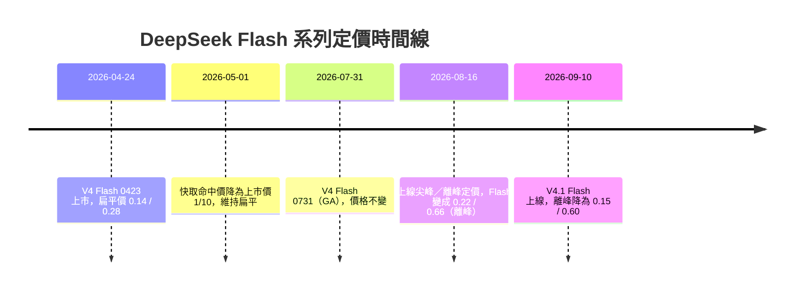

# 為什麼 DeepSeek V4.1 Flash 與 V4 Flash 0731 沒有比 V4 Flash 0423 省錢？

## 摘要

先講結論：**三個世代的模型，只有「快取命中的輸入（cache-hit input）」單價幾乎回到原點，其餘項目（未命中輸入、輸出）都比 0423 貴。** 而且 0731 相比 0423 其實「一模一樣貴、後來更貴」：0731 上線時並沒有降價，維持 0423 的扁平價；真正讓它變貴的是 2026 年 8 月 16 日上線的「尖峰／離峰」新定價制度[^news260813][^changelog]。至於 V4.1 Flash，雖然相對 0731 八月後的新價「降價」，但仍高於 0423 當年四月的上市扁平價，尤其「輸出」單價是 0423 的兩倍以上[^wayback-apr][^pricing-current]。

換句話說：**新模型「不算省錢」的主因不是新模型效能差，而是 0423 當年的價格是一組「上市期、全時段、平價搶市」的推廣價，之後 DeepSeek 先把它改成有尖峰加價的制度、再用新架構「降回高水位之下」，但沒有降回四月的水位。**

---

## 1. 三個版本的定位與時間線

| 名稱（對外俗稱） | API 模型名稱 | 版本 | 發布日 |
|---|---|---|---|
| V4 Flash 0423 | `deepseek-v4-flash` | DeepSeek-V4-Flash（Preview） | 2026-04-24 |
| V4 Flash 0731 | `deepseek-v4-flash` | DeepSeek-V4-Flash-0731 | 2026-07-31 |
| V4.1 Flash | `deepseek-flash` | DeepSeek-V4.1-Flash | 2026-09-10 |

說明：0423 是 2026 年 4 月 24 日 DeepSeek-V4 Preview 發佈時、代號 0423 的初始檢查點[^v4-preview][^or-versions]；0731 是同一架構的官方版（GA），官方明講「維持相同架構與規模，只重新做後訓練（re-post-trained）」[^changelog]；V4.1 Flash 則是新架構（Causal Encoder-Decoder，簡稱 CED）的第一個模型，也是官方用來取代前兩者的現役 Flash 模型[^news910]。

---

## 2. 官方 API 價格對照（每 1M tokens，美元）

以下皆為 **DeepSeek 官方 API 掛牌價**。0731 與 V4.1 皆有尖峰／離峰兩段，尖峰價恰為離峰的 2 倍[^pricing-current][^wayback-aug]。

| 版本 | 時段 | 輸入（快取命中） | 輸入（快取未命中） | 輸出 |
|---|---|---|---|---|
| V4 Flash 0423 | 全時段扁平 | 0.0028 | 0.14 | 0.28 |
| V4 Flash 0731 | 離峰 | 0.007 | 0.22 | 0.66 |
| V4 Flash 0731 | 尖峰 | 0.014 | 0.44 | 1.32 |
| V4.1 Flash | 離峰 | 0.003 | 0.15 | 0.60 |
| V4.1 Flash | 尖峰 | 0.006 | 0.30 | 1.20 |

資料來源：0423 上市價見 2026-05-01 的官方定價頁存檔[^wayback-apr]；0731 八月後價與 V4.1 現價見官方現行定價頁與 2026-08-21 存檔[^wayback-aug][^pricing-current]。官方中文頁亦以人民幣列出相同倍率（V4.1 Flash 未命中輸入離峰 1 元、尖峰 2 元；輸出離峰 4 元、尖峰 8 元）[^pricing-cn]。

以 0423 的扁平價為基準換算：

- **0731 離峰**：未命中輸入為 0423 的約 1.57 倍、輸出約 2.36 倍、快取命中約 2.5 倍；**尖峰** 再各乘 2。
- **V4.1 Flash 離峰**：未命中輸入為 0423 的約 1.07 倍、輸出約 2.14 倍、快取命中約 1.07 倍；**尖峰** 再各乘 2。

也就是說，唯一「幾乎回到原點」的是 V4.1 Flash 的快取命中輸入。

---

## 3. 為什麼沒有更便宜：四個關鍵原因

### 3.1 0423 是「上市期扁平推廣價」，本來就不是成本底線

DeepSeek-V4 在 2026-04-24 發佈時主打的標語是「Welcome to the era of cost-effective 1M context length（進入平價百萬上下文時代）」，並把 Flash 定位為「快速、有效率、經濟實惠」的選擇[^v4-preview]。當時 Flash 的定價是**全時段單一價** 0.14 / 0.28，沒有任何尖峰加價；同一份定價頁上，更高階的 V4-Pro 甚至還掛著 **75% 上市折扣**[^wayback-apr]。這種「上市促銷 + 扁平價」的組合，是為了搶開發者採用率，而不是長期可持續的成本線，因此後續被調整並不意外。

### 3.2 2026-08-16 上線尖峰／離峰定價，把「地板」整體抬高

DeepSeek 在 2026-08-13 宣布調整 API 定價、導入尖峰與離峰兩段費率，自 **2026-08-16 16:00 UTC** 生效；官方理由是「為了更合理地分配資源，鼓勵使用者依實際用量安排任務時段」，離峰價為尖峰價的一半[^news260813][^changelog]。尖峰時段為 UTC 週一至週五 01:00–04:00 與 06:00–10:00（台北時間 09:00–12:00、14:00–18:00），其餘時段與週末皆為離峰[^pricing-current][^pricing-cn]。

重點是：**改動後即使是最便宜的離峰價，也高於舊的扁平價**。以 Flash 為例，離峰未命中輸入 0.22 對比舊價 0.14（+57%）、輸出 0.66 對比 0.28（+136%）；尖峰再加倍（+214%、+371%）[^wayback-apr][^wayback-aug]。獨立社群整理亦指出，這次調整中 V4-Flash 的快取命中最貴漲約 5 倍（尖峰）[^v4hub]。

**所以「0731 沒有比 0423 省錢」的真正原因不是 0731 漲價，而是模型維持原價、但收費制度改了。** 0731 發佈時官方只說「模型維持相同架構與規模、僅重新後訓練」，並未宣布降價；上市價直到這波制度調整前都與 0423 相同[^changelog][^wayback-apr]。

### 3.3 V4.1 Flash 降價了，但只降到「高水位之下」，沒回到四月

V4.1 Flash 於 2026-09-10 上線時，官方明講「More efficient architecture. Lower API prices.（更有效率的架構、更低的 API 價格）」，並說「把省下的成本回饋給使用者」[^news910]。相對 0731 八月後的新價，它確實調降：未命中輸入 0.22 → 0.15、輸出 0.66 → 0.60、快取命中 0.007 → 0.003（離峰）[^wayback-aug][^pricing-current]。

但相對 0423 四月的扁平價，它**只追平了快取命中**，其餘仍較貴：快取命中 0.003 vs 0.0028（幾乎相同）、未命中輸入 0.15 vs 0.14（略高約 7%）、**輸出 0.60 vs 0.28（約 2.14 倍）**[^wayback-apr][^pricing-current]。也就是說，V4.1 Flash 是「從八月的高點往下修」，而不是「比四月更便宜」。

### 3.4 效率的提升主要反映在快取命中，而輸出反而成為成本重心

官方說明 V4.1 Flash 的省錢來自架構：KV cache 只需前一代的 **1/4 HBM、1/8 SSD**，而「快取命中費用往往佔 agent 成本的一大部分」，因此壓縮快取能顯著降低成本[^news910]。這正好對應到價格表：**快取命中回到幾乎與 0423 相同的水位**。相對地，新架構活化參數是「輸入 8B、輸出 16B」的非對稱設計，輸出端本來就較重[^news910][^openrouter-v41]；再加上新模型更偏 agent／推理用途，會產生更多輸出 token，於是「輸出」成為帳單的主要來源，而輸出單價正是三個世代差距最大的一項（0.28 → 0.60／0.66）[^pricing-current][^wayback-apr]。

---

## 4. 商業與產能因素

除了技術面，這次調價也有明顯的商業背景。官方僅以「更合理分配資源」帶過[^news260813]，但多家媒體的標題即點出方向：InfoWorld 以「AI 需求壓縮產能，DeepSeek 部分 V4 價格漲逾 10 倍」報導[^infoworld]；Tech Times 以「尖峰時段 V4 API 價格翻至四倍」報導[^techtimes]；Fortune 亦報導 DeepSeek 調漲多項 AI 服務價格[^fortune]。獨立社群站的整理則指出，V4-Pro 的快取命中輸入尖峰漲幅高達 12 倍，並認為這次調整讓「時段選擇」變成成本變數[^v4hub]。這些第三方來源立場各異、數字以官方頁面為準即可，但都指向同一結論：**舊的扁平低價在需求成長後已難維持，因此 DeepSeek 透過時段分層把尖峰的稀缺成本轉嫁出去。**

---

## 5. OpenRouter 上的另一種「看起來」：輸入更便宜、輸出更貴

若以第三方聚合平台 OpenRouter 的模型頁「In / Out Price」來看，會得到與官方價不完全相同的印象：

| 模型（OpenRouter 條目） | 聚合掛牌 輸入 / 輸出（每 1M） |
|---|---|
| DeepSeek V4 Flash 0423 | 0.091 / 0.182 |
| DeepSeek V4 Flash 0731 | 0.0144 / 0.576 |
| DeepSeek V4.1 Flash | 0.0052 / 0.60 |

以上為 OpenRouter 各模型頁顯示的聚合價[^or-0423][^or-0731][^or-v41]。可以看出：**新模型的輸入便宜了一個數量級以上（0.0052～0.0144 對比 0.091），但輸出卻貴約 3 倍（0.60／0.576 對比 0.182）。** 這正好呼應第 3.4 節：新世代的成本重心在輸出。

需要提醒的是，OpenRouter 是**多家第三方供應商的聚合**，同一模型不同供應商價差極大（例如 0423 的輸出從 0.165 到 1.32 都有），且 0423 在 OpenRouter 上的報價多為第三方託管價、並非 DeepSeek 官方價[^or-0423-endpoints]。OpenRouter 上 V4.1 Flash 的官方 DeepSeek 端點，也同樣套用尖峰／離峰規則（尖峰 0.30 / 1.20、離峰 0.15 / 0.60）[^or-v41-endpoints]，與 DeepSeek 官方一致。

因此，「新模型沒有比較省錢」是否成立，取決於你的輸入／輸出比例：**如果工作流以大量可快取輸入為主，新模型（尤其 V4.1 Flash 離峰）反而更便宜；如果以輸出為主，0423 的舊價確實更划算。**

---

## 6. 成本試算：以 agent 工作流為例

假設一個週期使用 **1M 輸入（其中 80% 快取命中、20% 未命中）＋ 0.1M 輸出**：

- **0423**：0.8×0.0028 ＋ 0.2×0.14 ＋ 0.1×0.28 ＝ 0.00224 ＋ 0.028 ＋ 0.028 ≈ **0.058 美元**
- **0731 離峰**：0.8×0.007 ＋ 0.2×0.22 ＋ 0.1×0.66 ＝ 0.0056 ＋ 0.044 ＋ 0.066 ≈ **0.116 美元**（約 2.0 倍）；尖峰約 0.231 美元
- **V4.1 Flash 離峰**：0.8×0.003 ＋ 0.2×0.15 ＋ 0.1×0.60 ＝ 0.0024 ＋ 0.03 ＋ 0.06 ≈ **0.092 美元**（約 1.6 倍）；尖峰約 0.185 美元

（單價皆取自官方定價頁與存檔[^wayback-apr][^wayback-aug][^pricing-current]。）

結果與直覺一致：**除非把幾乎所有輸入都壓成快取命中，否則新模型在這個工作流下仍比 0423 貴。**

---

## 7. 結論與實務建議

- **為何不更便宜**：0423 是上市期的扁平推廣價；0731 未降價，且 2026-08-16 起被納入尖峰／離峰制度而實質變貴；V4.1 Flash 雖降價，但只降回「高水位以下」，未回到四月的扁平水位，只有快取命中幾乎持平[^wayback-apr][^wayback-aug][^pricing-current]。
- **成本重心轉移**：新世代的差距集中在「輸出」與「未命中輸入」，而這正是 agent 工作流的主要開銷來源。
- **可省錢的做法**：把彈性任務排在離峰時段（避開台北時間週一至週五 09:00–12:00、14:00–18:00），並盡量提高快取命中率，讓計費盡量落在最便宜的快取命中價上[^pricing-current][^pricing-cn]。
- **注意模型已下線**：自 2026-09-10 起，`deepseek-v4-flash`（含 0423、0731）與 `deepseek-v4-flash-vision-exp` 皆已退役，舊模型名仍可呼叫但由 V4.1 Flash 提供服務、並依 Flash 價格計費[^news910][^pricing-current]。也就是說，即使你想沿用 0423 的舊價，官方 API 已經無法再現該價格。

---

## 註腳

[^v4-preview]: DeepSeek. (2026-04-24). DeepSeek V4 Preview Release. Retrieved 2026-10-14, from https://api-docs.deepseek.com/news/news260424
[^wayback-apr]: DeepSeek. (2026-05-01). Models & Pricing [Wayback Machine capture]. Retrieved 2026-10-14, from https://web.archive.org/web/20260501050639/https://api-docs.deepseek.com/quick_start/pricing
[^changelog]: DeepSeek. (n.d.). Change Log. Retrieved 2026-10-14, from https://api-docs.deepseek.com/updates
[^news260813]: DeepSeek. (2026-08-13). DeepSeek-V4-Pro GA Release. Retrieved 2026-10-14, from https://api-docs.deepseek.com/news/news260813
[^wayback-aug]: DeepSeek. (2026-08-21). Models & Pricing [Wayback Machine capture]. Retrieved 2026-10-14, from https://web.archive.org/web/20260821151358/https://api-docs.deepseek.com/quick_start/pricing
[^news910]: DeepSeek. (2026-09-10). DeepSeek-V4.1-Flash: Smarter, Faster, More Efficient. Retrieved 2026-10-14, from https://api-docs.deepseek.com/news/news260910
[^pricing-current]: DeepSeek. (n.d.). Models & Pricing. Retrieved 2026-10-14, from https://api-docs.deepseek.com/quick_start/pricing
[^pricing-cn]: DeepSeek. (n.d.). 模型 & 价格. Retrieved 2026-10-14, from https://api-docs.deepseek.com/zh-cn/quick_start/pricing
[^v4hub]: DeepSeek V4 Hub. (2026-08-13). DeepSeek Raises API Prices by Up to 12x With the Official V4 Pro Release. Retrieved 2026-10-14, from https://deepseekv4pro.com/news/deepseek-v4-pro-0813-official-release-opus-fable-benchmarks
[^infoworld]: Plumb, T. (2026-08-13). DeepSeek raises some V4 prices by more than 10x as AI demand strains capacity. InfoWorld. Retrieved 2026-10-14, from https://www.infoworld.com/article/4209439/deepseek-raises-some-v4-prices-by-more-than-10x-as-ai-demand-strains-capacity.html
[^techtimes]: Parham, A. (2026-08-17). DeepSeek V4 API prices quadruple at peak: What developers pay starting now. Tech Times. Retrieved 2026-10-14, from https://www.techtimes.com/articles/324764/20260817/deepseek-v4-api-prices-quadruple-peak-what-developers-pay-starting-now.htm
[^fortune]: Fortune. (2026-08-13). DeepSeek increases prices for AI services by multiple times. Retrieved 2026-10-14, from https://fortune.com/2026/08/13/deepseek-increases-prices-for-ai-services-by-multiple-times/
[^or-versions]: OpenRouter. (n.d.). DeepSeek: DeepSeek V4 Flash model versions. Retrieved 2026-10-14, from https://openrouter.ai/deepseek/deepseek-v4-flash
[^or-0423]: OpenRouter. (n.d.). DeepSeek: DeepSeek V4 Flash 0423. Retrieved 2026-10-14, from https://openrouter.ai/deepseek/deepseek-v4-flash
[^or-0731]: OpenRouter. (n.d.). DeepSeek: DeepSeek V4 Flash 0731. Retrieved 2026-10-14, from https://openrouter.ai/deepseek/deepseek-v4-flash-0731
[^or-v41]: OpenRouter. (n.d.). DeepSeek: DeepSeek V4.1 Flash. Retrieved 2026-10-14, from https://openrouter.ai/deepseek/deepseek-v4.1-flash
[^or-0423-endpoints]: OpenRouter. (n.d.). API: deepseek/deepseek-v4-flash-20260423 endpoints. Retrieved 2026-10-14, from https://openrouter.ai/api/v1/models/deepseek/deepseek-v4-flash-20260423/endpoints
[^or-v41-endpoints]: OpenRouter. (n.d.). API: deepseek/deepseek-v4.1-flash endpoints. Retrieved 2026-10-14, from https://openrouter.ai/api/v1/models/deepseek/deepseek-v4.1-flash/endpoints
