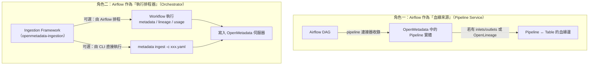
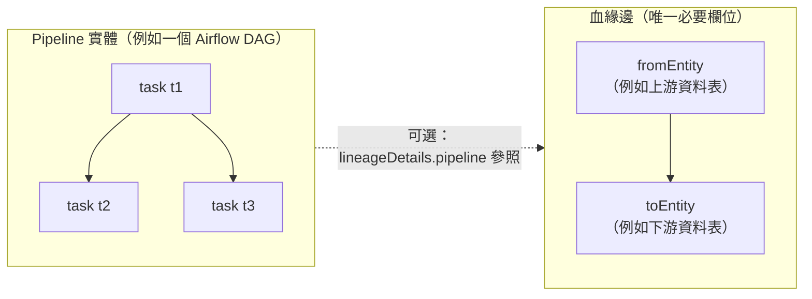
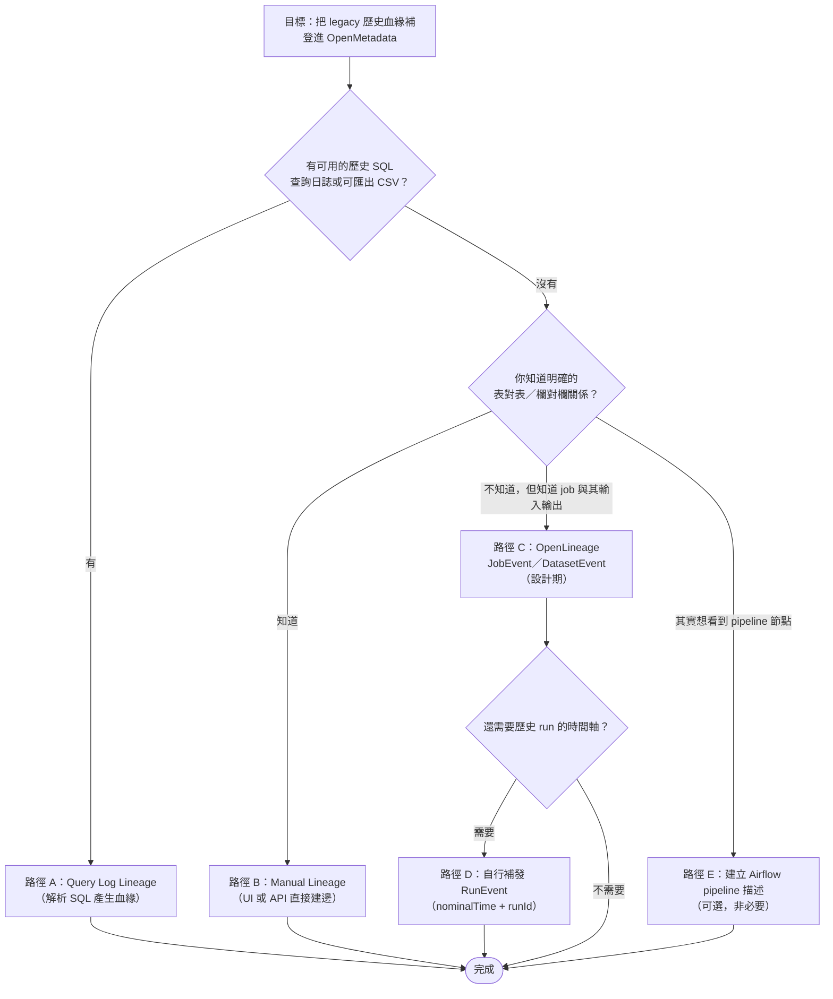

# 將 Legacy Data 的歷史血緣補登到 OpenMetadata：是否必須先以 Apache Airflow Pipeline 描述？

## 摘要

本文探討一個具體的資料治理解決方案問題：若要把「歷史遺留資料」（legacy data）的血緣（lineage，又稱資料血緣、資料血統）補登進 OpenMetadata，是否必須先在 Apache Airflow 中以 pipeline（管線）描述這些歷史流程。

**核心結論：不需要。** 在 OpenMetadata 中，血緣是一條「來源實體 → 目標實體」的有向邊（edge），其必要欄位只有 `fromEntity` 與 `toEntity`；pipeline 實體只是血緣圖上的一種**可選**節點，或血緣邊上的**可選**補充資訊[^edge-schema][^api-add]。Airflow 既不是血緣資料的必要來源，也不是執行補登工作的必要排程器[^lineage-ingestion][^external-deployment]。

不過，「不需要 Airflow」不等於「不需要任何描述」。要讓血緣能落地，真正的硬性前置條件是：**被血緣指涉的實體（例如資料表）必須先被收錄（ingest）進 OpenMetadata**，否則血緣解析階段找不到目標而無法建立邊[^lineage-ingestion]。

本文將拆解 Airflow 在本問題中的兩種不同角色，說明何時才真的「值得」建立 pipeline 實體，並列出補登歷史血緣的多條可行路徑。

---

## 1. 名詞定義（讓單獨閱讀本文者也能理解）

| 名詞 | 說明 |
| --- | --- |
| Legacy data（歷史遺留資料） | 泛指在導入現代化資料治理工具之前就已存在、且其產生流程未被現代排程器或血緣系統追蹤的資料集與資料流。 |
| OpenMetadata | 一套開源的資料治理與詮釋資料（metadata）平台，提供資料探索、血緣、資料品質與治理能力[^om-lineage]。 |
| Lineage（血緣） | 描述「資料從哪裡來、經過什麼轉換、流向哪裡」的關係圖，在 OpenMetadata 中表現為實體之間的有向邊[^om-lineage][^api-add]。 |
| Pipeline 實體（OpenMetadata 內） | OpenMetadata 中的一種資料資產實體，代表一個編排單元（orchestration unit）。以 Airflow 為例，**一個 DAG 對應一個 Pipeline 實體**[^airflow-connector]。 |
| Pipeline Service | OpenMetadata 中承載 pipeline 實體的服務連線（例如 Airflow、Dagster、Airbyte、Fivetran 連接器）[^airflow-connector]。 |
| OpenLineage | 一套開放的血緣事件規格（spec），以 Job／Dataset／Run 為核心模型描述資料流[^ol-spec][^ol-model]。 |
| Ingestion（收錄／擷取） | 把來源系統的詮釋資料抽取並推送進 OpenMetadata 伺服器的流程，由 OpenMetadata Ingestion Framework 執行[^ingestion-workflows]。 |

---

## 2. 問題的關鍵：Airflow 在 OpenMetadata 中有兩種完全不同的角色

使用者的問題之所以容易混淆，是因為「Airflow 出現在 OpenMetadata 生態」時，可以指兩件截然不同的事。務必先區分：



- **角色一（血緣來源）**：將 Airflow 當成一個被收錄的來源系統。此時 Airflow 的 DAG 會被轉成 OpenMetadata 的 Pipeline 實體，其任務（tasks）與執行狀態一併收錄；若任務有宣告 `inlets`／`outlets`，才會在 Pipeline 與 Table 實體之間建立血緣[^airflow-connector]。
- **角色二（執行排程器）**：Airflow 只是「跑 ingestion 工作的地方」之一。OpenMetadata 的 Ingestion Framework 是一個**獨立元件，理論上可以在任何能執行 Python 的地方運行**，Airflow 只是可選的排程器之一[^external-deployment][^ingestion-workflows]。

**歷史補登的問題主要落在角色二**：你要「執行一次工作」把歷史血緣寫進去。而這**不需要 Airflow**。

---

## 3. 為什麼「pipeline 不是必要條件」：從資料模型看

### 3.1 血緣邊的必要欄位只有兩個實體

OpenMetadata 的血緣規格 `EntitiesEdge` 只要求 `fromEntity` 與 `toEntity`。其中承載 pipeline 參照的 `lineageDetails` 是**可選**欄位，且明確標註為「僅用於 table 到 table 的血緣邊」[^edge-schema]：

```json
"lineageDetails": {
  "description": "Optional lineageDetails provided only for table to table lineage edge",
  "properties": {
    "pipeline": {
      "description": "Pipeline where the sqlQuery is periodically run"
    }
  }
}
```

換句話說，一條 `Table A → Table B` 的血緣邊**是完全合法且完整的**，即使系統中根本不存在任何 pipeline 實體[^edge-schema]。

### 3.2 血緣來源列舉中，pipeline 只是其中一種

`lineageDetails.source` 這個列舉列出多種血緣來源，包含 `Manual`、`ViewLineage`、`QueryLineage`、`PipelineLineage`、`DashboardLineage`、`DbtLineage`、`SparkLineage`、`OpenLineage` 等。「由 pipeline 產生」只是其中一個選項[^edge-schema]。

### 3.3 Pipeline 與 Task 是「容器」關係，與血緣是「正交」關係

Pipeline 實體內部包含 `tasks`（每個 task 的完整名稱格式為 `ServiceName.PipelineName.TaskName`）、`downstreamTasks`（描述 DAG 內部任務順序）、`pipelineStatus`（執行歷史）等[^airflow-connector][^pipeline-schema]。這些描述的是**管線內部結構**，本身不是血緣；血緣是實體與實體之間的關係[^om-lineage]。



### 3.4 官方文件對「兩實體間血緣」的說法

OpenMetadata 的文件指出，血緣 API「讓你管理 OpenMetadata 中**任意兩個實體**之間的血緣關係」，且「任何存在於 OpenMetadata 的實體都可以透過血緣與任何其他實體關聯」[^api-add]。官方 SDK 範例本身即示範**只有兩個 table、沒有 pipeline** 的血緣建立[^api-add]。

---

## 4. 那麼，什麼情況下才真的需要先有「Pipeline 描述」？

雖然 pipeline 非必要，但在下列情境中，建立 pipeline 實體（或事先在 Airflow 描述流程）會帶來實質好處：

1. **你想讓 pipeline 以節點形式出現在血緣圖上。** 當 pipeline 收錄時帶有資料庫服務名稱設定，OpenMetadata 會把 pipeline 與它讀寫的資料表連結，pipeline 便成為血緣圖上的一個節點。此外有 Pipeline View Mode 可選擇以節點或邊的形式呈現[^om-lineage]。

2. **你想用 Airflow 的 `inlets`／`outlets` 自動產生血緣。** 當任務宣告 `inlets`／`outlets` 指向資料表時，後端會在 Pipeline 與 Table 之間建立血緣。文件也提醒：若沒有指定任何血緣資訊，就只會收錄 Pipeline 實體而不額外產生血緣[^airflow-connector]。

3. **你想保留 DAG 拓樸與執行歷史。** Pipeline 實體能承載 `tasks`、`downstreamTasks`、`pipelineStatus`（含每次執行的 `run_id`）等結構資訊[^airflow-connector][^pipeline-schema]。

4. **你想用 OpenLineage 自動化蒐集 table 級血緣。** Airflow 的 OpenLineage provider 會在任務完成時發出事件到 OpenMetadata 的血緣端點，自動建立「pipeline 任務 ←→ 資料資產」的血緣邊。文件指出 table 級血緣「無法僅透過 REST API 捕捉」[^airflow-connector][^ol-airflow]。

反之，**若你的目的只是「把歷史資料流關係呈現出來」，上述四點都不是必要條件**。

---

## 5. 補登歷史血緣的可行路徑（皆不需要 Airflow）

### 路徑 A：以歷史 SQL 查詢日誌推導血緣（Query Log Lineage）

OpenMetadata 會用查詢解析器（官方文件提及 SQLLineage 這類 SQL 解析器）解析 SQL，抽出上下游資料表，再透過 ElasticSearch 以資料表完整名稱解析成已收錄的實體，最後呼叫血緣 API 建立邊[^lineage-ingestion]。

- **來源一：資料庫內部的查詢日誌表。** BigQuery、Snowflake、ClickHouse、Databricks、MSSQL、PostgreSQL、Redshift 等連接器有專屬的 lineage／usage 工作流，會讀取查詢日誌並解析（預設約 1000 筆的上限，可調整）[^lineage-ingestion]。
- **來源二：匯出的查詢日誌 CSV。** 對於其他資料庫連接器，可匯出 CSV（含 `query_text`、可選的 `database_name`／`schema_name` 等），以 YAML 設定搭配 CLI 執行，官方文件稱此方式「可任意套用於任何資料庫連接器」[^lineage-ingestion]。

若你的 legacy data 早就有一批歷史 SQL 記錄（例如 ETL 腳本、歷史查詢日誌），這條路徑最直接。

### 路徑 B：手動建立血緣（Manual Lineage）

可直接在 UI 的 Lineage 分頁點選 Edit，選擇目標資產類型（table、topic、dashboard、ML model、container 或 pipeline），搜尋並選取資產後建立邊；也可展開資料表以連結個別欄位來建立欄級血緣[^om-manual][^om-lineage]。

程式化方式則呼叫 `PUT /api/v1/lineage`，請求主體包含 `edge`（`fromEntity`、`toEntity`）與可選的 `lineageDetails`（`sqlQuery`、`columnsLineage`、`pipeline`）[^api-add]。Python SDK 對應 `metadata.add_lineage(...)`[^api-add]。

手動方式的精神在於：**你只要知道「哪張表來自哪張表」，就能補登**，不需要重現當初的排程流程。

### 路徑 C：以 OpenLineage 的「設計期事件」登記既有 Job 與 Dataset

OpenLineage 規格中有一類**不隸屬於任何 run** 的事件，非常適合描述「早已存在、沒有被追蹤執行歷史」的 legacy 流程[^ol-model]：

- **`JobEvent`**：描述一個 job 的詮釋資料，如其原始碼位置、宣告的輸入與輸出；「在設計期發出，且不與任何 Run 關聯」[^ol-model]。
- **`DatasetEvent`**：允許在 job 或 job run 的脈絡之外，將詮釋資料附加到 dataset 上[^ol-model]。

也就是說，對於「從未有過被追蹤執行紀錄」的歷史資料流，可以直接宣告既有 job 與 dataset 及其輸入輸出關係，而不必捏造歷史 run[^ol-model]。

### 路徑 D：為歷史執行補發 Run 事件（模擬歷史 run）

OpenLineage **沒有**專門的「backfill（回填）」功能或 API[^ol-model]。但事件本身只是 JSON 酬載，規格中的 `eventTime` 只是一個時間戳，**不必然要是「現在」**，因此可程式化地建構並送出描述歷史 run 的 `RunEvent`[^ol-model]。

實作要點[^ol-model][^ol-client]：
- 用官方 Python／Java 客戶端建構 `RunEvent`、`RunState`、`Run`、`Job`、`Dataset`、`Transport` 等物件。
- 用 **`nominalTime` facet** 標記「此 run 被排定的時間」，這正是重播過去排程的適當構造。
- 為每個歷史 run 指定穩定且全球唯一的 UUID `runId`（建議 UUIDv7），讓同一 run 的 START 與 COMPLETE 事件能拼接。
- 規格要求至少送出一個 START 事件與一個終止事件（COMPLETE／FAIL／ABORT）；詮釋資料在不同事件間是**累加**的。

### 路徑 E：若你確實想要 pipeline 節點，才在 Airflow 描述

如果你希望血緣圖上出現 pipeline 節點、或想利用 DAG 拓樸與執行歷史，才需要建立 pipeline 服務、以 Airflow 連接器收錄，並視需要宣告 `inlets`／`outlets`[^airflow-connector]。這是「選擇」，不是「前提」。



---

## 6. 真正的硬性前置條件

無論走哪條路徑，都有一個共同前提：**被血緣指涉的實體必須先被收錄進 OpenMetadata**。因為查詢解析後會用資料表完整名稱去 ElasticSearch 查詢已收錄的實體來解析參照，若目標實體不存在，血緣邊就無法建立[^lineage-ingestion]。因此標準順序是：先跑 metadata ingestion 收錄資料表，再跑血緣相關工作流[^lineage-ingestion][^ingestion-workflows]。

此外，執行 ingestion 不必然要靠 OpenMetadata UI 內建的排程器。官方列出三種執行方式[^external-deployment]：
1. 由 OpenMetadata 內部管理排程器執行（可為 Airflow，或較新版本提供的 Kubernetes 原生排程器，官方註記其「不需要 Airflow」）。
2. **外部執行**：任何能跑 Python 的工具皆可，例如 Airflow、AWS MWAA、GCP Composer、GitHub Actions，或單純的 cron／Python 腳本。
3. 也可透過環境變數 `PIPELINE_SERVICE_CLIENT_ENABLED=false` 完全停用 Pipeline Service Client。

CLI 方式為 `metadata ingest -c <path-to-yaml>`，可執行 metadata、lineage、usage、profiler、資料品質等各類工作流，全程不需 Airflow[^lineage-ingestion][^external-deployment]。

---

## 7. 注意事項與陷阱

1. **刪除 pipeline 會連帶刪除其關聯血緣。** Airflow 連接器有「Mark Deleted Pipeline」選項，勾選後會軟刪除 pipeline，且「關聯實體如血緣也會一併刪除」[^airflow-connector]。若你只是為了補登歷史而建了一堆 pipeline 實體，日後清理時要留意血緣會被波及。

2. **欄級血緣並非所有解析路徑都保證支援。** 檢視（view）血緣會自動產生欄級血緣；Snowflake 的 `ACCESS_HISTORY` 提供 Snowflake 端計算的表級與欄級血緣；dbt 收錄亦取得欄級血緣。但對一般未列舉的資料庫，若僅靠通用查詢解析器，官方描述主要抽出「來源與目標資料表」，欄級覆蓋可能需要依賴 view 血緣、dbt 或手動編輯[^lineage-ingestion]。

3. **時間軸的真實性。** 若採用路徑 D 補發歷史 run 事件，`eventTime` 與 `nominalTime` 都可自訂，但這代表你所補登的是一份「重建的歷史」，而非第一手觀測。報告呈現時宜標註其重建性質。

4. **血緣來源應標明。** `lineageDetails.source` 可區分 `Manual`、`QueryLineage`、`PipelineLineage` 等來源[^edge-schema]，補登時選擇正確來源有助於後續稽核與追溯。

---

## 8. 結論

回答原問題：**要把 legacy data 的歷史血緣補登到 OpenMetadata，並不需先在 Apache Airflow 用 pipeline 描述。**

- 從資料模型看，血緣邊只要求 `fromEntity` 與 `toEntity`，pipeline 是可有可無的節點或補充參照[^edge-schema][^api-add]。
- 從執行面看，Airflow 只是 Ingestion Framework 的可選排程器；CLI 或任何能跑 Python 的環境都能執行補登工作[^external-deployment][^lineage-ingestion]。
- 真正需要 pipeline 描述的情境，是「想讓 pipeline 出現在血緣圖上」或「想用 DAG inlets／outlets、OpenLineage provider 自動化蒐集血緣」[^airflow-connector][^om-lineage]。
- 補登歷史血緣的實務路徑包含：歷史 SQL 查詢日誌解析、手動建立血緣、OpenLineage 設計期事件（`JobEvent`／`DatasetEvent`）、以及補發歷史 `RunEvent`[^lineage-ingestion][^om-manual][^ol-model]。
- 唯一共同的硬性前提是：**相關實體必須先被收錄進 OpenMetadata**[^lineage-ingestion]。

---

## 參考文獻

[^om-lineage]: OpenMetadata. (n.d.). Data lineage. Retrieved 2026-10-13, from https://docs.open-metadata.org/latest/how-to-guides/data-lineage

[^om-manual]: OpenMetadata. (n.d.). Manual lineage. Retrieved 2026-10-13, from https://docs.open-metadata.org/latest/how-to-guides/data-lineage/manual

[^om-column]: OpenMetadata. (n.d.). Column-level lineage. Retrieved 2026-10-13, from https://docs.open-metadata.org/latest/how-to-guides/data-lineage/column

[^api-add]: OpenMetadata. (n.d.). Add lineage (API reference). Retrieved 2026-10-13, from https://docs.open-metadata.org/v2.0.x/api-reference/lineage/add

[^airflow-connector]: OpenMetadata. (n.d.). Airflow pipeline connector. Retrieved 2026-10-13, from https://docs.open-metadata.org/latest/connectors/pipeline/airflow

[^lineage-ingestion]: OpenMetadata. (n.d.). Lineage ingestion. Retrieved 2026-10-13, from https://docs.open-metadata.org/latest/connectors/ingestion/lineage

[^ingestion-workflows]: OpenMetadata. (n.d.). Ingestion workflows. Retrieved 2026-10-13, from https://docs.open-metadata.org/latest/connectors/ingestion/workflows

[^external-deployment]: OpenMetadata. (n.d.). Run the ingestion framework externally. Retrieved 2026-10-13, from https://docs.open-metadata.org/latest/deployment/ingestion/external

[^edge-schema]: OpenMetadata. (n.d.). Entity lineage schema (entityLineage.json) [Source code]. GitHub. Retrieved 2026-10-13, from https://github.com/open-metadata/OpenMetadata/blob/main/openmetadata-spec/src/main/resources/json/schema/type/entityLineage.json

[^pipeline-schema]: OpenMetadata. (n.d.). Pipeline entity schema (pipeline.json) [Source code]. GitHub. Retrieved 2026-10-13, from https://github.com/open-metadata/OpenMetadata/blob/main/openmetadata-spec/src/main/resources/json/schema/entity/data/pipeline.json

[^ol-spec]: OpenLineage. (n.d.). OpenLineage specification [Source code]. GitHub. Retrieved 2026-10-13, from https://github.com/OpenLineage/OpenLineage/blob/main/spec/OpenLineage.md

[^ol-model]: OpenLineage. (n.d.). Object model. Retrieved 2026-10-13, from https://openlineage.io/docs/spec/object-model

[^ol-client]: OpenLineage. (n.d.). Python client. Retrieved 2026-10-13, from https://openlineage.io/docs/client/python/

[^ol-airflow]: Apache Software Foundation. (n.d.). OpenLineage provider for Apache Airflow. Retrieved 2026-10-13, from https://airflow.apache.org/docs/apache-airflow-providers-openlineage/stable/index.html

[^sqllineage]: SQLLineage. (n.d.). SQLLineage documentation. Retrieved 2026-10-13, from https://sqllineage.readthedocs.io/

---

## 附錄：來源批判性反思

- **時效性**：OpenMetadata 迭代快速，部分官方文件同時存在 `latest` 與 `v2.0.x` 版本路徑。本文的模型層結論（`EntitiesEdge` 僅需 `fromEntity`／`toEntity`）奠基於規格檔 JSON schema，屬相對穩定的結構性事實；但 UI 操作細節與排程器選項（如 Kubernetes 原生排程器的可用版本）可能隨版本變動，實作前建議對照當前部署版本的官方文件[^external-deployment][^edge-schema]。
- **權威性**：本文主要引用 OpenMetadata 與 OpenLineage 的第一方文件與規格，兩者皆為專案官方來源，權威性高。第三方部落格或論壇內容未被採用。
- **一致性**：兩份 OpenMetadata 文件（連接器文件與血緣使用指南）對「pipeline 為可選」的說法彼此一致，且與 JSON schema 的定義相符，構成相互佐證[^airflow-connector][^om-lineage][^edge-schema]。
- **對 OpenLineage 補發歷史 run 的保留**：官方文件與 issue 追蹤中並未找到專門的 backfill 功能；「可自行補發事件」的結論是基於規格中 `eventTime` 與 `runId` 的設計推導而來，屬合理但非官方明列支援的用法，實作時應自行驗證目標後端（如 Marquez 或 OpenMetadata 的血緣端點）對歷史時間戳的接受程度[^ol-model]。
