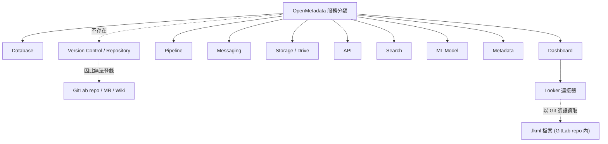
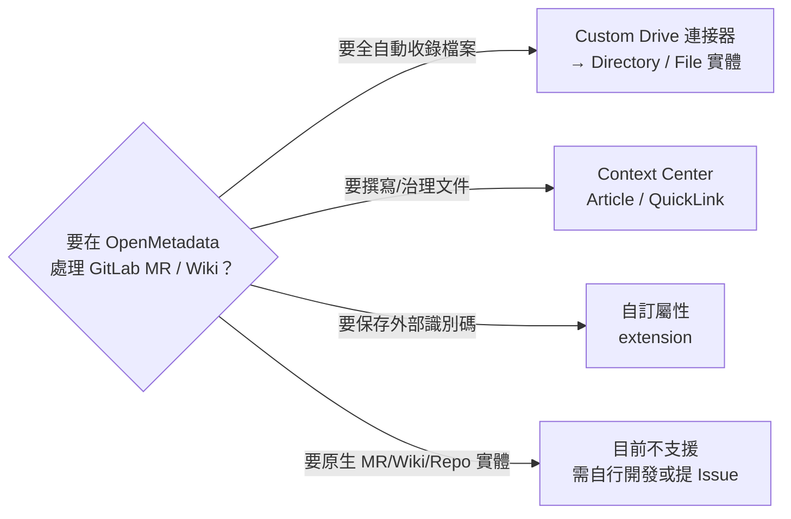

# OpenMetadata 如何處理 GitLab 的 MR / Wiki 這類資料實體

本報告說明 OpenMetadata 這個資料治理與資料目錄平台，對於「軟體開發協作平台」上的產物（特別是 GitLab 的合併請求 Merge Request，以下簡稱 MR，以及 Wiki 頁面）是否有對應的「資料實體」(data asset / entity) 加以收錄與治理，並整理出在現行版本下可行的替代做法。

## 背景：什麼是 OpenMetadata

OpenMetadata 是一套開放原始碼的資料探索 (data discovery)、可觀測性 (observability) 與資料治理 (governance) 平台，透過統一的 metadata 模型與 API，把資料庫、儀表板、資料管線、訊息主題、ML 模型、儲存體等資產集中登錄、描述、標註、串接血緣 (lineage)[^repo]。其 GitHub 專案 `open-metadata/OpenMetadata` 於擷取時約有 15,471 顆星，主要語言為 TypeScript[^repo]。撰寫本報告時的最新發行版為 `2.0.5-release`（2026-10-08）[^releases]。

OpenMetadata 的核心概念之一是「服務 (Service)」與「資料實體 (Entity / Data Asset)」的階層：一個服務代表一類外部系統（例如某個 PostgreSQL 資料庫），其下再產生具體實體（例如 Table、Dashboard、Pipeline）。要回答「GitLab 的 MR / Wiki 如何處理」，本質上就是在問：OpenMetadata 是否定義了對應的服務類型與實體類型。

## 核心結論（先講結論）

| 問題 | 結論 |
|---|---|
| OpenMetadata 有 GitLab 連接器 (connector) 嗎？ | **沒有**獨立連接器[^connectors] |
| OpenMetadata 有 GitLab 服務類型嗎？ | **沒有**[^connectors] |
| GitLab 在程式碼中出現於何處？ | 僅作為 **Looker** 連接器的「Git 憑證」之一，用來讀取 LookML 檔案[^looker][^gitlabcreds] |
| MR 有對應的資料實體嗎？ | **沒有**。OpenMetadata 未定義此類實體[^standards] |
| Wiki 頁面有對應的資料實體嗎？ | **沒有**專用的 Wiki 實體，但有「知識頁面 / Context Center」可承載文件內容[^context] |
| 有「程式碼倉庫 / 版本控制」實體嗎？ | **沒有**[^standards] |
| 可行的替代方案？ | 以 **File 實體**、**Context Center 知識頁面**、**自訂屬性 (custom properties)** 或 **自訂連接器** 收錄[^file][^context][^customdrive] |

## 一、OpenMetadata 現有連接器分類中不存在 GitLab

依官方連接器清單，OpenMetadata 的服務分類與其連接器如下（節錄）[^connectors]：

- **API**：REST
- **Database**：PostgreSQL、MySQL、Snowflake、BigQuery、dbt、S3/GCS/ADLS Datalake 等 50 餘種
- **Dashboard**：Looker、Tableau、PowerBI、Superset、Metabase、Grafana 等
- **Drive**：Custom Drive、Google Drive、SFTP（另在程式碼中含 SharePoint）
- **Messaging**：Kafka、Kinesis、Pub/Sub、Redpanda
- **Pipeline**：Airflow、Dagster、Airbyte、dbt Cloud、Fivetran、OpenLineage、Spline 等
- **ML Model**：MLflow、Sagemaker
- **Storage**：S3 Storage、GCS
- **Metadata**：AlationSink、Amundsen、Atlas
- **Search**：Elasticsearch、OpenSearch

清單中**沒有** GitLab、GitHub 或 Bitbucket，也沒有任何「版本控制 (Version Control)」、「程式碼倉庫 (Repository)」分類[^connectors]。換言之，GitLab 並非 OpenMetadata 認知的一種「服務」。

## 二、GitLab 唯一的出現位置：Looker 連接器的 Git 憑證

OpenMetadata 程式庫中與 GitLab 相關的程式碼僅有兩處性質：

1. **憑證型別 `GitlabCredentials`**：定義於 `openmetadata-spec/.../security/credentials/gitlabCredentials.json`，欄位包含 `gitHostURL`（GitLab 實例網址）、`repositoryOwner`、`repositoryName`、`token` 與 `type`[^gitlabcreds]。它被 Looker 連接器以 `$ref` 方式引用[^looker]。
2. **檔案讀取器 `GitlabReader`**：位於 `ingestion/src/metadata/readers/file/gitlab.py`，透過 GitLab REST API (`https://gitlab.com/api/v4`) 的 `projects/.../repository/files` 與 `repository/tree` 端點讀取單一檔案與檔案樹[^gitlabreader]。

這些憑證與讀取器的用途是：Looker 的 LookML 檢視 (views) 與其對來源資料表的血緣資訊並不存在於 Looker SDK 中，必須直接從存放 `.lkml` 檔案的 Git 倉庫讀取；因此 OpenMetadata 支援以 GitHub、BitBucket 或 GitLab 憑證存取該倉庫[^looker]。

> **重點**：GitLab 在此只是「取得 Looker 定義檔的來源」，OpenMetadata **並不會**把 GitLab 的 repo、MR、Wiki 本身當成資料實體收錄。

相關的官方需求與實作紀錄：

- Issue [#16010](https://github.com/open-metadata/OpenMetadata/issues/16010)「Gitlab support for Looker code」：2024-04-24 提出，2024-08-07 由 PR [#17284](https://github.com/open-metadata/OpenMetadata/pull/17284) 完成關閉，為 Looker 擷取加入 GitLab 來源[^issue16010][^pr17284]。
- Issue [#23421](https://github.com/open-metadata/OpenMetadata/issues/23421)「Support for self-hosted Git repository URLs in Looker ingestion」：2025-09-16 提出，2025-11-22 關閉，維護者回覆「shipped in 1.10.8」，讓自架 GitLab 等自訂 URL 也可使用[^issue23421]。

兩者都僅限於 Looker 擷取情境，並未延伸為通用的 GitLab 實體支援。

## 三、OpenMetadata 並未定義 MR / Wiki / Repository 實體

OpenMetadata 標準 (OpenMetadata Standards) 儲存庫中定義的資料實體型別包括[^standards]：

Table、Database、Database Schema、Stored Procedure、Pipeline、Topic、Dashboard、Chart、Dashboard Data Model、ML Model、Container、File、Directory、Folder、Spreadsheet、Worksheet、API Collection、API Endpoint、Search Index、Glossary、Glossary Term、Metric、Query、Data Contract、Report、Article、Page、Page Hierarchy、Quick Link 等。

其中**不存在**：

- `Repository`（程式碼倉庫）實體
- `Merge Request` / `Pull Request` 實體
- `Wiki` 實體
- `Version Control` / `GitService` 服務型別
- `Commit`、`Branch`、`Tag` 等版本控制概念

OpenMetadata 版本控制的是「metadata 本身的版本」（每個實體都有 `version` 欄位），而非把原始碼版本控制系統建模為資料資產[^standards]。

上圖顯示：GitLab 內容只能透過「Dashboard → Looker → Git 憑證」這條間接路徑被讀取檔案，無法作為獨立資產出現在 OpenMetadata 中。

## 四、替代做法：如何在現況下「處理」MR / Wiki

既然沒有原生支援，以下是官方機制可組合出的合理做法。

### 4.1 以 `File` 實體收錄（Drive Service）

OpenMetadata 有 `File` 實體，隸屬於 **DriveService**，用於描述檔案，具備下列欄位：`name`、`fileType`、`mimeType`、`fileExtension`、`path`、`size`（位元組）、`checksum`、`webViewLink`、`downloadLink`、`fileVersion`、`createdTime`、`modifiedTime`、`lastModifiedBy`、`sourceUrl`、`owners`、`tags`、`domains`、`certification`、`extension`（自訂屬性）等[^file]。其中 `fileType` 列舉包含 `Document`、`Spreadsheet`、`Presentation`、`Image`、`Video`、`Audio`、`PDF`、`Archive`、`Code`、`Data`、`CSV`、`Text`、`Other`[^file]。

因此可以：

- 把一個 Wiki 頁面以 `fileType: Document`（或 `Text`）、`mimeType: text/markdown` 登錄為 `File` 實體，並用 `description` 放摘要、以 `webViewLink` 連回 wiki 網址[^file]。
- 把 MR 相關的說明文件或變更摘要以文件名義登錄，並用 `tags`、`owners`、`domains` 治理[^file]。

**限制**：OpenMetadata 只收錄檔案的「中繼資料」，不會把文件全文內容做全文檢索；Drive/Storage 類連接器也不支援 Profiler 與資料品質工作流程[^file]。

### 4.2 以 `Custom Drive` 連接器自動化

若希望「自動」把像是 GitLab 這類系統的檔案樹帶進 OpenMetadata，官方提供 **Custom Drive 連接器** 框架：開發者以 Python 繼承 `Source`，在 `_iter()` 中 yield `CreateDirectoryRequest`、`CreateFileRequest`、`CreateSpreadsheetRequest`、`CreateWorksheetRequest` 等物件，再打包成 Docker 映像並以 YAML 設定執行[^customdrive]。此框架正是用來支援「任何檔案系統類服務」，可用來把 Git 倉庫的目錄 / 檔案結構登錄為 `Directory` / `File` 實體[^customdrive]。

**限制**：此框架只表達目錄與檔案（含名稱、大小、格式、路徑），**無法**表達 commit、branch、diff、MR 審核狀態或行級血緣等 Git 專屬語意[^customdrive]。

### 4.3 以 Context Center（知識頁面）承載 Wiki 內容

OpenMetadata v2.0 提供 **Context Center**（前身 Knowledge Center），內含三種內容[^context]：

- **Articles**：長篇知識頁面（政策、手冊、API 文件等）
- **Memories**：短篇原子事實
- **Documents**：上傳的檔案

在底層，UI 上所謂的 Article / Quick Link 其實都是 `Page`（KnowledgePage）實體，由 `pageType` 區分為 `Article` 或 `QuickLink`[^page]。`Page` 具備 `owners`、`tags`、`domains`、`reviewers`、`followers`、`votes`、`version`、`parent` / `children`（可階層化）等治理欄位，並有 `relatedEntities` 可連結 Table、Dashboard 等任何實體[^page][^context]。

因此，若要讓 GitLab 的 Wiki「可被資料治理平台索引」，實務做法是：

1. 在 Context Center 建 Article 撰寫或摘要內容；或建 **QuickLink** 直接指向 GitLab Wiki / MR 的 URL[^page]。
2. 用 `relatedEntities` 把它與相關的 Table、Dashboard、Glossary Term 串起來[^page]。
3. 用 `tags`、`owners`、`domains` 分類與指派負責人[^context]。

> 注意：這是「在 OpenMetadata 內建立知識頁面並手動/半自動關聯」，**不是**從 GitLab Wiki 自動同步。

### 4.4 以自訂屬性保存 MR / commit 識別

`File` 等實體具備 `extension`（自訂屬性）欄位[^file]。可透過自訂屬性 (custom properties) 存放外部識別碼，例如 MR 編號、commit SHA、GitLab 專案路徑，讓資產與程式碼變更有可追溯的關聯。

## 五、綜合建議

1. **不應期待原生支援**：目前 OpenMetadata 沒有 GitLab 服務類型，也沒有 MR、Wiki、Repository 實體，這是其「以資料與分析資產為中心」的設計取向[^standards]。
2. **檔案層面**：以 `File` 實體（可搭配 Custom Drive 連接器自動化）收錄 metadata，適合「知道有哪些文件、誰擁有、標什麼標籤」的需求[^file][^customdrive]。
3. **知識層面**：以 Context Center 的 Article / QuickLink 承載 Wiki 內容或外部連結，並用 `relatedEntities` 與資料資產連結[^context][^page]。
4. **追溯層面**：以自訂屬性保存 MR / commit 識別碼，維持與程式碼變更的對應關係[^file]。
5. **若必須原生支援**：需在 OpenMetadata 專案提出新的服務類型與實體型別需求，或自行開發自訂連接器；目前公開 Issues 中並無針對「GitLab 服務連接器」或「版本控制服務」的正式需求[^connectors]。

## 參考文獻

[^repo]: OpenMetadata. (n.d.). *open-metadata/OpenMetadata* [GitHub repository]. Retrieved 2026-10-14, from https://github.com/open-metadata/OpenMetadata
[^releases]: OpenMetadata. (2026). *Releases*. Retrieved 2026-10-14, from https://github.com/open-metadata/OpenMetadata/releases
[^connectors]: OpenMetadata Documentation. (n.d.). *Connectors*. Retrieved 2026-10-14, from https://docs.open-metadata.org/latest/connectors
[^looker]: OpenMetadata Documentation. (n.d.). *Looker*. Retrieved 2026-10-14, from https://docs.open-metadata.org/latest/connectors/dashboard/looker
[^gitlabcreds]: OpenMetadata. (n.d.). *gitlabCredentials.json* [Source code]. Retrieved 2026-10-14, from https://github.com/open-metadata/OpenMetadata/blob/main/openmetadata-spec/src/main/resources/json/schema/security/credentials/gitlabCredentials.json
[^gitlabreader]: OpenMetadata. (n.d.). *ingestion/src/metadata/readers/file/gitlab.py* [Source code]. Retrieved 2026-10-14, from https://github.com/open-metadata/OpenMetadata/blob/main/ingestion/src/metadata/readers/file/gitlab.py
[^standards]: OpenMetadata Standards. (n.d.). *Data assets overview*. Retrieved 2026-10-14, from https://openmetadatastandards.org/data-assets/overview/
[^file]: OpenMetadata Standards. (n.d.). *File*. Retrieved 2026-10-14, from https://openmetadatastandards.org/data-assets/storage/file/
[^context]: OpenMetadata Documentation. (n.d.). *Context Center: Articles*. Retrieved 2026-10-14, from https://docs.open-metadata.org/v2.0.x/how-to-guides/context-center/articles
[^page]: OpenMetadata Standards. (n.d.). *page.json* [Schema]. Retrieved 2026-10-14, from https://raw.githubusercontent.com/open-metadata/OpenMetadataStandards/main/schemas/entity/data/page.json
[^customdrive]: OpenMetadata Documentation. (n.d.). *Custom Drive*. Retrieved 2026-10-14, from https://docs.open-metadata.org/v2.0.x/connectors/drive/custom-drive
[^issue16010]: OpenMetadata. (2024). *Gitlab support for Looker code* (Issue No. 16010). Retrieved 2026-10-14, from https://github.com/open-metadata/OpenMetadata/issues/16010
[^pr17284]: OpenMetadata. (2024). *Fixes 16010: Support Looker ingestion from Gitlab* (Pull Request No. 17284). Retrieved 2026-10-14, from https://github.com/open-metadata/OpenMetadata/pull/17284
[^issue23421]: OpenMetadata. (2025). *Support for self-hosted Git repository URLs in Looker ingestion* (Issue No. 23421). Retrieved 2026-10-14, from https://github.com/open-metadata/OpenMetadata/issues/23421
