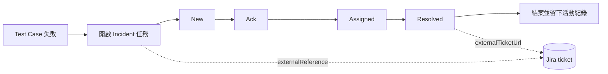

# OpenMetadata 如何處理 Jira ticket 這個資料實體

## 摘要

OpenMetadata（`open-metadata/OpenMetadata`）是 Apache 2.0 授權的開源資料治理與中繼資料平台，於 2026-10-14 時擁有 15,471 顆星、2,451 個 fork[^repo]。針對「Jira ticket」這個資料實體，OpenMetadata **並沒有**一個名為 Jira 或 Ticket 的一級（first-class）實體，也**沒有**內建的 Jira 連接器（connector）。它採取的是「外部參照（external reference）」策略：把 Jira 議題當作一般工作項的外部識別碼，掛在既有的 **Task**（任務）與 **Incident**（事故）資料模型之上[^task-json][^adr]。

換句話說，Jira ticket 在 OpenMetadata 裡不是獨立的 entity type，而是以三種形式存在：

1. **`Task.externalReference`**：任務實體上的一個結構化欄位，用來存放外部系統名稱、外部 ID、外部 URL 與同步狀態[^task-json]。
2. **`IncidentResolutionPayload.externalTicketUrl`**：事故解決表單（payload）上的一個 URL 欄位，指向外部事故單[^irp-json]。
3. **`DataAccessRequestPayload.ticketId`**：資料存取請求表單上的外部 ticket ID 欄位[^darp-json]。

本報告說明這三條路徑的資料模型、程式碼位置、實際運作方式，以及目前的限制。

---

## 1. 背景：OpenMetadata 的 Task 與 Incident 模型

要理解 Jira ticket 如何被處理，必須先理解 OpenMetadata 把「待辦事項」抽象化為 **Task** 實體。

`Task` 的 JSON Schema 定義在 `openmetadata-spec/src/main/resources/json/schema/entity/tasks/task.json`[^task-json]。它包含：

- `category`（任務分類）：`Approval`、`DataAccess`、`MetadataUpdate`、`Incident`、`Review`、`Custom`[^task-json]
- `type`（任務型別）：`GlossaryApproval`、`DataAccessRequest`、`TagUpdate`、`TestCaseResolution`、`IncidentResolution`、`PipelineReview`、`CustomTask` 等 15 種[^task-json]
- `status`（生命週期狀態）：`Open`、`InProgress`、`Pending`、`Approved`、`Rejected`、`Completed`、`Cancelled` 等[^task-json]

其中與事故（incident）相關的是 `category = Incident`，對應 `type = TestCaseResolution` 或 `IncidentResolution`。

**Incident（事故）** 本身是由資料品質測試失敗觸發的工作流。當一個測試案例（test case）第一次失敗時，OpenMetadata 會為它開啟一個 incident，狀態依序經過 `New → Ack → Assigned → Resolved`，直到有人處理完成[^tcrs-json]。這個生命週期的狀態機目前實作在 `TestCaseResolutionStatusRepository.storeInternal()`，事故本身則以時間序列實體 `TestCaseResolutionStatus` 儲存[^tcrs-json][^adr]。



---

## 2. 路徑一：`Task.externalReference` 結構化欄位

這是 OpenMetadata 對「外部 ticket」最正式、最貼近「資料實體」的處理方式。`task.json` 中定義了一個名為 `externalReference` 的物件型別，其描述即為 *"Reference to an external system like JIRA or ServiceNow."*[^task-json]。

| 欄位 | 型別 | 說明 |
| --- | --- | --- |
| `system` | string | 外部系統名稱，例如 `'jira'`、`'serviceNow'`、`'asana'`、`'github'`（必填）[^task-json] |
| `externalId` | string | 外部系統中的 ID，文件中明示為 *"JIRA issue key"*，例如 `DQ-123`（必填）[^task-json] |
| `externalUrl` | href | 在外部系統檢視該項目的 URL[^task-json] |
| `syncStatus` | enum | 同步狀態：`synced`、`pending`、`conflict`、`error`，預設 `synced`[^task-json] |
| `lastSyncedAt` | timestamp | 最後一次同步的時間戳[^task-json] |

`externalReference` 是 `Task` 的頂層屬性之一，描述為 *"Reference to external system (JIRA, ServiceNow, etc.)"*[^task-json]。

### 建立任務時即可帶入

建立任務的請求 schema（`api/tasks/createTask.json`）同樣接受 `externalReference`，直接參照任務 schema 中的定義[^create-task-json]。伺服器端在 `TaskResource` 建立任務時會把該欄位寫入任務物件[^task-resource]。換言之，透過 REST API 建立任務時，可以一次指定：

```json
{
  "category": "Incident",
  "type": "IncidentResolution",
  "externalReference": {
    "system": "jira",
    "externalId": "DQ-123",
    "externalUrl": "https://jira.example.com/browse/DQ-123",
    "syncStatus": "synced"
  }
}
```

（欄位語意取自 `task.json` 與 `createTask.json`[^task-json][^create-task-json]。）

### 在工作流治理架構中的傳遞

OpenMetadata 的治理工作流（governance workflows）框架在啟動任務流程時，會把任務屬性轉成流程變數。`TaskWorkflowLifecycleResolver.WorkflowStartVariables` 定義了 `TASK_EXTERNAL_REFERENCE = "taskExternalReference"`，並在初始化時將 `task.getExternalReference()` 序列化進流程變數[^tcrresolver]。工作流節點 `CreateTask.java` 會讀回這個變數，並在建立或更新任務時還原成 `TaskExternalReference` 物件[^createtask-java]。

也就是說，Jira 參照可以在「觸發工作流 → 建立任務 → 更新任務」的整條鏈路上被攜帶，而不會遺失。

### 周邊生態

- **Python 端**：`ingestion/src/metadata/ingestion/ometa/task_models.py` 定義了對應的 `TaskExternalReference` Pydantic 模型，供 Python SDK 與自動化腳本使用[^py-task-models]。
- **前端（UI）**：TypeScript 產物 `generated/entity/tasks/task.ts` 與 `generated/api/tasks/createTask.ts` 都包含 `ExternalReference` 介面與 `SyncStatus` 列舉[^ts-task]。此外 `TaskTabNew.component.tsx` 為資料存取請求表單欄位 `ticketId` 指定了票券圖示（`ic_ticket.svg`）[^tasktab-tsx]。
- **測試**：Python 單元測試 `test_task_announcement_feed_mixins.py` 直接以 `{"system": "jira", "externalId": "TASK-42", ...}` 作為 fixture，佐證 Jira 是官方認可的 `system` 值[^py-test]。

---

## 3. 路徑二：`IncidentResolutionPayload.externalTicketUrl`

事故解決任務（`type = IncidentResolution`）的 payload 定義於 `openmetadata-spec/.../json/schema/type/incidentResolutionPayload.json`[^irp-json]。其中包含欄位：

- `incidentType`：`DataQuality`、`Pipeline`、`Schema`、`Freshness`、`Volume`、`Custom`[^irp-json]
- `severity`：`Critical`、`High`、`Medium`、`Low`[^irp-json]
- `impactedAssets`、`rootCause`、`resolution`、`preventiveMeasures`[^irp-json]
- `startTime`、`endTime`[^irp-json]
- **`externalTicketUrl`**：描述為 *"URL to external incident ticket."*，型別為 `href`[^irp-json]

這是三條路徑中**唯一以「外部事故單」命名**的欄位。它讓處理事故的人在解決事故時，可以留下外部（例如 Jira）工單的連結，作為事故紀錄的一部分。此欄位會出現在 UI 的型別產物 `generated/type/incidentResolutionPayload.ts` 中[^ts-irp]。

需要注意的是，這個欄位只是一個 URL 字串，**不具備** `externalReference` 的結構化能力（沒有 `system`、`externalId`、`syncStatus`）。

---

## 4. 路徑三：`DataAccessRequestPayload.ticketId` 與任務表單

在資料存取請求（Data Access Request）流程中，payload 定義於 `type/dataAccessRequestPayload.json`，含：

- `ticketId`：描述為 *"External ticket ID (JIRA, ServiceNow) if required."*[^darp-json]
- `accessType`、`requestedAccess`、`columns`、`duration`、`reason`、`expirationDate`、`manualGrantReason`[^darp-json]

對應的任務表單 schema（`openmetadata-service/src/main/resources/json/data/taskFormSchemas/DataAccessRequest.json`）把 `ticketId` 定義為標題 *"External Ticket ID"*、`maxLength: 128` 的字串欄位，並列在 UI 欄位順序中[^dar-form]。

`TaskWorkflowLifecycleResolver` 在為 `DataAccessRequest` 型別組合預設 schema 時，也把 `ticketId` 納入屬性清單[^dar-resolver]。前端則在 `TaskTabNew.component.tsx` 為 `ticketId` 指定專屬圖示[^tasktab-tsx]。

這條路徑的意義是：資料存取請求（例如申請某張表的存取權）如果組織規定必須先開一張 Jira 單，OpenMetadata 可以記錄該單號。

---

## 5. 路徑四（文件層面）：把 Jira 連結貼進任務留言

除了 schema 欄位，官方文件也提供了最「土法煉鋼」但保證可行的做法：把 Jira 連結當作一般留言貼到事故的任務討論串。文件明確給出 API 範例[^docs-workflow]：

```http
POST /api/v1/feed/{threadId}/posts
Content-Type: application/json

{
  "message": "Tracked in JIRA: https://jira.example.com/browse/DQ-123",
  "from": "<username>"
}
```

文件說明這個做法適用於 *"an external system, such as a ticketing integration, acknowledges an incident and posts a link back to OpenMetadata."*[^docs-workflow]

值得注意的是，同一份文件中**並未**提及 `ticketId` 或 `externalTicketUrl` 等結構化欄位；也就是說，文件層級推薦的 Jira 整合方式仍是留言，而非 schema 欄位[^docs-workflow]。這透露了一個現實：schema 欄位雖然存在，但官方尚未把它們包裝成完整的 Jira 整合產品功能。

---

## 6. 警示（Alerts）與 Jira 的關聯

OpenMetadata 的警示系統分成兩類：**Observability alerts**（資料健康）與 **Notification alerts**（中繼資料與協作事件）[^alert-ref]。

- Incident 屬於 **Notification alert** 的範疇，因為 incident 本質上是一個 Task，會以 **Task** 事件形式出現；文件建議若要過濾事件型別或資產名稱，改用 **All** source[^alert-ref]。
- 每一個 incident 狀態變更（acknowledge、assign、resolve）預期會產生一個 `entityUpdated` 事件，entity type 為 `task`[^alert-ref]。
- 文件也明說：*"No Observability source reports incident status."*[^alert-ref]

因此，目前要「自動開 Jira 單」的可行做法是：建立一個 Notification alert，source 選 **Task**（或 **All**），destination 選 **webhook**，再由外部系統建立 Jira ticket。文件中提到通用 webhook 是可用的 destination 類型之一[^alert-ref]。

但這正是目前社群的痛點。2026-10-13 有一則功能請求（issue #35332）明確描述[^issue-35332]：

> Teams that track data quality work in their own tool (for example a webhook that creates a Jira ticket) want one ticket per incident. Today they can only alert on each failed result, so they have to deduplicate outside the platform.

該請求要求新增一個 **Incident** alert source，觸發條件為「incident opened」，並讓 payload 直接帶有 incident id、連結、test case、severity、assignees 與失敗原因，以便接收端「create one ticket per incident without extra API calls」[^issue-35332]。截至 2026-10-14，此 issue 仍為 open 狀態[^issue-35332]。

換言之：**「一個 incident 對應一張 Jira 單」這件事，OpenMetadata 目前沒有原生支援，仍是使用者自行串接的領域。**

---

## 7. 治理工作流：Jira 作為可掛載的後續步驟（設計階段）

一份架構決策紀錄（ADR）`adr-incident-manager-governance-workflows.md`（作者 Pablo Takara，日期 2026-02-27，狀態 Proposed）描述了把 Incidents Manager 遷移到治理工作流框架的計畫[^adr]。其中最關鍵的一段[^adr]：

> **UC-4 — User-defined hooks on any status transition**
> Users wire follow-up steps (notifications, Jira tickets, etc.) on any status change via workflow edges — no code changes.

在同一份文件的技術提案 `openspec/changes/incident-lifecycle-workflow/proposal.md` 中，也把「Users can customize by adding steps to workflow branches (e.g., notifications, Jira)」列為使用者可見的變更之一[^openspec]。

其設計是以 **Task Lifecycle Node** 取代硬編碼的 `storeInternal()` 狀態機，讓使用者用流程邊（edges）在任何狀態轉換上掛載後續動作，例如[^adr]：

```json
{ "from": "incident", "to": "notifySlack", "condition": { "status": "Assigned" } }
```

概念的意涵是：未來「開 Jira 單」可以變成工作流圖上的一個節點，由使用者自行設定在 `Assigned` 或 `New` 等狀態轉換時觸發，而無需修改程式碼。不過，該 ADR 狀態仍為 **Proposed**，且文件本身把「MainWorkflow compiler must support cycles」列為最大技術風險[^adr]，因此這屬於**規劃中**而非已上線的功能。

---

## 8. 沒有 Jira 連接器

必須強調：OpenMetadata **沒有**在 ingestion 連接器框架中提供 Jira connector。對原始碼的搜尋（Sourcegraph，跨 open-metadata/OpenMetadata 全域）顯示，與 Jira 相關的程式碼僅出現在：

- Task 相關 JSON Schema 的 `externalReference` 註解與 `system` 範例值[^task-json]
- `dataAccessRequestPayload.json` 的 `ticketId` 描述[^darp-json]
- `incidentResolutionPayload.json` 與其 TypeScript 產物[^irp-json][^ts-irp]
- ADR 與 openspec 提案的文字敘述[^adr][^openspec]
- 前端 `TaskTabNew.component.tsx` 的 `ticketId` 圖示對應[^tasktab-tsx]

另外有一則被關閉的舊功能請求（issue #7108，2022 年）曾提議與 Microsoft Teams / JIRA / ServiceNow 整合，但最終關閉且未產生連接器[^issue-7108]。此外整個 ingestion source 目錄（database、dashboard、messaging、pipeline、mlmodel、storage、search、security、drive、api、mcp 等）中並不存在 jira 目錄[^ingestion-src]。

---

## 9. 綜合對照表

| OpenMetadata 概念 | 對應 Jira 的處理 | 程式碼 / Schema 位置 |
| --- | --- | --- |
| Jira 議題（ticket） | Task 上的結構化外部參照 | `entity/tasks/task.json` 的 `externalReference`[^task-json] |
| Jira issue key | `externalReference.externalId` | 同上[^task-json] |
| Jira 議題 URL | `externalReference.externalUrl` | 同上[^task-json] |
| 同步狀態 | `externalReference.syncStatus` | 同上[^task-json] |
| 事故的外部工單連結 | `IncidentResolutionPayload.externalTicketUrl` | `type/incidentResolutionPayload.json`[^irp-json] |
| 存取請求的外部單號 | `DataAccessRequestPayload.ticketId` | `type/dataAccessRequestPayload.json`[^darp-json] |
| 任務建立時帶入 | `CreateTaskRequest.externalReference` | `api/tasks/createTask.json`[^create-task-json] |
| 工作流變數傳遞 | `taskExternalReference` | `TaskWorkflowLifecycleResolver.java`[^tcrresolver] |
| 工作流節點還原 | `CreateTask.java` | `governance/workflows/elements/nodes/userTask/CreateTask.java`[^createtask-java] |
| Python SDK | `TaskExternalReference` | `ingestion/.../ometa/task_models.py`[^py-task-models] |
| 手動連結（文件建議） | 任務留言 API 貼 Jira 連結 | `POST /api/v1/feed/{threadId}/posts`[^docs-workflow] |
| 自動開單（規劃中） | 工作流邊掛載節點 | ADR / openspec 提案[^adr][^openspec] |

---

## 10. 批判性評估

針對上述來源，有幾點值得留意：

1. **來源權威性**：本報告主要依據上游儲存庫 `main` 分支的原始碼與 Schema，屬於第一手資料，權威性高；文件（docs.open-metadata.org）與 GitHub issue 則反映官方立場與社群實務[^task-json][^docs-workflow][^issue-35332]。

2. **版本時效性**：本報告所引用的 `main` 分支內容擷取於 2026-10-14[^repo]。ADR 狀態為 Proposed（2026-02-27 提出），可能隨時變更；實施狀況必須以屆時的實際程式碼為準[^adr]。

3. **「有欄位」不等於「有整合」**：`externalReference`、`externalTicketUrl`、`ticketId` 三個欄位證明 OpenMetadata 的資料模型已為外部票券「預留位置」，但搜尋結果未發現任何自動與 Jira API 雙向同步的程式碼。`syncStatus` 提供了 `synced/pending/conflict/error` 的同步狀態語意，但沒有找到實際執行同步的實作。因此應理解為：**資料模型已備，整合邏輯未出**。

4. **來源相互補強**：三條獨立線索均指向同一結論 —— (a) Schema 欄位存在但僅為參照；(b) 官方文件推薦的整合方式是張貼留言；(c) 社群 issue 明確抱怨需要自行去重才能做到「一 incident 一 Jira 單」。三者互相印證，降低了單一來源偏誤的風險[^task-json][^docs-workflow][^issue-35332]。

5. **未能證實者**：本報告未能找到 OpenMetadata 官方針對 Jira 的雙向同步產品功能、專用連接器或 webhook formatter。基於搜尋證據，本報告傾向認為其不存在；但「未找到」不等於「絕對不存在」，尤其是企業版（Collate）可能另有實作，此點本報告無法查證。

---

## 結論

在 OpenMetadata 中，**Jira ticket 不是一個獨立的資料實體**。它被拆解為三種形式存在於既有實體之上：

- 一般任務用 `Task.externalReference`（結構化：system / externalId / externalUrl / syncStatus）[^task-json]
- 事故解決用 `IncidentResolutionPayload.externalTicketUrl`（僅 URL）[^irp-json]
- 資料存取請求用 `DataAccessRequestPayload.ticketId`（僅 ID）[^darp-json]

目前唯一「開箱即用」的官方整合方式，是在事故任務的討論串上張貼 Jira 連結[^docs-workflow]。要達成自動化、尤其是「一個 incident 對應一張 Jira 單」，實務上仍需靠 Notification alert + webhook 自行串接[^alert-ref][^issue-35332]；而把 Jira 開單變成治理工作流上可掛載節點的設計，仍停留在 Proposed 階段的 ADR[^adr]。

---

[^repo]: GitHub. (n.d.). *open-metadata/OpenMetadata* [Repository metadata]. Retrieved 2026-10-14, from https://api.github.com/repos/open-metadata/OpenMetadata

[^task-json]: OpenMetadata. (n.d.). *task.json* [JSON Schema]. Retrieved 2026-10-14, from https://raw.githubusercontent.com/open-metadata/OpenMetadata/main/openmetadata-spec/src/main/resources/json/schema/entity/tasks/task.json

[^create-task-json]: OpenMetadata. (n.d.). *createTask.json* [JSON Schema]. Retrieved 2026-10-14, from https://raw.githubusercontent.com/open-metadata/OpenMetadata/main/openmetadata-spec/src/main/resources/json/schema/api/tasks/createTask.json

[^irp-json]: OpenMetadata. (n.d.). *incidentResolutionPayload.json* [JSON Schema]. Retrieved 2026-10-14, from https://raw.githubusercontent.com/open-metadata/OpenMetadata/main/openmetadata-spec/src/main/resources/json/schema/type/incidentResolutionPayload.json

[^darp-json]: OpenMetadata. (n.d.). *dataAccessRequestPayload.json* [JSON Schema]. Retrieved 2026-10-14, from https://raw.githubusercontent.com/open-metadata/OpenMetadata/main/openmetadata-spec/src/main/resources/json/schema/type/dataAccessRequestPayload.json

[^tcrs-json]: OpenMetadata. (n.d.). *testCaseResolutionStatus.json* [JSON Schema]. Retrieved 2026-10-14, from https://raw.githubusercontent.com/open-metadata/OpenMetadata/main/openmetadata-spec/src/main/resources/json/schema/tests/testCaseResolutionStatus.json

[^adr]: Takara, P. (2026, February 27). *Integrate Incident Manager in the Governance Workflows Framework* [Architecture Decision Record]. Retrieved 2026-10-14, from https://raw.githubusercontent.com/open-metadata/OpenMetadata/main/adr-incident-manager-governance-workflows.md

[^openspec]: OpenMetadata. (n.d.). *Incident Lifecycle Workflow* [OpenSpec proposal]. Retrieved 2026-10-14, from https://raw.githubusercontent.com/open-metadata/OpenMetadata/main/openspec/changes/incident-lifecycle-workflow/proposal.md

[^docs-workflow]: OpenMetadata. (n.d.). *How to work with the Incident Manager*. Retrieved 2026-10-14, from https://docs.open-metadata.org/v2.0.x/how-to-guides/data-quality-observability/incident-manager/workflow

[^alert-ref]: OpenMetadata. (n.d.). *Alert Behavior Reference*. Retrieved 2026-10-14, from https://docs.open-metadata.org/v2.0.x/how-to-guides/data-quality-observability/alerts-notifications/alert-behavior-reference

[^issue-35332]: manerow. (2026, October 13). *FR: Add an Incident source to Observability alerts* [Issue #35332]. Retrieved 2026-10-14, from https://github.com/open-metadata/OpenMetadata/issues/35332

[^issue-7108]: upenbendre. (2022, September 1). *Look up, push, edit metadata using Integration with Microsoft Teams / JIRA / ServiceNow* [Issue #7108]. Retrieved 2026-10-14, from https://github.com/open-metadata/OpenMetadata/issues/7108

[^task-resource]: OpenMetadata. (n.d.). *TaskResource.java* [Source code]. Retrieved 2026-10-14, from https://github.com/open-metadata/OpenMetadata/blob/main/openmetadata-service/src/main/java/org/openmetadata/service/resources/tasks/TaskResource.java

[^tcrresolver]: OpenMetadata. (n.d.). *TaskWorkflowLifecycleResolver.java* [Source code]. Retrieved 2026-10-14, from https://github.com/open-metadata/OpenMetadata/blob/main/openmetadata-service/src/main/java/org/openmetadata/service/tasks/TaskWorkflowLifecycleResolver.java

[^createtask-java]: OpenMetadata. (n.d.). *CreateTask.java* [Source code]. Retrieved 2026-10-14, from https://github.com/open-metadata/OpenMetadata/blob/main/openmetadata-service/src/main/java/org/openmetadata/service/governance/workflows/elements/nodes/userTask/CreateTask.java

[^dar-resolver]: OpenMetadata. (n.d.). *TaskWorkflowLifecycleResolver.java* [Source code]. Retrieved 2026-10-14, from https://github.com/open-metadata/OpenMetadata/blob/main/openmetadata-service/src/main/java/org/openmetadata/service/tasks/TaskWorkflowLifecycleResolver.java

[^dar-form]: OpenMetadata. (n.d.). *DataAccessRequest.json* [Task form schema]. Retrieved 2026-10-14, from https://github.com/open-metadata/OpenMetadata/blob/main/openmetadata-service/src/main/resources/json/data/taskFormSchemas/DataAccessRequest.json

[^py-task-models]: OpenMetadata. (n.d.). *task_models.py* [Source code]. Retrieved 2026-10-14, from https://github.com/open-metadata/OpenMetadata/blob/main/ingestion/src/metadata/ingestion/ometa/task_models.py

[^py-test]: OpenMetadata. (n.d.). *test_task_announcement_feed_mixins.py* [Test source code]. Retrieved 2026-10-14, from https://github.com/open-metadata/OpenMetadata/blob/main/ingestion/tests/unit/metadata/ingestion/ometa/test_task_announcement_feed_mixins.py

[^ts-task]: OpenMetadata. (n.d.). *task.ts* and *createTask.ts* [Generated TypeScript types]. Retrieved 2026-10-14, from https://github.com/open-metadata/OpenMetadata/tree/main/openmetadata-ui/src/main/resources/ui/src/generated

[^ts-irp]: OpenMetadata. (n.d.). *incidentResolutionPayload.ts* [Generated TypeScript types]. Retrieved 2026-10-14, from https://github.com/open-metadata/OpenMetadata/blob/main/openmetadata-ui/src/main/resources/ui/src/generated/type/incidentResolutionPayload.ts

[^tasktab-tsx]: OpenMetadata. (n.d.). *TaskTabNew.component.tsx* [Source code]. Retrieved 2026-10-14, from https://github.com/open-metadata/OpenMetadata/blob/main/openmetadata-ui/src/main/resources/ui/src/components/Entity/Task/TaskTab/TaskTabNew.component.tsx

[^ingestion-src]: OpenMetadata. (n.d.). *ingestion/src/metadata/ingestion/source* [Directory listing]. Retrieved 2026-10-14, from https://api.github.com/repos/open-metadata/OpenMetadata/contents/ingestion/src/metadata/ingestion/source
