# 使用 OpenMetadata 必備的心智模型、領域模型、概念與領域知識

## 摘要

OpenMetadata 是一套開源的資料目錄（data catalog）、中繼資料管理（metadata management）與資料治理平台，官方定位為「資料與 AI 的開放情境層（The Open Context Layer for Data and AI）」[^gh]。本報告整理使用 OpenMetadata 前必須先建立的心智模型（mental model）、領域模型（domain model）、核心概念（concepts）與領域知識（domain knowledge）。

本報告以 OpenMetadata v2.0.x 官方文件與 OpenMetadata Standards 規格為主要來源[^llms][^standards]，並補充 GitHub 專案資訊[^gh]。全文為獨立文件，不需任何前置背景即可閱讀。

OpenMetadata 目前為 Apache-2.0 授權[^gh]，GitHub 上約 15.5k stars、2.5k forks[^gh]，最新版本為 2.0.5（2026-10-08 發布）[^rel]。

---

## 一、專案背景：它在生態系中的位置

### 1.1 什麼是 OpenMetadata

OpenMetadata 是一個統一的中繼資料平台，將技術中繼資料（technical metadata）、資料品質訊號、血緣（lineage）、欄位級血緣、擁有權、使用情形、政策、對話、記憶（memories）、詞彙表（glossaries）、分類（classifications）、指標（metrics）、領域（domains）、資料合約（data contracts）與資料產品（data products）串接成一個統一的「中繼資料知識圖譜（metadata knowledge graph）」[^gh]。

它提供 130+ 個連接器（connectors）、開放中繼資料標準、語意搜尋（semantic search）、API、SDK，以及一個 MCP server，讓每一個使用者與 AI 系統都能取得受治理的情境（governed context）[^gh]。

### 1.2 為什麼它對 AI 時代重要

官方論述的核心是：**AI 不需要另一個原始資料庫連接器，AI 需要的是「情境（context）＋記憶（memory）」**[^gh]。一個直連倉儲、湖、儀表板或管線的連線，只暴露了原始結構，它不會告訴 AI 助理：

- 這份資料是什麼意思
- 是否已被認證（certified）
- 誰擁有它
- 哪些政策適用
- 哪份合約管轄它
- 若它改變會破壞什麼
- 組織已經對它學到了什麼[^gh]

### 1.3 開源與商業化的關係

OpenMetadata 由 Collate 公司主導，採開源（Apache-2.0）核心加上商業產品的模式[^gh][^rel]。其規格另外以 **OpenMetadata Standards**（openmetadatastandards.org）形式獨立發布，作為跨工具的中繼資料模型標準[^standards]。

---

## 二、最重要的心智模型（Mental Models）

理解 OpenMetadata 之前，先建立以下五個心智模型，後續所有概念都會容易得多。

### 心智模型 1：Schema-First（規格優先）

OpenMetadata 是「schema-first」平台。**所有實體（entity）的定義都以 JSON Schema 撰寫，作為整個平台的唯一真實來源（single source of truth）**[^hld]。

從同一份 JSON Schema，自動產生三種語言的程式碼：

- **Java 類別** → 給 API 後端（openmetadata-service）使用
- **Python 類別** → 給 Ingestion Framework 使用
- **TypeScript 型別** → 給 UI 使用[^hld]

官方說法是「三個視圖、同一個來源（three views from the same source）」，藉此保證 API、擷取層與 UI 對「實體」的認知完全一致，不會產生漂移[^hld]。

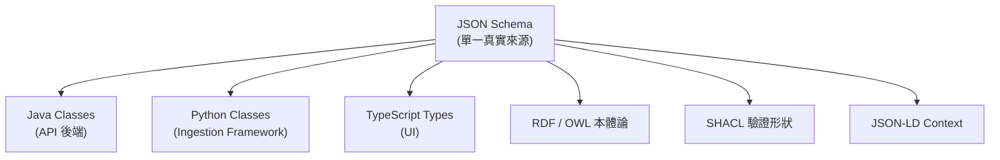

### 心智模型 2：屬性與關聯分離（Attributes vs. Relationships）

每一個中繼資料實體都有兩類欄位[^hld]：

1. **屬性（Attributes）**：實體的內在性質，例如 `name`、`id`、Table 的 `columns`、ML Model 的 `algorithm`。這些以 **JSON 文件**形式儲存在各自的實體表中（例如 `table_entity`）。
2. **關聯（Relationships）**：實體之間的關聯，以**圖的節點與邊（graph nodes/edges）**形式儲存在同一張 `entity_relationship` 表。邊上帶有關聯型別，例如 `contains`、`uses`、`follows`、`owns`。

這種分離的設計目的是「解耦關注點」，讓相關實體可以獨立處理，並在執行期驗證需要更新或檢索何種資訊[^hld]。

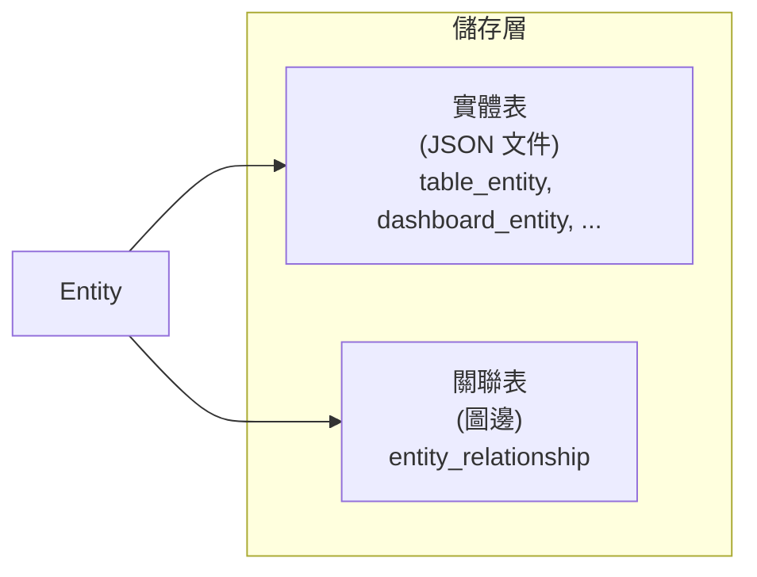

### 心智模型 3：Service 是階層的根（Service as Root）

「Service」代表**與一個外部系統的連線**，它是容器階層的最頂端，擁有其下所有資產[^hld]。FQN（fully qualified name）會以 Service 名稱作為前綴。

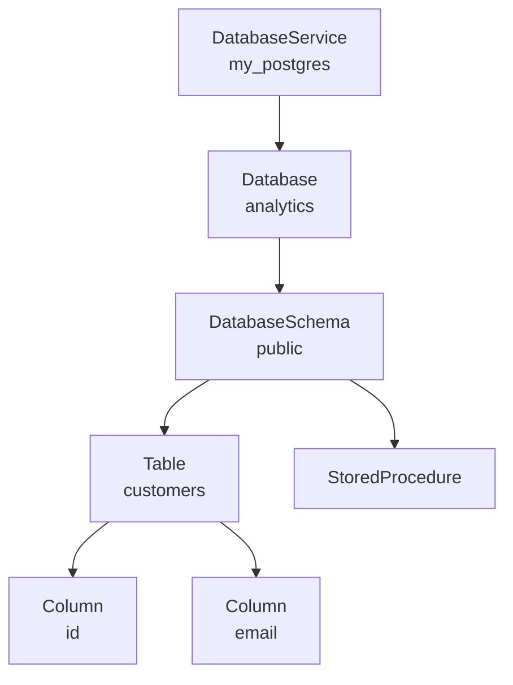

**刪除 Service 會連帶清除其下所有 Database、Schema、Table、Column**[^ma]。這是使用上最容易誤觸的破壞性操作之一。

### 心智模型 4：FQN 是實體的身分證

每個實體都有 `fullyQualifiedName`（FQN），由其在階層中的位置推導而來。格式為**點分階層**[^hld][^ma]：

```
service.database.schema.table.column
```

不同領域的 FQN 也遵循相同邏輯：

| 領域 | FQN 格式 | 範例 |
|---|---|---|
| 資料庫 | `service.database.schema.table.column` | `my_postgres.analytics.public.customers.email` |
| 詞彙表 | `glossary.parent.child` | `BusinessGlossary.Customer.Segment` |
| 標籤 | `Classification.Tag.SubTag` | `PII.Sensitive.Email` |
| 領域 | `domain.subdomain` | `Marketing.Campaigns` |
| 資料產品 | `domain.dataProductName` | `Marketing.CustomerInsights` |

FQN 由伺服器在 `Prepare` 階段依實體階層計算產生[^hld]。API 可用 `GET /api/v1/<collection>/name/{fqn}` 依 FQN 取得實體[^ma]。

### 心智模型 5：三種表示形式（JSON Schema / RDF-OWL / SHACL）

OpenMetadata Standards 對同一套中繼資料模型提供**三種互補表示**[^standards]：

1. **JSON Schema（Draft-07）**：911 份 schema，為主要格式，用於 REST API、驗證、程式碼產生[^standards][^concepts]。
2. **RDF / OWL 本體論**：Turtle 檔定義類別、屬性、階層、domain/range 限制；可 SPARQL 查詢，支援推理與知識圖譜[^standards]。另有 **Provenance Ontology** 延伸 W3C PROV-O，用於血緣[^standards]。
3. **SHACL 形狀**：W3C SHACL 用於 RDF 資料的基數、型別、值域、關聯等限制驗證[^standards]。

兩者之間的橋樑是 **JSON-LD contexts**，將 JSON 屬性映射到 RDF 屬性，實現自動轉換[^standards]。

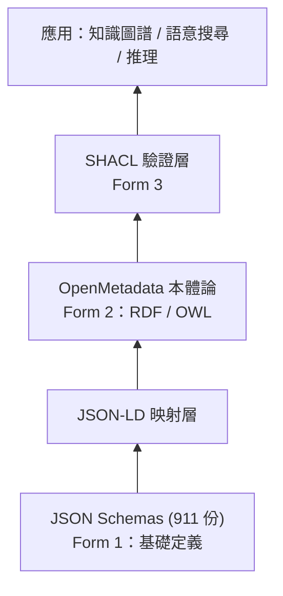

---

## 三、領域模型（Domain Model）

### 3.1 實體階層總覽

實體的繼承主幹為：**Entity → DataAsset / Service / Governance / 組織 / 資料品質**[^ma][^concepts]。

```mermaid
flowchart TD
    E["Entity<br/>id, name, fqn, description,<br/>owner, tags, version, href"]
    E --> DA["DataAsset"]
    E --> SV["Service"]
    E --> GV["Governance"]
    E --> OR["Team / User"]
    E --> DQ["Data Quality"]

    DA --> T["Table → Column"]
    DA --> DASH["Dashboard → Chart"]
    DA --> PIPE["Pipeline"]
    DA --> TOP["Topic → Field"]
    DA --> ML["MLModel"]
    DA --> CONT["Container"]
    DA --> SI["SearchIndex"]
    DA --> MSP["StoredProcedure"]
    DA --> API["APICollection → APIEndpoint"]
    DA --> MET["Metric"]
    DA --> DP["DataProduct"]

    SV --> DBS["DatabaseService"]
    SV --> MSS["MessagingService"]
    SV --> DSV["DashboardService"]
    SV --> PSV["PipelineService"]
    SV --> MLS["MLModelService"]
    SV --> SSV["StorageService"]
    SV --> SES["SearchService"]
    SV --> ASV["ApiService"]

    GV --> GL["Glossary → GlossaryTerm"]
    GV --> CL["Classification → Tag"]
    GV --> DOM["Domain"]
    GV --> POL["Policy"]
    GV --> DC["DataContract"]
```

### 3.2 五大實體類別

依官方分類，實體可分為以下群組[^ma][^concepts]：

#### (A) 資料資產（Data Assets）

實體資料的容器，包含 `Table`（表格與視圖，含 Column）、`Database`、`DatabaseSchema`、`Topic`（Kafka/Kinesis/Pulsar 等訊息主題）、`Dashboard`（BI 儀表板）、`Chart`（儀表板中的單一圖表）、`Pipeline`（資料管線）、`MLModel`（機器學習模型）、`Container`（物件儲存桶，如 S3/GCS/ADLS）、`SearchIndex`（搜尋索引）、`StoredProcedure`（預存程序）、`APICollection` / `APIEndpoint`、`Metric`（指標）[^ma]。

#### (B) 服務（Services）

與外部系統的連線設定，也是階層根：`DatabaseService`、`MessagingService`、`DashboardService`、`PipelineService`、`MLModelService`、`StorageService`、`SearchService`、`APIService`[^ma]。每個服務型別有自己的 **connection schema**（如 `PostgresConnection`、`SnowflakeConnection`），全部約有 150+ 種服務連線 schema[^ma]。

#### (C) 治理（Governance）

`Glossary`（詞彙表）、`GlossaryTerm`（詞彙術語）、`Classification`（分類）、`Tag`（標籤）、`Domain`（領域）、`DataProduct`（資料產品）、`Policy`（政策）、`DataContract`（資料合約）、`Metric`[^ma]。

#### (D) 組織（Organizational）

`User`（使用者）、`Team`（團隊，可階層化）、`Role`（角色）、`Persona`（人物誌）、`Bot`（服務帳號）[^ma]。

#### (E) 資料品質（Data Quality）

`TestDefinition`（測試定義模板）、`TestCase`（測試案例）、`TestSuite`（測試套件）、`TestResult`（測試結果）[^ma]。

### 3.3 關聯型別（Relationship Types）

關聯是有型別的邊[^concepts]：

| 類別 | 關聯 | 範例 |
|---|---|---|
| 容器 | `contains` | `DatabaseService` → `Database` → `Schema` → `Table` → `Column` |
| 擁有權 | `owns` | `Team` 擁有 `Dashboard`、`User` 擁有 `Table` |
| 使用 | `uses` | `Dashboard` 使用 `Table`、`Pipeline` 使用 `Table` |
| 衍生 | `derives from` | `Table` 衍生自 `Table`、`Column` 衍生自 `Column` |
| 產生 | `produces` | `Query` 產生 `Table` |
| 套用 | `appliedTo` | 標籤被套用到實體 |
| 組成 | `part-of` | 詞彙表中 `Address` 是 `Customer` 的一部分 |
| 階層 | `is-a` | 詞彙表中 `Customer` is-a `Person` |
| 同義 | synonym | 詞彙表中 `Client` 是 `Customer` 的同義詞 |

關聯以 `EntityReference` 編碼，內含 `id`、`type`、`name`、`fullyQualifiedName`、`displayName`、`href`[^concepts]。

### 3.4 通用實體屬性

所有實體共用三類屬性[^concepts]：

| 類別 | 屬性 | 說明 |
|---|---|---|
| 身分 | `id` | UUID 唯一識別碼 |
| 身分 | `name` | 人類可讀名稱 |
| 身分 | `fullyQualifiedName` | 唯一階層名稱 |
| 身分 | `displayName` | 顯示名稱 |
| 中繼 | `description` | Markdown 富文本描述 |
| 中繼 | `owner` | 擁有者（EntityReference） |
| 中繼 | `tags` | `TagLabel[]` 分類標籤 |
| 中繼 | `version` | 版本號（變更追蹤） |
| 中繼 | `updatedAt` / `updatedBy` | 最後修改時間／修改者 |
| 中繼 | `href` | 實體的 API 端點 |
| 關聯 | EntityReference / collections | 指向相關實體與子實體 |

### 3.5 型別系統（Type System）

`type/basic.json` 定義基本型別[^concepts]，包含 `uuid`（RFC 4122）、`email`（RFC 5322）、`timestamp` / `duration` / `date` / `time`（ISO 8601）、`markdown`（CommonMark）、`expression`（SQL 運算式）、`entityLink`。

集合型別包含 Arrays、Objects、EntityReference 及其列表[^concepts]。資料型別對應 SQL 種類：數值、字串、日期時間、布林、二進位、JSON、陣列、結構、映射[^concepts]。

實體還可透過 **Custom Properties**（自訂屬性）擴充 schema-less 的欄位，並保持可搜尋、可過濾[^concepts]。

---

## 四、核心概念逐一解說

### 4.1 Service 與 Connector

- **Service**：一個外部系統的連線（連線設定＋中繼資料來源）[^hld]。
- **Connector**：Ingestion Framework 中的元件，定義如何與某一種外部系統互動。每個 connector 從特定來源抽取中繼資料，使用 JSON Schema 產生的 Python 類別格式化，再送往 OpenMetadata API[^hld]。

官方現有 **130+ connectors**[^gh]。

### 4.2 Ingestion Framework（擷取框架）

Ingestion Framework 是 OpenMetadata 與外部系統之間的介面，以 Python 撰寫，包含所有 Connectors[^hld]。其核心設計是**拓樸式執行（topology-based execution）**[^ingest]：

- 每個 source 宣告一棵 **topology tree**，由 `TopologyNode` 組成，框架以**深度優先（depth-first）**巡訪[^ingest]。
- 每個 `TopologyNode` 有：`producer`（產生原始項目，如資料庫名稱）、`stages`（把項目轉成 entity request 的處理步驟）、`children`（子節點）、`post_process`（子節點完成後的清理，例如 `mark_tables_as_deleted()`）[^ingest]。
- `TopologyContext` 是執行緒安全的狀態物件，追蹤目前在階層中的位置，以便子節點建構 FQN[^ingest]。

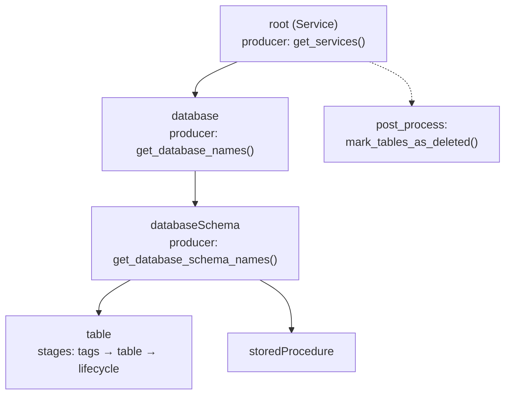

核心設計模式包含[^ingest]：

| 模式 | 位置 | 目的 |
|---|---|---|
| Topology | `ServiceTopology`, `TopologyNode` | 宣告式階層，免除手寫迴圈 |
| Either monad | `Either[T]` | 統一錯誤處理，不用例外 |
| Singledispatch | `MetadataRestSink._run_dispatch` | 依 entity 型別分派處理器 |
| Fingerprinting | 每個實體的 `sourceHash` | 增量擷取（create/patch/skip） |
| Mixin composition | `OpenMetadata` 類別（25+ mixins） | 模組化 API 客戶端 |
| Dynamic import | `get_connection()` | 執行期解析 connector 實作 |

**Fingerprinting（指紋）** 是效率關鍵：sink 比對 `sourceHash` 決定 CREATE（不存在）、PATCH（存在但雜湊不同）、SKIP（存在且雜湊相同），只寫入有變動的實體[^ingest]。

### 4.3 版本控制與變更事件

- 每次變更都會遞增版本號，採 **semver**：小幅變更（如改欄位描述）遞增 0.1，破壞性變更（如刪除欄位）遞增 1.0[^hld]。
- `changeDescription` 記錄新增／更新／刪除的欄位與新舊值[^concepts]。
- **Change Events 表（`change_event`）** 保存每個實體每次修改的完整軌跡，提供除錯能力；`ChangeEventHandler` 在伺服器啟動時註冊為 Jetty handler，透明記錄 `Created`／`Updated`／`Deleted` 事件[^hld]。
- **軟刪除（soft delete）** 為預設行為，實體帶 `deleted` 旗標，可透過 `PUT .../restore` 還原並保留歷史[^concepts][^ma]。

### 4.4 詞彙表（Glossary）與術語階層

`Glossary` 是一套受控詞彙（controlled vocabulary），描述業務概念，定義「資料是什麼意思（semantics）」[^gov]。`GlossaryTerm` 支援**無限層級嵌套**[^ma]。

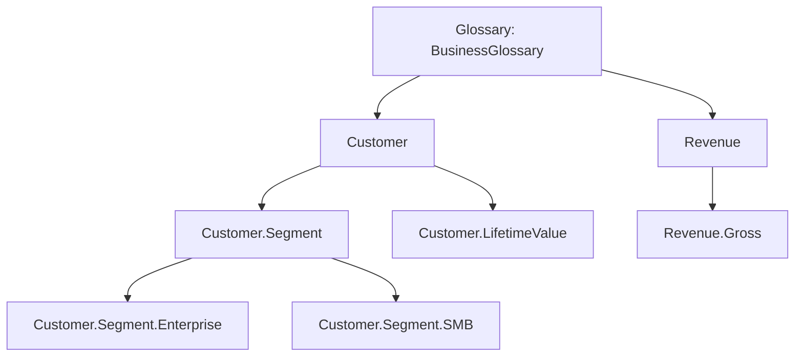

每個 GlossaryTerm 支援：**同義詞（synonyms）**、**相關術語（related terms）**、**審核者（reviewers）**、**狀態（Draft/Approved）**、**標籤**、**擁有權**[^ma][^gov]。詞彙表還支援 **OWL/SKOS 本體論匯入**與 CSV 批次匯入匯出[^gov]。關係包含同義、相關、is-a 階層、part-of 組成[^concepts]。

### 4.5 分類（Classification）與標籤（Tag）

- **Classification**：標籤的類別分組（像資料夾），定義「資料是什麼型別」[^gov]。
- **Tag**：分類內的個別標籤[^ma]。

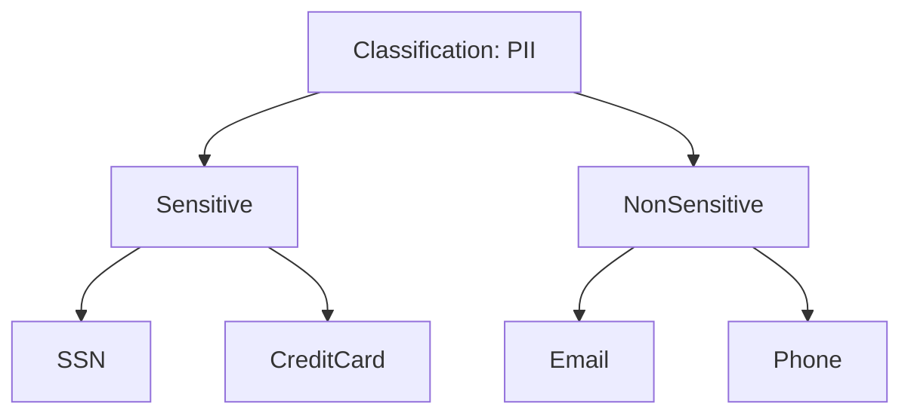

標籤的 FQN 格式為 `Classification.Tag.SubTag`，例如 `PII.Sensitive.Email`[^ma]。

**標籤來源（TagLabel.source）** 有三種[^ma][^concepts]：

| 來源 | 說明 |
|---|---|
| Manual | 使用者手動套用 |
| Automated | 自動分類規則套用（NLP 偵測 PII） |
| Propagated | 從父實體繼承 |

**兩類標籤**[^gov]：

- **Classification tags**：互斥（一個資產只能屬於一個類別，如 Public 或 Private）
- **Categorization tags**：非互斥（一個資產可有多個標籤，如 Usage + Financial + Reporting）

**自動分類（Auto-Classification）** 可用欄位名稱掃描、NLP 實體辨識、樣本資料樣式比對，自動偵測並標記 PII[^ma][^gov]。系統內建分類（`PersonalData`、`PII`、`Tiers`）不可刪除[^gov]。

### 4.6 領域（Domain）與資料產品（Data Product）

**Domain** 把相關資料資產歸到一個有明確擁有權的實體下，支援**分散式資料擁有權**與 **Data Mesh** 架構[^gov][^market]。Domain 可嵌套（`Marketing.Campaigns.Email`）[^ma]。

三種領域型別[^gov]：

| 型別 | 說明 |
|---|---|
| Source-aligned | 貼近線上服務與交易資料庫（事件、交易） |
| Aggregate | 匯集並策展多個 source-aligned 領域的資料（如 Customer 360） |
| Consumer-aligned | 面向使用者的領域，組合資料供業務決策 |

**DataProduct** 屬於某一 Domain，是一組策展過的資產集合，具有**輸入埠（input ports）**與**輸出埠（output ports）**[^ma]。

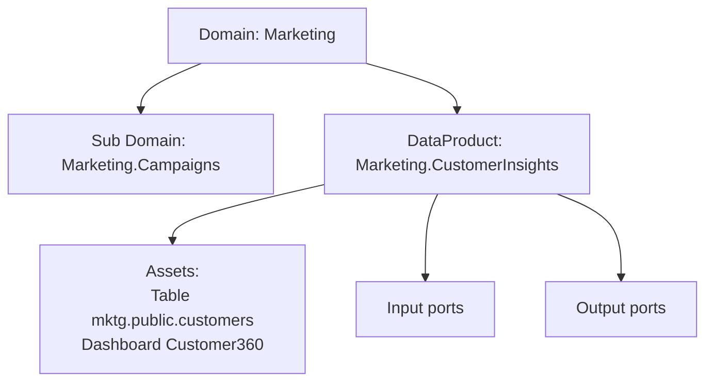

### 4.7 資料血緣（Data Lineage）

血緣是有向圖：**節點為實體（table、pipeline、dashboard、ML model、topic 等），邊為有方向的資料流**[^lin]。

模型建立在 **W3C PROV-O（Provenance Ontology）** 標準上[^lin][^concepts]：

- **Entity** → 資料資產
- **Activity** → 管線、查詢、作業（轉換）
- **Agent** → 使用者、服務、團隊（執行活動者）

`EntityLineage` schema 的頂層屬性為 `entity`（圖的中心實體）、`nodes`（其他實體）、`upstreamEdges`、`downstreamEdges`[^lin]。每條 `Edge` 有 `fromEntity`、`toEntity`、`lineageDetails`、`description`[^lin]。

**實體級 vs 欄位級血緣**[^lin]：

- **實體級（table-level）**：整個資料集之間的高階依賴。
- **欄位級（column-level）**：細緻對應個別欄位如何流動與轉換。

```json
{
  "fromColumns": ["raw.users.first_name", "raw.users.last_name"],
  "toColumn": "staging.users.full_name",
  "function": "CONCAT"
}
```

轉換型別包含 Identity（原樣複製）、Derived（衍生，如 UPPER/CONCAT）、Aggregate（聚合，如 SUM/COUNT/AVG）、Join（連接條件使用）[^lin]。

**血緣的來源（lineageDetails.source 列舉）**[^lin]：Manual、ViewLineage、QueryLineage、PipelineLineage、DashboardLineage、DbtLineage、SparkLineage、OpenLineage、ExternalTableLineage、CrossDatabaseLineage、ChildAssets。

**血緣擷取方式**[^lin]：

1. **SQL 查詢解析**：解析 `CREATE VIEW`、`INSERT INTO ... SELECT`、ETL SQL；分析資料庫查詢日誌（Snowflake query history、BigQuery audit logs、Redshift system tables、PostgreSQL `pg_stat_statements`）。
2. **Airflow Lineage Backend**：每個 DAG 成為一個 **Pipeline Entity**；task 用 `inlets` / `outlets` 宣告血緣（inlets → 上游、outlets → 下游）。
3. **OpenLineage connector**：從 Kafka broker 或 AWS Kinesis Data Streams 消費 OpenLineage 事件，支援至 OpenLineage 1.7.0。
4. **其他**：dbt（解析 `manifest.json`）、Spark（執行計畫）、Tableau（資料源關係）、手動（UI 或 API）。

**OpenLineage 與 OpenMetadata 的關係**[^lin]：

| | OpenLineage | OpenMetadata |
|---|---|---|
| 角色 | 線格式／規格（事件模型 run/job/dataset/facets） | 目錄應用（消費事件、轉譯為自身模型） |

映射關係：OpenLineage `Job` → Pipeline Entity；`Dataset` → Table/Topic Entity；`Run` → Pipeline Run Status；`Facets` → `columnLineage`[^lin]。

血緣 API 端點：`PUT /api/v1/lineage`（新增）、`GET /api/v1/lineage/{entityType}/{id}?upstreamDepth=N&downstreamDepth=M`（取得，含深度參數）、`GET /api/v1/lineage/table/{id}/column/{columnName}?depth=N`（欄位級）、`DELETE /api/v1/lineage?fromId=X&toId=Y`[^lin]。

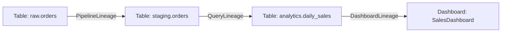

### 4.8 資料品質與可觀測性（Data Quality & Observability）

**資料剖析器（Data Profiler）** 擷取資料的統計樣貌（表與欄位的分布與描述統計），隨 profiler ingestion 執行，可輔助驗證假設，並支援自動 PII 標記與 Spark 引擎[^dq]。

**Metric** 是最小建構單元：對 Table 或 Column 執行的一次計算[^dq]。表級 metric 如 Row Count、Column Count；欄位級 metric 如 Values Count、Null Count、Distinct Count、Min/Max、Mean、Median、Sum、Standard Deviation、Histogram、四分位數等[^dq]。

**資料品質七大維度**[^dq]：

| 維度 | 說明 | 範例測試 |
|---|---|---|
| Completeness | 無缺失或 null | `columnValuesToBeNotNull` |
| Uniqueness | 無重複 | `columnValuesToBeUnique` |
| Validity | 符合業務規則／格式 | `columnValuesToMatchRegex`、`columnValuesToBeInSet` |
| Accuracy | 值正確（對齊真實來源） | 自訂 SQL 比對 |
| Consistency | 跨系統一致 | 跨表比對測試 |
| Timeliness | 資料新鮮 | `tableFreshnessCheck` |
| Integrity | 參照完整性 | 外鍵驗證測試 |

**四個品質實體**[^dq]：

- **TestDefinition**：可重複使用的測試模板，定義「檢查什麼」，OpenMetadata 內建 50+ 種[^dq]。
- **TestCase**：TestDefinition 的實例，套用到特定表／欄位並帶具體參數與結果[^dq]。狀態為 `Success`、`Failed`、`Aborted`、`Queued`[^dq]。
- **TestSuite**：測試案例群組，分為 **Executable**（綁定單一表、透過 pipeline 自動執行）與 **Logical**（跨表的使用者自訂群組、無 pipeline）[^dq]。
- **TestResult**：一次執行的結果，含時間戳、狀態、實際值、樣本資料[^dq][^concepts]。

**Profiling 與 Data Quality 的差異**[^dq]：

| 面向 | Data Profiler | Data Quality Tests |
|---|---|---|
| 目的 | 描述性：「資料長什麼樣？」 | 評估性：「資料是否符合我的規則？」 |
| 輸出 | 統計量、分布、直方圖 | Pass/Fail/Aborted 狀態 |
| 類比 | 拍照／量生命徵象 | 執行勾選清單 |
| 本質 | 計算並儲存 metric（無門檻） | 將 metric 與預設門檻比較 |

**測試結果流（端到端）**[^dq]：定義 TestDefinition → 實例化 TestCase → 組織成 TestSuite → 執行（管線完成或排程觸發）→ 記錄結果 → 失敗則自動開啟 Incident → 送 Alert → 在 Incident Manager 處理 → 留存歷史作為疑難排解手冊。

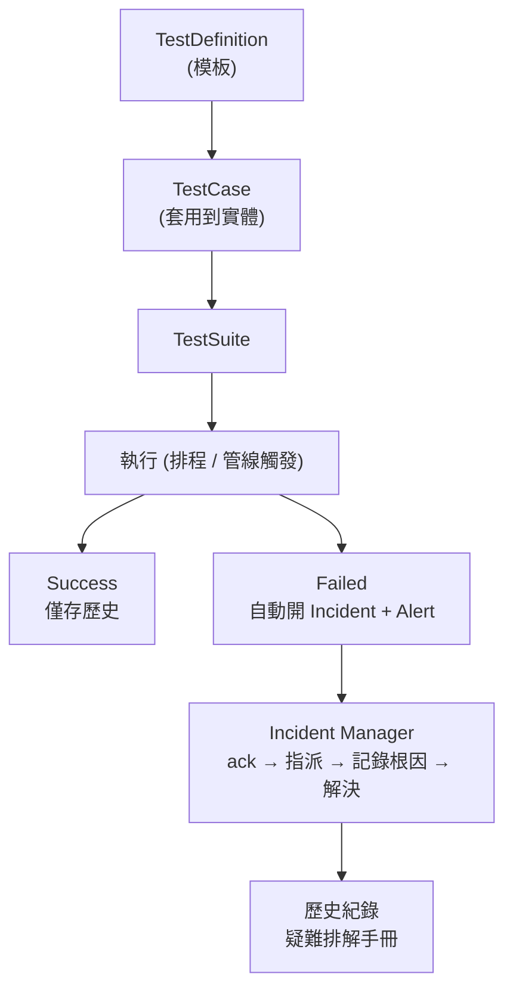

**Incident Manager** 集中處理失敗的資料品質測試：狀態由 `New` → 確認（ack）→ 指派 → `Resolved`[^dq]。歷史失敗紀錄成為團隊的疑難排解手冊[^dq]。

**告警（Alerts）** 透過統一的事件訂閱框架，分兩大類[^dq]：資料可觀測性（DQ 失敗、schema 變更、管線失敗、metric 更新）與系統治理（詞彙表變更、標籤更新、擁有權變更、任務提及）。目的地包含內部（Admins、Followers、Owners、Teams/特定使用者）與外部（Email、Slack、Microsoft Teams、Google Chat、通用 Webhook）[^dq]。

### 4.9 資料合約（Data Contract）

**Data Contract** 是資料生產者與消費者之間**正式、可版本化的協定**，定義資料資產的結構、品質、語意與 SLA，把隱含期待（例如「此欄位必有值」、「資料每日 6 點前更新」）轉為明示且可強制執行的條款[^dc]。每個資產**最多只能有一份自己的合約**[^dc]。

合約分為 **七大區段**，其中三個在執行時會被實際檢查[^dc]：

| 區段 | 定義 | 執行時檢查？ |
|---|---|---|
| Contract Details | 名稱、描述、擁有者、審核者、狀態 | 否 |
| Terms of Use | 允許／禁止的用途、GDPR/HIPAA 合規 | 否 |
| Schema | 欄位名稱、dataType、constraint、dataLength、描述 | 是 |
| Semantics | 以 JSON Logic 運算式評估的中繼資料規則 | 是 |
| Security | 資料分類（如 PII）、存取政策、列過濾 | 否 |
| Quality | 連結到合約的資料品質測試案例（僅表） | 是 |
| SLA | 更新頻率、最大延遲、可用時間、時區、保留期 | 否（未評估） |

**Schema 檢查**：型別以**家族（family）**比對（Text 家族含 STRING/VARCHAR/TEXT；Integer 家族含 INT/BIGINT/TINYINT）。缺少或重複欄位會使執行失敗；型別不符會被回報但不會失敗[^dc]。

**Semantics 檢查**：規則是以 JSON Logic 運算式對資產中繼資料評估，UI 提供的欄位包含 Owners、Display Name、Description、Domain、Tags、Glossary Term、Tier、Updated on、Updated by、Version、Status；運算式返回 `true` 才通過[^dc]。

**Quality 檢查**：儲存含測試案例的合約時，OpenMetadata 會建立一個 **test suite** 與一個**執行它的 pipeline**；每次合約執行都觸發該 pipeline；最新結果為 Failed 或 Aborted 的測試算作失敗[^dc]。

**執行狀態**：Running、Success、Failed、Aborted[^dc]。可透過 UI「Run now」、API `POST /v1/dataContracts/{id}/validate`、或排程（**Data Contract Validation** 應用預設每日午夜執行）觸發[^dc]。

**ODCS 關係**：OpenMetadata 支援以 **Open Data Contract Standard（ODCS）v3.1.0** 匯入／匯出合約（向下相容 v2.2.x、向上可讀 v3.2.0）[^dc]。轉換並非一對一，ODCS 有些欄位無對應（會回報「未匯入」）；ODCS 的品質規則會轉成 OpenMetadata 測試案例；廠商特定檢查（Soda、Great Expectations、dbt、Monte Carlo）會被儲存但不執行[^dc]。

**強制層級**[^dc]：

| 違規型別 | 強制 | 影響 |
|---|---|---|
| Schema 破壞性變更 | BLOCK | 管線無法繼續 |
| 品質失敗（Critical） | ALERT + BLOCK | 告警並阻擋管線 |
| 品質失敗（Warning） | ALERT + CONTINUE | 告警但管線繼續 |
| 新鮮度違規 | ALERT | 通知消費者 |
| 可用性違規 | ESCALATE | 通知待命工程師 |

**資料產品繼承**：僅屬於**恰好一個**資料產品的資產，會繼承該產品已核准的合約（含 semantics、security、SLA、terms of use，但**不含 schema 與 quality**）；資產若有自己的合約則優先使用自己的[^dc]。

### 4.10 治理與存取控制（RBAC + ABAC）

OpenMetadata 的授權由三個原語構成，回答三個問題：誰是使用者、要存取什麼、想做什麼[^gov]。

**Rule（規則）** 是授權的原子單位，包含[^gov]：

| 欄位 | 用途 |
|---|---|
| Name | 唯一識別 |
| Resources | 適用資源型別（如 `Table`、`All`） |
| Operations | 控制的動作（如 `ViewAll`、`EditTags`、`Delete`） |
| Condition | SpEL 運算式，需為 true 才適用 |
| Effect | `Allow` 或 `Deny` |

**Condition** 提供 ABAC 維度，可檢查資產屬性：`noOwner()`、`isOwner()`、`matchAllTags(...)`、`matchAnyTag(...)`、`matchTeam()`、`hasDomain()`，可用 `&&` / `||` 組合[^gov]。

**Policy（政策）** 是一組具名規則[^gov]：

- **衝突解決**：同一政策內規則衝突時，**Deny 永遠勝出**。
- **指派模型**：政策指派給**團隊**，不指派給個人；使用者加入團隊即繼承該團隊所有政策。
- **繼承**：政策沿團隊階層向下流動。
- **設計原則**：在階層頂端（Organization）設廣泛寬鬆規則，往下逐漸收嚴。

**Role（角色）** 是符合職務的**政策套裝**，可指派給個人使用者或整個團隊[^gov]。

| 面向 | Policy | Role |
|---|---|---|
| 是什麼 | 具名的一組**規則**（allow/deny） | 具名的一組**政策** |
| 指派對象 | **團隊**（沿階層繼承） | **使用者或團隊** |
| 用途 | 定義**允許什麼**存取 | 定義**誰**應具備那些權限（職務） |
| 粒度 | 細（每資源的個別規則） | 粗（整包政策） |

**檢視權限階層**（逐層疊加）[^gov]：`ViewBasic`（名稱、型別、擁有者）→ `ViewAll`（完整 schema、血緣、標籤）→ `ViewDataProfile`（欄位剖析統計）→ `ViewUsage`（查詢頻率與存取者）→ `ViewQueries`（實際 SQL）→ `ViewSampleData`（實際列級資料）→ `ViewTestCaseFailedRowsSample`（失敗測試的列）[^gov]。

**團隊階層**[^gov]：Organization → BusinessUnit → Division → Department → Group。**只有 Group 可以擁有資料資產**[^gov]。

**職責分離（Separation of Duties）**[^gov]：例如管線部署由資料工程師（Create/EditAll）與管線核准者（Deploy）分工；PII 標記由資料管家（EditTags）與合規人員（稽核）分工。

認證面向（Authentication）：人類使用者可經 SSO（Azure AD、Google、Okta、Auth0、LDAP、SAML 等）；機器人／服務帳號則以基於 SSL 憑證的 JWT token 認證[^gov]。

### 4.11 指標（Metric）與 KPI

**Metric** 記錄一個計算值的名稱、意義與公式／SQL。Metric 是**純文件性質**，OpenMetadata 只儲存定義，不計算數值[^gov]。屬性含 Name（camelCase，如 `customerRetentionRate`）、Display Name、Description、Expression（含語言標註 SQL/Python/Java）、Granularity（Daily/Weekly/Monthly）、Metric Type（Count/Average/Ratio/Percentage）、Unit of Measurement、Owner[^gov]。

**KPI** 則由 **Data Insights** 計算，追蹤平台健康狀態（例如「多少百分比的表有描述」）[^gov][^insights]。主要 KPI 類別為 **Completed Description** 與 **Completed Ownership**[^insights]。

### 4.12 資料探索（Data Discovery）

OpenMetadata 提供單一目錄，以關鍵字搜尋、關聯（常被一起 join 的表、血緣）與複雜查詢探索資料[^disc]。

- **階層檢視（Hierarchical View）**：依關係與依賴以結構化分層呈現，可展開／收合。**關鍵字搜尋**：`Ctrl+K` / `Cmd+K`，由 Elasticsearch 支援，比對名稱、描述、元件名稱[^disc]。
- **快速篩選**：依 Owner、Tag、Tier、Data Product、Service、Service Type、Database、Schema、Columns，甚至軟刪除資產[^disc]。
- **進階搜尋**：視覺化查詢建構器（免語法），以 Field + Operator + Criteria 組成多條件 AND/OR[^disc]。
- **探索關聯**：常被 join 的表／欄位（由 profiler 量測）與上下游血緣[^disc]。

資產詳情頁的頁籤包含 Schema、Activity Feeds & Tasks、Sample Data、Queries（僅表）、Data Observability（僅表）、Lineage、Custom Properties、Executions（僅 pipeline）、Features（僅 ML model）、Details（dashboard/ML model）[^disc]。

### 4.13 Context Center、MCP 與「開放情境層」

OpenMetadata 2.0 的定位是「AI 代理的開放情境層（The Open Context Layer for AI Agents）」[^mcp]。

**Context Center** 是公司情境的共享知識庫，含三類內容[^mcp]：

| 內容型別 | 說明 | MCP 可搜尋？ |
|---|---|---|
| Articles | 長篇頁面（政策、playbook、內部文件） | 否 |
| Memories | 短小的原子事實（偏好、runbook 步驟、FAQ） | 否（手動建立的記憶目前不支援） |
| Documents | 上傳檔案（PDF、試算表、合規稽核） | 是（會抽取「knowledge pills」） |

**Memories** 有五種類型：FAQ、Note、Preference、Runbook、Use Case；可見性分 Shared / Entity / Private；可連結資料資產；追蹤被引用次數；受 RBAC 的 **Context Memory** 資源治理[^mcp]。

**MCP Server** 暴露 14 個工具，分六類[^mcp]：

| 類別 | 工具 | 讀寫 |
|---|---|---|
| Discover | `search_metadata`、`semantic_search`、`company_context` | 讀 |
| Inspect | `get_entity_details`（可帶 include: context/lineage/quality/content） | 讀 |
| Context | `get_user_context`、`get_persona_context`、`find_context` | 讀 |
| Lineage & Impact | `get_entity_lineage`、`create_lineage`、`root_cause_analysis` | 讀+寫 |
| Create & Modify | `create_entity`、`describe_entity_type`、`patch_entity` | 寫 |
| Data Quality | `get_test_definitions`、`create_test_case` | 讀+寫 |

官方工作流程建議：已有 FQN 就從 `get_entity_details` 開始；沒有就先用 `search_metadata` 或 `semantic_search`，再把結果的 `fullyQualifiedName` 傳入 `get_entity_details`[^mcp]。

**語意搜尋（Semantic Search）** 是向量式的自然語言搜尋：查詢文字轉成向量嵌入（embedding provider：OpenAI、AWS Bedrock 或 DJL），由 OpenSearch/Elasticsearch 執行 **KNN** 相似度搜尋，結果依實體去重後回傳[^mcp]。

| 面向 | 關鍵字搜尋 | 語意搜尋 |
|---|---|---|
| 比對 | 精確關鍵字／文字 | 基於意義的相似度 |
| 查詢風格 | 具體關鍵字與篩選 | 自然語言問句 |
| 結果 | 含搜尋詞的文件 | 概念相關的文件 |
| 設定 | 預設可用 | 需啟用＋嵌入供應者 |

**與原始資料庫連接器的差異**[^mcp]：

| 面向 | 原始 DB 連接器 | OpenMetadata MCP Server |
|---|---|---|
| 資料 | 原始列級資料 | 關於資料的中繼資料 |
| 查詢方式 | SQL | 自然語言 → 語意搜尋或結構化查詢 |
| 業務情境 | 無 | 豐富（詞彙表、指標定義、政策、runbook、記憶） |
| 治理 | 通常無 | 完整 RBAC、SSO、稽核、bot 服務帳號 |
| 風險 | 直接 SQL 存取生產表 | 唯讀中繼資料，寫入受政策控制 |

---

## 五、系統架構與儲存

### 5.1 五大元件

OpenMetadata 由五個主要元件組成[^hld]：

| 元件 | 角色 |
|---|---|
| **API Server** | 核心支柱，以 **Jetty** 實作的 RESTful API，管理所有對中繼資料實體的互動，驗證資料、強制關聯，是所有消費者的單一介面 |
| **Ingestion Framework** | 與外部系統的介面，包含所有 **Connectors**，以 Python 實作，使用同一套 JSON Schema |
| **Entity Store（MySQL）** | 主要中繼資料儲存，以 JSON 文件存於各實體表（如 `table_entity`），另有 `entity_relationship` 表存圖邊 |
| **Search Engine（Elasticsearch/OpenSearch）** | 索引系統，驅動 UI 探索，讓使用者搜尋並找到中繼資料資產 |
| **UI** | 以探索為中心、團隊為中心的前端，使用 JSON Schema 產生的 TypeScript 型別 |

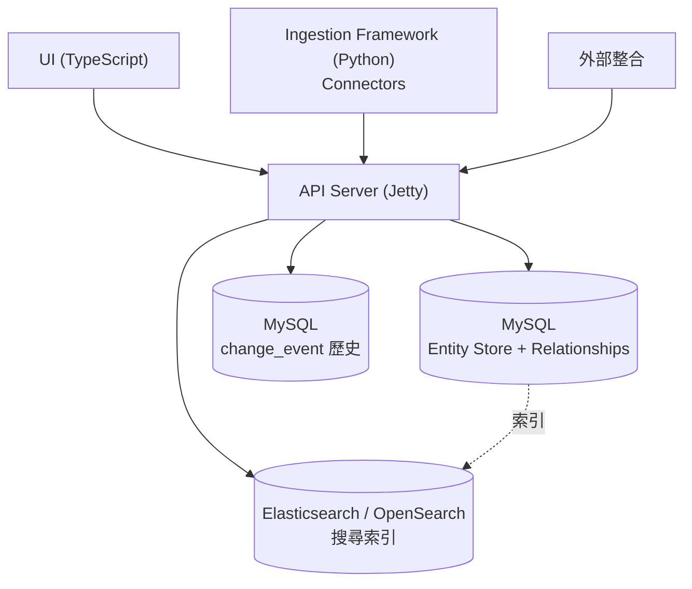

### 5.2 三層儲存的角色[^hld]

| 儲存 | 用途 |
|---|---|
| MySQL（Entity Store） | 所有實體與關聯的即時狀態 |
| Elasticsearch/OpenSearch | UI 探索與搜尋的索引 |
| MySQL（Change Events） | 歷史版本追蹤 |

### 5.3 API 結構

API 遵循一致的 RESTful 模式[^ma]：

```
GET    /api/v1/<collectionName>             # 列表（含篩選、分頁）
GET    /api/v1/<collectionName>/{id}        # 依 ID 取得
GET    /api/v1/<collectionName>/name/{fqn}  # 依 FQN 取得
POST   /api/v1/<collectionName>             # 建立
PUT    /api/v1/<collectionName>             # 建立或更新
PATCH  /api/v1/<collectionName>/{id}        # 依 ID 部分更新
DELETE /api/v1/<collectionName>/{id}        # 刪除（預設軟刪除）
```

所有實體共通的 API 特性：分頁（cursor 與 offset）、版本（`GET /{id}/versions`）、軟刪除與還原、`fields` 參數（`GET /{id}?fields=owner,tags,usageSummary`）[^ma]。

內部採用 **EntityResource + EntityRepository** 模式：前者處理 HTTP 請求、驗證 schema、管理認證；後者是 DAO 層，負責 CRUD、FQN 建構、關聯管理與變更事件[^ma]。

### 5.4 POST / PUT 流程

**POST（建立）**[^hld]：

1. `Prepare`：驗證資料、計算 FQN、檢查關聯
2. `Store`：剝除 href 屬性後將 JSON 文件存入實體表；將關聯圖邊存入 `entity_relationship`
3. 回傳建立的實體

**PUT（建立或更新）**[^hld]：若不存在則同 POST；若存在則只允許可變欄位變更（`id`、`name` 不可變），更新後寫回並視需要修改關聯。

### 5.5 內部 SDK

Python 的 `OpenMetadata` 類別（位於 `ometa/ometa_api.py`）由 **25+ mixins** 組成，模組化存取 API[^ingest]：`OMetaTableMixin`、`OMetaPipelineMixin`、`OMetaDashboardMixin`、`OMetaPatchMixin`、`OMetaTagGlossaryMixin`、`OMetaServiceMixin`、`OMetaLineageMixin` 等[^ingest]。

---

## 六、關鍵術語對照表

| 英文 | 中文 | 一句話定義 |
|---|---|---|
| Entity | 實體 | 中繼資料的基礎物件，具 id/name/fqn/version |
| Data Asset | 資料資產 | 承載資料的實體（Table、Dashboard 等） |
| Service | 服務 | 與外部系統的連線，是容器階層的根 |
| Connector | 連接器 | 擷取特定來源中繼資料的元件 |
| FQN | 完整限定名稱 | 由階層推導的唯一名稱 |
| Governance | 治理 | 詞彙表、標籤、領域、政策、合約等管理 |
| Glossary / GlossaryTerm | 詞彙表／術語 | 業務概念的受控詞彙，可嵌套 |
| Classification / Tag | 分類／標籤 | 資料型別的標記系統 |
| Domain | 領域 | 業務範圍，支援分散式擁有權 |
| Data Product | 資料產品 | 策展過的資產集合，屬某一領域 |
| Data Contract | 資料合約 | 生產者與消費者間正式可強制執行的協定 |
| Lineage | 血緣 | 資料流的有向圖（實體級／欄位級） |
| TestDefinition / TestCase / TestSuite | 測試定義／案例／套件 | 資料品質檢查的模板、實例、群組 |
| Profiler | 剖析器 | 擷取資料統計樣貌 |
| Incident | 事故 | 品質測試失敗後的處理單 |
| Policy | 政策 | 一組規則，指派給團隊 |
| Role | 角色 | 一組政策，對應職務 |
| Persona | 人物誌 | 使用者原型，用於客製登陸頁 |
| Bot | 機器人 | 服務帳號 |
| Context Center | 情境中心 | 公司知識庫（文章／記憶／文件） |
| MCP | 模型情境協定 | AI 助理存取中繼資料的標準介面 |
| ODCS | 開放資料合約標準 | 合約的跨工具交換格式 |

---

## 七、建議的學習路徑

建立心智模型的建議順序：

1. **先懂 Schema-First 與三種表示**：理解 JSON Schema 為何是唯一真實來源。
2. **再懂 Entity / Service / FQN**：畫出資料庫階層的樹狀圖，理解 FQN 的組成。
3. **接著懂屬性與關聯分離**：理解 `entity_relationship` 圖的意義。
4. **然後學治理四件套**：Glossary、Classification、Domain、DataContract。
5. **再學品質與血緣**：Profiler vs TestCase、實體級 vs 欄位級血緣。
6. **最後學存取控制與 MCP**：Rule → Policy → Role 的堆疊，以及 AI 如何透過 MCP 取用情境。

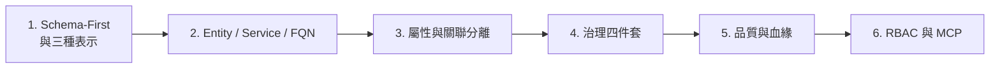

---

## 八、批判性反思（Critical Reflection）

在閱讀上述內容時，需注意以下幾點：

1. **來源性質偏官方**：本報告主要事實來自 OpenMetadata 官方文件與官方規格網站[^llms][^standards]，以及專案自己的 GitHub README[^gh]。這些來源在描述「OpenMetadata 是什麼、怎麼運作」上具權威性，但在「它比其他方案更好」這類比較性論述上帶有明顯行銷立場（例如「largest and fastest-growing」等用語）[^gh]。讀者應將功能描述與行銷評價分開看待。

2. **版本時效性**：本報告以 v2.0.x 為主。官方文件另提供 v1.13.x 與 v2.1.x-SNAPSHOT 版本索引[^llms]，不同版本的實體與功能可能略有差異。最新發布為 2.0.5（2026-10-08）[^rel]。使用前應確認自己所部署版本的對應文件。

3. **數字需保留彈性**：官方文件同時出現「911 份 JSON Schema」「100+ entity schemas」「130+ connectors」「150+ service connection schemas」「50+ built-in test definitions」等多組數字[^gh][^ma][^standards][^dq]，這些是隨版本變動的估計值，不應視為精確常數。

4. **部分概念仍在演進**：Context Center、MCP、語意搜尋等是 2.0 的新焦點。文件中對這些功能的描述（例如 MCP 目前不搜尋手動建立的 Memories）顯示功能仍在快速迭代，可能存在版本間行為差異[^mcp]。

5. **已盡力避免臆測**：本報告未找到官方對「pull-based / push-based / hybrid」世代論述的一手頁面（相關部落格頁面回傳 403），因此未在報告中納入該部分細節，而非憑印象補述[^gh]。

---

## 參考文獻

[^gh]: OpenMetadata. (n.d.). *OpenMetadata: The Open Context Layer for Data and AI* [Repository]. GitHub. Retrieved 2026-10-14, from https://github.com/open-metadata/OpenMetadata

[^llms]: OpenMetadata. (n.d.). *OpenMetadata Documentation: Documentation index*. Retrieved 2026-10-14, from https://docs.open-metadata.org/llms.txt

[^hld]: OpenMetadata. (n.d.). *High Level Design*. OpenMetadata Documentation. Retrieved 2026-10-14, from https://docs.open-metadata.org/v2.0.x/main-concepts/high-level-design

[^ma]: OpenMetadata. (n.d.). *Main Concepts*. OpenMetadata Documentation. Retrieved 2026-10-14, from https://docs.open-metadata.org/v2.0.x/main-concepts

[^standards]: OpenMetadata. (n.d.). *Metadata Specifications Overview*. OpenMetadata Standards. Retrieved 2026-10-14, from https://openmetadatastandards.org/metadata-specifications/overview/

[^concepts]: OpenMetadata. (n.d.). *Core Concepts*. OpenMetadata Standards. Retrieved 2026-10-14, from https://openmetadatastandards.org/getting-started/core-concepts/

[^ingest]: OpenMetadata. (n.d.). *Metadata Ingestion deep dive*. OpenMetadata Documentation. Retrieved 2026-10-14, from https://docs.open-metadata.org/v2.0.x/developers/contribute/codebase-deep-dives/metadata-ingestion

[^gov]: OpenMetadata. (n.d.). *Building Blocks of Authorization: Rules, Policies, and Roles*. OpenMetadata Documentation. Retrieved 2026-10-14, from https://docs.open-metadata.org/v2.0.x/how-to-guides/admin-guide/roles-policies/authorization

[^lin]: OpenMetadata. (n.d.). *Data Lineage*. OpenMetadata Documentation. Retrieved 2026-10-14, from https://docs.open-metadata.org/v2.0.x/how-to-guides/data-lineage

[^dq]: OpenMetadata. (n.d.). *Data Quality and Observability*. OpenMetadata Documentation. Retrieved 2026-10-14, from https://docs.open-metadata.org/v2.0.x/how-to-guides/data-quality-observability

[^dc]: OpenMetadata. (n.d.). *Data Contracts*. OpenMetadata Documentation. Retrieved 2026-10-14, from https://docs.open-metadata.org/v2.0.x/how-to-guides/data-contracts

[^disc]: OpenMetadata. (n.d.). *Data Discovery*. OpenMetadata Documentation. Retrieved 2026-10-14, from https://docs.open-metadata.org/v2.0.x/how-to-guides/data-discovery

[^mcp]: OpenMetadata. (n.d.). *MCP Server*. OpenMetadata Documentation. Retrieved 2026-10-14, from https://docs.open-metadata.org/v2.0.x/how-to-guides/mcp

[^market]: OpenMetadata. (n.d.). *Data Marketplace*. OpenMetadata Documentation. Retrieved 2026-10-14, from https://docs.open-metadata.org/v2.0.x/how-to-guides/data-marketplace

[^insights]: OpenMetadata. (n.d.). *Data Insights*. OpenMetadata Documentation. Retrieved 2026-10-14, from https://docs.open-metadata.org/v2.0.x/how-to-guides/data-insights

[^rel]: OpenMetadata. (2026). *Releases*. OpenMetadata Documentation. Retrieved 2026-10-14, from https://docs.open-metadata.org/v2.0.x/releases
