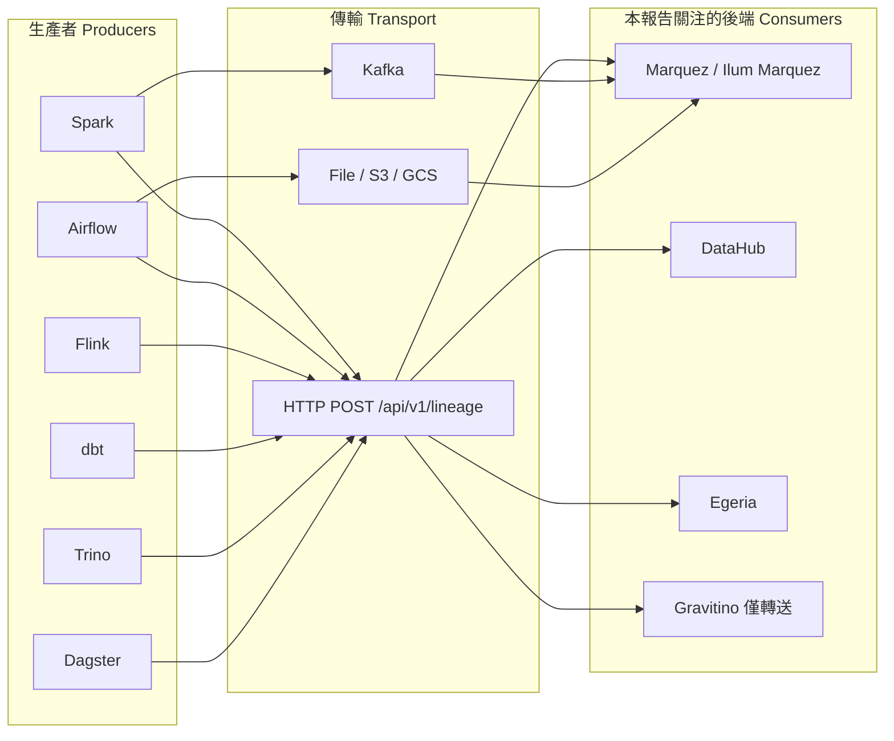

# OpenLineage 的 FOSS 後端替代方案：除了 Marquez 之外還有什麼？

## 摘要

OpenLineage 是一個由 Linux Foundation 旗下 LF AI & Data 託管的開放標準，用於定義資料血緣 (lineage) 與中繼資料 (metadata) 的收集格式，其核心是一個極簡的 REST 規範：只有一個端點 `POST {urlroot}/api/v1/lineage`，接收單一 OpenLineage RunEvent 作為請求主體[^ol-spec-api]。任何「後端 (consumer/backend)」只要能接收這種事件並儲存、查詢、視覺化，就是 OpenLineage 生態的一員。

問題在於：**真正原生接收任意 OpenLineage 事件、不需為每個資料來源額外撰寫連接器 (connector/Service)、並且附帶可用 Web UI 的開源後端，數量極少。** 參考實作 Marquez 是最標準的選擇，但其 Web UI 長期被使用者抱怨過於陽春且充滿 bug，且上游自 2024 年 10 月以來已近一年沒有正式發版[^marquez-releases]。本報告系統性盤點 2026 年 10 月市場上所有已知的 FOSS 選項，逐一檢視它們是否「原生吃 OpenLineage 標準事件」、授權、活躍度與 UI 品質。

**主要結論：**

- 唯一同時滿足「原生接收任意 OpenLineage 事件」＋「成熟 Web UI」＋「活躍維護」的專案是 **DataHub**（`POST /openapi/openlineage/api/v1/lineage`），但官方明言這不是完整的 OpenLineage spec 實作[^datahub-ol]。
- **Marquez** 是最完整的標準實作，但 UI 脆弱；其社群維護分支 **Ilum Marquez**（後端改寫為 Rust）持續發版，是上游停滯時的實用替代[^ilum-readme]。
- **Egeria** 原生實作 OpenLineage REST API，但屬於超大型企業治理平台，作為單純後端過重[^egeria-ol]。
- **Apache Gravitino** 只做中繼轉送，不儲存、不查詢、無血緣 UI，不能當後端[^gravitino-lineage]。
- 輕量級選項（**marquito**、**open-lineage-proxy**、**openlineage-visualizer**）star 數極低，僅適合開發除錯或實驗。
- 大量常被提及的專案（Apache Atlas、ODD Platform、Spline、Amundsen）**並不原生吃 OpenLineage 標準事件**，屬於本報告需明確排除的類型。

---

## 背景：什麼才算「OpenLineage 標準的完整實作」？

在評估替代方案前，必須先明確定義判準，否則很容易把「有血緣功能的資料目錄」誤認為 OpenLineage 後端。

OpenLineage 標準的核心運作方式：生產者 (producer，例如 Spark、Airflow、dbt 的整合套件) 透過 transport 把 `RunEvent` 送到某個 URL，規範本身只定義了單一端點[^ol-spec-api]：

```text
POST {urlroot}/api/v1/lineage
Body: 單一 OpenLineage RunEvent (JSON)
```

一個事件包含 `eventType`（START / RUNNING / COMPLETE / FAIL / ABORT 等）、`eventTime`、`run`（含 runId 與 run facets）、`job`（含 namespace、name 與 job facets）、`inputs` 與 `outputs`（資料集清單與 dataset facets），以及 `producer`、`schemaURL` 等欄位[^ol-spec-api]。

因此「真正相容的後端」應該做到：

1. **通用入口**：直接接受任意符合規範的 RunEvent，而**不需要**為每一種資料來源實作專屬的連接器或「Service」。
2. **物件模型對應**：能把「任意」namespace 下的 dataset / job / run 建立成物件，而不是只認得自己支援的那幾種資料源。
3. **可查詢與可視覺化**：提供 API 與 UI 讓使用者瀏覽血緣圖。
4. **標準演進相容**：能跟上 OpenLineage 規範版本（目前為 `2-0-2`）[^marquez-compat]。

不符合第 1 點的方案，本質上仍是「資料目錄 + 逐源連接器」模型。使用者若要求資料治理對象「千奇百怪」都能被治理，這種需要為每個對象補實作的方案就會失效。

下圖說明 OpenLineage 的架構位置，以及本報告鎖定的「consumer/backend」角色：



---

## 候選方案逐一分析

### 1. Marquez（參考實作，基準線）

| 項目 | 內容 |
|---|---|
| 來源 | [github.com/MarquezProject/marquez](https://github.com/MarquezProject/marquez) |
| 授權 | Apache-2.0 |
| 語言 | Java |
| Star 數 | 約 2,290 |
| 原生 OL 端點 | 是（`/api/v1/lineage`，規範參考實作） |
| 最新版本 | 0.50.0（2024-10-23） |

Marquez 是 OpenLineage 的參考實作與 LF AI & Data 畢業專案，直接提供 OpenLineage 相容端點，並以 PostgreSQL 儲存 dataset / job / run 的中繼資料，附帶 React Web UI、GraphQL (beta) 與 HTTP API[^marquez-readme]。相容性上，0.50.0 對應 OpenLineage `2-0-2`[^marquez-compat]。

然而其缺點正是使用者抱怨的核心：

- **上游停滯**：最新釋出為 0.50.0（2024-10-23），此後長期沒有新版本；維護者在討論中甚至直接建議使用者改用 Ilum 分支[^marquez-issues]。
- **UI 脆弱**：社群 issue 顯示多起崩潰與空白頁問題，例如當 `job.latestRuns` 為空時 React `reduce()` 沒有初始值導致整個 UI 崩潰、血緣檢視回傳 HTTP 500、欄位血緣的 transformation 明細永遠顯示為 null、刪除 job 導致無關 dataset 出現在血緣圖上等[^marquez-issues]。
- **特殊字元地雷**：當 namespace 使用含冒號的 URI（例如 `oracle://host:1521/db`）時，因解析以 `:` 為分隔，欄位血緣與 dataset 血緣無法檢視[^marquez-issues]。

即便有這些問題，Marquez 仍是「最標準、最通用」的後端，因此是後續所有替代方案的比較基準。

### 2. Ilum Marquez（社群維護分支，後端 Rust 化）

| 項目 | 內容 |
|---|---|
| 來源 | [github.com/ilum-cloud/marquez](https://github.com/ilum-cloud/marquez) |
| 授權 | Apache-2.0 |
| 語言 | Java（Rust 重寫後端） |
| Star 數 | 約 18 |
| 原生 OL 端點 | 是（100% 相容上游 API） |
| 最新版本 | 0.54.1（2026-10-01） |

這是 Ilum 在 Marquez 上游開發放緩期間建立的分支，訴求是「不破壞相容性地補上關鍵修補與附加功能」，並自 0.52.x 起回頭對上游貢獻[^ilum-readme]。技術上最重要的差異是：自 0.54.x 起，API 後端改以 Rust（Axum / SQLx / tokio）重寫，取代原本的 Java Dropwizard，官方說法是效能更好、資源佔用更低；同時新增了上游沒有的 Search API[^ilum-readme]。

它仍然接收原生 OpenLineage 事件，後端相容 OpenLineage `2-0-2`，Ilum 平台中每個 Spark 工作都會自動掛上 OpenLineage listener 並指向 Marquez 的 `/api/v1/lineage`[^ilum-readme]。

**關鍵警告**：Ilum 分支 repo 內的 `web/` 目錄**仍舊是原本的 Marquez Web UI（marquez-web）**，並沒有換成 Ilum 自家那套進階血緣 UI。Ilum 文件明言：「我們不使用 marquez-web；我們在 Ilum 執行自己的 UI，並計畫開源」[^ilum-readme][^ilum-org]。也就是說，Ilum 那套主打智慧 job 分群、medallion 分層標示、ERD↔Lineage 切換、運維疊圖的 UI，**目前仍屬商業平台專有，尚未開源**[^ilum-org]。因此若使用 `ilum-cloud/marquez`，得到的是「更新、更快、持續發版的後端」，但前端體驗仍受制於同一套上游 marquez-web。

> 由於後端 100% 相容上游 API，實務上可以「Ilum 後端 + 任何相容 Marquez API 的前端」混搭，這是它最大的價值。

### 3. DataHub（唯一同時原生 + 成熟 UI + 活躍的選項）

| 項目 | 內容 |
|---|---|
| 來源 | [github.com/datahub-project/datahub](https://github.com/datahub-project/datahub) |
| 授權 | Apache-2.0 |
| 語言 | Python |
| Star 數 | 約 12,840 |
| 原生 OL 端點 | 是（`POST /openapi/openlineage/api/v1/lineage`） |
| 活躍度 | 極活躍（每日推送） |

DataHub 提供一個原生 REST 端點，可直接接收標準 OpenLineage 事件，將任意被 instrument 的引擎送來的事件轉成自己的中繼資料模型[^datahub-ol]。支援範圍相當廣：

- 資料表層級血緣與**欄位層級血緣**（預設開啟，`DATAHUB_OPENLINEAGE_CAPTURE_COLUMN_LEVEL_LINEAGE=true`）
- Run 事件（START / COMPLETE / FAIL 等）
- `dataSource`、`schemaMetadata`、`processing_engine` 等標準 facet
- schema metadata（預設開啟）、file partition、patch 模式（選擇性）、domain 指派等

**但它不是完整的 OpenLineage spec 實作**，官方文件明確列出限制[^datahub-ol]：

- **無 PathSpec 支援**：HDFS/S3/GCS/Azure 路徑式的 dataset URN 對應，只在 DataHub Cloud 的 Spark 外掛中有，通用 REST 端點沒有。
- **自訂 facet 支援不明**：文件未說明是否儲存任意自訂 facet，未知 facet 很可能被靜默丟棄。
- **transformation 型別對應**：OpenLineage 欄位血緣 facet 的 transformation 類型對應，只在 Spark 外掛中完整；通用端點較弱。
- **官方反向建議**：對 Spark 與 Airflow，DataHub 反而建議改用其自家外掛（Spark Lineage、DataHub Airflow plugin）而非通用端點。
- **domain 只能在端點層指派**：因 OpenLineage 沒有 domain facet，分類無法隨事件傳遞，只能靠環境變數在端點層級指定，且會覆蓋既有指派。

換言之，DataHub 是「最成熟的通用接收端」，但若追求**規範完整性**（尤其 PathSpec 與自訂 facet）仍非滿分。

### 4. Egeria（原生實作規範，但極為笨重）

| 項目 | 內容 |
|---|---|
| 來源 | [github.com/odpi/egeria](https://github.com/odpi/egeria) |
| 授權 | Apache-2.0 |
| 語言 | Java |
| Star 數 | 約 925 |
| 原生 OL 端點 | 是（`POST {urlroot}/api/v1/lineage`） |
| 活躍度 | 極活躍（每月發版與電子報） |

Egeria 由 LF AI & Data 託管，實作了標準的 OpenLineage REST API，並明確描述規範：「REST API 只有一個操作 `{{urlroot}}/api/v1/lineage`，接收單一事件作為請求主體」，第三方處理引擎可直接把事件 POST 進來，**不需為每個來源寫連接器**[^egeria-ol]。它也支援透過 Kafka 接收（以 OpenLineage proxy 側車模式），並提供 Lineage Explorer 血緣視覺化 UI，具備歷史時間軸滑桿、欄位級血緣、端到端血緣圖等功能[^egeria-ol]。

問題在於規模：Egeria 是完整企業級中繼資料治理平台，包含整合常駐程式 (integration daemon)、引擎主機、metadata access point、view server、治理動作服務、重複偵測 (Mendel)、依賴彙總 (Darwin)、內容包與數百種實體型別[^egeria-ol]。若只是要「收 OpenLineage 事件並看血緣圖」，這是嚴重殺雞用牛刀；官方亦承認若需求單純，Marquez 遠更簡單[^egeria-ol]。

### 5. Apache Gravitino（只轉送，不能當後端）

| 項目 | 內容 |
|---|---|
| 來源 | [github.com/apache/gravitino](https://github.com/apache/gravitino) |
| 授權 | Apache-2.0 |
| 語言 | Java |
| Star 數 | 約 3,248 |
| 原生 OL 端點 | 有入口 (`POST /api/lineage`)，但僅為轉送 |
| 儲存 / UI | 無儲存、無查詢、無血緣 UI |

Gravitino 伺服器提供可插拔的血緣框架，內部流程為 Source → Processor → Sink 三段：預設 `HTTPLineageSource` 在 `/api/lineage` 接收 OpenLineage RunEvent，`NoopProcessor` 原樣通過，再交給 sink[^gravitino-lineage]。預設 sink 是寫入 log 檔，另一個 `LineageHttpSink` 則把事件**轉送到外部 OpenLineage HTTP 伺服器，文件舉例正是 Marquez**[^gravitino-lineage]。

它沒有資料庫儲存、沒有查詢 API、沒有血緣 UI；其 Web UI 具備 catalog、metalake、角色、政策等頁面，但**沒有血緣頁面**[^gravitino-lineage]。因此 Gravitino 的角色是「中繼轉接層」，適合在事件進入 Marquez 之前做改寫或分派，而非後端替代品。

### 6. 輕量／實驗性選項

以下專案能原生接收 `POST /api/v1/lineage`，但 star 數極低、成熟度不足，僅適合開發除錯或自建參考。

**marquito** — [github.com/celine-eu/marquito](https://github.com/celine-eu/marquito)

Python / FastAPI 版本的 Marquez API 移植，明確定位為「Marquez 的極簡替代品，用以透過 HTTP 儲存血緣並在原生 Marquez UI 瀏覽」[^marquito-readme]。它提供 `POST /api/v1/lineage` 接收事件，並實作 namespaces、sources、datasets、jobs、runs、血緣圖查詢、搜尋、標籤、統計與 GraphQL[^marquito-readme]。特色是「相容 Marquez web 前端」，也就是用它可以搭配既有 Marquez UI。但 repo 描述為 "Experimental Marquez API python clone"，star 數為 0，2026 年建立後推送有限[^marquito-api]。

**open-lineage-proxy** — [github.com/senthilsweb/open-lineage-proxy](https://github.com/senthilsweb/open-lineage-proxy)

Next.js 代理，接收 `POST /api/v1/lineage` 後把事件存成 JSON 檔（依 run ID 命名），並附帶一個獨立血緣圖檢視器（`lineage-designer.html`，零依賴、支援搜尋、縮放、run 篩選）[^olproxy]。授權 MIT，但 star 數 0、單一開發者，README 自述「本代理僅供除錯與開發用途，正式環境請考慮 Marquez 等專用後端」[^olproxy]。

**openlineage-visualizer** — [github.com/entropy-data/openlineage-visualizer](https://github.com/entropy-data/openlineage-visualizer)

純前端（React Flow）視覺化元件，從靜態 JSON URL 讀取事件，**沒有後端端點、沒有持久化**[^olviz]。適合嵌入既有儀表板，但非後端。star 數 2、授權未明。

**LineageViewer** — [github.com/DataVisuals/LineageViewer](https://github.com/DataVisuals/LineageViewer)

React + Cytoscape.js 前端，具備八種佈局演算法與搜尋，但**連線到 Marquez API 取資料，本身無後端**[^lv]。可視為 Marquez UI 的可能前端替代，但非獨立後端。star 數 2、無授權檔。

---

### 需明確排除：不原生吃 OpenLineage 標準事件的專案

使用者特別強調要排除「需要自己實作 Service 才支援」的糟糕方案，以下專案即屬此類，**不應**被列為 OpenLineage 後端替代：

| 專案 | 為何排除 |
|---|---|
| **OpenMetadata** | 以 Kafka / Kinesis 連接器消費事件，不是通用 HTTP 端點；使用者已明確排除 |
| **Apache Atlas** | 無原生 OpenLineage 端點，採自家 hook/bridge 模型；社群 Jira 提案（ATLAS-4550）未實作 |
| **ODD Platform** | 採用自家 ODD Specification，需逐源 collector/adapter，不接收通用 OpenLineage 事件[^odd] |
| **Spline** | 使用自家 producer API（REST/Kafka）而非 OpenLineage 標準端點；其 `spline-openlineage` 轉接器最後推送為 2022 年，star 數 6，實質停滯[^spline][^spline-ol] |
| **Amundsen** | 僅有 `OpenLineageTableLineageExtractor` 由事件抽取血緣；且 repo 已封存 (archived)，不再接受變更[^amundsen] |
| **Grai** | 提供 source-openlineage 整合，但屬「從既有 OpenLineage 後端單向同步進 Grai」，本身非通用後端；star 數 317[^grai] |

---

## 綜合比較表

| 專案 | 原生接收任意 OL 事件 | 有儲存/查詢 | 有血緣 UI | 授權 | Star | 活躍度 | 適合定位 |
|---|---|---|---|---|---|---|---|
| **Marquez** | 是（參考實作） | 是（PostgreSQL） | 是（脆弱） | Apache-2.0 | ~2,290 | 上游停滯 | 標準基準 |
| **Ilum Marquez** | 是（相容上游） | 是 | 沿用 marquez-web | Apache-2.0 | ~18 | 活躍（Rust 後端） | 上游停滯時的後端替代 |
| **DataHub** | 是（通用端點） | 是 | 是（成熟） | Apache-2.0 | ~12,840 | 極活躍 | 通用接收 + 完整目錄 |
| **Egeria** | 是（標準 REST API） | 是 | 是（Lineage Explorer） | Apache-2.0 | ~925 | 極活躍 | 企業級治理平台 |
| **Gravitino** | 僅轉送 | 否 | 否 | Apache-2.0 | ~3,248 | 極活躍 | 事件中繼/改寫層 |
| **marquito** | 是 | 是 | 相容 Marquez UI | Apache-2.0 | 0 | 實驗 | 輕量自架/研究 |
| **open-lineage-proxy** | 是 | 檔案式 | 有（簡易） | MIT | 0 | 玩具 | 除錯/開發 |
| **OL Visualizer** | 否（靜態 JSON） | 否 | 有（僅前端） | 未明 | 2 | 低 | 嵌入元件 |
| **LineageViewer** | 否（需 Marquez） | 否 | 有（僅前端） | 無 | 2 | 低 | Marquez 前端替代 |

---

## 決策建議

### 若優先追求「規範完整度」

留在 **Marquez** 家族，並改用 **Ilum Marquez** 分支取得持續修補與效能改進；前端可考慮外掛相容 Marquez API 的第三方檢視器。這是目前唯一 100% 忠實實作 OpenLineage 標準、又能接受任意事件的組合。

### 若優先追求「成熟 UI + 原生通用入口」

採 **DataHub**。它能直接把任意 OpenLineage 事件丟到 `POST /openapi/openlineage/api/v1/lineage`，UI 成熟、生態龐大，但需接受 PathSpec 與自訂 facet 的規範缺口，且系統較重（MySQL + Elasticsearch + Kafka）。

### 若已在企業治理體系內

採 **Egeria**。它以標準 OpenLineage REST API 接收事件，並提供長線治理能力（去重、依賴彙總、雙向血緣發布），代價是極高的架構複雜度。

### 不建議

- 任何需要「為每個資料來源實作專屬 Service/connector」才支援的方案（OpenMetadata、Atlas、ODD、Spline 等），因為這與「資料治理對象千奇百怪」的需求本質衝突。
- 以 0～2 star 的實驗專案作為正式環境後端。

### 值得觀察

- **Ilum 是否如期開源其自家血緣 UI**：若開源，將直接補上 Marquez 家族最弱的一環[^ilum-org]。
- **DataHub 通用端點是否補上 PathSpec 與自訂 facet 支援**：這會使其從「成熟接收端」升級為「完整規範實作」。
- **Marquez 上游是否恢復發版**：目前維護者已公開建議轉向 Ilum 分支，短期難見轉機[^marquez-issues]。

---

## 方法與來源反思

本報告全部事實均來自 2026-10-14 當日以 Web Fetch 取得的官方文件、GitHub API 與 issue 追蹤。Star 數、授權、活躍狀態皆以 GitHub REST API 當日回傳為準，數字會隨時間變動；OpenLineage 規範版本、Marquez 相容性與各專案限制則以官方文件為依據。

需要留意的偏誤：(1) AI 摘要工具對「某專案是否原生支援 OpenLineage」的判斷曾有前後不一致之處，例如 DataHub 一度被描述為「僅透過 ingestion 間接支援」，經查官方文件後確認其確實提供原生 REST 端點，本報告以官方文件為準；(2) star 數會高估知名度、低估成熟度，故本報告同時標註最後推送時間與封存狀態；(3) 部分非官方比較文章（如第三方部落格）未經採用，僅採用第一方專案文件與 GitHub API 資料，以降低二手資訊風險。

---

[^ol-spec-api]: OpenLineage. (n.d.). OpenLineage API. Retrieved 2026-10-14, from https://openlineage.io/docs/spec/api/

[^marquez-readme]: MarquezProject. (n.d.). Marquez: Collect, aggregate, and visualize a data ecosystem's metadata [README]. GitHub. Retrieved 2026-10-14, from https://github.com/MarquezProject/marquez

[^marquez-compat]: MarquezProject. (n.d.). Versions and OpenLineage compatibility [README section]. GitHub. Retrieved 2026-10-14, from https://github.com/MarquezProject/marquez#versions-and-openlineage-compatibility

[^marquez-releases]: MarquezProject. (n.d.). Releases. GitHub. Retrieved 2026-10-14, from https://github.com/MarquezProject/marquez/releases

[^marquez-issues]: MarquezProject. (n.d.). Issues. GitHub. Retrieved 2026-10-14, from https://github.com/MarquezProject/marquez/issues

[^ilum-readme]: Ilum. (n.d.). Marquez (Ilum fork) [README]. GitHub. Retrieved 2026-10-14, from https://github.com/ilum-cloud/marquez

[^ilum-org]: Ilum. (n.d.). GitHub organization repositories. GitHub. Retrieved 2026-10-14, from https://github.com/orgs/ilum-cloud/repositories

[^datahub-ol]: DataHub. (n.d.). OpenLineage. DataHub Documentation. Retrieved 2026-10-14, from https://docs.datahub.com/docs/lineage/openlineage

[^egeria-ol]: Egeria Project. (n.d.). Lineage management overview. Retrieved 2026-10-14, from https://egeria-project.org/features/lineage-management/overview/

[^gravitino-lineage]: Apache Software Foundation. (n.d.). Gravitino lineage. Apache Gravitino Documentation. Retrieved 2026-10-14, from https://gravitino.apache.org/docs/latest/lineage/lineage/

[^marquito-readme]: celine-eu. (n.d.). marquito [README]. GitHub. Retrieved 2026-10-14, from https://github.com/celine-eu/marquito

[^marquito-api]: GitHub. (2026). Repository metadata: celine-eu/marquito [Data set]. Retrieved 2026-10-14, from https://api.github.com/repos/celine-eu/marquito

[^olproxy]: senthilsweb. (n.d.). open-lineage-proxy [README]. GitHub. Retrieved 2026-10-14, from https://github.com/senthilsweb/open-lineage-proxy

[^olviz]: entropy-data. (n.d.). openlineage-visualizer [README]. GitHub. Retrieved 2026-10-14, from https://github.com/entropy-data/openlineage-visualizer

[^lv]: DataVisuals. (n.d.). LineageViewer [README]. GitHub. Retrieved 2026-10-14, from https://github.com/DataVisuals/LineageViewer

[^odd]: Open Data Discovery. (n.d.). ODD Platform [README]. GitHub. Retrieved 2026-10-14, from https://github.com/opendatadiscovery/odd-platform

[^spline]: AbsaOSS. (n.d.). Spline: Data lineage tracking and visualization solution [README]. GitHub. Retrieved 2026-10-14, from https://github.com/AbsaOSS/spline

[^spline-ol]: AbsaOSS. (n.d.). spline-openlineage: Open Lineage integration for Spline [README]. GitHub. Retrieved 2026-10-14, from https://github.com/AbsaOSS/spline-openlineage

[^amundsen]: Amundsen. (n.d.). Amundsen [README]. GitHub. Retrieved 2026-10-14, from https://github.com/amundsen-io/amundsen

[^grai]: Grai. (n.d.). grai-core [README]. GitHub. Retrieved 2026-10-14, from https://github.com/grai-io/grai-core
