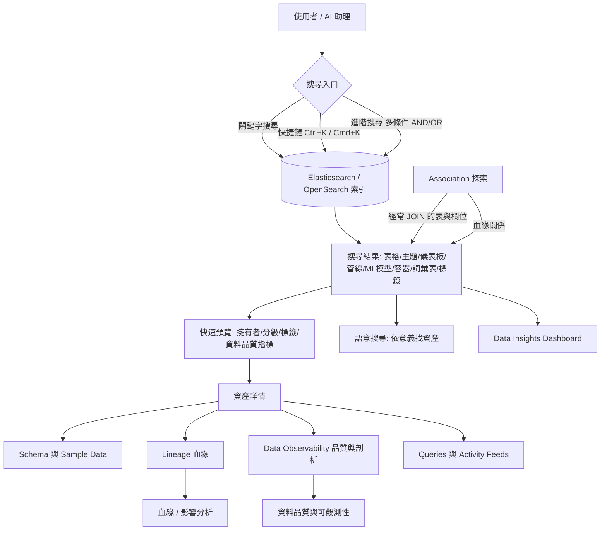

# OpenMetadata 中的 Data Discovery（資料探索）

## 摘要

OpenMetadata 是一套開源的後設資料（metadata）管理與資料目錄（data catalog）平台[^repo]。在其功能版圖中，**Data Discovery（資料探索）**指的是一整套讓使用者「找到並理解」組織內各種資料資產的能力，核心是以關鍵字搜尋（keyword search）、關聯探索（association，例如經常被一起 JOIN 的表、血緣 lineage）與複雜查詢（complex queries）為策略，跨表格、主題、儀表板、管線、ML 模型、容器、詞彙表與標籤進行搜尋[^discovery]。本報告說明 Data Discovery 的定義、組成子功能、搜尋底層機制與相關延伸能力。

---

## 1. 背景：OpenMetadata 是什麼

OpenMetadata 自我定位為「AI 的開放情境層（The Open Context Layer for AI）」，將技術後設資料、資料品質訊號、血緣、欄位級血緣、擁有者、使用情形、政策、對話、記憶、詞彙表、分類、指標、領域、資料契約與資料產品串接成一個統一的後設資料知識圖譜（metadata knowledge graph）[^readme]。截至 2026-10-14，該專案在 GitHub 上約有 15.5k 顆星、2.5k 次 fork，主要語言為 TypeScript，採用 Apache License 2.0[^repo]。最新版本為 2.0.5，發布於 2026-10-08[^releases]。

在 README 的「Core Platform Capabilities」表中，與探索直接對應的能力列為 **Discovery and Understanding**，其包含項目為：asset search、semantic search、descriptions、sample data、usage、ownership、conversations、tasks、announcements[^readme]。

---

## 2. Data Discovery 的定義

官方 How-To 指南對 Data Discovery 的定義如下（原文引述）：

> "OpenMetadata provides a user-friendly interface for **data discovery**. OpenMetadata enables you to discover your data using a variety of strategies, including: keyword search, data associations (e.g., frequently joined tables, lineage), and complex queries. Using OpenMetadata you can search across tables, topics, dashboards, pipelines, ML models, containers, glossaries, and tags. OpenMetadata supports detailed metadata for assets and their components (e.g., columns, charts), including support for complex data types such as arrays and structs. Users can get a complete picture of their data by viewing the **data evolution** tracked using lineage and metadata versioning."[^discovery]

另一段來自同頁的引述則說明其動機：

> "Discovering data among thousands of datasets is hard without rich metadata and faceted search. OpenMetadata with a single catalog aggregates metadata about all data assets, and presents the right information to users depending on their needs."[^discovery]

因此，Data Discovery 並非單一功能，而是一個涵蓋「搜尋 → 預覽 → 詳情 → 進階查詢」的完整探索流程。

---

## 3. Data Discovery 的子功能

根據官方文件，Data Discovery 章節由以下子頁面構成[^discovery]：

| 子功能 | 說明 |
| --- | --- |
| **How to Discover Assets of Interest** | 關鍵字搜尋、快速篩選、依型別／擁有者／資料庫／分級（tier）／使用量篩選、關聯探索（經常 JOIN 的表）、血緣關聯、進階搜尋、資料演進、已刪除資產 |
| **Get a Quick Glance of the Data Assets** | 行內預覽，顯示來源、名稱、描述、擁有者、分級、使用量、標籤、schema，以及資料品質與剖析指標（Tests Passed／Aborted／Failed） |
| **Data Asset Details** | 完整檢視，分頁包含 Schema、Activity Feeds & Tasks、Sample Data、Queries、Data Observability（Table Profile／Column Profile／Data Quality）、Lineage、Custom Properties、Config、Details、Features、Children、Executions |
| **Using Advanced Search** | 視覺化查詢建構器，支援多條件與 AND／OR 邏輯；欄位包含 Deleted、Owner、Tags、Tier、Service、Database、Database Schema 等 |

在官方 Features 文件中，Data Discovery 直接列出三個子項[^features]：

1. **Data Discovery**：依名稱、描述、元件後設資料（例如欄位、圖表）與所屬服務尋找資產。
2. **Discover Data through Association**：透過資料剖析器（data profiler）測得的經常 JOIN 的表與欄位、以及血緣關係來探索資產。
3. **Advanced Search**：以嚴格的後設資料屬性條件與布林運算子尋找資產。

---

## 4. 搜尋底層機制

搜尋是 Data Discovery 的核心。官方文件指出[^discover]：

> "**Search** is at the front and center of OpenMetadata and is available in the top Menu bar across all the different pages. Users can also start searching by invoking the Keyboard shortcut Ctrl + K in Windows or Cmd + K in Mac OS."

> "The Search APIs are backed by Elasticsearch."

OpenMetadata 將可搜尋資料存放在獨立的搜尋索引中，該索引可由 Elasticsearch **或** OpenSearch 提供；索引可能隨時間與後設資料不同步，因此需要重新索引（reindex）以從後設資料資料庫重建[^reindex]。

搜尋結果可在兩個層級調整[^searchconfig]：

- **全域層級**：套用於所有資產型別的規則。
- **資產型別層級**：針對特定型別（如 Tables、Dashboards）的規則。

其中「matching fields」定義要搜尋哪些後設資料欄位（例如 `displayName.keyword`、`name`、`description`、`fullyQualifiedName`、`columns.name.keyword`、`tags.tagFQN.text`），每個欄位可設定 match type（Exact、Phrase、Fuzzy、Standard）與權重；此外還有 term boost（依標籤提升）、field value boost（依數值欄位如 `usageSummary.weeklyStats.count` 提升）等排序機制，並以 score mode 與 boost mode 決定多個 boost 的合併方式[^searchconfig]。

進階搜尋則提供視覺化查詢建構器，無需語法知識即可建立多條件查詢[^advanced]。需注意其限制：Elasticsearch 不支援 Time、DateTime 以及 `yyyy-MM-dd` 以外日期格式的自訂屬性[^advanced]。

---

## 5. 延伸與相關能力

Data Discovery 雖然是探索流程的主軸，但在概念與介面上與下列能力密切交織：

- **語意搜尋（Semantic Search）**：README 指出語意搜尋讓使用者與 AI 助理能「依意義而非僅依關鍵字」尋找資料資產，例如查詢「Find trusted customer purchase datasets with known data quality issues and recent remediation notes.」，即使各領域、工具與團隊命名不同，也能找出概念相關的資產、指標、詞彙表詞條、資料產品、記憶片段與治理情境[^semantics]。README 另將「AI Data Discovery」列為可建構的應用之一：對後設資料圖譜提出自然語言問題，即使名稱與關鍵字不完全吻合也能找到相關資產[^readme]。

- **資料血緣（Lineage）**：Data Asset Details 頁的血緣分頁適用於所有資產型別，顯示端到端、涵蓋上游與下游的表格級與欄位級血緣追蹤[^details]。血緣亦被列為 Association 探索的依據之一[^features]。

- **資料品質與可觀測性（Data Quality and Observability）**：預覽頁會顯示資料品質與剖析指標（Tests Passed／Aborted／Failed）[^preview]；Details 頁的 Data Observability 分頁包含 Table Profile、Column Profile 與 Data Quality，且測試可在表格層級與欄位層級新增[^details]。

- **Data Insights**：Data Insights Dashboard 提供資料資產與使用者活動關鍵指標的分析視圖，協助監控資料健康、追蹤目標進度，並可定義 KPI 與設定時限目標（如更好的文件、擁有者與分級）[^insights]。

- **治理與語意（Governance and Semantics）**：詞彙表（glossary）與分類／標籤（classification／tags）本身也是可被搜尋的資產型別[^discovery]；分類可用於管理 PII 敏感資料的存取[^governance]。

- **AI 與 MCP 介面**：OpenMetadata 提供 MCP server，讓相容的 AI 助理與代理能以自然語言搜尋後設資料、執行語意搜尋、檢視血緣、理解資料契約與政策情境等[^readme]。

---

## 6. 整體流程示意

下圖以 Mermaid 呈現 Data Discovery 由搜尋入口到資產理解的流程，以及與周邊能力的關係：

---

## 7. 小結

在 OpenMetadata 中，**Data Discovery 是一套以 Elasticsearch／OpenSearch 為底層的統一搜尋與探索系統**，讓使用者能跨所有資料資產型別進行關鍵字搜尋、快速篩選、關聯探索與進階多條件查詢，並在找到資產後透過預覽與詳情頁理解其 schema、血緣、資料品質、使用量、擁有者與標籤。它同時是語意搜尋、血緣分析、資料品質可觀測性、Data Insights 與 AI／MCP 應用的共同入口。其官方子頁面明確劃分為：Discover Assets、Quick Preview、Data Asset Details 與 Advanced Search 四大部分[^discovery]。

---

## 參考資料

[^repo]: OpenMetadata. (n.d.). *OpenMetadata — The Open Context Layer for AI*. GitHub. Retrieved 2026-10-14, from https://github.com/open-metadata/OpenMetadata

[^readme]: OpenMetadata. (n.d.). *README.md*. GitHub. Retrieved 2026-10-14, from https://raw.githubusercontent.com/open-metadata/OpenMetadata/main/README.md

[^discovery]: OpenMetadata. (n.d.). *Data Discovery*. OpenMetadata Documentation. Retrieved 2026-10-14, from https://docs.open-metadata.org/v2.0.x/how-to-guides/data-discovery

[^discover]: OpenMetadata. (n.d.). *How to Discover Assets of Interest*. OpenMetadata Documentation. Retrieved 2026-10-14, from https://docs.open-metadata.org/v2.0.x/how-to-guides/data-discovery/discover

[^preview]: OpenMetadata. (n.d.). *Get a Quick Glance of the Data Assets*. OpenMetadata Documentation. Retrieved 2026-10-14, from https://docs.open-metadata.org/v2.0.x/how-to-guides/data-discovery/preview

[^details]: OpenMetadata. (n.d.). *Data Asset Details*. OpenMetadata Documentation. Retrieved 2026-10-14, from https://docs.open-metadata.org/v2.0.x/how-to-guides/data-discovery/details

[^advanced]: OpenMetadata. (n.d.). *Using Advanced Search*. OpenMetadata Documentation. Retrieved 2026-10-14, from https://docs.open-metadata.org/v2.0.x/how-to-guides/data-discovery/advanced

[^features]: OpenMetadata. (n.d.). *Features*. OpenMetadata Documentation. Retrieved 2026-10-14, from https://docs.open-metadata.org/v2.0.x/features

[^searchconfig]: OpenMetadata. (n.d.). *Search Configuration Settings*. OpenMetadata Documentation. Retrieved 2026-10-14, from https://docs.open-metadata.org/v2.0.x/how-to-guides/admin-guide/search-configuration-settings

[^reindex]: OpenMetadata. (n.d.). *Reindexing Search*. OpenMetadata Documentation. Retrieved 2026-10-14, from https://docs.open-metadata.org/v2.0.x/how-to-guides/admin-guide/reindexing-search

[^insights]: OpenMetadata. (n.d.). *Data Insights*. OpenMetadata Documentation. Retrieved 2026-10-14, from https://docs.open-metadata.org/v2.0.x/how-to-guides/data-insights

[^governance]: OpenMetadata. (n.d.). *Data Governance*. OpenMetadata Documentation. Retrieved 2026-10-14, from https://docs.open-metadata.org/v2.0.x/how-to-guides/data-governance

[^releases]: OpenMetadata. (2026, October 8). *2.0.5 Release*. GitHub. Retrieved 2026-10-14, from https://github.com/open-metadata/OpenMetadata/releases
