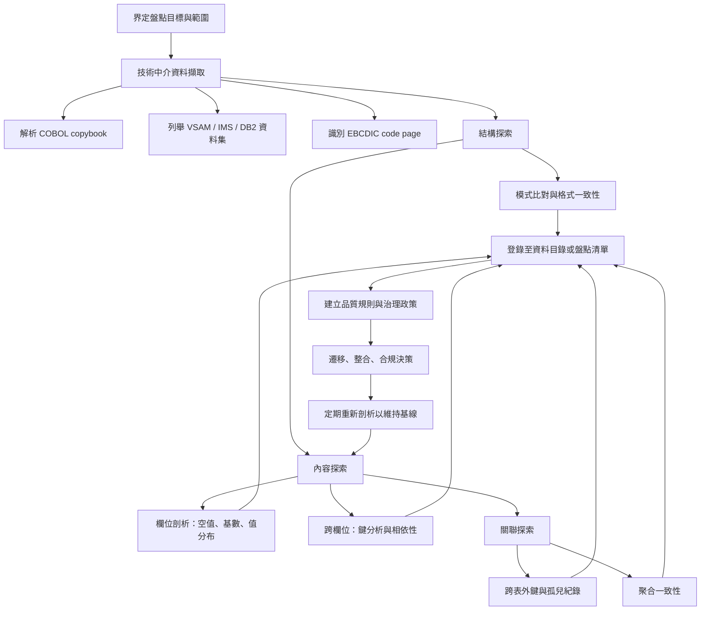

# 資料治理脈絡下「對 Legacy Data 進行盤點」是什麼意思？

## 摘要

在資料治理（data governance）領域，「對 legacy data 進行盤點」指的並不是單純把老舊系統的檔案列一張清單，而是一組以「摸清資料實際長相」為核心的技術活動，通常涵蓋三個彼此互補、層層遞進的概念：**資料探索（data discovery）**、**資料剖析（data profiling）**，以及把結果沉澱為**資料盤點清單／資料目錄（data inventory / data catalog）**。資料探索負責回答「資料在哪裡」，資料剖析負責回答「資料實際長什麼樣子、品質如何」，而盤點清單則負責把前兩者的發現固化成可被治理、可被查詢的中介資料（metadata）。

之所以要特別對「legacy data」做這件事，是因為老舊系統（尤其是主機／mainframe 上的 COBOL、VSAM、IMS、DB2 等）往往缺乏自我描述的結構：資料檔本身不攜帶 schema，欄位意義只存在於早已佚失或版本混亂的 COBOL copybook、JCL 與已退休工程師的記憶中[^copybook]。因此 legacy 盤點的本質，是在缺乏可信中介資料的前提下，用工具與統計方法**反向重建（reverse-engineer）**這些資料的真實結構、內容、關聯與品質，作為後續治理、遷移、整合與合規的實證基礎。

本報告以 zh_TW 撰寫，所有事實均附註腳與改良版 APA 引用（日期使用 ISO 8601）。

---

## 1. 先把三個名詞分清楚

在中文裡「盤點」一詞常被混用，但在英文資料治理文獻中，下列三個概念各有明確分工。

### 1.1 資料探索（Data Discovery）

IBM 的定義是：

> 「資料探索是從多個、往往彼此分散的來源蒐集、評估與探索資料的過程。它協助組織找出隱藏或被孤立（siloed）的資料，確保沒有有價值的資訊被忽略。」[^ibmdisc]

同一份 IBM 文件進一步指出，在資料探索期間，資料專業人員會辨識並擷取組織資料庫、應用程式、內部檔案與其他儲存庫中的原始資料，並檢視其特徵、格式、血緣（lineage）、品質與可能用途，而「這個檢視的過程本身即稱為資料剖析（data profiling）」[^ibmdisc]。也就是說，在 IBM 的框架下，**資料剖析是資料探索的一個內含環節**。

OvalEdge 則把資料探索描述為「辨識、編目與理解組織內資料的過程」，是資料治理的基礎，用以實現對分散資料來源的「透明性、可及性與控制」；Acceldata 則強調資料探索偏重「探索與分析」，讓團隊「找到資料、理解它包含什麼、並透過視覺化與統計探索萃取洞察」[^ovaledge][^acceldata]。

### 1.2 資料剖析（Data Profiling）

Gartner 的定義為：

> 「資料剖析是一種用於發現與調查資料品質問題（如重複、不一致、缺乏準確性與完整性）的技術。其作法是分析一個或多個資料來源並蒐集中介資料，以顯示資料的狀況，並讓資料管理人（data steward）得以追查資料錯誤的來源。此類工具會以表格與圖形形式提供資料統計量，例如重複程度與屬性值比率。」[^gartprof]

IBM 則將資料剖析（又稱「資料考古學／data archeology」）定義為：

> 「審視與清理資料，以更理解其結構並維持組織內資料品質標準的過程。其主要目的是透過審視與彙總資料的方法，取得對資料品質的洞察，進而評估其狀況。」[^ibmprof]

維基百科的定義與上述一致，並把它操作化為：對既有資訊來源（如資料庫或檔案）進行檢視，並蒐集關於該資料的統計量或具資訊性的摘要；目的包括判斷資料能否被用於其他用途、評估資料品質、評估整合風險，以及**「探索來源資料庫的中介資料，包括值模式與分布、候選鍵、候選外鍵與函數相依性」**[^wiki]。

換言之，資料剖析是**描述性（descriptive）而非評價性**的工作：它告訴你資料「實際上是什麼」，而不是「應該是什麼」。The Data Governor 用一句話點出區別：「剖析是做功課，品質規則才是標準；先剖析，再根據你所發現的來定義什麼叫『好』。」[^gov]

### 1.3 資料盤點清單／資料目錄（Data Inventory / Data Catalog）

IBM 將資料目錄描述為「組織內資料資產的詳細清單（a detailed inventory of data assets within an organization）」，而資料探索所蒐集的資料會被匯入、整合並轉換為一致格式，存放於此目錄中[^ibmdisc]。

因此三者的關係可理解為：**探索（找資料）→ 剖析（摸清資料）→ 盤點／編目（把發現登錄成清單）**。Atlan 在引述 Gartner 時指出，Gartner 將「資料探索與分類（data discovery and classification）」列為中介資料管理與資料／分析治理平台的**必要能力（mandatory capability）**[^atlan]。下表整理三者的差異。

| 面向 | 資料探索 Data Discovery | 資料剖析 Data Profiling | 資料盤點／目錄 Data Inventory / Catalog |
|---|---|---|---|
| 主要目的 | 找出資料在哪裡、有哪些 | 分析原始資料的結構、內容、品質與關聯 | 建立可搜尋、可治理的資料資產清單 |
| 核心活動 | 掃描來源、辨識中介資料、視覺化探索 | 統計分析：空值、值分布、模式比對、鍵推斷 | 中介資料管理、分類、綁定治理政策 |
| 產出 | 資料所在位置與內容的地圖 | 摘要統計、品質基線、異常標記、推斷鍵 | 含描述、擁有者、血緣、詞彙表的可搜尋清單 |
| 主要使用者 | 資料工程師、分析師、業務使用者 | 資料工程師、資料管理人、品質分析師 | 資料管理人、治理團隊、IT、業務使用者 |

（差異整理參考 IBM、Atlan 引述之 Gartner、OvalEdge、Acceldata、Solix 等來源[^ibmdisc][^atlan][^ovaledge][^acceldata][^solix]。）

---

## 2. Legacy Data 為何需要特別「盤點」

在現代系統中，schema 通常可透過 `INFORMATION_SCHEMA` 或系統表直接查詢，中介資料相對豐富。但 legacy 系統的資料治理困境在於**缺乏可信的自我描述結構**：

- **COBOL copybook 是外部的、且經常佚失**：copybook 是包含 COBOL 資料描述（紀錄布局）的原始碼檔案，程式以 `COPY` 敘述在編譯期引入；它定義欄位名稱、型別、長度與小數位，但**資料檔本身不內嵌 schema**，一旦欠缺 copybook，一串 EBCDIC 位元組流就是不可解的[^copybook]。
- **EBCDIC 編碼與 ASCII 不相容**：主機使用 EBCDIC 8 位元編碼，字母序列不連續、且小寫字母的排序與 ASCII 相反；EBCDIC 檔案不帶 BOM 或編碼標記，多種 code page（如 IBM037、IBM500、IBM1140）必須先被正確識別，否則文字會靜默損毀[^ebcdic]。
- **COMP-3 壓縮十進位是二進位格式**：每個位元組存兩位十進位數字，正負號放在尾端 nibble；位數與小數點位置是只存在於 copybook 或程式邏輯中的「隱含中介資料」，標準文字工具無法解讀[^packed]。
- **VSAM 是紀錄導向、無內建 schema 的檔案系統**：KSDS／ESDS／RRDS／LDS 四種組織方式中，KSDS 的索引元件與資料元件是分離的檔案（合稱 cluster），其關聯並非自明[^vsam][^aws]。
- **IMS 是階層式資料庫**：資料以 segment 依父子階層排列，沒有關聯式 schema，階層與存取路徑存在於 DBD／PSB 中介資料中，而這些中介資料常在封存時遺失[^ims]。
- **死欄位、孤兒表與晦澀欄位名**：長年修補後，系統會累積已不再被任何程式填充的死欄位、不再被引用的孤兒表，以及因命名限制而生的短名（如 `CUST-NBR`、`FLD-0001`）。這些都讓自動化工具無法在缺乏領域知識下判斷意義。
- **暗資料（dark data）**：IBM 指出，組織累積卻幾乎從未用於分析或決策的資訊即為暗資料，其成因之一正是「無法與現代分析工具整合的 legacy 系統」；IBM 引用的調查顯示，約六成受訪者認為其組織一半以上的資料屬於暗資料，三分之一更認為高達 75% 以上[^dark]。

換句話說，legacy 盤點要處理的核心矛盾是：**schema 只在程式編譯期存在（schema-on-read 的極端形式），而治理卻需要 schema 隨時可得**。

---

## 3. 盤點具體在做什麼：技術工作的三個層次

IBM 將資料剖析的技術途徑分成三大類[^ibmprof]：

1. **結構探索（Structure discovery）**：著重資料格式與全庫一致性，透過模式比對（pattern matching）理解格式特定資訊。例如在電話號碼欄位中偵測到漏值。
2. **內容探索（Content discovery）**：分析資料列中的錯誤或系統性問題，逐一檢視個別元素以找出不正確的值。
3. **關聯探索（Relationship discovery）**：找出哪些資料被使用、以及資料集之間的連結；先做中介資料分析以推斷關係，再收斂到特定欄位之間的連結。

維基百科則從統計方法補充了剖析會產出的中介資料種類：最小值、最大值、平均數、眾數、百分位、標準差、頻率、變異、計數與加總等描述統計量，以及資料型別、長度、離散值、唯一性、空值出現情形、典型字串模式與抽象型別辨識；這些中介資料之後可用來發現非法值、拼字錯誤、缺漏值、值表示不一致與重複等問題[^wiki]。

在操作層面，IBM 與 The Data Governor 都把剖析技術歸納為三種粒度[^ibmprof][^gov]：

### 3.1 欄位剖析（Column profiling）

以單一欄位為單位掃描，統計每個值在欄位中出現的次數，用於找出頻率分布與模式[^ibmprof]。常見指標包括：空值／空字串／佔位符（如 "N/A"）計數、唯一值與基數（cardinality）、資料型別推斷、以及用 regex 模板比對格式（email、電話、日期）。其中空值處理特別棘手，因為不同工具對 null、空字串與佔位符的處理方式不同[^gov]。

### 3.2 跨欄位剖析（Cross-column profiling）

分析同一張表內欄位之間的關係，包含兩類程序[^ibmprof]：

- **鍵分析（Key analysis）**：檢視屬性值陣列，尋找可能的主鍵（高唯一性、低空值率的欄位）。
- **相依性分析（Dependency analysis）**：辨識資料集中內嵌的關係或模式，例如 `end_date` 必須晚於 `start_date`、狀態為「已結案」時結案日期不得為空、`amount = quantity × unit_price` 等邏輯一致性[^gov]。

### 3.3 跨表剖析（Cross-table profiling）

以鍵分析找出「散落資料」，用**外鍵分析**辨識孤兒紀錄（orphaned records）或一般性差異，以檢視不同表之間欄位集合的關係[^ibmprof]。此外也涵蓋聚合一致性（表頭的訂單總額是否等於明細行加總）與時間對齊[^gov]。IBM 亦以「鍵完整性（key integrity）」、「基數（cardinality）」、「模式與頻率分布」等方法描述這類檢查[^ibmprof]。

Informatica 的 Enterprise Data Catalog 在文件中所列出的「剖析相關中介資料」則包括：空值、相異值、推斷資料型別、唯一鍵與資料域（data domains）[^infaprof][^infaedc]，可作為商用工具在實作上述概念時的具體對應。

下圖以 Mermaid 呈現典型的 legacy 盤點流程。

---

## 4. 盤點的產出與後續運用

盤點不是一次性的清單，而是一組需要持續維護的基線。The Data Governor 整理了實務上的關鍵做法[^gov]：

- **先剖析、再定規則**：常見錯誤是依據需求文件直接設計品質規則，但需求文件往往「過於理想、過時或錯誤」。
- **規則分級**：對關鍵欄位（識別碼、代碼、日期、狀態）採嚴格規則；對描述性欄位採較寬鬆規則；對可接受度不確定的欄位採「追蹤型規則」僅標記而不判失敗。
- **不可只靠自動化**：工具分為資料庫內建 SQL、專用剖析平台、資料目錄／MDM 自動剖析、自寫 Python/R 腳本、人工抽樣五大類，最佳實務是混合使用，且即使有自動工具也應人工目視抽查實際值，「因為目視檢視實際值能揭露彙總量所遺漏的東西」。
- **剖析不能只做一次**：資料會變、來源系統會演化，建議對主要來源至少每年重新剖析，對新系統或大幅修改的系統則更頻繁；高風險系統宜將持續剖析整合進資料管線。
- **遷移與 MDM 專案**：遷移前先剖析來源以發現混合格式、非預期空值、循環參照等意外；主資料整併時逐一剖析各來源以理解命名、識別碼與完整度差異；上線後再剖析新系統並與遷移前基線比對以驗證。
- **六個常見陷阱**：無脈絡地剖析、只剖析一次、把剖析誤認為修復、低估空值處理複雜度、忽略資料血緣、過度依賴自動化模式。

在治理層次上，資料剖析提供了**實證證據**，讓治理決策（資料標準、品質門檻、修復優先序、資料擁有者指派）能建立在事實之上。Gartner 將資料治理定義為「一套決策權與問責框架的規範，以確保在資料與分析的評價、創造、消費與控制上採取適切行為」[^gartgov]；而剖析正是把抽象問題「這份資料能不能用」轉換為可量測、可比較之指標的機制。

---

## 5. 批判性省思：來源的偏誤與限制

閱讀上述定義時，有幾點必須保持警覺：

1. **定義本身帶有工具商立場**。Gartner、IBM、Informatica、Collibra 等來源多為廠商或其合作夥伴的內容，其定義往往隱含「你應該購買某類工具」的框架。相對地，維基百科的定義偏向學術與資料倉儲實務（引用 Kimball、Loshin、Olson、Rahm & Do 等）[^wiki]，兩者交叉參照後較能取得平衡。
2. **「Data Discovery」一詞並無單一共識定義**。Gartner 曾有的獨立詞條已於近年被移除（原 URL 轉址），不同廠商對其範疇的界定差異很大：有的視其為含剖析的完整流程，有的僅視為搜尋與視覺化探索[^gartprof]。
3. **DAMA-DMBOK 的原文無法免費公開取得**。本報告未能取得 DAMA-DMBOK 對「data profiling」的逐字定義（該書為版權書籍），因此關於 DAMA 框架的敘述僅能依賴二手轉述，權威性低於可查證的 IBM／Gartner 定義[^dama]。讀者若需正式定義，應查閱 DAMA-DMBOK 原書或其官方詞典。
4. **主機技術細節以 IBM 官方文件為準**。COBOL copybook、EBCDIC、COMP-3、VSAM、IMS 等敘述均來自 IBM 官方文件，可信度高，但也意味著其描述的是 IBM 生態系；其他主機平台（如 Unisys、Bull）可能有不同細節。
5. **廠商支援程度需個別查證**。就 legacy／mainframe 的資料探索與剖析而言，本報告查證範圍內，Microsoft Purview、Informatica、Collibra 的文件並未明確列出主機專屬連接器；AWS 則以 AWS Transform for mainframe 主打程式碼與業務邏輯的代理式分析[^aws2]。Precisely、Rocket Software 的網站對自動化抓取回傳 403／404，故無法查證其主機盤點能力，此為本報告的已知缺口。

---

## 6. 結論

「對 legacy data 進行盤點」在資料治理中是一套以**反推中介資料**為核心的工程：先用資料探索找出資料在哪裡，再用資料剖析（欄位、跨欄位、跨表三個層次）摸清其實際結構、內容、關聯與品質，最後把結果登錄為資料盤點清單或資料目錄，成為品質規則、遷移決策與合規工作的實證基線。它的難度不只在資料量大，而在於 legacy 系統的 schema 只存在於編譯期與已佚失的文件中，需要跨越 COBOL copybook、EBCDIC、COMP-3、VSAM、IMS 等技術障礙才能重建。因此，legacy 盤點既是技術任務，也是治理能否落地的前置條件，正如 The Data Governor 的總結：「多數治理失敗都可追溯到略過剖析、或只是敷衍地做。」[^gov]

---

## 參考文獻

[^gov]: The Data Governor. (2026, October 7). Data profiling. Retrieved 2026-10-14, from https://thedatagovernor.com/data-profiling/

[^gartgov]: Gartner. (n.d.). Data governance. Gartner Information Technology Glossary. Retrieved 2026-10-14, from https://www.gartner.com/en/information-technology/glossary/data-governance

[^gartprof]: Gartner. (n.d.). Data profiling. Gartner Information Technology Glossary. Retrieved 2026-10-14, from https://www.gartner.com/en/information-technology/glossary/data-profiling

[^atlan]: Atlan. (n.d.). Data discovery and classification tools: Gartner. Retrieved 2026-10-14, from https://atlan.com/know/data-discovery-and-classification-tools-gartner/

[^ibmdisc]: IBM. (n.d.). What is data discovery? Retrieved 2026-10-14, from https://www.ibm.com/think/topics/data-discovery

[^ibmprof]: IBM. (n.d.). What is data profiling? Retrieved 2026-10-14, from https://www.ibm.com/think/topics/data-profiling

[^dark]: IBM. (n.d.). What is dark data? Retrieved 2026-10-14, from https://www.ibm.com/think/topics/dark-data

[^copybook]: IBM. (n.d.). Copybooks. IBM COBOL for z/OS documentation. Retrieved 2026-10-14, from https://www.ibm.com/docs/en/cobol-zos/6.3?topic=concepts-copybooks

[^ebcdic]: IBM. (n.d.). EBCDIC character set. IBM z/OS documentation. Retrieved 2026-10-14, from https://www.ibm.com/docs/en/zos/2.4.0?topic=character-ebcdic

[^packed]: IBM. (n.d.). Packed decimal format. IBM z/OS documentation. Retrieved 2026-10-14, from https://www.ibm.com/docs/en/zos/2.4.0?topic=record-pack-decimal-format

[^vsam]: IBM. (n.d.). What is VSAM? IBM z/OS Basic Skills. Retrieved 2026-10-14, from https://www.ibm.com/docs/en/zos-basic-skills?topic=what-is-vsam

[^ims]: IBM. (n.d.). IBM Information Management System (IMS). Retrieved 2026-10-14, from https://www.ibm.com/products/ims

[^infaprof]: Informatica. (n.d.). Profiling considerations: Profiling & data discovery in EDC. Retrieved 2026-10-14, from https://success.informatica.com/success-accelerators/profiling-considerations---profiling--data-discovery--in-edc-.html

[^infaedc]: Informatica. (n.d.). Data discovery. Enterprise Data Catalog 10.5.6 Catalog Administrator Guide. Retrieved 2026-10-14, from https://docs.informatica.com/data-catalog/enterprise-data-catalog/10-5-6/catalog-administrator-guide/enterprise-data-catalog-concepts/data-discovery.html

[^wiki]: Wikipedia. (2026). Data profiling. Retrieved 2026-10-14, from https://en.wikipedia.org/wiki/Data_profiling

[^ovaledge]: OvalEdge. (n.d.). Data discovery for efficient data governance. Retrieved 2026-10-14, from https://www.ovaledge.com/blog/data-discovery-for-efficient-data-governance

[^acceldata]: Acceldata. (n.d.). Data catalog vs data discovery: Differences that matter in practice. Retrieved 2026-10-14, from https://www.acceldata.io/blog/data-catalog-vs-data-discovery-differences-that-matter-in-practice

[^solix]: Solix. (n.d.). What is the difference between data profiling and data cataloging? Retrieved 2026-10-14, from https://www.solix.com/products/answers/what-is-the-difference-between-data-profiling-and-data-cataloging/

[^aws]: Amazon Web Services. (n.d.). Migrating VSAM files using AWS DMS. Retrieved 2026-10-14, from https://docs.aws.amazon.com/dms/latest/userguide/sources-vsam.html

[^aws2]: Amazon Web Services. (n.d.). Mainframe modernization. Retrieved 2026-10-14, from https://aws.amazon.com/mainframe/

[^dama]: DAMA International. (n.d.). DAMA-DMBOK: Data management body of knowledge. Retrieved 2026-10-14, from https://www.dama.org/cpages/body-of-knowledge/
