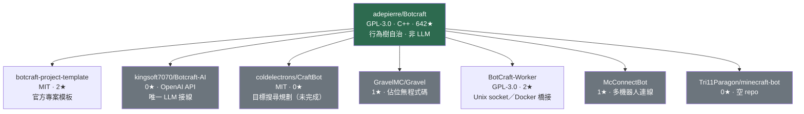

# 以 Botcraft 為基礎的 Agent 實作調查

## 摘要

Botcraft 是一套以 C++ 撰寫、能讓機器人連線並與 Minecraft Java 版伺服器互動的跨平台函式庫[^botcraft]。「以 Botcraft 為基礎的 Agent」在實務上可分成三種層次：

1. **Botcraft 本身**：內建行為樹（behaviour tree）AI 系統的自治機器人框架，屬於傳統規則式 AI，而非大型語言模型（LLM）驅動[^botcraft-ai]。
2. **依賴 Botcraft 的獨立專案**：在其上層額外實作管理、排程或通訊功能的機器人工具。
3. **將 LLM／生成式 AI 接到 Botcraft 的實驗**：數量極少，且沒有任何一個達到開源社群規模。

本報告的核心結論是：**目前不存在成熟、具規模、完全開源（FOSS）且由 LLM 驅動的 Botcraft Agent**。最接近「以 Botcraft 為基礎的 AI Agent」的專案，star 數都極低，多數為個人實驗或尚未放出程式碼的佔位專案。Botcraft 官方 GitHub 依賴圖顯示沒有任何登記的 downstream 依賴者[^dependents]，這正是此一生態系規模偏小的直接證據。

## 背景知識（本報告自帶脈絡）

### 什麼是 Botcraft

Botcraft 由 GitHub 使用者 adepierre 開發，建立於 2019-07-23，採用 GNU GPL v3 授權，主要語言為 C++，支援 Minecraft Java 版 1.12.2 至 1.21.11 的官方版本[^botcraft]。截至 2026-10-14，其 star 數為 642、fork 數為 61[^botcraft-api]。函式庫本身宣稱擁有以下能力[^botcraft]：

- 連線至離線（破解）模式與線上模式伺服器
- 尋路（含爬梯、鷹架攀爬等複雜情境）
- 破壞與放置方塊、物品使用、方塊互動
- 物品欄管理、合成、村民交易（1.14+）
- 完整實體支援與（選配的）OpenGL 渲染
- **以行為樹（behaviour tree）系統撰寫機器人程式**

「行為樹」是一種由節點組成的決策結構，透過 Success／Failure／Running 三種狀態在每個 tick 決定下一步行為[^botcraft-ai-status]。這是一種可組合、可除錯的古典 AI 技術，與 LLM 無關。

### 為什麼 Botcraft 的 AI 生態系很小

Botcraft 作者自述這是一個「learn-by-doing」的寵物專案，更接近「半公開的私人 repo」，而非真正的開源社群專案[^botcraft]。再加上 C++ 生態、Minecraft 機器人領域主流的 JavaScript（Mineflayer）與 Java 生態更興盛，使得以 Botcraft 為底的上層專案數量稀薄。作為對照，知名的 LLM Minecraft Agent「Voyager」是建立在 Mineflayer 之上，而非 Botcraft[^voyager]。

## 調查結果：以 Botcraft 為基礎的實作清單

下表整理本次調查所找到、可與「Agent 實作」相關的專案。**注意：所有 star 數為 2026-10-14 由 GitHub API 取得之即時數值**[^botcraft-api]。

| 專案 | 類型 | Star | 授權 | 語言 | 最後推送 | 是否 LLM 驅動 |
|---|---|---|---|---|---|---|
| adepierre/Botcraft | 基礎函式庫 | 642 | GPL-3.0 | C++ | 2026-10-03 | 否（行為樹） |
| adepierre/botcraft-project-template | 官方專案模板 | 2 | MIT | CMake | 2025-10-15 | 否 |
| kingsoft7070/Botcraft-AI | Botcraft 分支＋OpenAI | 0 | GPL-3.0 | C++ | 2026-03-05 | 是（OpenAI API） |
| coldelectrons/CraftBot | 依賴 Botcraft 的實驗 Agent | 0 | MIT | C++20 | 2023-02-19 | 否（目標搜尋規劃） |
| GravelMC/Gravel | Botcraft 上層機器人管理器 | 1 | 無授權檔 | Shell／C++23 | 2026-10-09 | 否 |
| RegularRabbit05/BotCraft-Worker | Botcraft 對外橋接（Unix socket／Docker） | 2 | GPL-3.0 | C++ | 2026-10-09 | 否 |
| Urpagin/McConnectBot | 多機器人連線工具 | 1 | 無授權檔 | C++ | 2024-03-20 | 否 |
| Tri11Paragon/minecraft-bot | 佔位專案 | 0 | 無授權檔 | — | 2026-02-25 | 否（空 repo） |
| willbara/botcraft | **非** adepierre Botcraft（同名 Fabric mod） | 0 | 無授權檔 | Java | 2026-10-13 | 否 |

以下逐一說明。

### 1. adepierre/Botcraft（基礎函式庫本體）

這是所有其他專案的根。它本身即是一個「Agent 框架」：開發者以行為樹節點組合出自洽的機器人邏輯，官方 Examples 資料夾提供了 8 個由淺入深的範例，包含聊天指令機器人、全自動 AFK 機器人、像素藝術地圖建造、全自動發射器農場、以及「世界吞噬者」（world eater）等完全自治程式[^botcraft]。

值得強調的是，Botcraft 的自治能力是**規則式**的：行為樹節點是開發者手寫的 C++ 程式碼，決策不經過語言模型。這使它在資源效率上極佳（官方稱 AFK 機器人低於 5 MB RAM、無頭模式下的其他機器人低於 60 MB），但與「LLM Agent」是不同物種[^botcraft]。

### 2. kingsoft7070/Botcraft-AI（唯一明確接上 LLM 的專案）

這是一份 Botcraft 的 **fork**，作者在 repo 描述中寫明「I added OpenAI API to this project, so it can controlled by AI :)」[^botcraft-ai-fork]。其 GitHub API 資料顯示，它是 adepierre/Botcraft 的 fork（parent 指向原始 repo），建立於 2026-03-05，最後推送亦為 2026-03-05，star 數為 0、fork 數為 0，授權沿用 GPL-3.0[^botcraft-ai-api]。

**批判性評估**：這是全網唯一一個可被驗證、明確把 LLM（OpenAI API）接進 Botcraft 的專案。然而：

- 它是一次性提交的個人實驗（建立與最後推送同日，之後未再更新）[^botcraft-ai-api]。
- 沒有任何 star、追蹤者或討論，社群可見度為零。
- 其 README 幾乎原封不動沿用 Botcraft 官方 README，並未提供任何架構說明、提示詞設計或評測結果[^botcraft-ai-fork]。
- 因此它**不能**被視為成熟、可重用的 FOSS Agent 框架，只能視為「把 LLM 接到 Botcraft 是可行的」之概念驗證。

### 3. coldelectrons/CraftBot（目標導向的實驗 Agent）

repo 描述為「Experimental bot using BotCraft」，採用 MIT 授權、C++20，主題標籤為 bot、cpp、cpp20、minecraft[^craftbot-api]。其 README 明列規劃中的行為樹子樹：作物收成與種植、交易、物品農場、建築藍圖載入、戰鬥與迴避[^craftbot-readme]。

最值得注意的是其**高階目標**：作者寫道「我的高階目標是能夠指定某個目標，然後機器人執行類似 A* 的動作搜尋來達成該目標」，並以「傘兵工程師」作為終極願景——把機器人空投進 SMP 遊戲中，讓它自行求生、蓋基地、蓋各種農場、囤積物資[^craftbot-readme]。

**批判性評估**：這是最接近「自主規劃型 Agent」設計理念的 Botcraft 專案，但它自 2023-02-19 後即未再推送，star 為 0，且 README 中所有功能清單的核取方塊皆為未勾選狀態[^craftbot-readme][^craftbot-api]。這是設計願景，不是已完成品。

### 4. GravelMC/Gravel（上層機器人管理器）

描述為「GravelMC: lightweight C++ Minecraft Java bot manager」，star 為 1，建立與最後推送皆為 2026-10-09，主題標籤明確包含 `botcraft`[^gravel-api]。README 說明其為 C++23 撰寫、同時執行多個各自擁有帳號的機器人、提供挖礦／建築／農業模組、自動重連與抖動延遲、可從遊戲內聊天控制[^gravel-readme]。

作者在 README 的「Why Gravel?」段落自述動機：「我原本用 PrismarineJS 掛機，但它的尋路很糟，後來我發現 Botcraft，擴充它並在上層加上遊戲內指令」[^gravel-readme]。Gravel 宣稱使用 Botcraft 自帶的尋路器[^gravel-readme]。

**批判性評估**：這是最新（2026-10）且主題標籤直接標記 botcraft 的上層專案，授權在 README 中聲明為 GPL v3，但 GitHub API 顯示 repo 並未偵測到授權檔（`license: null`），亦無任何程式碼（repo 大小僅 3 KB）[^gravel-api]。README 開頭即寫明「This repo is empty, i will soon create the actual code」[^gravel-readme]。因此它目前**只是佔位專案**，尚無可評估的實作。

### 5. RegularRabbit05/BotCraft-Worker（Botcraft 對外橋接）

描述為「Unix socket client (and Docker image) for BotCraft」，star 為 2，GPL-3.0，C++，最後推送 2026-10-09[^worker-api]。它的用途是透過 Unix socket 與 Docker 映像，把 Botcraft 機器人接進 Discord 機器人，實現 Minecraft 與 Discord 之間的聊天橋接[^worker-search]。

**批判性評估**：這不是自治 Agent，而是「讓其他系統（例如 Discord 機器人）能驅動 Botcraft」的整合層。若要以 Botcraft 打造由外部 LLM 服務控制的 Agent，這類橋接元件在架構上很有參考價值，但它本身不含任何決策智慧。

### 6. Urpagin/McConnectBot（多機器人連線工具）

描述為「Connects multiple offline bots to a Minecraft server using botcraft」，star 為 1，無授權檔，C++，最後推送 2024-03-20，主題標籤包含 `botcraft`[^mcconnect-api]。功能是讓多個離線模式機器人同時連進伺服器並可同時下指令，作者自述為學習性質的小專案[^worker-search]。

### 7. Tri11Paragon/minecraft-bot（空佔位）

描述為「Minecraft bot based on botcraft」，但 repo 大小為 0 KB、無程式碼、無授權、star 為 0，建立與最後推送同為 2026-02-25[^tri11-api]。僅能視為預告，無內容可評估。

### 8. 官方專案模板 adepierre/botcraft-project-template

由 Botcraft 作者本人維護，描述為「A ready-to-use cmake project using Botcraft」，MIT 授權（與函式庫本體的 GPL-3.0 不同），建立於 2025-10-15，star 為 2[^template-api]。這是任何想開發 Botcraft Agent 者最正規的起點，透過 CMake 的 FetchContent 自動取得 Botcraft 依賴[^botcraft]。

### 9. Botcraft 的活躍 fork（建置系統與版本變體）

社群中另有若干僅改變建置系統或追蹤新版本的 fork，例如改採 xmake 的 Botcraft-xmake、實驗性分支 BotcraftExperimental、針對 GTNH 模組包的分支，以及舊版的 Protocolcraft[^fork-search]。這些 fork 主要價值在於展示如何把 Botcraft 嵌入不同工具鏈，並非新 Agent 實作。

## 需要留意的同名混淆：willbara/botcraft

搜尋 GitHub 時會出現一個名為 `willbara/botcraft` 的專案，描述為「AI companions that join Minecraft as real players, survive on their own, work together, remember their experiences, and chat with you」，建立於 2026-10-10，語言為 Java，star 為 0、無授權[^willbara-api]。

**這不是** adepierre 的 Botcraft，也不是以它為基礎的專案。其 README 明確說明它是 Minecraft 1.20.1 的 **Fabric 伺服器端模組**，唯一依賴是 Fabric API，且「沒有任何 API key、語言模型或原生函式庫」，聊天是用「模式比對」而非語言模型理解[^willbara-readme]。換言之，它名稱撞名，本質是一個規則式 AI 同伴 mod。

同樣地，`Palats/botcraft` 是 2012 年的 Python Minecraft 機器人框架（GPL-2.0，star 4），與 adepierre 的 Botcraft 完全無關[^palats-api]。研究此主題時務必區分同名專案，避免把不相關的工作誤計入 Botcraft 生態系。

## 整體評估與結論

### 生態系關係圖

### 主要發現

1. **沒有成熟的 LLM 驅動 Botcraft Agent**。唯一明確整合 LLM 的 `kingsoft7070/Botcraft-AI` 是 0 star、單次提交的個人 fork[^botcraft-ai-api]。
2. **Botcraft 自身的 AI 是行為樹，而非 LLM**。想要「AI Agent」的人，多數會在 Botcraft 上自己寫行為樹，因此不需另開 repo，這也解釋了為何上層專案稀少[^botcraft]。
3. **上層專案多為佔位或個人學習專案**。Gravel 與 Tri11Paragon/minecraft-bot 皆為無程式碼的佔位；CraftBot 自 2023 年停更[^gravel-api][^tri11-api][^craftbot-api]。
4. **官方依賴圖沒有任何 downstream 依賴者**，代表社群實際上是以 fork 或自行引入依賴的方式使用 Botcraft，而非登記為 GitHub 依賴[^dependents]。
5. **真正達到產品級別的 LLM Minecraft Agent（如 Voyager）選用的是 Mineflayer，不是 Botcraft**，這是技術棧選擇的結構性差異[^voyager]。

### 對實作者的建議

若目標是「以 Botcraft 打造 FOSS 的 LLM Agent」，目前沒有現成可用的框架可直接沿用，可行路徑為：

- 以 `adepierre/botcraft-project-template`（MIT）作為專案骨架[^template-api]。
- 以 Botcraft 的行為樹節點作為「LLM 可呼叫的工具／技能」（tool use），由 LLM 負責高階規劃，行為樹負責低階執行。
- 參考 `BotCraft-Worker` 的 socket／Docker 模式，把決策服務與 Botcraft 執行程序解耦[^worker-api]。
- 注意授權：Botcraft 本體為 GPL-3.0，任何衍生作品在散布時須遵循其條款；官方模板雖為 MIT，但連帶使用的函式庫仍受 GPL 約束[^botcraft]。

### 來源批判

- **GitHub API 為第一手資料源**：本報告的 star、授權、推送時間皆直接取自 GitHub REST API，而非二手整理，可信度高，但數值會隨時間變動，讀者應以取用當日數值為準。
- **README 為作者自述，非獨立驗證**：CraftBot 與 Gravel 的功能清單來自作者 README 的規劃與宣稱，其中 Gravel 明言尚未有程式碼，兩者的「能力」皆未經第三方驗證。
- **搜尋工具可能遺漏**：本次以 GitHub 主題標籤、關鍵字搜尋與 fork 清單交叉比對，仍可能遺漏未使用 botcraft 字樣、或僅在程式碼內引用而無描述的低調專案。
- **時間敏感**：Botcraft 作者聲明每月第一週推送更新，生態系處於緩慢變動中，本報告結論（特別是「尚無成熟 LLM Agent」）僅反映 2026-10-14 的狀態。

## 參考文獻

[^botcraft]: Adepierre. (2026). *Botcraft* [Computer software]. GitHub. Retrieved 2026-10-14, from https://github.com/adepierre/Botcraft

[^botcraft-api]: GitHub REST API. (2026). *Repositories: adepierre/Botcraft*. Retrieved 2026-10-14, from https://api.github.com/repos/adepierre/Botcraft

[^botcraft-ai]: Adepierre. (2026). *Behaviour system*. Botcraft Wiki. Retrieved 2026-10-14, from https://github.com/adepierre/Botcraft/wiki/Behaviours-system

[^botcraft-ai-status]: Adepierre. (n.d.). *Status.hpp* [Source code]. GitHub. Retrieved 2026-10-14, from https://github.com/adepierre/Botcraft/blob/master/botcraft/include/botcraft/AI/Status.hpp

[^botcraft-ai-fork]: Kingsoft7070. (2026). *Botcraft-AI* [Computer software]. GitHub. Retrieved 2026-10-14, from https://github.com/kingsoft7070/Botcraft-AI

[^botcraft-ai-api]: GitHub REST API. (2026). *Repositories: kingsoft7070/Botcraft-AI*. Retrieved 2026-10-14, from https://api.github.com/repos/kingsoft7070/Botcraft-AI

[^craftbot-api]: GitHub REST API. (2026). *Repositories: coldelectrons/CraftBot*. Retrieved 2026-10-14, from https://api.github.com/repos/coldelectrons/CraftBot

[^craftbot-readme]: Coldelectrons. (2023). *CraftBot README.md* [Source code]. GitHub. Retrieved 2026-10-14, from https://github.com/coldelectrons/CraftBot/blob/main/README.md

[^gravel-api]: GitHub REST API. (2026). *Repositories: GravelMC/Gravel*. Retrieved 2026-10-14, from https://api.github.com/repos/GravelMC/Gravel

[^gravel-readme]: GravelMC. (2026). *Gravel README.md* [Source code]. GitHub. Retrieved 2026-10-14, from https://github.com/GravelMC/Gravel/blob/main/README.md

[^worker-api]: GitHub REST API. (2026). *Repositories: RegularRabbit05/BotCraft-Worker*. Retrieved 2026-10-14, from https://api.github.com/repos/RegularRabbit05/BotCraft-Worker

[^worker-search]: GitHub. (2026). *Search results for "botcraft minecraft"* [Search results]. Retrieved 2026-10-14, from https://github.com/search?q=botcraft+minecraft&type=repositories

[^mcconnect-api]: GitHub REST API. (2026). *Repositories: Urpagin/McConnectBot*. Retrieved 2026-10-14, from https://api.github.com/repos/Urpagin/McConnectBot

[^tri11-api]: GitHub REST API. (2026). *Repositories: Tri11Paragon/minecraft-bot*. Retrieved 2026-10-14, from https://api.github.com/repos/Tri11Paragon/minecraft-bot

[^template-api]: GitHub REST API. (2026). *Repositories: adepierre/botcraft-project-template*. Retrieved 2026-10-14, from https://api.github.com/repos/adepierre/botcraft-project-template

[^fork-search]: GitHub. (2026). *Repositories matching "botcraft" sorted by stars* [Search results]. Retrieved 2026-10-14, from https://github.com/search?q=botcraft&type=repositories&s=stars&o=desc

[^dependents]: GitHub. (2026). *Dependency graph: adepierre/Botcraft* [Web page]. Retrieved 2026-10-14, from https://github.com/adepierre/Botcraft/network/dependents

[^voyager]: MineDojo. (2023). *Voyager: An open-ended embodied agent with large language models* [Computer software]. GitHub. Retrieved 2026-10-14, from https://github.com/MineDojo/Voyager

[^willbara-api]: GitHub REST API. (2026). *Repositories: willbara/botcraft*. Retrieved 2026-10-14, from https://api.github.com/repos/willbara/botcraft

[^willbara-readme]: Willbara. (2026). *botcraft README.md* [Source code]. GitHub. Retrieved 2026-10-14, from https://github.com/willbara/botcraft/blob/main/README.md

[^palats-api]: GitHub REST API. (2026). *Repositories: Palats/botcraft*. Retrieved 2026-10-14, from https://api.github.com/repos/Palats/botcraft
