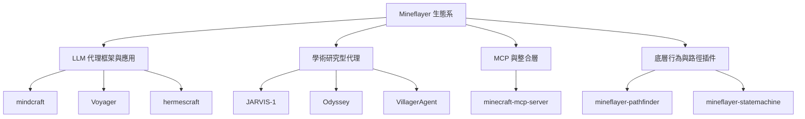

# 以 Mineflayer 為基礎的自由開源 AI Agent 實作調查

本報告調查「以 Mineflayer 函式庫為核心所建構的 AI Agent（自主代理）實作」，並將範圍限定在自由開源軟體（FOSS, Free and Open Source Software）。報告涵蓋 Mineflayer 本身的定位、以 LLM（大型語言模型）驅動的代理框架、學術研究型代理、MCP（Model Context Protocol）伺服器、以及支撐代理行為的底層插件。所有資料以 GitHub 官方 API 與專案說明文件為依據，檢索日期為 2026-10-14。

## 目錄

- [背景：Mineflayer 是什麼](#背景mineflayer-是什麼)
- [調查範圍與分類](#調查範圍與分類)
- [一、LLM 驅動的代理框架與應用](#一llm-驅動的代理框架與應用)
- [二、學術研究型代理](#二學術研究型代理)
- [三、MCP 與整合層](#三mcp-與整合層)
- [四、底層行為與路徑插件](#四底層行為與路徑插件)
- [五、常被誤認為 Mineflayer 專案的計畫](#五常被誤認為-mineflayer-專案的計畫)
- [綜合比較表](#綜合比較表)
- [批判性反思](#批判性反思)
- [參考文獻](#參考文獻)

## 背景：Mineflayer 是什麼

Mineflayer 是一個以 JavaScript 撰寫的高階 API，用於建立 Minecraft 機器人。它讓開發者能以程式控制一個 Minecraft 玩家角色，進行移動、挖礦、合成、戰鬥、與世界互動等操作[^mineflayer]。該專案由 PrismarineJS 組織維護，最早於 2011 年建立，是整個生態系中最基礎、被引用最廣的函式庫[^mineflayer-api]。

正因為 Mineflayer 提供了穩定且高階的控制介面，許多 AI 代理計畫選擇它作為「代理的身體」，再在上層接上決策模組（可能是 LLM、強化學習模型、或狀態機）[^mineflayer]。本報告即以這些上層實作為主體。

## 調查範圍與分類

本報告將蒐集到的專案分為四類，並另闢一節釐清常被混淆、實際上並非以 Mineflayer 為基礎的知名計畫。判斷「是否以 Mineflayer 為基礎」的依據，是專案說明文件中是否明確列出 `mineflayer` 依賴，或程式結構中是否出現 `mineflayer` 環境目錄。

## 一、LLM 驅動的代理框架與應用

此類專案以 LLM 作為決策核心，Mineflayer 作為動作執行層，多數可直接運行於區域網路或私人伺服器。

### mindcraft

`mindcraft-bots/mindcraft` 是此領域目前最活躍、應用最廣的框架，說明文件開宗明義寫著「以 LLM 與 Mineflayer 打造 Minecraft 的心智」[^mindcraft-readme]。它支援超過 15 種 API 供應商（OpenAI、Google Gemini、Anthropic、DeepSeek、Ollama 本地模型等），並允許為聊天、寫程式、視覺、嵌入、語音合成分別指定不同模型[^mindcraft-readme]。專案採用 MIT 授權，主要作者為 Kolby Nottingham[^mindcraft-readme]。截至檢索日，該專案有 5,886 顆星，並持續更新（最後推送 2026-10-03）[^mindcraft-api]。其研究成果發表於論文《Collaborating Action by Action: A Multi-agent LLM Framework for Embodied Reasoning》[^mindcraft-paper]。

需特別注意其安全警告：mindcraft 允許 LLM 在開發者電腦上撰寫與執行程式碼，預設關閉，但仍有提示注入（prompt injection）風險，官方建議勿連線至公開伺服器[^mindcraft-readme]。

### Voyager

`MineDojo/Voyager` 是「第一個由 LLM 驅動、能在 Minecraft 中終身學習」的具身代理，由三個部分組成：自動課程、可執行程式碼的技能庫、以及迭代提示機制[^voyager-readme]。它透過 GPT-4 的 blackbox 查詢進行決策，並在 `voyager/env/mineflayer` 目錄中使用 Mineflayer 作為環境介面[^voyager-readme]。專案採 MIT 授權，7,260 顆星[^voyager-api]。不過其最後推送時間為 2024-04-03，屬於較早的奠基性作品，近期維護較少[^voyager-api]。

### hermescraft

`bigph00t/hermescraft` 是建構於 Nous Research 的 Hermes Agent 架構之上的具身代理，強調持久記憶、視野感知（line-of-sight 過濾，不做透視）、以及多代理「文明模式」[^hermescraft-api]。採 MIT 授權，73 顆星，JavaScript 撰寫，最後推送 2026-03-25[^hermescraft-api]。

### 其他活躍專案

- **minecraft-mcp-server**（`yuniko-software`，780 星，Apache-2.0，TypeScript）：將 Mineflayer 包裝成 MCP 伺服器，供 Claude Desktop、Cursor 等 AI 助理以自然語言即時控制角色[^mcp-api]。
- **blockmine**（`blockmineJS`，55 星，JavaScript）：開源 Minecraft 機器人框架與自動化平台，內建 MCP 伺服器、多機器人管理、網頁儀表板與視覺化腳本編輯器[^blockmine-api]。惟其倉庫未提供明確授權檔案，使用前需向維護者確認[^blockmine-api]。
- **minecraft-agent-swarm**（`JesseRWeigel`，32 星，MIT，Python）：由 5 個以本地 LLM（Ollama）驅動的機器人組成的協同團隊[^swarm-api]。
- **Minecraft-Agent**（`Kevin-Liu-01`，10 星，MIT，Python）：可於區域網路運作、內含 60 多項工具的 MCP 伺服器，具技能庫與自主生存模式[^kliu-api]。
- **dsh-mc-agent**（`hellosky983`，10 星，MIT，JavaScript）：為 DeepSeek Harness 打造，含視覺／控制工具與內建啟動器[^dsh-api]。
- **hermes-and-jev-play-minecraft**（`teknium1`，10 星，MIT，JavaScript）：由 Hermes Agent 規劃、Jev 選擇動作、Mineflayer 執行，不使用螢幕截圖或鍵盤模擬[^jev-api]。
- **MC-CIV**（`Pomilon`，9 星，MIT，Python 與 Node.js 混合）：由 LLM 世界敘事者驅動的多代理故事框架[^mcciv-api]。
- **Claudecraft**（`louz514`，14 星，MIT，TypeScript）：多個 Claude 驅動的機器人探索、建造與社交[^claudecraft-api]。
- **minecraft-agentic**（`NoblerWorks-HQ`，7 星，MIT，JavaScript）：多代理 LLM 團隊操作 4 個 Mineflayer 機器人[^agentic-api]。
- **minecraft-openai**（`manekinekko`，122 星，MIT，JavaScript）：以 GPT-3 控制 Minecraft NPC 的概念驗證，最後推送於 2022 年[^openai-api]。
- **KonekoMinecraftBot**（`AkagawaTsurunaki`，44 星，Apache-2.0，TypeScript）：以有限狀態機結合機器學習演算法（DB-Scan、單層感知器）的智慧機器人[^koneko-api]。
- **amazon-bedrock-minecraft-agent**（`build-on-aws`，59 星，MIT-0，TypeScript）：以 Amazon Bedrock Agents 操作 Mineflayer 的範例，惟倉庫已封存[^bedrock-api]。
- **minecraft-llm-agent-community**（`gigio1023`，25 星，無授權，TeX）：以「Soul」為基礎的 Minecraft 社會模擬執行環境[^community-api]。
- **minecraft-builder-skill**（`wzhaoMS`，15 星，無授權，JavaScript）：專注於建造的 AI 代理技能[^builder-api]。
- **mc-agents**（`ATLucas`，8 星，MIT，JavaScript）：結合 Mineflayer 與 OpenAI API 的早期實驗[^mcagents-api]。
- **strands-minecraft**（`cagataycali`，2 星，MIT，TypeScript）：將 Mineflayer 全部功能包成 61 項工具並交給 Strands 代理[^strands-api]。
- **steveX**（`piggy4`，3 星，無授權，JavaScript）：支援多代理管理、77 個命令與網頁面板的 LLM 代理框架[^stevex-api]。
- **clawcraft**（`zumberr`，5 星，無授權，JavaScript）：以 Bun 與 Mineflayer 打造、含 45 個模組的自主同伴代理[^claw-api]。
- **Minecraft-God-AI**（`Michael-Andrzejewski`，3 星，MIT，JavaScript）：mindcraft 的分支，用於 AI 對齊與目標漂移研究，曾獲 Apart Research AI Agent Security 黑客松獎項[^godai-api]。

## 二、學術研究型代理

此類專案通常附帶論文，程式碼釋出程度不一，部分僅釋出離線評估版本。

- **JARVIS-1**（`CraftJarvis/JARVIS-1`，417 星，Java，未標示授權）：以多模態語言模型為基礎、配備多模態記憶的開世界代理，能完成 200 多項任務[^jarvis-readme]。其使用 `prepare_mcp.py` 建置以 Mineflayer 為基礎的 MCP-Reborn 作為控制介面[^jarvis-readme]。授權狀態不明，且多模態描述子（multimodal descriptor）尚未釋出[^jarvis-readme]。
- **Odyssey**（`zju-vipa/Odyssey`，411 星，MIT，Python）：基於 Voyager 框架，提供含 40 個原始技能與 183 個組合技能的開世界技能庫，以及微調過的 LLaMA-3 模型[^odyssey-readme]。程式碼採 MIT，但 Minecraft 問答資料集採 CC BY-NC-SA 3.0，兩者授權不同[^odyssey-readme]。已獲 IJCAI 2025 接受，最後推送 2025-10-22[^odyssey-api]。
- **VillagerAgent**（`cnsdqd-dyb/VillagerAgent-Minecraft-multiagent-framework`，188 星，MIT，Python）：以圖為基礎的多代理協作框架，說明文件明確標示「powered by Mineflayer」，獲 ACL 2024 接受[^villager-readme]。
- **Optimus-1**（`iLearn-Lab/NeurIPS24-Optimus-1`，104 星，Java，未標示授權）：混合多模態記憶代理，獲 NeurIPS 2024 接受[^opt1-api]。
- **Optimus-3**（`JiuTian-VL/Optimus-3`，74 星，MIT，Python）：混合專家（MoE）架構的通用多模態 Minecraft 代理[^opt3-api]。
- **Optimus-2**（`iLearn-Lab/CVPR25-Optimus-2`，29 星，MIT）：目標－觀測－動作條件化策略代理，獲 CVPR 2025 接受[^opt2-api]。
- **Project Sid**（`altera-al/project-sid`，1,386 星，未標示授權）：以 10 至 1,000 多個代理進行「AI 文明」模擬的研究[^sid-api]。需注意此倉庫僅含論文，未釋出代理原始碼[^sid-api]。

## 三、MCP 與整合層

MCP（Model Context Protocol）是讓 AI 助理連接外部工具的協定。以 Mineflayer 包裝的 MCP 伺服器讓通用 AI 助理（如 Claude Desktop）不必自行實作遊戲邏輯即可控制 Minecraft 角色。

- `yuniko-software/minecraft-mcp-server`（780 星，Apache-2.0）：提供移動、方塊互動、物品欄管理、熔煉、實體互動、聊天、飛行等工具[^mcp-api]。
- `Kevin-Liu-01/Minecraft-Agent`（10 星，MIT）：以 Dedalus MCP 與 Mineflayer 橋接，支援區域網路、含 60 多項工具[^kliu-api]。
- `blockmineJS/blockmine`（55 星）：內建 MCP 伺服器，允許 LLM 建立與編輯外掛、管理權限[^blockmine-api]。

## 四、底層行為與路徑插件

這些插件本身不一定是「AI」，但幾乎所有上層代理都倚賴它們提供尋路與行為樹能力，因此構成 FOSS 代理生態的關鍵基礎。

- **mineflayer-pathfinder**（`PrismarineJS`，313 星，MIT，JavaScript）：提供 A 點到 B 點尋路能力[^pathfinder-api]。
- **mineflayer-statemachine**（`PrismarineJS`，138 星，MIT，TypeScript）：用於設計複雜行為樹的狀態機插件，含網頁除錯檢視[^statemachine-api]。
- **mineflayer-baritone**（`miner-org`，46 星，未標示授權）：進階尋路插件，支援 A*、跑酷動作、打破與放置方塊、游泳、爬梯等[^baritone-api]。授權狀態不明。

## 五、常被誤認為 Mineflayer 專案的計畫

以下計畫在 Minecraft AI 領域極具知名度，但實際上**並非**以 Mineflayer 為基礎，為避免混淆，特此釐清。

- **MineDojo / GITM**（`MineDojo/MineDojo` 2,271 星、`OpenGVLab/GITM` 644 星）：GITM 使用 **MineDojo** 環境（提供位置、LiDAR、體素觀測）而非 Mineflayer[^gitm-readme]。MineDojo 本身採 MIT 授權[^minedojo-api]。
- **Cradle**（`BAAI-Agents/Cradle`，2,594 星，MIT，Python）：通用電腦控制（GCC）框架，以螢幕截圖與鍵鼠輸出為介面，並非 Minecraft 專用，也未使用 Mineflayer[^cradle-api]。
- **Video PreTraining（VPT）**（`openai/Video-Pre-Training`，約 1,700 星，MIT）：奠基於 **MineRL** 環境的基礎模型，與 Mineflayer 無關[^vpt-api]。
- **MineLand**：學術論文存在，但公開 GitHub 倉庫（`CraftJarvis/MineLand`、`GameGenAI/MineLand`）皆回傳 404，未尋得可用的開源程式碼[^mineland-404]。

## 綜合比較表

以下星數與推送時間均取自 GitHub API，檢索日期皆為 2026-10-14。「授權」欄若為「未標示」，表示倉庫首頁未顯示標準授權檔，使用前應另行確認。

| 專案 | 類型 | 語言 | 星數 | 授權 | 最後推送 |
|---|---|---|---|---|---|
| PrismarineJS/mineflayer[^mineflayer-api] | 核心函式庫 | JavaScript | 7,582 | MIT | 2026-10-11 |
| MineDojo/Voyager[^voyager-api] | LLM 代理 | Python + JS | 7,260 | MIT | 2024-04-03 |
| mindcraft-bots/mindcraft[^mindcraft-api] | LLM 框架 | JavaScript | 5,886 | MIT | 2026-10-03 |
| altera-al/project-sid[^sid-api] | 研究（論文） | 無 | 1,386 | 未標示 | 2024-11-04 |
| yuniko-software/minecraft-mcp-server[^mcp-api] | MCP 整合 | TypeScript | 780 | Apache-2.0 | 2026-04-04 |
| CraftJarvis/JARVIS-1[^jarvis-api] | 研究 | Java | 417 | 未標示 | 2024-04-08 |
| zju-vipa/Odyssey[^odyssey-api] | 研究 | Python | 411 | MIT（程式） | 2025-10-22 |
| PrismarineJS/mineflayer-pathfinder[^pathfinder-api] | 插件 | JavaScript | 313 | MIT | 2026-10-06 |
| cnsdqd-dyb/VillagerAgent[^villager-api] | 研究 | Python | 188 | MIT | 2026-10-07 |
| PrismarineJS/mineflayer-statemachine[^statemachine-api] | 插件 | TypeScript | 138 | MIT | 2026-07-08 |
| manekinekko/minecraft-openai[^openai-api] | LLM 代理 | JavaScript | 122 | MIT | 2022-04-27 |
| iLearn-Lab/Optimus-1[^opt1-api] | 研究 | Java | 104 | 未標示 | 2025-06-17 |
| JiuTian-VL/Optimus-3[^opt3-api] | 研究 | Python | 74 | MIT | 2026-04-14 |
| bigph00t/hermescraft[^hermescraft-api] | LLM 代理 | JavaScript | 73 | MIT | 2026-03-25 |
| build-on-aws/amazon-bedrock-minecraft-agent[^bedrock-api] | LLM 代理 | TypeScript | 59 | MIT-0 | 2026-07-23（已封存） |
| blockmineJS/blockmine[^blockmine-api] | 自動化平台 | JavaScript | 55 | 未標示 | 2026-10-09 |
| miner-org/mineflayer-baritone[^baritone-api] | 插件 | JavaScript | 46 | 未標示 | 2026-08-29 |
| AkagawaTsurunaki/KonekoMinecraftBot[^koneko-api] | ML 代理 | TypeScript | 44 | Apache-2.0 | 2025-12-22 |
| JesseRWeigel/minecraft-agent-swarm[^swarm-api] | 多代理 | Python | 32 | MIT | 2026-09-29 |
| iLearn-Lab/Optimus-2[^opt2-api] | 研究 | 無 | 29 | MIT | 2025-06-17 |
| gigio1023/minecraft-llm-agent-community[^community-api] | 社會模擬 | TeX | 25 | 未標示 | 2026-07-30 |
| wzhaoMS/minecraft-builder-skill[^builder-api] | 建造代理 | JavaScript | 15 | 未標示 | 2026-05-14 |
| louz514/Claudecraft[^claudecraft-api] | 多代理 | TypeScript | 14 | MIT | 2026-02-13 |
| Kevin-Liu-01/Minecraft-Agent[^kliu-api] | MCP 整合 | Python | 10 | MIT | 2026-06-16 |
| hellosky983/dsh-mc-agent[^dsh-api] | LLM 代理 | JavaScript | 10 | MIT | 2026-09-29 |
| teknium1/hermes-and-jev-play-minecraft[^jev-api] | LLM 代理 | JavaScript | 10 | MIT | 2026-09-21 |
| Pomilon/MC-CIV[^mcciv-api] | 多代理 | Python | 9 | MIT | 2026-05-25 |
| ATLucas/mc-agents[^mcagents-api] | LLM 代理 | JavaScript | 8 | MIT | 2024-03-19 |
| NoblerWorks-HQ/minecraft-agentic[^agentic-api] | 多代理 | JavaScript | 7 | MIT | 2026-10-10 |
| zumberr/clawcraft[^claw-api] | 同伴代理 | JavaScript | 5 | 未標示 | 2026-03-30 |
| piggy4/steveX[^stevex-api] | LLM 框架 | JavaScript | 3 | 未標示 | 2026-10-08 |
| Michael-Andrzejewski/Minecraft-God-AI[^godai-api] | 對齊研究 | JavaScript | 3 | MIT | 2024-11-05 |
| cagataycali/strands-minecraft[^strands-api] | LLM 代理 | TypeScript | 2 | MIT | 2026-10-04 |

## 批判性反思

在解讀本報告時，須留意以下幾點限制：

1. **資料時效性**：所有星數與推送時間均為 GitHub API 於 2026-10-14 的快照。GitHub 星數會持續變動，且「最後推送」不等於「持續活躍」，部分專案可能僅有零星提交[^mineflayer-api]。
2. **授權狀態落差**：多個專案（如 blockmine、baritone、steveX、JARVIS-1）在倉庫首頁未顯示標準授權檔。學術專案常見「程式碼開放、模型或資料集另有限制」的情形，例如 Odyssey 的程式碼為 MIT，但資料集為 CC BY-NC-SA 3.0（禁止商業使用）[^odyssey-readme]。使用前務必逐項確認。
3. **研究與產品的差異**：Voyager、JARVIS-1 等研究型計畫通常需要特定 Minecraft 版本、Fabric 模組或 OpenAI API 金鑰才能運行，且部分功能（如 JARVIS-1 的多模態記憶）尚未完整釋出[^jarvis-readme]。它們的代表性高於即用性。
4. **名稱混淆風險**：Minecraft AI 領域存在多個名稱相近但性質不同的計畫。例如 `google-deepmind/iris` 並非 Minecraft 代理（而是最佳化函式庫），`MineDojo/MineDojo` 與 `OpenGVLab/GITM` 使用的是 MineRL／MineDojo 環境而非 Mineflayer[^gitm-readme]。跨來源比對時須以說明文件為準。
5. **來源性質**：本報告的事實主要來自各專案自己的 README（屬於第一手但帶有推廣性質的來源）與 GitHub API（結構化、可信度高）。專案自述的效能數字（如 Voyager 的「快 15.3 倍」）尚未經本報告獨立驗證，讀者應審慎看待[^voyager-readme]。

## 參考文獻

[^mineflayer]: PrismarineJS. (n.d.). *Mineflayer*. Retrieved 2026-10-14, from https://github.com/PrismarineJS/mineflayer

[^mineflayer-api]: GitHub. (n.d.). *PrismarineJS/mineflayer repository metadata* [Data set]. Retrieved 2026-10-14, from https://api.github.com/repos/PrismarineJS/mineflayer

[^mindcraft-readme]: Mindcraft Bots. (n.d.). *mindcraft README*. Retrieved 2026-10-14, from https://raw.githubusercontent.com/mindcraft-bots/mindcraft/main/README.md

[^mindcraft-api]: GitHub. (n.d.). *mindcraft-bots/mindcraft repository metadata* [Data set]. Retrieved 2026-10-14, from https://api.github.com/repos/mindcraft-bots/mindcraft

[^mindcraft-paper]: White, I., Nottingham, K., Maniar, A., Robinson, M., Lillemark, H., Maheshwari, M., Qin, L., & Ammanabrolu, P. (2025). Collaborating action by action: A multi-agent LLM framework for embodied reasoning. *arXiv preprint arXiv:2504.17950*. Retrieved 2026-10-14, from https://arxiv.org/abs/2504.17950

[^voyager-readme]: Wang, G., Xie, Y., Jiang, Y., Mandlekar, A., Xiao, C., Zhu, Y., Fan, L., & Anandkumar, A. (2023). *Voyager README*. Retrieved 2026-10-14, from https://raw.githubusercontent.com/MineDojo/Voyager/main/README.md

[^voyager-api]: GitHub. (n.d.). *MineDojo/Voyager repository metadata* [Data set]. Retrieved 2026-10-14, from https://api.github.com/repos/MineDojo/Voyager

[^hermescraft-api]: GitHub. (n.d.). *bigph00t/hermescraft repository metadata* [Data set]. Retrieved 2026-10-14, from https://api.github.com/repos/bigph00t/hermescraft

[^mcp-api]: GitHub. (n.d.). *yuniko-software/minecraft-mcp-server repository metadata* [Data set]. Retrieved 2026-10-14, from https://api.github.com/repos/yuniko-software/minecraft-mcp-server

[^blockmine-api]: GitHub. (n.d.). *blockmineJS/blockmine repository metadata* [Data set]. Retrieved 2026-10-14, from https://api.github.com/repos/blockmineJS/blockmine

[^swarm-api]: GitHub. (n.d.). *JesseRWeigel/minecraft-agent-swarm repository metadata* [Data set]. Retrieved 2026-10-14, from https://api.github.com/repos/JesseRWeigel/minecraft-agent-swarm

[^kliu-api]: GitHub. (n.d.). *Kevin-Liu-01/Minecraft-Agent repository metadata* [Data set]. Retrieved 2026-10-14, from https://api.github.com/repos/Kevin-Liu-01/Minecraft-Agent

[^dsh-api]: GitHub. (n.d.). *hellosky983/dsh-mc-agent repository metadata* [Data set]. Retrieved 2026-10-14, from https://api.github.com/repos/hellosky983/dsh-mc-agent

[^jev-api]: GitHub. (n.d.). *teknium1/hermes-and-jev-play-minecraft repository metadata* [Data set]. Retrieved 2026-10-14, from https://api.github.com/repos/teknium1/hermes-and-jev-play-minecraft

[^mcciv-api]: GitHub. (n.d.). *Pomilon/MC-CIV repository metadata* [Data set]. Retrieved 2026-10-14, from https://api.github.com/repos/Pomilon/MC-CIV

[^claudecraft-api]: GitHub. (n.d.). *louz514/Claudecraft repository metadata* [Data set]. Retrieved 2026-10-14, from https://api.github.com/repos/louz514/Claudecraft

[^agentic-api]: GitHub. (n.d.). *NoblerWorks-HQ/minecraft-agentic repository metadata* [Data set]. Retrieved 2026-10-14, from https://api.github.com/repos/NoblerWorks-HQ/minecraft-agentic

[^openai-api]: GitHub. (n.d.). *manekinekko/minecraft-openai repository metadata* [Data set]. Retrieved 2026-10-14, from https://api.github.com/repos/manekinekko/minecraft-openai

[^koneko-api]: GitHub. (n.d.). *AkagawaTsurunaki/KonekoMinecraftBot repository metadata* [Data set]. Retrieved 2026-10-14, from https://api.github.com/repos/AkagawaTsurunaki/KonekoMinecraftBot

[^bedrock-api]: GitHub. (n.d.). *build-on-aws/amazon-bedrock-minecraft-agent repository metadata* [Data set]. Retrieved 2026-10-14, from https://api.github.com/repos/build-on-aws/amazon-bedrock-minecraft-agent

[^community-api]: GitHub. (n.d.). *gigio1023/minecraft-llm-agent-community repository metadata* [Data set]. Retrieved 2026-10-14, from https://api.github.com/repos/gigio1023/minecraft-llm-agent-community

[^builder-api]: GitHub. (n.d.). *wzhaoMS/minecraft-builder-skill repository metadata* [Data set]. Retrieved 2026-10-14, from https://api.github.com/repos/wzhaoMS/minecraft-builder-skill

[^mcagents-api]: GitHub. (n.d.). *ATLucas/mc-agents repository metadata* [Data set]. Retrieved 2026-10-14, from https://api.github.com/repos/ATLucas/mc-agents

[^strands-api]: GitHub. (n.d.). *cagataycali/strands-minecraft repository metadata* [Data set]. Retrieved 2026-10-14, from https://api.github.com/repos/cagataycali/strands-minecraft

[^stevex-api]: GitHub. (n.d.). *piggy4/steveX repository metadata* [Data set]. Retrieved 2026-10-14, from https://api.github.com/repos/piggy4/steveX

[^claw-api]: GitHub. (n.d.). *zumberr/clawcraft repository metadata* [Data set]. Retrieved 2026-10-14, from https://api.github.com/repos/zumberr/clawcraft

[^godai-api]: GitHub. (n.d.). *Michael-Andrzejewski/Minecraft-God-AI repository metadata* [Data set]. Retrieved 2026-10-14, from https://api.github.com/repos/Michael-Andrzejewski/Minecraft-God-AI

[^jarvis-readme]: Wang, Z., Cai, S., Liu, A., Jin, Y., Hou, J., Zhang, B., Lin, H., He, Z., Zheng, Z., Yang, Y., Ma, X., & Liang, Y. (2023). *JARVIS-1 README*. Retrieved 2026-10-14, from https://raw.githubusercontent.com/CraftJarvis/JARVIS-1/main/README.md

[^jarvis-api]: GitHub. (n.d.). *CraftJarvis/JARVIS-1 repository metadata* [Data set]. Retrieved 2026-10-14, from https://api.github.com/repos/CraftJarvis/JARVIS-1

[^odyssey-readme]: Liu, S., Li, Y., Zhang, K., Cui, Z., Fang, W., Zheng, Y., Zheng, T., & Song, M. (2024). *Odyssey README*. Retrieved 2026-10-14, from https://raw.githubusercontent.com/zju-vipa/Odyssey/master/README.md

[^odyssey-api]: GitHub. (n.d.). *zju-vipa/Odyssey repository metadata* [Data set]. Retrieved 2026-10-14, from https://api.github.com/repos/zju-vipa/Odyssey

[^villager-readme]: Dong, Y., Zhu, X., Pan, Z., Zhu, L., & Yang, Y. (2024). *VillagerAgent README*. Retrieved 2026-10-14, from https://raw.githubusercontent.com/cnsdqd-dyb/VillagerAgent-Minecraft-multiagent-framework/main/README.md

[^villager-api]: GitHub. (n.d.). *cnsdqd-dyb/VillagerAgent-Minecraft-multiagent-framework repository metadata* [Data set]. Retrieved 2026-10-14, from https://api.github.com/repos/cnsdqd-dyb/VillagerAgent-Minecraft-multiagent-framework

[^opt1-api]: GitHub. (n.d.). *iLearn-Lab/NeurIPS24-Optimus-1 repository metadata* [Data set]. Retrieved 2026-10-14, from https://api.github.com/repos/iLearn-Lab/NeurIPS24-Optimus-1

[^opt2-api]: GitHub. (n.d.). *iLearn-Lab/CVPR25-Optimus-2 repository metadata* [Data set]. Retrieved 2026-10-14, from https://api.github.com/repos/iLearn-Lab/CVPR25-Optimus-2

[^opt3-api]: GitHub. (n.d.). *JiuTian-VL/Optimus-3 repository metadata* [Data set]. Retrieved 2026-10-14, from https://api.github.com/repos/JiuTian-VL/Optimus-3

[^sid-api]: GitHub. (n.d.). *altera-al/project-sid repository metadata* [Data set]. Retrieved 2026-10-14, from https://api.github.com/repos/altera-al/project-sid

[^pathfinder-api]: GitHub. (n.d.). *PrismarineJS/mineflayer-pathfinder repository metadata* [Data set]. Retrieved 2026-10-14, from https://api.github.com/repos/PrismarineJS/mineflayer-pathfinder

[^statemachine-api]: GitHub. (n.d.). *PrismarineJS/mineflayer-statemachine repository metadata* [Data set]. Retrieved 2026-10-14, from https://api.github.com/repos/PrismarineJS/mineflayer-statemachine

[^baritone-api]: GitHub. (n.d.). *miner-org/mineflayer-baritone repository metadata* [Data set]. Retrieved 2026-10-14, from https://api.github.com/repos/miner-org/mineflayer-baritone

[^gitm-readme]: Zhu, X., Chen, Y., Tian, H., Tao, C., Su, W., Yang, C., Huang, G., Li, B., Lu, L., Wang, X., Qiao, Y., Zhang, Z., & Dai, J. (2023). *Ghost in the Minecraft (GITM) README*. Retrieved 2026-10-14, from https://raw.githubusercontent.com/OpenGVLab/GITM/main/README.md

[^minedojo-api]: GitHub. (n.d.). *MineDojo/MineDojo repository metadata* [Data set]. Retrieved 2026-10-14, from https://api.github.com/repos/MineDojo/MineDojo

[^cradle-api]: GitHub. (n.d.). *BAAI-Agents/Cradle repository metadata* [Data set]. Retrieved 2026-10-14, from https://api.github.com/repos/BAAI-Agents/Cradle

[^vpt-api]: GitHub. (n.d.). *openai/Video-Pre-Training repository metadata* [Data set]. Retrieved 2026-10-14, from https://api.github.com/repos/openai/Video-Pre-Training

[^mineland-404]: GitHub. (n.d.). *CraftJarvis/MineLand* [Repository not found]. Retrieved 2026-10-14, from https://api.github.com/repos/CraftJarvis/MineLand
