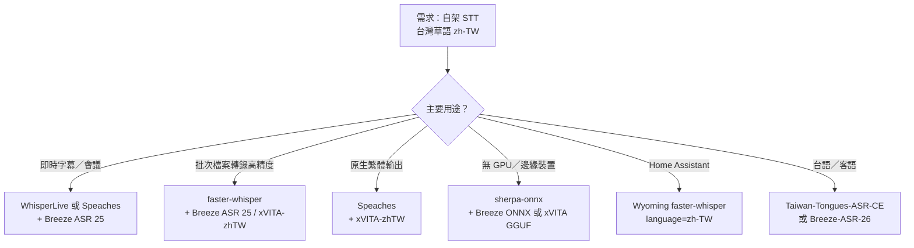

# 自由軟體／自架語音轉文字（STT）方案：台灣華語（zh-TW）支援評估

## 摘要

本報告調查可自行架設（self-hosted）、且為自由／開放原始碼軟體（FOSS）的語音轉文字（Speech-to-Text, STT）方案，重點在於「台灣華語（Taiwanese Mandarin，語言代碼 `zh-TW`）」的辨識能力。

結論先行：

- **模型層面**：台灣華語的最佳選擇是 **MediaTek Research 的 Breeze ASR 25**（以 Whisper-large-v2 微調），在 CommonVoice16-zh-TW 上字元錯誤率（CER/WER）約 **7.97**，優於 Whisper-large-v3 的 8.95[^breeze]。
- **第二大類**：由台灣官方與民間釋出的一系列 Whisper 微調模型，包括數位發展部數位產業署的 **Taiwan-Tongues-ASR-CE**（支援國語／台語／客語／英語）[^tt]、云碩科技的 **xVITA-zhTW**（原生繁體輸出）[^xvita]、以及多個社群微調版[^jacob][^jz]。
- **通用工具層面**：若需要「開箱即用的伺服器」，**Speaches**（OpenAI 相容 API ＋ 串流）[^speaches]、**WhisperLive**（WebSocket 即時串流）[^wlive]、**sherpa-onnx**（跨平台、可離線、Apache-2.0）[^sherpa] 是三個最完整的自架選項。
- **關鍵陷阱**：**未經微調的 Whisper 預設輸出簡體中文**，且繁體字錯誤率高（實測 CER 33.26% 對比微調後 8.60%）[^xvita]。純通用模型無法直接滿足台灣華語需求，必須改用微調版本。

---

## 一、問題背景：為何通用 STT 對台灣華語表現不佳

「台灣華語」與「中國大陸普通話」在詞彙、用字（繁體 vs 簡體）、腔調與語碼混用（中英夾雜）上有明顯差異。通用語音模型（如原版 Whisper）雖然支援 `zh` 語言，但：

1. **預設輸出簡體中文**，需要額外後處理轉換[^xvita]。
2. **對台灣腔調與台灣特有詞彙辨識率下降**。
3. **中英夾雜**（例如「我們怎麼用 open mind open heart 的心情去 explore」）常被模型錯誤地整句翻成中文或漏字[^breeze]。

因此，真正可用的自架方案，多半是**以 Whisper 為基座、針對台灣華語微調的模型**，而非通用模型。

---

## 二、模型層：針對台灣華語的開源模型

### 2.1 Breeze ASR 25（MediaTek Research／聯發創新基地）

**Breeze ASR 25** 由聯發科技旗下「聯發創新基地（MediaTek Research）」開發，以 **Whisper-large-v2** 微調而成，約 20 億參數，特別針對兩點優化[^breeze]：

- **強化繁體中文情境辨識能力**（台灣華語用字）
- **強化中英混用情境**，包含句內（intra-sentential）與句外（inter-sentential）轉換
- **強化時間戳記對齊**，適合自動字幕生成

**授權**：Hugging Face 模型卡標示 `apache-2.0`[^breeze]；GitHub 儲存庫的 LICENSE 檔為 MIT[^breezegit]。使用前建議以實際下載頁面確認。

**效能（WER／CER，越低越好）**[^breeze]：

| 資料集 | 語言 | Whisper-large-v2 | Whisper-large-v3 | Breeze ASR 25 |
|---|---|---|---|---|
| CommonVoice16-zh-TW | 華語 | 9.84 | 8.95 | **7.97** |
| CSZS-zh-en（中英混用） | 混合 | 29.49 | 26.43 | **13.01** |
| ASCEND-MIX（中英混用） | 混合 | 21.01 | 25.13 | **16.38** |
| Formosa-Go（長音檔） | 華語 | 15.03 | 14.90 | **13.61** |
| FormosaSpeech（長音檔） | 華語 | 22.34 | 21.22 | **22.09** |

**訓練資料**：中文部分**完全採用合成語音**（10,000 小時 ODC Synth），另加 1,738 小時真實英語（CommonVoice17-EN）與 11 小時中英混用（NTUML2021），皆為寬鬆授權來源[^breeze]。

**自架需求**：架構與 Whisper-large-v2 相同（約 2B 參數）。一般建議 **8 GB 以上 VRAM** 的 GPU 可順暢推論；亦有社群量化版本與 ONNX 版本可降低門檻[^onnx]。

- Hugging Face：`MediaTek-Research/Breeze-ASR-25`
- ONNX（供 sherpa-onnx／行動裝置）：`MediaTek-Research/Breeze-ASR-25-onnx-250806`[^onnx]

> 註：GitHub 儲存庫 `mtkresearch/Breeze-ASR-25` 的星數約 **221**（相對於通用專案偏低）[^stars]。但本主題屬高度利基（台灣華語專用模型），低星數不代表品質不佳；此模型在台灣華語基準測試上為開源領域領先者，故仍納入報告。

### 2.2 Breeze ASR 26（Taigi／台語）

MediaTek Research 另有針對**台灣台語（Taiwanese Hokkien，`nan`）**的模型 **Breeze-ASR-26**，輸出為華語漢字，CER 約 **30.13%**，優於教育部台灣台語輸入法（30.70%）、雅婷逐字稿（32.11%）與 Gemini 3 Flash（32.52%）[^taigi]。若需求是台灣台語而非台灣華語，這是目前開源最佳解。

- Hugging Face：`MediaTek-Research/Breeze-ASR-26`

### 2.3 Taiwan-Tongues-ASR-CE（數位發展部數位產業署）

台灣**數位發展部數位產業署（ADI）**釋出的多語 ASR 專案，以 Whisper-large-v2 為基座，支援**國語、台語、客語、英語**四種語言，並同時釋出訓練資料集[^tt]。

- 可續訓版本：`adi-gov-tw/Taiwan-Tongues-ASR-CE-pretrained-v1.0`
- 純推論版本（CTranslate2／faster-whisper 格式）：`adi-gov-tw/Taiwan-Tongues-ASR-CE-v1.0`
- 訓練腳本：`github.com/adi-gov-tw/Taiwan-Tongues-ASR-CE`

**資料集**[^tt]：`zhtw`（12 萬筆華語）、`en`（3.2 萬筆英語）、`hokkien`（3.18 萬筆台語）、`hakka`（5,600 筆客語）。

授權為「其他（other）」，依專案條款釋出，使用前需確認[^tt]。GitHub 儲存庫星數約 **88**[^stars]，屬政府利基專案。另有社群 LoRA 適配器 `johnnycpu/taiwan-tongues-welfare-asr-lora`（Apache-2.0），將社福領域詞彙 CER 由約 35% 降至 8% 以下[^tt]。

### 2.4 xVITA-zhTW（云碩科技）

**Whisper-Large-v3-xVITA-zhTW** 以 `openai/whisper-large-v3` 微調，**原生輸出繁體中文**，內建簡體詞元封鎖清單與自動標點[^xvita]。

**效能（962 句台灣華語測試集，CER）**[^xvita]：

| 模型 | 內容 CER（繁簡統一後） | 實際輸出 CER（vs 繁體標準答案） |
|---|---|---|
| `openai/whisper-large-v3`（base） | 5.94% | 33.26%（輸出簡體） |
| `Whisper-Large-v3-xVITA-zhTW` | **5.57%** | **8.60%**（原生繁體） |

- 授權：**Apache-2.0**（模型權重）[^xvita]
- 格式：HF Transformers、**CTranslate2**（`ct2/`，供 faster-whisper）、**GGUF**（供 whisper.cpp，含 1.1 GB 起的量化檔）[^xvita]
- 另有 Turbo 版 `Whisper-Large-v3-Turbo-xVITA-zhTW`（約 0.8B 參數，MIT 授權），主打會議語音，實際會議語音 CER 12.85%（對比 base turbo 19.40%）[^xvita2]

### 2.5 社群 Whisper 微調版

| 模型 | 基座 | 授權 | 指標 | 來源 |
|---|---|---|---|---|
| `JacobLinCool/whisper-large-v3-turbo-common_voice_19_0-zh-TW` | large-v3-turbo | MIT | WER 32.56%／CER 8.60% | [^jacob] |
| `DDTChen/whisper-small-tw` | small | Apache-2.0 | CommonVoice 11 zh-TW WER 40.28% | [^ddt] |
| `Jingmiao/whisper-small-zh_tw` | small | Apache-2.0 | CommonVoice 11 zh-TW WER 41.97% | [^jz] |
| `Luigi/whisper-small-zh_tw-ct2` | small（CT2） | Apache-2.0 | CPU int8 部署用 | [^luigi] |

小模型（small）錯誤率偏高（40% 以上），僅建議資源極受限或即時性優先的情境；**品質取向建議 large-v3／large-v2 等級**。

### 2.6 FunASR／SenseVoice（阿里／通義實驗室）

FunASR 與 SenseVoice 在**中國大陸普通話**上精度極高（SenseVoiceSmall 於中文基準 CER 約 8%，優於 Whisper 同級模型的 22% 以上）[^funasr]，且提供 CPU、vLLM、llama.cpp、Docker、ONNX 等多種自架方式[^funasr]。

**但對台灣華語的適用性有限**：官方模型以 `zh`（普通話）為主，並無 `zh-TW` 專用語言標籤，輸出傾向大陸用語與簡體字。若資料以台灣華語為主，仍需自行以台灣語料微調。適合「以普通話為主、偶有台灣腔」的混合情境。

### 2.7 其他

- **Whisper-large-v3（OpenAI 原版）**：MIT 授權，多語言，但台灣華語輸出為簡體、中英混用效能差，僅作基座或最後備案[^breeze]。
- **Vosk**：Apache-2.0、純 CPU、模型極小（42 MB 起），但僅有 **大陸普通話**（zh-CN）模型，**無 zh-TW**，不建議用於台灣華語[^vosk]。
- **NVIDIA NeMo**：`stt_zh_conformer_transducer_large`（CC-BY-4.0）僅訓練於 AISHELL-2（大陸朗讀語音），需 GPU，**無 zh-TW**[^nemo]。
- **wav2vec2 華語版**：AISHELL 系列多為**學術授權（禁商用）**，且無 zh-TW 微調，實務價值有限[^w2v]。

---

## 三、部署層：可自架的 STT 伺服器軟體

模型需要伺服器軟體來提供 API／串流。以下為主要 FOSS 方案：

| 專案 | 星數（約）[^stars] | 授權 | OpenAI 相容 API | 串流 | 可跑 zh-TW 模型 |
|---|---|---|---|---|---|
| **Speaches** | 3.7k | MIT | ✅ 完整 | ✅ SSE ＋ Realtime WS | ✅（faster-whisper 為後端）[^speaches] |
| **WhisperLive** | 4.3k | MIT | ✅ `/v1/audio/transcriptions` | ✅ WebSocket | ✅（多語言模型）[^wlive] |
| **whisper-asr-webservice** | 3.4k | MIT | ⚠️ 部分 | ❌ | ✅[^wasr] |
| **RealtimeSTT** | 10.2k | MIT | ❌（自有 API） | ✅ WebSocket | ✅（多後端）[^rstt] |
| **Wyoming faster-whisper** | 396 | MIT | ❌（Wyoming 協定） | ✅ | ✅（明確支援 `zh-TW`）[^wyoming] |
| **sherpa-onnx** | 15.3k | Apache-2.0 | ❌（函式庫／CLI） | ✅ 串流與非串流 | ✅ 可載入 Breeze ONNX[^sherpa] |

### 重點說明

- **Speaches**：定位為「STT/TTS 界的 Ollama」，提供完整 OpenAI 相容 API、SSE 串流與 Realtime WebSocket，Docker Compose 一鍵部署[^speaches]。若你的應用已用 OpenAI 語音 API，這是改為自架最低摩擦的選擇。**可載入任意 faster-whisper 模型**，故可指向 Breeze ASR 25 或 xVITA-zhTW。
- **WhisperLive**（Collabora 維護）：原生 WebSocket 即時串流，並提供 `/v1/audio/transcriptions` OpenAI 相容端點，適合即時字幕／會議逐字稿[^wlive]。
- **sherpa-onnx**：Apache-2.0，支援 Android／iOS／Windows／macOS／Linux／樹莓派／Jetson／RISC-V／WASM 等極廣平台，支援線上（streaming）與離線推論，並已有熱心者將 Breeze ASR 25 轉為其 ONNX 格式[^sherpa][^onnx]。適合**邊緣裝置、離線、無 GPU** 情境。
- **Wyoming faster-whisper**：若使用 **Home Assistant**，此為官方生態方案，語言清單**明確含 `zh-TW`**[^wyoming]。

### 推論引擎（底層）

- **faster-whisper**（CTranslate2）：CPU／GPU 皆可，int8 量化大幅降低資源需求，是 Speaches、Wyoming 等的後端[^fw]。
- **whisper.cpp**（GGML／GGUF）：純 CPU／邊緣裝置首選，可載入 xVITA-zhTW 的 GGUF 量化檔[^xvita][^wcpp]。

---

## 四、建議組合

以下為依使用情境的建議（皆為 FOSS＋自架）：

1. **最高精度（台灣華語 ＋ 中英夾雜）**：`faster-whisper` 或 Speaches，載入 **Breeze ASR 25**。需 8 GB 級 GPU。
2. **需原生繁體、不後處理**：**xVITA-zhTW**（CTranslate2／GGUF 皆有），Apache-2.0，且提供 whisper.cpp 量化檔可純 CPU 跑。
3. **即時／串流**：**WhisperLive** 或 **Speaches** 的 Realtime API。
4. **邊緣／無 GPU**：**sherpa-onnx** ＋ Breeze ONNX 量化版，或 whisper.cpp ＋ xVITA GGUF（1.1 GB 起）。
5. **多語（含台語／客語）**：**Taiwan-Tongues-ASR-CE**（國／台／客／英），或台語另用 **Breeze-ASR-26**。

---

## 五、授權與實務注意事項

- **下載模型前務必確認授權**：同一模型在 Hugging Face 與 GitHub 可能標示不同（例：Breeze ASR 25 的 HF 標 `apache-2.0`、GitHub 為 MIT）[^breeze][^breezegit]；Taiwan-Tongues-ASR-CE 為「other」，需讀專案條款[^tt]。
- **AISHELL 系列 wav2vec2 多為學術授權**，商業使用受限[^w2v]。
- **注意繁簡輸出**：通用 Whisper 預設吐簡體，若要用於台灣情境務必選微調版或加繁化後處理[^xvita]。
- **GPU 需求差異大**：large 級模型（Breeze、xVITA-large-v3）約需 8 GB VRAM；量化／Turbo／small 版本可降至 CPU 可跑，但精度取捨明顯[^xvita][^onnx]。

---

## 六、結論

在「FOSS ＋ 自架 ＋ 台灣華語」的交集下，**MediaTek Research 的 Breeze ASR 25 是目前開源領域的領先模型**，於台灣華語與中英混用基準上均優於 Whisper-large-v3[^breeze]；若偏好原生繁體輸出與更輕量部署，**xVITA-zhTW** 是極具吸引力的替代[^xvita]；若需多語（含台語、客語）或官方支援，**Taiwan-Tongues-ASR-CE** 值得評估[^tt]。

部署層面，**Speaches**（OpenAI 相容 ＋ 串流）與 **WhisperLive**（WebSocket 即時）最適合通用伺服器需求[^speaches][^wlive]；**sherpa-onnx** 則在邊緣與跨平台離線場景無可取代[^sherpa]。

---

## 參考文獻

[^breeze]: MediaTek Research. (2025). *Breeze-ASR-25* [Model card]. Hugging Face. Retrieved 2026-10-14, from https://huggingface.co/MediaTek-Research/Breeze-ASR-25

[^breezegit]: mtkresearch. (2025). *Breeze-ASR-25* [Source code]. GitHub. Retrieved 2026-10-14, from https://github.com/mtkresearch/Breeze-ASR-25

[^onnx]: MediaTek Research. (2025). *Breeze-ASR-25-onnx-250806* [Model card]. Hugging Face. Retrieved 2026-10-14, from https://huggingface.co/MediaTek-Research/Breeze-ASR-25-onnx-250806

[^taigi]: MediaTek Research. (2026). *Breeze-ASR-26* [Model card]. Hugging Face. Retrieved 2026-10-14, from https://huggingface.co/MediaTek-Research/Breeze-ASR-26

[^tt]: 數位發展部數位產業署. (2026). *Taiwan-Tongues-ASR-CE-v1.0* [Model card]. Hugging Face. Retrieved 2026-10-14, from https://huggingface.co/adi-gov-tw/Taiwan-Tongues-ASR-CE-v1.0

[^xvita]: xCloudinfo Corp. Limited. (2025). *Whisper-Large-v3-xVITA-zhTW* [Model card]. Hugging Face. Retrieved 2026-10-14, from https://huggingface.co/xCloudinfo/Whisper-Large-v3-xVITA-zhTW

[^xvita2]: xCloudinfo Corp. Limited. (2025). *Whisper-Large-v3-Turbo-xVITA-zhTW* [Model card]. Hugging Face. Retrieved 2026-10-14, from https://huggingface.co/xCloudinfo/Whisper-Large-v3-Turbo-xVITA-zhTW

[^jacob]: JacobLinCool. (n.d.). *whisper-large-v3-turbo-common_voice_19_0-zh-TW* [Model card]. Hugging Face. Retrieved 2026-10-14, from https://huggingface.co/JacobLinCool/whisper-large-v3-turbo-common_voice_19_0-zh-TW

[^ddt]: DDTChen. (n.d.). *whisper-small-tw* [Model card]. Hugging Face. Retrieved 2026-10-14, from https://huggingface.co/DDTChen/whisper-small-tw

[^jz]: Jingmiao. (n.d.). *whisper-small-zh_tw* [Model card]. Hugging Face. Retrieved 2026-10-14, from https://huggingface.co/Jingmiao/whisper-small-zh_tw

[^luigi]: Luigi. (n.d.). *whisper-small-zh_tw-ct2* [Model card]. Hugging Face. Retrieved 2026-10-14, from https://huggingface.co/Luigi/whisper-small-zh_tw-ct2

[^funasr]: modelscope. (n.d.). *FunASR* [Source code]. GitHub. Retrieved 2026-10-14, from https://github.com/modelscope/FunASR

[^vosk]: Alpha Cephei. (n.d.). *Vosk models*. Retrieved 2026-10-14, from https://alphacephei.com/vosk/models

[^nemo]: NVIDIA. (n.d.). *stt_zh_conformer_transducer_large* [Model card]. Hugging Face. Retrieved 2026-10-14, from https://huggingface.co/nvidia/stt_zh_conformer_transducer_large

[^w2v]: kehanlu. (n.d.). *mandarin-wav2vec2-aishell1* [Model card]. Hugging Face. Retrieved 2026-10-14, from https://huggingface.co/kehanlu/mandarin-wav2vec2-aishell1

[^speaches]: speaches-ai. (n.d.). *Speaches* [Source code]. GitHub. Retrieved 2026-10-14, from https://github.com/speaches-ai/speaches

[^wlive]: Collabora. (n.d.). *WhisperLive* [Source code]. GitHub. Retrieved 2026-10-14, from https://github.com/collabora/WhisperLive

[^wasr]: ahmetoner. (n.d.). *whisper-asr-webservice* [Source code]. GitHub. Retrieved 2026-10-14, from https://github.com/ahmetoner/whisper-asr-webservice

[^rstt]: KoljaB. (n.d.). *RealtimeSTT* [Source code]. GitHub. Retrieved 2026-10-14, from https://github.com/KoljaB/RealtimeSTT

[^wyoming]: OHF-Voice. (n.d.). *wyoming-faster-whisper* [Source code]. GitHub. Retrieved 2026-10-14, from https://github.com/OHF-Voice/wyoming-faster-whisper

[^sherpa]: k2-fsa. (n.d.). *sherpa-onnx* [Source code]. GitHub. Retrieved 2026-10-14, from https://github.com/k2-fsa/sherpa-onnx

[^fw]: SYSTRAN. (n.d.). *faster-whisper* [Source code]. GitHub. Retrieved 2026-10-14, from https://github.com/SYSTRAN/faster-whisper

[^wcpp]: ggml-org. (n.d.). *whisper.cpp* [Source code]. GitHub. Retrieved 2026-10-14, from https://github.com/ggml-org/whisper.cpp

[^stars]: GitHub 星數為 2026-10-14 檢視各專案儲存庫所得之近似值，僅供相對參考，會隨時間變動。
