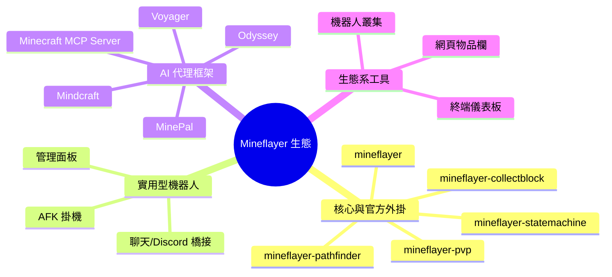

# 以 Mineflayer 驅動的自由開源（FOSS）Minecraft 機器人實作調查

## 摘要

本報告調查以 [Mineflayer](https://github.com/prismarinejs/mineflayer) 為底層、且以自由開源（FOSS, Free and Open-Source Software）形式釋出的 Minecraft 機器人（bot）實作。Mineflayer 是一套以 JavaScript 撰寫、用於建立 Minecraft 機器人的高階函式庫[^mineflayer]，本身採用 MIT 授權[^mineflayer-gh]。本報告將可找到的實作分為四大類：(1) 核心函式庫與官方外掛；(2) 以 Mineflayer 直接驅動的獨立實用型機器人（掛機、管理、橋接）；(3) 結合大型語言模型（LLM）的 AI 代理框架；(4) 第三方的周邊生態系工具。所有星號數、授權與描述均以 2026-10-14 檢索時的公開資料為準。

---

## 1. 背景：Mineflayer 是什麼

Mineflayer 由 PrismarineJS 組織維護，讓開發者以「強大、穩定且高階的 JavaScript API」建立 Minecraft 機器人[^mineflayer]。其官方說明為：Mineflayer 會把 Minecraft 的原始網路封包抽象化成高階物件，使機器人能存取世界狀態、實體、物品欄、合成、挖掘、戰鬥與聊天等功能[^mineflayer]。

- GitHub：`PrismarineJS/mineflayer`
- 星號數：**7,582**[^mineflayer-gh]
- 授權：**MIT License**[^mineflayer-gh]
- 主要語言：JavaScript[^mineflayer-gh]
- 建立時間：2011-01-23[^mineflayer-gh]
- 描述：`Create Minecraft bots with a powerful, stable, and high level JavaScript API.`[^mineflayer-gh]

> 授權提醒：Mineflayer 本體為 MIT，但**衍生專案各自的授權不盡相同**（例如部分為 GPL-3.0、Apache-2.0，亦有專案未標示授權）。使用前務必逐一確認各專案的 LICENSE[^mineflayer-gh][^afk-gh][^mcp-gh]。

---

## 2. 分類總覽

---

## 3. 核心函式庫與官方外掛（PrismarineJS 組織）

下表為 PrismarineJS 組織內、與 Mineflayer 直接相關且較受注目的專案[^prismarine-org][^pathfinder-gh][^statemachine-gh][^pvp-gh][^collectblock-gh]。

| 專案 | 星號數 | 授權 | 用途 |
|---|---|---|---|
| `PrismarineJS/mineflayer` | 7,582 | MIT | 核心函式庫[^mineflayer-gh] |
| `PrismarineJS/mineflayer-pathfinder` | 313 | MIT | 由 A 點走到 B 點的路徑尋找外掛[^pathfinder-gh] |
| `PrismarineJS/mineflayer-statemachine` | 138 | MIT | 以狀態機設計複雜行為樹[^statemachine-gh] |
| `PrismarineJS/mineflayer-pvp` | 71 | MIT | 為機器人加入基本 PvP／PvE 能力[^pvp-gh] |
| `PrismarineJS/mineflayer-navigate` | 62 | 未標示 | 以 A* 提供高階三維導航 API[^prismarine-org] |
| `PrismarineJS/mineflayer-collectblock` | 56 | MIT | 更高階的方塊收集 API[^collectblock-gh] |
| `PrismarineJS/mineflayer-radar` | 44 | 未標示 | 網頁版雷達介面（已標示 unmaintained）[^prismarine-org] |
| `PrismarineJS/MineflayerArmorManager` | 34 | MIT | 自動穿上最佳護甲[^prismarine-org] |
| `PrismarineJS/mineflayer-builder` | 32 | 未標示 | 自動化建築[^prismarine-org] |
| `PrismarineJS/mineflayer-tool` | 29 | 未標示 | 自動選擇最佳工具／武器[^prismarine-org] |
| `PrismarineJS/mineflayer-scaffold` | 28 | 未標示 | 透過放置或破壞方塊來抵達目標[^prismarine-org] |

> 備註：此類專案為「外掛（plugin）」，並非獨立可執行的機器人；它們通常與其他外掛組合，作為 AI 代理或實用型機器人的底層積木[^pathfinder-gh][^statemachine-gh]。

---

## 4. 實用型獨立機器人（AFK、橋接、管理）

這一類是「立即可用」的成品機器人，多數以 Mineflayer 直接驅動。

### 4.1 掛機／伺服器維持類

| 專案 | 星號數 | 授權 | 說明 | 維護狀態 |
|---|---|---|---|---|
| `nuekkis/Minecraft-AFK-Bot` | 99 | MIT | 讓 Aternos 等伺服器保持 24 小時上線的掛機機器人，支援可設定的區塊剪枝以降低記憶體用量[^nuekkis-gh] | 活躍（2026-09 仍有推送）[^nuekkis-gh] |
| `urFate/Afk-Bot` | 134 | MIT | 支援 Anti-AFK、自動登入、Mojang／Microsoft 帳號與自動重連[^afk-gh] | **已封存（archived）**[^afk-gh] |
| `Sloboscc/Slobos-AFK-Aternos-Bot` | 82 | MIT | 以 Mineflayer 維持 Aternos 伺服器上線[^github-search] | 2026-03 建立[^github-search] |
| `MrJuice3046/Aternos24-7-HostingBot` | 43 | 其他（NOASSERTION） | 維持 Aternos 伺服器上線[^github-search] | —[^github-search] |

### 4.2 管理／多功能工具類

| 專案 | 星號數 | 授權 | 說明 | 維護狀態 |
|---|---|---|---|---|
| `TrafficerMC-Development/TrafficerMC` | 282 | MIT | Electron 桌面工具，含 Anti-AFK、聊天洗頻、物品欄／箱子管理、killaura、腳本與代理（proxy）支援，涵蓋 1.8.x–1.20[^trafficer-gh] | **已封存**[^trafficer-gh] |
| `peter81745/PeterBOT` | 37 | 未標示 | 以 NodeJS、Mineflayer 建構、附 GUI 的易用機器人[^github-search] | **已封存**[^github-search] |
| `barbarbar338/minecraft-helper-bot` | 30 | GPL-3.0 | 提供各式協助的 Minecraft 機器人[^github-search] | —[^github-search] |

### 4.3 聊天／Discord 橋接類

| 專案 | 星號數 | 授權 | 說明 |
|---|---|---|---|
| `DuckySoLucky/hypixel-discord-chat-bridge` | 78 | 未標示 | 以 discord.js v14 與 Mineflayer 串接 Hypixel 公會聊天與 Discord 頻道的雙向橋接[^hypixel-gh] |
| `OBNinjaa/mineflayer-discord-bot` | 37 | 未標示 | 以 Discord 斜線指令與遊戲內指令控制 Mineflayer 機器人[^github-search] |

### 4.4 早期／經典實作

| 專案 | 星號數 | 授權 | 說明 |
|---|---|---|---|
| `rom1504/rbot` | 90 | MIT | 由 Mineflayer 核心貢獻者 rom1504 所寫、可執行建造等任務的早期機器人[^rbot-gh] |
| `Darthfett/helperbot` | 58 | 未標示 | 協助玩家在 Minecraft 中完成事情的機器人（最後推送 2017 年）[^github-search] |

---

## 5. AI 代理框架（LLM + Mineflayer）

這是近兩年最活躍的類別，多數以 LLM 產生 JavaScript 程式碼或動作指令，交由 Mineflayer 執行。

### 5.1 Voyager（MineDojo）

- GitHub：`MineDojo/Voyager`
- 星號數：約 **7.3k**[^voyager]
- 授權：**MIT**[^voyager]
- 說明：首個以 LLM 驅動、具終身學習能力的 Minecraft 具身代理。它包含自動課程（automatic curriculum）、持續成長的技能庫，以及迭代提示機制；透過黑箱查詢與 GPT-4 互動，不需微調模型。論文中宣稱其取得 3.3 倍獨特物品、移動距離 2.3 倍，並以最高 15.3 倍速解鎖科技樹里程碑[^voyager]。
- Mineflayer 關聯：其安裝流程要求進入 `voyager/env/mineflayer` 執行 `npm install`，並以 `npx tsc` 建置 `mineflayer-collectblock`，可確認 Mineflayer 為其 Minecraft 介面層[^voyager]。
- 論文：*Voyager: An Open-Ended Embodied Agent with Large Language Models*（2023，arXiv:2305.16291）[^voyager-paper]。

### 5.2 Mindcraft（mindcraft-bots）

- GitHub：`mindcraft-bots/mindcraft`
- 星號數：**5,886**[^mindcraft-gh]
- 授權：**MIT**[^mindcraft-gh]
- 主要語言：JavaScript；預設分支 `develop`[^mindcraft-gh]
- 說明：描述為「Minecraft AI with LLMs+Mineflayer」。它支援 20 種以上的 LLM 供應商（OpenAI、Anthropic、Google Gemini、Ollama、DeepSeek、Groq、HuggingFace 等），可透過 bot 設定檔（如 `andy.json`）定義名稱、模型與人設，具備自主遊玩、沙盒式程式執行、任務目標、語音合成、Docker 支援與多代理協作[^mindcraft]。其論文為 *Collaborating Action by Action: A Multi-agent LLM Framework for Embodied Reasoning*（arXiv:2504.17950）[^mindcraft]。

### 5.3 Odyssey（zju-vipa）

- GitHub：`zju-vipa/Odyssey`
- 星號數：約 **411**[^odyssey]
- 授權：**MIT**[^odyssey]
- 說明：建構於 Voyager 之上，主打「開放世界技能庫」——40 個基礎技能與 183 個組合技能、微調過的 LLaMA-3 用於 Minecraft 問答，以及長期規劃／動態即時規劃／自主探索等新基準任務。同樣以 `odyssey/env/mineflayer/` 內的 Mineflayer 執行技能[^odyssey]。
- 論文：獲 IJCAI 2025 接受（arXiv:2407.15325）[^odyssey]。

### 5.4 Minecraft MCP Server（yuniko-software）

- GitHub：`yuniko-software/minecraft-mcp-server`
- 星號數：**780**[^mcp-gh]
- 授權：**Apache-2.0**[^mcp-gh]
- 主要語言：TypeScript[^mcp-gh]
- 說明：以 Mineflayer API 驅動的 Minecraft MCP（Model Context Protocol）伺服器，讓 Claude 等 AI 助理即時操控 Minecraft 角色，透過自然語言建造、探索、挖掘與放置方塊[^mcp-gh]。

### 5.5 其他 AI 代理

| 專案 | 星號數 | 授權 | 說明 |
|---|---|---|---|
| `altera-al/project-sid` | 約 1.4k | 未標示 | Altera 的多代理「AI 文明」模擬，於 Minecraft 中觀察角色分化、規則制定與文化傳播（10–1000+ 個代理）[^sid] |
| `manekinekko/minecraft-openai` | 122 | MIT | 以 OpenAI／GPT-3 控制 Minecraft NPC 的概念驗證[^openai-gh] |
| `bigph00t/hermescraft` | 73 | MIT | 具持久記憶、視覺、學習與多代理的 Minecraft 具身 AI 同伴[^github-search] |
| `JesseRWeigel/minecraft-agent-swarm` | 約 32 | — | 自我改進的本機 LLM 蜂群[^search-agent] |
| `CraftJarvis/JARVIS-1` | 約 417 | 未標示 | 多模態記憶的 Minecraft 代理；主要控制器為 STEVE-1，Minecraft 連線協定多經 MCP-Reborn 而非直接 Mineflayer[^search-agent] |
| `MinePal`（原專案已刪除） | 分支多為低星 | MIT／AGPL-3.0（分支而異） | Electron 桌面 App，於玩家旁啟動 Mineflayer 機器人並以 LLM 解讀自然語言指令（含 `mineflayer-collectblock`、`mineflayer-auto-eat`、`mineflayer-pvp`、`mineflayer-pathfinder` 子模組）[^minpal] |

### 5.6 BlockMine（blockmineJS）

- GitHub：`blockmineJS/blockmine`
- 星號數：**55**[^blockmine-gh]
- 授權：**MIT**[^blockmine-gh]
- 說明：開源的 Minecraft 機器人「框架與自動化平台」，明確標示「built on Mineflayer」。功能包含多機器人管理、視覺化（免寫程式）節點腳本、JS／TS 外掛系統與外掛市集、權限與群組、Cron 排程、即時除錯器、3D 世界檢視、WebSocket API，以及內建 MCP 伺服器讓 AI 代理控制機器人[^blockmine]。其 `package.json` 列出 `mineflayer ^4.33.0` 與 `mineflayer-pathfinder ^2.4.5` 為核心相依[^blockmine-json]。

---

## 6. 生態系周邊工具（非「機器人」但常被使用）

| 專案 | 星號數 | 授權 | 說明 |
|---|---|---|---|
| `imharvol/mineflayer-web-inventory` | 99 | MIT | 以網頁即時檢視機器人物品欄（socket.io 即時更新）之外掛[^webinv-gh] |
| `wvffle/mineflayer-dashboard` | 71 | MIT | 單一機器人的終端機儀表板，含模式、自訂指令與日誌[^prismarine-org] |
| `linkle69/mineflayer-auto-eat` | 51 | — | 依飢餓／血量自動進食（僅 ESM）[^prismarine-org] |
| `Pandapip1/mineflayer-swarm` | 32 | MIT | 以極少額外程式碼控制一整個 Mineflayer 機器人叢集[^github-search] |

---

## 7. 比較與觀察

- **最受注目的兩個 AI 代理**為 Voyager（約 7.3k 星、MIT）與 Mindcraft（5,886 星、MIT）；前者奠定了「LLM 撰寫技能程式碼交由 Mineflayer 執行」的範式，後者則以「直接以 LLM 選擇 Mineflayer 動作」與多供應商支援取勝[^voyager][^mindcraft-gh]。
- **掛機（AFK）類**星號數多不高（多在 30–140 之間），且常因 Minecraft 版本更新而迅速過時，數個高星專案（TrafficerMC、urFate/Afk-Bot）已封存[^trafficer-gh][^afk-gh]。
- **授權差異大**：核心與多數 AI 代理為 MIT，MCP Server 為 Apache-2.0，另有 GPL-3.0（`barbarbar338/minecraft-helper-bot`）與未標示授權者（如 project-sid、JARVIS-1、hypixel-discord-chat-bridge）[^github-search][^sid][^hypixel-gh]。
- **活躍度落差明顯**：Mineflayer 本體於 2026-10 仍有推送[^mineflayer-gh]；但不少舊機器人（helperbot、PeterBOT）最後更新已久[^github-search]。

---

## 8. 資料來源的批判性反思

- **星號數具有時效性與快照偏差**：本報告同時使用 GitHub REST API（`api.github.com/repos/*`）與搜尋結果頁作為來源，兩者對部分專案（如 Mindcraft）給出 5.9k 與 5,886 等些微不同數字，屬正常快照差異；報告以 API 數值為主、頁面值為輔並標註「約」[^mindcraft-gh][^mindcraft]。
- **「是否使用 Mineflayer」需逐一驗證**：Project Sid 的論文與 GitHub 僅含報告，未公開程式碼，故**無法證實**其是否使用 Mineflayer；本報告僅陳述其為 Minecraft 多代理模擬，並標示「未確認」[^sid]。相對地，Voyager、Mindcraft、BlockMine 等可由安裝流程或 `package.json` 相依直接證實[^voyager][^blockmine-json]。
- **第三方整理可能出錯**：部分社群整理把不同作者的同名專案（例如兩個 `mineflayer-web-inventory`）混為一談，星號數差異懸殊；本報告一律回到 GitHub API 與官方組織頁核對[^webinv-gh][^prismarine-org]。
- **維護狀態不等於可用性**：標示為 archived 的專案仍常有大量 fork，代表其程式碼仍被社群沿用，但不再接收上游更新[^afk-gh][^trafficer-gh]。

---

## 參考文獻

[^mineflayer]: PrismarineJS. (n.d.). *mineflayer: Create Minecraft bots with a powerful, stable, and high level JavaScript API.* Retrieved 2026-10-14, from https://github.com/prismarinejs/mineflayer

[^mineflayer-gh]: GitHub. (n.d.). *PrismarineJS/mineflayer* [Repository metadata]. Retrieved 2026-10-14, from https://api.github.com/repos/PrismarineJS/mineflayer

[^mindcraft]: Mindcraft Bots. (n.d.). *Mindcraft: Minecraft AI with LLMs+Mineflayer.* Retrieved 2026-10-14, from https://github.com/mindcraft-bots/mindcraft

[^mindcraft-gh]: GitHub. (n.d.). *mindcraft-bots/mindcraft* [Repository metadata]. Retrieved 2026-10-14, from https://api.github.com/repos/mindcraft-bots/mindcraft

[^voyager]: MineDojo. (n.d.). *Voyager: An Open-Ended Embodied Agent with Large Language Models.* Retrieved 2026-10-14, from https://github.com/MineDojo/Voyager

[^voyager-paper]: Wang, G., Xie, Y., Jiang, Y., Mandlekar, A., Xiao, C., Zhu, Y., Fan, L., & Anandkumar, A. (2023). *Voyager: An Open-Ended Embodied Agent with Large Language Models.* Retrieved 2026-10-14, from https://arxiv.org/abs/2305.16291

[^sid]: Altera.AL. (n.d.). *Project Sid: Many-agent simulations toward AI civilization.* Retrieved 2026-10-14, from https://github.com/altera-al/project-sid

[^sid-paper]: Altera.AL, Ahn, A., Becker, Carroll, Christie, Cortes, Demirci, Du, Li, Luo, P. Y. Wang, Willows, Yang, & Yang, G. R. (2024, October 31). *Project Sid: Many-agent simulations toward AI civilization* (arXiv:2411.00114). Retrieved 2026-10-14, from https://arxiv.org/abs/2411.00114

[^mcp-gh]: GitHub. (n.d.). *yuniko-software/minecraft-mcp-server* [Repository metadata]. Retrieved 2026-10-14, from https://api.github.com/repos/yuniko-software/minecraft-mcp-server

[^trafficer-gh]: GitHub. (n.d.). *TrafficerMC-Development/TrafficerMC* [Repository metadata]. Retrieved 2026-10-14, from https://api.github.com/repos/TrafficerMC-Development/TrafficerMC

[^afk-gh]: GitHub. (n.d.). *urFate/Afk-Bot* [Repository metadata]. Retrieved 2026-10-14, from https://api.github.com/repos/urFate/Afk-Bot

[^openai-gh]: GitHub. (n.d.). *manekinekko/minecraft-openai* [Repository metadata]. Retrieved 2026-10-14, from https://api.github.com/repos/manekinekko/minecraft-openai

[^webinv-gh]: GitHub. (n.d.). *imharvol/mineflayer-web-inventory* [Repository metadata]. Retrieved 2026-10-14, from https://api.github.com/repos/imharvol/mineflayer-web-inventory

[^nuekkis-gh]: GitHub. (n.d.). *nuekkis/Minecraft-AFK-Bot* [Repository metadata]. Retrieved 2026-10-14, from https://api.github.com/repos/nuekkis/Minecraft-AFK-Bot

[^rbot-gh]: GitHub. (n.d.). *rom1504/rbot* [Repository metadata]. Retrieved 2026-10-14, from https://api.github.com/repos/rom1504/rbot

[^hypixel-gh]: GitHub. (n.d.). *DuckySoLucky/hypixel-discord-chat-bridge* [Repository metadata]. Retrieved 2026-10-14, from https://api.github.com/repos/DuckySoLucky/hypixel-discord-chat-bridge

[^pathfinder-gh]: GitHub. (n.d.). *PrismarineJS/mineflayer-pathfinder* [Repository metadata]. Retrieved 2026-10-14, from https://api.github.com/repos/PrismarineJS/mineflayer-pathfinder

[^statemachine-gh]: GitHub. (n.d.). *PrismarineJS/mineflayer-statemachine* [Repository metadata]. Retrieved 2026-10-14, from https://api.github.com/repos/PrismarineJS/mineflayer-statemachine

[^pvp-gh]: GitHub. (n.d.). *PrismarineJS/mineflayer-pvp* [Repository metadata]. Retrieved 2026-10-14, from https://api.github.com/repos/PrismarineJS/mineflayer-pvp

[^collectblock-gh]: PrismarineJS. (n.d.). *mineflayer-collectblock.* Retrieved 2026-10-14, from https://github.com/PrismarineJS/mineflayer-collectblock

[^blockmine-gh]: GitHub. (n.d.). *blockmineJS/blockmine* [Repository metadata]. Retrieved 2026-10-14, from https://api.github.com/repos/blockmineJS/blockmine

[^blockmine]: BlockMine. (n.d.). *BlockMine: Open-source Minecraft bot framework built on Mineflayer.* Retrieved 2026-10-14, from https://github.com/blockmineJS/blockmine

[^blockmine-json]: BlockMine. (n.d.). *package.json.* Retrieved 2026-10-14, from https://raw.githubusercontent.com/blockmineJS/blockmine/master/package.json

[^prismarine-org]: PrismarineJS. (n.d.). *Repositories.* Retrieved 2026-10-14, from https://github.com/orgs/PrismarineJS/repositories?q=mineflayer&type=all&sort=stars

[^search-agent]: GitHub. (n.d.). *Repository search: minecraft agent mineflayer.* Retrieved 2026-10-14, from https://github.com/search?q=minecraft+agent+mineflayer&type=repositories&s=stars&o=desc

[^odyssey]: zju-vipa. (n.d.). *Odyssey: Empowering Minecraft Agents with Open-World Skills.* Retrieved 2026-10-14, from https://github.com/zju-vipa/Odyssey

[^minpal]: Malte0621. (n.d.). *MinePal.* Retrieved 2026-10-14, from https://github.com/Malte0621/MinePal

[^github-search]: GitHub. (n.d.). *Repository search: mineflayer-bot.* Retrieved 2026-10-14, from https://api.github.com/search/repositories?q=mineflayer-bot&sort=stars&order=desc&per_page=30
