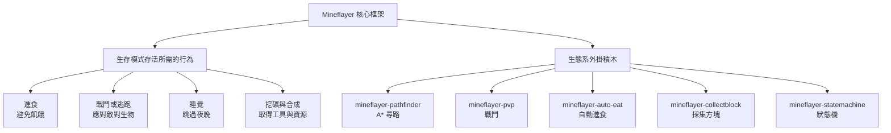

# 以 Mineflayer 打造、能在生存模式存活的 FOSS Bot 實作調查

## 摘要

Mineflayer 是一套以 JavaScript/Node.js 撰寫的 Minecraft Java 版機器人框架，提供高階 API 讓開發者操控一名「假玩家」：移動、挖礦、合成、攻擊實體、管理背包等[^mineflayer]。本報告調查「以 Mineflayer 為基礎、開源（FOSS）、且能在 Minecraft 生存模式（survival mode）中存活」的 Bot 實作。

核心結論：**沒有任何單一成熟專案能開箱即用、完全自主地在生存模式中長期存活**。生態系呈現兩種極端：

- **LLM 驅動的大型專案**（Mindcraft、Voyager）功能最完整、能真正做到吃、打、逃、睡，但需要付費（或本機）大型語言模型 API，且並非「純規則式」自動化[^mindcraft][^voyager]。
- **規則式／狀態機驅動的小型專案**（KonekoMinecraftBot、mc-bot、rbot）不需 LLM 即可運行，但成熟度低、多為個人專案（星數 < 100），生存行為有已知缺陷[^koneko][^mcbof][^rbot]。
- 真正被廣泛使用的，其實是 PrismarineJS 生態系的**外掛積木**（pathfinder、pvp、auto-eat、collectblock），開發者通常自行組裝成生存邏輯[^pathfinder][^pvp][^autoeat][^collectblock]。

---

## 背景：什么是 Mineflayer

Mineflayer 由 PrismarineJS 組織維護，採 MIT 授權，是 Minecraft 機器人領域最主流的 JavaScript 框架[^mineflayer]。它透過實作 Minecraft 的網路協定，讓 Node.js 程式以「玩家」身分登入伺服器，並暴露 `bot` 物件供程式操作，例如：

- `bot.pathfinder`（配合外掛）：A* 尋路
- `bot.dig(block)`：挖掘方塊
- `bot.craft(recipe)`：合成物品
- `bot.attack(entity)`：攻擊實體
- `bot.chat(message)`：發送聊天訊息

「能在生存模式存活」在此定義為 Bot 能夠自主處理生存模式的核心威脅：**飢餓（進食）**、**敵對生物（戰鬥或逃跑）**、**夜晚（睡覺）**，以及資源取得（挖礦、合成工具）。

---

## 一、LLM 驅動的完整生存 Bot

### 1. Mindcraft（kolbytn/mindcraft）

被社群公認最活躍、功能最完整的 Mineflayer 生存 Bot 之一，星數約 5.9k，採 MIT 授權[^mindcraft]。它把大型語言模型（支援 OpenAI、Gemini、Anthropic，以及可本機執行的 Ollama）接到 Mineflayer 上，讓 Bot 能聊天、執行程式碼、完成任務，並支援多代理協作（MineCollab）[^mindcraft]。

**生存能力**：透過整合 `mineflayer-auto-eat` 處理飢餓，透過 `mineflayer-pvp` 處理戰鬥，並可用床睡覺、在危險時撤退。因為決策由 LLM 負責，理論上四項生存需求皆能滿足[^mindcraft]。

**限制**：需要語言模型 API（或足夠的本地算力），並非「純規則式」自動化；程式碼執行沙箱預設關閉[^mindcraft]。

### 2. Voyager（MineDojo/Voyager）

學術界知名的「終身學習」代理，星數約 7.3k，MIT 授權，由 NVIDIA 等機構的研究者提出，使用 GPT-4 作為大腦[^voyager]。它具備自動課程（automatic curriculum）、可執行程式碼技能庫（skill library）、以及迭代式提示機制，能在 Minecraft 中自主探索並推進科技樹[^voyager]。

**生存能力**：其 Mineflayer 環境層包含自動進食，技能庫涵蓋採集食物、戰鬥、使用床鋪等技能，因此能應付生存模式的威脅[^voyager]。

**限制**：需要 GPT-4 存取權；研究原型在學習階段常以創造／和平模式運行，並非為長期生存掛機設計[^voyager]。

> 小結：這兩個專案「能存活」的前提是**有 LLM 可用**。若研究目標是「不需外部 API 的純 FOSS 自動化」，必須往下看規則式專案。

---

## 二、規則式 / 狀態機驅動的生存 Bot

這一類不需語言模型，靠有限狀態機（FSM）、優先權仲裁或命令腳本運作，是「FOSS + 可自行部署」最直接的選項，但普遍星數偏低（多為個人專案）。

### 1. KonekoMinecraftBot（AkagawaTsurunaki/KonekoMinecraftBot）

**本報告中規則式生存 Bot 裡功能最完整者**。星數約 44，Apache-2.0 授權，以有限狀態機加上少量機器學習（DB-Scan 分群樹木、單層感知器加權決策）驅動，支援 Minecraft 1.20.1 / 1.20.2 / 1.20.6[^koneko]。

其狀態機涵蓋的生存行為[^koneko]：

| 行為 | 對應狀態 | 說明 |
|---|---|---|
| 自動進食 | AutoEatBehaviour | 使用 `mineflayer-auto-eat` 外掛，飢餓時自動進食 |
| 戰鬥 | AttackHostilesState / AttackPlayerState | 攻擊接近的敵對生物；反擊挑釁的玩家 |
| 睡覺 | SleepState | 依時間與最近的床判斷，找床過夜 |
| 滅火／岩漿 | OnFireState / InLavaState | 著火時尋找最近水源；落入岩漿則慌亂跳動 |
| 游泳／潛水 | DiveState | 依氧氣與血量決定浮出或下潛 |
| 釣魚 | FishingState | 偵測附近水域後拋竿 |
| 農務／伐木 | HarvestState / LoggingState | 協助收成與播種；協助收集玩家砍下的木頭 |

作者亦在 README 中誠實列出已知缺陷，例如 Bot 可能為了找床而破壞方塊、不會躲避敵人而是正面衝鋒、著火時可能繞遠路而燒死[^koneko]。這說明：即使是規則式專案中最完整者，其生存行為在實戰中仍不穩定。

### 2. rbot（rom1504/rbot）

星數約 90，MIT 授權，是早期的命令驅動型 Bot，具備豐富的任務語言[^rbot]。它支援挖掘（含螺旋樓梯、隧道）、合成、建造（庇護所、橋樑、牆）、攻擊（`attack <entity>`、`attack everymob`）、使用弓箭、以及條件式命令鏈（`if`/`repeat`/`sequence`）[^rbot]。

**生存能力評估**：戰鬥能力 ✅（可連續攻擊所有靠近生物）；進食為 ⚠️ 部分（可合成／取得食物，但非被動式自動進食）；睡覺 ⚠️ 部分（可建造庇護所，但無夜間自動上床邏輯）；逃跑 ❌ 未明確實作[^rbot]。

**限制**：主要針對 Minecraft 1.11.2 等舊版本，且為命令驅動而非完全自主[^rbot]。

### 3. cristiancolon/mc-bot

星數 0（極新的個人專案），MIT 授權。它以「優先權仲裁」架構實作純生存邏輯，優先序為：逃跑 > 戰鬥 > 進食 > 覓食 > 待機，並使用遲滯帶（hysteresis）避免狀態抖動[^mcbof]。特色包括：智慧進食（6 格內有威脅時不吃、金蘋果留待危急）、取樣式撤退尋路、以及完整單元／整合測試[^mcbof]。

**生存能力**：進食 ✅、逃跑 ✅、戰鬥 ✅、覓食（地面食物 → 成熟作物 → 獵殺動物）✅；但**不挖礦、不合成、不睡覺**[^mcbof]。適合研究者研究「純生存維持」的架構。

### 4. IndeedMcKenzie/minecraft-bots

星數 1，MIT 授權。以 7 個分工 Bot（伐木、礦工、農夫、釣魚、牧場、工匠、倉管）加網頁控制面板運作[^indeed]。礦工 Bot 有礦石優先序（鑽石 > 綠寶石 > 金 > 鐵 > 煤…），工匠 Bot 能合成與附魔鑽石工具並熔煉，獵人 Bot 使用劍與弓箭戰鬥[^indeed]。**限制**：需 Paper 伺服器並安裝自訂外掛才能完整運作[^indeed]。

### 5. 其他低星數專案

以下專案星數極低（0–2），僅列供參考，**不建議作為主要採用對象**[^githubsearch]：

- **RmeKLV/minecraft-ai**（1 星）：腳本式 FSM，目標為速通與生存推進，但明確缺乏戰鬥與飢餓管理[^rmeklv]。
- **nuxdie/minecraft-bots**（0 星）：GOAP（目標導向行動規劃）架構，偏重農業與伐木。
- **schematical/chaoscraft**（29 星，無授權）：以遺傳演算法演化生存行為，已停止維護，後繼專案為 Forge 模組而非 Mineflayer[^chaoscraft]。

---

## 三、構成生存 Bot 的外掛積木

多數生存 Bot（包含上述專案）實際上是「核心框架 + 外掛」的組合。若你要自行打造生存 Bot，這些是最常被引用的積木[^pathfinder][^statemachine][^pvp][^collectblock][^autoeat]：

| 外掛 | 星數 | 授權 | 用途 |
|---|---|---|---|
| mineflayer-pathfinder | 約 313 | MIT | A* 尋路，讓 Bot 從 A 走到 B |
| mineflayer-statemachine | 約 138 | MIT | 有限狀態機框架，組裝複雜行為 |
| mineflayer-pvp | 約 71 | MIT | 基本 PVP / PVE 戰鬥 |
| mineflayer-collectblock | 約 56 | MIT | 高階採集方塊 API（尋路 → 選工具 → 挖 → 撿拾） |
| mineflayer-auto-eat | 約 51 | MIT | 依飢餓／血量門檻自動進食，並排除不安全食物 |

> 注意：`mineflayer-statemachine` 的 README 將「戰鬥類行為」列為待辦（To Do），因此戰鬥需另外以 `mineflayer-pvp` 組合[^statemachine]。

---

## 四、比較總表

| 專案 | 星數 | 授權 | 需 LLM？ | 進食 | 戰鬥 | 逃跑 | 睡覺 | 成熟度 |
|---|---|---|---|---|---|---|---|---|
| Mindcraft | ~5.9k | MIT | 是 | ✅ | ✅ | ✅ | ✅ | 高 |
| Voyager | ~7.3k | MIT | 是（GPT-4） | ✅ | ✅ | ✅ | ✅ | 高（研究原型） |
| KonekoMinecraftBot | ~44 | Apache-2.0 | 否 | ✅ | ✅ | ⚠️ | ✅ | 中 |
| rbot | ~90 | MIT | 否 | ⚠️ | ✅ | ❌ | ⚠️ | 中 |
| cristiancolon/mc-bot | ~0 | MIT | 否 | ✅ | ✅ | ✅ | ❌ | 低（新專案） |
| IndeedMcKenzie/minecraft-bots | ~1 | MIT | 否 | 部分 | ✅ | ✅ | ❌ | 低 |
| RmeKLV/minecraft-ai | ~1 | 無 | 否 | ❌ | ❌ | ❌ | ❌ | 低 |
| schematical/chaoscraft | ~29 | 無 | 否 | ? | ? | ? | ? | 已棄用 |

---

## 五、批判性反思與建議

**來源權威性**：星數與授權資訊來自各專案 GitHub 頁面，然而 GitHub API 於本次調查中對匿名請求回傳 HTTP 403，故部分數字（尤其外掛星數）係取自網頁摘要，可能存在小幅誤差；讀者應以實際 GitHub 頁面為準[^mineflayer]。

**社群偏差**：搜尋結果高度集中在少數明星專案（Mindcraft、Voyager），這兩者都依賴 LLM，可能讓人誤以為「Mineflayer 生存 Bot 一定需要 LLM」。規則式專案雖然零散、星數低，但更符合純 FOSS、可離線部署的需求。

**低星數考量**：本主題確實存在「只有低星數專案」的情形——嚴格意義上「純規則、全自主、能長期存活」的專案屈指可數，且多為個人實驗。因此本報告仍收錄星數 < 100 的專案，但明確標示其成熟度與已知缺陷，避免誤導。

**實務建議**：

1. **若要「可運行、功能最全」** → 選擇 Mindcraft，並準備本機 Ollama 模型以維持純 FOSS[^mindcraft]。
2. **若要「不依賴 LLM 的純規則式生存」** → 以 KonekoMinecraftBot 為起點最為完整，但需接受其已知缺陷並自行修補[^koneko]。
3. **若要「自行打造」** → 直接組合 `mineflayer-pathfinder` + `mineflayer-pvp` + `mineflayer-auto-eat` + `mineflayer-collectblock`，再以 `mineflayer-statemachine` 串成 FSM[^pathfinder][^pvp][^autoeat][^collectblock][^statemachine]。
4. **共同前提**：上述所有方案都需要一個 Minecraft Java 版伺服器（或區域網路世界），且多數 Bot 依賴特定 Minecraft 版本，部署前務必確認版本相容性[^mineflayer]。

---

## 參考文獻

[^mineflayer]: PrismarineJS. (n.d.). Mineflayer: Create Minecraft bots with a powerful, stable, and high level JavaScript API. GitHub. Retrieved 2026-10-14, from https://github.com/PrismarineJS/mineflayer

[^mindcraft]: Mindcraft. (n.d.). Minecraft AI with LLMs + Mineflayer. GitHub. Retrieved 2026-10-14, from https://github.com/kolbytn/mindcraft

[^voyager]: MineDojo. (2023). Voyager: An Open-Ended Embodied Agent with Large Language Models. GitHub. Retrieved 2026-10-14, from https://github.com/MineDojo/Voyager

[^koneko]: AkagawaTsurunaki. (n.d.). KonekoMinecraftBot: An intelligent Minecraft bot based on Finite State Machine and some Machine Learning Algorithms. GitHub. Retrieved 2026-10-14, from https://github.com/AkagawaTsurunaki/KonekoMinecraftBot

[^rbot]: rom1504. (n.d.). rbot: Bot made with mineflayer which can do tasks. GitHub. Retrieved 2026-10-14, from https://github.com/rom1504/rbot

[^mcbof]: cristiancolon. (n.d.). mc-bot: A Minecraft Java survival bot built on Mineflayer with priority-based behavior arbitration. GitHub. Retrieved 2026-10-14, from https://github.com/cristiancolon/mc-bot

[^indeed]: IndeedMcKenzie. (n.d.). minecraft-bots: 7 autonomous Minecraft bots (Mineflayer) with a web control panel. GitHub. Retrieved 2026-10-14, from https://github.com/IndeedMcKenzie/minecraft-bots

[^rmeklv]: RmeKLV. (n.d.). minecraft-ai: An autonomous Mineflayer bot with speedrun and survival modes. GitHub. Retrieved 2026-10-14, from https://github.com/RmeKLV/minecraft-ai

[^chaoscraft]: schematical. (n.d.). chaoscraft: Minecraft bot using genetic algorithms. GitHub. Retrieved 2026-10-14, from https://github.com/schematical/chaoscraft

[^pathfinder]: Karang. (n.d.). mineflayer-pathfinder: Pathfinding plugin for Mineflayer. GitHub. Retrieved 2026-10-14, from https://github.com/Karang/mineflayer-pathfinder

[^statemachine]: PrismarineJS. (n.d.). mineflayer-statemachine: A state machine plugin for Mineflayer. GitHub. Retrieved 2026-10-14, from https://github.com/PrismarineJS/mineflayer-statemachine

[^pvp]: PrismarineJS. (n.d.). mineflayer-pvp: Adds support for basic PVP and PVE to Mineflayer bots. GitHub. Retrieved 2026-10-14, from https://github.com/PrismarineJS/mineflayer-pvp

[^collectblock]: PrismarineJS. (n.d.). mineflayer-collectblock: A utility plugin for collecting blocks with Mineflayer. GitHub. Retrieved 2026-10-14, from https://github.com/PrismarineJS/mineflayer-collectblock

[^autoeat]: linkle69. (n.d.). mineflayer-auto-eat: Auto eat plugin for Mineflayer. GitHub. Retrieved 2026-10-14, from https://github.com/linkle69/mineflayer-auto-eat

[^githubsearch]: GitHub. (n.d.). Repository search results for "mineflayer survival bot". Retrieved 2026-10-14, from https://github.com/search?q=mineflayer+survival+bot&type=repositories&s=stars&o=desc
