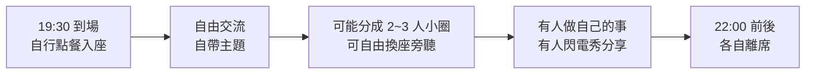

# Hacking Thursday（H4）

## 摘要

Hacking Thursday（常簡稱 **H4**）是一個發源於台灣台北、每週四晚間於咖啡店舉辦的自由軟體／開放原碼開發者聚會[^official]。聚會以「非會議形式」進行，沒有固定主題，參與者自帶主題自由交流、實作想法，性質隨性而長壽，被視為台灣持續最久的開放原始碼社群聚會之一[^official]。

## 起源與歷史

在 2008-08-21（星期四）這一天，由一位代號 **Thinker** 的開發者在 Assembla 平台開設了一個名為 `HackingThursday` 的專案頁面，社群將這一天訂為聚會的創立紀念日[^history]。

正式創辦人共有 6 位，分別是 **Thinker、Rex、Mat、Fourdollars、yuren、hychen**，皆為當時居住於台北地區的自由軟體／開放原碼開發者[^history]。

## 聚會形式與文化

Hacking Thursday 刻意有別於一般研討會：不需報名、沒有專人接待，也沒有固定議程[^newbie]。聚會強調以「禮貌、謙遜與尊重」的互信態度，接納並鼓勵概念發想、發起新計畫，並透過協同開發與經驗分享互相學習[^official]。常見的活動包括：

- 討論網站設計、電腦網路、程式設計、作業系統等技術主題
- 交流軟硬體工具與使用技巧
- 閒聊八卦

與會者同時是聽眾，也可能隨時成為「閃電秀」的講者[^official]。

針對首次參加者，社群建議抱持「平常心」，並提出 **3-3-3 原則**：每個月參加 3 次、每次約 3 小時、持續 3 個月，以便慢慢融入群體、讓彼此熟悉[^newbie]。聚會的影響被形容為「週復一週、一點一滴」累積，而非單次研討會式的密集衝擊[^newbie]。

社群另訂有參與者公約（Code of Conduct），並提供給新訪客的入門說明[^official]。

## 聚會時間與地點

台北場自 2008 年起持續舉辦，目前資訊如下[^official]：

| 項目 | 內容 |
|------|------|
| 時間 | 每週四晚上 19:30 至 22:00（GMT+8） |
| 地點 | O'tree Cafe（歐樹咖啡，中山區） |
| 地址 | 台北市中山區民權東路一段 56 號（介於捷運 O-10 民權西路站與 O-11 中山國小站之間） |
| 費用 | 最低消費為一杯飲料 |
| 設施 | 提供 WiFi 與電源插座 |
| 備註 | 自行點餐入座，向店員表示「參加 H4 聚會」即可 |

聚會不需報名、可自由入場與離席；若在到訪途中需要協助，可在 Discord／Telegram 即時線上詢問[^official]。

## 社群與線上資源

Hacking Thursday 為非營利、由志工運作的社群，並在多個平台維持線上據點[^official]：

| 資源 | 連結 |
|------|------|
| 官方網站 | https://www.hackingthursday.org |
| 歷史頁面 | https://www.hackingthursday.org/history.html |
| 給新訪客 | https://www.hackingthursday.org/intro_for_newbie |
| 參與者公約 | https://www.hackingthursday.org/coc |
| GitHub 組織 | https://github.com/hacking-thursday |
| Discord | https://discord.gg/s6sKDcEB95 |
| Telegram | https://web.telegram.org/k/#@hackingday |
| Facebook 社團 | https://www.facebook.com/groups/hackingthursday |
| Matrix | https://matrix.to/#/#hackingthursday:matrix.org |
| 每週聚會筆記 | https://pad.hackingthursday.org |
| HackMD 共筆 | https://hackmd.io/@h4 |
| 郵件論壇 | https://groups.google.com/group/hackingthursday |

社群亦與其他開放原始碼組織往來，官方網站條列的友站包含 Taipei Open Source Software User Group（TOSSUG）、上海、廣州、杭州的 Linux 使用者社群、Open Source Hong Kong、SJTUG，以及 Hacking Thursday 台中社群[^official]。

## 相關活動

H4 社群亦參與或舉辦系列活動，官方網站曾紀錄 HITCON、COSCUP、SITCON 等台灣大型開放原始碼／資訊社群研討會的參與紀錄[^official]。

## 批判性反思

- **來源權威性**：本報告主要依據 Hacking Thursday 官方網站及其歷史、新訪客頁面，屬第一手官方來源，可信度高；惟自述性資料可能存在美化或遺漏，尤其是聚會實際出席人數與成員組成的長期變化，官方頁面未提供統計數據[^official][^history][^newbie]。
- **時效性**：聚會地點與時間（O'tree Cafe、每週四 19:30–22:00）可能隨店家或社群狀況變動，實際前往前建議以官方網站或 Discord／Telegram 最新公告為準[^official]。
- **多方佐證**：創立日期與 6 位創辦人的資訊在官方歷史頁面與官方網站的描述一致，可相互佐證；但更早期的細節（如 Assembla 專案頁面內容）已不易查證，官方引用的是網際網路檔案館（Wayback Machine）中的舊 Hackpad 頁面[^history]。
- **中立性**：上述段落多為社群自我描述，讀者宜理解其為社群視角，而非第三方獨立報導。

## 參考文獻

[^official]: Hacking Thursday. (n.d.). *Hacking Thursday*. Retrieved 2026-10-15, from https://www.hackingthursday.org/

[^history]: Hacking Thursday. (n.d.). *歷史*. Retrieved 2026-10-15, from https://www.hackingthursday.org/history.html

[^newbie]: Hacking Thursday. (n.d.). *給初次來訪的新朋友的一封信*. Retrieved 2026-10-15, from https://www.hackingthursday.org/intro_for_newbie
