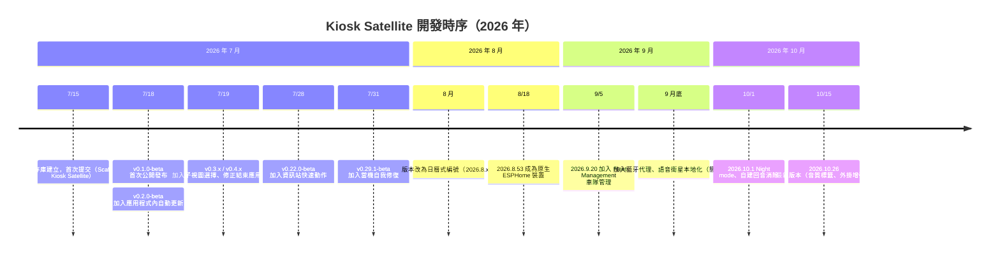

# Kiosk Satellite 專案歷史研究報告

## 摘要

本報告調查 GitHub 上 `jxlarrea/kiosk-satellite` 專案的來歷與發展歷史。Kiosk Satellite 是一套免費的 Android 應用程式，用來把任何 Android 裝置（Android 7.0 以上）變成專門顯示 Home Assistant 控制面板的資訊站（kiosk），並內建語音助理、音樂播放與螢幕保護程式等功能[^repo]。專案由單一開發者 Xavier Larrea 於 2026 年 7 月發起，在約三個月內累積超過 2,100 次提交與 1,500 顆以上的星星，屬於極高開發強度的個人專案。

## 專案基本資料

| 項目 | 內容 |
|---|---|
| 儲存庫 | `jxlarrea/kiosk-satellite` |
| 說明 | Turn any Android device into a beautiful, dedicated Home Assistant kiosk[^repo] |
| 建立時間 | 2026-07-15[^repo] |
| 主要語言 | Dart（約 1,470 萬位元組），其次為 Kotlin、JavaScript[^lang] |
| 星星數 | 1,588[^repo] |
| 分支（fork）數 | 53[^repo] |
| 授權 | CC BY-NC-ND 4.0（個人、非商業免費使用；不得商用；不得散布修改後的版本）[^readme] |
| 官方網站 | `kiosksatellite.com`[^site] |
| 貢獻者 | 僅一位，即作者本人，累積 2,101 次提交[^contrib] |

專案的高星數（超過 1,500 顆）與極高的提交密度，顯示它已在 Home Assistant 社群中獲得相當程度的關注，即便開發者僅有一人。

## 作者背景

作者為 **Xavier Larrea**（GitHub 帳號 `jxlarrea`，使用者編號 309902，2010 年即註冊），居住於厄瓜多[^user]。他自述「在閒暇時間開發軟體，並喜歡貢獻自由與開源軟體，著迷於 Home Assistant Voice，期望有天能讓 Alexa 與 Google Home 被淘汰」[^readme]。他是更大型的 **Voice Satellite** 生態系作者，該系列包含：

- `voice-satellite-card-integration`（Voice Satellite，2026-02-17 建立，887 顆星）：把平板、手機或瀏覽器變成 Home Assistant 免持語音助理[^vs]
- `kiosk-satellite`：Voice Satellite 的官方 Android 資訊站夥伴應用[^repo]
- 以及 `voice-satellite-card-llm-tools`、`wyoming-voice-match`、`homeassistant-voice-recipes`、`lineageos-echo-show-camera` 等周邊專案[^readme]

由此可見，Kiosk Satellite 並非憑空誕生，而是作者先建立 Voice Satellite 語音助理之後，進一步向下延伸到「整個裝置的資訊站體驗」而開發的產品。

## 發展時序

### 關鍵里程碑

- **2026-07-15**：儲存庫建立，同日首個提交訊息為「Scaffold Kiosk Satellite: manager architecture, JS API bridge, remote server」，奠定經理架構、JavaScript API 橋接與遠端伺服器的基礎[^firstcommit]。
- **2026-07-18**：`v0.1.0-beta` 首次公開發布，定位為「專為 Home Assistant 打造、原生支援 Voice Satellite 的 Android 資訊站瀏覽器」；同日發布 `v0.2.0-beta`，加入透過 GitHub 檢查與安裝更新的應用程式內更新機制[^v010][^v020]。
- **2026-07-31**：`v0.29.1-beta` 導入「當機自我修復」，即使未開啟背景聆聽，程序崩潰後也能自動重新啟動面板[^v0291]。
- **2026-08 中旬起**：版本編號由 `v0.x` 改為日曆式編號（如 `2026.8.53`、`2026.9.20`、`2026.10.26`）[^tags]。
- **2026-08-18**：`2026.8.53` 讓資訊站成為原生 ESPHome 裝置，Home Assistant 可直接自動探索，並內建完整的藍牙代理（Bluetooth proxy）[^v853]。
- **2026-09-05**：`2026.9.20` 推出重大功能 **Fleet Management（車隊管理）**，讓主資訊站（leader）能向其他追隨者（follower）推送設定檔與協調更新[^v920]。
- **2026-10-01**：`2026.10.1` 加入自建回音消除、OpenAI 與 xAI Grok 即時對話、喚醒詞仲裁（wake word arbitration）等功能[^changelog]。
- **2026-10-15**：最新版本 `2026.10.26` 發布，加入 Now Playing 音質標籤、外掛螢幕保護設定連結等[^v1026]。

### 版本演進特色

- 發布極為頻繁：專案在三個月內產生數百個版本tag，後期幾乎每天都有版本，例如 `2026.10.22`、`2026.10.23`、`2026.10.24`、`2026.10.25`、`2026.10.26` 連續多天發布[^tags]。
- 使用日曆式版本編號，但並非嚴格一致：8 月與 9 月部分版本採遞增序號（如 `2026.8.103`、`2026.9.98`），10 月則採月.日格式（如 `2026.10.26`）[^tags]。
- 每次發布都附有詳盡的變更說明，並維護一份完整的 `CHANGELOG.md`[^changelog]。

## 功能範疇

由 README 與官方網站可歸納出主要功能群[^readme][^site]：

- **原生語音控制**：內建 Voice Satellite，支援 vsWakeWord、openWakeWord、microWakeWord 等喚醒詞引擎，可於螢幕關閉或其他 App 前景時持續聆聽。
- **音樂播放**：內建 Sendspin 播放器，支援 Music Assistant 同步播放、歌詞與跟隨 Home Assistant／Sonos 播放器。
- **螢幕保護程式**：Immich 相簿、本機照片、時鐘（數位／翻頁／滾軸）、隨天氣變化的 Weather Mood 動態天空。
- **Home Assistant 整合**：透過 ESPHome 連線把螢幕、亮度、音量、感測器暴露為實體；可選的藍牙代理。
- **遠端管理與車隊管理**：以瀏覽器開啟 `http://<裝置IP>:2324` 管理設定、截圖、日誌與備份；多台資訊站可同步設定檔。
- **對講機、鬧鐘、手勢、資訊站鎖定、相機檢視**（最多 12 路）、DLNA 播放、RTSP 串流等。

## 專案生態與定位

Kiosk Satellite 的 README 明確聲明它是「獨立專案，與 Home Assistant 無官方隸屬關係」[^site]。它建立在多個開源專案之上，包括 Home Assistant、ESPHome、Music Assistant、Immich、Flutter、flutter_inappwebview、ONNX Runtime，以及 WebRTC 音訊處理等[^readme]。

授權方面採用相對嚴格的 **CC BY-NC-ND 4.0**：允許個人非商業使用，但禁止商業使用與散布修改後的版本；外掛另有 `PLUGIN-EXCEPTION.md` 的額外授權[^readme]。這種「開源但限制衍生散布」的模式，與典型 MIT／Apache 授權的社群專案不同，反映了作者對商業化與分支散布的保留態度。

## 來源評論

本報告的事實主要來自第一手來源：GitHub REST API 回傳的結構化中介資料（星星數、提交紀錄、發布紀錄、語言統計）、專案自身的 README 與 CHANGELOG，以及官方網站。這些來源權威性高且更新即時。

需注意的偏誤與限制如下：

1. **時間點一致性**：所有資料擷取於 2026-10-15，該日恰為最新版本 `2026.10.26` 發布當天，專案仍在高速迭代，任何數字（星數、提交數、版本）在此之後都會快速變動。
2. **自我陳述偏誤**：作者背景與專案定位多來自作者自述（README、GitHub 個人檔案），缺乏第三方獨立報導可交叉驗證；本報告中未找到主流科技媒體對該專案的報導。
3. **社群熱度與品質的落差**：高星數與高提交頻率並不等同於程式碼品質或長期穩定性，專案發布僅約三個月，仍未經過長時間驗證。
4. **貢獻者單一**：2,101 次提交全部來自作者一人，這既是產品一致性的優點，也是「巴士因子（bus factor）為 1」的風險，若作者停止維護，專案恐快速停滯。

## 結論

Kiosk Satellite 是一個典型的「單一開發者、高強度、快速迭代」開源專案。它誕生於 2026 年 7 月，作為作者既有 Voice Satellite 語音助理生態系的延伸，目標是把整個 Android 裝置轉化為 Home Assistant 專用資訊站。在約三個月內，它從 v0.1.0-beta 快速演進到 `2026.10.26`，功能範疇橫跨語音、音樂、螢幕保護、ESPHome 整合、車隊管理與外掛系統，並累積超過 1,500 顆星。其成長動能來自 Home Assistant 社群對「本地優先、無雲端依賴」智慧家庭顯示裝置的強烈需求。

## 參考文獻

[^repo]: jxlarrea. (2026). *Kiosk Satellite* [Computer software]. GitHub. Retrieved 2026-10-15, from https://github.com/jxlarrea/kiosk-satellite

[^lang]: GitHub. (2026). *Repository languages for jxlarrea/kiosk-satellite* [Data file]. Retrieved 2026-10-15, from https://api.github.com/repos/jxlarrea/kiosk-satellite/languages

[^contrib]: GitHub. (2026). *Contributors to jxlarrea/kiosk-satellite* [Data file]. Retrieved 2026-10-15, from https://api.github.com/repos/jxlarrea/kiosk-satellite/contributors

[^user]: GitHub. (2026). *User profile: jxlarrea* [Data file]. Retrieved 2026-10-15, from https://api.github.com/users/jxlarrea

[^readme]: jxlarrea. (2026). *Kiosk Satellite README*. GitHub. Retrieved 2026-10-15, from https://raw.githubusercontent.com/jxlarrea/kiosk-satellite/main/README.md

[^site]: Larrea, X. (n.d.). *Kiosk Satellite for Home Assistant*. Retrieved 2026-10-15, from https://kiosksatellite.com/

[^firstcommit]: jxlarrea. (2026, July 15). *Scaffold Kiosk Satellite: manager architecture, JS API bridge, remote server* [Commit]. GitHub. Retrieved 2026-10-15, from https://github.com/jxlarrea/kiosk-satellite/commit/509f0a2ebbca2c958ebaaa2c82e962c399976a53

[^tags]: GitHub. (2026). *Tags for jxlarrea/kiosk-satellite* [Data file]. Retrieved 2026-10-15, from https://api.github.com/repos/jxlarrea/kiosk-satellite/tags

[^v010]: jxlarrea. (2026, July 18). *Kiosk Satellite v0.1.0 beta* [Release]. GitHub. Retrieved 2026-10-15, from https://github.com/jxlarrea/kiosk-satellite/releases/tag/v0.1.0-beta

[^v020]: jxlarrea. (2026, July 18). *Kiosk Satellite v0.2.0-beta* [Release]. GitHub. Retrieved 2026-10-15, from https://github.com/jxlarrea/kiosk-satellite/releases/tag/v0.2.0-beta

[^v0291]: jxlarrea. (2026, July 31). *Kiosk Satellite v0.29.1-beta* [Release]. GitHub. Retrieved 2026-10-15, from https://github.com/jxlarrea/kiosk-satellite/releases/tag/v0.29.1-beta

[^v853]: jxlarrea. (2026, August 18). *Kiosk Satellite 2026.8.53* [Release]. GitHub. Retrieved 2026-10-15, from https://github.com/jxlarrea/kiosk-satellite/releases/tag/2026.8.53

[^v920]: jxlarrea. (2026, September 5). *Kiosk Satellite 2026.9.20* [Release]. GitHub. Retrieved 2026-10-15, from https://github.com/jxlarrea/kiosk-satellite/releases/tag/2026.9.20

[^v1026]: jxlarrea. (2026, October 15). *Kiosk Satellite 2026.10.26* [Release]. GitHub. Retrieved 2026-10-15, from https://github.com/jxlarrea/kiosk-satellite/releases/tag/2026.10.26

[^changelog]: jxlarrea. (2026). *Kiosk Satellite CHANGELOG*. GitHub. Retrieved 2026-10-15, from https://raw.githubusercontent.com/jxlarrea/kiosk-satellite/main/CHANGELOG.md

[^vs]: jxlarrea. (2026). *Voice Satellite* [Computer software]. GitHub. Retrieved 2026-10-15, from https://github.com/jxlarrea/voice-satellite-card-integration
