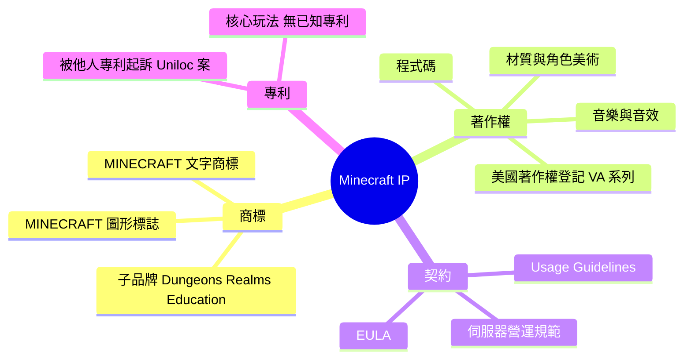
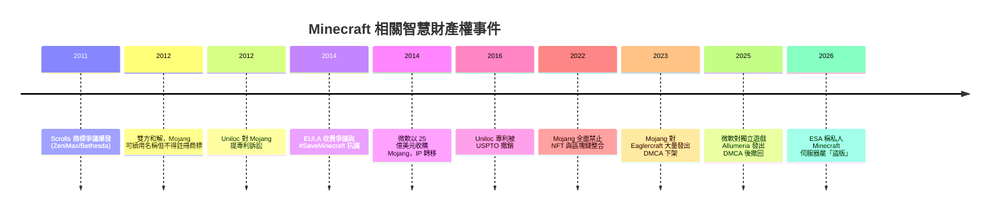

# Minecraft 有哪些概念被申請成智慧財產權？

## 摘要

Minecraft 是瑞典開發者 Markus "Notch" Persson 於 2009 年推出的沙盒遊戲，2014 年由微軟以 25 億美元收購其開發商 Mojang AB[^wiki-mc]。就智慧財產權 (Intellectual Property, IP) 而言，Minecraft 的保護主要建立在**商標 (trademark)**、**著作權 (copyright)** 與**契約 (EULA)** 三種機制上，而**遊戲玩法概念本身幾乎沒有專利保護**[^patent-survey]。

換句話說：

- **「Minecraft」這個名字與標誌**：已大量註冊為商標，涵蓋軟體、服飾、玩具、化妝品、主題樂園等眾多類別[^tm-search]。
- **程式碼、美術、音樂、角色**：受著作權保護，並有具體的美國著作權登記號[^dmca2023]。
- **遊戲機制（方塊放置、地形生成、紅石電路、區塊渲染）**：**沒有**由 Mojang 或微軟持有的對應專利[^patent-survey]。
- **「Minecraft 是什麼」的體驗與玩法規則**：主要靠 EULA 與 Usage Guidelines 以契約方式約束玩家與伺服器，而非靠專利[^eula][^usage]。

> 重要提醒：本報告中部分商標註冊號來自第三方商標資料庫 (Trademarkia) 的二手整理，未逐一以官方 USPTO 檢索系統核對；引用時請保留此不確定性。專利部分則是在多方檢索後**未發現**相關專利，屬於「未找到」而非「已證明不存在」。

## 智慧財產權類型總覽

## 一、商標：Minecraft 最核心的 IP 資產

### 主要文字商標

最早的核心美國註冊（由 Mojang AB 申請、後轉移給微軟）如下表所示[^tm-search][^wiki-mc]：

| 項目 | 內容 |
|---|---|
| 商標 | MINECRAFT |
| 美國序號 | 85-323,318 |
| 美國註冊號 | 4,252,394 |
| 申請日 | 2011-05-17 |
| 註冊日 | 2012-12-04 |
| 原始申請人 | Mojang AB |
| 現權利人 | Microsoft Corporation |
| 尼斯分類 (Nice Classes) | 第 9 類（遊戲軟體）、第 25 類（服飾）、第 28 類（玩具、遊戲機）、第 41 類（線上遊戲娛樂服務） |

### 國際註冊與類別擴張

微軟後續透過馬德里協定 (Madrid Protocol) 取得國際註冊（WIPO 國際註冊號 4,853,070，美國序號 79-145,431，2013-10-02 申請、2015-11-17 註冊），涵蓋第 9、14、16、18、21、25、28、35、38、41、42、45 類等，從軟體一路延伸到珠寶、皮革製品、家用品與線上社交服務[^tm-search]。

近年更持續擴張到**化妝品（第 3 類）、活動體驗（第 41 類）、乃至主題樂園與度假住宿（第 39、43 類）**，顯示 Minecraft 品牌正從遊戲走向跨產業授權[^tm-search]。

### 子品牌商標

| 商標 | 美國序號 | 申請日 | 狀態 |
|---|---|---|---|
| MINECRAFTEDUCATION | 97-867,602 | 2023-03-31 | 已註冊 |
| MINECRAFTREALMS | 79-150,928 | 2013-12-20 | 已註冊 |
| MINECRAFTDUNGEONS | 88-138,958 | 2018-10-01 | 已註冊 |
| MINECRAFTADVENTURE | 99-007,845 | 2025-01-17 | 審查中 |
| MINECRAFTSHAPEYOURWORLD | 98-568,541 | 2024-05-24 | 審查中 |

### 第三人搶註失敗案例

第三方嘗試註冊「MINECRAFT」相關商標的申請大多被放棄或核駁，例如「MINECRAFTMOGULS」（服飾）、「STONEWORKSMINECRAFT」（娛樂服務）以及多件玩具、煙火類申請，反映微軟對品牌識別的積極維護[^tm-search]。

## 二、著作權：程式碼、美術與音樂

Minecraft 的程式碼與素材受著作權保護。根據 Minecraft Usage Guidelines：

> 「名稱、品牌、素材及其任何衍生物中的所有權利（包含著作權、商標權及相關權利），均由 Mojang 與 Microsoft 擁有。」[^usage]

Mojang 在 DMCA 下架通知中具體列出多項美國著作權登記號，用於主張遊戲中的美術與角色設計，例如 VA 1-885-980、VA 1-885-976、VA 1-886-104、VA 1-885-991 等共十餘件[^dmca2023]。

值得注意的是，Minecraft 的**核心玩法概念（放方塊、破壞方塊、探索生成世界）本身不受著作權保護**——著作權只保護「表達」而非「構想」，這也是眾多方塊沙盒遊戲（如 Terraria、Vintage Story、Luanti）得以合法存在的原因[^wiki-mc]。

## 三、專利：核心玩法幾乎沒有專利保護

### 未發現 Mojang／微軟持有的玩法專利

經多方檢索，**未發現**由 Mojang 或微軟持有、且涵蓋 Minecraft 核心機制的專利，包括[^patent-survey]：

- 程序化世界／地形生成
- 方塊放置與破壞機制
- 區塊 (chunk) 渲染與世界儲存
- 紅石 (Redstone) 邏輯電路模擬

> 此為「檢索後未找到」，而非「已證明不存在」。Google Patents 的搜尋頁面需 JavaScript 才能渲染，本次無法完整解析，故無法窮盡所有專利家族。

### Uniloc 案：Minecraft 是被起訴方，而非專利權人

唯一與 Minecraft 直接相關的著名專利事件，是 **Uniloc 2017 LLC 於 2012 年 7 月對 Mojang 提起的訴訟**。Uniloc 主張《Minecraft Pocket Edition》的授權驗證機制侵害其美國專利 US 6,857,067 B2「System and method for preventing unauthorized access to electronic data」[^uniloc][^us6857067]。Notch 當時公開稱此訴訟毫無根據。該專利已於 2016 年 3 月經多方挑戰後被美國專利商標局 (USPTO) 撤銷[^uniloc]。

重點：**這是別人拿專利告 Mojang，不是 Mojang 拿專利保護 Minecraft。**

## 四、契約：EULA 與 Usage Guidelines 才是實際的「玩法防火牆」

由於核心玩法無法用專利或著作權獨佔，Mojang 改用契約約束生態系：

- **EULA** 禁止散布遊戲軟體或內容、禁止商業化使用 Mojang 的素材、禁止散布「改裝版」客戶端或伺服器；但允許原創模組 (mod)[^eula]。
- **Usage Guidelines** 規範「Minecraft」名稱的使用、伺服器收費方式、影片與直播收益、以及手作商品的數量與金額上限（每款設計最多 20 件、每年上限 5,000 美元）[^usage]。

Mojang 明確保留隨時修改這些規範的權利[^usage]。

## 五、重要 IP 爭議與執法事件

### Scrolls 商標爭議（2011–2012）

Mojang 第二款遊戲《Scrolls》被 ZeniMax（《The Elder Scrolls》母公司）控訴商標侵權。2011 年 10 月 Mojang 先取得暫時禁制令勝利，2012 年 3 月雙方和解：Mojang 可繼續使用「Scrolls」名稱，但**不得將該名稱註冊為商標**，且不得與《The Elder Scrolls》直接競爭[^callersbane][^gamasutra]。此爭議在微軟先後收購 Mojang（2014）與 ZeniMax（2020）後實質上失去意義[^callersbane]。

### EULA 收費爭議（2014）

2014 年 6 月 Mojang 宣布強制執行 EULA，禁止伺服器販售影響遊戲平衡的「付費取勝 (pay-to-win)」項目，僅允許收取入場費與外觀類商品。此舉引發 #SaveMinecraft 抗議浪潮，部分玩家指控 Mojang 意在為自家 Minecraft Realms 訂閱服務護航[^guardian]。Notch 事後表示此爭議「與錢無關，與我的理智有關」，並被認為是其決定出售 Mojang 的因素之一[^bbc][^wiki-mc]。

### NFT 禁令（2022）

2022 年 7 月 20 日，Mojang 發布政策，禁止在 Minecraft 客戶端與伺服器中整合區塊鏈技術，也禁止利用遊戲內容（世界、外觀、模組）製作 NFT。理由包括：NFT 製造的稀缺性與排他性「與 Minecraft 的精神衝突」、投機炒作背離遊戲樂趣、以及第三方資產管理者的不可靠與詐騙風險[^nft]。

### DMCA 執法：Eaglercraft 與 Allumeria

- **Eaglercraft（2023）**：Mojang 對 GitHub 上這個可於瀏覽器執行的 Minecraft 重製／反編譯專案發動多波 DMCA 下架，2023 年 2 月的通知即鎖定 92 個以上儲存庫，指控其「100% 重用了我們的程式碼與素材」[^torrentfreak][^dmca2023]。這是行政層級的下架，而非法院訴訟。
- **Allumeria（2025）**：微軟對 Steam 上的獨立方塊沙盒遊戲 Allumeria 發出 DMCA 下架通知，導致遊戲短暫下架；隨後微軟**撤回**該主張，遊戲恢復上架[^pcgamer-allumeria]。

### ESA 稱私人伺服器為「盜版」（2026）

2026 年，美國娛樂軟體協會 (ESA) 代表在加州參議院「Protect Our Games Act」聽證會上聲稱，私人 Minecraft 與 Call of Duty 伺服器「違法」且構成「盜版」，並稱有兩件針對私人伺服器的訴訟正在進行[^pcgamer-esa]。此言論引發爭議，因為微軟／Mojang 官方本身就提供伺服器軟體並維護社群伺服器清單；ESA 事後澄清，其指的是「未經授權託管或散布受著作權保護遊戲內容」的伺服器[^pcgamer-esa]。

## 結論

| IP 類型 | Minecraft 是否採用 | 保護的對象 |
|---|---|---|
| 商標 | **是，且極為廣泛** | 「MINECRAFT」名稱、標誌、子品牌，橫跨數十個商品與服務類別 |
| 著作權 | **是** | 程式碼、美術、音樂、角色設計（有美國著作權登記號） |
| 契約 (EULA／Guidelines) | **是，實務上最關鍵** | 伺服器收費、模組散布、名稱使用、商業行為 |
| 專利 | **幾乎沒有** | 核心玩法（地形生成、方塊機制、紅石、區塊渲染）未見專利 |

因此，對於「Minecraft 是否有任何概念被申請成智慧財產權？」這個問題，答案是：**「Minecraft」這個品牌名稱與標誌被大量註冊為商標，遊戲的程式碼與美術受著作權保護，但構成 Minecraft 之所以為 Minecraft 的核心玩法概念，本身幾乎沒有專利保護，主要靠契約而非專利來維持控制。**

## 參考文獻

[^wiki-mc]: Wikipedia. (n.d.). Minecraft. Retrieved 2026-10-15, from https://en.wikipedia.org/wiki/Minecraft

[^wiki-mojang]: Wikipedia. (n.d.). Mojang Studios. Retrieved 2026-10-15, from https://en.wikipedia.org/wiki/Mojang_Studios

[^tm-search]: Trademarkia. (n.d.). MINECRAFT trademark search results. Retrieved 2026-10-15, from https://trademarkia.com/search/?q=minecraft

[^usage]: Mojang AB. (n.d.). Minecraft usage guidelines. Retrieved 2026-10-15, from https://www.minecraft.net/en-us/usage-guidelines

[^eula]: Mojang AB. (n.d.). Minecraft end user license agreement. Retrieved 2026-10-15, from https://www.minecraft.net/en-us/eula

[^dmca2023]: Mojang AB. (2023, April 12). DMCA takedown notice: Eaglercraft. Retrieved 2026-10-15, from https://github.com/github/dmca/blob/master/2023/04/2023-04-12-eaglecraft.md

[^patent-survey]: 本報告檢索 Google Patents（assignee 檢索：Mojang、Microsoft Technology Licensing 搭配 Minecraft 關鍵字）後未發現對應專利；Google Patents 搜尋頁面需 JavaScript 渲染，無法完整解析，故結論為「未找到」而非「已證明不存在」。檢索日期 2026-10-15。

[^uniloc]: Wikipedia. (n.d.). Uniloc. Retrieved 2026-10-15, from https://en.wikipedia.org/wiki/Uniloc

[^us6857067]: Uniloc USA, Inc. (2005). System and method for preventing unauthorized access to electronic data (U.S. Patent No. 6,857,067 B2). Retrieved 2026-10-15, from https://patents.google.com/patent/US6857067B2/en

[^callersbane]: Wikipedia. (n.d.). Caller's Bane. Retrieved 2026-10-15, from https://en.wikipedia.org/wiki/Caller%27s_Bane

[^gamasutra]: Game Developer. (2012, March 11). Bethesda, Mojang settle 'Scrolls' trademark lawsuit. Retrieved 2026-10-15, from https://www.gamedeveloper.com/business/bethesda-mojang-settle-scrolls-trademark-lawsuit

[^guardian]: The Guardian. (2014, June 24). Minecraft: How a change to the rules is tearing the community apart. Retrieved 2026-10-15, from https://www.theguardian.com/technology/2014/jun/24/minecraft-how-a-change-to-the-rules-is-tearing-the-community-apart

[^bbc]: BBC News. (2014, September 15). Minecraft creator on Microsoft deal: 'It's about my sanity'. Retrieved 2026-10-15, from https://www.bbc.com/news/technology-29205368

[^nft]: Mojang Studios. (2022, July 20). Minecraft and NFTs. Retrieved 2026-10-15, from https://www.minecraft.net/en-us/article/minecraft-and-nfts

[^torrentfreak]: TorrentFreak. (2023, February 24). Mojang targets repositories of browser-based Minecraft copy 'Eaglercraft'. Retrieved 2026-10-15, from https://torrentfreak.com/mojang-targets-repositories-of-browser-based-minecraft-copy-eaglercraft-230224/

[^pcgamer-allumeria]: PC Gamer. (2025). 'I genuinely do not know what to do' says developer of Minecraft-like Allumeria after Microsoft issues a DMCA takedown forcing it off Steam. Retrieved 2026-10-15, from https://www.pcgamer.com/games/survival-crafting/i-genuinely-do-not-know-what-to-do-says-developer-of-minecraft-like-allumeria-after-microsoft-issues-a-dmca-takedown-forcing-it-off-steam/

[^pcgamer-esa]: PC Gamer. (2026). ESA bafflingly declares private Minecraft servers illegal in Stop Killing Games hearing: 'We consider it piracy, we have lawsuits'. Retrieved 2026-10-15, from https://www.pcgamer.com/gaming-industry/esa-bafflingly-declares-private-minecraft-servers-illegal-in-stop-killing-games-hearing-we-consider-it-piracy-we-have-lawsuits/
