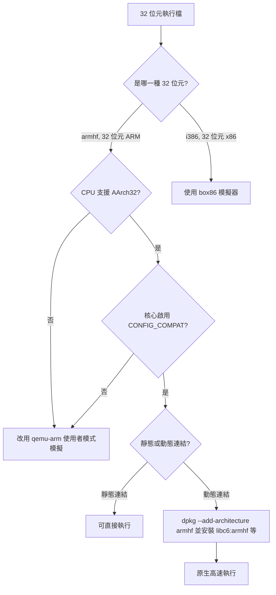

# 如何在 64 位 Raspberry Pi（64 位核心 + 64 位使用者空間）上執行 32 位元執行檔

## 摘要

在 64 位元的 Raspberry Pi OS（`arm64` 核心搭配 `aarch64` 使用者空間）上執行「32 位元執行檔」是可行的，但前提必須同時滿足三個層次的條件[^threelayers]：

1. **硬體層**：CPU 必須支援 AArch32 執行狀態（32 位元 EL0）。
2. **核心層**：64 位元核心必須啟用 `CONFIG_COMPAT`（arm64 上名稱為「Kernel support for 32-bit EL0」）。
3. **使用者空間層**：動態連結的 32 位元執行檔，需要 `armhf` 版本的動態連結器與函式庫。

此外，「32 位元執行檔」在 Raspberry Pi 的語境下可能是兩種完全不同的東西，處理方式也不同：**armhf（32 位元 ARM）原生執行檔**可用 multiarch 原生執行；而**32 位元 x86 執行檔**則必須透過 box86 之類的使用者空間模擬器。本文分別說明。

## 名詞與情境界定

Raspberry Pi OS 官方同時提供 64 位元與 32 位元版本[^rpiarch]：

> The *64-bit* version is designed for newer Raspberry Pi models that have 64-bit processors, like Raspberry Pi 3, 4, and 5. It can run both 64-bit and 32-bit software...
> （64 位元版本專為搭載 64 位元處理器的新款機型（如 Raspberry Pi 3、4、5）設計。它可以同時執行 64 位元與 32 位元軟體……）

也就是說，官方文件本身就明示 64 位元作業系統「可以執行 32 位元軟體」。本報告要回答的是「*如何*做到」。

需要區分的兩種 32 位元執行檔：

| 執行檔類型 | 指令集 | 在 arm64 Raspberry Pi 上的處理方式 |
|---|---|---|
| armhf 原生執行檔 | 32 位元 ARM（ARMv7 / AArch32） | CPU 硬體層原生相容，設定 multiarch 安裝 32 位元函式庫即可 |
| 32 位元 x86（i386）執行檔 | x86 | 需使用 box86 等使用者空間模擬器 |

## 可行條件總覽



### 條件一：CPU 支援 AArch32

ARMv8-A 架構向後相容 32 位元的 AArch32 執行狀態。搭載 64 位元核心的 Raspberry Pi 機型（Pi 3、Pi 4、Pi 400、Pi Zero 2 W 等）其 CPU（Cortex-A53、Cortex-A72 等）都在 EL0 支援 AArch32，因此可以原生執行 armhf 執行檔[^threelayers]。

Pi 5 則有重要的架構變化：其 Cortex-A76 是 ARM 首款「僅在特權層級為 64 位元」的核心。Cortex-A76 仍支援 32 位元的 A32/T32 指令於 EL0（使用者層級），但在 EL1/EL2（核心、Hypervisor）只支援 64 位元 A64[^a76]。

> The Cortex-A76 supports unprivileged 32-bit applications, but privileged software, such as operating systems and kernels, must use the 64-bit ARMv8-A instruction set.
> （Cortex-A76 支援非特權的 32 位元應用程式，但作業系統與核心等特權軟體必須使用 64 位元 ARMv8-A 指令集。）

實務結論：Pi 5 **無法**開機執行 32 位元作業系統（核心在 EL1，A64-only），但理論上單獨的 32 位元使用者空間執行檔仍可在 64 位元核心上執行。官方並未為 Pi 5 提供 32 位元映像，Raspberry Pi 官方員工也確認「32 位元 Bookworm 映像不會支援 Pi 5」[^pi5].

### 條件二：核心啟用 CONFIG_COMPAT

在 arm64 核心中，對應的核心設定選項為 `CONFIG_COMPAT`，提示文字為「Kernel support for 32-bit EL0」，其說明為[^lkddb]：

> This option enables support for a 32-bit EL0 running under a 64-bit kernel at EL1. AArch32-specific components such as system calls, the user helper functions, VFP support and the ptrace interface are handled appropriately by the kernel.
> （此選項啟用 64 位元核心（EL1）下 32 位元 EL0 的支援。系統呼叫、使用者輔助函式、VFP 支援與 ptrace 介面等 AArch32 專屬元件皆由核心妥善處理。）

該選項相依於 `CONFIG_ARM64_4K_PAGES || CONFIG_EXPERT`，且說明中有一項關鍵警語：

> If you use a page size other than 4KB (i.e, 16KB or 64KB), please be aware that you will only be able to execute AArch32 binaries that were compiled with page size aligned segments.
> （若使用非 4KB 的分頁大小（如 16KB 或 64KB），請注意您只能執行以分頁大小對齊區段編譯的 AArch32 執行檔。）

這一警語在 Pi 5 上特別重要，因為 Pi 5 預設載入的 `kernel_2712.img` 含有該機型專屬的最佳化，例如 **16K 分頁大小**[^rpiboot]：

> The Raspberry Pi 5, 500, 500+, and Compute Module 5 firmware defaults to loading `kernel_2712.img` because this image contains optimisations specific to those models (for example, 16K page-size). If this file is not present, then the common 64-bit kernel (`kernel8.img`) will be loaded instead.
> （Raspberry Pi 5、500、500+ 與 Compute Module 5 的韌體預設載入 `kernel_2712.img`，因為該映像含有這些機型專屬的最佳化（例如 16K 分頁大小）。若此檔案不存在，則改載入通用的 64 位元核心 `kernel8.img`。）

因此，在採用 16K 分頁的 Pi 5 核心上，部分以 4KB 對齊假設編譯的舊 32 位元執行檔可能無法執行。此為 Pi 5 相對 Pi 3/4 的額外風險。

**查核方式**（若核心有 `CONFIG_IKCONFIG_PROC`，可讀取 `/proc/config.gz`[^procconfig]）：

```bash
zcat /proc/config.gz | grep CONFIG_COMPAT
# 期望輸出：CONFIG_COMPAT=y
```

若沒有 `/proc/config.gz`，可改用 `/boot/config-$(uname -r)`。

補充：在 Raspberry Pi 3 B+ 上的一項實測指出，若編譯核心時只開啟 `CONFIG_COMPAT` 而未設定 `CROSS_COMPILE_COMPAT` 指向 AArch32 交叉編譯器，核心將不會提供 32 位元的 vDSO。這不會讓程式無法執行，但會讓 `gettimeofday(2)` 之類的呼叫失去 vDSO 加速；該實測顯示在 50 萬次呼叫下，缺少 vDSO 的版本慢了 25 倍以上[^vdso]:

> As illustrated, the benchmark runs more than **25 times** slower without the vDSO.
> （如圖所示，缺少 vDSO 時該基準測試慢了 25 倍以上。）

### 條件三：32 位元使用者空間函式庫（動態連結檔）

靜態連結的 armhf 執行檔不需任何額外函式庫即可執行。動態連結的執行檔則需要 32 位元動態連結器 `ld-linux-armhf.so.3` 與 `libc.so.6`（armhf 版）等。Linux 發行版以 **multiarch** 機制讓不同架構的套件並存：64 位元函式庫位於 `/lib/aarch64-linux-gnu/`，32 位元 ARM 函式庫位於 `/lib/arm-linux-gnueabihf/`[^threelayers]。

在 Raspberry Pi 4（4GB）搭配 Ubuntu Server 22.04（AArch64，核心 `5.15.0-1019-raspi`，`CONFIG_COMPAT=y`）的實驗中，四種測試案例皆成功[^threelayers]：

| 測試 | 類型 | 結果 |
|---|---|---|
| TC1 | 靜態連結 Hello World（直接 `write` 系統呼叫） | 成功 |
| TC2 | 動態連結 Hello World（依賴 32 位元 libc） | 成功 |
| TC3 | 直接呼叫 ARM32 `getpid` 系統呼叫（編號 20） | 成功 |
| TC4 | 使用 32 位元 `libstdc++` 與 `libm` 的 C++ 程式 | 成功 |

TC2 的 `ldd` 輸出確認載入了正確的 32 位元動態連結器[^threelayers]：

```
libc.so.6 => /lib/arm-linux-gnueabihf/libc.so.6 (0x00000000f7e0d000)
/lib/ld-linux-armhf.so.3 (0x00000000f7fec000)
```

## 方法一：multiarch 原生執行 armhf 執行檔

此為首選方案，因為它由 CPU 硬體原生執行，沒有模擬的效能損失。

### 步驟

```bash
# 1. 新增 armhf 架構（dpkg 允許安裝 :armhf 套件）
sudo dpkg --add-architecture armhf

# 2. 更新套件索引
sudo apt update

# 3. 安裝 32 位元核心函式庫
sudo apt install libc6:armhf libstdc++6:armhf

# 4. 直接執行 32 位元執行檔
./your-armhf-binary
```

`dpkg --add-architecture` 的作用，依 dpkg 手冊頁所述為[^dpkg]:

> Add architecture to the list of architectures for which packages can be installed without using --force-architecture.
> （將某個架構加入清單，使套件不需使用 --force-architecture 即可安裝。）

Debian multiarch HOWTO 也記錄了「查詢目前架構」與「為特定架構安裝套件」的標準用法[^multiarch]：

```bash
# 本機架構
dpkg --print-architecture
# 其他已加入的架構
dpkg --print-foreign-architectures
# 為特定架構安裝套件（例如 libc6:i386）
sudo apt-get install "<package>:<architecture>"
```

安裝後，32 位元動態連結器會位於 `/lib/arm-linux-gnueabihf/`，核心的 ELF 載入器辨識 `EM_ARM`（40）機器類型後即以 AArch32 狀態執行[^threelayers]。

### 常見錯誤與排除

| 症狀 | 可能原因 | 處理 |
|---|---|---|
| `Exec format error` | 核心未啟用 `CONFIG_COMPAT`，或 CPU 不支援 AArch32 | 檢查 `/proc/config.gz`；Pi 5 需注意其 EL0-only 特性 |
| `error while loading shared libraries: libc.so.6` | 未安裝 armhf 函式庫 | 安裝 `libc6:armhf` 等 |
| `No such file or directory`（指向動態連結器） | 缺少 `ld-linux-armhf.so.3` | 由 `libc6:armhf` 提供 |
| `Illegal instruction`（非法指令） | 連結時浮點 ABI 不符（`-mfloat-abi`）導致 `.interp` 指向錯誤連結器 | 重新以正確的 `-mfloat-abi=hard` 連結[^interp] |

浮點 ABI 問題的成因在於：程式載入器並非以 `NEEDED` 共享函式庫的形式記錄，而是藏在名為 `.interp` 的區段中；若連結時未指定 `-mfloat-abi=hard`，會誤用 `/lib/ld-linux.so.3`（softfp），在只提供 hard-float 連結器的系統上便會失敗[^interp]。

## 方法二：qemu-user-static + binfmt_misc 透明執行

當 CPU 不支援 AArch32（或需要跨架構、跨容器時），可用 QEMU 使用者模式模擬。

`binfmt_misc` 是 Linux 核心功能，會檢查執行檔的 magic bytes，若符合註冊的樣式，核心便自動把執行導向註冊的解譯器（例如 QEMU）[^binfmt]:

> This Kernel feature allows you to invoke almost every program by simply typing its name in the shell.
> （此核心功能讓您只要在 shell 中輸入程式名稱，就能呼叫幾乎任何程式。）

`qemu-user-static` 提供靜態編譯的 QEMU 使用者模式模擬器（如 `qemu-arm-static`）。靜態連結至關重要，因為模擬器必須能在容器、chroot、mount namespace 中運作，而該環境中可能沒有對應架構的動態函式庫[^qemustatic]。

Debian 官方作法[^debqemu]:

```bash
# 安裝套件
sudo apt install qemu-user qemu-user-binfmt

# 為 armhf 加入 multiarch 與 32 位元 libc
sudo dpkg --add-architecture armhf
sudo apt update
sudo apt install libc6:armhf

# 安裝測試套件驗證
sudo apt install hello:armhf
hello
```

Docker 場景則使用[^binfmt docker]:

```bash
sudo docker run --privileged --rm tonistiigi/binfmt --install all
# 之後即可執行 arm32v7 映像
sudo docker run --rm -t arm32v7/centos uname -m   # 輸出 armv7l
```

`binfmt_misc` 註冊項目的 `F`（fix binary）旗標對容器至關重要：核心文件說明，一般行為是「延遲生成」執行檔，但在 mount namespace 與 changeroot 下會失效，因此 `F` 模式會在模擬器安裝時就開啟執行檔並持有其映像，使其在任何環境下都可用[^binfmt].

**注意**：以 `multiarch/qemu-user-static` 或 `tonistiigi/binfmt` 容器所做的註冊，重開機後不會保留；實務上需以 systemd 服務在每次開機時重新註冊，或改用發行版套件（Debian 的 `binfmt-support`）由 systemd 單元處理持久化[^qemustatic].

## 方法三：32 位元 x86 執行檔（box86）

若「32 位元執行檔」指的是 32 位元 x86（i386）執行檔，則 CPU 無法原生相容，需使用 **box86**。

Box86 是針對 ARM Linux 裝置設計的 x86 使用者空間模擬器，由 ptitSeb 開發，以 MIT 授權釋出，GitHub 星數約 3.8k，最新版本 v0.3.8（2024 年 12 月 6 日）[^box86].

其原理與 QEMU 不同[^box86]:

- 即時將 x86 指令轉譯為 ARM 指令；
- 攔截動態函式庫呼叫（libc、libm、SDL、OpenGL 等），改為**轉發至原生 ARM 函式庫**，而非模擬它們；
- 內含 DynaRec（動態重新編譯器），相對於純解譯模式可帶來 5 至 10 倍的加速。

**關鍵相容性限制**：box86 自身是 32 位元 ARM（armhf）程式，在 64 位元作業系統上必須有 armhf multiarch 環境或 chroot 才能運作，官方編譯文件明確指出[^box86compile]:

> Important note, if you are using a 64bits OS, you need to have multi-arch enabled, with armhf support, for box86 to works.
> （重要提醒：若使用 64 位元作業系統，必須啟用含 armhf 支援的 multiarch，box86 才能運作。）

在 Raspberry Pi 的 64 位元 OS 上編譯[^box86compile]:

```bash
# 啟用 multiarch 並安裝 32 位元 libc 與 armhf 交叉編譯器
sudo dpkg --add-architecture armhf && sudo apt-get update
sudo apt-get install libc6:armhf -y
sudo apt install gcc-arm-linux-gnueabihf

git clone https://github.com/ptitSeb/box86
cd box86
mkdir build; cd build
cmake .. -DRPI4ARM64=1 -DCMAKE_BUILD_TYPE=RelWithDebInfo
make -j2
sudo make install
sudo systemctl restart systemd-binfmt
```

也可使用 Pi-Apps-Coders 維護的預編譯 apt 套件庫；在 64 位元 OS 上[^box86compile]:

```bash
sudo dpkg --add-architecture armhf
sudo apt update
sudo apt install box86-generic-arm:armhf -y
```

DynaRec 需要 NEON 與 VFPv3 硬體支援，因此 Raspberry Pi 1 與 Pi Zero 無法使用 DynaRec[^box86compile].

## 查核目前的系統能力

### arch-test：最可靠的執行期檢查

`arch-test` 會直接以機器碼實際測試您的核心能否執行各架構，且不檢查函式庫[^archtest]:

> arch-test outputs the list of architectures executable by your running kernel, one per line, using Debian arch names. Libc or other libraries are neither needed nor checked — an arch is listed if its machine code can be executed and the appropriate syscall ABI is supported by the kernel.
> （arch-test 以 Debian 架構名稱逐行列出您的執行中核心可以執行的架構。不需要也不檢查 libc 或其他函式庫；只要機器碼可被執行且核心支援對應的系統呼叫 ABI，該架構就會被列出。）

```bash
sudo apt install arch-test
arch-test          # 列出可執行的架構
arch-test armhf    # 單獨測試 armhf（結束碼 0 表示可行）
```

（`-n` 選項可嘗試停用已知模擬器，僅檢驗原生能力；在此選項下 `qemu` 與 `wine` 會被排除[^archtest]。）

### 其他檢查方式與其侷限

| 方式 | 能得知什麼 | 侷限 |
|---|---|---|
| `zcat /proc/config.gz \| grep CONFIG_COMPAT` | 核心是否「編譯時」啟用 32 位元支援 | 需要核心啟用 `CONFIG_IKCONFIG_PROC`；/proc/config.gz 不存在時需看 `/boot/config-*`[^procconfig] |
| `file ./binary` | 執行檔的架構（如 `ELF 32-bit LSB executable, ARM`） | 只描述檔案本身，不代表核心能執行它 |
| `/lib/ld-linux-armhf.so.3` 是否存在 | 使用者空間是否已裝 armhf 函式庫 | 「必要但不充分」：核心未啟用 `CONFIG_COMPAT` 時，即使有連結器，`execve` 仍會失敗[^threelayers] |
| `/proc/sys/abi` | x86 相關 ABI 設定 | 主要為 x86 而設（如 `vsyscall32`），並非 arm64 的 32 位元檢查機制[^procabi] |
| `/sys/devices/system/cpu/aarch32_el0` | 哪些 CPU 支援 32 位元 EL0（非對稱 SoC） | 僅在非對稱 32 位元 SoC 情境下存在[^asym] |

## 限制與注意事項

- **32 位元核心模組不可行**：ARM32 核心模組無法載入 AARCH64 核心（ISA 與核心介面不同）[^threelayers].
- **記憶體上限**：32 位元執行檔最多只能定址約 4GB 的虛擬記憶體，由 compat 層強制[^threelayers].
- **效能開銷**：AArch32 模式可能因 32 位元暫存器限制與 compat 層的系統呼叫轉譯而有輕微開銷；而 QEMU/box86 模擬的開銷則遠大於此[^threelayers][^box86].
- **vDSO**：自建核心時務必設定 `CROSS_COMPILE_COMPAT`，否則 32 位元應用缺少 vDSO，時間相關呼叫效能大幅下滑[^vdso].（Raspberry Pi OS 的預編核心已正確設定，一般使用者無須擔心。）
- **16K 分頁（Pi 5）**：Pi 5 預設 `kernel_2712.img` 使用 16K 分頁，`CONFIG_COMPAT` 說明指出此情況下僅能執行「以分頁大小對齊區段編譯」的 AArch32 執行檔[^lkddb][^rpiboot].
- **非對稱 32 位元 SoC**：部分 Armv9 big.LITTLE SoC 只有部分 CPU 支援 32 位元，預設會停用 32 位元執行（`execve` 回傳 `-ENOEXEC`）；需以核心命令列參數 `allow_mismatched_32bit_el0` 明確開啟。可透過 `arm64.no32bit_el0` 無條件停用 32 位元應用執行[^asym].
- **安全性硬化**：部分發行版或強化核心設定會限制 32 位元執行檔以縮減攻擊面，即使硬體與核心支援也可能被擋下；Raspberry Pi OS 預設不這樣做[^threelayers].
- **套件可用性**：並非所有套件都有 `:armhf` 版本；若特定函式庫缺少 armhf 版，可能需要自行交叉編譯[^threelayers].

## 結論與建議流程

1. 先確認 CPU 與核心層級支援：執行 `arch-test armhf`，或檢查 `/proc/config.gz` 中的 `CONFIG_COMPAT=y`。
2. 若為 armhf 原生執行檔：以 `dpkg --add-architecture armhf` 安裝 `libc6:armhf` 等 32 位元函式庫，即可原生執行；靜態連結檔甚至無需此步驟。
3. 若為 32 位元 x86 執行檔：先建立 armhf multiarch 環境，再安裝或編譯 box86。
4. 若 CPU 不支援 AArch32（如非 Raspberry Pi 的 Apple M 系列或 Armv9 A64-only 核心）：只能改用 `qemu-arm` 使用者模式模擬，但效能開銷較大。
5. Pi 5 使用者請注意 16K 分頁的額外限制，以及官方不提供 32 位元映像的事實。

## 參考文獻

[^threelayers]: LinuxVox. (2026, June 25). *Can old ARM32 binary files run on AARCH64 Linux kernel? Experiments and execution results*. Retrieved 2026-10-17, from https://linuxvox.com/blog/can-old-arm32-binary-files-be-run-on-aarch64-kernel/

[^rpiarch]: Raspberry Pi Ltd. (n.d.). *Raspberry Pi OS introduction*. Retrieved 2026-10-17, from https://github.com/raspberrypi/documentation/blob/master/documentation/asciidoc/computers/os/rpi-os-introduction.adoc

[^rpiboot]: Raspberry Pi Ltd. (n.d.). *config.txt boot options*. Retrieved 2026-10-17, from https://github.com/raspberrypi/documentation/blob/master/documentation/asciidoc/computers/config_txt/boot.adoc

[^a76]: Wikipedia. (n.d.). *ARM Cortex-A76*. Retrieved 2026-10-17, from https://en.wikipedia.org/wiki/ARM_Cortex-A76

[^pi5]: Raspberry Pi Ltd. (2023, September 28). *Introducing: Raspberry Pi 5!* Retrieved 2026-10-17, from https://www.raspberrypi.com/news/introducing-raspberry-pi-5/

[^lkddb]: Cateee. (2026). *CONFIG_COMPAT: Kernel support for 32-bit EL0*. Linux Kernel Driver DataBase. Retrieved 2026-10-17, from https://cateee.net/lkddb/web-lkddb/COMPAT.html

[^procconfig]: Linux man-pages project. (n.d.). *proc_config.gz(5)*. Retrieved 2026-10-17, from https://man7.org/linux/man-pages/man5/proc_config.gz.5.html

[^vdso]: Weinberger, R. (2024, February 14). *A time consuming pitfall for 32-bit applications on AArch64*. sigma star gmbh. Retrieved 2026-10-17, from https://sigma-star.at/blog/2024/02/aarch64-32-bit-compat-pitfall/

[^dpkg]: Debian Project. (n.d.). *dpkg(1)*. Debian Manpages. Retrieved 2026-10-17, from https://manpages.debian.org/bookworm/dpkg/dpkg.1.en.html

[^multiarch]: Debian Project. (2025, September 23). *Multiarch/HOWTO*. Debian Wiki. Retrieved 2026-10-17, from https://wiki.debian.org/Multiarch/HOWTO

[^interp]: Debian Project. (n.d.). *Ideas on why my app won't run on Yocto RPi system?* Raspberry Pi Stack Exchange. Retrieved 2026-10-17, from https://raspberrypi.stackexchange.com/questions/68925/ideas-on-why-my-app-wont-run-on-yocto-rpi-system

[^binfmt]: Linux kernel development community. (n.d.). *binfmt_misc*. The Linux Kernel documentation. Retrieved 2026-10-17, from https://docs.kernel.org/admin-guide/binfmt-misc.html

[^qemustatic]: multiarch. (n.d.). *qemu-user-static*. GitHub. Retrieved 2026-10-17, from https://github.com/multiarch/qemu-user-static

[^debqemu]: Debian Project. (2025, June 14). *QemuUserEmulation*. Debian Wiki. Retrieved 2026-10-17, from https://wiki.debian.org/QemuUserEmulation

[^binfmt docker]: Docker Inc. (n.d.). *Multi-platform builds*. Docker Documentation. Retrieved 2026-10-17, from https://docs.docker.com/build/building/multi-platform/

[^box86]: ptitSeb. (n.d.). *Box86 - Linux userspace x86 emulator with a twist, targeted at ARM Linux devices*. GitHub. Retrieved 2026-10-17, from https://github.com/ptitSeb/box86

[^box86compile]: ptitSeb. (n.d.). *Compiling/Installing*. Box86 documentation. Retrieved 2026-10-17, from https://ptitseb.github.io/box86/COMPILE.html

[^archtest]: Borowski, A. (n.d.). *arch-test(1)*. Debian Manpages. Retrieved 2026-10-17, from https://manpages.debian.org/trixie/arch-test/arch-test.1.en.html

[^procabi]: Linux man-pages project. (n.d.). *proc_sys_abi(5)*. Retrieved 2026-10-17, from https://man7.org/linux/man-pages/man5/proc_sys_abi.5.html

[^asym]: Deacon, W. (2021, May 17). *Asymmetric 32-bit SoCs*. The Linux Kernel documentation. Retrieved 2026-10-17, from https://docs.kernel.org/arch/arm64/asymmetric-32bit.html