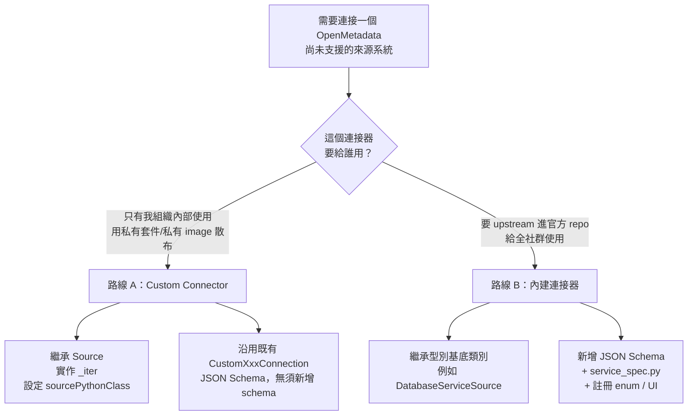
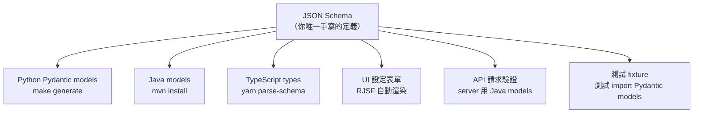
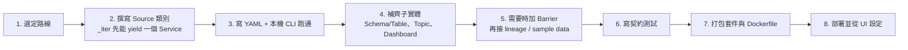

# OpenMetadata 自訂連接器（Custom Connector）實作完整指南

## 摘要

OpenMetadata 是一套開源的資料目錄（data catalog）與中繼資料（metadata）平台，其資料攝取（ingestion）框架以 Python 撰寫，並將「連接器（connector）」抽象為一個名為 `Source` 的類別。所謂「自訂連接器」，指的是由使用者自行撰寫、放在自己 Python 套件中的 `Source` 實作，透過設定檔中的 `sourcePythonClass` 欄位被動態載入，因此不需要修改 OpenMetadata 的原始碼，也不需要把自己的程式碼併入官方 repo[^om-custom]。

本報告回答一個具體問題：**如何實作一個 OpenMetadata 的自訂連接器？**內容涵蓋兩種截然不同的路線：

1. **路線 A：Custom Connector（客戶自有 Python 類別）** — 適用於「來源系統官方尚未支援、且我不想 upstream」的情境。這是絕大多數企業整合的實務選擇。
2. **路線 B：貢獻內建連接器（schema-first + `scaffold-connector`）** — 適用於「我要把這個連接器做成正式功能、給社群使用」的情境。

兩種路線的抽象基礎、產出檔案、註冊方式、測試方式都不同，必須先選定路線再動手，否則會白費工。報告最後整理常見陷阱與對照表。

---

## 1. 背景：連接器在 OpenMetadata 中的位置

### 1.1 服務類型（Service Type）

OpenMetadata 依來源系統的性質，把連接器分成多個服務類型：Database（資料庫）、Dashboard（儀表板）、Messaging（訊息串流）、Pipeline（資料管線）、ML Model（機器學習模型）、Storage（物件儲存）、Search（搜尋引擎）、API、Drive（檔案系統）、Metadata（後設目錄）等[^om-docs-index]。每個類型都有一組型別專屬的抽象基底類別，例如資料庫是 `DatabaseServiceSource`、儀表板是 `DashboardServiceSource`[^om-guide-scaffold]。

**關鍵區別**：這些型別專屬基底類別是給**內建（built-in）連接器**用的。自訂連接器路線**不繼承**它們，而是直接繼承最上層的 `Source`[^om-docs-custom]。

### 1.2 兩條路線的決策



---

## 2. 路線 A：Custom Connector

### 2.1 運作機制：`sourcePythonClass` 如何被載入

自訂連接器的核心機制，是**在設定檔中直接寫出完全限定類別名稱（fully qualified class name）**，由攝取框架在執行期 import。相關實作位於 `ingestion/src/metadata/workflow/ingestion.py` 的 `import_source_class`：

```python
def import_source_class(self) -> type[Source]:
    source_type = self.config.source.type.lower()
    try:
        return (
            import_from_module(self.config.source.serviceConnection.root.config.sourcePythonClass)
            if source_type.startswith(CUSTOM_CONNECTOR_PREFIX)
            else import_source_class(service_type=self.service_type, source_type=source_type)
        )
    except DynamicImportException as e:
        if source_type.startswith(CUSTOM_CONNECTOR_PREFIX):
            raise e  # noqa: TRY201
        ...
        raise MissingPluginException(source_type)  # noqa: B904
```

其中 `CUSTOM_CONNECTOR_PREFIX = "custom"`[^om-constants]。這段程式碼揭示了兩個硬性規則：

- **規則一**：設定檔裡 `source.type` 必須以 `custom` 開頭（例如 `custom-database`、`custom-dashboard`），否則框架會走「內建連接器」分支，去尋找 `metadata.ingestion.source.<service_type>.<type>.service_spec`，然後因為找不到而拋出 `MissingPluginException`[^om-workflow-ingestion]。
- **規則二**：`source.serviceConnection.root.config.sourcePythonClass` 必須可被 import。若 import 失敗，`DynamicImportException` 會直接往外拋，不做任何 fallback[^om-importer]。

`import_from_module` 的行為是：把字串從最後一個 `.` 切成「模組路徑」與「物件名稱」，呼叫 `importlib.import_module`，再用 `getattr` 取出類別[^om-importer]。

### 2.2 前置條件

| 項目 | 要求 |
| --- | --- |
| Python 版本 | 官方範例套件宣告 `requires-python = ">=3.10"`[^demo-pyproject] |
| OpenMetadata 版本對齊 | 自訂連接器套件依賴 `openmetadata-ingestion`，版本必須與伺服器／UI 版本一致 |
| 部署環境 | 類別必須存在於「實際執行攝取的那個 Python 環境」（EC2、Airflow host、Docker image 等）[^om-docs-custom] |
| 驗證機制 | `CustomXxxConnection` 的 JSON Schema 設有 `additionalProperties: true`，因此 `sourcePythonClass` 能通過 schema 驗證[^om-schema-customdb] |

### 2.3 `Source` 抽象類別與必實作方法

`Source` 定義於 `ingestion/src/metadata/ingestion/api/steps.py`，繼承 `IterStep` 與 `ABC`：

```python
class Source(IterStep, ABC):
    """
    Abstract source implementation. The workflow will run
    its next_record and pass them to the next step.
    """

    metadata: OpenMetadata
    connection_obj: Any
    service_connection: Any

    @abstractmethod
    def prepare(self):
        pass

    @abstractmethod
    def test_connection(self) -> None:
        pass

    @property
    def name(self) -> str:
        return "Source"

    def run(self) -> Iterable[Entity | None]:
        with diagnostics.operation("source.iter"):
            yield from super().run()
```

`IterStep` 另外定義了抽象的 `_iter`[^om-steps]。因此一個可用的自訂連接器最少需要：

| 成員 | 責任 | 備註 |
| --- | --- | --- |
| `__init__(config, metadata)` | 保存設定與 API client | 慣例上呼叫 `super().__init__()` 以初始化 `Status` |
| `create(config_dict, metadata, pipeline_name=None)` | 類別方法工廠，驗證連線型別 | 必須檢查 `isinstance(connection, CustomXxxConnection)` 並在失敗時拋 `InvalidSourceException` |
| `prepare()` | 建立外部連線／初始化 client | 由 `__init__` 流程觸發[^om-docs-source-api] |
| `test_connection()` | 驗證權限與連通性 | 官方文件指出僅供「OpenMetadata 支援的連接器」使用來驗證連線[^om-docs-source-api] |
| `close()` | 釋放資源 | 來自 `Closeable` |
| `_iter(**_)` | **核心**：產生器，逐筆 yield `Either` | 送出 `CreateXxxRequest` 給 Sink[^om-docs-custom] |

### 2.4 `Either` 與錯誤處理

框架要求每次 yield 都包在 `Either` 中：`right` 放正確的 `CreateEntityRequest`，`left` 放要追蹤的例外（`StackTraceError`）[^om-docs-custom]。

```python
from metadata.ingestion.api.models import Either, StackTraceError

try:
    1 / 0
except Exception:
    yield Either(
        left=StackTraceError(
            name="My Error",
            error="Demoing one error",
            stack_trace=traceback.format_exc(),
        )
    )

for row in self.data:
    yield Either(
        right=CreateTableRequest(...)
    )
```

`Either` 的定義（`ingestion/src/metadata/ingestion/api/models.py`）是泛型 Pydantic 模型，`left` 型別為 `StackTraceError | None`，`right` 為 `T | None`，兩者預設皆為 `None`[^om-models]。錯誤最後會由框架彙整成表格輸出[^om-docs-custom]。在 `IterStep.run()` 中，`left` 會被記入 `status.failed(...)`，`right` 會被記入 `status.scanned(...)`；`AttributeError` 有專門分支，用來提示「`_iter` 回傳的不是 `Either`」[^om-steps]。

### 2.5 `Barrier`：需要「先落地、後引用」時

當後續實體必須先確認前一批實體已寫入 OpenMetadata（例如 lineage 的兩端要用 FQN 解析、topic 的 sample data 要掛在已建立的 topic 上），就要 yield 一個 `Barrier`。其定義只是一個凍結的 dataclass：

```python
@dataclass(frozen=True)
class Barrier:
    reason: str | None = None
```

官方範例的註解寫得很明確：*"Lineage resolves both ends by FQN, so the buffered tables must be committed first."*[^demo-database]

### 2.6 目錄結構

官方 Demo 套件採用 `src/` 佈局，每個服務類型一個模組[^demo-readme]：

```
custom-connector/
├── pyproject.toml
├── configs/
│   ├── custom-database.yaml
│   ├── custom-dashboard.yaml
│   └── ...
├── src/
│   └── openmetadata_demo_connectors/
│       ├── __init__.py
│       ├── database.py
│       ├── dashboard.py
│       ├── messaging.py
│       ├── mlmodel.py
│       ├── pipeline.py
│       ├── search.py
│       ├── storage.py
│       └── drive.py
├── tests/
└── docker/
    ├── Dockerfile
    └── compose.override.yml
```

另一種官方文件示範的佈局，是把程式碼直接掛進 `metadata` 命名空間下的 `metadata/ingestion/source/database/my_awesome_connector.py`，讓它能與既有原始碼共存於同一 namespace[^om-docs-source-api]。若只是想快速驗證，任何可 import 的套件路徑都可行。

### 2.7 完整範例：自訂資料庫連接器

以下改寫自官方 `openmetadata-demo` 的 `CustomDatabaseSource`[^demo-database]。它的結構是自訂連接器的標準樣板。

```python
from collections.abc import Iterable

from metadata.generated.schema.api.data.createDatabase import CreateDatabaseRequest
from metadata.generated.schema.api.data.createDatabaseSchema import CreateDatabaseSchemaRequest
from metadata.generated.schema.api.data.createTable import CreateTableRequest
from metadata.generated.schema.api.services.createDatabaseService import CreateDatabaseServiceRequest
from metadata.generated.schema.entity.data.table import Column, DataType, TableType
from metadata.generated.schema.entity.services.connections.database.customDatabaseConnection import (
    CustomDatabaseConnection,
)
from metadata.generated.schema.entity.services.databaseService import DatabaseServiceType
from metadata.generated.schema.metadataIngestion.workflow import Source as WorkflowSource
from metadata.ingestion.api.models import Either
from metadata.ingestion.api.steps import InvalidSourceException, Source
from metadata.ingestion.ometa.ometa_api import OpenMetadata


class CustomDatabaseSource(Source):
    """Yields a catalog of databases, schemas and tables from an in-memory source."""

    def __init__(self, config: WorkflowSource, metadata: OpenMetadata):
        super().__init__()
        self.config = config
        self.metadata = metadata
        self.service_connection = config.serviceConnection.root.config
        options = self.service_connection.connectionOptions
        self.database_name = (
            (options.root or {}).get("databaseName", "my_catalog")
            if options
            else "my_catalog"
        )

    @classmethod
    def create(
        cls,
        config_dict: dict,
        metadata: OpenMetadata,
        pipeline_name: str | None = None,
    ) -> "CustomDatabaseSource":
        config: WorkflowSource = WorkflowSource.model_validate(config_dict)
        connection = config.serviceConnection.root.config
        if not isinstance(connection, CustomDatabaseConnection):
            raise InvalidSourceException(f"Expected CustomDatabaseConnection, but got {connection}")
        return cls(config, metadata)

    def prepare(self):
        """Nothing to prepare"""

    def test_connection(self) -> None:
        """No external system to reach"""

    def close(self) -> None:
        """Nothing to close"""

    def _iter(self, *_, **__) -> Iterable[Either]:
        service_name = self.config.serviceName

        # 1. 一定要先建立 Service 本體
        yield Either(
            right=CreateDatabaseServiceRequest(
                name=service_name,
                serviceType=DatabaseServiceType.CustomDatabase,
                connection=self.config.serviceConnection.root,
                displayName="Custom Database Demo",
            )
        )

        # 2. 再建立 Database / Schema / Table（FQN 由 service 名稱往下堆疊）
        yield Either(
            right=CreateDatabaseRequest(name=self.database_name, service=service_name)
        )
        database_fqn = f"{service_name}.{self.database_name}"
        yield Either(
            right=CreateDatabaseSchemaRequest(name="my_schema", database=database_fqn)
        )
        schema_fqn = f"{database_fqn}.my_schema"
        yield Either(
            right=CreateTableRequest(
                name="orders",
                databaseSchema=schema_fqn,
                tableType=TableType.Regular,
                columns=[
                    Column(name="order_id", dataType=DataType.BIGINT, dataLength=64),
                    Column(name="total_amount", dataType=DataType.DECIMAL, dataLength=64),
                ],
            )
        )
```

幾個值得注意的細節：

- `connection=self.config.serviceConnection.root`：建立 Service 時要**把整包連線設定原封不動傳回去**，而不是只傳自己解析出的欄位。這是 `CustomXxxConnection` 存在的意義：它讓「自訂連接器的設定」能被目錄保存下來[^demo-database]。
- `connectionOptions` 是 `Optional[dict]` 型別的 root model，因此讀取時要用 `options.root or {}` 取值[^demo-database]。
- FQN（fully qualified name）是 `<service>.<database>.<schema>.<table>` 逐層串接[^demo-database]。
- 更完整的官方範例另外展示了 `OMetaTagAndClassification`（標籤與分類）、`CreateStoredProcedureRequest`（預存程序）、`OMetaFQNLineageRequest`（血緣）與 `Barrier` 的用法[^demo-database]。

### 2.8 套件打包

官方 Demo 的 `pyproject.toml` 全文如下[^demo-pyproject]：

```toml
[build-system]
requires = ["setuptools>=78.1.1"]
build-backend = "setuptools.build_meta"

[project]
name = "openmetadata-demo-connectors"
version = "0.1.0"
description = "Runnable custom connector examples for OpenMetadata"
requires-python = ">=3.10"
dependencies = ["openmetadata-ingestion==2.0.0.0rc1"]

[project.optional-dependencies]
test = ["pytest>=8", "ruff>=0.12"]

[tool.setuptools.packages.find]
where = ["src"]

[tool.pytest.ini_options]
pythonpath = ["src"]

[tool.ruff]
line-length = 100
target-version = "py310"

[tool.ruff.lint]
select = ["B", "E", "F", "I", "UP"]
```

**重點**：自訂連接器**不需要**在 `pyproject.toml` 或 `setup.py` 裡註冊 `entry_points`。框架是靠 `sourcePythonClass` 字串做動態 import，而不是靠 setuptools 的 entry point 探索。

作為對照，內建連接器則必須在 `ingestion/setup.py` 的 `extras_require` 中註冊驅動依賴，例如 `"mysql": {VERSIONS["pymysql"], ...}`、`"clickhouse": {"clickhouse-driver~=0.2", ...}`[^om-setup-py]。這是路線 B 才需要的動作。

### 2.9 包裝成自訂攝取映像（Image）

若要在 UI 中直接使用連接器，攝取環境必須包含你的程式碼。官方 Demo 的 `docker/Dockerfile` 全文[^demo-dockerfile]：

```dockerfile
FROM docker.getcollate.io/openmetadata/ingestion:2.0.0-rc1

WORKDIR /opt/airflow/openmetadata-demo-connectors
USER airflow

COPY --chown=airflow:0 pyproject.toml ./
COPY --chown=airflow:0 src ./src
RUN pip install --no-deps .
```

官方文件給的版本是通用寫法[^om-docs-custom]：

```Dockerfile
# Base image from the right version
FROM openmetadata/ingestion:<version>

# Let's use the same workdir as the ingestion image
WORKDIR ingestion
USER airflow

# Install our custom connector
# For a PROD image, this could be picking up the package from your private package index
COPY connector connector
COPY setup.py .
RUN pip install --no-deps .
```

`docker/compose.override.yml` 用來把這個映像疊進官方 Compose 檔[^demo-compose]：

```yaml
services:
  ingestion:
    build:
      context: ./custom-connector
      dockerfile: docker/Dockerfile
    image: openmetadata-demo/ingestion:2.0.0-rc1
```

啟動指令[^demo-readme]：

```bash
docker compose \
  -f docker-compose-postgres.yml \
  -f custom-connector/docker/compose.override.yml \
  up --detach --build
```

**注意**：Dockerfile 使用 `--no-deps`，因為映像內已安裝與自身版本相符的 OpenMetadata 依賴；若讓 pip 重新解析依賴，可能裝進不相容的版本[^demo-readme]。

### 2.10 攝取設定檔（YAML）

`configs/custom-database.yaml` 全文[^demo-yaml]：

```yaml
source:
  type: custom-database
  serviceName: custom_database_demo
  serviceConnection:
    config:
      type: CustomDatabase
      sourcePythonClass: openmetadata_demo_connectors.database.CustomDatabaseSource
      connectionOptions:
        databaseName: customer_catalog
  sourceConfig:
    config:
      type: DatabaseMetadata
sink:
  type: metadata-rest
  config: {}
workflowConfig:
  loggerLevel: INFO
  openMetadataServerConfig:
    hostPort: ${OPENMETADATA_HOST}
    authProvider: openmetadata
    securityConfig:
      jwtToken: ${OPENMETADATA_JWT_TOKEN}
```

各服務類型的設定差異只在三個地方：`source.type`、`serviceConnection.config.type`、`sourceConfig.config.type`。對照表[^demo-readme]：

| 服務 | `source.type` | `config.type` | `sourceConfig.type` | Python 類別 |
| --- | --- | --- | --- | --- |
| Database | `custom-database` | `CustomDatabase` | `DatabaseMetadata` | `CustomDatabaseSource` |
| Dashboard | `custom-dashboard` | `CustomDashboard` | `DashboardMetadata` | `CustomDashboardSource` |
| Messaging | `custom-messaging` | `CustomMessaging` | `MessagingMetadata` | `CustomMessagingSource` |
| ML model | `custom-mlmodel` | `CustomMlModel` | `MlModelMetadata` | `CustomMlModelSource` |
| Pipeline | `custom-pipeline` | `CustomPipeline` | `PipelineMetadata` | `CustomPipelineSource` |
| Search | `custom-search` | `CustomSearch` | `SearchMetadata` | `CustomSearchSource` |
| Storage | `custom-storage` | `CustomStorage` | `StorageMetadata` | `CustomStorageSource` |
| Drive | `custom-drive` | `CustomDrive` | `DriveMetadata` | `CustomDriveSource` |

`metadata ingest -c <yaml>` 是執行入口，`scaffold-connector` 是另一支子命令[^om-cmd]。

### 2.11 安裝與執行

```bash
python3 -m venv .venv
source .venv/bin/activate
python -m pip install --editable "./custom-connector[test]"

export OPENMETADATA_HOST="http://localhost:8585/api"
export OPENMETADATA_JWT_TOKEN="<ingestion-bot-token>"
metadata ingest -c custom-connector/configs/custom-database.yaml
```

以上取自官方 Demo 的 Quickstart[^demo-readme]。

### 2.12 從 UI 設定

資料庫、儀表板、Pipeline 等服務：進入 **Database Services → Add New Service → Custom**，在 `Source Python Class Name` 欄位填入完全限定類別名稱，例如 `connector.my_awesome_connector.MyAwesomeConnector`[^om-docs-custom]。

**Drive 是例外**：`customDriveConnection.json` 並未宣告 `sourcePythonClass` 欄位，它「只是因為 schema 設了 `additionalProperties: true` 才存活」，因此 UI 無法設定，必須改用 YAML 加 CLI[^demo-drive]。官方文件亦證實該欄位在 Drive 表單中不存在[^om-docs-drive]。

### 2.13 測試

官方 Demo 採用「契約測試」策略：不連線、不打伺服器，只驗證產生的請求序列與內容是否符合預期[^demo-test-db]。

```python
def source_config() -> dict:
    return {
        "type": "custom-database",
        "serviceName": "custom_database_demo",
        "serviceConnection": {
            "config": {
                "type": "CustomDatabase",
                "sourcePythonClass": "openmetadata_demo_connectors.database.CustomDatabaseSource",
                "connectionOptions": {"databaseName": "customer_catalog"},
            }
        },
        "sourceConfig": {"config": {"type": "DatabaseMetadata"}},
    }


def test_database_connector_uses_connection_options() -> None:
    source = CustomDatabaseSource.create(source_config(), metadata=object())
    database = next(
        result.right for result in source._iter() if isinstance(result.right, CreateDatabaseRequest)
    )
    assert database.name.root == "customer_catalog"
```

注意 `metadata=object()`：因為範例的 `_iter` 不需要真的呼叫 API，所以傳入任何物件都能通過。這個技巧讓契約測試可以完全離線執行[^demo-readme]。

官方 Demo 的驗證邊界寫得很清楚：*"The repository checks package installation, imports, workflow models, emitted request models, and dependency ordering without a live server. Running ingestion against a deployed server remains a manual validation step."*[^demo-readme]

---

## 3. 路線 B：貢獻內建連接器（schema-first）

若連接器要 upstream，做法完全不同。OpenMetadata 採用 **schema-first** 架構：你只寫一份 JSON Schema，其餘六層由程式碼產生器推導[^om-guide-scaffold]。



### 3.1 環境準備

```bash
python3.11 -m venv env
source env/bin/activate
make install_dev generate
```

官方指引強調：後續每次開新 session 都要先 `source env/bin/activate`[^om-guide-scaffold]。

### 3.2 執行 scaffold

互動模式是 `metadata scaffold-connector`；非互動模式則帶完整旗標，例如官方以 ClickHouse 為例[^om-guide-scaffold]：

```bash
metadata scaffold-connector \
    --name clickhouse \
    --service-type database \
    --connection-type sqlalchemy \
    --scheme "clickhousedb+connect" \
    --auth-types basic \
    --capabilities metadata lineage usage profiler \
    --docs-url "https://clickhouse.com/docs/en/interfaces/http" \
    --sdk-package "clickhouse-connect"
```

互動模式會逐項詢問連接器名稱、服務類型、連線類型（資料庫專屬：`sqlalchemy`／`rest_api`／`sdk_client`）、驗證方式、能力集合、文件 URL、SDK 套件、API 端點、實作備註、Docker 映像與容器埠[^om-guide-scaffold]。CLI 的旗標清單可在 `ingestion/src/metadata/cmd.py` 中看到，包含 `--docker-image`、`--docker-port` 等測試用參數[^om-cmd]。

### 3.3 產出的檔案

```
# 連線 schema（唯一真實來源）
openmetadata-spec/.../connections/{service_type}/{name}Connection.json

# Test connection 定義
openmetadata-service/.../testConnections/{service_type}/{name}.json

# Python 連接器程式碼
ingestion/src/metadata/ingestion/source/{service_type}/{name}/
├── __init__.py
├── connection.py        # 實作連線邏輯
├── metadata.py          # 實作抽取（資料庫類型常可原樣使用）
├── service_spec.py      # 已完成，不需修改
├── queries.py           # 資料庫專屬：SQL 查詢樣板
├── client.py            # 非資料庫專屬：REST/SDK client
├── lineage.py           # 若選了 lineage 能力
├── usage.py             # 若選了 usage 能力
├── query_parser.py      # 若選了 lineage 或 usage
└── CONNECTOR_CONTEXT.md # 給 AI agent 的實作說明
```

官方指引特別點出：**測試不會被產生**，必須自己照參考連接器的測試寫[^om-guide-scaffold]。

### 3.4 各類型的工作量差異

| 服務類型 | 基底類別 | 主要工作量 |
| --- | --- | --- |
| Database | `CommonDbSourceService`；連線用 `BaseConnection[Config, Engine]` | 通常最少；多數情況 `metadata.py` 可原樣使用，主要補 `queries.py` 的 SQL[^om-guide-scaffold] |
| Dashboard | `DashboardServiceSource` | 實作 `get_dashboards_list()`、`get_dashboard_name()`、`get_dashboard_details()`、`yield_dashboard()`、`yield_dashboard_chart()`[^om-guide-scaffold] |
| Pipeline | `PipelineServiceSource` | 實作 `get_pipelines_list()`、`get_pipeline_name()`、`yield_pipeline()`、`yield_pipeline_status()`[^om-guide-scaffold] |
| Messaging | `MessagingServiceSource` | 主要實作 `yield_topic()`[^om-guide-scaffold] |
| ML Model | `MlModelServiceSource` | 參考 `mlflow/`[^om-guide-scaffold] |
| Storage | `StorageServiceSource` | 參考 `s3/`[^om-guide-scaffold] |
| Search | `SearchServiceSource` | 參考 `elasticsearch/`[^om-guide-scaffold] |
| API | `ApiServiceSource` | 參考 `api/rest/`[^om-guide-scaffold] |

資料庫類型使用 `DefaultDatabaseSpec`，它已預先接好 profiler、sampler、test suite、data diff；非資料庫類型則用 `BaseSpec(metadata_source_class=...)`[^om-guide-scaffold]。

一個具體的 `service_spec.py` 範例（MySQL）[^om-guide-scaffold]：

```python
from metadata.ingestion.source.database.mysql.metadata import MysqlSource
from metadata.ingestion.source.database.mysql.lineage import MysqlLineageSource
from metadata.ingestion.source.database.mysql.usage import MysqlUsageSource
from metadata.ingestion.source.database.mysql.profiler import MysqlProfiler
from metadata.sampler.sqlalchemy.mysql.sampler import MysqlSampler
from metadata.utils.service_spec.default import DefaultDatabaseSpec

ServiceSpec = DefaultDatabaseSpec(
    metadata_source_class=MysqlSource,
    lineage_source_class=MysqlLineageSource,
    usage_source_class=MysqlUsageSource,
    profiler_class=MysqlProfiler,
    sampler_class=MysqlSampler,
)
```

框架是以 `metadata.ingestion.source.{service_type}.{name}.service_spec.ServiceSpec` 這個固定路徑動態解析 spec 的[^om-guide-scaffold]。

### 3.5 註冊清單（scaffold 不會自動做的事）

官方指引列出三處必須手動編輯[^om-guide-scaffold]：

1. **Service schema** — 在 `openmetadata-spec/.../entity/services/{serviceType}Service.json` 的 `type` enum 陣列加入新名稱，並在 `connection` 的 `oneOf` 加入指向新 schema 的 `$ref`。
2. **UI service utils** — 在 `openmetadata-ui/.../utils/{ServiceType}ServiceUtils.tsx` import schema 並加入 switch case。
3. **在地化（i18n）** — 在 `openmetadata-ui/.../locale/languages/` 加入顯示名稱鍵值。

### 3.6 程式碼產生與驗證

```bash
source env/bin/activate

# 從 JSON Schema 產生 Python Pydantic models
make generate

# 產生 Java models
mvn clean install -pl openmetadata-spec

# 產生 UI 表單用的 resolved JSON
cd openmetadata-ui/src/main/resources/ui && yarn parse-schema
```

驗證指令[^om-guide-scaffold]：

```bash
make py_format
mvn spotless:apply
python -m pytest ingestion/tests/unit/topology/{service_type}/test_{name}.py
```

本機 Docker 測試[^om-guide-scaffold]：

```bash
# 完整建置（首次或 Java/UI 有變更）
./docker/run_local_docker.sh -m ui -d mysql -s false -i true -r true

# 快速重建（僅 ingestion 變更，約 2-3 分鐘）
./docker/run_local_docker.sh -m ui -d mysql -s true -i true -r false
```

UI 位於 `http://localhost:8585`、Airflow 位於 `http://localhost:8080`（admin/admin）、Elasticsearch 位於 `http://localhost:9200`；拆除用 `cd docker/development && docker compose down -v`[^om-guide-scaffold]。

### 3.7 CONNECTOR_CONTEXT.md 與 AI agent 協作

scaffold 會在連接器目錄內產生 `CONNECTOR_CONTEXT.md`，內容包含連接器概況、來源文件、每個檔案的實作說明、參考連接器、註冊清單與驗證清單，設計給 AI agent（Claude Code、Cursor、Copilot、Codex）閱讀[^om-guide-scaffold]。官方示範的用法是：

```bash
claude "Read ingestion/src/metadata/ingestion/source/database/my_db/CONNECTOR_CONTEXT.md
and implement all the TODO items. Use the reference connector as a pattern."
```

---

## 4. 常見陷阱

以下為兩條路線實作時最容易踩到的問題，來源多為官方文件、原始碼註解與範例程式碼的明示警告。

| # | 陷阱 | 說明與解法 |
| --- | --- | --- |
| 1 | `source.type` 沒有 `custom` 前綴 | 框架會改走內建分支並以 `MissingPluginException` 失敗[^om-workflow-ingestion][^om-constants] |
| 2 | 類別不在攝取環境中 | `sourcePythonClass` 是執行期 import；必須裝進映像／host。import 失敗會直接拋 `DynamicImportException`[^om-importer] |
| 3 | 沒有先 yield Service 本體 | 子實體的 FQN 依賴 service 名稱，順序錯誤會解析不到上層[^demo-database] |
| 4 | 忘了在需要時插 `Barrier` | lineage 兩端以 FQN 解析、topic sample data 需掛在已存在的 topic 上，緩衝必須先 flush[^demo-database][^demo-messaging] |
| 5 | 把 `connectionOptions` 當普通 dict | 它是 optional root model，要寫 `options.root or {}`[^demo-database] |
| 6 | 建立 Service 時只傳自訂欄位 | 要傳 `self.config.serviceConnection.root` 整包，否則目錄端保存不到設定[^demo-database] |
| 7 | 在 `pyproject.toml` 找 `entry_points` | 自訂連接器不需要；探索是靠 `sourcePythonClass` 字串 |
| 8 | `pip install` 讓依賴被重解析 | 官方 Dockerfile 用 `--no-deps`，避免覆蓋映像內相符的 OpenMetadata 依賴[^demo-dockerfile][^demo-readme] |
| 9 | 想在 Drive 的 UI 表單填類別名稱 | `customDriveConnection.json` 未宣告 `sourcePythonClass`，UI 無此欄位，須用 CLI + YAML[^demo-drive][^om-docs-drive] |
| 10 | 期待 profiler 可用 | `validate()` 會檢查 `serviceConnection.root.config.supportsProfiler`，未宣告就拋 `WorkflowExecutionError`（除非 `ignoreValidation`）[^om-workflow-ingestion] |
| 11 | 版本不對齊 | 自訂套件依賴 `openmetadata-ingestion`；映像 tag 必須與伺服器版本相符[^demo-readme][^om-docs-custom] |
| 12 | 期待 schema 阻擋未知欄位 | `CustomXxxConnection` 設 `additionalProperties: true`，`sourcePythonClass` 靠這個才活得下來[^om-schema-customdb][^demo-drive] |
| 13 | 以為 `_iter` 可以回傳非 `Either` | `IterStep.run()` 有專門的 `AttributeError` 分支提示此事[^om-steps] |
| 14 | 以為自訂連接器有 `test_connection` UI 驗證 | 官方文件指出 `test_connection` 主要由 OpenMetadata 支援的連接器用於事前驗證[^om-docs-source-api] |

---

## 5. 兩條路線對照

| 面向 | 路線 A：Custom Connector | 路線 B：內建連接器 |
| --- | --- | --- |
| 基底類別 | `metadata.ingestion.api.steps.Source`[^om-docs-custom] | `DatabaseServiceSource`、`DashboardServiceSource` 等[^om-guide-scaffold] |
| 探索機制 | 設定檔 `sourcePythonClass` 執行期動態 import[^om-workflow-ingestion] | `service_spec.ServiceSpec` 固定路徑解析[^om-guide-scaffold] |
| 核心方法 | `_iter`（單一扁平產生器）[^om-docs-custom] | `Topology` 節點定義 + 各 `yield_*` 方法[^om-guide-scaffold] |
| JSON Schema | 沿用既有 `CustomXxxConnection`，無須新增[^om-schema-customdb] | 必須新增 `{name}Connection.json`[^om-guide-scaffold] |
| 註冊 | 無須註冊 | 需改 service enum、`oneOf`、UI utils、i18n[^om-guide-scaffold] |
| 程式碼產生 | 不需要 | `make generate`、`mvn install`、`yarn parse-schema`[^om-guide-scaffold] |
| 打包 | 自有 `pyproject.toml` + 自訂攝取映像[^demo-pyproject] | 於 `ingestion/setup.py` 新增 plugin extra[^om-setup-py] |
| UI 可用性 | 多數服務可在 UI 填類別名稱；Drive 例外[^om-docs-custom][^om-docs-drive] | 完整納入 UI 表單（RJSF 自動渲染）[^om-guide-scaffold] |
| 測試 | 契約測試（離線驗證請求序列）[^demo-test-db] | topology 單元測試 + testcontainers 整合測試[^om-guide-scaffold] |
| 適用情境 | 組織內部、私有來源系統 | 貢獻社群、正式支援的連接器 |

---

## 6. 專案活躍度參考

| 專案 | GitHub Stars | 說明 |
| --- | --- | --- |
| `open-metadata/OpenMetadata` | 約 15,500[^om-gh-repo] | 主專案，Apache-2.0，預設分支 `main` |
| `open-metadata/openmetadata-demo` | 約 2[^demo-gh-repo] | 官方可執行範例集（含自訂連接器），Apache-2.0 |

`openmetadata-demo` 的 star 數極低，但它是 OpenMetadata 官方組織（`open-metadata`）直屬的 repository，且被官方文件以 `<Tip>` 明確推薦為 2.0 自訂連接器範例來源[^om-docs-custom]，因此仍是本主題最權威的參考實作，而 star 數在此處不構成可信度指標。此現象呼應「低 star 專案須審慎評估」的通則，但評估結論取決於維護者身分與被官方文件引用與否，而非單看數字。

最新版本為 `2.0.5-release`（2026-10-08 發布），屬維護性版本，聚焦連接器與血緣可靠性[^om-release]。

---

## 7. 建議的實作順序



1. **先讓最小可跑版本通過**：只 yield `CreateXxxServiceRequest`，用 `metadata ingest -c` 確認動態 import 與 service 建立都成功，再往下加子實體。
2. **契約測試先於整合測試**：因為 `_iter` 是純產生器，離線就能驗證請求型別與順序[^demo-test-db]。
3. **血緣與 sample data 最後做**：它們是唯一需要「先落地、後引用」的部分，插入 `Barrier` 的時機錯了會很難除錯[^demo-messaging]。

---

## 參考文獻

Collate Inc. (2025). *Building an OpenMetadata Connector* [GUIDE.md]. Retrieved 2026-10-17, from https://github.com/open-metadata/OpenMetadata/blob/main/skills/connector-building/GUIDE.md

GitHub. (2026). *open-metadata/OpenMetadata* [Repository metadata]. Retrieved 2026-10-17, from https://api.github.com/repos/open-metadata/OpenMetadata

GitHub. (2026). *open-metadata/openmetadata-demo* [Repository metadata]. Retrieved 2026-10-17, from https://api.github.com/repos/open-metadata/openmetadata-demo

OpenMetadata. (2026). *2.0.5-release* [Release notes]. Retrieved 2026-10-17, from https://github.com/open-metadata/OpenMetadata/releases/tag/2.0.5-release

OpenMetadata. (n.d.). *Custom Connectors | Build & Extend OpenMetadata Easily*. Retrieved 2026-10-17, from https://docs.open-metadata.org/v2.0.x/connectors/custom-connectors

OpenMetadata. (n.d.). *Custom Drive Connector | Build & Extend OpenMetadata Easily*. Retrieved 2026-10-17, from https://docs.open-metadata.org/v2.0.x/connectors/drive/custom-drive

OpenMetadata. (n.d.). *Source* [Python SDK API reference]. Retrieved 2026-10-17, from https://docs.open-metadata.org/v2.0.x/api-reference/sdk/python/build-connector/source

OpenMetadata. (n.d.). *customDatabaseConnection.json* [JSON Schema]. Retrieved 2026-10-17, from https://github.com/open-metadata/OpenMetadata/blob/main/openmetadata-spec/src/main/resources/json/schema/entity/services/connections/database/customDatabaseConnection.json

OpenMetadata. (n.d.). *customDriveConnection.json* [JSON Schema]. Retrieved 2026-10-17, from https://github.com/open-metadata/OpenMetadata/blob/main/openmetadata-spec/src/main/resources/json/schema/entity/services/connections/drive/customDriveConnection.json

OpenMetadata. (n.d.). *cmd.py* [CLI entrypoint source code]. Retrieved 2026-10-17, from https://github.com/open-metadata/OpenMetadata/blob/main/ingestion/src/metadata/cmd.py

OpenMetadata. (n.d.). *constants.py* [Ingestion constants source code]. Retrieved 2026-10-17, from https://github.com/open-metadata/OpenMetadata/blob/main/ingestion/src/metadata/utils/constants.py

OpenMetadata. (n.d.). *custom_database.py* [Integration test source code]. Retrieved 2026-10-17, from https://github.com/open-metadata/OpenMetadata/blob/main/ingestion/tests/integration/custom_connectors/custom_database.py

OpenMetadata. (n.d.). *custom_drive.py* [Integration test source code]. Retrieved 2026-10-17, from https://github.com/open-metadata/OpenMetadata/blob/main/ingestion/tests/integration/custom_connectors/custom_drive.py

OpenMetadata. (n.d.). *importer.py* [Dynamic import helpers source code]. Retrieved 2026-10-17, from https://github.com/open-metadata/OpenMetadata/blob/main/ingestion/src/metadata/utils/importer.py

OpenMetadata. (n.d.). *ingestion.py* [Ingestion workflow source code]. Retrieved 2026-10-17, from https://github.com/open-metadata/OpenMetadata/blob/main/ingestion/src/metadata/workflow/ingestion.py

OpenMetadata. (n.d.). *models.py* [Either model source code]. Retrieved 2026-10-17, from https://github.com/open-metadata/OpenMetadata/blob/main/ingestion/src/metadata/ingestion/api/models.py

OpenMetadata. (n.d.). *setup.py* [Ingestion packaging source code]. Retrieved 2026-10-17, from https://github.com/open-metadata/OpenMetadata/blob/main/ingestion/setup.py

OpenMetadata. (n.d.). *steps.py* [Source abstract class source code]. Retrieved 2026-10-17, from https://github.com/open-metadata/OpenMetadata/blob/main/ingestion/src/metadata/ingestion/api/steps.py

OpenMetadata. (n.d.). *Webinar on Custom Connectors* [Video]. Retrieved 2026-10-17, from https://www.youtube.com/watch?v=fDUj30Ub9VE

openmetadata-demo. (n.d.). *Custom Connector Examples* [README]. Retrieved 2026-10-17, from https://github.com/open-metadata/openmetadata-demo/blob/main/custom-connector/README.md

openmetadata-demo. (n.d.). *configs/custom-database.yaml* [Workflow configuration example]. Retrieved 2026-10-17, from https://github.com/open-metadata/openmetadata-demo/blob/main/custom-connector/configs/custom-database.yaml

openmetadata-demo. (n.d.). *database.py* [Custom connector example source code]. Retrieved 2026-10-17, from https://github.com/open-metadata/openmetadata-demo/blob/main/custom-connector/src/openmetadata_demo_connectors/database.py

openmetadata-demo. (n.d.). *messaging.py* [Custom connector example source code]. Retrieved 2026-10-17, from https://github.com/open-metadata/openmetadata-demo/blob/main/custom-connector/src/openmetadata_demo_connectors/messaging.py

openmetadata-demo. (n.d.). *docker/Dockerfile* [Custom ingestion image example]. Retrieved 2026-10-17, from https://github.com/open-metadata/openmetadata-demo/blob/main/custom-connector/docker/Dockerfile

openmetadata-demo. (n.d.). *docker/compose.override.yml* [Docker Compose overlay example]. Retrieved 2026-10-17, from https://github.com/open-metadata/openmetadata-demo/blob/main/custom-connector/docker/compose.override.yml

openmetadata-demo. (n.d.). *pyproject.toml* [Package metadata example]. Retrieved 2026-10-17, from https://github.com/open-metadata/openmetadata-demo/blob/main/custom-connector/pyproject.toml

openmetadata-demo. (n.d.). *tests/test_database.py* [Contract test example]. Retrieved 2026-10-17, from https://github.com/open-metadata/openmetadata-demo/blob/main/custom-connector/tests/test_database.py

[^om-docs-custom]: OpenMetadata. (n.d.). Custom Connectors | Build & Extend OpenMetadata Easily. Retrieved 2026-10-17, from https://docs.open-metadata.org/v2.0.x/connectors/custom-connectors

[^om-docs-drive]: OpenMetadata. (n.d.). Custom Drive Connector | Build & Extend OpenMetadata Easily. Retrieved 2026-10-17, from https://docs.open-metadata.org/v2.0.x/connectors/drive/custom-drive

[^om-docs-source-api]: OpenMetadata. (n.d.). Source [Python SDK API reference]. Retrieved 2026-10-17, from https://docs.open-metadata.org/v2.0.x/api-reference/sdk/python/build-connector/source

[^om-docs-index]: OpenMetadata. (n.d.). Connectors [Documentation index]. Retrieved 2026-10-17, from https://docs.open-metadata.org/_llms/v2-0-x/connectors.txt

[^om-guide-scaffold]: Collate Inc. (2025). Building an OpenMetadata Connector. Retrieved 2026-10-17, from https://github.com/open-metadata/OpenMetadata/blob/main/skills/connector-building/GUIDE.md

[^om-workflow-ingestion]: OpenMetadata. (n.d.). ingestion.py [Ingestion workflow source code]. Retrieved 2026-10-17, from https://github.com/open-metadata/OpenMetadata/blob/main/ingestion/src/metadata/workflow/ingestion.py

[^om-importer]: OpenMetadata. (n.d.). importer.py [Dynamic import helpers source code]. Retrieved 2026-10-17, from https://github.com/open-metadata/OpenMetadata/blob/main/ingestion/src/metadata/utils/importer.py

[^om-constants]: OpenMetadata. (n.d.). constants.py [Ingestion constants source code]. Retrieved 2026-10-17, from https://github.com/open-metadata/OpenMetadata/blob/main/ingestion/src/metadata/utils/constants.py

[^om-steps]: OpenMetadata. (n.d.). steps.py [Source abstract class source code]. Retrieved 2026-10-17, from https://github.com/open-metadata/OpenMetadata/blob/main/ingestion/src/metadata/ingestion/api/steps.py

[^om-models]: OpenMetadata. (n.d.). models.py [Either model source code]. Retrieved 2026-10-17, from https://github.com/open-metadata/OpenMetadata/blob/main/ingestion/src/metadata/ingestion/api/models.py

[^om-schema-customdb]: OpenMetadata. (n.d.). customDatabaseConnection.json [JSON Schema]. Retrieved 2026-10-17, from https://github.com/open-metadata/OpenMetadata/blob/main/openmetadata-spec/src/main/resources/json/schema/entity/services/connections/database/customDatabaseConnection.json

[^om-setup-py]: OpenMetadata. (n.d.). setup.py [Ingestion packaging source code]. Retrieved 2026-10-17, from https://github.com/open-metadata/OpenMetadata/blob/main/ingestion/setup.py

[^om-cmd]: OpenMetadata. (n.d.). cmd.py [CLI entrypoint source code]. Retrieved 2026-10-17, from https://github.com/open-metadata/OpenMetadata/blob/main/ingestion/src/metadata/cmd.py

[^om-gh-repo]: GitHub. (2026). open-metadata/OpenMetadata [Repository metadata]. Retrieved 2026-10-17, from https://api.github.com/repos/open-metadata/OpenMetadata

[^om-release]: OpenMetadata. (2026). 2.0.5-release [Release notes]. Retrieved 2026-10-17, from https://github.com/open-metadata/OpenMetadata/releases/tag/2.0.5-release

[^demo-readme]: openmetadata-demo. (n.d.). Custom Connector Examples [README]. Retrieved 2026-10-17, from https://github.com/open-metadata/openmetadata-demo/blob/main/custom-connector/README.md

[^demo-database]: openmetadata-demo. (n.d.). database.py [Custom connector example source code]. Retrieved 2026-10-17, from https://github.com/open-metadata/openmetadata-demo/blob/main/custom-connector/src/openmetadata_demo_connectors/database.py

[^demo-messaging]: openmetadata-demo. (n.d.). messaging.py [Custom connector example source code]. Retrieved 2026-10-17, from https://github.com/open-metadata/openmetadata-demo/blob/main/custom-connector/src/openmetadata_demo_connectors/messaging.py

[^demo-drive]: OpenMetadata. (n.d.). custom_drive.py [Integration test source code]. Retrieved 2026-10-17, from https://github.com/open-metadata/OpenMetadata/blob/main/ingestion/tests/integration/custom_connectors/custom_drive.py

[^demo-pyproject]: openmetadata-demo. (n.d.). pyproject.toml [Package metadata example]. Retrieved 2026-10-17, from https://github.com/open-metadata/openmetadata-demo/blob/main/custom-connector/pyproject.toml

[^demo-dockerfile]: openmetadata-demo. (n.d.). docker/Dockerfile [Custom ingestion image example]. Retrieved 2026-10-17, from https://github.com/open-metadata/openmetadata-demo/blob/main/custom-connector/docker/Dockerfile

[^demo-compose]: openmetadata-demo. (n.d.). docker/compose.override.yml [Docker Compose overlay example]. Retrieved 2026-10-17, from https://github.com/open-metadata/openmetadata-demo/blob/main/custom-connector/docker/compose.override.yml

[^demo-yaml]: openmetadata-demo. (n.d.). configs/custom-database.yaml [Workflow configuration example]. Retrieved 2026-10-17, from https://github.com/open-metadata/openmetadata-demo/blob/main/custom-connector/configs/custom-database.yaml

[^demo-test-db]: openmetadata-demo. (n.d.). tests/test_database.py [Contract test example]. Retrieved 2026-10-17, from https://github.com/open-metadata/openmetadata-demo/blob/main/custom-connector/tests/test_database.py

[^demo-gh-repo]: GitHub. (2026). open-metadata/openmetadata-demo [Repository metadata]. Retrieved 2026-10-17, from https://api.github.com/repos/open-metadata/openmetadata-demo
