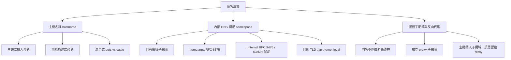
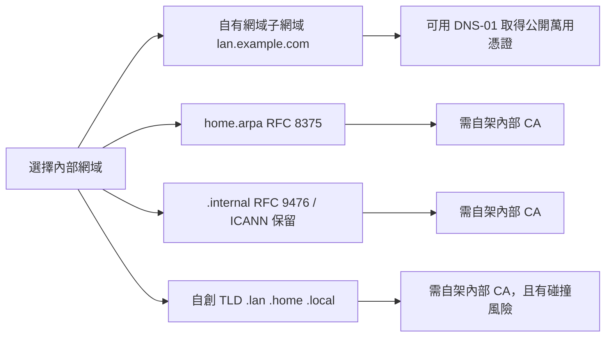

# 家用自架玩家的命名實踐：主機名稱、內部 DNS 網域與服務子網域

## 摘要

「命名」是家用自架 (homelab) 社群長年被反覆討論、卻始終沒有唯一答案的問題。本文整理自 1990 年的 RFC 1178 到 2026 年 ICANN 新通用頂級域 (gTLD) 申請案的公開資料，歸納出三層命名決策：**主機名稱 (hostname)**、**內部 DNS 網域 (namespace/TLD)**、以及**服務子網域與反向代理 (reverse proxy)**。社群實務大致分裂為「有主題的擬人命名」與「純功能描述命名」兩派；而在網域層，專業共識則傾向「使用自己擁有的真實網域之子網域」，因為這是在不暴露內部服務的前提下唯一能取得公開憑證授權單位 (CA) 憑證的做法。

---

## 一、前言：為什麼 homelab 玩家在意命名

當自架環境從「幾台記得住 IP 的機器」成長為「十幾個服務、需要 HTTPS 又不想看到瀏覽器憑證警告」時，命名就從個人趣味變成基礎設施問題。家用自架社群的核心矛盾在於：**有趣的命名難以擴展，可擴展的命名又枯燥**，而這條線到底畫在哪裡，正是社群辯論的主軸[^grumpy]。

命名決策可拆成三個彼此獨立、但常被混為一談的層次：



---

## 二、主機名稱 (hostname) 的流派

### 2.1 理論基礎：RFC 1178

家用自架命名討論最常被引用的文件，是 Don Libes 於 1990 年為 NIST 撰寫的 RFC 1178〈Choosing a Name for Your Computer〉。它並非規範性標準，而是一篇經驗彙整文章[^rfc1178]。其「不該做」清單包括：不要使用日常語意過載的字 (例如把機器命名為 `up`，會出現「Is up down?」的困惑)、不要用只對該機器有意義的專案名稱、不要用自己的名字、不要用超過八個字元的名稱、避免刻意錯拼 (例如 `czek` 被誤聽為 `check`)、避免使用網域或類網域名稱、不要用開頭是數字或全為十六進位數字的名稱 (例如 `beef` 可被解讀為十六進位數)、不要使用非英數字元、不要期待大小寫被保留[^rfc1178]。

其「該做」清單則建議：使用罕用字、**使用主題式名稱 (theme names)**、使用真實詞彙、不必擔心與其他網域重複使用同一主機名，並提醒改名極其痛苦[^rfc1178]。RFC 1178 明確列出可用的主題，包括神話地點 (Midgard、Styx、Paradise)、神話人物 (Zeus、Procne、Tereus)、殺手 (Cain、Burr、Boleyn)、元素 (helium、argon、zinc)、花卉 (tulip、peony、lilac)，並指出「顏色永遠不會用完」，暗喻應選擇可無限延伸的主題集合[^rfc1178]。

值得注意的是，RFC 1178 **完全沒有提及「homelab」或「家用小型網路」**：它寫於 1990 年，針對的是機構與企業環境[^rfc1178]。但現今家用自架社群普遍將其中的「主題式命名」建議，當作自己採用神話、行星等命名法的理論背書。

### 2.2 神話系：最常見的主題

希臘與北歐神話是社群中最普遍的主題。在 Reddit r/homelab 的「你的伺服器命名規則是什麼？」討論串中，發文者以希臘神祇對應機器角色：最重要的 Unraid 伺服器命名為 `Zeus` (眾神之王)，Proxmox 伺服器為 `Hera` (天后，象徵秩序與結構)，TrueNAS 儲存伺服器為 `Poseidon` (海神，掌管大量資料)，另有 `Artemis`、`Athena-01`、`Athena-02`、`Hades-01` 至 `Hades-03`、`Hephaestus`，以及命名為 `Titan` 的 Kubernetes 叢集[^reddit2024]。

北歐神話同樣熱門。開發者 Mischa van den Burg 記錄其網路設計：整體網路命名為 `Asgard`，各 VLAN 則取自北歐神話的九界——生產 Kubernetes 叢集為 `Valhalla`、預備 (staging) 叢集為 `Midgard`、主要 VLAN 為 `Yggdrasil`、物聯網 VLAN 為 `Niflheim`、訪客網路為 `Jotunheim`[^mischa]。另有 r/homelab 使用者表示其伺服器命名承襲 1990 年代末就讀資工時所學的北歐神話規則[^reddit2024]。

### 2.3 太陽系系：以階層自我描述

開發者 Douglas Lockamy 提出一套以太陽系為主題的階層式命名法，其網路名為 `Sol`。**實體伺服器取行星名，虛擬主機與服務取衛星名，實驗性服務取小行星名**：例如 `io.softsurve.com` 為行星 (主要實體主機)，其上的服務 `nexus` (製品倉庫)、`jenkins` (CI/CD)、`grafana` (監控) 則為衛星；臨時或測試服務使用 `ceres`、`vesta`、`juno` 等小行星名[^dlockamy]。

該文主張此法的優點是**階層自我描述**：從名稱即可判斷某個名稱是「服務 (衛星)」還是「實體機 (行星)」，且衛星的母行星只需一層 DNS 查詢即可得知。作者並提出三項反對純功能命名的理由：(1) 服務會搬家，但服務身分不變；(2) 一台主機上服務會增殖，`nexus-host` 這類名稱立刻就失準；(3) 描述性名稱製造隱性契約，例如命名為 `database-server` 會讓人誤以為它只跑資料庫[^dlockamy]。文中亦比較主題式與純隨機命名，認為純隨機 (如 `athena`、`hermes`、`zeus`) 無法從名稱推回拓樸，需要額外查表[^dlockamy]。

### 2.4 流行文化系：科幻船艦、遊戲、影視

社群回報的主題極其多元。Hacker News 的〈Ask HN: How do you choose a hostname for personal devices?〉(2024 年 7 月) 蒐集了大量實例，包括：河流名 (`congo`、`volga`、`nile`、`danube`、`yangtze`)、科幻作家 (`lem`、`Gibson`、`harlan`、`Brian`)、希臘神話 (`Nyx`、`Xeno`、`Ker`)、DOTA2 角色 (`pudge`、`invoker`、`riki`、`rylai`、`meepo`、`Ostarion`，且刻意依角色特性對應機器規格)、The Expanse 船艦 (`Rocinante`、`Donnager`、`Nauvoo`)、銀河便車指南角色 (`arthur`、`eddie`、`zarquon`、`trillian`、`marvin`)、寶可夢、Stargate、以及日本噪音搖滾樂團 Boredoms 的歌曲名[^hn2024]。

Reddit r/homelab 討論串中出現的主題亦包括：科幻船艦 (`serenity`、`pegasus`、`galactica`、`rocinante`、`voyager`、`cube`、`normandy`)、星際大戰 (`alderaan`、`corellia`、`balmorra`)、漫威/MCU (`thor`、`hulk`、`asgard`、`xandar`)、LoTR (`moria`、`gondor`、`tirith`)、廚房家電 (`Toaster` 為 Unraid、`Coffeemaker` 為 OPNsense、`Grinder` 為 Home Assistant、`Frother` 為備份)、DC 反派 (`BANE`、`Riddler`、`Penguin`、`Joker`、`Doomsday`)、Halo (`Installation00`、`Library`、`UNSC-Infinity`)、NATO 音標字母 (`Alpha`、`Bravo`、`Charlie`)、元素週期表、火山 (`Vesuvius`、`Fuji`、`Etna`)、以及自然災害 (`Avalanche`、`Tsunami`、`Wildfire`) 等[^reddit2024]。

### 2.5 功能描述式：pets vs cattle

另一派主張純功能命名。部落格 Grumpy Systems 指出：「有些人走完全務實的路線，把東西命名為 `app-server`。當你管理數百或數千台系統時，這實際上是唯一可行的方法。」[^grumpy] 該文引用雲端運算的「寵物 vs 牲畜 (pets vs cattle)」比喻：應用節點是牲畜，命名為 `-01`、`-02`，或對自動建立的臨時節點附加雜湊 (例如 `-a34d3c`)；而實體節點與監控這類「高度持久、極少被替換」的機器則是寵物，可以有主題式名稱，例如該作者的 Proxmox 虛擬機監控器即取名自太空梭[^grumpy]。

HomelabAddiction 的入門指南建議採用 `<角色>-<地點>-<編號>` 的模式，例如 `docker-office-01`、`proxmox-rack-01`、`nas-office-01`，並明確警告初學者「不要一開始就用聰明的主題……當實驗室零件夠多時，有趣的名稱就不再有用」[^hladdiction]。這套邏輯也在 Hacker News 上被總結為「現代『正確』答案是不要給機器取特定名字，而是自動化命名，例如 `prod-location-number`」[^reddit2024]。

### 2.6 專業級混合式：隨機識別碼 + 功能 CNAME

若把視野擴大到專業維運，MNX.io 的〈A Proper Server Naming Scheme〉提出一套常被 homelab 玩家引用的模式：**每台主機取得一個隨機、永久、唯一的名稱 (取自 Oren Tirosh 的助憶編碼詞表)，作為 A 記錄；所有功能性、易變的資訊則放在 CNAME 記錄**。格式為：

```
<service><serial>.<environment>.<geography>.<domain>.  CNAME  <random-word>.<domain>.
```

例如 `web01.prd.nyc.example.com` 指向 A 記錄 `crimson.example.com`；當硬體 `crimson` 損壞時，只要把 CNAME 改指到新主機，所有引用者無需更動[^mnx]。此模式支援 `lan.example.com` 與 `oob.example.com` (頻外管理/IPMI) 等子網域[^mnx]。

### 2.7 命名靈感資料庫

社群常引用的靈感來源是共筆維基 namingschemes.com，它依主題與數量分類數百種命名方案，包括行星/恆星、元素、花卉、香料、棋類、神話人物、七大罪、摩門經、Tolkien、Star Trek、Star Wars、Halo、甚至「廁所同義詞」等[^namingschemes]。資安教學站 EvilSaint 亦在〈Hostnames For Setting Up Labs〉中推薦此資源，指出可從「神話、星辰、行星、希臘神祇到七大罪與摩門經」取得靈感[^evilsaint]。

---

## 三、內部 DNS 網域命名：最具爭議的一層

### 3.1 選項總覽

家用自架社群在「內部網域該用什麼結尾」上，主要考量已不是美觀，而是**能否取得公開 CA 簽發的憑證**。2026 年的深入分析文章指出：「決定性因素是 TLS，不是品味。」[^bigiron]



### 3.2 `.local`：被一致警告的陷阱

`.local` 被所有來源一致反對，因為它並非「未註冊」，而是**已被 RFC 6762 保留給多點傳送 DNS (mDNS)**。mDNS 是 Apple Bonjour、Linux Avahi 等零設定探索協定背後的機制，用於讓印表機、Chromecast、Sonos 等裝置不需 DNS 伺服器即可自我宣告[^rfc6762]。Analyst 指出，所有支援 mDNS 的堆疊都會攔截 `.local` 查詢並優先嘗試多點傳送解析，「把真正的單點傳送 A 記錄指向 `something.local`，你會得到一個解析行為不一致的命名空間：從某台裝置正常，從另一台則要等候數秒 (或直接失敗)」[^bigiron]。這被形容為 homelab 命名中最常見的「我的筆電可以、我的手機不行」類型錯誤[^bigiron]。

### 3.3 `home.arpa`：RFC 8375 的標準答案

RFC 8375 (2018) 為住宅家庭網路保留 `home.arpa.` 作為特殊用途網域，且 IANA 對其設有不含 DS 記錄的「不安全委派」，指向黑洞伺服器，使其永遠不會從根區域被真正委派[^rfc8375]。此 RFC 的另一個重點是**修正** RFC 7788 原本提案的 `.home`：文中指出「證據顯示 `.home` 的查詢經常外洩並抵達根名稱伺服器」，因此 `.home` 的所有未註冊用法均被廢棄[^rfc8375]。規範並要求 `home.arpa.` 的查詢「不得被遞迴轉送到家用網路邏輯邊界外的伺服器」[^rfc8375]。

其優點是免費、有標準依據、不會被未來 gTLD 委派而碰撞；缺點則如實務分析所言：「『被保留且保證永遠不會成為公開 TLD』正是它無法被公開 CA 認證的原因」——使用者等於簽約自架 PKI，且每個新裝置都得手動安裝根憑證[^bigiron]。

### 3.4 `.internal`：RFC 9476 與 ICANN 的正式保留

RFC 9476 (2023 年 9 月) 保留 `.alt` 作為**非 DNS 情境**的替代命名空間頂級標籤 (pseudo-TLD)，並建議現有使用自創 TLD 的專案遷移到 `.alt` 之下；但它同時強調 `.alt` 名稱「會外洩到有效情境之外」，數十年經驗顯示這些查詢會出現在遞迴解析器乃至根伺服器上[^rfc9476]。需注意的是，RFC 9476 的主體是 `.alt`，並非直接保留 `.internal`。

`.internal` 的正式保留來自 ICANN。2024 年 1 月 24 日，IANA 做成暫時性判定，認為 `.INTERNAL` 應保留給私人用途與內部網路應用，並依 SAC113 諮詢程序進行公開意見徵詢，徵詢期至 2024 年 3 月 21 日[^icann2024a]。2024 年 7 月 29 日，ICANN 董事會通過決議 (2024.07.29.06)，「永久保留 .INTERNAL 不被委派於 DNS 根區域，以供其用於私人用途應用」[^icann2024b]。

分析文章指出，`.internal` 相對 `.lan` 或 `.corp` 是「真正、有標準依據的改善」，因為它關閉了未來碰撞風險，但「並未解決憑證問題：對公開 CA 而言，`.internal` 仍不是可簽發的網域」[^bigiron]。

### 3.5 自創 TLD `.lan` / `.home` 的風險與 2026 年事件

`<span>`自創 TLD 的風險有兩層。第一，沒有可委派的區域，公開 CA 無法驗證控制權，因此無法簽發憑證。第二，ICANN 會週期性開放新 gTLD 申請，任何今天自創的字串，明天都可能被別人申請並委派；若成真，內部名稱就會與真實、可公開路由的 TLD 碰撞[^bigiron]。分析引用 ICANN 安全與穩定諮詢委員會 (SSAC) 的研究指出，自創內部 TLD 的碰撞查詢每天以數百萬計外洩到公開根 DNS 伺服器[^bigiron]。

此風險在 2026 年具體化。ICANN 2026 年新 gTLD 申請輪的申請期間為 2026 年 4 月 30 日至 8 月 12 日，「揭露日 (Reveal Day)」為 2026 年 10 月 7 日[^icann2026a]。在公開的申請資料庫中，出現一件申請字串為 `lan` 的申請案，申請編號 CD2694T-T26351，申請人為 Coffee Danger, LLC (其網站指向 Identity Digital)，狀態為 Active、處理階段為 Pre-Evaluation Processing，最後發佈時間為 2026 年 10 月 7 日 15:32 UTC[^icann2026b]。

該申請在 Hacker News 引發討論。留言指出，許多市售路由器 (如 OpenWRT、GL.iNet、AVM Fritz!Box) 預設以 `.lan` 作為本地網域，「把 `.lan` 委派為公開 TLD 可能對數百萬台已在本地解析 `.lan` 名稱的裝置造成安全風險——流量可能外洩到公開解析器，進而有利於中間人攻擊。」另有留言批評：「沒把 `lan` 納入最近的保留私人命名空間更新是一大失誤，它事實上是既成的私人命名空間。」[^hn2026]

針對「未明確保留的 TLD 會有什麼問題」，D.J. Bernstein 風格的維運文章〈DNS: Use domain names that you own〉早已舉出歷史教訓：`corp.` 曾被 AlterNIC 真的建立為頂級域而衝突；`.local` 則同時被 ZeroConf/Bonjour/Avahi 與 HTTP Cookies (RFC 2965) 採用而衝突，「與 Bonjour 的衝突至少自 2002 年就有文件記載，但管理員數十年後仍在犯同樣的錯」[^jdebp]。該文並指出，企業合併或 VPN 互連時，雙方若都各自「偷用」`lan.` 這類 TLD，命名空間會直接碰撞——因為「每個人都有同樣不原創的想法」[^jdebp]。

### 3.6 主流推薦：自有網域的子網域

綜合上述，2026 年的專業共識是**使用自己擁有的真實網域之子網域**，例如 `lan.yourdomain.tld` 或 `home.yourdomain.tld`。理由不是喜好，而是結構性的：公開 CA 只能為真正被委派於公開 DNS 根區域的網域簽發憑證，而唯一適用於從不公開可達位址的驗證方式是 **DNS-01 挑戰** (在該網域下放置 TXT 記錄，透過真實權威名稱伺服器證明控制權)[^bigiron]。因此，擁有真實網域者可透過 Cloudflare、Route 53 等供應商的 API，讓 ACME 用戶端 (Caddy 內建 ACME、certbot、acme.sh 等)取得 `*.lan.yourdomain.tld` 的萬用憑證，且該憑證被全世界瀏覽器與作業系統預設信任，不需逐台裝置安裝根憑證[^bigiron]。

HomelabAddiction 的 DNS 規則指南同樣將其列為「建議選項 A」，並給出實例 `home.example.com`、`lab.example.com`，同時把 `home.arpa` 列為「純內部命名」的選項 B，把 `.lan`/`.home` 這類自創 TLD 列為「應避免」的選項 C[^hladdictiondns]。Techno Tim 等知名自架 YouTuber 亦採用自有網域搭配分割視野 (split-horizon) DNS 與 Let's Encrypt 萬用憑證的做法；其 Pi-hole DNS 實例命名為 `quasar`、`blazar`、`electron`，Proxmox 節點則為 `xing-01` 至 `xing-03` 與 `storinator`[^technotim]。

### 3.7 層級比較表

| 方案 | 成本 | 可取得公開 CA 憑證 | 憑證信任模型 | 未來碰撞風險 | 標準依據 |
|---|---|---|---|---|---|
| `lan.yourdomain.tld` | 約 USD 10–15/年 | 是 (DNS-01 萬用憑證) | 公開 CA，預設全平台信任 | 無 (網域為你所有) | 無 (即一般 DNS) |
| `home.arpa` | 免費 | 否 | 需自架內部 CA 並逐一安裝根憑證 | 無 (RFC 8375 永久保留) | RFC 8375 |
| `.internal` | 免費 | 否 | 同上 | 無 (ICANN 2024 永久保留) | RFC 9476 相關脈絡 + ICANN 決議 |
| `.lan` / `.home` 等自創 TLD | 免費 | 否 | 同上 | 有 (ICANN 定期開放新 gTLD) | 無 |
| `.local` | 免費 | 否 | 同上，且與 mDNS 衝突 | 有 | RFC 6762 已保留給 mDNS |

---

## 四、服務子網域與反向代理的命名

當內部網路改用自有網域後，homelab 玩家會遇到第二個命名難題：**主機名稱與反向代理的 hostname 如何共存而不碰撞**。品牌工程師 brandonio21 記錄了這個過程：他原本透過 UniFi 的內部 DNS 自動產生 `[Hostname].[InternalNetwork.com]` 記錄，因此 Proxmox 介面位於 `proxmox.[InternalDomain.com]:8006`；當他要為「記不住的通訊埠」建立反向代理時，就發現 `proxmox` 這個名稱已被實體主機佔用，於是產生了「那代理主機該叫什麼？」的難題[^brandonio]。

他列出並評估三個選項：(1) 保持同層、靠記憶避免碰撞——他因自認記性差且擔心未來新主機撞名而否決；(2) 為代理建立新子網域 (如 `proxy.[InternalDomain.com]`)——他同樣否決，「建立代理的整個重點就是讓我少記一點，我不想再記住所有東西都要加 `.proxy` 前綴」；(3) **把所有主機名稱移到子網域，頂層只留給代理**——這是他最終採用的方案[^brandonio]。

最終架構為：本地網路主機使用 `hostname.local.[InternalDomain.com]`；代理本身為 `proxy.[InternalDomain.com]` 並以 A 記錄指向 `npm.local.[InternalDomain.com]`；每個代理服務則以 CNAME `service.[InternalDomain.com]` 指向 `proxy.[InternalDomain.com]`[^brandonio]。他也以 DNS 挑戰申請 `*.[InternalDomain.com]` 萬用憑證，並在 Nginx Proxy Manager 中對所有代理主機強制 SSL[^brandonio]。

另一套常見做法 (Pi-hole + Caddy) 則將所有服務放在 `homelab.local` 之下成為子網域，例如 `grafana.homelab.local`、`photo.homelab.local`、`music.homelab.local`、`rss.homelab.local`、`jellyfin.homelab.local`，並由 Caddy 依 hostname 反向代理到各容器通訊埠；作者因未將 homelab 暴露到網際網路，選擇只使用 HTTP 以避免自簽憑證警告[^stfn]。

此外，HomelabAddiction 建議服務網域使用「可猜測的名稱」，例如 `grafana.lab.example.com`、`books.lab.example.com`、`immich.lab.example.com`，並提醒「短不一定好。`pt.l4n.io` 或許省下按鍵，但 `portainer.example.com` 在半年後更容易辨認」[^hladdiction]。

Solar System 方案則採「所有子網域都指向同一內部位址、由 nginx 依 hostname 路由」的做法，並以 `*.softsurve.com` 萬用憑證涵蓋所有服務，使 nginx 設定可預測地呈現為 `server_name nexus.softsurve.com; proxy_pass http://127.0.0.1:8081;`[^dlockamy]。

---

## 五、社群辯論的核心張力

**主題式 vs 功能式**是貫穿兩層的同一條軸線。Grumpy Systems 主張折衷：「獨特的名稱仍可透過主題傳達角色與機器分組。我的 Proxmox 虛擬機監控器取名自太空梭；雖然其共通性不像 `pve-01`、`pve-02` 那麼明顯，但仍可看出它們相關。」[^grumpy] 該文亦指出，主題式命名最大的實務優勢是**讓監控系統單靠一次反向查詢就能取得節點資訊**——在日誌中即可得知節點做什麼、在哪裡、屬於哪個網路[^grumpy]。

Hacker News 2024 年的討論中，也出現明確的反主題立場，例如「我很久以前就不再跟風把機器命名為卡通角色、希臘神祇等了。裝置用途/使用者/編號。玄妙的名字只是顯得可笑。」[^hn2024] 但同一討論串也顯示，多數留言仍選擇主題式，且**常依機器特性挑選對應名稱**：DOTA2 玩家把記憶體大的主機取名 `Pudge`、把白色 Mac Mini 取名 `Rylai`；Expanse 愛好者把大台桌機取名 `Donnager`、NAS 取名 `Nauvoo`[^hn2024]。

**關於「名稱是否洩漏基礎設施資訊」**，Grumpy Systems 提醒不必過度擔憂：「別太擔心可預測的名稱會洩漏基礎設施資訊，因為這些名稱透露的一切，你都能用其他方式得知。安全靠隱蔽不是好策略，只會讓你反覆頭痛。」[^grumpy]

**關於 IPv6 行動性**，Hacker News 上另有一派指出自有網域搭配分割視野 DNS 的額外好處：可輕鬆透過 IPv6 對外提供特定主機，或在內網直連特定主機、在外網則經由反向代理進入[^hn2025]。

---

## 六、批判性反思：來源品質與時間性

1. **RFC 的權威性差異**：RFC 1178 是 1990 年的 FYI 文件，明確聲明「不指定任何標準」，且完全未考慮 homelab 情境；把它當作命名「規範」是常見的過度引用[^rfc1178]。相對地，RFC 8375 為 Standards Track 且經 IESG 核准，權威性高得多[^rfc8375]；RFC 9476 亦為 Standards Track，但其保留的是 `.alt` 而非 `.internal`，部分二手文章將兩者混為一談，需留意[^rfc9476]。

2. **`.internal` 的雙軌事實**：ICANN 董事會 2024 年 7 月 29 日的決議才是實務上生效的保留行動；IETF 端則以 Internet-Draft (`draft-davies-internal-tld`) 平行進行文件化，截至本文撰寫時尚未成為 RFC[^icann2024b]。引用時應區分「ICANN 已保留」與「IETF 尚未標準化」兩件事。

3. **未來日期來源的處理**：本文引用的多篇 2026 年部落格與 ICANN 資料 (Big Iron 2026-07-31、HomelabAddiction 2026-02-12、Solar System 2026-05-13、ICANN 2026 申請資料) 均為近期或進行中的資料，其結論可能隨 gTLD 審議進展而變動；特別是 `.lan` 申請案仍在 Pre-Evaluation 階段，後續是否進入異議或否決程序仍未定，因此不應視為已定案[^icann2026a][^icann2026b]。

4. **Reddit 資料的取得限制**：r/homelab 討論串的 robots.txt 明確禁止自動化擷取，本文相關內容係透過代理摘要與網頁存檔取得；雖然具體名稱與主題與其他獨立來源 (Hacker News、部落格) 高度一致，仍應視為軼事證據而非統計事實[^reddit2024]。

5. **商業內容的偏誤**：部分來源 (如 HomelabAddiction) 含有聯盟行銷與付費模板推銷，其技術建議雖引用 Pi-hole、AdGuard Home、Caddy、RFC 6762 等一手文件，但讀者仍應注意其商業立場[^hladdictiondns]。

6. **尚未找到的資料**：本文未能取得原作者對 `.lan` 申請案的官方立場聲明，亦未找到該申請案是否已進入 ICANN 名稱碰撞風險架構評估的公開結果；此為後續追蹤點。

---

## 七、結論：三層決策的實務收斂

綜合公開資料，家用自架社群在命名上呈現清楚的收斂：

- **主機名稱層**：沒有共識，且社群刻意保留個人風格；主題式 (尤其神話與天體) 與功能式並存，專業規模化情境傾向「隨機永久識別碼 + 功能 CNAME」的混合式[^mnx][^grumpy]。
- **網域層**：專業共識明確——使用自有真實網域的子網域，因為這是唯一能自動取得公開 CA 萬用憑證的方案；`home.arpa` 與 `.internal` 為有標準依據的次選；`.lan`/`.home`/`.local` 等自創 TLD 應避免，其中 `.local` 因與 mDNS 衝突而風險最高[^bigiron][^hladdictiondns][^rfc6762]。
- **服務子網域層**：常見模式為「主機名稱移入子網域、頂層留給代理」，或以服務名直接作為可辨識的子網域，避免與實體主機名稱碰撞[^brandonio][^stfn]。

---

## 參考文獻

[^rfc1178]: Libes, D. (1990, August). *Choosing a name for your computer* (RFC 1178, FYI 5). Internet Engineering Task Force. Retrieved 2026-10-17, from https://www.rfc-editor.org/rfc/rfc1178.txt

[^rfc8375]: Pfister, P., & Lemon, T. (2018, May). *Special-use domain 'home.arpa.'* (RFC 8375, Standards Track). Internet Engineering Task Force. Retrieved 2026-10-17, from https://www.rfc-editor.org/rfc/rfc8375.txt

[^rfc9476]: Kumari, W., & Hoffman, P. (2023, September). *The .alt special-use top-level domain* (RFC 9476, Standards Track). Internet Engineering Task Force. Retrieved 2026-10-17, from https://www.rfc-editor.org/rfc/rfc9476.txt

[^rfc6762]: Cheshire, S., & Krochmal, M. (2013, February). *Multicast DNS* (RFC 6762, Standards Track). Internet Engineering Task Force. Retrieved 2026-10-17, from https://www.rfc-editor.org/rfc/rfc6762.txt

[^grumpy]: Grumpy. (2022, August 17). Naming things in a homelab. *Grumpy Systems*. Retrieved 2026-10-17, from https://grumpy.systems/2022/naming-things-in-a-homelab/

[^dlockamy]: Lockamy, D. (2026, May 13). Name your homelab after the solar system. *dlockamy.com*. Retrieved 2026-10-17, from https://dlockamy.com/posts/2026/05/13/solar-system-homelab-naming/

[^mischa]: van den Burg, M. (2024, January 13). Designed the network for my homelab. *Mischa van den Burg*. Retrieved 2026-10-17, from https://mischavandenburg.com/zet/homelab-network-design/

[^reddit2024]: R3VD4L et al. (2024). What's your server naming scheme? Looking for some ideas. *r/homelab, Reddit*. Archived version retrieved 2026-10-17, from https://web.archive.org/web/20241130123112/https://www.reddit.com/r/homelab/comments/1fukqd7/whats_your_server_naming_scheme_looking_for_some/

[^hn2024]: fallingsquirrel et al. (2024, July 28). Ask HN: How do you choose a hostname for personal devices? *Hacker News*. Retrieved 2026-10-17, from https://news.ycombinator.com/item?id=41096212

[^hn2025]: n4bz0r et al. (2025, September 5). Comment thread on "My Own DNS Server at Home – Part 1: IPv4". *Hacker News*. Retrieved 2026-10-17, from https://news.ycombinator.com/item?id=45144931

[^hn2026]: jstarks et al. (2026, October 7). New gTLD application for .lan. *Hacker News*. Retrieved 2026-10-17, from https://news.ycombinator.com/item?id=50007353

[^mnx]: MNX.io. (n.d.). A proper server naming scheme. *MNX.io*. Retrieved 2026-10-17, from https://mnx.io/blog/a-proper-server-naming-scheme/

[^hladdiction]: HomelabAddiction. (n.d.). Homelab naming conventions and folder layout for hosts, services, and notes. *HomelabAddiction*. Retrieved 2026-10-17, from https://homelabaddiction.com/homelab-naming-conventions-and-folder-layout-a-beginner-friendly-system-that-stays-usable/

[^hladdictiondns]: HomelabAddiction Research Desk. (2026, February 12). Homelab DNS rules for domains, split-horizon DNS, and local HTTPS. *HomelabAddiction*. Retrieved 2026-10-17, from https://homelabaddiction.com/homelab-dns/

[^namingschemes]: Naming Schemes. (n.d.). Main page. *Naming Schemes Wiki*. Retrieved 2026-10-17, from https://namingschemes.com/Main_Page

[^evilsaint]: EvilSaint. (2021, March 21). Hostnames for setting up labs. *EvilSaint*. Retrieved 2026-10-17, from https://evilsaint.com/post/hostnames-setting-labs/

[^bigiron]: Big Iron. (2026, July 31). home.arpa vs owned domain vs fake TLD: Picking your LAN naming scheme. *Big Iron*. Retrieved 2026-10-17, from https://www.bigiron.cc/guides/home-arpa-vs-owned-domain-vs-fake-tld-lan-naming

[^brandonio]: brandonio21. (2023, February 19). Configuring a homelab reverse proxy. *brandonio21*. Retrieved 2026-10-17, from https://brandonio21.com/configuring-a-homelab-reverse-proxy/

[^stfn]: STFN. (2024, July 20). How to set up subdomains in the homelab with PiHole and Caddy. *STFN*. Retrieved 2026-10-17, from https://stfn.pl/blog/42-caddy-pihole-homelab-subdomains/

[^technotim]: Techno Tim. (2024, January 15). Meet Homepage - your HomeLab services dashboard. *Techno Tim*. Retrieved 2026-10-17, from https://technotim.com/posts/homepage-dashboard/

[^icann2024a]: ICANN. (2024, January 24). *ICANN seeks feedback on proposed top-level domain string for private use*. Retrieved 2026-10-17, from https://www.icann.org/en/announcements/details/icann-seeks-feedback-on-proposed-top-level-domain-string-for-private-use-24-01-2024-en

[^icann2024b]: ICANN. (2024, July 29). *Approved resolutions: Special meeting of the ICANN board* (Resolution 2024.07.29.06). Retrieved 2026-10-17, from https://www.icann.org/en/board-activities-and-meetings/materials/approved-resolutions-special-meeting-of-the-icann-board-29-07-2024-en

[^icann2026a]: ICANN. (2026, October 7). *ICANN reveals 2026 round applications for new generic top-level domains*. Retrieved 2026-10-17, from https://www.icann.org/en/announcements/details/icann-reveals-2026-round-applications-for-new-generic-top-level-domains-07-10-2026-en

[^icann2026b]: ICANN. (2026, October 7). *Application details: Primary string "lan"* (Application ID CD2694T-T26351). New gTLD Program, Application Publication and Statistics. Retrieved 2026-10-17, from https://newgtldprogram-aps.icann.org/applications/CD2694T-T26351/summary

[^jdebp]: JdeBP. (2018). DNS: Use domain names that you own and don't abuse domain names that you do not own. *JdeBP*. Retrieved 2026-10-17, from https://jdebp.uk/FGA/dns-use-domain-names-that-you-own.html
