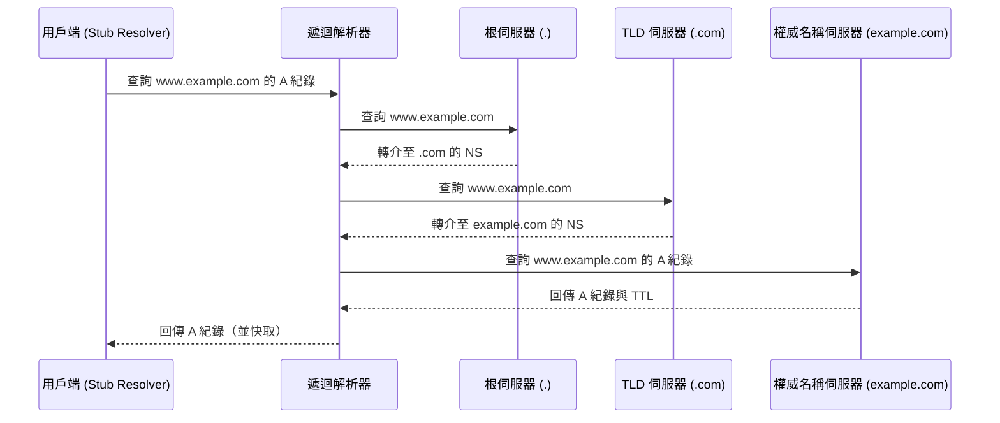
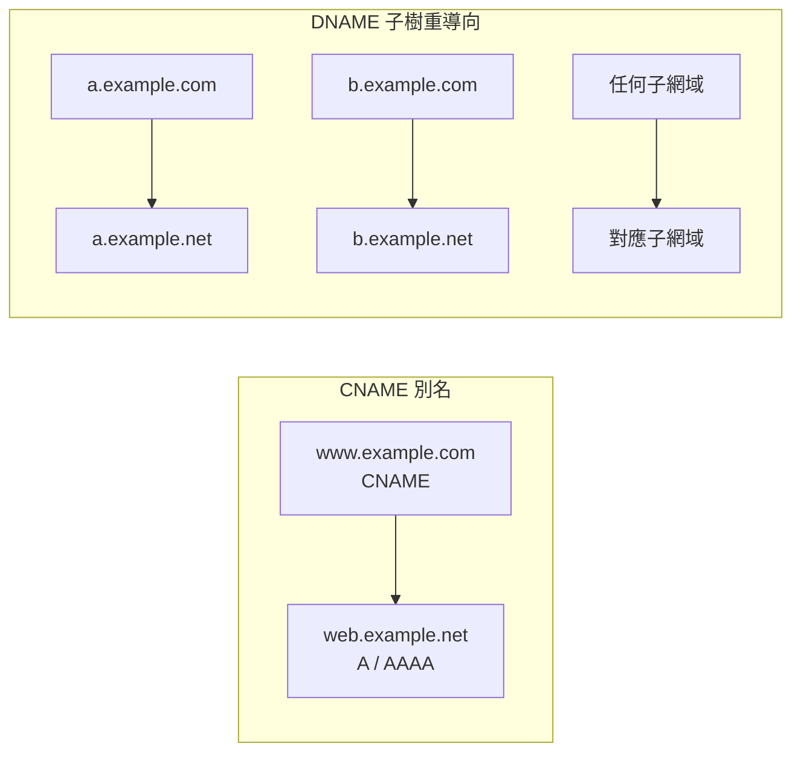
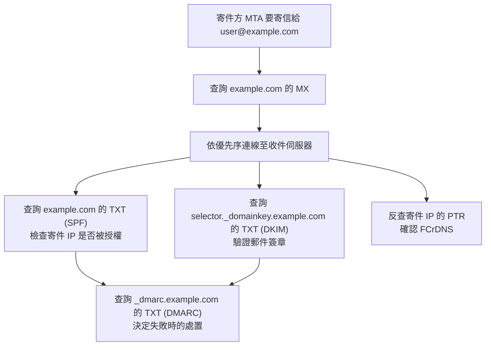
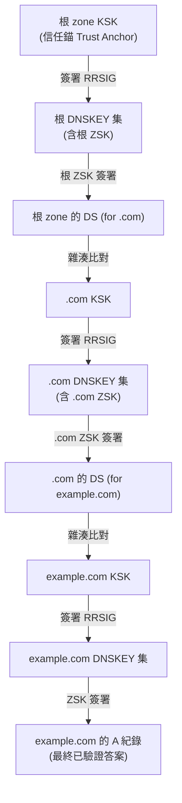

# DNS Record 的種類與意義

## 摘要

DNS（Domain Name System，網域名稱系統）是網際網路將「人類可讀的名稱」對應到「機器可讀的位址與服務資訊」的分散式資料庫。這個資料庫的最小單位是「資源紀錄」（Resource Record，簡稱 RR），每一筆紀錄都由若干欄位構成，並以一個「型別代碼」（TYPE code）標示其用途[^rfc1034]。本文整理 DNS 紀錄的主要型別、每一種型別代表什麼意思、其資料欄位、以及常見用途；同時說明幾個容易誤解的限制（例如 CNAME 不能與其他紀錄並存、不能放在 zone apex），並在附錄列出 IANA 官方註冊表的完整型別清單。

本文以 IETF 的 RFC 標準文件與 IANA 官方註冊表為主要來源，輔以維基百科與 ICANN、Let's Encrypt 等機構的說明文件。所有事實均標註來源。

## 一、先理解脈絡：Zone、TTL、快取與伺服器角色

在逐一介紹紀錄型別前，必須先理解幾個基礎觀念，否則難以理解某些型別為何存在。

### 1.1 Zone（區域）

DNS 的命名空間是一棵樹狀結構，這個資料庫被切分成若干「zone（區域）」，由不同的名稱伺服器分別負責[^rfc1034]。Zone 是「由單一管理權威所控制的連續命名空間區段」；一旦某個組織控制了自己的 zone，就可以單方面修改其中的資料、新增子樹、刪除節點，或把新的子 zone 委派出去[^rfc1034]。一個 zone 通常包含四大部分：該 zone 內所有節點的權威資料、定義 zone 頂端節點的資料（含 SOA 與 NS）、描述被委派子 zone 的資料，以及指向子 zone 內名稱伺服器的 glue（黏合）資料[^rfc1034]。

### 1.2 TTL（存活時間）

每一筆 RR 都帶有一個 TTL 欄位。TTL 是一個 32 位元整數，單位為秒，主要供 resolver（解析器）在快取 RR 時使用，描述「這筆紀錄可被快取多久才應被丟棄」[^rfc1034]。TTL 由資料來源 zone 的管理者指定；較短的 TTL 可降低快取效果，TTL 為零則禁止快取，但實務上典型主機常使用多天的 TTL[^rfc1034]。

### 1.3 快取與解析器

Resolver 的核心目標之一，是「藉由其先前結果的快取，消除大多數請求的網路延遲與名稱伺服器負載」[^rfc1034]。當快取中已有資料時，會被視為「足夠良好」而直接回覆；但「權威資料永遠優先於快取資料」[^rfc1034]。DNS 也提供選擇性的「負向快取」（negative caching），讓名稱伺服器能搭配 TTL 散布「此名稱不存在」的結果[^rfc1034]。

### 1.4 伺服器角色：Root、TLD、權威與遞迴

- **Root name servers（根伺服器）**：位於命名樹最頂端（`.` 這個 zone），知道每個頂級網域（TLD）由哪些名稱伺服器負責；「根伺服器將提供通往整個網域空間的途徑」[^rfc1034]。
- **TLD servers（頂級網域伺服器）**：如 `.com`、`.org` 的權威名稱伺服器，由根 zone 以 NS 紀錄委派而來[^rfc1034]。
- **Authoritative nameservers（權威名稱伺服器）**：對某段命名空間持有完整、本地設定的資料，被稱為該區域的「權威」；名稱伺服器的「本質任務就是用其 zone 中的資料回答查詢」[^rfc1034]。
- **Recursive resolvers（遞迴解析器）**：代表使用者端程式介接名稱伺服器，在遞迴模式下「扮演解析器的角色，回傳錯誤或答案，但永不回傳轉介（referral）」[^rfc1034]。

下圖描繪一次典型的遞迴解析流程：

*圖一：DNS 遞迴解析的轉介鏈，依 RFC 1034 的概念繪製[^rfc1034]。*

## 二、核心紀錄型別

以下依型別逐一說明。型別代碼與命名引用自 IANA 的 DNS Parameters 註冊表[^iana]，欄位定義引用自各 RFC。

### 2.1 A（位址紀錄，Type 1）

- **意義**：主機位址（a host address）[^iana]。
- **內容**：一個 32 位元的 IPv4 位址[^wiki-rr]。
- **用途**：最常見的是把主機名稱對應到其 IPv4 位址；此外也用於 DNSBL（黑名單）與存放子網遮罩等[^wiki-rr]。
- **標準**：RFC 1035[^rfc1035]。

### 2.2 AAAA（IPv6 位址紀錄，Type 28）

- **意義**：IP6 Address[^iana]。
- **內容**：一個 128 位元的 IPv6 位址[^wiki-rr]。
- **用途**：把主機名稱對應到其 IPv6 位址，是 A 紀錄的 IPv6 對應版本[^wiki-rr]。
- **標準**：RFC 3596[^rfc3596]。

### 2.3 NS（名稱伺服器紀錄，Type 2）

- **意義**：一個權威名稱伺服器（an authoritative name server）[^iana]。
- **內容**：一個權威名稱伺服器的主機名稱[^wiki-rr]。
- **用途**：把某個 zone 委派給一組權威名稱伺服器。它同時用在兩種位置：zone 頂端（宣告該 zone 自身有哪些 NS），以及在委派點（指向子 zone 的伺服器）[^rfc1034]。
- **重要規則**：NS 的目標「不得為別名（CNAME）」[^rfc2181]。
- **標準**：RFC 1035[^rfc1035]。

### 2.4 SOA（起始授權紀錄，Type 6）

- **意義**：標示一個授權區域的開始（marks the start of a zone of authority）[^iana]。
- **內容**：包含七個欄位[^rfc1035]：

| 欄位 | 意義 | 作用 |
|---|---|---|
| MNAME | 該 zone 原始或主要資料來源的名稱伺服器[^rfc1035] | 次要伺服器向它發起 zone transfer（AXFR/IXFR）前，先向此伺服器進行 refresh[^rfc1035] |
| RNAME | 負責此 zone 之管理者的信箱，以網域名稱編碼[^rfc1035] | 純粹行政與資訊用途[^rfc1035] |
| SERIAL | 該 zone 原始副本的 32 位元版本號，zone 傳輸會保留此值，採序號空間算術比較[^rfc1035] | 次要伺服器比較本地與主伺服器的 SERIAL，較大者即觸發 zone transfer[^rfc1035] |
| REFRESH | 應重新整理 zone 的 32 位元時間間隔[^rfc1035] | 次要伺服器兩次向主伺服器檢查更新的間隔[^rfc1035] |
| RETRY | 失敗的更新應重試前須經過的 32 位元時間間隔[^rfc1035] | refresh 失敗後等待多久再試[^rfc1035] |
| EXPIRE | 可經過多久而 zone 不再具權威性的 32 位元時間上限[^rfc1035] | 次要伺服器超過此期限仍未成功更新，即不再具權威性地回答該 zone[^rfc1035] |
| MINIMUM | 原始定義為從該 zone 輸出的 RR 應套用的最小 TTL；RFC 2308 重新定義為負向回應的快取 TTL[^rfc2308] | 決定解析器可快取 NXDOMAIN 或 NODATA 多久[^rfc2308] |

- **補充**：每個 zone 恰有一個 SOA，位於其頂端節點[^rfc1034]。RFC 2308 指出，MINIMUM 欄位的「最小 TTL」舊義「從未被實際採用，故予以廢止」，現行唯一保留的意義是「用於負向回應的 TTL」[^rfc2308]。
- **標準**：RFC 1035[^rfc1035]，MINIMUM 語意由 RFC 2308 修訂[^rfc2308]。

### 2.5 CNAME（正式名稱／別名紀錄，Type 5）

- **意義**：別名所對應的正式名稱（the canonical name for an alias）[^iana]。
- **內容**：一個正式名稱（alias 的目標網域名稱）[^wiki-rr]。
- **用途**：建立從一個名稱指向另一個名稱的別名；解析器會用新名稱重試查詢[^wiki-rr]。RFC 2181 規定「任何一個別名只能有一個正式名稱」[^rfc2181]。
- **重要限制**：CNAME 不能與同一名稱下的其他紀錄並存。RFC 2181 指出，一個別名名稱「若使用 DNSSEC，可以有 SIG、NXT、KEY 紀錄，但不得有其他資料」；且任一標籤（網域名稱）在 DNS 中恰好處於下列四種互斥狀態之一：存在一筆 CNAME（選擇性伴隨 SIG、NXT、KEY）、存在一或多筆非 CNAME 的紀錄、名稱存在但無任何 RR、名稱完全不存在[^rfc2181]。
- **標準**：RFC 1035[^rfc1035]。

### 2.6 DNAME（委派名稱紀錄，Type 39）

- **意義**：DNAME[^iana]。
- **內容**：一個目標網域名稱[^rfc6672]。
- **用途**：為「整個子樹」提供重導向，凡是以某字尾結尾的所有名稱，都被重導向到 DNS 的另一部分[^rfc6672]。例如 owner 為 `example.com.`、目標 `example.net.` 時，`a.example.com.` 會被改寫為 `a.example.net.`[^rfc6672]。
- **與 CNAME 差異**：CNAME 只把「其 owner 的資料查詢」導向另一個單一名稱；DNAME 則把「其 owner 子孫的名稱查詢」導向樹中另一節點下的對應名稱；「DNAME 的 owner 名稱本身不會被重導向」[^rfc6672]。
- **限制**：DNAME 的任一子網域「不得存在任何資源紀錄」，否則那些名稱會被遮蔽（occluded）[^rfc6672]；一個 owner 只能有一筆 DNAME，且該名稱不得有 CNAME[^rfc6672]。
- **標準**：RFC 6672[^rfc6672]。

*圖二：CNAME 只重導向單一名稱，DNAME 重導向整個子樹[^rfc6672]。*

### 2.7 MX（郵件交換紀錄，Type 15）

- **意義**：mail exchange[^iana]。
- **內容**：清單，每筆包含一個偏好值（preference／priority）與一部郵件伺服器的主機名稱；「較小的數值優先」[^cf-mx]。MX 的目標「必須直接指向 A 或 AAAA 紀錄，指向 CNAME 為 RFC 2181 所禁止」[^cf-mx]。
- **用途**：指定代表某網域接收電子郵件的伺服器，以及嘗試順序[^rfc1035]。寄件方的 MTA 查詢收件網域的 MX，按優先序（由小到大）排序後依序嘗試連線；這提供備援、容錯與負載平衡[^cf-mx]。
- **Null MX**：RFC 7505 定義了一種特殊 MX，用來宣告某網域「完全不收信」。它只有單一筆 MX，偏好值為 `0`、交換目標為 `.`（單一點，非合法主機名稱）；「由於 '.' 不是合法主機名稱，null MX 不會與一般 MX 混淆」[^rfc7505]。此設計可讓寄件方立即收到失敗，避免其退回 A/AAAA 嘗試投遞而浪費資源[^cf-mx]。
- **標準**：RFC 1035[^rfc1035]，Null MX 由 RFC 7505 定義[^rfc7505]。

### 2.8 TXT（文字紀錄，Type 16）

- **意義**：文字字串（text strings）[^iana]。
- **內容**：任意文字字串[^wiki-rr]。
- **用途**：原本供人類可讀文字之用；自 1990 年代起，主要用於攜帶給機器讀取的資料，例如 SPF、DKIM、DMARC、DNS-SD 等協定，是最具彈性、被最廣泛再利用的型別[^wiki-rr]。
- **標準**：RFC 1035[^rfc1035]。

### 2.9 PTR（指標紀錄，Type 12）

- **意義**：網域名稱指標（a domain name pointer）[^iana]。
- **內容**：一個正式網域名稱[^wiki-rr]。
- **用途**：從名稱（通常是反解 zone 中由 IP 衍生的名稱）指向正式主機名稱，最常見於「反向 DNS 查詢」（reverse DNS），即把 IP 位址反查回主機名稱。「與 CNAME 不同，DNS 處理在 PTR 之後就停止，只回傳該名稱」[^wiki-rr]。
- **反解 zone 結構**：整個網際網路的反解資料庫根植於 `.arpa` 頂級網域[^rdns]。IPv4 使用 `in-addr.arpa`：把位址切成四個 octet 後反轉順序再接上此字尾，例如 `192.168.10.2` 記為 `2.10.168.192.in-addr.arpa`[^rdns]。IPv6 使用 `ip6.arpa`：以十六進位 nibble 反序排列[^rdns]。
- **常見用途**：反垃圾郵件（收件伺服器檢查寄件 IP 的 PTR 是否與寄件網域相符）、DNSBL（以反解機制查詢 IP 是否在黑名單）、系統記錄與監控、網路疑難排解[^rdns]。
- **標準**：RFC 1035[^rfc1035]。

### 2.10 SRV（服務定位紀錄，Type 33）

- **意義**：Server Selection[^iana]。
- **內容與格式**：`_Service._Proto.Name TTL Class SRV Priority Weight Port Target`[^rfc2782]。各欄位定義如下[^rfc2782]：
  - **Service**：所需服務的象徵名稱，前置一個底線（`_`）以避免與自然出現的 DNS 標籤碰撞。
  - **Proto**：所需協定的象徵名稱，同樣前置底線，`_TCP`、`_UDP` 為目前最有用的值。
  - **Priority**：目標主機的優先序，「用戶端必須嘗試連線其所能觸及的最低編號優先序主機」，範圍 0–65535。
  - **Weight**：伺服器選擇機制；「權重為同優先序項目指定相對權重，較大權重應被賦予比例上較高的被選機率」，範圍 0–65535。
  - **Port**：該服務在目標主機上的埠號，範圍 0–65535。
  - **Target**：目標主機的網域名稱，「該名稱必須有一或多筆位址紀錄，且不得為別名」；目標為 `.` 表示該服務在此網域「明確地不存在」。
- **用途**：讓用戶端動態探索提供某服務的伺服器及埠號，例如 SIP、XMPP、Minecraft、Active Directory（網域控制站藉此註冊服務）等[^wiki-srv]。
- **權重負載平衡**：僅在同一優先序之間生效。RFC 2782 的演算法為：將權重為 0 的排在最前，其餘任意排序，計算權重總和並為每筆累加執行和，取一個 0 到總和（含）之間的均勻隨機數，選中累加和第一個大於等於該隨機數者[^rfc2782]。這是「靜態」而非動態的伺服器選擇，「權重僅供靜態使用；若用於動態選擇需搭配不合理的短 TTL，會限縮 DNS 快取的效益」[^rfc2782]。
- **標準**：RFC 2782[^rfc2782]。

### 2.11 CAA（憑證授權機構授權紀錄，Type 257）

- **意義**：Certification Authority Restriction[^iana]。
- **內容與格式**：`CAA <flags> <tag> <value>`[^le-caa]：
  - **Flags**：`0` 為未設旗標（絕大多數情況），`128` 為「critical bit」，一旦設定，CA「必須」理解該 tag 的內容，否則「必須拒絕」簽發[^le-caa]。
  - **Tag**：常見有 `issue`（控制該網域及其子網域能否由某 CA 簽發憑證，含萬用字元，除非被 `issuewild` 覆寫）、`issuewild`（專門控制萬用字元憑證的簽發）、`iodef`（指定 CA 回報政策違規或不合規簽發嘗試的 URI）[^le-caa]。
  - **Value**：CA 的識別網域名稱，另可附帶分號分隔的參數，例如 `validationmethods`（限制驗證方法）、`accounturi`（限制特定 ACME 帳號）[^le-caa]。
- **用途**：讓網域擁有者指定「哪些 CA 有權為其網域簽發 TLS/SSL 憑證」。預設上任何公開 CA 都能為任何網域簽發；CAA 收斂了這個巨大的信任面，若某 CA 的驗證流程有漏洞，CAA 可阻止它為你的網域簽發[^le-caa]。
- **CA 的檢查流程**：每次簽發前，CA 從被請求的確切名稱開始查詢 CAA；若該層無紀錄，則沿網域樹向上逐層檢查，停在第一個找到的 CAA 紀錄[^le-caa]。若查詢發生錯誤（SERVFAIL、逾時），CA 因無法確認是否存在禁止紀錄，故「不得簽發」[^le-caa]。
- **標準**：RFC 8659[^rfc8659]（取代 RFC 6844）[^iana]。

### 2.12 SVCB 與 HTTPS（服務綁定紀錄，Type 64／65）

- **意義**：SVCB 為 General-purpose service binding；HTTPS 為 SVCB-compatible type for use with HTTP[^iana]。
- **內容**：兩個必填欄位與一個選填欄位[^rfc9460]：
  - **SvcPriority**：此紀錄相對於其他紀錄的優先序，數值越小越優先；值為 0 表示 **AliasMode**，否則為 **ServiceMode**[^rfc9460]。
  - **TargetName**：AliasMode 時為別名目標，ServiceMode 時為替代端點；單一 `.` 有特殊意義（AliasMode 表示服務不可用；ServiceMode 表示使用 owner 名稱）[^rfc9460]。
  - **SvcParams**（選填）：描述替代端點的 key=value 清單（僅 ServiceMode 使用）；已註冊的鍵包含 `mandatory`、`alpn`、`no-default-alpn`、`port`、`ipv4hint`、`ech`（保留給 Encrypted ClientHello）、`ipv6hint`[^rfc9460]。
- **兩種模式**：
  - **AliasMode（優先序 0）**：把服務別名到 TargetName，主要目的是「在 zone apex 進行別名，因為 CNAME 在此不被允許」；「與 CNAME 不同，AliasMode 紀錄不影響其他 RR 型別的解析，且只適用於特定服務，而非整個網域名稱」[^rfc9460]。
  - **ServiceMode（優先序大於 0）**：把服務的替代端點與其連線參數關聯起來[^rfc9460]。
- **用途**：一次 DNS 查詢就提供存取服務的完整指引，達成「改善效能與隱私」（避免先連到次佳的預設伺服器、協商偏好協定、提供相關公鑰）[^rfc9460]。其中 `ech` 參數可傳遞加密 ClientHello 金鑰，`ipv4hint` 與 `ipv6hint` 則可省去額外的 A/AAAA 查詢往返[^rfc9460]。
- **標準**：RFC 9460[^rfc9460]。

## 三、電子郵件相關紀錄

郵件安全建立在多種 DNS 紀錄的組合之上。以下說明 MX、SPF、DKIM、DMARC 與 PTR 的協作。

- **MX**：路由郵件至正確的收件伺服器（見 2.7）[^cf-mx]。
- **SPF（以 TXT 發布）**：讓網域擁有者指定「哪些電腦被授權以此網域的 envelope-from 位址寄信」[^wiki-spf]。政策字串以 `v=spf1` 開頭，後接機制與限定詞；限定詞包含 `+`（PASS，預設）、`?`（NEUTRAL）、`~`（SOFTFAIL）、`-`（FAIL）[^wiki-spf]。收件伺服器檢查 SPF，以驗證寄件伺服器是否有權代表該網域寄信[^wiki-spf]。
- **DKIM（以 TXT 發布）**：以密碼學方式簽署外寄郵件。寄件伺服器以私鑰簽署每封郵件，收件伺服器從 DNS 的 TXT 紀錄取得對應公鑰以驗證簽章，證明郵件確實來自所宣稱的網域且未被竄改[^wiki-dkim]。公鑰發布於 `selector._domainkey.example.com`，以 tag=value 格式呈現（如 `v`、`k`、`p`、`s`、`t`）[^wiki-dkim]。
- **DMARC（以 TXT 發布，位於 `_dmarc.example.com`）**：告訴收件伺服器當郵件未通過 SPF 及／或 DKIM 時該如何處理，並要求「對齊（alignment）」，即 `From:` 標頭中的網域必須與經 SPF 或 DKIM 驗證的網域相符[^wiki-dmarc]。主要欄位包含 `v`、`p`（none／quarantine／reject）、`sp`、`pct`、`rua`、`ruf` 等[^wiki-dmarc]。
- **PTR**：供反垃圾郵件驗證，許多郵件伺服器會檢查寄件 IP 的 PTR 是否與其 HELO/EHLO 主機名稱相符（即 FCrDNS，forward-confirmed reverse DNS）[^rdns]。
- **TLSA**：可將 TLS 憑證綁定到網域，使 SMTP 加密可被驗證（見 5.3）[^wiki-dane]。

*圖三：寄信時多種 DNS 紀錄的協作關係[^cf-mx][^wiki-spf][^wiki-dkim][^wiki-dmarc][^rdns]。*

## 四、DNSSEC 家族

DNSSEC（Domain Name System Security Extensions）以公開金鑰密碼學為 DNS 加入數位簽章。ICANN 指出：「有了 DNSSEC，被密碼學簽署的並非 DNS 查詢與回應本身，而是 DNS 資料由資料擁有者簽署」[^icann]。以下介紹主要 DNSSEC 紀錄。

### 4.1 DNSKEY（Type 48）

- **內容**：flags、protocol（有效 DNSSEC 中恆為 3）、algorithm、公開金鑰資料[^icann]。
- **用途**：zone 發布其作用中簽章金鑰的公鑰部分，供遞迴解析器取回以驗證該 zone 的資料[^icann]。flags 為 256 者為 Zone-Signing Key（ZSK），257 者為 Key-Signing Key（KSK）或 Combined Signing Key（CSK），257 帶有 SEP（Secure Entry Point）位元[^icann]。
- **標準**：RFC 4034[^rfc4034]。

### 4.2 RRSIG（Type 46）

- **內容**：被簽署的型別、演算法、labels、原始 TTL、簽章到期與起始時間、key tag、簽署者名稱、簽章值[^icann]。
- **用途**：對某一組資源紀錄集（RRset）提供密碼學簽章，證明其完整性與來源真實性；「資料來源驗證讓解析器能以密碼學方式驗證其收到的資料確實來自它相信的來源 zone，完整性保護則讓解析器得知資料自簽署後未在傳輸中被修改」[^icann]。
- **標準**：RFC 4034[^rfc4034]。

### 4.3 DS（Delegation Signer，Type 43）

- **內容**：key tag、algorithm、digest type（如 2 為 SHA-256、4 為 SHA-384）、子 zone KSK 的雜湊摘要[^icann]。
- **用途**：**位於父 zone**，是串接子 zone 進入全球信任鏈的關鍵樞紐。「zone 的公鑰就如同 zone 中其他資料一樣被簽署，但它不是由該 zone 的私鑰簽署，而是由父 zone 的私鑰簽署——父 zone 為其子 zone 公鑰的真實性背書」[^icann]。
- **標準**：RFC 4034[^rfc4034]。

### 4.4 NSEC（Type 47）與 NSEC3（Type 50）

- **內容（NSEC）**：zone 中依正規順序的下一個存在名稱，以及目前名稱存在哪些型別[^icann]。
- **用途**：兩者都提供「已驗證的不存在證明」（authenticated denial of existence）。NSEC 以類似環狀鏈結串列的方式，證明兩個存在的名稱之間不存在任何名稱[^icann]。NSEC3 則在建立鏈之前先對名稱做雜湊，以避免 NSEC 的「zone walking」（公開列舉 zone 內所有名稱）隱私問題[^icann]。
- **標準**：RFC 4034[^rfc4034]、RFC 5155（NSEC3）[^iana]。

### 4.5 CDS（Type 59）與 CDNSKEY（Type 60）

- **意義**：Child DS[^iana]；DNSKEY(s) the Child wants reflected in DS[^iana]。
- **用途**：兩者都位於**子 zone**，用於自動化 DS 更新以支援金鑰輪替[^icann]。CDS 由子 zone 發布，欄位與 DS 相同，父 zone 營運者可據以自動更新對應的 DS[^icann]；CDNSKEY 則發布子 zone 完整的公開 DNSKEY，讓父 zone 可自行推導出 DS 雜湊[^icann]。
- **標準**：RFC 7344[^iana]。

*圖四：DNSSEC 由根 zone 向下的信任鏈，依 ICANN 說明繪製[^icann]。*

若每個簽章都驗證成功並串回信任錨，回應會標上 AD（Authenticated Data）旗標並標示為 SECURE；任一步驟失敗，解析器即「假設遭遇攻擊、捨棄資料並回傳錯誤」（回應為 BOGUS）[^icann]。

## 五、加密金鑰與憑證綁定紀錄

### 5.1 SSHFP（Type 44）

- **意義**：SSH Key Fingerprint[^iana]。
- **用途**：把 SSH 主機公鑰指紋與主機名稱關聯，讓 SSH 用戶端不需依賴首次連線的 TOFU（trust on first use）提示即可驗證伺服器主機金鑰[^wiki-sshfp]。
- **內容**：algorithm、type（雜湊演算法）、指紋[^wiki-sshfp]。
- **與 DNSSEC 關係**：SSHFP 的取得「需以 DNSSEC 之類的機制保護，才能建立信任鏈」[^wiki-sshfp]。它與 DANE 屬平行機制，並非 DANE 本身的一部分[^wiki-dane]。
- **標準**：RFC 4255[^iana]。

### 5.2 OPENPGPKEY（Type 61）與 CERT（Type 37）

- **OPENPGPKEY**：為特定電子郵件位址發布 OpenPGP 公鑰，實現加密郵件的金鑰自動探索；紀錄名稱以「本地部分的 SHA-256 雜湊」加 `._openpgpkey.` 再加網域構成，內容為 base64 編碼的可轉移公鑰[^wiki-dane]。屬 DANE 協定家族（RFC 7929），同樣需要 DNSSEC 以防金鑰被偽造[^wiki-dane]。
- **CERT**：在 DNS 中存放各種形式的數位憑證（PKIX、SPKI、PGP 等）[^wiki-rr]。它是 DANE 的通用型前身與替代方案，但並非 DANE 的一部分；DANE 使用帶有 usage、selector、matching 結構化欄位的 TLSA，而非 CERT[^wiki-dane]。
- **標準**：RFC 7929（OPENPGPKEY）[^wiki-dane]、RFC 4398（CERT）[^iana]。

### 5.3 TLSA（Type 52）

- **用途**：把 TLS 伺服器憑證或公鑰與其所在網域關聯，形成「TLSA certificate association」，讓用戶端無須完全依賴傳統 CA 即可驗證 TLS 伺服器[^wiki-dane]。這是 DANE（DNS-based Authentication of Named Entities）的核心紀錄。
- **內容**：四個欄位[^wiki-dane]：certificate usage（0 至 3）、selector（0 為全憑證、1 為僅公鑰）、matching type（0 為原始、1 為 SHA-256、2 為 SHA-512）、association data（雜湊或憑證資料）。
- **與 DNSSEC 關係**：「DANE 需要以 DNSSEC 簽署 DNS 紀錄，其安全模型方能運作」，否則攻擊者可偽造 TLSA 紀錄並將用戶端導向惡意憑證[^wiki-dane]。
- **標準**：RFC 6698[^iana]。

## 六、服務探索與其他型別

### 6.1 NAPTR（Type 35）

- **意義**：Naming Authority Pointer[^iana]。
- **內容**：六個欄位[^wiki-naptr]：Order（16 位元，較小者先處理）、Preference（同 Order 中較小者優先）、Flags（單一字元，控制重寫的下一步，如 `U` 表示輸出為 URI、`S` 表示輸出為需再查 SRV 的網域名稱）、Services（如 `E2U+sip`）、Regexp（sed 風格取代式）、Replacement（用於取代 regexp 的網域名稱）[^wiki-naptr]。
- **用途**：以正規表達式對網域名稱做重寫，可解析為 URI 或進一步查詢的名稱；最著名的是 ENUM（E.164 電話號碼對 URI 的對應）與 SIP 路由[^wiki-naptr]。電話號碼反轉後以點分隔並加上 `e164.arpa` 字尾，例如 `+1 555 42 42` 轉為 `2.4.2.4.5.5.5.1.e164.arpa`[^wiki-enum]。
- **標準**：RFC 3403[^iana]。

### 6.2 URI（Type 256）

- **用途**：發布主機名稱到 URI 的對應；欄位包含 priority、weight、target（URI 本身）[^wiki-rr]。常與 U-NAPTR 搭配，用於服務探索結果需為 URI 而非網域名稱的情境[^wiki-rr]。
- **標準**：RFC 7553[^iana]。

### 6.3 HINFO（Type 13）

- **用途**：原定義為提供主機的 CPU 型別與作業系統資訊，實務上鮮少用於此目的[^wiki-rr]。RFC 8482 將其再利用為 ANY 查詢的最小化替代回應，以緩解 DNS 放大攻擊[^wiki-rr]。
- **標準**：RFC 1035[^rfc1035]，再利用於 RFC 8482[^iana]。

### 6.4 LOC（Type 29）

- **用途**：以 WGS84 座標表達與某網域名稱相關的地理位置，欄位包含經緯度（度分秒）、海拔、以及主機或子網的實體大小與精度[^wiki-rr]。因隱私顧慮而鮮少使用[^wiki-rr]。
- **標準**：RFC 1876[^iana]。

### 6.5 其他較新或特殊型別

- **DELEG（Type 61440，暫時註冊）**：傳統 NS 加 glue 委派的可擴充替代方案，借用 SVCB 格式編碼名稱伺服器名稱、其 IP（ipv4hint／ipv6hint）、傳輸協定（如 `alpn=dot`）等；因位於父 zone 而可被 DNSSEC 簽署，實現簽署過的轉介；並支援類似 CNAME 的 Alias Mode[^deleg-ref]。
- **DSYNC（Type 66）**：用於探索委派同步通知訊息的接收端點，當子 zone 的委派資訊（NS、DS、DNSSEC bootstrap 資料）變更時，父 zone 可據以發送通知[^deleg-ref]。
- **RESINFO（Type 261）**：讓遞迴解析器以結構化 key/value 對發布其能力與政策，例如是否啟用 QNAME minimization（`qnamemin`）、支援哪些 Extended DNS Error 代碼（`exterr`）、人可讀資訊的 URL（`infourl`）等[^deleg-ref]。
- **WALLET（Type 262）**：把網域名稱對應到加密貨幣與公開錢包位址，目標是「減輕 TXT 紀錄被超載使用」的情形[^deleg-ref]。
- **HHIT（Type 67）與 BRID（Type 68）**：與無人機（UAS）遠端識別相關。HHIT 為階層式主機識別標籤，作為可信任的識別碼；BRID 則存放廣播遠端識別資訊[^deleg-ref]。
- **SPF（Type 99）**：曾為 SPF 專用的紀錄型別，但 RFC 7208 因普遍缺乏支援而「停止使用該型別」，SPF 資料現應完全以 TXT 紀錄發布[^wiki-spf]。
- **NID／L32／L64／LP（Type 104 至 107）**：ILNP（Identifier-Locator Network Protocol）相關紀錄，分別對應節點識別碼、32 位元定位器、64 位元定位器及定位器指標[^iana]。

## 七、易誤解的重要規則

### 7.1 CNAME 不得與其他紀錄並存

如 2.5 所述，一個名稱若存在 CNAME，則不得有其他型別（RFC 2181 下的例外為 DNSSEC 的 SIG、NXT、KEY）[^rfc2181]。RFC 1034 亦規定「若某節點存在 CNAME，則不應存在其他資料；這確保正式名稱與其別名的資料不會不同」[^cname-wiki]。

### 7.2 CNAME 不得放在 zone apex

Zone apex（例如 `example.com`）是 zone 中唯一「必須」攜帶運作所需紀錄（SOA、NS，若處理郵件則還有 MX）的位置。若在 apex 放 CNAME，上述關鍵紀錄都會被覆寫，使 zone 損壞且無法解析[^cname-wiki]。嚴格的名稱伺服器（如 BIND 9）會直接拒絕載入該 zone；寬鬆的管理面板可能允許儲存，但結果是郵件投遞失敗、解析時好時壞、或網域實質上無法解析[^cname-wiki]。

### 7.3 MX 與 NS 不得指向 CNAME

RFC 2181 明文規定 MX 與 NS 紀錄「絕不可指向 CNAME 別名」[^cname-wiki]。RFC 2181 解釋：額外區段處理不包括 CNAME 紀錄，因此若在 NS 或 MX 值中使用別名，就無法同時回傳其位址紀錄，導致額外查詢甚至失敗[^rfc2181]。

### 7.4 因應方案：CNAME Flattening、ALIAS、ANAME 與 SVCB

- **CNAME Flattening（Cloudflare）**：在儀表板於 apex 建立 CNAME，但對外「不」以 CNAME 形式提供，而是由供應商在伺服器端追隨目標、解析為 A/AAAA 後直接回傳 IP[^cname-wiki]。
- **ALIAS（Amazon Route 53）**：專有紀錄，把 apex 指向 AWS 資源或其他 Route 53 紀錄，內部解析後以目標位址回應[^cname-wiki]。
- **ANAME（NS1 等）**：更通用的 apex 別名，可指向任意外部主機名稱；曾有 IETF 草案但未達共識，已被 RFC 9460（SVCB／HTTPS）取代[^cname-wiki]。
- **SVCB／HTTPS AliasMode**：RFC 9460 標準化的 apex 別名途徑（見 2.12）[^rfc9460]。
- 上述方案共同的取捨：供應商快取解析結果造成的新鮮度落差、依供應商解析器位置決定回應位址（可能把使用者導向非最佳節點）、非標準線格式導致可攜性差[^cname-wiki]。

## 八、附錄：IANA 註冊 RR TYPE 清單節錄

下表整理 IANA 註冊的 RR 型別（涵蓋已指派、已廢止與保留者）[^iana]。未列出的數值區間為未指派。

| TYPE 名稱 | 值 | 意義 | 參考 |
|---|---|---|---|
| A | 1 | a host address | RFC 1035 |
| NS | 2 | an authoritative name server | RFC 1035 |
| MD | 3 | a mail destination（已廢，改用 MX） | RFC 1035 |
| MF | 4 | a mail forwarder（已廢，改用 MX） | RFC 1035 |
| CNAME | 5 | the canonical name for an alias | RFC 1035 |
| SOA | 6 | marks the start of a zone of authority | RFC 1035 |
| MB | 7 | a mailbox domain name（實驗性） | RFC 1035 |
| MG | 8 | a mail group member（實驗性） | RFC 1035 |
| MR | 9 | a mail rename domain name（實驗性） | RFC 1035 |
| NULL | 10 | a null RR（實驗性） | RFC 1035 |
| WKS | 11 | a well known service description | RFC 1035 |
| PTR | 12 | a domain name pointer | RFC 1035 |
| HINFO | 13 | host information | RFC 1035 |
| MINFO | 14 | mailbox or mail list information | RFC 1035 |
| MX | 15 | mail exchange | RFC 1035 |
| TXT | 16 | text strings | RFC 1035 |
| RP | 17 | for Responsible Person | RFC 1183 |
| AFSDB | 18 | for AFS Data Base location | RFC 1183, 5864 |
| X25 | 19 | for X.25 PSDN address | RFC 1183 |
| ISDN | 20 | for ISDN address | RFC 1183 |
| RT | 21 | for Route Through | RFC 1183 |
| NSAP | 22 | NSAP 位址（已廢止） | RFC 1706 |
| NSAP-PTR | 23 | NSAP 形式的名稱指標（已廢止） | RFC 1706 |
| SIG | 24 | for security signature | RFC 2536, 2931, 3110, 4034 |
| KEY | 25 | for security key | RFC 2536, 2539, 3110, 4034 |
| PX | 26 | X.400 mail mapping information | RFC 2163 |
| GPOS | 27 | Geographical Position | RFC 1712 |
| AAAA | 28 | IP6 Address | RFC 3596 |
| LOC | 29 | Location Information | RFC 1876 |
| NXT | 30 | Next Domain（已廢止） | RFC 2535, 3755 |
| EID | 31 | Endpoint Identifier | Michael_Patton |
| NIMLOC | 32 | Nimrod Locator | Michael_Patton |
| SRV | 33 | Server Selection | RFC 2782 |
| ATMA | 34 | ATM Address | ATM Forum AF-DANS-0152.000 |
| NAPTR | 35 | Naming Authority Pointer | RFC 3403 |
| KX | 36 | Key Exchanger | RFC 2230 |
| CERT | 37 | CERT | RFC 4398 |
| A6 | 38 | A6（已廢，改用 AAAA） | RFC 2874, 3226, 6563 |
| DNAME | 39 | DNAME | RFC 6672 |
| SINK | 40 | SINK | Donald_E_Eastlake |
| OPT | 41 | OPT | RFC 3225, 6891 |
| APL | 42 | APL | RFC 3123 |
| DS | 43 | Delegation Signer | RFC 4034 |
| SSHFP | 44 | SSH Key Fingerprint | RFC 4255 |
| IPSECKEY | 45 | IPSECKEY | RFC 4025 |
| RRSIG | 46 | RRSIG | RFC 4034 |
| NSEC | 47 | NSEC | RFC 4034, 9077 |
| DNSKEY | 48 | DNSKEY | RFC 4034 |
| DHCID | 49 | DHCID | RFC 4701 |
| NSEC3 | 50 | NSEC3 | RFC 5155, 9077 |
| NSEC3PARAM | 51 | NSEC3PARAM | RFC 5155 |
| TLSA | 52 | TLSA | RFC 6698 |
| SMIMEA | 53 | S/MIME cert association | RFC 8162 |
| DELEGPARAM | 54 | Extensible Delegation Indirection（暫時註冊） | draft-ietf-deleg-12 |
| HIP | 55 | Host Identity Protocol | RFC 8005 |
| NINFO | 56 | NINFO | Jim_Reid |
| RKEY | 57 | RKEY | Jim_Reid |
| TALINK | 58 | Trust Anchor LINK | Wouter_Wijngaards |
| CDS | 59 | Child DS | RFC 7344 |
| CDNSKEY | 60 | DNSKEY(s) the Child wants reflected in DS | RFC 7344 |
| OPENPGPKEY | 61 | OpenPGP Key | RFC 7929 |
| CSYNC | 62 | Child-To-Parent Synchronization | RFC 7477 |
| ZONEMD | 63 | Message Digest Over Zone Data | RFC 8976 |
| SVCB | 64 | General-purpose service binding | RFC 9460 |
| HTTPS | 65 | SVCB-compatible type for use with HTTP | RFC 9460 |
| DSYNC | 66 | Endpoint discovery for delegation synchronization | RFC 9859 |
| HHIT | 67 | Hierarchical Host Identity Tag | RFC 9886 |
| BRID | 68 | UAS Broadcast Remote Identification | RFC 9886 |
| UNECE | 69 | Value coded per a UNECE Recommendation | draft-woodcock-faltstrom-external-registry-rrtypes-00 |
| ISO | 70 | Value coded per an ISO standard | draft-woodcock-faltstrom-external-registry-rrtypes-00 |
| SPF | 99 | （註冊表中意義欄為空） | RFC 7208 |
| UINFO | 100 | （IANA 保留） | IANA-Reserved |
| UID | 101 | （IANA 保留） | IANA-Reserved |
| GID | 102 | （IANA 保留） | IANA-Reserved |
| UNSPEC | 103 | （IANA 保留） | IANA-Reserved |
| NID | 104 | （ILNP 節點識別碼） | RFC 6742 |
| L32 | 105 | （ILNP 32 位元定位器） | RFC 6742 |
| L64 | 106 | （ILNP 64 位元定位器） | RFC 6742 |
| LP | 107 | （ILNP 定位器指標） | RFC 6742 |
| EUI48 | 108 | an EUI-48 address | RFC 7043 |
| EUI64 | 109 | an EUI-64 address | RFC 7043 |
| NXNAME | 128 | NXDOMAIN indicator for Compact Denial of Existence | RFC 9824 |
| TKEY | 249 | Transaction Key | RFC 2930 |
| TSIG | 250 | Transaction Signature | RFC 8945 |
| IXFR | 251 | incremental transfer | RFC 1995 |
| AXFR | 252 | transfer of an entire zone | RFC 1035, 5936 |
| MAILB | 253 | mailbox-related RRs (MB, MG or MR) | RFC 1035 |
| MAILA | 254 | mail agent RRs（已廢，見 MX） | RFC 1035 |
| *（ANY） | 255 | 請求伺服器所擁有之部分或全部紀錄 | RFC 1035, 6895, 8482 |
| URI | 256 | URI | RFC 7553 |
| CAA | 257 | Certification Authority Restriction | RFC 8659 |
| AVC | 258 | Application Visibility and Control | Wolfgang_Riedel |
| DOA | 259 | Digital Object Architecture | draft-durand-doa-over-dns-02 |
| AMTRELAY | 260 | Automatic Multicast Tunneling Relay | RFC 8777 |
| RESINFO | 261 | Resolver Information as Key/Value Pairs | RFC 9606 |
| WALLET | 262 | Public wallet address | Paul_Hoffman |
| CLA | 263 | BP Convergence Layer Adapter | draft-johnson-dns-ipn-cla-07 |
| IPN | 264 | BP Node Number | draft-johnson-dns-ipn-cla-07 |
| TA | 32768 | DNSSEC Trust Authorities | Sam_Weiler |
| DLV | 32769 | DNSSEC Lookaside Validation（已廢止） | RFC 8749, 4431 |
| DELEG | 61440 | Extensible Delegation（暫時註冊） | draft-ietf-deleg-12 |

*表二：IANA DNS RR TYPE 註冊表節錄整理[^iana]。*

### 8.1 型別代碼的區間與註冊程序

IANA 對 RRTYPE 的數值區間有以下規範[^iana]：

| 區間 | 註冊程序 |
|---|---|
| 0 | 保留（RRTYPE 零作為 SIG RR 的特殊指示用） |
| 1 至 127 | Expert Review 或 Standards Action（資料型） |
| 128 至 255 | Expert Review 或 Standards Action（Q TYPE、Meta TYPE） |
| 256 至 61439 | Expert Review 或 Standards Action（資料 RRTYPE） |
| 61440 至 65279 | 保留供未來使用（需 IETF Review） |
| 65280 至 65534 | 私人使用（Private Use） |
| 65535 | 保留（Standards Action） |

## 九、重點整理

- DNS 的最小資料單位是 RR，每筆由 TYPE、TTL 等欄位構成，並由 zone 的權威伺服器管理[^rfc1034]。
- **名稱對位址**：A（IPv4）、AAAA（IPv6）[^wiki-rr]。
- **別名與重導向**：CNAME（單一名稱）、DNAME（整個子樹）、SVCB／HTTPS AliasMode（apex 別名）[^cname-wiki][^rfc6672][^rfc9460]。
- **權威與區域管理**：NS（委派）、SOA（區域參數與負向快取）[^rfc1034][^rfc2308]。
- **郵件**：MX（路由）、SPF／DKIM／DMARC（以 TXT 發布的驗證）、PTR（反解與反垃圾）[^cf-mx][^wiki-spf][^wiki-dkim][^wiki-dmarc][^rdns]。
- **服務探索**：SRV（主機與埠）、NAPTR（正規表達式重寫，如 ENUM）[^rfc2782][^wiki-naptr]。
- **安全與憑證**：CAA（限制可簽發的 CA）、DNSSEC 家族（DNSKEY／RRSIG／DS／NSEC／NSEC3／CDS／CDNSKEY）、TLSA／SSHFP／OPENPGPKEY（DANE 相關金鑰綁定）[^le-caa][^icann][^wiki-dane]。
- **易錯規則**：CNAME 不得與其他紀錄並存，且不得置於 apex；MX 與 NS 不得指向 CNAME[^rfc2181][^cname-wiki]。

## 十、批判性來源反思

撰寫本文時，對來源做了以下評估：

1. **標準文件優先**：欄位定義與限制（CNAME 共存規則、SOA 欄位語意、SRV 欄位）皆以 IETF RFC 原文為準，因 RFC 是這些協定的規範性來源。IANA 註冊表則作為型別代碼與指派狀態的權威依據[^iana]。
2. **時間性與暫時性註冊**：IANA 註冊表中 DELEGPARAM（54）與 DELEG（61440）標示為暫時註冊，屬草案階段的實驗性指派，未來可能變動；本文僅將其列為「較新與特殊型別」並標明其時限[^iana][^deleg-ref]。
3. **商業來源的立場**：部分說明（CNAME Flattening、ALIAS、ANAME）來自供應商說明，這些內容本質上在推廣各家專有方案，其技術描述可與 RFC 交叉印證，但「哪個方案較優」的評價具有商業立場，本文僅陳述技術事實與共通取捨[^cname-wiki]。
4. **資料完整性**：IANA 註冊表中 SPF、UINFO、UID、GID、UNSPEC、NID、L32、L64、LP 等型別的「Meaning」欄位為空白；本文對這些未憑推測填補，而是如實標示註冊表未提供意義，或另以 RFC 補充 ILNP 相關型別之用途[^iana]。
5. **未查證事項**：本文未逐一驗證每個 RFC 的最新 obsoletes 狀態（例如 CAA 由 RFC 8659 取代 RFC 6844）；此類版本關係以 IANA 註冊表所列參考為準，讀者若需精確版次仍應查閱 IETF 官方文件。

## 參考文獻

Internet Engineering Task Force. (1987). *Domain names — Concepts and facilities* (RFC 1034). Retrieved 2026-10-17, from https://www.rfc-editor.org/rfc/rfc1034

Internet Engineering Task Force. (1987). *Domain names — Implementation and specification* (RFC 1035). Retrieved 2026-10-17, from https://www.rfc-editor.org/rfc/rfc1035

Internet Engineering Task Force. (1997). *Clarifications to the DNS specification* (RFC 2181). Retrieved 2026-10-17, from https://www.rfc-editor.org/rfc/rfc2181

Internet Engineering Task Force. (1998). *Negative caching of DNS queries* (RFC 2308). Retrieved 2026-10-17, from https://www.rfc-editor.org/rfc/rfc2308

Internet Engineering Task Force. (2000). *A DNS RR for specifying the location of services (DNS SRV)* (RFC 2782). Retrieved 2026-10-17, from https://www.rfc-editor.org/rfc/rfc2782

Internet Engineering Task Force. (2003). *DNS extensions to support IP version 6* (RFC 3596). Retrieved 2026-10-17, from https://www.rfc-editor.org/rfc/rfc3596

Internet Engineering Task Force. (2005). *Resource records for the DNS security extensions* (RFC 4034). Retrieved 2026-10-17, from https://www.rfc-editor.org/rfc/rfc4034

Internet Engineering Task Force. (2011). *DNS redirection in the DNS* (RFC 6672). Retrieved 2026-10-17, from https://www.rfc-editor.org/rfc/rfc6672

Internet Engineering Task Force. (2014). *A "null MX" no service resource record for domains that accept no mail* (RFC 7505). Retrieved 2026-10-17, from https://www.rfc-editor.org/rfc/rfc7505

Internet Engineering Task Force. (2019). *DNS Certification Authority Authorization (CAA) resource record* (RFC 8659). Retrieved 2026-10-17, from https://www.rfc-editor.org/rfc/rfc8659

Internet Engineering Task Force. (2023). *Service binding and parameter specification via the DNS (SVCB and HTTPS resource records)* (RFC 9460). Retrieved 2026-10-17, from https://www.rfc-editor.org/rfc/rfc9460

Internet Engineering Task Force. (2024). *DNS resolver information* (RFC 9606). Retrieved 2026-10-17, from https://www.rfc-editor.org/rfc/rfc9606

Internet Engineering Task Force. (2025). *Generalized DNS notifications* (RFC 9859). Retrieved 2026-10-17, from https://www.rfc-editor.org/rfc/rfc9859

Internet Engineering Task Force. (n.d.). *Extensible delegation for DNS* (draft-ietf-deleg-12). Retrieved 2026-10-17, from https://datatracker.ietf.org/doc/draft-ietf-deleg/

Internet Corporation for Assigned Names and Numbers. (2019). *DNSSEC: What is it and why is it important?* Retrieved 2026-10-17, from https://www.icann.org/resources/pages/dnssec-what-is-it-why-important-2019-03-05-en

Internet Assigned Numbers Authority. (n.d.). *Domain Name System (DNS) parameters*. Retrieved 2026-10-17, from https://www.iana.org/assignments/dns-parameters/dns-parameters.xhtml

Let's Encrypt. (n.d.). *Certificate Authority Authorization (CAA)*. Retrieved 2026-10-17, from https://letsencrypt.org/docs/caa/

Cloudflare. (n.d.). *What is a DNS MX record?* Retrieved 2026-10-17, from https://www.cloudflare.com/learning/dns/dns-records/dns-mx-record/

Wikipedia. (n.d.). *List of DNS record types*. Retrieved 2026-10-17, from https://en.wikipedia.org/wiki/List_of_DNS_record_types

Wikipedia. (n.d.). *CNAME record*. Retrieved 2026-10-17, from https://en.wikipedia.org/wiki/CNAME_record

Wikipedia. (n.d.). *Reverse DNS lookup*. Retrieved 2026-10-17, from https://en.wikipedia.org/wiki/Reverse_DNS_lookup

Wikipedia. (n.d.). *SRV record*. Retrieved 2026-10-17, from https://en.wikipedia.org/wiki/SRV_record

Wikipedia. (n.d.). *Sender Policy Framework*. Retrieved 2026-10-17, from https://en.wikipedia.org/wiki/Sender_Policy_Framework

Wikipedia. (n.d.). *DomainKeys Identified Mail*. Retrieved 2026-10-17, from https://en.wikipedia.org/wiki/DomainKeys_Identified_Mail

Wikipedia. (n.d.). *DMARC*. Retrieved 2026-10-17, from https://en.wikipedia.org/wiki/DMARC

Wikipedia. (n.d.). *NAPTR record*. Retrieved 2026-10-17, from https://en.wikipedia.org/wiki/NAPTR_record

Wikipedia. (n.d.). *Telephone number mapping*. Retrieved 2026-10-17, from https://en.wikipedia.org/wiki/Telephone_number_mapping

Wikipedia. (n.d.). *DNS-based Authentication of Named Entities*. Retrieved 2026-10-17, from https://en.wikipedia.org/wiki/DNS-based_Authentication_of_Named_Entities

Wikipedia. (n.d.). *SSHFP record*. Retrieved 2026-10-17, from https://en.wikipedia.org/wiki/SSHFP_record

[^rfc1034]: Internet Engineering Task Force. (1987). *Domain names — Concepts and facilities* (RFC 1034). Retrieved 2026-10-17, from https://www.rfc-editor.org/rfc/rfc1034
[^rfc1035]: Internet Engineering Task Force. (1987). *Domain names — Implementation and specification* (RFC 1035). Retrieved 2026-10-17, from https://www.rfc-editor.org/rfc/rfc1035
[^rfc2181]: Internet Engineering Task Force. (1997). *Clarifications to the DNS specification* (RFC 2181). Retrieved 2026-10-17, from https://www.rfc-editor.org/rfc/rfc2181
[^rfc2308]: Internet Engineering Task Force. (1998). *Negative caching of DNS queries* (RFC 2308). Retrieved 2026-10-17, from https://www.rfc-editor.org/rfc/rfc2308
[^rfc2782]: Internet Engineering Task Force. (2000). *A DNS RR for specifying the location of services (DNS SRV)* (RFC 2782). Retrieved 2026-10-17, from https://www.rfc-editor.org/rfc/rfc2782
[^rfc3596]: Internet Engineering Task Force. (2003). *DNS extensions to support IP version 6* (RFC 3596). Retrieved 2026-10-17, from https://www.rfc-editor.org/rfc/rfc3596
[^rfc4034]: Internet Engineering Task Force. (2005). *Resource records for the DNS security extensions* (RFC 4034). Retrieved 2026-10-17, from https://www.rfc-editor.org/rfc/rfc4034
[^rfc6672]: Internet Engineering Task Force. (2011). *DNS redirection in the DNS* (RFC 6672). Retrieved 2026-10-17, from https://www.rfc-editor.org/rfc/rfc6672
[^rfc7505]: Internet Engineering Task Force. (2014). *A "null MX" no service resource record for domains that accept no mail* (RFC 7505). Retrieved 2026-10-17, from https://www.rfc-editor.org/rfc/rfc7505
[^rfc8659]: Internet Engineering Task Force. (2019). *DNS Certification Authority Authorization (CAA) resource record* (RFC 8659). Retrieved 2026-10-17, from https://www.rfc-editor.org/rfc/rfc8659
[^rfc9460]: Internet Engineering Task Force. (2023). *Service binding and parameter specification via the DNS (SVCB and HTTPS resource records)* (RFC 9460). Retrieved 2026-10-17, from https://www.rfc-editor.org/rfc/rfc9460
[^iana]: Internet Assigned Numbers Authority. (n.d.). *Domain Name System (DNS) parameters*. Retrieved 2026-10-17, from https://www.iana.org/assignments/dns-parameters/dns-parameters.xhtml
[^wiki-rr]: Wikipedia. (n.d.). *List of DNS record types*. Retrieved 2026-10-17, from https://en.wikipedia.org/wiki/List_of_DNS_record_types
[^cname-wiki]: Wikipedia. (n.d.). *CNAME record*. Retrieved 2026-10-17, from https://en.wikipedia.org/wiki/CNAME_record
[^rdns]: Wikipedia. (n.d.). *Reverse DNS lookup*. Retrieved 2026-10-17, from https://en.wikipedia.org/wiki/Reverse_DNS_lookup
[^wiki-srv]: Wikipedia. (n.d.). *SRV record*. Retrieved 2026-10-17, from https://en.wikipedia.org/wiki/SRV_record
[^wiki-spf]: Wikipedia. (n.d.). *Sender Policy Framework*. Retrieved 2026-10-17, from https://en.wikipedia.org/wiki/Sender_Policy_Framework
[^wiki-dkim]: Wikipedia. (n.d.). *DomainKeys Identified Mail*. Retrieved 2026-10-17, from https://en.wikipedia.org/wiki/DomainKeys_Identified_Mail
[^wiki-dmarc]: Wikipedia. (n.d.). *DMARC*. Retrieved 2026-10-17, from https://en.wikipedia.org/wiki/DMARC
[^wiki-naptr]: Wikipedia. (n.d.). *NAPTR record*. Retrieved 2026-10-17, from https://en.wikipedia.org/wiki/NAPTR_record
[^wiki-enum]: Wikipedia. (n.d.). *Telephone number mapping*. Retrieved 2026-10-17, from https://en.wikipedia.org/wiki/Telephone_number_mapping
[^wiki-dane]: Wikipedia. (n.d.). *DNS-based Authentication of Named Entities*. Retrieved 2026-10-17, from https://en.wikipedia.org/wiki/DNS-based_Authentication_of_Named_Entities
[^wiki-sshfp]: Wikipedia. (n.d.). *SSHFP record*. Retrieved 2026-10-17, from https://en.wikipedia.org/wiki/SSHFP_record
[^cf-mx]: Cloudflare. (n.d.). *What is a DNS MX record?* Retrieved 2026-10-17, from https://www.cloudflare.com/learning/dns/dns-records/dns-mx-record/
[^le-caa]: Let's Encrypt. (n.d.). *Certificate Authority Authorization (CAA)*. Retrieved 2026-10-17, from https://letsencrypt.org/docs/caa/
[^icann]: Internet Corporation for Assigned Names and Numbers. (2019). *DNSSEC: What is it and why is it important?* Retrieved 2026-10-17, from https://www.icann.org/resources/pages/dnssec-what-is-it-why-important-2019-03-05-en
[^deleg-ref]: Internet Engineering Task Force. (n.d.). *Extensible delegation for DNS* (draft-ietf-deleg-12). Retrieved 2026-10-17, from https://datatracker.ietf.org/doc/draft-ietf-deleg/
