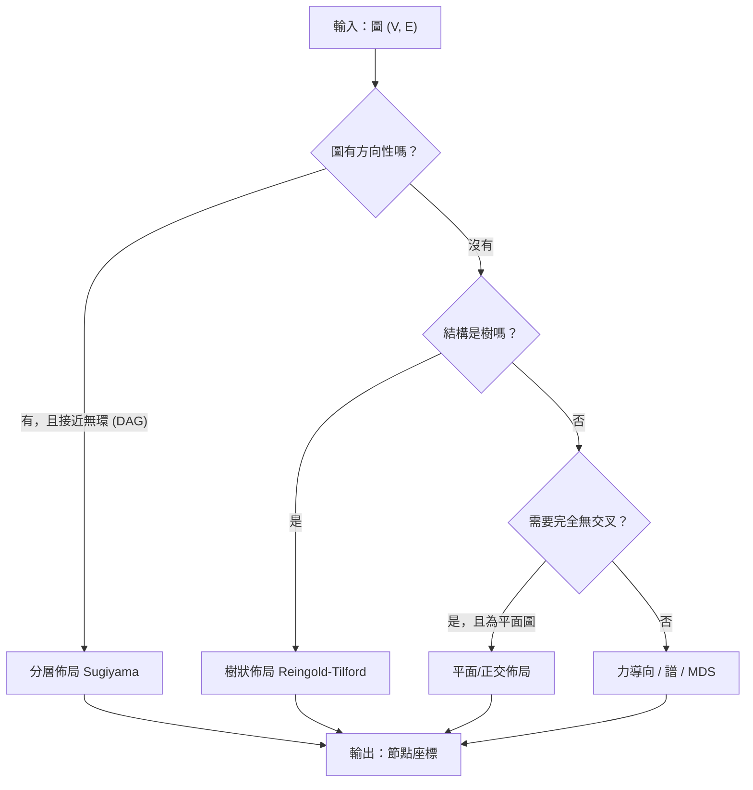
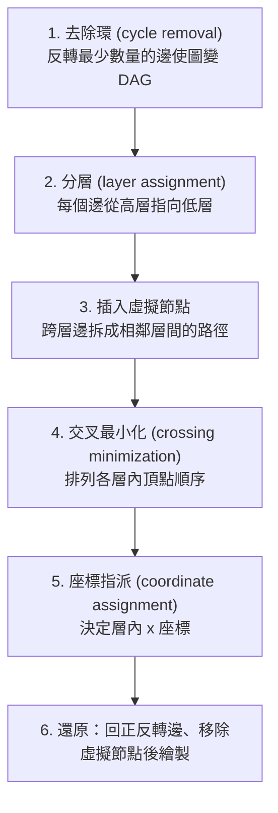
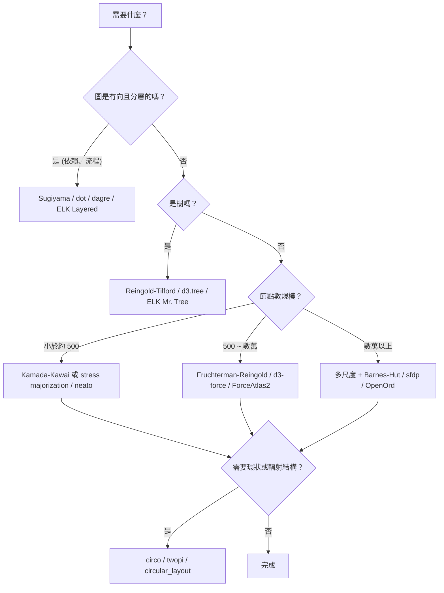

# 圖形佈局（Graph Layout）演算法總覽

## 摘要

「圖形佈局」（graph layout，學術上常稱 graph drawing）指的是：給定一個圖（一組節點與一組邊），算出每個節點在平面或空間中的座標，使得畫出來的圖容易閱讀[^gdwiki]。這個問題沒有唯一正解，因為同一個圖可以有非常多種擺法，而「好不好看／好不好懂」需要被量化成所謂的「美學準則」（aesthetic criteria），例如邊交叉數、邊長一致性、對稱性、面積、彎折數與角度解析度等[^gdwiki]。

本報告整理目前主流且被廣泛實作的佈局演算法家族，包括力導向（force-directed）、分層／階層式（layered，又稱 Sugiyama）、正交（orthogonal）、樹狀（tree）、圓形與輻射（circular / radial）、譜佈局（spectral）與多維尺度化（MDS / stress majorization），並附上常見實作（Graphviz、D3、ELK、dagre、NetworkX、Gephi）的對照，最後給出選擇建議與資料來源評估。

本報告為獨立文件，所有必要背景皆收錄於本文內。

---

## 1. 問題定義與品質指標

一個圖的「畫法」與「圖本身」是兩件事：抽象的圖只記錄哪些節點兩兩相連，但實際畫在紙上時，節點與邊的擺放方式會直接影響可讀性、可用性與美觀[^gdwiki]。

常見用來衡量佈局品質的指標包括[^gdwiki]：

- **交叉數（crossing number）**：兩條邊互相交叉的對數。若圖是平面圖（planar），通常可以畫成完全無交叉，此時的畫法對應圖的一種平面嵌入（embedding）；但非平面圖在實務中很常見，因此演算法一般必須容許交叉。
- **面積（area）**：圖形最小外框的大小（相對於節點間最小距離）。面積越小，特徵可以畫得越大、越清楚。
- **對稱性（symmetry）**：找出圖的自同構群並在畫面上呈現。力導向方法特別擅長自然呈現對稱。
- **彎折數（bends）**：折線或多邊線畫法中每條邊轉折的次數，越少越容易用眼睛追蹤。
- **邊長（edge length）**：通常希望總邊長與最長邊都小，且各邊長度盡量一致。
- **角度解析度（angular resolution）**：圖中最銳角的尖銳程度；高維度節點必然導致小角度，但可用節點度數的下界來估計。
- **斜率數（slope number）**：直線段畫法中，所需的不同斜率個數。

另有**動態圖佈局**（dynamic graph drawing）議題：當圖隨時間增刪邊時，佈局要盡量保持使用者的「心智地圖」（mental map）[^gdwiki]。

---

## 2. 演算法家族總覽

| 家族 | 代表演算法 | 關鍵年份 | 主要適用情境 |
|---|---|---|---|
| 力導向 | Tutte 重心法、Eades 彈簧、Fruchterman-Reingold、Kamada-Kawai、ForceAtlas2 | 1963–2014 | 一般無向圖、社群網路 |
| 分層／階層式 | Sugiyama 法、Coffman-Graham 分層、Brandes-Köpf 座標指派 | 1981–2002 | 有向圖、依賴圖、流程圖 |
| 正交 | Tamassia 彎折最小化 | 1987 | VLSI、PCB、需要水平垂直邊的圖 |
| 樹狀 | Reingold-Tilford、Buchheim 線性時間法 | 1981–2002 | 階層樹、樹狀圖 |
| 圓形／輻射 | Six-Tollis 圓形、Gansner-Koren 改良圓形、twopi 輻射 | 1997–2007 | 環狀網路、週期性結構 |
| 譜佈局 | 拉普拉斯矩陣特徵向量法 | 1994–2005 | 快速取得初步結構 |
| MDS／應力最小化 | Kruskal MDS、SMACOF、stress majorization | 1964–2005 | 高品質、單調收斂的無向圖佈局 |
| 特化 | arc diagram、dominance drawing、hive plot、treemap | — | 特定資料型態 |

---

## 3. 力導向演算法（Force-Directed / Spring Embedders）

### 3.1 核心概念

力導向演算法把圖當成物理系統：對每一條邊的兩端施加類似彈簧的**吸引力**（依虎克定律），同時對所有節點對施加類似電荷的**排斥力**（依庫倫定律）[^fdwiki]。系統在反覆迭代後趨近力學平衡，此時邊長趨於一致、沒有邊相連的節點會被推開[^fdwiki]。核心優點是：**不需要任何圖論知識**（例如平面性），實作簡單、可延伸、具互動性，並且對中等規模的圖（約 50–500 個節點）通常能得到高品質結果[^fdwiki]。

### 3.2 歷史節點

- **Tutte 重心法（1963）**：最早期的力導向方法。把平面嵌入外圍面的頂點固定在凸位置，對每條邊放上彈簧並讓系統穩定。因為力很單純，系統不會卡在區域極小值，而是收斂到唯一的全域最佳解；這類畫法被稱為 Tutte 嵌入[^fdwiki]。
- **Eades 彈簧嵌入器（1984）**：首次同時使用「相鄰頂點吸引力 + 所有頂點排斥力」的組合[^fdwiki]。
- **Fruchterman-Reingold（1991）**：以吸引力（與距離成正比）與排斥力（與距離平方成反比）迭代調整整體位置，是後世最常被引用的實作基礎[^fdwiki][^fa2]。
- **Kamada-Kawai（1989）**：只使用彈簧力，讓每一對節點的理想距離等於它們在圖上的最短路徑距離，再用最陡下降法求能量極小；這等價於度量式多維尺度化（metric MDS）問題[^fdwiki]。
- **ForceAtlas2（2014）**：為 Gephi 設計的連續型力導向演算法，整合 Barnes-Hut 近似、**依節點度數調整的排斥力**，以及局部與全域的自適應「溫度」（步長選擇）[^fa2]。

### 3.3 複雜度與加速技巧

標準力導向演算法的總時間複雜度被認為是 O(n³)：因為迭代次數估計為 O(n)，而每輪迭代需要對所有節點對計算斥力（O(n²)）[^fdwiki]。這源自物理上的 N-body 問題。常見加速手段有：

- **Barnes-Hut 近似（1986）**：用四元樹（2D）或八元樹（3D）遞迴切分空間。若某個內部節點所代表區域的寬度 s 與「查詢點到該節點質心距離」d 的比值 s/d 小於門檻 θ，就把該節點內所有粒子當成單一質點處理；θ 越大越快但越不準，θ=0 時退化為直接計算法。此法把每輪複雜度從 O(n²) 降到 O(n log n)[^bh]。
- **多層次／多尺度法（multilevel）**：先反覆把圖粗化（把鄰近節點合併成超級節點）成小圖，在小圖上快速求佈局，再逐層放大並細修，以避免陷入區域極小值。Yifan Hu 於 2005 年提出此法並套用於 Graphviz 的 `sfdp`[^sfdp][^fdwiki]。
- **高維嵌入（high-dimensional embedding）**：先在高維空間求解再投影回二維，用於大型圖[^fdwiki]。

### 3.4 優點與缺點

**優點**：品質好、彈性高（可延伸至有向圖、3D、叢集圖、受限佈局、動態圖）、直覺易懂、實作簡單、支援互動、具良好理論基礎（可對應到 MDS，且 stress majorization 有單調收斂保證）[^fdwiki]。

**缺點**：[^fdwiki]
- 執行時間高，典型為 O(n³)。
- 容易陷入品質很差的區域極小值；最終結果高度取決於（通常隨機的）初始佈局，節點越多越嚴重。
- 常見補救：先用 Kamada-Kawai 快速產生合理初值，再用 Fruchterman-Reingold 細修鄰近節點；或使用多層次法[^fdwiki]。

### 3.5 實作行為差異（以 D3 為例）

D3 的 `d3-force` 採用 **velocity Verlet** 數值積分器，假設固定時間步長 Δt=1 與單位質量 m=1，因此力 F 等同於固定加速度，可直接加進節點速度，再加進位置[^d3sim]。

- `alpha` 類比於**模擬退火中的溫度**，隨時間冷卻；當 alpha 降到 alphaMin 時模擬停止。預設 alphaMin=0.001、alphaDecay≈0.0228，對應約 300 次迭代[^d3sim]。
- `velocityDecay` 類似大氣摩擦，預設 0.4；每輪 tick 後速度乘以 (1 − decay)。降低 velocityDecay 或 alphaDecay 可能收斂到更好的解，但會有數值不穩定與振盪的風險[^d3sim]。
- 大型圖的靜態佈局建議在 Web Worker 中計算，避免凍結使用者介面[^d3sim]。

---

## 4. 分層／階層式佈局（Layered / Sugiyama）

### 4.1 適用情境

分層佈局（又稱階層式佈局、Sugiyama 式佈局，以提出者 Kozo Sugiyama 命名）把有向圖的頂點畫在水平層中，邊大致朝下（或朝右），最適合有向無環圖（DAG）或「幾乎無環」的圖，例如軟體模組或函式的依賴關係圖[^laywiki]。理想形態是「向上平面畫法」（upward planar drawing）：所有邊方向一致且沒有交叉[^laywiki]。

### 4.2 標準流程

各步驟要點[^laywiki]：

1. **去除環**：若輸入不是 DAG，需反轉一組邊使其無環。求最少反轉集合是 NP 完全的「回饋弧集」（feedback arc set）問題，因此實務上常用貪婪啟發式；精確解可用整數規劃，若反轉邊數很少也可用固定參數可解（FPT）演算法。
2. **分層**：目標是同時讓層數少、長邊少、每層頂點數均衡。依「從各頂點出發的最長路徑長度」分層，由 Mirsky 定理可知能得到最少層數；Coffman-Graham 演算法可在「每層頂點數上限」限制下近似最小化層數；在無每層上限時，最小化邊所跨越的總層數可用線性規劃求解。
3. **虛擬節點**：跨越超過一層的邊會被拆解成經過虛擬節點的路徑，使每條邊都只連接相鄰兩層。
4. **交叉最小化**：層內頂點排列以減少與前一層之間的交叉。求最少交叉數是 NP 完全（即使一次只排一層也一樣），所以常用啟發式：先以鄰居位置的平均或中位數決定位置，再交換相鄰對直到交叉數不再改善。
5. **座標指派**：為每個頂點決定層內座標，需讓虛擬節點落在其兩端連線以避免不必要的彎折，並使頂點相對鄰居居中。Sugiyama 原始做法是二次規劃；Brandes 與 Köpf 提出的方法只需線性時間，且保證每條邊最多兩個彎折[^laywiki]。
6. **還原**：把反轉的邊轉回原方向、移除虛擬節點；跨多層的邊可畫成折線或多項式曲線，通過各虛擬節點位置以避免與節點相交。

### 4.3 效能

最簡單版本因需建立大量虛擬節點，時間複雜度可能是 O(mn)（n 個頂點、m 條邊）；某些變體可在不實際建立虛擬節點的情況下模擬其效果，達到接近線性的實作[^laywiki]。Graphviz 的 `dot` 即採用此類演算法[^laywiki][^gvdocs]，另外 Microsoft Automatic Graph Layout 與 Tulip 也內含分層佈局[^laywiki]。

### 4.4 變體

分層框架也可用於**輻射佈局**（把圖排成繞某起始節點的同心情圓）以及三維分層圖[^laywiki]。當長邊很多時，可把一組邊綁成 bundle 一起繞過同一組虛擬節點以降低雜亂；分層佈局也常被用來產生力導向演算法的初始位置[^laywiki]。

---

## 5. 正交佈局（Orthogonal Layout）

正交佈局限制邊只能水平或垂直，平行於座標軸。此類方法最初為 VLSI 與 PCB 佈局設計，後來被移植到圖形繪製[^gdwiki]。典型流程是多階段式：先把圖「平面化」（將交叉點換成頂點），求平面化圖的拓撲嵌入，選擇邊的方向以最小化彎折，依方向放置頂點，最後做壓縮（compaction）以縮小面積[^gdwiki]。

其代表性經典結果是 Tamassia（1987）提出的「在網格上以最少彎折數嵌入平面圖」的最小彎折演算法[^gdwiki]。

---

## 6. 樹狀佈局（Tree Layout）

樹狀佈局針對有根樹，顯示成階層式樹型[^gdwiki]。

- **Reingold-Tilford「tidy」樹演算法（1981）**：以兩次走訪緊湊地繪製樹：後序走訪決定 y 座標與初步 x 座標，前序走訪決定最終 x 座標；利用「輪廓（contour）」與「執行緒（thread）」概念在子樹之間保持適當間距[^d3tree]。
- **Buchheim 等人的線性時間改良（2002）**：修正 Walker（1990）將 Reingold-Tilford 推廣到任意分支度樹時、宣稱 O(n) 但實際為 O(n²) 的問題，透過自底向上的合併與輪廓穿越達到真正的 O(n)[^d3tree]。
- **氣球佈局（balloon layout）**：把每個節點的子節點畫在該節點周圍的圓上，越下層圓半徑越小以避免重疊[^gdwiki]。

D3 的 `d3.tree()` 即採用「Reingold-Tilford tidy 演算法」，並採用 Buchheim 等人的線性時間改良版[^d3tree]。其座標系統是任意的：若把 x 當角度、y 當半徑，即可得到輻射狀 tidy tree；D3 文件也建議輻射佈局時把間距除以節點深度，使間隙隨半徑縮放[^d3tree]。

---

## 7. 圓形與輻射佈局（Circular / Radial）

**圓形佈局**把頂點放在一個圓上（通常等距，形成正多邊形的頂點）[^circwiki]。它的關鍵優勢是**中立性**：所有頂點與彼此及圓心的距離相等，沒有哪個節點被賦予特權位置，可抵消「中央節點更重要」的視覺偏誤[^circwiki]。

- **適用**：通訊網路拓撲（星狀、環狀）、代謝網路的週期部分；若圖有已知的 Hamiltonian cycle，可將該環畫成圓[^circwiki]。
- **可作為子結構佈局**：也可只用於圖中部分群集（如雙連通分量），再用力導向等方法安排各群集的相對位置[^circwiki]。
- **邊的畫法**：可為弦、圓弧（甚至可垂直於頂點圓，模擬雙曲幾何的 Poincaré disk），或其他曲線；Gansner 與 Koren（2007）的演算法在圓內做邊綁束（bundling），部分未綁束的邊畫在圓外[^circwiki]。
- **交叉最小化**：只在外平面圖（outerplanar graph）時交叉數可為零；一般而言最小化交叉數是 NP 完全[^circwiki]。Shahrokhi 等人（1995）提出基於平衡切割的近似演算法；另有用啟發式（頂點插入順序、區域搜尋）降低交叉複雜度的方法[^circwiki]。
- **其他準則**：邊長、交叉角度解析度、cutwidth（圓上一段弧連到對面弧的最大邊數）也有人研究，但多為 NP 完全[^circwiki]。

**輻射佈局（twopi）**：依節點到根節點的圖論距離，把節點放在同心圓上；可指定根節點，多個同距離節點放同一圓[^gvdocs]。

---

## 8. 譜佈局與 MDS／應力最小化

### 8.1 譜佈局（Spectral Layout）

譜佈局使用矩陣（例如圖的拉普拉斯矩陣）的**特徵向量**作為頂點的直角座標[^specwiki]。在二維情況下，對應節點 i 的 x 與 y 座標分別取拉普拉斯矩陣 L 的第一與第二個特徵向量的第 i 個分量[^specwiki]。通常取最大（或最小）的兩個特徵值與對應特徵向量；若要嵌入更多維度，就取更多特徵向量[^specwiki]。此方法起源可追溯到 Beckman（1994）的 Microsoft Research 技術報告，以及 Koren（2005）在《Computers & Mathematics with Applications》的理論與實務整理[^specwiki]。

### 8.2 應力最小化（Stress Majorization / SMACOF）

**應力（stress）函數**衡量「理想距離」與「實際繪圖距離」的平方差總和[^stresswiki]：

σ(X) = Σ_{i<j≤n} w_ij · (d_ij(X) − δ_ij)²

其中 w_ij ≥ 0 是量測權重（可設為 0 表示該對無資訊），d_ij(X) 是點 i 與 j 的歐氏距離，δ_ij 是理想距離[^stresswiki]。

- Kruskal（1964）曾建議用迭代最陡下降最小化應力。
- **de Leeuw（1977）** 提出迭代**最大化下界（majorization）**法，又稱 **SMACOF**（"Scaling by MAjorizing a COmplicated Function"）。每一步最小化一個簡單的凸函數，該函數同時從上方界住 σ 並在支撐點 Z 與 σ 相切；此法收斂性有保證且單調[^stresswiki]。
- 在圖形繪製上，Gansner、Koren 與 North（2005）把 SMACOF 引入成 **stress majorization**，成為 `neato` 等工具的預設模式[^gvdocs]。

因為節點對的彈簧理想長度與圖論距離成正比，最小化歐氏距離與理想距離差（通常取平方差）即等價於度量式 MDS 問題[^fdwiki]。應力最小化被認為行為非常良好，且**單調收斂**；單調收斂（每輪迭代都降低佈局成本）很重要，因為它保證佈局最終會到達某個區域極小值並停止；相較之下，阻尼排程雖然能讓演算法停下，卻無法保證真的到達極小值[^fdwiki]。

---

## 9. 其他特化佈局

- **Arc diagram（弧線圖）**：把頂點排在一條線上，邊畫成線上方或下方的半圓、或由多段半圓接成的平滑曲線[^gdwiki]。
- **Dominance drawing（支配圖）**：安排頂點使「一個頂點在另一個的右方、上方或右上」若且唯若前者可從後者到達，讓可達性關係在視覺上直接可見[^gdwiki]。
- **Hive plot（蜂巢圖）**：依一個分割變數把節點放到少數徑向軸上，並依某個排序變數沿軸排列。位置由資料決定而非佈局演算法，因此結果可重現，且能直接看出圖的結構性質[^nxdocs]。
- **Treemap（縮方塊圖／squarified treemap）**：Graphviz 的 `patchwork` 用它來畫叢集圖的地圖[^gvdocs]。
- **Hasse diagram、狀態圖、資料流圖、樹狀圖（phylogram）** 等屬於特定應用的圖形繪製[^gdwiki]。

---

## 10. 常見函式庫／工具對照

| 工具 | 實作的佈局演算法 | 備註 |
|---|---|---|
| **Graphviz** | `dot`（分層法）、`neato`（彈簧模式／應力最小化、Kamada-Kawai、SGD）、`fdp`（Fruchterman-Reingold 力導向）、`sfdp`（可擴展力導向，Yifan Hu 多尺度）、`circo`（圓形）、`twopi`（輻射）、`osage`（叢集圖）、`patchwork`（treemap） | 官方文件稱 `neato` 最小化一個等效於統計多維尺度化的全域能量函數[^gvdocs][^sfdp] |
| **D3.js** | `d3.tree()`（Reingold-Tilford / Buchheim tidy tree）、`d3.cluster()`（樹狀圖）、`d3.force()`（velocity Verlet 力導向） | `d3-force` 預設約 300 次迭代[^d3tree][^d3sim] |
| **ELK（Eclipse Layout Kernel）** | `org.eclipse.elk.layered`（分層）、`org.eclipse.elk.force`（力導向，含 Eades 排斥）、`org.eclipse.elk.mrtree`（樹）、`org.eclipse.elk.radial`（輻射）、`org.eclipse.elk.stress`（應力）、`org.eclipse.elk.box`、`org.eclipse.elk.disco`（連通分量）、`org.eclipse.elk.rectpacking` 等；另可轉呼叫 Graphviz 各引擎 | 演算法 ID 與清單見官方參考文件[^elk] |
| **dagre** | JavaScript 的**有向圖分層佈局**（Sugiyama 風格） | 處理有向圖並產生分層排列[^dagre] |
| **NetworkX** | `spring_layout`（Fruchterman-Reingold）、`kamada_kawai_layout`、`spectral_layout`、`circular_layout`、`forceatlas2_layout`、`planar_layout`、`shell_layout`、`spiral_layout`、`multipartite_layout`、`bfs_layout`、`arf_layout` 等 | 官方明言其主要目標是圖分析而非視覺化，建議把圖匯出到 Gephi / Graphviz / Cytoscape 等專門工具[^nxdocs] |
| **Gephi** | ForceAtlas2（預設）、Fruchterman-Reingold、Yifan Hu、OpenOrd 等 | ForceAtlas2 為其預設佈局演算法[^fa2] |

> GitHub 星數備註：本次查證中僅能確認 D3 官方網站顯示的 star 數約為 112,966[^d3tree]；其他專案的星數未經查證，故不列出，以免提供未經來源支持之數據。

---

## 11. 如何選擇佈局演算法

實務建議：

- 有向依賴圖首選分層佈局（Graphviz `dot`、dagre、ELK Layered）。
- 一般無向圖且規模不大時，stress majorization / Kamada-Kawai 品質較穩定。
- 大規模網路（社群網路、生物網路）用力導向 + Barnes-Hut 或直接採多尺度法。
- 需要快速初步結構時可用譜佈局，但它對圖的「社群結構」呈現通常不如力導向[^specwiki][^fdwiki]。
- 環狀或輻射結構（通訊、週期網路）用圓形／輻射佈局，其「中立性」是獨特優勢[^circwiki]。

---

## 12. 資料來源評估與限制

- **權威性**：本報告核心事實多來自 Wikipedia 條目、Graphviz／D3／NetworkX／ELK 官方文件，以及 PLOS ONE 的 ForceAtlas2 論文與 arXiv 的 Kobourov 綜述。Wikipedia 條目本身引用了 Di Battista 等人的教科書《Graph Drawing: Algorithms for the Visualization of Graphs》（1998）與 Tamassia 編的《Handbook of Graph Drawing and Visualization》（2014），屬於該領域的標準參考書[^gdwiki][^laywiki]。
- **時效性**：經典演算法（1963–2005）的內容已相當穩定；ForceAtlas2（2014）與當代函式庫文件（2024–2026 之間更新）仍屬現行。函式庫文件可能隨版本變動，實作參數預設值宜以實際安裝版本為準。
- **佐證**：多個獨立來源互相印證了演算法歸屬，例如 Fruchterman-Reingold 同時見於 Wikipedia 條目、Graphviz 文件與 ForceAtlas2 論文[^fdwiki][^gvdocs][^fa2]。
- **可能的偏誤**：Graphviz 文件以自身引擎為中心，會以「工具視角」描述演算法；函式庫文件對演算法的命名（如 ELK 的 Eades 排斥、FR 溫度）反映其實作選擇，未必與原始論文完全一致[^elk]。
- **未涵蓋範圍**：本報告未深入各演算法的完整數學推導、NP 完備性證明、動態圖佈局的最新研究、三維佈局與邊綁束（edge bundling）的專門演算法，也未逐一比較各函式庫在大規模圖上的實測效能。有意深入者建議直接閱讀 Kobourov 的力導向綜述[^kobourov]與 Tamassia 的 Handbook[^gdwiki]。

---

## 參考文獻

[^gdwiki]: Wikipedia. (n.d.). Graph drawing. Retrieved 2026-10-17, from https://en.wikipedia.org/wiki/Graph_drawing

[^fdwiki]: Wikipedia. (n.d.). Force-directed graph drawing. Retrieved 2026-10-17, from https://en.wikipedia.org/wiki/Force-directed_graph_drawing

[^laywiki]: Wikipedia. (n.d.). Layered graph drawing. Retrieved 2026-10-17, from https://en.wikipedia.org/wiki/Layered_graph_drawing

[^specwiki]: Wikipedia. (n.d.). Spectral layout. Retrieved 2026-10-17, from https://en.wikipedia.org/wiki/Spectral_layout

[^stresswiki]: Wikipedia. (n.d.). Stress majorization. Retrieved 2026-10-17, from https://en.wikipedia.org/wiki/Stress_majorization

[^circwiki]: Wikipedia. (n.d.). Circular layout. Retrieved 2026-10-17, from https://en.wikipedia.org/wiki/Circular_layout

[^bh]: Wikipedia. (n.d.). Barnes–Hut simulation. Retrieved 2026-10-17, from https://en.wikipedia.org/wiki/Barnes%E2%80%93Hut_simulation

[^gvdocs]: The Graphviz Authors. (n.d.). Layout engines. Graphviz. Retrieved 2026-10-17, from https://graphviz.org/docs/layouts/

[^sfdp]: The Graphviz Authors. (2024, November 18). sfdp. Graphviz. Retrieved 2026-10-17, from https://graphviz.org/docs/layouts/sfdp/

[^d3tree]: Bostock, M., & Observable, Inc. (n.d.). Tree. D3 by Observable. Retrieved 2026-10-17, from https://d3js.org/d3-hierarchy/tree

[^d3sim]: Bostock, M., & Observable, Inc. (n.d.). Force simulations. D3 by Observable. Retrieved 2026-10-17, from https://d3js.org/d3-force/simulation

[^nxdocs]: NetworkX Developers. (n.d.). Drawing. NetworkX 3.7 documentation. Retrieved 2026-10-17, from https://networkx.org/documentation/stable/reference/drawing.html

[^elk]: Eclipse Foundation. (n.d.). Algorithms. Eclipse Layout Kernel reference. Retrieved 2026-10-17, from https://eclipse.dev/elk/reference/algorithms.html

[^dagre]: dagrejs. (n.d.). dagre: Directed graph layout for JavaScript. GitHub. Retrieved 2026-10-17, from https://github.com/dagrejs/dagre

[^fa2]: Jacomy, M., Venturini, T., Heymann, S., & Bastian, M. (2014). ForceAtlas2, a continuous graph layout algorithm for handy network visualization designed for the Gephi software. PLOS ONE, 9(6), e98679. Retrieved 2026-10-17, from https://journals.plos.org/plosone/article?id=10.1371/journal.pone.0098679

[^kobourov]: Kobourov, S. G. (2012). Spring embedders and force directed graph drawing algorithms. arXiv. Retrieved 2026-10-17, from https://arxiv.org/abs/1201.3011
