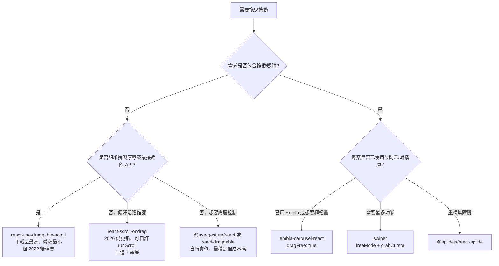

# react-indiana-drag-scroll 的替代方案調查

## 摘要

`react-indiana-drag-scroll` 是一個 React 生態系的「按住滑鼠拖曳即捲動」函式庫，由俄羅斯開發者 Norserium 維護。它讓任何可捲動容器（橫向、縱向或雙向）具備如同 Google Maps 般的「抓取拖曳」體驗，並且預設隱藏原生捲軸[^indiana-repo]。其 GitHub 專案約有 **529 顆星**，npm 每週下載量約 **100,580 次**（統計區間 2026-10-06 至 2026-10-12），最新穩定版為 `2.2.1`，於 2025-03-01 發布[^indiana-npm][^indiana-dl]。

本報告調查其替代方案，並依「專職拖曳捲動函式庫」、「通用拖曳／手勢工具」與「輪播滑動函式庫」三類整理。核心結論：**若只需要最單純的拖曳捲動，`react-use-draggable-scroll` 是下載量最接近、體積最小且最成熟的替代品；若同時需要輪播、吸附與慣性動畫，`embla-carousel-react` 與 `swiper` 是維護最活躍、下載量最高的選項**[^ruds-npm][^embla-npm][^swiper-npm]。

---

## 一、調查對象：react-indiana-drag-scroll 是什麼

`react-indiana-drag-scroll` 的官方描述為「React component which implements scrolling via holding the mouse button or touch」（實作透過按住滑鼠或觸控來捲動的 React 元件）[^indiana-repo]。它的主要特徵如下：

| 項目 | 內容 |
|---|---|
| GitHub 星數 | 529[^indiana-repo] |
| Fork 數 | 28[^indiana-repo] |
| 授權 | MIT[^indiana-npm] |
| 最新穩定版 | 2.2.1（2025-03-01 發布）[^indiana-npm] |
| 最新 alpha 版 | 3.0.4-alpha（`@next` 標籤）[^indiana-repo] |
| npm 每週下載 | 約 100,580 次[^indiana-dl] |
| 體積（minified） | 約 7.66 kB；gzip 後約 2.63 kB[^indiana-bundle] |
| 相依套件 | `debounce`、`easy-bem`、`classnames`[^indiana-npm] |
| 最近一次程式碼推送 | 2025-03-01[^indiana-repo] |

功能上，它提供 `ScrollContainer` 元件與 `useDraggableScroll` hook 兩種用法，支援橫向與縱向拖曳、以 `activationDistance`（預設 10px）區分「點擊」與「拖曳起點」、以 `ignoreElements` 選擇器排除特定子元素（例如彈窗）不觸發拖曳、以 `nativeMobileScroll`（預設 `true`）在行動裝置沿用原生觸控捲動，並預設以 `hideScrollbars` 隱藏原生捲軸[^indiana-repo]。

需要留意的維護訊號：本專案自 2025-03-01 之後沒有新的程式碼推送，且 npm registry 顯示只有一位維護者[^indiana-repo][^indiana-npm]。這代表它並非「已废弃」，但更新節奏偏慢。

---

## 二、替代方案總覽

下表把候選方案分為三類。下載量與星數皆為 2026-10 的查詢結果，日期為統計截止日。

### 2.1 專職「拖曳捲動」函式庫（與原專案最同性質）

| 套件 | GitHub 星數 | 每週下載 | 最新版 | 授權 | 維護狀態 |
|---|---|---|---|---|---|
| `react-use-draggable-scroll` | 120[^ruds-repo] | 92,809[^ruds-dl] | 0.4.7（2022-09-28）[^ruds-npm] | MIT[^ruds-npm] | 停更（2022-09-28 最後提交）[^ruds-repo] |
| `react-scroll-ondrag` | 7[^rsod-repo] | 3,556[^rsod-dl] | 5.0.0（2026-07-14）[^rsod-npm] | ISC[^rsod-npm] | 活躍（2026-09 仍有依賴更新提交）[^rsod-repo] |
| `use-draggable-scroll` | 35[^uds-repo] | 8,158[^uds-dl] | 0.1.0（2021-06-19）[^uds-npm] | MIT[^uds-npm] | 停更[^uds-repo] |
| `use-drag-scroll` | 4[^udsc-repo] | 27,862[^udsc-dl] | 1.0.1（2020-04-19）[^udsc-npm] | MIT[^udsc-npm] | 停更[^udsc-repo] |
| `dragscroll`（vanilla JS，非 React 專用） | 1,116[^dragscroll-repo] | 6,761[^dragscroll-dl] | 0.0.8（2016-11-20）[^dragscroll-npm] | MIT[^dragscroll-repo] | 長期未更新[^dragscroll-repo] |

補充：npm 上另有 `@skax/drag-scroll`（2026-02-26 發布，每週約 112 次下載）[^skax-npm]、`drag-scroll-carousel`（2026-04-10 發布，每週約 6 次下載）[^dsc-npm]，以及 `drag-scroll-provider`（2018 年後未更新）[^dsp-npm]。這三個方案下載量與星數都極低，除非有特殊需求，否則不建議採用。

### 2.2 通用拖曳／手勢工具（可自行組出拖曳捲動）

| 套件 | GitHub 星數 | 每週下載 | 最新版 | 說明 |
|---|---|---|---|---|
| `@use-gesture/react` | 9,620[^usegesture-repo] | 7,353,220[^usegesture-dl] | 10.3.1（2024-03-21）[^usegesture-npm] | pmndrs 團隊的手勢 hook，提供 drag／pinch／scroll 等底層事件[^usegesture-repo] |
| `react-draggable` | 9,287[^rd-repo] | 7,782,797[^rd-dl] | 4.7.2（2026-09-16）[^rd-npm] | 最普及的 React 拖曳元件，`DraggableCore` 可取得低階拖曳事件自組捲動[^rd-repo] |
| `motion`（前 framer-motion） | 34,208[^motion-repo] | 25,186,152（`motion`）／51,084,213（`framer-motion` 仍並行發布）[^motion-dl][^fm-dl] | 14.3.0[^motion-npm] | 完整動畫函式庫，`drag` prop 支援拖曳、彈簧物理與動量[^motion-repo] |

### 2.3 輪播／滑動函式庫（同時提供拖曳與吸附）

| 套件 | GitHub 星數 | 每週下載 | 最新版 | 授權 | 說明 |
|---|---|---|---|---|---|
| `embla-carousel-react` | 8,449[^embla-repo] | 28,559,989[^embla-dl] | 8.6.0[^embla-npm] | MIT[^embla-npm] | 極輕量、無相依的輪播核心，`dragFree` 可開自由捲動[^embla-options] |
| `swiper` | 41,899[^swiper-repo] | 4,249,728[^swiper-dl] | 14.3.0（2026-09-28）[^swiper-npm] | MIT[^swiper-npm] | 功能最完整的觸控輪播，`freeMode`＋`grabCursor` 可模擬拖曳捲動[^swiper-api] |
| `@splidejs/react-splide` | 5,369（Splide 核心）[^splide-repo] | 138,078[^splide-dl] | 0.7.12[^splide-npm] | MIT[^splide-npm] | 無障礙導向的輕量輪播，核心 2024-07 後未推送[^splide-repo] |
| `keen-slider` | 5,020[^keen-repo] | 220,856[^keen-dl] | 6.8.6[^keen-npm] | MIT[^keen-npm] | 號稱「最接近原生手感」的觸控滑動元件，近年更新頻率下降[^keen-repo] |

---

## 三、各方案深入比較

### 3.1 react-use-draggable-scroll

這是與原專案最直接對應的替代品。它以單一 hook `useDraggable` 實作，回傳可直接展開到目標元素的事件處理器，並在拖曳結束後加入慣性（動量）效果[^ruds-repo]。可調參數包含：

- `decayRate`（預設 `0.95`）：慣性衰減率，數值越接近 1 滑得越遠[^ruds-readme]
- `applyRubberBandEffect`（預設 `false`）：捲動到邊界時讓子元素產生橡皮筋回彈效果[^ruds-readme]
- `activeMouseButton`：指定以左／中／右鍵觸發[^ruds-readme]
- `safeDisplacement`、`isMounted` 等其他選項[^ruds-readme]

它內部使用自訂的 `useIsomorphicLayoutEffect`，在伺服器端渲染（SSR）時退回 `useEffect`，因此與 Next.js 等 SSR 框架相容[^ruds-readme]。體積限制設定在 10 kB 以內[^ruds-npm]。

**風險**：最後一次程式碼提交為 2022-09-28，官方沒有任何 GitHub Release[^ruds-repo]。雖然下載量仍高（每週約 92,809 次[^ruds-dl]），但屬於「成熟但無人維護」的狀態。若專案需要支援未來新版 React，需自行驗證相容性（其 peer dependency 標示 `react >= 16`[^ruds-npm]）。

### 3.2 react-scroll-ondrag

此方案以 hook `useScrollOnDrag(ref, options?)` 呈現，回傳 `{ events }` 供展開[^rsod-repo]。最特別的是 `runScroll` 回呼，開發者可完全自訂捲動邏輯，例如只允許橫向捲動：

```jsx
const { events } = useScrollOnDrag(ref, {
  runScroll: ({ dx, dy }) => {
    ref.current.scrollLeft += dx;
  },
});
```

它另提供 `onDragStart` 與 `onDragEnd` 生命週期回呼，且不需要匯入任何 CSS[^rsod-repo]。`mousemove`／`mouseup` 事件綁定在 `globalThis` 上，因此游標離開元素後拖曳仍可持續[^rsod-repo]。

**取捨**：它是本調查中維護最活躍的專職拖曳捲動方案（2026-07-14 發布 5.0.0，2026-09 仍有依賴更新提交）[^rsod-repo][^rsod-npm]，但採用者極少（GitHub 僅 7 顆星、每週 3,556 次下載）[^rsod-repo][^rsod-dl]，生態驗證不足。此外它標示為 ESM only、Node engine `>=20.0.0`[^rsod-npm]，對舊工具鏈不友善。

### 3.3 @use-gesture/react 與 react-draggable

若不想依賴小眾套件，可選用成熟的手勢／拖曳底層來自行實作。`@use-gesture/react` 提供 `useDrag` 等 hook，能取得拖曳過程的位移量，再手動寫入 `scrollLeft`／`scrollTop`[^usegesture-repo]。其下載量（每週約 735 萬次）與生態成熟度遠勝任何專職方案[^usegesture-dl]。

`react-draggable` 的 `DraggableCore` 子元件提供不含定位邏輯的原始拖曳事件，可用來組出拖曳捲動[^rd-repo]。它維護活躍（2026-09-16 發布 4.7.2）[^rd-npm]，但要注意它是為「拖曳元素本身」設計，用來捲動容器需要自行撰寫位移對應邏輯。

**取捨**：自由度最高、長期維護最穩，但開發成本也最高，且需要自行處理慣性、點擊與拖曳的區分、行動裝置觸控等細節。

### 3.4 embla-carousel-react

Embla 是本次調查中下載量最高的候選（`embla-carousel-react` 每週約 2,856 萬次[^embla-dl]），且核心完全無相依[^embla-repo]。它最關鍵的選項是 `dragFree`：

- `dragFree: false`（預設）：拖曳後吸附到最近的投影片[^embla-options]
- `dragFree: true`：**自由慣性捲動，停在使用者放手的任意位置，不吸附**[^embla-options]
- `dragFree: 'snap'`：保留自由流暢手感，但最終仍吸附到最接近的吸附點[^embla-options]

另有 `dragThreshold`（預設 10，僅影響點擊是否觸發，不影響拖曳起始）[^embla-options]、`containScroll`（預設 `'trimSnaps'`，處理頭尾空白）[^embla-options]。因此當需求其實是「拖曳捲動清單」時，以 Embla 設定 `dragFree: true` 即可逼近原專案的體驗，同時獲得活躍維護（最近推送 2026-10-12）[^embla-repo]。

**取捨**：它本質是輪播，需要包一層投影片結構；若只是要一個可拖曳的 `div`，使用它屬於「殺雞用牛刀」。

### 3.5 swiper

Swiper 是星數最高的選項（41,899 顆星）[^swiper-repo]，維護非常活躍（最新 14.3.0 於 2026-09-28 發布）[^swiper-npm]。模擬拖曳捲動的關鍵設定為：

- `freeMode`：關閉吸附，可設為 `true` 或傳入物件微調 `momentum`、`momentumBounce`、`momentumRatio` 等[^swiper-api]
- `grabCursor`：滑鼠移入時顯示「抓手」游標，強化可拖曳的視覺提示[^swiper-api]
- `mousewheel`：讓滑鼠滾輪也能操作，並可用 `releaseOnEdges` 在邊界時交還頁面捲動[^swiper-api]

**取捨**：功能最全面，但體積與 API 複雜度也最高；對「單純拖曳捲動」而言明顯過重。

### 3.6 Splide 與 keen-slider

`@splidejs/react-splide` 主打無障礙與零 Lighthouse 錯誤[^splide-repo]，每週下載約 13.8 萬次[^splide-dl]。但核心 Splide 自 2024-07-08 後未再推送程式碼[^splide-repo]，React 包裝版本停留在 0.7.12[^splide-npm]。

`keen-slider` 強調「最接近原生的觸控手感」，每週下載約 22 萬次[^keen-dl]，但同樣面臨更新放緩的情形（核心最後推送 2026-01-22，且累積 149 個未結議題）[^keen-repo]。

---

## 四、選擇決策



### 建議對照表

| 你的情境 | 建議方案 | 理由 |
|---|---|---|
| 只想換掉原專案，行為要幾乎一致 | `react-use-draggable-scroll` | 同樣是 hook 式、體積小、下載量接近，且有慣性效果 |
| 在意「有人維護」 | `react-scroll-ondrag` | 本調查中唯一近期仍有發布與提交的專職拖曳捲動套件 |
| 不想引入小眾依賴 | `@use-gesture/react` | 每週 700 萬次下載、pmndrs 生態，長期風險最低 |
| 同時要做輪播／產品展示牆 | `embla-carousel-react` | `dragFree` 可調出自由捲動，下載量與維護皆強 |
| 需要最完整功能與最大社群 | `swiper` | 星數與功能最全面，維護最活躍 |
| 必須支援舊瀏覽器或無建置流程 | `dragscroll`（vanilla） | 純 JS、無依賴，但已多年未更新 |

---

## 五、批判性來源反思

本報告的數據來自三類來源，各有其偏誤與限制，閱讀時應留意：

1. **npm 官方 API 與 registry**（下載量、版本、相依、授權）：這是最可信的一手資料，下載量取自 2026-10-06 至 2026-10-12 的單週區間[^indiana-dl]。限制在於「下載量」會被 CI 快取、鏡像與相依樹重複計數放大，並不精確等於「實際使用人數」；且單週快照可能受當週事件（如某大專案發版）影響而波動。此外，本報告查詢 npm 網站頁面時數次遭遇 HTTP 403，因此改以 `registry.npmjs.org` 與 `api.npmjs.org` 的程式化端點取得資料，這反而避開了網頁版的可能延遲。

2. **GitHub REST API**（星數、推送時間、授權、未結議題）：屬於平台官方資料，可視為一手。但星數只是「受關注度」而非品質保證，且會被議題討論與歷史累積影響；`pushed_at` 也無法區分「實質功能更新」與「依賴機器人更新」，本報告因此在 `react-scroll-ondrag` 的維護活躍度判斷上，特別查閱了提交紀錄，確認 2026-09 的推送為 dependabot 依賴更新而非核心功能變更[^rsod-repo]，並在正文中據實標註。

3. **官方文件與第三方聚合網站**（功能說明、體積）：套件功能說明來自官方 README、官方文件與釋出頁，可信度高。體積數據（7.66 kB／2.63 kB）來自第三方聚合服務，可能因打包設定不同而與實測有落差，僅宜作相對比較。選項語意（`dragFree`、`freeMode`、`grabCursor`）則交叉核對了官方文件與原始碼，兩者一致。

**未能驗證的事項**：本報告未實際安裝並執行任何套件，因此「拖曳手感」、「在特定 React 版本下的相容性」與「行動裝置實機行為」皆未經實測，讀者若要做最終決策，建議以最小範例在各候選方案上實際操作一次。此外，`react-indiana-drag-scroll` 的 3.x alpha 系列仍在變動中，本報告未深入評估其穩定性。

---

## 六、結論

`react-indiana-drag-scroll` 本身仍是一款體積小、API 直覺的專職拖曳捲動元件，並非不能用，只是更新節奏放緩。替代方案中：

- **最平價的替代**：`react-use-draggable-scroll`（同為 hook 式、下載量與體積相近，但自 2022 年停更）。
- **最活躍的專職替代**：`react-scroll-ondrag`（維護中，但社群極小）。
- **最穩健的長期選擇**：以 `@use-gesture/react` 或 `react-draggable` 自行實作。
- **若需求其實是輪播**：`embla-carousel-react`（`dragFree: true`）與 `swiper`（`freeMode` + `grabCursor`）是維護最活躍、下載量最高的選項。

---

## 參考文獻

[^indiana-repo]: Norserium. (n.d.). *react-indiana-drag-scroll* [Computer software]. GitHub. Retrieved 2026-10-17, from https://github.com/Norserium/react-indiana-drag-scroll

[^indiana-npm]: Norserium. (2025). *react-indiana-drag-scroll* (Version 2.2.1) [Computer software]. npm. Retrieved 2026-10-17, from https://registry.npmjs.org/react-indiana-drag-scroll/latest

[^indiana-dl]: npm, Inc. (2026). *npm downloads API: react-indiana-drag-scroll*. Retrieved 2026-10-17, from https://api.npmjs.org/downloads/point/last-week/react-indiana-drag-scroll

[^indiana-bundle]: Bundlephobia. (n.d.). *react-indiana-drag-scroll v2.2.1 bundle size*. Retrieved 2026-10-17, from https://bundlephobia.com/api/size?package=react-indiana-drag-scroll@2.2.1

[^ruds-repo]: Miotto, R. F. (n.d.). *react-use-draggable-scroll* [Computer software]. GitHub. Retrieved 2026-10-17, from https://github.com/rfmiotto/react-use-draggable-scroll

[^ruds-npm]: Miotto, R. F. (2022). *react-use-draggable-scroll* (Version 0.4.7) [Computer software]. npm. Retrieved 2026-10-17, from https://registry.npmjs.org/react-use-draggable-scroll/latest

[^ruds-dl]: npm, Inc. (2026). *npm downloads API: react-use-draggable-scroll*. Retrieved 2026-10-17, from https://api.npmjs.org/downloads/point/last-week/react-use-draggable-scroll

[^ruds-readme]: Miotto, R. F. (n.d.). *README*. In react-use-draggable-scroll [Computer software]. GitHub. Retrieved 2026-10-17, from https://raw.githubusercontent.com/rfmiotto/react-use-draggable-scroll/main/README.md

[^rsod-repo]: dotcore64. (n.d.). *react-scroll-ondrag* [Computer software]. GitHub. Retrieved 2026-10-17, from https://github.com/dotcore64/react-scroll-ondrag

[^rsod-npm]: dotcore64. (2026). *react-scroll-ondrag* (Version 5.0.0) [Computer software]. npm. Retrieved 2026-10-17, from https://registry.npmjs.org/react-scroll-ondrag/latest

[^rsod-dl]: npm, Inc. (2026). *npm downloads API: react-scroll-ondrag*. Retrieved 2026-10-17, from https://api.npmjs.org/downloads/point/last-week/react-scroll-ondrag

[^uds-repo]: del Molino, G. (n.d.). *use-draggable-scroll* [Computer software]. GitHub. Retrieved 2026-10-17, from https://github.com/g-delmo/use-draggable-scroll

[^uds-npm]: del Molino, G. (2021). *use-draggable-scroll* (Version 0.1.0) [Computer software]. npm. Retrieved 2026-10-17, from https://registry.npmjs.org/use-draggable-scroll/latest

[^uds-dl]: npm, Inc. (2026). *npm downloads API: use-draggable-scroll*. Retrieved 2026-10-17, from https://api.npmjs.org/downloads/point/last-week/use-draggable-scroll

[^udsc-repo]: Mildren, B. (n.d.). *useDragScroll* [Computer software]. GitHub. Retrieved 2026-10-17, from https://github.com/mildrenben/useDragScroll

[^udsc-npm]: Mildren, B. (2020). *use-drag-scroll* (Version 1.0.1) [Computer software]. npm. Retrieved 2026-10-17, from https://registry.npmjs.org/use-drag-scroll/latest

[^udsc-dl]: npm, Inc. (2026). *npm downloads API: use-drag-scroll*. Retrieved 2026-10-17, from https://api.npmjs.org/downloads/point/last-week/use-drag-scroll

[^dragscroll-repo]: Prokashev, D. (n.d.). *dragscroll* [Computer software]. GitHub. Retrieved 2026-10-17, from https://github.com/asvd/dragscroll

[^dragscroll-npm]: Prokashev, D. (2016). *dragscroll* (Version 0.0.8) [Computer software]. npm. Retrieved 2026-10-17, from https://registry.npmjs.org/dragscroll/latest

[^dragscroll-dl]: npm, Inc. (2026). *npm downloads API: dragscroll*. Retrieved 2026-10-17, from https://api.npmjs.org/downloads/point/last-week/dragscroll

[^skax-npm]: freeshineit. (2026). *@skax/drag-scroll* (Version 2.0.0) [Computer software]. npm. Retrieved 2026-10-17, from https://www.npmjs.com/package/@skax/drag-scroll

[^dsc-npm]: Attar, S. (2026). *drag-scroll-carousel* (Version 1.0.8) [Computer software]. npm. Retrieved 2026-10-17, from https://www.npmjs.com/package/drag-scroll-carousel

[^dsp-npm]: Sa, D. (2018). *drag-scroll-provider* (Version 1.0.6) [Computer software]. npm. Retrieved 2026-10-17, from https://www.npmjs.com/package/drag-scroll-provider

[^usegesture-repo]: pmndrs. (n.d.). *use-gesture* [Computer software]. GitHub. Retrieved 2026-10-17, from https://github.com/pmndrs/use-gesture

[^usegesture-npm]: Bismut, D. (2024). *@use-gesture/react* (Version 10.3.1) [Computer software]. npm. Retrieved 2026-10-17, from https://registry.npmjs.org/@use-gesture/react/latest

[^usegesture-dl]: npm, Inc. (2026). *npm downloads API: @use-gesture/react*. Retrieved 2026-10-17, from https://api.npmjs.org/downloads/point/last-week/@use-gesture/react

[^rd-repo]: react-grid-layout. (n.d.). *react-draggable* [Computer software]. GitHub. Retrieved 2026-10-17, from https://github.com/react-grid-layout/react-draggable

[^rd-npm]: Reed, S. (2026). *react-draggable* (Version 4.7.2) [Computer software]. npm. Retrieved 2026-10-17, from https://www.npmjs.com/package/react-draggable

[^rd-dl]: npm, Inc. (2026). *npm downloads API: react-draggable*. Retrieved 2026-10-17, from https://api.npmjs.org/downloads/point/last-week/react-draggable

[^motion-repo]: Motion Division. (n.d.). *motion* [Computer software]. GitHub. Retrieved 2026-10-17, from https://github.com/motiondivision/motion

[^motion-npm]: Perry, M. (2026). *motion* (Version 14.3.0) [Computer software]. npm. Retrieved 2026-10-17, from https://registry.npmjs.org/motion/latest

[^motion-dl]: npm, Inc. (2026). *npm downloads API: motion*. Retrieved 2026-10-17, from https://api.npmjs.org/downloads/point/last-week/motion

[^fm-dl]: npm, Inc. (2026). *npm downloads API: framer-motion*. Retrieved 2026-10-17, from https://api.npmjs.org/downloads/point/last-week/framer-motion

[^embla-repo]: Jerleke, D. (n.d.). *embla-carousel* [Computer software]. GitHub. Retrieved 2026-10-17, from https://github.com/davidjerleke/embla-carousel

[^embla-npm]: Jerleke, D. (2025). *embla-carousel-react* (Version 8.6.0) [Computer software]. npm. Retrieved 2026-10-17, from https://registry.npmjs.org/embla-carousel-react/latest

[^embla-dl]: npm, Inc. (2026). *npm downloads API: embla-carousel-react*. Retrieved 2026-10-17, from https://api.npmjs.org/downloads/point/last-week/embla-carousel-react

[^embla-options]: Jerleke, D. (n.d.). *Options*. In Embla Carousel documentation. Retrieved 2026-10-17, from https://www.embla-carousel.com/api/options/

[^swiper-repo]: Kharlampidi, V. (n.d.). *swiper* [Computer software]. GitHub. Retrieved 2026-10-17, from https://github.com/nolimits4web/swiper

[^swiper-npm]: Kharlampidi, V. (2026). *swiper* (Version 14.3.0) [Computer software]. npm. Retrieved 2026-10-17, from https://registry.npmjs.org/swiper/latest

[^swiper-dl]: npm, Inc. (2026). *npm downloads API: swiper*. Retrieved 2026-10-17, from https://api.npmjs.org/downloads/point/last-week/swiper

[^swiper-api]: Kharlampidi, V. (n.d.). *Swiper API*. Retrieved 2026-10-17, from https://swiperjs.com/swiper-api

[^splide-repo]: Splidejs. (n.d.). *splide* [Computer software]. GitHub. Retrieved 2026-10-17, from https://github.com/Splidejs/splide

[^splide-npm]: Splidejs. (2022). *@splidejs/react-splide* (Version 0.7.12) [Computer software]. npm. Retrieved 2026-10-17, from https://registry.npmjs.org/@splidejs/react-splide/latest

[^splide-dl]: npm, Inc. (2026). *npm downloads API: @splidejs/react-splide*. Retrieved 2026-10-17, from https://api.npmjs.org/downloads/point/last-week/@splidejs/react-splide

[^keen-repo]: Beyer, E. (n.d.). *keen-slider* [Computer software]. GitHub. Retrieved 2026-10-17, from https://github.com/rcbyr/keen-slider

[^keen-npm]: Beyer, E. (2023). *keen-slider* (Version 6.8.6) [Computer software]. npm. Retrieved 2026-10-17, from https://registry.npmjs.org/keen-slider/latest

[^keen-dl]: npm, Inc. (2026). *npm downloads API: keen-slider*. Retrieved 2026-10-17, from https://api.npmjs.org/downloads/point/last-week/keen-slider
