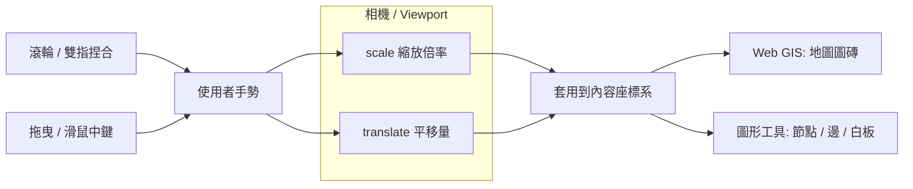
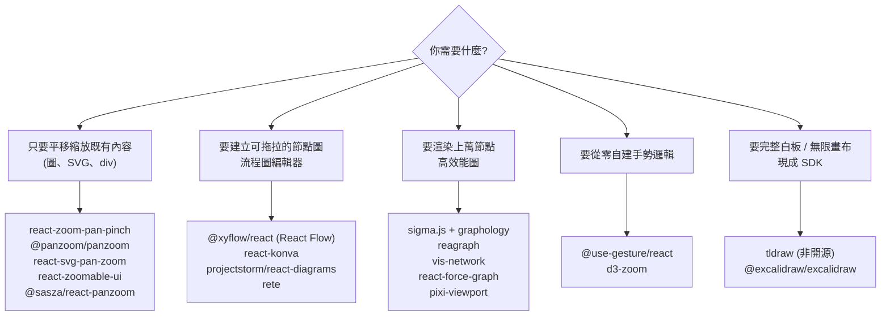
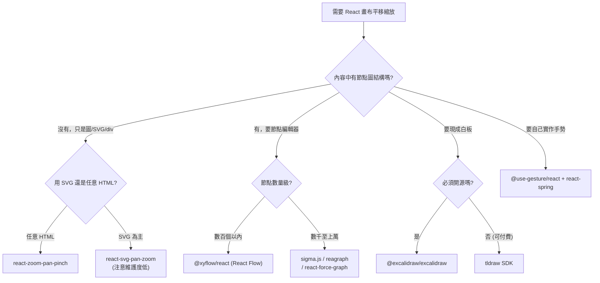

# React 圖形畫布的平移與縮放 (Pan / Zoom Viewport) 函式庫調查

## 摘要

本報告調查可用於 React 的「畫布式 UX」函式庫，也就是讓使用者能**滾輪縮放 (zoom in / out)**、**拖曳平移 (drag to pan)** 的無限或固定視埠 (viewport)。這類互動在概念上等同於 Web GIS (如 Leaflet、OpenLayers、CesiumJS) 提供的地圖平移縮放體驗，但應用對象不是地理地圖，而是**節點圖 (node graph)、流程圖 (flowchart)、白板 (whiteboard)、知識圖譜 (knowledge graph)** 等抽象內容[^gis]。

調查結果顯示，這些函式庫可依「你只想平移縮放既有內容」或「你要自己建立節點圖編輯器」分成不同層級；前者應選純 viewport 函式庫，後者則應選節點圖框架或高效能圖渲染引擎。本報告全部事實均來自網路檢索，並以改良式 APA 格式標註來源。

## 一、問題定義：什麼是「畫布式平移縮放」

「平移縮放視埠」的核心是一組**相機 (camera) 概念**：畫面本身不動，而是改變一個內含內容的座標系 (transform)，使用者透過手勢改變這個座標系的**縮放倍率 (scale)** 與**平移位移 (translate)**[^zoombehav]。這與 Web GIS 的地圖平移縮放完全相同，差別只在於底層內容是地圖圖磚 (tiles) 還是圖形節點。

下圖說明同一套互動模型如何泛用於地圖與圖形：

一般使用者期待的手勢包含：滑鼠滾輪或觸控板縮放、雙指捏合 (pinch)、拖曳背景平移、以及「以游標為中心縮放 (zoom to point)」等[^zoombehav]。

## 二、函式庫分類

依「介入深度」可分成五類，選擇哪一類取決於你的需求：

### 2.1 純視埠函式庫 (Generic Pan/Zoom Viewport)

這一類只負責把「任意 HTML / SVG 內容」放進一個可平移縮放的容器，不涉及圖形資料結構。若你已有自己的圖形繪製邏輯 (例如自己畫 SVG 節點)，只需外掛這層互動，這類最適合。

| 函式庫 | npm 套件 | Stars | 授權 | 最新版本 (發佈時間) |
|---|---|---|---|---|
| react-zoom-pan-pinch | `react-zoom-pan-pinch` | 1,950[^gh_rzpp] | MIT[^gh_rzpp] | 4.2.0 (2026-09)[^npm_rzpp] |
| @panzoom/panzoom | `@panzoom/panzoom` | 2,470[^gh_panzoom] | MIT[^gh_panzoom] | 4.6.2[^npm_panzoom] |
| react-svg-pan-zoom | `react-svg-pan-zoom` | 696[^gh_rsvg] | MIT[^gh_rsvg] | 3.13.1 (2024-08)[^npm_rsvg] |
| react-zoomable-ui | `react-zoomable-ui` | 101[^gh_rzui] | MIT[^gh_rzui] | 0.11.0 (2023-01)[^npm_rzui] |
| @sasza/react-panzoom | `@sasza/react-panzoom` | 22[^gh_rpz] | MIT[^gh_rpz] | 1.20.0[^npm_rpz] |
| d3-zoom | `d3-zoom` | 535[^gh_d3z] | ISC[^gh_d3z] | 3.0.0[^npm_d3z] |

**react-zoom-pan-pinch** 是最直接的選擇：它讓任意 HTML DOM 元素 (如 ``、`
`) 支援縮放、平移與捏合手勢，無外部相依，並提供 `TransformWrapper` / `TransformComponent` 元件與 `useControls` hook 來程式化控制相機[^gh_rzpp]。原始碼為 TypeScript，近期仍在活躍更新 (2026-10 仍有提交)[^gh_rzpp]。

**@panzoom/panzoom** 是框架無關 (framework-agnostic) 的引擎，使用 CSS transform 達成 GPU 加速的平移縮放，體積小，可用 ref 包進 React。支援任意元素 (canvas、SVG、影片、iframe) 與焦點縮放 `zoomToPoint`[^gh_panzoom]。

**react-svg-pan-zoom** 針對 SVG 特化，內建工具列與迷你地圖 (minimap)，但最後一次發佈為 2024-08，維護度偏低，新專案需留意[^npm_rsvg][^gh_rsvg]。

**react-zoomable-ui** 與 **@sasza/react-panzoom** 功能完整，但社群規模小、更新不活躍 (前後者最後發佈分別為 2023 與 2026-07)，適合利基情境而非長期主力[^gh_rzui][^gh_rpz]。

**d3-zoom** 是 D3 生態的平移縮放行為模組，可作用於 SVG、HTML 或 Canvas，成熟穩定但非 React 原生，需以 `useEffect` + ref 整合[^gh_d3z]。

### 2.2 節點圖 / 流程圖編輯器框架

若你要建立**可拖拉節點、連接邊**的編輯器，這類框架已內建平移縮放視埠，不需另尋。

| 函式庫 | npm 套件 | Stars | 授權 | 最新版本 |
|---|---|---|---|---|
| React Flow | `@xyflow/react` | 38,695[^gh_xyflow] | MIT[^gh_xyflow] | 12.12.0[^npm_xyflow] |
| react-konva | `react-konva` + `konva` | 6,434[^gh_rkonva] | MIT[^gh_rkonva] | 19.3.2[^npm_rkonva] |
| projectstorm/react-diagrams | `@projectstorm/react-diagrams` | 9,431[^gh_rd] | MIT[^gh_rd] | 2025-04 後趨緩[^gh_rd] |
| rete | `rete` | 12,293[^gh_rete] | MIT[^gh_rete] | 活躍[^gh_rete] |

**React Flow (`@xyflow/react`)** 是目前最主流的節點式 UI 函式庫，內建拖曳平移、滾輪/捏合縮放、迷你地圖、控制按鈕、背景格線，並支援自訂節點與邊 (任何 React 元件都能當節點)[^gh_xyflow]。若你的目標就是「知識圖譜 / 流程圖編輯器」，這是最推薦的起點。舊套件 `react-flow-renderer` 與 `reactflow` 已分別被 v11、v12 取代，新專案應直接使用 `@xyflow/react`[^gh_xyflow]。

**react-konva** 是 Konva 2D canvas 場景圖 (scene graph) 的 React 綁定，適合白板、設計編輯器等「畫在 canvas 上」的應用；其平移縮放需透過 Konva `Stage` 的 scale/position 自行管理，而非獨立外掛[^gh_rkonva]。

**projectstorm/react-diagrams** 是歷史悠久的 React 圖表函式庫，但近年提交趨緩 (最後推送 2025-04)，維護風險較高[^gh_rd]。**rete** 則專注於視覺化程式設計 (visual programming) 的節點編輯器，活躍開發中[^gh_rete]。

### 2.3 高效能圖渲染引擎 (WebGL / Canvas)

當節點數達數千至上萬，DOM 或 SVG 方案會有效能瓶頸，需改用 WebGL / Canvas 渲染引擎。這些引擎同樣具備平移縮放視埠。

| 函式庫 | npm 套件 | Stars | 授權 | 最新版本 |
|---|---|---|---|---|
| sigma.js | `sigma` (+ `graphology`) | 12,191[^gh_sigma] | MIT[^gh_sigma] | 4.0.3[^npm_sigma] |
| cytoscape.js | `cytoscape` (+ `react-cytoscapejs`) | 11,237[^gh_cyto] | MIT[^gh_cyto] | 3.34.4[^gh_cyto] |
| vis-network | `vis-network` | 3,632[^gh_vis] | Apache-2.0[^gh_vis] | 10.1.2[^gh_vis] |
| react-force-graph | `react-force-graph-2d` | 3,325[^gh_rfg] | MIT[^gh_rfg] | 1.29.2[^npm_rfg] |
| reagraph | `reagraph` | 1,097[^gh_reagraph] | Apache-2.0[^gh_reagraph] | 4.32.0[^gh_reagraph] |
| pixi-viewport | `pixi-viewport` (+ PixiJS) | 1,221[^gh_pixiv] | MIT[^gh_pixiv] | 6.0.3[^gh_pixiv] |

**sigma.js** 專為「數千節點與邊」的圖視覺化設計，以 WebGL 渲染，搭配 `graphology` 資料結構[^gh_sigma]。**cytoscape.js** 是成熟的圖論分析與視覺化函式庫，提供 `react-cytoscapejs` React 封裝[^gh_cyto]。**react-force-graph** 提供 2D/3D/VR/AR 的力導向圖 React 元件[^gh_rfg]。**reagraph** 則是較新的 React 專用 WebGL 圖元件[^gh_reagraph]。

**pixi-viewport** 是 PixiJS 的高度可配置 2D 相機/視埠，支援慣性拖曳、跟隨目標、邊界回彈、滑鼠邊緣捲動等；它是通用相機引擎而非圖論函式庫，適合用 PixiJS 自建高效能畫布時使用[^gh_pixiv]。

### 2.4 手勢底層工具

若你不想依賴現成視埠，想自行組裝手勢邏輯：

- **@use-gesture/react** (9,620 stars, MIT[^gh_usegesture])：提供 `useDrag`、`usePinch`、`useWheel` 等 hook，是手勢「原語 (primitive)」，需自行組合成平移縮放邏輯；常與動畫函式庫 `react-spring` 搭配[^gh_usegesture]。
- **d3-zoom**：見 2.1 節，可直接對任意選取 (selection) 綁定平移縮放手勢[^gh_d3z]。

### 2.5 完整白板 / 無限畫布 SDK

若你要的是「拿來就能用的無限畫布」，而非自己組裝，需特別注意授權：

| 專案 | npm 套件 | Stars | 授權 | 備註 |
|---|---|---|---|---|
| Excalidraw | `@excalidraw/excalidraw` | 134,000[^gh_excal] | MIT[^gh_excal] | 開源、可作 React 元件[^gh_excal] |
| tldraw | `tldraw` | 50,958[^gh_tldraw] | **非開源 (source-available)**[^tldraw_lic] | 正式環境需商業授權[^tldraw_lic] |

**Excalidraw** 是 MIT 授權的手繪風白板，其 npm 套件 `@excalidraw/excalidraw` 明確設計為可嵌入的 React 元件[^gh_excal]。

**tldraw** 雖然 GitHub 星數極高，但其 SDK 採用**專有、僅原始碼可見 (source-available) 的授權，並非開源授權**。預設授權僅允許在開發環境使用；正式環境 (Production) 需申請商業授權或 100 天試用授權；免費的 Hobby 授權僅限非商業用途，且會在畫布顯示 "made with tldraw" 浮水印[^tldraw_lic]。若你的專案要求開源或商用免費，應避免採用 tldraw SDK。

## 三、選型建議

要點整理：

- **只想平移縮放既有 DOM 內容**：首選 `react-zoom-pan-pinch`；框架無關且輕量則選 `@panzoom/panzoom`。
- **要建節點圖 / 流程圖編輯器**：首選 `@xyflow/react` (React Flow)。
- **節點數量龐大需 WebGL**：選 `sigma.js`、`reagraph` 或 `react-force-graph`。
- **要自建手勢層**：用 `@use-gesture/react` 或 `d3-zoom`。
- **要現成無限畫布**：開源選 `@excalidraw/excalidraw`；`tldraw` 僅在能接受其非開源授權時使用。

## 四、來源可信度與限制反思

1. **Stars 與版本的時效性**：本報告的 GitHub stars 與最後提交時間取自 GitHub REST API，版本號取自 npm registry / registry 的 `latest` 端點，皆為查詢當下 (2026-10-17) 的快照，會隨時間變動[^ghapi][^npmapi]。
2. **搜尋引擎資料為二手整理**：部分函式庫定位描述最初由搜尋結果彙整，本報告盡量以 GitHub API 與 npm registry 的官方資料交叉驗證 (stars、授權、版本)，但個別「最佳用途」屬於綜合判斷，讀者仍應實際試用。
3. **授權需以官方文本為準**：尤其 `tldraw` 的非開源授權條款細節，建議直接閱讀其官方 LICENSE 與定價頁面；本報告僅摘要其要旨[^tldraw_lic]。
4. **維護度警訊**：`react-svg-pan-zoom`、`react-zoomable-ui`、`projectstorm/react-diagrams` 三者提交或發佈時間較久，長期專案應評估接手維護成本[^npm_rsvg][^gh_rzui][^gh_rd]。
5. **未涵蓋範圍**：本報告聚焦「視埠互動」與「圖形框架」，未深入各函式庫的無障礙 (a11y)、SSR 相容性、行動裝置效能細節，這些需依個別專案另行驗證。

[^gis]: Web GIS 泛指在網頁上提供地圖平移、縮放、圖層疊加等互動的地理資訊系統；其相機模型 (平移 + 縮放) 與本報告所述的圖形畫布視埠相同。

[^zoombehav]: Timmy Willison. (n.d.). Panzoom — Pan and zoom elements anywhere using native transformations. Retrieved 2026-10-17, from https://github.com/timmywil/panzoom

[^ghapi]: GitHub, Inc. (n.d.). GitHub REST API — Repositories. Retrieved 2026-10-17, from https://docs.github.com/en/rest/repos/repos

[^npmapi]: npm, Inc. (n.d.). npm registry API — package metadata. Retrieved 2026-10-17, from https://registry.npmjs.org

[^gh_rzpp]: BetterTyped. (n.d.). react-zoom-pan-pinch: React library to support easy zoom, pan, pinch on various HTML DOM elements. GitHub. Retrieved 2026-10-17, from https://github.com/BetterTyped/react-zoom-pan-pinch

[^npm_rzpp]: npm. (2026). react-zoom-pan-pinch (Version 4.2.0) [Computer software]. Retrieved 2026-10-17, from https://registry.npmjs.org/react-zoom-pan-pinch/latest

[^gh_panzoom]: Willison, T. (n.d.). panzoom: A library for panning and zooming elements using CSS transforms. GitHub. Retrieved 2026-10-17, from https://github.com/timmywil/panzoom

[^npm_panzoom]: npm. (2026). @panzoom/panzoom (Version 4.6.2) [Computer software]. Retrieved 2026-10-17, from https://registry.npmjs.org/@panzoom/panzoom/latest

[^gh_rsvg]: Vadala, C. (n.d.). react-svg-pan-zoom: A React component that adds pan and zoom features to SVG. GitHub. Retrieved 2026-10-17, from https://github.com/chrvadala/react-svg-pan-zoom

[^npm_rsvg]: npm. (2024). react-svg-pan-zoom (Version 3.13.1) [Computer software]. Retrieved 2026-10-17, from https://registry.npmjs.org/react-svg-pan-zoom/latest

[^gh_rzui]: Dail, A. (n.d.). react-zoomable-ui: Build zoomable UI with React. GitHub. Retrieved 2026-10-17, from https://github.com/aarondail/react-zoomable-ui

[^npm_rzui]: npm. (2023). react-zoomable-ui (Version 0.11.0) [Computer software]. Retrieved 2026-10-17, from https://registry.npmjs.org/react-zoomable-ui/latest

[^gh_rpz]: sasza2. (n.d.). react-panzoom. GitHub. Retrieved 2026-10-17, from https://github.com/sasza2/react-panzoom

[^npm_rpz]: npm. (2026). @sasza/react-panzoom (Version 1.20.0) [Computer software]. Retrieved 2026-10-17, from https://registry.npmjs.org/@sasza/react-panzoom/latest

[^gh_d3z]: D3. (n.d.). d3-zoom: Pan and zoom SVG, HTML or Canvas using mouse or touch input. GitHub. Retrieved 2026-10-17, from https://github.com/d3/d3-zoom

[^npm_d3z]: npm. (2021). d3-zoom (Version 3.0.0) [Computer software]. Retrieved 2026-10-17, from https://registry.npmjs.org/d3-zoom/latest

[^gh_xyflow]: xyflow. (n.d.). React Flow | Svelte Flow — Powerful open source libraries for building node-based UIs. GitHub. Retrieved 2026-10-17, from https://github.com/xyflow/xyflow

[^npm_xyflow]: npm. (2026). @xyflow/react (Version 12.12.0) [Computer software]. Retrieved 2026-10-17, from https://registry.npmjs.org/@xyflow/react/latest

[^gh_rkonva]: KonvaJS. (n.d.). react-konva: React components for the Konva 2D canvas library. GitHub. Retrieved 2026-10-17, from https://github.com/konvajs/react-konva

[^npm_rkonva]: npm. (2026). react-konva (Version 19.3.2) [Computer software]. Retrieved 2026-10-17, from https://registry.npmjs.org/react-konva/latest

[^gh_rd]: projectstorm. (n.d.). react-diagrams: a super simple, no-nonsense diagramming library written in React. GitHub. Retrieved 2026-10-17, from https://github.com/projectstorm/react-diagrams

[^gh_rete]: retejs. (n.d.). rete: JavaScript framework for visual programming. GitHub. Retrieved 2026-10-17, from https://github.com/retejs/rete

[^gh_sigma]: Jacomy, A., & Plique, G. (n.d.). sigma.js: A JavaScript library aimed at visualizing graphs of thousands of nodes and edges. GitHub. Retrieved 2026-10-17, from https://github.com/jacomyal/sigma.js

[^npm_sigma]: npm. (2026). sigma (Version 4.0.3) [Computer software]. Retrieved 2026-10-17, from https://registry.npmjs.org/sigma/latest

[^gh_cyto]: Cytoscape. (n.d.). cytoscape.js: Graph theory (network) library for visualisation and analysis. GitHub. Retrieved 2026-10-17, from https://github.com/cytoscape/cytoscape.js

[^gh_vis]: vis.js. (n.d.). vis-network: Display dynamic, automatically organised, customizable network views. GitHub. Retrieved 2026-10-17, from https://github.com/visjs/vis-network

[^gh_rfg]: Vasturiano, V. (n.d.). react-force-graph: React component for 2D, 3D, VR and AR force directed graphs. GitHub. Retrieved 2026-10-17, from https://github.com/vasturiano/react-force-graph

[^npm_rfg]: npm. (2026). react-force-graph-2d (Version 1.29.2) [Computer software]. Retrieved 2026-10-17, from https://registry.npmjs.org/react-force-graph-2d/latest

[^gh_reagraph]: reaviz. (n.d.). reagraph: WebGL Graph Visualizations for React. GitHub. Retrieved 2026-10-17, from https://github.com/reaviz/reagraph

[^gh_pixiv]: pixijs-userland. (n.d.). pixi-viewport: A highly configurable viewport/2D camera designed to work with pixi.js. GitHub. Retrieved 2026-10-17, from https://github.com/pixijs-userland/pixi-viewport

[^gh_usegesture]: pmndrs. (n.d.). use-gesture: Bread n butter utility for component-tied mouse/touch gestures in React and Vanilla JavaScript. GitHub. Retrieved 2026-10-17, from https://github.com/pmndrs/use-gesture

[^gh_excal]: Excalidraw. (n.d.). Excalidraw: Virtual whiteboard for sketching hand-drawn like diagrams. GitHub. Retrieved 2026-10-17, from https://github.com/excalidraw/excalidraw

[^gh_tldraw]: tldraw. (n.d.). tldraw: Build infinite canvas apps in React with the tldraw SDK. GitHub. Retrieved 2026-10-17, from https://github.com/tldraw/tldraw

[^tldraw_lic]: tldraw, Inc. (n.d.). tldraw SDK license. Retrieved 2026-10-17, from https://github.com/tldraw/tldraw/blob/main/LICENSE.md
