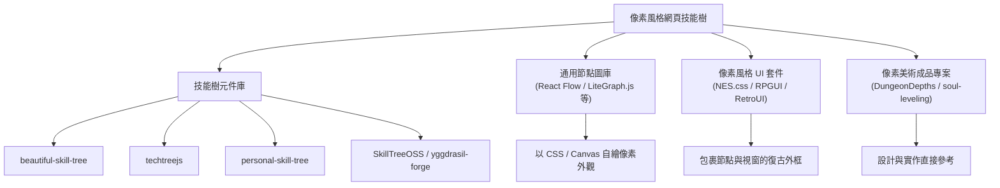

# 網頁像素風格科技樹／技能樹之自由開源專案調查

## 摘要

本報告調查「可在網頁上呈現像素風格（pixel art／復古 8-bit、16-bit）科技樹（tech tree）或技能樹（skill tree）」的自由開源（FOSS, Free and Open Source Software）專案。經實際檢索 GitHub 後可歸納出四類資源：(1) 專為技能樹設計的元件庫；(2) 通用節點圖／流程圖編輯器，可再自行套用像素風格；(3) 像素風格 UI 套件，提供周邊按鈕、視窗、進度條等素材；(4) 本身就是像素美術網頁遊戲或應用的專案，可作為設計與實作參考。整體而言，**同時具備「網頁原生」與「開箱即用的像素風格技能樹元件」兩項條件的專案並不多**，多數情況需以通用節點圖庫或像素 UI 套件自行組裝。

## 背景：什麼是科技樹／技能樹

科技樹（tech tree）或技能樹（skill tree）是電子遊戲與學習系統中常見的視覺化呈現方式：將多個「節點」（技能、科技、能力）以「連線」（前置條件、解鎖關係）串接成有向圖，玩家或學習者須先滿足某些前置節點，才能解鎖後續節點。此類圖形通常允許平移與縮放，並以不同外觀（可用、鎖定、已解鎖）區分節點狀態。

在網頁實作上，技能樹的技術核心是「節點圖（node graph）」或「有向無環圖（DAG, Directed Acyclic Graph）」的排版與互動，而「像素風格」則屬於視覺層（CSS、Canvas 渲染、字型與圖示）。

## 第一類：專為技能樹／科技樹設計的元件庫

### beautiful-skill-tree

React 與 TypeScript 撰寫的技能樹元件庫，提供 `<SkillProvider>`、`<SkillTreeGroup>`、`<SkillTree>` 等元件，支援可折疊群組、篩選、自訂主題與鍵盤導覽。授權為 GPL-3.0，約 390 顆星，程式庫本身最後一次推送為 2024-05-04，社群普遍認為維護趨緩[^bst]。

[^bst]: andrico1234. (n.d.). *beautiful-skill-tree*. GitHub. Retrieved 2026-10-17, from https://github.com/andrico1234/beautiful-skill-tree

### techtreejs

早期（2014 年）的 JavaScript 遊戲科技樹函式庫，以 D3.js 搭配 SVG 渲染，資料以 JSON 描述，節點可帶 .png 圖示，並支援「可負擔／鎖定」狀態與節點選取的回呼覆寫。專案自 2015 年後未再更新，約 18 顆星[^ttjs]。其像素風格需仰賴自行提供的圖示素材。

[^ttjs]: 7yl4r. (n.d.). *techtreejs*. GitHub. Retrieved 2026-10-17, from https://github.com/7yl4r/techtreejs

### personal-skill-tree

以 TypeScript 搭配 D3.js 製作的「RPG 風格天賦樹」網頁應用，可透過 CSS 與 JSON 高度自訂外觀，授權 MIT，約 38 顆星[^pst]。由於外觀完全由 CSS 控制，較容易改造成像素風格。

[^pst]: janu-sh. (n.d.). *personal-skill-tree*. GitHub. Retrieved 2026-10-17, from https://github.com/janu-sh/personal-skill-tree

### SkillTreeOSS

Next.js 搭配 ReactFlow 與 Dagre 自動排版的遊戲化學習平台，內含拖放式視覺化編輯器（`/builder`）與多種主題（含 RPG 主題）。授權 MIT，約 12 顆星，於 2026 年仍持續更新[^stoss]。此專案同時涵蓋「檢視」與「編輯」兩種需求。

[^stoss]: Preptics. (n.d.). *SkillTreeOSS*. GitHub. Retrieved 2026-10-17, from https://github.com/Preptics/SkillTreeOSS

### yggdrasil-forge

TypeScript 單一倉庫（monorepo）形式的「進度圖引擎」，涵蓋技能樹、課程地圖與科技樹，提供 React 渲染器、瀏覽器內視覺化編輯器（PWA）、CLI、驗證器、外掛系統、SVG 渲染與 JSON Schema。授權 MIT[^ygf]。專案相當新、星數極低（約 1 顆星），適合關注其架構設計。

[^ygf]: fraga-labs. (n.d.). *yggdrasil-forge*. GitHub. Retrieved 2026-10-17, from https://github.com/fraga-labs/yggdrasil-forge

### skill-tree-planner

以原生 JavaScript（ES6+）與 HTML5 Canvas 實作的技能樹「編輯器與模擬器」，支援拖拉、縮放、AND／OR／SUM 相依邏輯、播放模式與 JSON 匯入匯出。授權 MIT，約 4 顆星[^stp]。Canvas 架構對像素級繪製較為友善。

[^stp]: CommanderFoo. (n.d.). *skill-tree-planner*. GitHub. Retrieved 2026-10-17, from https://github.com/CommanderFoo/skill-tree-planner

### interactive-skill-tree-builder

React 18 搭配 TypeScript 與 ReactFlow 的互動式技能樹建構器，支援拖拉節點、連線管理、技能解鎖、搜尋與 localStorage 持久化，節點依「鎖定／可解鎖／已解鎖」上色。無標示授權，星數為 0[^istb]。

[^istb]: hazu100. (n.d.). *interactive-skill-tree-builder*. GitHub. Retrieved 2026-10-17, from https://github.com/hazu100/interactive-skill-tree-builder

### bl2skills.com

《邊境之地 2》(Borderlands 2) 的技能計算器網頁應用，為純前端技能樹規劃器，使用復古風格的技能圖示。授權 MIT，約 33 顆星，最後推送為 2022-07-13[^bl2]。此為商業遊戲技能樹 UI 的開源參考實作。

[^bl2]: seigler. (n.d.). *bl2skills.com*. GitHub. Retrieved 2026-10-17, from https://github.com/seigler/bl2skills.com

## 第二類：通用節點圖／流程圖函式庫（可套像素風格）

由於「開箱即用且帶像素風格的技能樹元件」稀少，實務上更常見的做法是採用通用節點圖庫，再以 CSS 或 Canvas 自行繪製像素外觀。以下為主要選項，資料以各專案 GitHub 頁面與 API 為準：

| 函式庫 | 星數 | 授權 | 技術 | 維護狀態 |
|---|---|---|---|---|
| React Flow (xyflow)[^xyflow] | 約 38,696 | MIT | React／Svelte，DOM＋SVG | 非常活躍 |
| Rete.js[^rete] | 約 12,300 | MIT | 框架無關（React／Vue／Angular…） | 中等 |
| LiteGraph.js[^lite] | 約 8,200 | MIT | 原生 JS，Canvas2D | 低（單一維護者） |
| Drawflow[^draw] | 約 6,100 | MIT | 原生 JS，DOM | 低 |
| BaklavaJS[^bak] | 約 2,100 | MIT | Vue | 活躍 |

[^xyflow]: xyflow. (n.d.). *xyflow (React Flow / Svelte Flow)*. GitHub. Retrieved 2026-10-17, from https://github.com/xyflow/xyflow
[^rete]: retejs. (n.d.). *Rete.js*. GitHub. Retrieved 2026-10-17, from https://github.com/retejs/rete
[^lite]: jagenjo. (n.d.). *LiteGraph.js*. GitHub. Retrieved 2026-10-17, from https://github.com/jagenjo/litegraph.js
[^draw]: jerosoler. (n.d.). *Drawflow*. GitHub. Retrieved 2026-10-17, from https://github.com/jerosoler/Drawflow
[^bak]: newcat. (n.d.). *BaklavaJS*. GitHub. Retrieved 2026-10-17, from https://github.com/newcat/baklavajs

上述星數與維護狀態為檢索當下所見，**維護狀態的判讀具有時效性**，實際採用前應再次確認最新提交日期。

其中 React Flow 以 DOM 元素渲染節點，可直接以 CSS（例如 `image-rendering: pixelated`、像素字型、像素邊框）完成像素風格，彈性最高；LiteGraph.js 以 Canvas2D 逐像素繪製，對「像素級控制」最直接，且為熱門節點式工具 ComfyUI 的底層；其餘則多為 DOM 或框架特定方案。

## 第三類：像素風格 UI 套件（技能樹周邊外觀）

以下套件本身不是技能樹，但可提供像素風格的按鈕、視窗、進度條與字型，用來包裹技能樹節點：

| 專案 | 星數 | 授權 | 說明 |
|---|---|---|---|
| NES.css[^nes] | 約 21,837 | MIT | 8-bit 任天堂紅白機風格 CSS 框架 |
| RPGUI[^rpgui] | 約 958 | zlib | 老派 RPG 網頁 GUI（邊框、血條、可拖曳視窗） |
| Pixel RetroUI (RetroUI)[^retro] | 約 482 | BSD-3-Clause | React／Next.js 像素化元件庫 |
| pxlkit[^pxl] | 約 120 | 混合（程式 MIT／圖示 CC-BY-NC） | 復古像素元件庫＋200 餘枚像素 SVG 圖示 |
| PixelArtUI React[^paui] | 約 12 | MIT | 受 8-bit／16-bit 啟發的像素元件庫 |

[^nes]: nostalgic-css. (n.d.). *NES.css*. GitHub. Retrieved 2026-10-17, from https://github.com/nostalgic-css/NES.css
[^rpgui]: RonenNess. (n.d.). *RPGUI*. GitHub. Retrieved 2026-10-17, from https://github.com/RonenNess/RPGUI
[^retro]: Dksie09. (n.d.). *Pixel RetroUI*. GitHub. Retrieved 2026-10-17, from https://github.com/Dksie09/RetroUI
[^pxl]: Joangeldelarosa. (n.d.). *pxlkit*. GitHub. Retrieved 2026-10-17, from https://github.com/Joangeldelarosa/pxlkit
[^paui]: Pixelartui. (n.d.). *pixelartui-react*. GitHub. Retrieved 2026-10-17, from https://github.com/Pixelartui/pixelartui-react

其中 NES.css 為純 CSS、幾無相依，最易與前述任一技能樹方案搭配使用。

## 第四類：本身就是像素美術的網頁技能樹專案

若需要「貼近成品」的參考，以下專案已把像素美術與技能樹結合：

- **DungeonDepths**：可自架的瀏覽器版《暗黑破壞神》風格動作 RPG，以原生 JS＋HTML5 Canvas 實作，採等角像素美術，含各職業技能樹。無標示授權，約 2 顆星[^dd]。
- **soul-leveling**：《我獨自升級》主題的個人成長 RPG 網頁應用（PWA），含技能樹、技能系統與像素風 RPG 介面。授權 MIT，約 6 顆星[^sl]。
- **Skill-Tree (NatashaCreatesCode)**：原生 JavaScript 的遊戲化學習技能樹，含 15 個技能、4 個階層與 150 題測驗解鎖機制，採深色 RPG 風格。無標示授權，星數為 0[^ncc]。
- **aetherial-alchemy**：以 React＋Vite 製作的 D&D 5e 藥水調製系統，含互動式配方技能樹與 8-bit 像素風格（使用 Press Start 2P 像素字型）。授權 MIT，星數為 0[^aa]。

[^dd]: sdeveer. (n.d.). *DungeonDepths*. GitHub. Retrieved 2026-10-17, from https://github.com/sdeveer/DungeonDepths
[^sl]: HorusRento. (n.d.). *soul-leveling*. GitHub. Retrieved 2026-10-17, from https://github.com/HorusRento/soul-leveling
[^ncc]: NatashaCreatesCode. (n.d.). *Skill-Tree*. GitHub. Retrieved 2026-10-17, from https://github.com/NatashaCreatesCode/Skill-Tree
[^aa]: caaatto. (n.d.). *aetherial-alchemy*. GitHub. Retrieved 2026-10-17, from https://github.com/caaatto/aetherial-alchemy

## 關聯性示意

下圖整理「像素風格網頁技能樹」的技術組裝方式，說明四個類別之間的關係：

## 選擇建議

| 需求情境 | 建議方案 |
|---|---|
| React 專案、要有現成技能樹元件 | beautiful-skill-tree（但為 GPL-3.0 且維護趨緩） |
| React 專案、要活躍且高度可自訂 | React Flow 自建節點＋CSS 像素風格 |
| 需要逐像素的 Canvas 控制 | LiteGraph.js（注意維護趨緩） |
| Vue 專案 | BaklavaJS |
| 同時要「檢視」與「編輯」 | SkillTreeOSS 或 yggdrasil-forge |
| 需要像素風格外框、按鈕、字型 | NES.css（純 CSS，最易整合） |
| 需要有像素美術的完整參考品 | DungeonDepths、soul-leveling、aetherial-alchemy |

## 來源批判與反思

本報告資料以 GitHub 官方 API 與各專案頁面為主要來源，屬第一手且可查證，取得時間為 2026-10-17。須留意以下限制：

1. **星數會變動**：本報告所列星數為檢索當下的快照，僅供相對比較，不宜視為絕對標準。
2. **維護狀態具時效性**：GitHub 星數高不代表持續維護。部分熱門元件（如 beautiful-skill-tree、LiteGraph.js）已有數年未更新，採用前務必確認最新提交日期與相容性。
3. **「像素風格」多為事後加工**：除少數遊戲專案外，多數函式庫並非原生像素風格，而是由使用者以 CSS 或 Canvas 自行改造；因此「開箱即用且像素風的技能樹元件」在開源生態中相對稀少。
4. **低星專案存疑**：本報告納入部分星數極低（0 至 12 星）之專案，因其主題高度契合本次調查且屬新興專案。此類專案程式碼品質、安全性與長期維護皆未經社群驗證，採用時應自行審閱原始碼。
5. **授權差異**：各專案授權不一（MIT、GPL-3.0、BSD-3-Clause、zlib、CC-BY-NC 等），部分專案未標示授權。商用或再散布前必須逐一確認授權條款；GPL-3.0 具傳染性，pxlkit 的圖示為非商業授權，尤須注意。

## 參考文獻

andrico1234. (n.d.). *beautiful-skill-tree*. GitHub. Retrieved 2026-10-17, from https://github.com/andrico1234/beautiful-skill-tree

7yl4r. (n.d.). *techtreejs*. GitHub. Retrieved 2026-10-17, from https://github.com/7yl4r/techtreejs

janu-sh. (n.d.). *personal-skill-tree*. GitHub. Retrieved 2026-10-17, from https://github.com/janu-sh/personal-skill-tree

Preptics. (n.d.). *SkillTreeOSS*. GitHub. Retrieved 2026-10-17, from https://github.com/Preptics/SkillTreeOSS

fraga-labs. (n.d.). *yggdrasil-forge*. GitHub. Retrieved 2026-10-17, from https://github.com/fraga-labs/yggdrasil-forge

CommanderFoo. (n.d.). *skill-tree-planner*. GitHub. Retrieved 2026-10-17, from https://github.com/CommanderFoo/skill-tree-planner

hazu100. (n.d.). *interactive-skill-tree-builder*. GitHub. Retrieved 2026-10-17, from https://github.com/hazu100/interactive-skill-tree-builder

seigler. (n.d.). *bl2skills.com*. GitHub. Retrieved 2026-10-17, from https://github.com/seigler/bl2skills.com

xyflow. (n.d.). *xyflow (React Flow / Svelte Flow)*. GitHub. Retrieved 2026-10-17, from https://github.com/xyflow/xyflow

retejs. (n.d.). *Rete.js*. GitHub. Retrieved 2026-10-17, from https://github.com/retejs/rete

jagenjo. (n.d.). *LiteGraph.js*. GitHub. Retrieved 2026-10-17, from https://github.com/jagenjo/litegraph.js

jerosoler. (n.d.). *Drawflow*. GitHub. Retrieved 2026-10-17, from https://github.com/jerosoler/Drawflow

newcat. (n.d.). *BaklavaJS*. GitHub. Retrieved 2026-10-17, from https://github.com/newcat/baklavajs

nostalgic-css. (n.d.). *NES.css*. GitHub. Retrieved 2026-10-17, from https://github.com/nostalgic-css/NES.css

RonenNess. (n.d.). *RPGUI*. GitHub. Retrieved 2026-10-17, from https://github.com/RonenNess/RPGUI

Dksie09. (n.d.). *Pixel RetroUI*. GitHub. Retrieved 2026-10-17, from https://github.com/Dksie09/RetroUI

Joangeldelarosa. (n.d.). *pxlkit*. GitHub. Retrieved 2026-10-17, from https://github.com/Joangeldelarosa/pxlkit

Pixelartui. (n.d.). *pixelartui-react*. GitHub. Retrieved 2026-10-17, from https://github.com/Pixelartui/pixelartui-react

sdeveer. (n.d.). *DungeonDepths*. GitHub. Retrieved 2026-10-17, from https://github.com/sdeveer/DungeonDepths

HorusRento. (n.d.). *soul-leveling*. GitHub. Retrieved 2026-10-17, from https://github.com/HorusRento/soul-leveling

NatashaCreatesCode. (n.d.). *Skill-Tree*. GitHub. Retrieved 2026-10-17, from https://github.com/NatashaCreatesCode/Skill-Tree

caaatto. (n.d.). *aetherial-alchemy*. GitHub. Retrieved 2026-10-17, from https://github.com/caaatto/aetherial-alchemy
