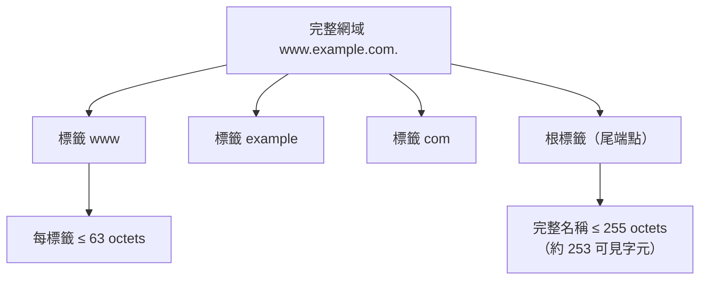
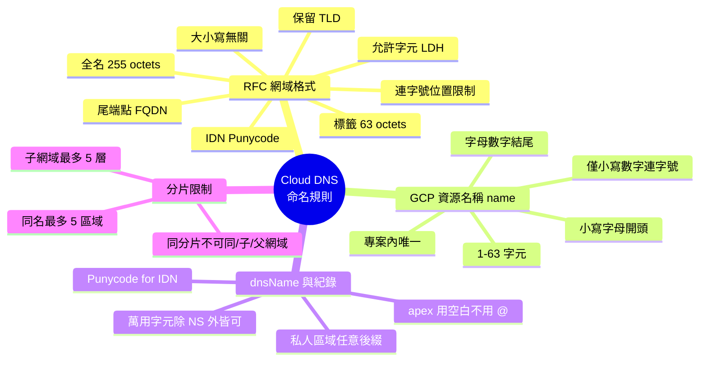

# GCP (Google Cloud) DNS 域名格式與命名規則

## 摘要

Google Cloud 的雲端 DNS 服務稱為 **Cloud DNS**，用於代管公開與私人 DNS 區域（managed zone）[^zones]。使用 Cloud DNS 時會遇到兩套彼此相關但不同的命名規則：一套是**網域本身的格式規則**（遵循 IETF 的 RFC 標準），另一套是**Google Cloud 資源層級的命名規則**（例如 managed zone 的資源名稱）。本報告分別說明這兩套規則，並整理 Cloud DNS 特有的限制，例如同位址名稱伺服器分片（shard）的重疊限制、萬用字元紀錄，以及國際化網域名稱（IDN）的處理方式。

## 1. 背景：兩種「名稱」的區別

在 Cloud DNS 中建立一個託管區域時，至少有兩個欄位涉及命名：

| 欄位 | 意義 | 範例 |
|---|---|---|
| `name`（資源名稱／zone name） | Google Cloud 專案內部的資源識別名稱 | `my-example-zone` |
| `dnsName`（DNS 名稱／DNS name suffix） | 這個區域所代管的實際網域後綴 | `example.com.` |

`name` 只是 Google Cloud 專案內的資源標籤；`dnsName` 才是真正對外的網域名稱[^managedzones]。兩者的格式規則不同，必須分別理解。

## 2. 網域本身格式：RFC 標準

DNS 網域格式主要由 RFC 1035 定義，並由 RFC 1123 放寬部分限制[^rfc1035][^rfc1123]。



### 2.1 允許字元（LDH 規則）

一般標籤只能使用 **字母（A–Z、a–z）、數字（0–9）與連字號（-）**，稱為 LDH（Letter-Digit-Hyphen）語法[^rfc1035]。RFC 1035 原先要求標籤必須以字母開頭、以字母或數字結尾；RFC 1123 進一步放寬，允許標籤**以數字開頭**[^rfc1123]。

不允許的字元包括底線（`_`）、空白、`@`、`#`、`$`、`%`、`&`、`*`、`+` 等符號[^rfc1035]。需注意部分特殊用途協定標籤（例如 SRV 紀錄的 `_sip`、`_tcp`）會以底線開頭，但這些屬於特定協定用途，並非一般可註冊的網域標籤[^rfc1035]。

### 2.2 連字號位置限制

連字號不得出現在標籤的開頭或結尾[^rfc1035]。此外，RFC 5891 規定 Unicode 字串**不得在第 3、4 個字元位置出現連續兩個連字號（`--`）**，因為 `xn--` 前綴被保留給 Punycode 編碼使用[^rfc5891]。

| 位置 | 是否允許 | 範例 |
|---|---|---|
| 標籤中間 | 允許 | `my-domain.com` |
| 標籤開頭 | 不允許 | `-domain.com` |
| 標籤結尾 | 不允許 | `domain-.com` |
| 第 3、4 位置連續連字號 | 不允許（保留給 `xn--`） | `ab--cd.com` |

### 2.3 長度限制

- **單一標籤**上限為 **63 octets**[^rfc1035]。
- **完整網域名稱**上限為 **255 octets**（換算為文字表示約 **253 個可見字元**），此限制來自 DNS 線路格式（wire format）中標籤長度欄位與根標籤的保留位元[^rfc1035]。

### 2.4 大小寫

DNS 比對為**大小寫無關**（case-insensitive）：`Example.com`、`EXAMPLE.COM` 與 `example.com` 視為相同名稱[^rfc1035]。註冊商通常統一以小寫儲存。

### 2.5 尾端點與 FQDN

在 DNS 線路格式中，每個網域名稱都以根的空標籤（null label，長度為 0）結尾[^rfc1035]。文字表示上，這個根標籤以**尾端點（trailing dot）**表示。帶有尾端點的名稱是**完整網域名稱（FQDN, Fully Qualified Domain Name）**，代表名稱已完整、不需要再做後綴展開；RFC 1123 亦指出「尾端點是表示名稱已完整的慣用方法」[^rfc1123]。

- `www.example.com.` → FQDN（絕對、無歧義）
- `www.example.com` → 相對名稱（解析器可能附加搜尋後綴）

### 2.6 國際化網域名稱（IDN）與 Punycode

IDN 允許非 ASCII 字元（中文、阿拉伯文、西里爾文等），透過 **Punycode** 編碼（RFC 3492）轉為 ASCII 相容編碼（ACE），並加上 `xn--` 前綴[^rfc3492][^rfc5891]。例如 `münchen.de` 編碼為 `xn--mnchen-3ya.de`。**63 octets 的標籤長度限制是套用在編碼後的形式，而非 Unicode 顯示形式**[^rfc5891]。

### 2.7 保留的頂級網域

RFC 2606 與 RFC 6761 定義了永久保留、不可註冊的頂級網域[^rfc2606][^rfc6761]：

| 保留 TLD | 用途 |
|---|---|
| `.test` | 測試用途 |
| `.example` | 文件與範例 |
| `.invalid` | 保證無效（回傳 NXDOMAIN） |
| `.localhost` | 回送（loopback） |

此外，`example.com`、`example.net`、`example.org` 三個第二層網域也被保留供文件使用[^rfc2606]。

## 3. Google Cloud 資源名稱（zone `name`）規則

Cloud DNS 的 managed zone 資源名稱（`name` 欄位）有一組明確限制[^managedzones]：

| 規則 | 規格 |
|---|---|
| 長度 | 1–63 個字元 |
| 起始字元 | 必須為**字母** |
| 結尾字元 | 必須為**字母或數字** |
| 允許字元 | 僅允許**小寫字母（a–z）、數字（0–9）、連字號（-）** |
| 唯一性 | 必須在專案內唯一 |

官方文件未提供明確的 regex，但依上述描述可表示為：

```
^[a-z][a-z0-9-]{0,61}[a-z0-9]$
```

（單一字元名稱則為例外，僅 `[a-z]`。）

注意此處**不允許大寫字母**，與一般 DNS 的大小寫無關規則不同；`name` 是 Google Cloud 資源識別名稱，規範更嚴格。

## 4. Cloud DNS 的 DNS 名稱（`dnsName`）

`dnsName` 是區域所代管的實際網域，例如 `example.com.`[^managedzones]。其規則如下：

- **格式**：標準 DNS 網域名稱，可接受選用的尾端點。
- **IDN 支援**：支援國際化網域名稱；使用 gcloud CLI 或 API 時必須以 **Punycode** 形式提供（例如 `ελ` 對應 `xn--qxam`），Google Cloud 主控台則會自動編碼[^international-domains]。
- **公開區域（public zone）**：必須是你在註冊商實際擁有的網域。
- **私人區域（private zone）**：可使用任意 DNS 後綴（例如 `example.private`、`internal.company`）[^zones]。

### 4.1 紀錄名稱（record name）

資源紀錄的名稱必須以該區域的 DNS 名稱為後綴[^records]。不同工具的操作方式不同：

- **主控台**：只需輸入子網域部分（例如 `www`）；頂點（apex）紀錄則留空。主控台會自動附加區域後綴與尾端點[^records]。
- **gcloud CLI**：需指定完整 DNS 名稱（例如 `test.example.com` 或 `test.example.com.`）[^records]。
- **API**：`name` 欄位必須是完整 DNS 名稱並帶尾端點，例如 `test.example.com.`[^records]。

**頂點紀錄的陷阱**：`@` 符號在 Cloud DNS 中會被**字面解讀**，不會被視為區域頂點。在 `example.com.` 區域中，對 `@` 建立的紀錄會被解讀為 `@.example.com.`，而非 `example.com.`[^troubleshooting]。因此建立頂點紀錄時應留空（主控台）或使用完整網域名稱（API／gcloud）。

### 4.2 萬用字元紀錄

萬用字元紀錄支援**所有紀錄類型，但 `NS` 紀錄除外**[^json-record]。格式為 `*` 或完整名稱如 `*.example.com.`[^json-record]。

### 4.3 長度與配額

Cloud DNS 遵循標準 DNS 長度限制，並有自身配額[^quotas][^records-overview]：

| 項目 | 限制 |
|---|---|
| DNS 標籤長度 | 63 字元 |
| 完整 FQDN 長度 | 253 字元 |
| TXT 紀錄單一字串 | 255 字元 |
| TXT 紀錄總長度 | 1000 字元（可洽支援提高） |
| 每區域的資源紀錄集（RRSet） | 10,000（預設配額） |
| 每個 RRSet 的資源紀錄 | 10,000 |
| 每次變更的 rrdata 大小 | 100,000 bytes |
| 每次變更的新增／刪除數 | 各 1,000 |
| UDP DNS 回應大小 | 1,440 bytes |
| TCP DNS 回應大小 | 65,533 bytes |
| NS 委派的名稱伺服器數 | 8 |
| 每專案 managed zone 數 | 10,000（預設配額） |
| 每區域標籤（labels） | 64 個，每個 key/value 128 bytes |

## 5. Cloud DNS 特有的重疊與分片限制

Cloud DNS 會將每個**公開** managed zone 指派到五個名稱伺服器**分片（shard A–E）**之一。若同一個分片上已存在下列任一情形，新的區域就無法再被指派到該分片[^zones]：

- **相同 DNS 名稱**（例如另一個 `domain.example.tld`）
- **子網域**（例如 `sub.domain.example.tld`）
- **父網域**（例如 `example.tld`）

由此產生以下硬性限制：

- **相同 DNS 名稱最多 5 個區域**（每個分片一個）。
- **每個父網域最多 5 層子網域**。
- 若子網域佔滿全部 5 個分片，父網域將**無法**建立。

> **實務建議**：永遠**先建立父網域區域，再建立子網域區域**[^zones]。

其他重疊規則[^zones]：

- **公開區域之間的重疊不允許**（同一組名稱伺服器上）。
- **公開＋私人區域重疊允許**：私人區域可與任何公開區域重疊。
- **跨 VPC 的私人＋私人重疊允許**：不同 VPC 網路可各自擁有相同 DNS 名稱的區域。
- **同一 VPC 內的私人＋私人重疊受限**：同一 VPC 中的兩個私人區域不能有相同來源，除非其中一個是另一個的子網域（採最長後綴比對）。

### 5.1 NS 與 SOA 紀錄

Cloud DNS 在建立區域時會**自動建立** NS 與 SOA 紀錄；使用者**不得變更**區域的 NS 紀錄名稱或 Cloud DNS 所選的名稱伺服器清單[^zones]。

## 6. 綜合對照表



## 7. 結論

Cloud DNS 的命名規則可拆成兩層理解：

1. **網域格式層**：遵循 RFC 1035／1123 的 LDH 規則、63 octets 標籤上限、255 octets 全名上限、大小寫無關、尾端點 FQDN 慣例，以及 IDN 的 Punycode 編碼，並避開 RFC 2606／6761 保留的頂級網域。
2. **Google Cloud 資源層**：zone 的 `name` 欄位更嚴格，僅允許小寫字母、數字與連字號，且須以字母開頭、在專案內唯一；`dnsName` 則遵循網域格式，私人區域可使用任意後綴。

實務上最常見的踩雷點是：誤以為 `name` 可用大寫、在頂點紀錄使用 `@`（Cloud DNS 會字面解讀），以及未先建立父網域就建立子網域而觸發分片限制。

## 參考文獻

[^zones]: Google Cloud. (n.d.). *Create, modify, and delete zones*. Cloud DNS documentation. Retrieved 2026-10-17, from https://cloud.google.com/dns/docs/zones

[^managedzones]: Google Cloud. (n.d.). *REST Resource: managedZones*. Cloud DNS API reference. Retrieved 2026-10-17, from https://cloud.google.com/dns/docs/reference/v1/managedZones

[^international-domains]: Google Cloud. (n.d.). *Create a zone with an Internationalized Domain Name*. Cloud DNS documentation. Retrieved 2026-10-17, from https://cloud.google.com/dns/docs/zones/international-domains

[^records]: Google Cloud. (n.d.). *Add, modify, and delete records*. Cloud DNS documentation. Retrieved 2026-10-17, from https://cloud.google.com/dns/docs/records

[^records-overview]: Google Cloud. (n.d.). *Records overview*. Cloud DNS documentation. Retrieved 2026-10-17, from https://cloud.google.com/dns/docs/records-overview

[^json-record]: Google Cloud. (n.d.). *JSON record example*. Cloud DNS documentation. Retrieved 2026-10-17, from https://cloud.google.com/dns/docs/records/json-record

[^quotas]: Google Cloud. (n.d.). *Quotas and limits*. Cloud DNS documentation. Retrieved 2026-10-17, from https://cloud.google.com/dns/quotas

[^troubleshooting]: Google Cloud. (n.d.). *Troubleshooting*. Cloud DNS documentation. Retrieved 2026-10-17, from https://cloud.google.com/dns/docs/troubleshooting

[^rfc1035]: Mockapetris, P. (1987, November). *Domain names - implementation and specification* (RFC 1035). Internet Engineering Task Force. Retrieved 2026-10-17, from https://www.ietf.org/rfc/rfc1035.txt

[^rfc1123]: Braden, R. (1989, October). *Requirements for Internet Hosts - Application and Support* (RFC 1123). Internet Engineering Task Force. Retrieved 2026-10-17, from https://datatracker.ietf.org/doc/html/rfc1123

[^rfc2606]: Eastlake, D., & Panitz, A. (1999, February). *Reserved Top Level DNS Names* (RFC 2606). Internet Engineering Task Force. Retrieved 2026-10-17, from https://www.ietf.org/rfc/rfc2606.txt

[^rfc3492]: Costello, A. (2003, March). *Punycode: A Bootstring encoding of Unicode for Internationalized Domain Names in Applications (IDNA)* (RFC 3492). Internet Engineering Task Force. Retrieved 2026-10-17, from https://www.ietf.org/rfc/rfc3492.txt

[^rfc5891]: Klensin, J. (2010, August). *Internationalized Domain Names in Applications (IDNA): Protocol* (RFC 5891). Internet Engineering Task Force. Retrieved 2026-10-17, from https://datatracker.ietf.org/doc/html/rfc5891

[^rfc6761]: Cheshire, S., & Krochmal, M. (2013, February). *Special-Use Domain Names* (RFC 6761). Internet Engineering Task Force. Retrieved 2026-10-17, from https://datatracker.ietf.org/doc/html/rfc6761
