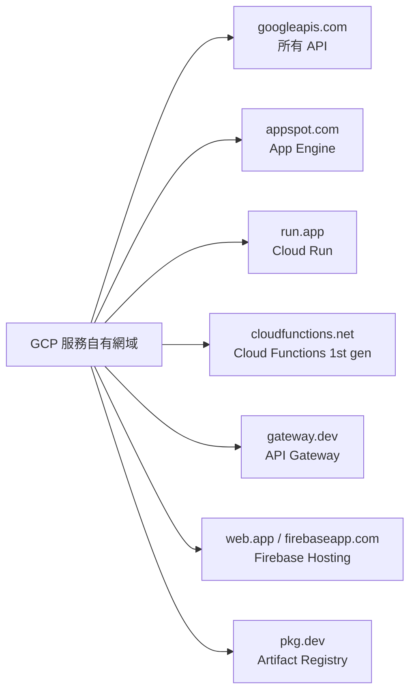
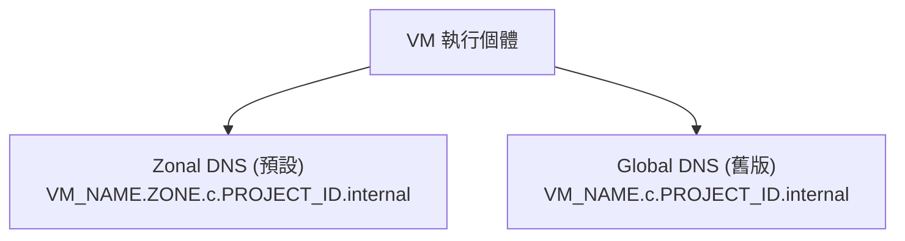
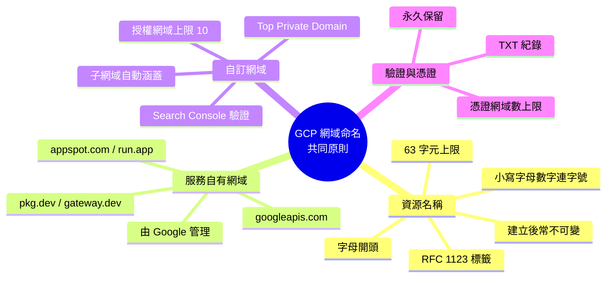

# GCP 各產品的網域名稱格式與命名規則總覽

## 摘要

本報告整理 **Google Cloud Platform（GCP）多個產品**在「網域名稱」層面的格式與命名規則，而非僅限單一 DNS 產品。GCP 生態系中會出現三種不同層次的名稱，必須先區分：

1. **品牌自有的服務網域**（service-owned domain），例如 `*.googleapis.com`、`*.run.app`、`*.appspot.com` 等，由 Google 擁有並自動指派。
2. **資源識別名稱**（resource name），例如 project ID、Cloud Run 服務名稱、Cloud Storage bucket 名稱，這些名稱會直接影響預設主機名稱。
3. **自訂網域**（custom domain），由使用者擁有並透過 DNS 記錄與 Google 驗證後綁定。

理解這三層後，各產品看似紛亂的規則其實可歸納為幾條共同原則：資源名稱多半採「RFC 1123 DNS 標籤」規則（小寫字母、數字、連字號，字母開頭、數字或字母結尾），而自訂網域則一律需要透過 Google Search Console 進行網域所有權驗證，且通常只能驗證「頂級私人網域（top private domain）」，子網域由父網域自動涵蓋。

## 1. Google 服務自有網域對照表

GCP 為各產品指派了專屬的服務網域。以下整理產品與其預設主機名稱格式[^service-domains][^cloud-run-domain][^firebase-hosting][^artifact-names][^cloud-endpoints][^appengine-routing][^iam-sa]。

| 服務網域 | 對應產品 | 典型主機名稱格式 |
|---|---|---|
| `googleapis.com` | 所有 Cloud API | `SERVICE_NAME.googleapis.com` |
| `appspot.com` | App Engine（Standard／Flexible） | `PROJECT_ID.REGION_ID.r.appspot.com` |
| `run.app` | Cloud Run（與 Cloud Run functions 2nd gen） | `[TAG---]SERVICE_NAME-PROJECT_NUMBER.REGION.run.app` |
| `cloudfunctions.net` | Cloud Functions 1st gen | `REGION-PROJECT_ID.cloudfunctions.net/FUNCTION_NAME` |
| `gateway.dev` | API Gateway | `GATEWAY_ID-HASH.REGION_CODE.gateway.dev` |
| `cloudworkstations.dev` | Cloud Workstations | `PORT-WORKSTATION_NAME.CLUSTER_ID.cloudworkstations.dev` |
| `firebaseapp.com` | Firebase Hosting | `PROJECT_ID.firebaseapp.com` |
| `web.app` | Firebase Hosting | `PROJECT_ID.web.app` |
| `firebasestorage.app` | Cloud Storage for Firebase | `PROJECT_ID.firebasestorage.app` |
| `pkg.dev` | Artifact Registry | `LOCATION-docker.pkg.dev/PROJECT_ID/REPO/IMAGE` |
| `gcr.io` | Container Registry（已落日） | `[LOCATION.]gcr.io/PROJECT_ID/IMAGE` |
| `cloud.goog` | Cloud Endpoints | `API_NAME.endpoints.PROJECT_ID.cloud.goog` |
| `gserviceaccount.com` | IAM 服務帳戶 | `SA_NAME@PROJECT_ID.iam.gserviceaccount.com` |
| `googleusercontent.com` | 使用者／自動產生內容 | 各種子網域格式 |

## 2. 專案層級識別名稱：命名規則的根源

許多預設主機名稱都嵌入 **project ID**，因此 project ID 的命名規則會直接傳導到各產品的網域上[^projects]。

| 屬性 | 規則 |
|---|---|
| 長度 | 6–30 個字元 |
| 允許字元 | 小寫字母（a–z）、數字（0–9）、連字號（-） |
| 開頭 | 必須為字母 |
| 結尾 | 必須為字母或數字（不可為連字號） |
| 唯一性 | 全球唯一 |
| 可否重用 | 不可；專案刪除後 ID 永久保留、無法再用 |
| 保留字串 | 不可包含 `google`、`ssl`、`undefined`、`null` |
| 可否修改 | 不可（建立時固定） |

相對地，**project name** 只是顯示用標籤（4–30 字元、可含空白與部分符號、可修改、不要求唯一、不影響任何 API 或 URL）；**project number** 則是由 Google 指派的純數字識別碼（如 `847193562410`），不可修改且全球唯一，常見於服務帳戶名稱等[^projects]。

## 3. Compute Engine VM 的內部 DNS 名稱

Compute Engine 會為每個 VM 自動建立 `.internal` 區域的 A 與 PTR 紀錄，並有兩種命名格式[^internal-dns]：

| 類型 | 格式 | 唯一性範圍 |
|---|---|---|
| Zonal DNS（2018-09-06 後建立之專案預設） | `VM_NAME.ZONE.c.PROJECT_ID.internal` | 同一 zone 內唯一（可跨 zone 重用） |
| Global DNS（舊版） | `VM_NAME.c.PROJECT_ID.internal` | 整個專案唯一 |

重點限制[^internal-dns]：

- 自動 DNS 紀錄**僅**針對 `nic0` 網路介面的主要內部 IPv4 位址建立；不對其他介面、外部 IP、別名 IP 範圍或 IPv6 建立。
- 解析僅在**同一 VPC 網路、同一專案**內有效（Shared VPC 有例外，需用 FQDN 查詢）。
- 中繼資料伺服器為 `metadata.google.internal`，IP 為 `169.254.169.254`（IPv6 為 `fd20:ce::254`）。
- **自訂主機名稱（custom hostname）** 需符合 RFC 1035：至少兩個以點分隔的標籤，每標籤符合 `[a-z]([-a-z0-9]*[a-z0-9])?`、1–63 字元、總長 ≤ 253 字元；建立後不可變更，且自訂主機名稱**不會**由內部 DNS 自動解析，須自行設定 DNS 紀錄[^internal-dns]。

## 4. Cloud Storage Bucket 名稱

儲存桶名稱規則較為寬鬆，但涉及網域時有額外要求[^bucket-naming]：

- 允許字元：小寫字母、數字、連字號（-）、底線（_）、點（.）；**不允許大寫與空白**。
- 一般名稱長度 **3–63 字元**；**含點的名稱**（視為網域）總長可達 **222 字元**，但每個以點分隔的元件（label）≤ 63 字元。
- 名稱必須以字母或數字開頭與結尾。
- **不可**為點分十進位 IP 位址（如 `192.168.5.4`）。
- **不可**以 `goog` 開頭；**不可**包含 `google` 或其近似拼法（如 `g00gle`）。
- 儲存桶名稱**全球唯一**。

當 bucket 名稱含點（例如 `bucket.example.com`）時，Cloud Storage 會將其視為網域，需先完成**網域所有權驗證**，且名稱結尾須為現行可辨識的頂級網域[^bucket-naming]。

Bucket 名稱如何對應到主機名稱[^bucket-naming]：

| 存取方式 | URL 格式 |
|---|---|
| XML API（虛擬主機樣式） | `https://BUCKET_NAME.storage.googleapis.com/OBJECT` |
| XML API（路徑樣式） | `https://storage.googleapis.com/BUCKET_NAME/OBJECT` |
| JSON API | `https://storage.googleapis.com/storage/v1/b/BUCKET_NAME/o/OBJECT` |
| 已驗證瀏覽器下載 | `https://storage.cloud.google.com/BUCKET_NAME/OBJECT` |
| 自訂網域（CNAME） | 指向 `c.storage.googleapis.com.`（僅 HTTP、單一 bucket、僅子網域） |

若要在 DNS 紀錄中使用儲存桶名稱，建議遵循標準 DNS 慣例：避免底線與 `..`、`.-`、`-.` 等連續字元[^bucket-naming]。

## 5. 無伺服器產品的預設網域與自訂網域

### 5.1 App Engine

- 預設主機名稱：`PROJECT_ID.REGION_ID.r.appspot.com`（2020 年 2 月後建立）；服務與版本使用 `-dot-` 記法，例如 `VERSION-dot-SERVICE-dot-PROJECT_ID.REGION_ID.r.appspot.com`[^appengine-routing]。
- 自訂網域可對應裸網域（`example.com`）、子網域或**萬用字元**（從第三層子網域起支援，例如 `*.example.com`）[^appengine-domain]。
- 網域驗證須透過 Google Search Console 的 **Domain Property（DNS 層級）** 方法，且須由專案 **Owner** 執行；每個專案最多可驗證 **10 個授權網域**[^appengine-domain]。
- Managed SSL 憑證**不支援萬用字元**，萬用字元網域需自備憑證；萬用字元憑證僅支援一層子網域[^appengine-domain]。

### 5.2 Cloud Run

- 預設 URL 有兩種形式[^cloud-run-domain]：
  - 決定性（deterministic）：`https://[TAG---]SERVICE_NAME-PROJECT_NUMBER.REGION.run.app`，僅當 DNS 段（服務名＋專案號＋流量標記）≤ 63 字元時提供。
  - 非決定性：`https://[TAG---]SERVICE_IDENTIFIER.run.app`，以雜湊值構成，無法預測但穩定。
- 服務名稱限制：**≤ 49 字元**、專案內每區域唯一、建立後不可變更、公開可見；修訂版本名稱須以 `SERVICE-` 開頭且 ≤ 63 字元[^cloud-run-domain]。
- 自訂網域對應（Preview）目前**限制為 64 字元**，不支援萬用字元憑證、無法上傳自管憑證，且僅在特定區域提供[^cloud-run-domain]。
- 網域驗證同樣須驗證**基礎網域**（例如要對應 `sub.example.com` 需驗證 `example.com`）[^cloud-run-domain]。

### 5.3 Cloud Functions

- 1st gen：`https://REGION-PROJECT_ID.cloudfunctions.net/FUNCTION_NAME`[^service-domains]。
- 2nd gen（Cloud Run functions）底層為 Cloud Run：透過 `gcloud functions` 部署時使用 `cloudfunctions.net` 形式，直接以 Cloud Run 管理時則為 `FUNCTION_NAME-HASH-REGION.a.run.app`[^service-domains]。
- 2nd gen 函式名稱須符合 **RFC 1123 DNS 標籤**：小寫字母、數字、連字號，字母開頭、不可連字號結尾、≤ 63 字元；不可底線、不可駝峰、不可數字開頭[^service-domains]。

### 5.4 Firebase Hosting

- 每個專案免費獲得兩個預設網域：`PROJECT_ID.web.app` 與 `PROJECT_ID.firebaseapp.com`[^firebase-hosting]。
- 可連接裸網域或子網域；DNS 須設定 A 紀錄指向 `199.36.158.100`（Anycast），並以永久 TXT 紀錄驗證所有權[^firebase-hosting]。
- **每個裸網域最多 20 個子網域**（受 SSL 憑證 SAN 數量限制）[^firebase-hosting]。
- **不原生支援萬用字元子網域**（`*.example.com`）[^firebase-hosting]。
- 驗證頂級網域即自動涵蓋其所有子網域；驗證 TXT 紀錄須永久保留以利憑證續約[^firebase-hosting]。

## 6. API 與工作負載產品的預設網域

- **API Gateway**：`https://GATEWAY_ID-HASH.REGION_CODE.gateway.dev`；SSL 由 Google 自動管理，且**不原生支援自訂網域**，需前置 HTTP(S) 負載平衡器[^service-domains]。
- **Cloud Workstations**：`https://PORT-WORKSTATION_NAME.CLUSTER_ID.cloudworkstations.dev`；URL 需含埠號前綴（預設 `80`）。自訂網域需私人叢集、PSC 後端負載平衡器與 `*.DOMAIN` 萬用字元憑證[^service-domains]。
- **Cloud Endpoints**：使用 `cloud.goog` 網域，格式為 `YOUR_API_NAME.endpoints.YOUR_PROJECT_ID.cloud.goog`；`cloud.goog` 與 `appspot.com` 皆由 Google 擁有與管理[^cloud-endpoints]。
- **Artifact Registry**：主機名稱格式為 `LOCATION-docker.pkg.dev`（LOCATION 可為區域或多區域），其他格式如 `LOCATION-maven.pkg.dev`、`LOCATION-npm.pkg.dev` 等[^artifact-names]。
- **Container Registry（已落日）**：`gcr.io`、`us.gcr.io`、`eu.gcr.io`、`asia.gcr.io`；現由 Artifact Registry 以預先定義的對應儲存庫承接，例如 `gcr.io` 對應 `us` 多區域中名為 `gcr.io` 的儲存庫[^artifact-names]。

## 7. 負載平衡器與 SSL 憑證的網域規則

External Application Load Balancer 透過 **URL map** 依主機名稱與路徑路由[^lb-url-map]：

- **Host rules（`hostRules`）**：將一或多個主機名稱導向單一 path matcher；同一 URL map 中兩條 host rule **不得**含相同主機名稱[^lb-url-map]。
- **萬用字元**：`*` 可匹配任意主機名稱；`*.example.net` 可匹配 `news.example.net`、`finance.example.net`[^lb-url-map]。
- **正規表達式**：僅特定 LB 模式（全域外部、區域外部、內部 ALB）支援，且須使用 **RE2** 語法；傳統 ALB 不支援[^lb-url-map]。
- **路徑規則**：`pathPattern` 與 `pathSubstitution` 各限 **250 字元**[^lb-url-map]。

SSL 憑證網域限制[^lb-url-map]：

| 憑證類型 | 每張憑證網域上限 | 單一網域長度 |
|---|---|---|
| Compute Engine 代管憑證 | 100（不可提高） | 首個網域 64 bytes；其餘 253 bytes |
| Certificate Manager（負載平衡器授權） | 5 | 253 字元 |
| Certificate Manager（DNS 授權） | 100 | 237 字元 |
| Certificate Manager（每專案 DNS 授權 + Google CA） | — | 220 字元 |

HTTPS 負載平衡器的網域僅支援**小寫**字元[^lb-url-map]。代管憑證的網域驗證採負載平衡器授權或 DNS 授權；A／AAAA 紀錄須指向負載平衡器 IP，否則狀態會變成 `FAILED_NOT_VISIBLE`[^lb-url-map]。

## 8. 自訂網域驗證與 OAuth 授權網域

多數 GCP 自訂網域功能共用同一套驗證機制[^oauth-domains][^appengine-domain][^cloud-run-domain]：

- 驗證方式為 **Google Search Console** 的 **Domain Property（DNS TXT 紀錄）** 方法。
- 只能加入 **Top Private Domain**（可註冊的頂級私人網域，例如 `example.com`）；加入後其**所有子網域與頁面**自動涵蓋，**不能**直接加入子網域。
- OAuth 同意畫面（OAuth consent screen）的授權網域上限為 **10 個**；須由專案 Owner 或 Editor 以其 Google 帳號驗證。
- 授權網域必須**先於**重新導向 URI、首頁 URL、隱私政策 URL、服務條款 URL 設定。
- **Identity-Aware Proxy（IAP）** 無獨立網域規則，共用同一套 OAuth 同意畫面與授權網域；IAP 若設定 `login_hint`，該網域必須是已驗證的 Google Workspace 網域。

## 9. 共同原則歸納

1. **資源名稱層**：project ID、bucket、Cloud Run 服務、Cloud Functions 2nd gen 名稱等，大多遵循 RFC 1123／1035 DNS 標籤規則（小寫、數字、連字號），並有長度上限（常見 63 字元），且建立後通常不可變更。
2. **服務自有網域層**：由 Google 指派，格式固定且不可自訂，例如 `*.run.app`、`*.appspot.com`、`*.pkg.dev`；想換成自有網域時，多數服務需透過負載平衡器或特定的網域對應功能。
3. **自訂網域層**：一律須完成網域所有權驗證，且驗證對象是「頂級私人網域」而非子網域。
4. **驗證與憑證層**：驗證多用 DNS TXT 紀錄（Search Console），且 TXT 紀錄須永久保留以支援 SSL 憑證續約；憑證每張可容納的網域數量因類型而異（5 至 100 個）。

## 10. 結論

GCP 沒有一套單一的「網域命名規則」，而是由三層機制交織而成：**RFC 標準的網域格式**、**各產品資源識別名稱的命名限制**，以及**服務自有網域的固定格式**。實務上最容易出錯的地方在於：誤以為可以自訂服務自有網域、在需要子網域時直接驗證子網域（實際上只能驗證頂級私人網域），以及忽略各產品對資源名稱（尤其是 Cloud Run、Cloud Functions 2nd gen 與 Cloud Storage）的字元與長度限制。掌握上述共同原則後，即可推知多數 GCP 產品的網域行為。

## 參考文獻

[^service-domains]: Google Cloud. (n.d.). *Cloud Run functions documentation*. Retrieved 2026-10-17, from https://cloud.google.com/functions/docs

[^cloud-run-domain]: Google Cloud. (n.d.). *Map custom domains*. Cloud Run documentation. Retrieved 2026-10-17, from https://cloud.google.com/run/docs/mapping-custom-domains

[^firebase-hosting]: Google. (n.d.). *Connect a custom domain*. Firebase Hosting documentation. Retrieved 2026-10-17, from https://firebase.google.com/docs/hosting/custom-domain

[^artifact-names]: Google Cloud. (n.d.). *Repository and image names*. Artifact Registry documentation. Retrieved 2026-10-17, from https://cloud.google.com/artifact-registry/docs/docker/names

[^cloud-endpoints]: Google Cloud. (n.d.). *Configure Endpoints*. Cloud Endpoints documentation. Retrieved 2026-10-17, from https://cloud.google.com/endpoints/docs/openapi/configure-endpoints

[^appengine-routing]: Google Cloud. (n.d.). *How requests are routed*. App Engine documentation. Retrieved 2026-10-17, from https://cloud.google.com/appengine/docs/standard/how-requests-are-routed

[^appengine-domain]: Google Cloud. (n.d.). *Mapping custom domains*. App Engine documentation. Retrieved 2026-10-17, from https://cloud.google.com/appengine/docs/standard/mapping-custom-domains

[^iam-sa]: Google Cloud. (n.d.). *Service account types*. IAM documentation. Retrieved 2026-10-17, from https://cloud.google.com/iam/docs/service-account-types

[^projects]: Google Cloud. (n.d.). *Creating and managing projects*. Resource Manager documentation. Retrieved 2026-10-17, from https://cloud.google.com/resource-manager/docs/creating-managing-projects

[^internal-dns]: Google Cloud. (n.d.). *Using internal DNS*. Compute Engine documentation. Retrieved 2026-10-17, from https://cloud.google.com/compute/docs/networking/using-internal-dns

[^bucket-naming]: Google Cloud. (n.d.). *Bucket naming guidelines*. Cloud Storage documentation. Retrieved 2026-10-17, from https://cloud.google.com/storage/docs/naming-buckets

[^lb-url-map]: Google Cloud. (n.d.). *URL maps overview*. Cloud Load Balancing documentation. Retrieved 2026-10-17, from https://cloud.google.com/load-balancing/docs/url-map-concepts

[^oauth-domains]: Google. (n.d.). *Manage OAuth app branding: authorized domains*. Google Cloud support. Retrieved 2026-10-17, from https://support.google.com/cloud/answer/15549049
