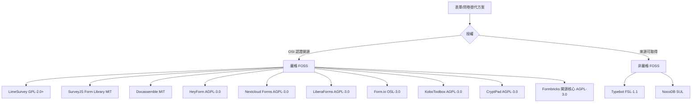

# Google Forms 的自由開源（FOSS）替代方案

## 摘要

本文整理了 2026 年可用於取代 Google Forms 的自由及開源軟體（Free and Open Source Software，以下簡稱 FOSS）表單與問卷工具。遴選標準為：具備原始碼公開授權、可自行架設（self-host）、且截至 2026 年 10 月仍在維護。本文依「維護狀態」與「授權是否為 OSI 認證的開源授權」兩軸進行分類，並提醒讀者注意若干知名專案（如 Typebot、NocoDB）在 2026 年已改用「來源可取得（source-available）」而非開源授權，以及 TellForm、OhMyForm 等專案已封存（archived）而不再維護[^scope]。

需要先釐清的是，「FOSS」在嚴格定義下僅包含 OSI（Open Source Initiative）認證的授權。然而表單工具生態中，許多受歡迎的專案採用「開源核心 + 專有企業版」（open-core）模式：核心以 AGPL-3.0 等開源授權釋出，但部分進階功能位於受專有授權保護的目錄中。本文會逐一標示，避免讀者誤以為「整包都是開源」[^opencore]。

---

## 名詞與分類定義

- **自架（Self-host）**：可部署於自己的伺服器或 Docker，資料不離開自有基礎設施。
- **開源核心（Open-core）**：主要程式碼為開源授權，但某些功能目錄受專有企業授權約束。
- **來源可取得（Source-available）**：原始碼公開可讀，但授權並非 OSI 認證（例如限制商業轉售），嚴格來說不算 FOSS[^fsl]。

下圖說明本文的分類邏輯：

---

## 一、嚴格 FOSS 且內建表單建構器（推薦）

### 1. Formbricks

Formbricks 自我定位為「開放原始碼的 Qualtrics 替代方案」，主打產品內嵌（in-app）、網站、連結與電子郵件問卷[^formbricks-home]。截至 2026-10-17，其 GitHub 倉庫累積 13,114 顆星，使用 TypeScript／Next.js／PostgreSQL，最後一次推送為 2026-10-16，維護極為活躍[^formbricks-gh]。最新穩定版為 6.0.2（2026-10-01 發布），同時 6.1.0 已進入候選版本階段[^formbricks-rel]。

授權方面需特別注意其為**開源核心模式**：根目錄 `LICENSE` 載明，位於 `apps/web/modules/ee` 目錄的內容受專有企業授權約束；`packages/js/`、`packages/android/`、`packages/ios/`、`packages/api/` 等目錄為 MIT；其餘內容以 AGPLv3 釋出[^formbricks-license]。因此若要完整使用某些企業功能（如 SSO、進階權限），需購買授權，但一般問卷功能的自架使用仍屬開源範圍。

### 2. HeyForm

HeyForm 是主打「Typeform 風格」對話式表單的開源表單建構器，GitHub 描述為「Open-Source Form Builder」[^heyform-gh]。截至 2026-10-17 累積 9,031 顆星，預設分支為 `next`，最後推送 2026-10-15；最新版本為 v3.0.4（2026-10-15 發布），近期更新包含「支援 Logic Flow 的收斂路由與答案分支」、深色模式可讀性修正等[^heyform-rel]。授權為 AGPL-3.0，屬 OSI 認證的開源授權[^heyform-gh]。

使用體驗上它支援條件邏輯、多種結尾（multiple endings）、自訂 CSS 主題、以及 Slack／Zapier／Make／Google Sheets 等整合；官方網站亦列出 30 種以上整合[^heyform-home]。

### 3. OpnForm

OpnForm 是 PHP／Laravel（後端）搭配 Nuxt.js／Vue（前端）打造的開源表單建構器，GitHub 描述為「Beautiful Open-Source Form Builder」[^opnform-gh]。截至 2026-10-17 累積 3,845 顆星，最後推送 2026-10-14，最新版本 v2.6.0（2026-10-14 發布），該版本新增自架執行個體的自訂表單網址、改善分析資料保存與郵件整合可見度[^opnform-rel]。

授權同樣為開源核心模式：位於 `api/app/Enterprise` 目錄者受專有企業授權約束，其餘以 AGPLv3 釋出[^opnform-license]。功能包含條件欄位、計算欄位、單頁或多頁（Typeform 風格）版面、QR code、檔案上傳、Stripe 付款、REST API 與 webhook 等[^opnform-home]。

### 4. LimeSurvey

LimeSurvey 是本文中年資最久、功能最完整的問卷平台，自 2006 年持續發展，官方描述為「免費的 SurveyMonkey、Typeform、Qualtrics 與 Google Forms 替代方案」[^limesurvey-gh]。截至 2026-10-17 累積 3,767 顆星，最後推送 2026-10-16[^limesurvey-gh]。最新社群版為 7.6.0（build 261013，2026-10-13 發布）[^limesurvey-rel]。

授權為 GNU General Public License 第 2 版或任何後續版本（GPL-2.0-or-later）[^limesurvey-license]，社群版可 100% 免費自架，沒有問卷或作答數上限；營收來自雲端託管服務與商業外掛[^limesurvey-dl]。功能涵蓋 30 種以上題型、分支／跳題邏輯、80 種以上語言、WCAG 2.2 Level AA 無障礙標準、REST API 與各式研究用題型（conjoint、maxDiff 等）[^limesurvey-home]。

> **注意**：LimeSurvey 在 GitHub 上的授權欄位被標示為 `NOASSERTION`，這是因為其授權檔案未採用 GitHub 可自動辨識的標準範本；實際授權仍以官方授權頁與 `LICENSE` 檔案所載的 GPL-2.0+ 為準[^limesurvey-license]。

### 5. Nextcloud Forms

若組織已運行 Nextcloud，Forms 是最低摩擦的選擇：它是 Nextcloud 的官方表單與問卷 App，資料完全留在自家執行個體[^nextcloud-gh]。截至 2026-10-17 累積 384 顆星，最後推送 2026-10-17，最新版本 v5.4.0（2026-09-15 發布），新增提交同步至匯出檔、可自訂分享權杖等功能[^nextcloud-rel]。授權為 AGPL-3.0[^nextcloud-gh]。其特色是簡單、行動裝置友善，並支援 CSV 匯出與 webhook[^nextcloud-app]。

需注意它功能相對精簡，並非 LimeSurvey 那樣的重量級平台；且必須先有 Nextcloud 才能使用。

### 6. LiberaForms

LiberaForms 專注於「尊重隱私的表單」，支援端對端加密（E2EE）、表單到期設定、協作管理與個別作答 PDF 下載[^libera-home]。需特別說明的是：其 GitHub 上名為 `ngi-nix/liberaforms` 的倉庫早已封存，且星數極低；專案的正式維護地已於 2025-04-07 從 GitLab 遷移至 Codeberg 的 `LiberaForms/server`[^libera-codeberg]。查證 Codeberg API 顯示該倉庫仍在更新（最後更新 2026-10-16），最新版本為 v4.11.1（2026-09-12 發布），顯示專案仍在活躍維護[^libera-codeberg][^libera-rel]。授權為 AGPLv3[^libera-home]。

> **重要澄清**：部分二手比較文章仍以 GitHub／GitLab 舊址判定 LiberaForms「已封存、不再維護」，這在 2026 年已是**過時資訊**。正確的現行來源是 Codeberg[^libera-codeberg]。

---

## 二、程式庫與開發者取向

### 7. SurveyJS（Form Library）

SurveyJS 並非獨立應用，而是一套以 JSON 驅動的 JavaScript 表單程式庫，支援 React、Angular、Vue 3 與純 JavaScript[^surveyjs-gh]。截至 2026-10-17 累積 4,904 顆星，最後推送 2026-10-16，維護相當活躍[^surveyjs-gh]。其 Form Library 採 MIT 授權，是本文中授權最寬鬆者；但拖放式建構器（Survey Creator）與 Dashboard、PDF Generator 屬另外的產品與授權[^surveyjs-gh]。

它適合想在自己應用程式中嵌入表單、且自行處理資料儲存的開發者，而非尋求「開箱即用的填表平台」的使用者。

### 8. Form.io

Form.io 是「表單 + API 平台」的伺服器端無程式碼表單系統，使用 Node.js 與 MongoDB，支援 Angular／React／Vue[^formio-gh]。截至 2026-10-17 累積 2,323 顆星，最後推送 2026-10-14[^formio-gh]。授權為 Open Software License 3.0（OSL-3.0），屬 OSI 認證的 copyleft 授權[^formio-gh]。適合需要「表單即後端 API」的開發者情境。

### 9. Docassemble

Docassemble 是以 Python、YAML、Markdown 為基礎的引導式訪談與文件組裝專家系統，採 MIT 授權[^docassemble-gh]。截至 2026-10-17 累積 992 顆星，最後推送 2026-10-16，仍在維護[^docassemble-gh]。其定位非常專門：適合需要「依條件分支產生文件（如 PDF）」的法律、公部門或表單流程，而非一般問卷。

---

## 三、其他資料蒐集／鄰近領域工具

### 10. KoboToolbox

KoboToolbox 是為人道救援、發展與研究設計的資料蒐集、管理與視覺化平台，其伺服器元件 `kpi` 採 AGPL-3.0 授權[^kobo-gh]。其特色是支援離線蒐集：瀏覽器網頁表單與 Android 的 KoboCollect App 皆可在無網路環境下先下載表單再作答[^kobo-offline]。截至 2026-10-17，`kpi` 倉庫累積 186 顆星，最後推送 2026-10-16[^kobo-gh]。星數偏低的主因是其開發主要集中於自架部署與非營利領域，而非追求 GitHub 人氣。

### 11. CryptPad Forms

CryptPad 是一套端對端加密的協作辦公套件，其中包含表單（Forms）功能，採 AGPL-3.0 授權[^cryptpad-gh]。截至 2026-10-17 累積 8,010 顆星，最後推送 2026-10-16；最新版本為 2026.5.1（2026-05-26 發布）[^cryptpad-rel]。若最高優先順序是「填答內容全程加密、連伺服器都看不到」，CryptPad 是少數能達成此目標的選項。

---

## 四、授權陷阱：名氣大但已非嚴格 FOSS

### Typebot

Typebot 是對話式聊天機器人／表單建構器，截至 2026-10-17 累積 10,550 顆星，維護活躍[^typebot-gh]。然而其 `LICENSE` 檔案載明為 **Functional Source License, Version 1.1, Apache 2.0 Future License**（FSL-1.1-Apache-2.0）：允許自用、非商業教育與非商業研究，但禁止「競爭性使用（Competing Use）」，且需在軟體發布滿兩年後才自動轉為 Apache 2.0[^typebot-license]。因此**它並非 OSI 認證的開源軟體**，而是來源可取得（fair source）。GitHub API 對其授權回報為 `NOASSERTION` 也反映了這一點[^typebot-gh]。

### NocoDB

NocoDB 是知名的 Airtable 替代方案，截至 2026-10-17 累積 65,288 顆星[^nocodb-gh]。但它已於 2026-01-09 從 AGPL-3.0 改為 **Sustainable Use License（SUL）**，屬於 fair-code 的來源可取得授權，**不再是 OSI 認證的開源軟體**[^nocodb-license]。其 Form View 功能完整（含 Survey Mode、條件顯示、URL 預填）[^nocodb-form]，若使用者能接受非 OSI 授權仍可考慮，但不符合嚴格 FOSS 定義。

### Baserow

Baserow 是 Airtable 替代方案並具備表單檢視（form view），截至 2026-10-17 累積 6,168 顆星，維護活躍[^baserow-gh]。其 `LICENSE` 載明為開源核心模式：`docs/` 目錄為 CC BY-SA 4.0、`premium/` 與 `enterprise/` 目錄受各自專有授權約束，其餘的「Baserow Open Source Edition」以 **MIT Expat** 釋出[^baserow-license]。因此其核心屬開源，與 Formbricks 相同需留意企業目錄的專有部分。

---

## 五、已封存、不建議新專案採用

| 專案 | 星數 | 授權 | 狀態 | 說明 |
|---|---|---|---|---|
| TellForm | 3,022 | MIT（未標準化） | 已封存，最後推送 2019-10-09 | 官方建議改用 OhMyForm 或 Formbricks[^tellform-gh] |
| OhMyForm | 2,889 | AGPL-3.0 | 已封存，最後推送 2024-10-31 | 維護者明確建議改用 Formbricks[^ohmyform-gh] |

這兩個專案常出現在舊的「開源 Google Forms 替代方案」清單中，但截至 2026 年皆已停止維護，不應納入新專案評估[^tellform-gh][^ohmyform-gh]。

---

## 六、綜合比較

| 專案 | GitHub 星數（2026-10-17） | 授權 | 自架 | 最新版本 | 是否活躍 | 最適合 |
|---|---|---|---|---|---|---|
| Formbricks | 13,114 | AGPL-3.0 核心 + 專有 EE | 是 | 6.0.2 | 高 | 產品內嵌／網站問卷 |
| Typebot | 10,550 | FSL-1.1（非 OSI） | 是 | 活躍 | 高 | 對話式聊天表單 |
| HeyForm | 9,031 | AGPL-3.0 | 是 | v3.0.4 | 高 | Typeform 風格表單 |
| CryptPad | 8,010 | AGPL-3.0 | 是 | 2026.5.1 | 高 | 全程加密表單 |
| Baserow | 6,168 | MIT 核心 + 專有 premium | 是 | 活躍 | 高 | 資料庫 + 表單 |
| SurveyJS | 4,904 | MIT（Form Library） | 程式庫 | 活躍 | 高 | 開發者嵌入 |
| OpnForm | 3,845 | AGPL-3.0 核心 + 專有企業版 | 是 | v2.6.0 | 高 | 美觀的通用表單 |
| LimeSurvey | 3,767 | GPL-2.0+ | 是 | 7.6.0 | 極高 | 學術／企業問卷 |
| Form.io | 2,323 | OSL-3.0 | 是 | 活躍 | 高 | 表單即 API |
| Docassemble | 992 | MIT | 是 | 活躍 | 高 | 文件組裝訪談 |
| Nextcloud Forms | 384 | AGPL-3.0 | 是（需 Nextcloud） | v5.4.0 | 高 | Nextcloud 使用者 |
| KoboToolbox | 186 | AGPL-3.0 | 是 | 活躍 | 高 | 離線／人道現場蒐集 |
| LiberaForms | 23（Codeberg） | AGPL-3.0 | 是 | v4.11.1 | 中高 | 隱私優先小表單 |

> 表中星數以 GitHub REST API 於 2026-10-17 查詢所得；LiberaForms 已遷至 Codeberg，星數與 GitHub 不可直接類比[^libera-codeberg]。

---

## 七、選用建議

- **想要最接近 Google Forms 的簡單體驗、且在意開源**：HeyForm、OpnForm。
- **要學術級問卷與統計分析能力**：LimeSurvey（最成熟、題型最多）。
- **已在用 Nextcloud**：Nextcloud Forms（零額外基礎設施）。
- **要產品內嵌或網站問卷與轉換分析**：Formbricks。
- **開發者要在自家 App 內嵌 JSON 驅動表單**：SurveyJS（MIT）。
- **極端重視隱私、資料端對端加密**：LiberaForms、CryptPad。
- **離線或現場行動蒐集**：KoboToolbox。
- **需要表單加資料庫一體**：Baserow（核心為 MIT，但 premium 目錄為專有）。
- **可以接受非 OSI 授權的來源可取得軟體**：Typebot、NocoDB（但需自行評估授權限制）。

---

## 八、來源批判性反思

1. **授權欄位不可盡信**：GitHub API 對 Formbricks、OpnForm、LimeSurvey、Typebot、Baserow、NocoDB 皆回報 `NOASSERTION`，原因是這些專案採用「混合授權」或自訂授權檔，GitHub 無法自動辨識。本文因此逐一取得各倉庫的 `LICENSE` 原文驗證，而非僅依賴 GitHub 標籤[^formbricks-license][^opnform-license][^baserow-license][^typebot-license]。

2. **活躍度不能只看星數**：KoboToolbox 的 `kpi` 僅 186 星但在非營利資料蒐集領域為事實標準；LiberaForms 在 Codeberg 僅 23 星卻持續發布新版本。反之，TellForm 與 OhMyForm 星數近 3,000 卻早已封存。星數反映關注度，不等於維護狀態[^tellform-gh][^ohmyform-gh][^kobo-gh]。

3. **二手比較文章常有過時資訊**：多篇 2026 年的比較文章仍將 LiberaForms 描述為「已封存、遷移至 nixpkgs」，但查證 Codeberg 官方倉庫可確認其於 2026 年仍持續發布 v4.11.1，顯示二手來源有明顯時滯[^libera-codeberg][^libera-rel]。

4. **日期語意需釐清**：GitHub 的「最後推送」與「最新發布版本」日期未必一致。例如 Formbricks 最後推送為 2026-10-16，但穩定版 6.0.2 發佈於 2026-10-01，其後為候選版 6.1.0-rc.2。本文同時標示兩者以完整呈現維護節奏[^formbricks-rel]。

5. **未取得來源者不予斷言**：本文所有版本號、星數與授權均取自各專案的 API 或官方頁面。凡未能查證之事項（例如部分專案早期授權沿革）本文不予臆測。

---

## 參考文獻

[^scope]: 本文的遴選與分類標準由作者依 OSI 開源定義、專案官方授權聲明及 GitHub／Codeberg API 於 2026-10-17 的即時查詢結果綜合裁定。

[^opencore]: Open-core 係指核心程式碼採開源授權、但部分功能目錄另以專有授權釋出的商業模式。此定義為業界通用描述，非引自單一來源。

[^fsl]: Functional Source License（FSL）為一種「來源可取得」授權，並非 OSI 認證的開源授權。Typebot. (2026). Functional Source License, Version 1.1, Apache 2.0 Future License. Retrieved 2026-10-17, from https://github.com/baptisteArno/typebot.io/blob/main/LICENSE

[^formbricks-home]: Formbricks. (n.d.). Formbricks — Open Source Qualtrics Alternative. Retrieved 2026-10-17, from https://formbricks.com

[^formbricks-gh]: GitHub. (2026). formbricks/formbricks repository metadata. Retrieved 2026-10-17, from https://github.com/formbricks/formbricks

[^formbricks-rel]: GitHub. (2026). Releases — formbricks/formbricks. Retrieved 2026-10-17, from https://github.com/formbricks/formbricks/releases

[^formbricks-license]: Formbricks GmbH. (2024). License — formbricks/formbricks. Retrieved 2026-10-17, from https://github.com/formbricks/formbricks/blob/main/LICENSE

[^heyform-gh]: GitHub. (2026). heyform/heyform repository metadata. Retrieved 2026-10-17, from https://github.com/heyform/heyform

[^heyform-rel]: GitHub. (2026, October 15). HeyForm v3.0.4 release notes. Retrieved 2026-10-17, from https://github.com/heyform/heyform/releases/tag/v3.0.4

[^heyform-home]: HeyForm. (n.d.). HeyForm — Open-Source Form Builder. Retrieved 2026-10-17, from https://heyform.net

[^opnform-gh]: GitHub. (2026). OpnForm/OpnForm repository metadata. Retrieved 2026-10-17, from https://github.com/OpnForm/OpnForm

[^opnform-rel]: GitHub. (2026, October 14). OpnForm v2.6.0: Reliable analytics and custom form URLs. Retrieved 2026-10-17, from https://github.com/OpnForm/OpnForm/releases/tag/v2.6.0

[^opnform-license]: OpnForm. (2025). OpnForm licensing — LICENSE. Retrieved 2026-10-17, from https://github.com/OpnForm/OpnForm/blob/main/LICENSE

[^opnform-home]: OpnForm. (n.d.). OpnForm — Beautiful Open-Source Form Builder. Retrieved 2026-10-17, from https://opnform.com

[^limesurvey-gh]: GitHub. (2026). LimeSurvey/LimeSurvey repository metadata. Retrieved 2026-10-17, from https://github.com/LimeSurvey/LimeSurvey

[^limesurvey-rel]: LimeSurvey. (2026, October 13). LimeSurvey 7.6.0 build 261013 released. Retrieved 2026-10-17, from https://comfortupdate.limesurvey.org/?r=rss

[^limesurvey-license]: LimeSurvey. (n.d.). Licence & trademark. Retrieved 2026-10-17, from https://community.limesurvey.org/licence-trademark/

[^limesurvey-dl]: LimeSurvey. (n.d.). Downloads — Community Edition. Retrieved 2026-10-17, from https://community.limesurvey.org/downloads/

[^limesurvey-home]: LimeSurvey. (n.d.). LimeSurvey — Free Online Survey Tool. Retrieved 2026-10-17, from https://www.limesurvey.org

[^nextcloud-gh]: GitHub. (2026). nextcloud/forms repository metadata. Retrieved 2026-10-17, from https://github.com/nextcloud/forms

[^nextcloud-rel]: GitHub. (2026, September 15). Nextcloud Forms v5.4.0 release notes. Retrieved 2026-10-17, from https://github.com/nextcloud/forms/releases/tag/v5.4.0

[^nextcloud-app]: Nextcloud. (n.d.). Forms — Nextcloud App Store. Retrieved 2026-10-17, from https://apps.nextcloud.com/apps/forms

[^libera-home]: LiberaForms. (n.d.). LiberaForms — Create and manage forms that respect people's privacy. Retrieved 2026-10-17, from https://www.liberaforms.org

[^libera-codeberg]: Codeberg. (2026). LiberaForms/server repository metadata. Retrieved 2026-10-17, from https://codeberg.org/LiberaForms/server

[^libera-rel]: Codeberg. (2026, September 12). LiberaForms v4.11.1 release. Retrieved 2026-10-17, from https://codeberg.org/LiberaForms/server/releases/tag/v4.11.1

[^surveyjs-gh]: GitHub. (2026). surveyjs/survey-library repository metadata. Retrieved 2026-10-17, from https://github.com/surveyjs/survey-library

[^formio-gh]: GitHub. (2026). formio/formio repository metadata. Retrieved 2026-10-17, from https://github.com/formio/formio

[^docassemble-gh]: GitHub. (2026). jhpyle/docassemble repository metadata. Retrieved 2026-10-17, from https://github.com/jhpyle/docassemble

[^kobo-gh]: GitHub. (2026). kobotoolbox/kpi repository metadata. Retrieved 2026-10-17, from https://github.com/kobotoolbox/kpi

[^kobo-offline]: KoboToolbox. (n.d.). Data collection tools. Retrieved 2026-10-17, from https://github.com/kobotoolbox/docs/blob/master/source/data-collection-tools.md

[^cryptpad-gh]: GitHub. (2026). cryptpad/cryptpad repository metadata. Retrieved 2026-10-17, from https://github.com/cryptpad/cryptpad

[^cryptpad-rel]: GitHub. (2026, May 26). CryptPad 2026.5.1 release notes. Retrieved 2026-10-17, from https://github.com/cryptpad/cryptpad/releases/tag/2026.5.1

[^typebot-gh]: GitHub. (2026). baptisteArno/typebot.io repository metadata. Retrieved 2026-10-17, from https://github.com/baptisteArno/typebot.io

[^typebot-license]: Typebot. (2026). Functional Source License, Version 1.1, Apache 2.0 Future License. Retrieved 2026-10-17, from https://github.com/baptisteArno/typebot.io/blob/main/LICENSE

[^nocodb-gh]: GitHub. (2026). nocodb/nocodb repository metadata. Retrieved 2026-10-17, from https://github.com/nocodb/nocodb

[^nocodb-license]: NocoDB. (2026, January 9). Self-hosting license. Retrieved 2026-10-17, from https://nocodb.com/docs/self-hosting/license

[^nocodb-form]: NocoDB. (n.d.). Form view. Retrieved 2026-10-17, from https://nocodb.com/docs/product/tables/views/view-types/form

[^baserow-gh]: GitHub. (2026). baserow/baserow repository metadata. Retrieved 2026-10-17, from https://github.com/baserow/baserow

[^baserow-license]: Baserow B.V. (2019). LICENSE — baserow/baserow. Retrieved 2026-10-17, from https://github.com/baserow/baserow/blob/develop/LICENSE

[^tellform-gh]: GitHub. (2026). tellform/tellform repository metadata. Retrieved 2026-10-17, from https://github.com/tellform/tellform

[^ohmyform-gh]: GitHub. (2026). ohmyform/ohmyform repository metadata. Retrieved 2026-10-17, from https://github.com/ohmyform/ohmyform
