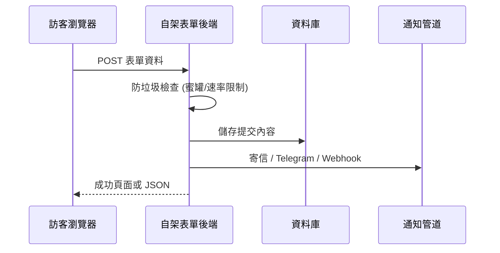
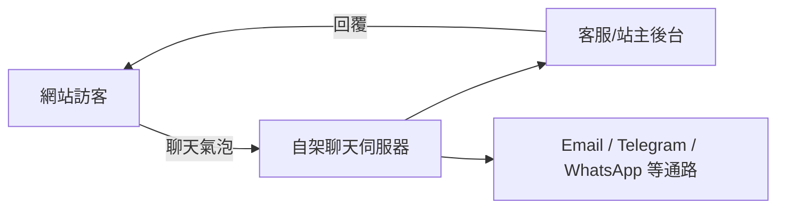

# 網站「聯絡我」表單的自由開源軟體方案調查

## 摘要

任何網站都需要一個「聯絡我 (Contact me)」管道,讓訪客能留下訊息或與站主互動。傳統做法是用 `<a href="mailto:...">` 直接開郵件軟體,但這種方式體驗差、容易被垃圾郵件機器人收集位址,也無法在手機上順暢使用[^mailto]。

現代的自由開源軟體 (FOSS, Free and Open Source Software) 生態系提供了多種替代方案,大致可分為四大類:

- **A. 輕量型表單後端 (form backend)**:把 HTML 表單的 `action` 指向一個自架端點,由該端點代為收信、通知、防垃圾。相當於自架版的 Formspree。
- **B. 完整表單建構器 (form builder)**:附視覺化編輯器、表單資料庫與儀表板,相當於自架版的 Typeform / Google Forms。
- **C. 即時聊天 / 客服元件 (live chat / customer engagement)**:在網站右下角放一個對話氣泡,提供即時或離線訊息,相當於自架版的 Intercom。
- **D. 純靜態網站方案**:把留言寫回 Git 儲存庫,完全不需資料庫,適合 Jekyll / Hugo 等靜態網站。

本報告逐一整理各類別中值得注意的專案,附上授權條款、技術堆疊、GitHub 星數與維護活躍度,最後依使用情境給出建議。

## 為什麼不直接用 `mailto:` 或第三方 SaaS

`mailto:` 連結的問題包含:使用者必須有設定好的郵件軟體、信中看不到結構化欄位、無法防機器人、也無法記錄「誰在何時送了什麼」[^mailto]。而 Formspree、Netlify Forms、Typeform 等第三方 SaaS 雖然方便,卻把訪客資料放到第三方伺服器,且免費方案通常有每月提交次數上限;一旦服務漲價或關站,網站就得重新遷移。

自架 FOSS 方案的價值在於:資料留在自己的伺服器、沒有提交次數上限、可自由修改程式碼,並且能與站上其他服務整合。

## A. 輕量型表單後端 (Form Backend)

這一類專案最貼近原問題的直覺解:網站前端仍是普通 HTML 表單,只要把 `action` 改成自架端點即可。

### A-1. FormBee

- 定位:主打資料隱私的表單後端[^formbee]
- 授權:MIT[^formbee-license]
- 技術:Angular 前端 + Node.js/Express 後端 + PostgreSQL (TypeORM)[^formbee]
- 星數:約 770[^formbee]
- 特點:可把提交轉發到 Email、Telegram、Discord、n8n、Make.com 或任意 Webhook;內建工作量證明 (Proof-of-Work) 形式的 CAPTCHA、網域白名單、自動回覆信;提供多種 Docker 映像以只安裝需要的功能[^formbee]
- 維護:最後推送於 2026-09-20,持續開發中[^formbee]
- **注意事項**:官方託管服務 formbee.dev 已於 2026 年 7 月下線,但儲存庫仍開源、可自架[^formbee]

### A-2. FormTo

- 定位:自稱「你會真的想維運的自架表單後端」,明確定位為 Formspree / Formcarry / Basin 的開源替代品[^formto]
- 授權:MIT[^formto]
- 技術:React 19 前端 + Fastify (Node.js 20) 後端 + PostgreSQL 16 + Caddy 2 反向代理;以 Docker Compose 部署[^formto]
- 星數:約 31[^formto]
- 特點:提交收件匣 (可回信、加註記、改狀態)、自帶 SMTP 寄信、Telegram/Slack 原生整合、Webhook、自訂信件模板、分析儀表板、可託管的獨立表單頁 (`/f/:endpoint`)、蜜罐與速率限制防垃圾、CSV/JSON 匯出[^formto]
- 維護:專案建立於 2026-04,最後推送 2026-05-19[^formto]
- 亮點:Caddy 會自動申請 Let's Encrypt 憑證,HTTPS 設定零負擔[^formto]
- 屬性是「新專案、星數低」,適合願意嘗鮮且能自行看程式碼的使用者。

### A-3. FormGrid

- 定位:開源、隱私友善的表單提交服務,可自架或使用託管版[^formgrid]
- 授權:MIT[^formgrid]
- 技術:TypeScript monorepo,Node.js + React (Vite) 儀表板 + MySQL (Prisma)[^formgrid]
- 星數:約 51[^formgrid]
- 特點:即時產生表單 API 端點、JWT 驗證、檔案上傳 (本機 / MinIO / S3 / GCS)、蜜罐 + reCAPTCHA、速率限制、分析儀表板、命令列工具[^formgrid]
- 維護:最後推送 2026-10-13,活躍中[^formgrid]

### A-4. FormZero

- 定位:主打「零付費功能」的表單後端,一鍵部署到免費的 Cloudflare 帳號[^formzero]
- 授權:MIT[^formzero]
- 技術:TypeScript + React Router v7 + Cloudflare Workers + D1 (SQLite)[^formzero]
- 星數:約 83[^formzero]
- 特點:支援 HTML 表單與 JSON 提交、不限表單與提交數、PoW CAPTCHA、分析與 CSV 匯出、以 Resend 寄送通知;官方稱免費方案每日可處理十萬次提交[^formzero]
- 維護:最後推送 2026-04-26[^formzero]
- 適合:不想維運伺服器、只想用 Serverless 免費額度的個人站長。

### A-5. MailBear

- 定位:極簡的自架表單轉寄信後端[^mailbear]
- 授權:GPL-3.0[^mailbear]
- 技術:Go 單一執行檔 + YAML 設定 + SMTP[^mailbear]
- 星數:約 82[^mailbear]
- 特點:每個表單一組金鑰、可設定允許網域、Prometheus metrics 與 Grafana 儀表板、速率限制、Docker 部署[^mailbear]
- 維護:**最後推送為 2020-11-11**,已多年未更新[^mailbear]
- 評價:功能單純、程式碼量小,適合想自己接手維護的人;但已非活躍專案,不建議新專案採用。

### A-6. Collecto

- 定位:開源自架表單後端,著重電子郵件收集[^collecto]
- 授權:AGPL-3.0[^collecto]
- 技術:C# / .NET + Redis + Swagger/OpenAPI,以 Docker Compose 部署[^collecto]
- 星數:約 53[^collecto]
- 維護:最後推送 2025-01-03[^collecto]
- 適合:.NET 技術棧的團隊。

### A-7. dsforms

- 定位:靜態網站用的自架表單後端,單一 Go 二進位檔加上單一 SQLite 檔案[^dsforms]
- 授權:AGPL-3.0 (v0.5.2 之前為 MIT)[^dsforms]
- 技術:Go + SQLite,Docker 映像約 20 MB[^dsforms]
- 星數:約 7[^dsforms]
- 特點:垃圾訊息「隔離區」(評分後保留而非直接刪除,可查看評分明細)、Email 與 Webhook 通知、候補名單 (waitlist) 與確認信、內建管理介面、蜜罐與速率限制、MCP 端點供 AI 工具呼叫、可由介面備份還原[^dsforms]
- 維護:最後推送 2026-10-03[^dsforms]
- 屬性是「低星數但功能獨特」的專案,垃圾隔離與 MCP 設計在同類專案中少見。

### A-8. 其他低星數新專案

- **Formlite**(SvelteKit + SQLite,單一 Docker 容器,多租戶,約 2 星,儲存庫未標示授權)[^formlite]
- **Submify**(Go + Next.js + PostgreSQL,AGPL-3.0,約 2 星,提供客戶入口與 XLSX/PDF 匯出)[^submify]
- **Formweh**(Hono + Cloudflare Workers + D1,MIT,約 4 星,同時提供表單、候補名單與問卷)[^formweh]

這些專案星數極低 (< 10),僅在使用者特別在意某項獨特功能時才建議採用;否則應優先選擇 A-1 至 A-4 等較成熟的方案。

### A-9. 已封存或不再活躍的方案

- **Formspree 官方舊版原始碼**:原為 AGPL/MIT 混合授權,約 2,751 星,儲存庫已封存 (archived),最後推送 2023-05-22;官方說明後繼服務原始碼不對外開放[^formspree-old]。**不建議新專案使用。**
- **OhMyForm**:AGPL-3.0,約 2,889 星,已封存;README 直接建議使用者改用 Formbricks[^ohmyform]。
- **Form Tools**:GPL-2.0,PHP + MySQL,約 211 星,最後推送 2023-09-08;專案自 2004 年延續至今,但介面老舊、開發緩慢[^formtools]。

## B. 完整表單建構器 (Form Builder)

若需求不只是「一個聯絡表單」,而是想長期建立多種表單、問卷與蒐集分析,則應考慮完整建構器。

### B-1. Formbricks

- 定位:開源版的 Qualtrics / 體驗管理平台,支援應用內、網站、連結與電子郵件問卷[^formbricks]
- 授權:AGPLv3 (核心) + Enterprise 授權 (EE 目錄)[^formbricks-license]
- 技術:TypeScript + Next.js + React + Prisma + PostgreSQL (開發堆疊另含 Valkey、Cube、Hub 等服務)[^formbricks]
- 星數:約 13,114[^formbricks]
- 特點:無程式碼問卷編輯器、多種範本、可對特定使用者族群投放、連結型問卷、團隊協作、Slack / Notion / Zapier / n8n 整合[^formbricks]
- 維護:最後推送 2026-10-16,極為活躍[^formbricks]
- 評價:功能最完整但部署也最重,對單純的「聯絡我」而言可能過度設計。

### B-2. HeyForm

- 定位:開源表單建構器,提供對話式與傳統式兩種表單外觀[^heyform]
- 授權:AGPL-3.0[^heyform-license]
- 技術:Node.js (NestJS) + React + MongoDB + KeyDB[^heyform]
- 星數:約 9,031[^heyform]
- 特點:條件邏輯、檔案上傳、完成率與流失率分析、CSV 匯出、可嵌入任意網站、自訂 CSS[^heyform]
- 維護:最後推送 2026-10-15,活躍中[^heyform]
- 注意:僅支援 MongoDB,無 SQL 資料庫選項[^heyform]

### B-3. OpnForm

- 定位:外觀類似 Typeform 的無程式碼表單建構器[^opnform]
- 授權:AGPLv3,但 `api/app/Enterprise` 目錄另有企業授權;免費自架版限制 2 名使用者[^opnform-license]
- 技術:PHP (Laravel) + Vue.js (Nuxt) + PostgreSQL/MySQL + Redis[^opnform]
- 星數:約 3,845[^opnform]
- 特點:拖放式編輯器、28 種以上輸入型態、檔案上傳、條件邏輯、Email 通知、Slack/Discord/Webhook 整合、CAPTCHA、表單分析、CSV/Excel/PDF 匯出[^opnform]
- 維護:最後推送 2026-10-14,活躍中[^opnform]

### B-4. Typebot

- 定位:對話式聊天機器人 / 表單建構器,一次只問一個問題[^typebot]
- 授權:Functional Source License v1.1 (FSL-1.1-Apache-2.0),兩年後自動轉為 Apache-2.0;條款禁止「競爭性使用」[^typebot-license]
- 技術:TypeScript + Next.js + PostgreSQL[^typebot]
- 星數:約 10,550[^typebot]
- 特點:34 種以上積木、條件分支、A/B 測試、Stripe 付款、OpenAI 等整合、可嵌入為彈窗或聊天氣泡[^typebot]
- 維護:最後推送 2026-10-15,極為活躍[^typebot]
- 注意:僅提供對話式介面,不適合需要一次顯示多欄位的傳統聯絡表單;FSL 授權也限制把它當成託管服務轉售[^typebot-license]

### B-5. 其他建構器

- **Form.io**:OSL-3.0 授權,約 2,323 星,JavaScript + MongoDB;以 JSON schema 定義表單、供開發者嵌入自家應用,屬 headless 取向[^formio]
- **LimeSurvey**:GPL-2.0,約 3,767 星,PHP;2003 年問世的老牌學術級問卷平台,支援 80 種以上語言與複雜跳題邏輯[^limesurvey]
- **Nextcloud Forms**:AGPL-3.0,約 384 星,JavaScript/Vue;Nextcloud 生態系的簡易表單與問卷 App,適合已在使用 Nextcloud 的組織[^nextcloud-forms]
- **LiberaForms**:AGPLv3,Flask + PostgreSQL,託管於 Codeberg (約 23 星);主打 GDPR 合規、表單答案端到端加密,並由 NLnet 基金會資助開發[^liberaforms]

## C. 即時聊天 / 客服元件 (Live Chat)

若「聯絡我」的期望是「像客服一樣即時回覆」,而非送出表單後等待回信,則應選用即時聊天方案。

- **Chatwoot**:開源即時聊天、郵件與全通路客服台,被視為 Intercom / Zendesk 的替代品;MIT Expat 授權 (另有 `enterprise/` 目錄採企業授權);Ruby on Rails;星數約 37,875,極度活躍[^chatwoot]。若要一個功能完整的自架客服平台,Chatwoot 是此類別的標竿。
- **Live Helper Chat**:Apache-2.0,約 2,250 星,PHP;提供網頁與行動 App、語音/視訊/螢幕分享,並支援 Telegram、Twilio (WhatsApp)、Facebook Messenger 及聊天機器人[^livehelperchat]。
- **Tiledesk**:MIT,約 322 星;提供 Docker Compose 與 Helm 部署,主打可建立 LLM 驅動的聊天機器人並在需要時轉接真人客服[^tiledesk]。

## D. 純靜態網站方案

若網站是部署在 GitHub Pages、GitLab Pages 或 Netlify 的純靜態站 (Jekyll、Hugo、Eleventy 等),沒有後端伺服器,可考慮把留言寫回 Git 儲存庫的方案。

- **Staticman**:MIT,約 2,451 星,JavaScript;接收表單 POST 後,以機器人身分把內容寫成資料檔並推送到 GitHub / GitLab 儲存庫,支援審核模式 (先開 Pull Request 等待核准)[^staticman]。最後推送為 2024-04-24,維護趨緩但架構簡單[^staticman]。

## 綜合比較

| 專案 | 類別 | 授權 | 技術棧 | 星數 | 最近推送 | 適合情境 |
|---|---|---|---|---|---|---|
| FormBee | 表單後端 | MIT | Node.js / Angular / PostgreSQL | ~770 | 2026-09-20 | 想自架、需多通路通知 |
| FormGrid | 表單後端 | MIT | Node.js / React / MySQL | ~51 | 2026-10-13 | 需檔案上傳與管理介面 |
| FormZero | 表單後端 | MIT | Cloudflare Workers / D1 | ~83 | 2026-04-26 | 不想維運伺服器 |
| FormTo | 表單後端 | MIT | Fastify / React / PostgreSQL | ~31 | 2026-05-19 | 想要完整收件匣與自動 HTTPS |
| MailBear | 表單後端 | GPL-3.0 | Go | ~82 | 2020-11-11 | 極簡、能自己接手維護 |
| dsforms | 表單後端 | AGPL-3.0 | Go / SQLite | ~7 | 2026-10-03 | 單檔部署、垃圾隔離 |
| Collecto | 表單後端 | AGPL-3.0 | .NET / Redis | ~53 | 2025-01-03 | .NET 技術棧 |
| Formbricks | 表單建構器 | AGPLv3 + EE | Next.js / PostgreSQL | ~13,114 | 2026-10-16 | 產品內問卷與體驗管理 |
| HeyForm | 表單建構器 | AGPL-3.0 | NestJS / MongoDB | ~9,031 | 2026-10-15 | 美觀的多用途表單 |
| OpnForm | 表單建構器 | AGPLv3 + EE | Laravel / Vue | ~3,845 | 2026-10-14 | Typeform 風格外觀 |
| Typebot | 對話式表單 | FSL-1.1 | Next.js / PostgreSQL | ~10,550 | 2026-10-15 | 聊天式引導流程 |
| LimeSurvey | 問卷平台 | GPL-2.0 | PHP | ~3,767 | 2026-10-16 | 學術級問卷 |
| Form.io | Headless 表單 | OSL-3.0 | Node.js / MongoDB | ~2,323 | 2026-10-14 | 嵌入自家應用 |
| Nextcloud Forms | 表單 App | AGPL-3.0 | JavaScript / Vue | ~384 | 2026-10-17 | 已用 Nextcloud |
| LiberaForms | 表單平台 | AGPLv3 | Flask / PostgreSQL | ~23 | 2026-10-16 | GDPR / E2EE 需求 |
| Chatwoot | 即時客服 | MIT Expat + EE | Ruby on Rails | ~37,875 | 2026-10-17 | 全通路客服台 |
| Live Helper Chat | 即時客服 | Apache-2.0 | PHP | ~2,250 | 2026-10-16 | 輕量即時支援 |
| Tiledesk | 即時客服 | MIT | Node.js / Helm | ~322 | 2026-10-13 | LLM 聊天機器人 |
| Staticman | 靜態留言 | MIT | Node.js | ~2,451 | 2024-04-24 | 純靜態網站 |
| Formspree (舊) | 表單後端 | AGPL/MIT | Python / PostgreSQL | ~2,751 | 2023-05-22 | **已封存,勿用** |
| OhMyForm | 表單建構器 | AGPL-3.0 | TypeScript | ~2,889 | 2024-10-31 | **已封存,勿用** |

> 星數與推送日期為 2026-10-17 以 GitHub API 查詢的即時數值,會隨時間變動。

## 結論與建議

1. **只想在個人網站加一個「聯絡我」表單,且願意自架伺服器**:優先考慮 **FormBee** (星數與多通路通知最成熟)或 **FormTo** (收件匣功能完整、Caddy 自動 HTTPS)。若想避免維運,**FormZero** 只要一鍵部署到 Cloudflare 免費方案。
2. **需要多種表單、問卷與分析**:選 **Formbricks** (功能最完整但部署最重)或 **HeyForm** (兼顧美觀與 MongoDB 棧)。
3. **想要聊天式引導體驗**:選 **Typebot**,但務必注意其 FSL 授權對「競爭性託管」的限制。
4. **已經是 Nextcloud 使用者**:直接用 **Nextcloud Forms**,無需額外部署。
5. **需要 GDPR / 端到端加密的公益或公共機構場景**:選 **LiberaForms**。
6. **希望訪客能即時對話而非留言**:選 **Chatwoot** (功能最強)或 **Live Helper Chat** (較輕量)。
7. **網站為純靜態且無後端**:選 **Staticman**,把留言寫回 Git 儲存庫。
8. **不要採用**已封存的 **Formspree 舊版**與 **OhMyForm**,以及多年未更新的 **MailBear**,除非你打算親自接手維護。

選擇時除功能外,應一併評估:(a) 授權條款是否允許你的使用情境 (AGPL 與 FSL 有網路服務與競爭性使用限制);(b) 專案維護活躍度 (星數高不等於維護中,例如 MailBear、Form Tools);(c) 是否與現有技術棧相符;以及 (d) 防垃圾機制是否足夠,因為公開的聯絡表單幾乎必然會遭遇機器人。

## 參考文獻

[^mailto]: Wikipedia contributors. (2026, September 12). mailto. In Wikipedia, The Free Encyclopedia. Retrieved 2026-10-17, from https://en.wikipedia.org/wiki/Mailto

[^formbee]: FormBee. (n.d.). FormBee — The open-source form backend for data privacy conscious developers [Source code]. GitHub. Retrieved 2026-10-17, from https://github.com/FormBee/FormBee

[^formbee-license]: FormBee. (2024). MIT License [Source code]. GitHub. Retrieved 2026-10-17, from https://github.com/FormBee/FormBee/blob/main/LICENSE

[^formto]: lumizone. (n.d.). FormTo — a simple, self-hosted backend for HTML forms [Source code]. GitHub. Retrieved 2026-10-17, from https://github.com/lumizone/formto

[^formgrid]: allenarduino. (n.d.). FormGrid — Open-source, privacy-friendly form submission service [Source code]. GitHub. Retrieved 2026-10-17, from https://github.com/allenarduino/formgrid

[^formzero]: BohdanPetryshyn. (n.d.). FormZero — Form backend with zero paid features [Source code]. GitHub. Retrieved 2026-10-17, from https://github.com/BohdanPetryshyn/formzero

[^mailbear]: DenBeke. (n.d.). MailBear — Self hosted forms backend [Source code]. GitHub. Retrieved 2026-10-17, from https://github.com/DenBeke/mailbear

[^collecto]: Eliran-Turgeman. (n.d.). Collecto — an open source & self-hosted forms backend [Source code]. GitHub. Retrieved 2026-10-17, from https://github.com/Eliran-Turgeman/Collecto

[^dsforms]: barancezayirli. (n.d.). dsforms — Self-hosted form backend for static sites [Source code]. GitHub. Retrieved 2026-10-17, from https://github.com/barancezayirli/dsforms

[^formlite]: megabudino. (n.d.). formlite [Source code]. GitHub. Retrieved 2026-10-17, from https://github.com/megabudino/formlite

[^submify]: Raktim94. (n.d.). Submify — a private Formspree/Form-to-email replacement you run yourself [Source code]. GitHub. Retrieved 2026-10-17, from https://github.com/Raktim94/Submify

[^formweh]: duskresearch. (n.d.). formweh — Open source forms, waitlists, and surveys made easy to self-host [Source code]. GitHub. Retrieved 2026-10-17, from https://github.com/duskresearch/formweh

[^formspree-old]: Formspree. (n.d.). The successor to this repository is actively maintained at https://formspree.io [Source code]. GitHub. Retrieved 2026-10-17, from https://github.com/formspree/formspree

[^ohmyform]: ohmyform. (n.d.). OhMyForm — Free open source alternative to TypeForm, TellForm, or Google Forms [Source code]. GitHub. Retrieved 2026-10-17, from https://github.com/ohmyform/ohmyform

[^formtools]: formtools. (n.d.). Form Tools Core [Source code]. GitHub. Retrieved 2026-10-17, from https://github.com/formtools/core

[^formbricks]: Formbricks. (n.d.). Formbricks — Open Source Qualtrics Alternative [Source code]. GitHub. Retrieved 2026-10-17, from https://github.com/formbricks/formbricks

[^formbricks-license]: Formbricks GmbH. (2024). Formbricks licensing [Source code]. GitHub. Retrieved 2026-10-17, from https://github.com/formbricks/formbricks/blob/main/LICENSE

[^heyform]: HeyForm. (n.d.). HeyForm — Open-Source Form Builder [Source code]. GitHub. Retrieved 2026-10-17, from https://github.com/heyform/heyform

[^heyform-license]: HeyForm. (n.d.). GNU Affero General Public License v3.0 [Source code]. GitHub. Retrieved 2026-10-17, from https://github.com/heyform/heyform/blob/next/LICENSE

[^opnform]: OpnForm. (n.d.). OpnForm — Beautiful Open-Source Form Builder [Source code]. GitHub. Retrieved 2026-10-17, from https://github.com/OpnForm/OpnForm

[^opnform-license]: OpnForm. (2025). OpnForm licensing [Source code]. GitHub. Retrieved 2026-10-17, from https://github.com/OpnForm/OpnForm/blob/main/LICENSE

[^typebot]: baptisteArno. (n.d.). Typebot — a powerful chatbot builder that you can self-host [Source code]. GitHub. Retrieved 2026-10-17, from https://github.com/baptisteArno/typebot.io

[^typebot-license]: Typebot. (2024). Functional Source License, Version 1.1, Apache 2.0 Future License [Source code]. GitHub. Retrieved 2026-10-17, from https://github.com/baptisteArno/typebot.io/blob/main/LICENSE

[^formio]: Form.io. (n.d.). Form.io — A Form and Data Management Platform for Progressive Web Applications [Source code]. GitHub. Retrieved 2026-10-17, from https://github.com/formio/formio

[^limesurvey]: LimeSurvey. (n.d.). LimeSurvey — A powerful, open-source survey platform [Source code]. GitHub. Retrieved 2026-10-17, from https://github.com/LimeSurvey/LimeSurvey

[^nextcloud-forms]: Nextcloud. (n.d.). Forms — Simple form & survey app for Nextcloud [Source code]. GitHub. Retrieved 2026-10-17, from https://github.com/nextcloud/forms

[^liberaforms]: LiberaForms. (n.d.). LiberaForms — Create and manage forms that respect people's privacy [Source code]. Codeberg. Retrieved 2026-10-17, from https://codeberg.org/LiberaForms/server

[^chatwoot]: Chatwoot. (n.d.). Chatwoot — Open-source live-chat, email support, omni-channel desk [Source code]. GitHub. Retrieved 2026-10-17, from https://github.com/chatwoot/chatwoot

[^livehelperchat]: LiveHelperChat. (n.d.). Live Helper Chat — live support for your website [Source code]. GitHub. Retrieved 2026-10-17, from https://github.com/LiveHelperChat/livehelperchat

[^tiledesk]: Tiledesk. (n.d.). Tiledesk — Install Tiledesk on your server [Source code]. GitHub. Retrieved 2026-10-17, from https://github.com/Tiledesk/tiledesk

[^staticman]: eduardoboucas. (n.d.). Staticman — User-generated content for Git-powered websites [Source code]. GitHub. Retrieved 2026-10-17, from https://github.com/eduardoboucas/staticman
