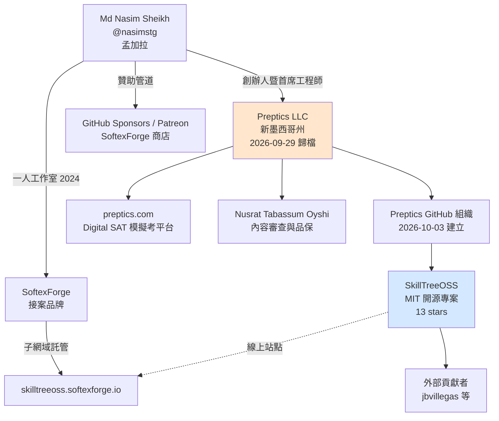

# SkillTreeOSS 專案背景調查：公司、創投、團隊、社群與資金

本報告調查 GitHub 專案 `Preptics/SkillTreeOSS` 的背景，涵蓋其產品定位、背後的組織與公司實體、核心團隊成員、社群規模與經營狀況，以及可公開查證的資金與商業模式資訊。所有事實均附註腳，檢索日期為 2026-10-17。

## 摘要

SkillTreeOSS 是一套以「技能樹」為核心的開源遊戲化學習平台，由 Preptics 組織託管於 GitHub，採用 MIT 授權[^repo]。它並非獨立創業題目，而是一家名為 Preptics LLC 的小型教育科技公司的開源副專案；該公司同時經營一個 Digital SAT（美國大學入學測驗）自適應模擬考平台[^about]。目前專案規模極小：13 顆星、3 個 fork、30 個未結議題、2 位具名貢獻者[^repo][^contrib]。在可查證範圍內，**沒有發現任何創業投資（VC）或機構資金**，商業模式為單一創辦人自力經營（bootstrapped）[^about][^careers]。

## 一、專案本身

### 定位與願景

SkillTreeOSS 自我定位為「The Democratization of Mastery」（掌握知識的民主化）[^readme]。它把複雜技能（例如 Full-Stack Developer、ML Engineer、攝影）拆解成一張 RPG 風格的視覺化技能樹；每個節點對應一項子技能，並連結到社群精選的免費學習資源，學習者完成後可獲得 XP 並「升級」[^readme]。其要解決的問題是自學者面臨的「課程缺口」（curriculum gap）——不確定下一步該學什麼[^readme]。

### 主要功能

- **視覺化技能樹編輯器**：於站內 `/builder` 以拖放方式建立節點與連線，支援鍵盤快捷鍵、Dagre 自動排版、`localStorage` 草稿、Supabase 持久化，並可「Submit as PR」送出 GitHub Pull Request[^readme]。
- **互動式技能畫布**：四種視覺主題（World Map、RPG、Terminal、Neural），節點狀態動畫（locked → available → completed）[^readme]。
- **帳號與進度**：Supabase 認證、XP 與等級系統（每節點 50 XP、8 個等級 Apprentice → Legend）、即時資料庫同步[^readme]。
- **探索頁**：全文檢索、依分類與難度篩選、多種排序、分頁[^readme]。
- **樹的評分與選課數**：1–5 星評分，選課數由已完成節點自動推定[^readme]。
- **平台即時統計**：以 Postgres trigger 維護 `site_stats` 單例資料表，讓首頁統計為 O(1) 讀取[^readme]。
- **社群回饋**：每個資源可上下投票，並可「建議更好的資源」，經 `pending → reviewed → accepted/rejected` 流程審核[^readme]。

### 技術棧

Next.js 16（App Router、Turbopack）、TypeScript、ReactFlow（`@xyflow/react`）搭配 Dagre、Zustand、Framer Motion、Tailwind CSS v4，以及 Supabase（Postgres、RLS、SSR client）作為認證與資料庫[^readme]。授權為 MIT；授權檔名為 `LICENCE.md`（英式拼法），版權宣告為「2026 SkilleTreeOSS Contributors」，README 收尾語為「Education should be free, and so is this code」[^readme]。

### 倉庫數據與時間線

依 GitHub API 於 2026-10-17 檢索[^api]：

| 項目 | 數值 |
|---|---|
| 完整名稱 | `Preptics/SkillTreeOSS` |
| 建立時間 | 2026-02-24 |
| 最後推送 | 2026-09-29 |
| 主要語言 | TypeScript |
| 授權 | MIT |
| 星數 | 13 |
| Fork 數 | 3 |
| 未結議題 | 30 |
| 討論區 | 已啟用（`has_discussions: true`） |
| 首頁 | `https://skilltreeoss.softexforge.io` |
| 主題標籤 | 19 個，含 `edtech`、`open-source-education`、`good-first-issue`、`self-taught` 等 |

值得注意的是標籤中有 `skill-treee`（拼字有誤），而 README 標題亦寫成「SkilleTreeOSS」（多一個 e），網站頁尾同樣使用「SkilleTreeOSS」[^repo][^readme][^site]。這是專案內一致但拼字錯誤的品牌寫法。

倉庫建立於 2026-02-24，但 Preptics 組織本身直到 2026-10-03 才建立[^orgapi]，顯示倉庫原先屬於個人帳號後才轉入組織。間接證據包括 README 的 clone 指令仍指向 `https://github.com/nasimstg/SkillTreeOSS.git`[^readme]，且網站頁尾的 GitHub 連結仍指向個人帳號[^site]。提交歷史亦顯示 2026 年 2 至 3 月的提交作者為 `nasim@nasimstg.dev`[^commits]。

線上站點顯示版本為 `v0.8`、「Visual Builder is live」，統計數據為 29 棵技能樹、6 位 active learners、24 個已解鎖節點[^site]；探索頁顯示 29 棵樹、26 個分類、208 個節點[^explore]。這些數字規模極小，屬早期階段。

## 二、背後的組織：Preptics

### GitHub 組織

`Preptics` GitHub 組織的 API 資料顯示[^orgapi]：

- 建立時間：2026-10-03
- 公開倉庫數：1（即 SkillTreeOSS）
- 追蹤者：0
- 公開成員：無（組織頁顯示「This organization has no public members」）[^orgpage]
- 描述：「Adaptive Digital SAT mocks with an honest score band, a daily study plan, and a scoring method we publish in full.」
- 網站：`https://preptics.com`；X：`@preptics`；Email：`contact@preptics.com`

換言之，**SkillTreeOSS 是該組織唯一的公開倉庫**，且組織的對外定位並非教育遊戲化，而是 SAT 備考[^orgapi][^orgpage]。

### 公司實體

根據 Preptics 官網「About」頁，SkillTreeOSS 的託管組織 Preptics 對應到一家法律實體[^about]：

- **名稱**：Preptics LLC
- **型態**：新墨西哥州（New Mexico）有限責任公司
- **組織章程歸檔日**：2026-09-29，檔號 3308238
- **營業與通訊地址**：1209 Mountain Road Pl NE, Ste R, Albuquerque, NM 87110, USA
- **送達代收人（registered agent）**：Registered Agents Inc（同址）

同一頁也聲明 Preptics 與 College Board 無隸屬關係，SAT® 為 College Board 註冊商標[^about]。官網頁尾亦重申「Preptics is operated by Preptics LLC, a New Mexico limited liability company」[^about][^site]。

值得注意的是，該公司使用「Registered Agents Inc」與代辦地址（虛擬辦公室型態），是新墨西哥州常見的遠端註冊做法；官網明確表示「There is no office in any country」（沒有任何國家的辦公室），團隊為全遠端[^careers]。

### 主要產品

Preptics 的主要產品是 Digital SAT 自適應模擬考平台[^preptics]，特色包括：

- 每個 section 兩個 module，第二個 module 依第一個的表現路由（與真實 Digital SAT 相同結構）[^preptics]
- 計時器由伺服器持有，關閉分頁不會停止[^preptics]
- 分數以「區間加上信心水準」呈現，而非單一精確數字（一次模考後總分 ±60，三次後縮小到 ±40）[^about]
- 依 30 項 SAT 技能分析失分、配速，並產生每日讀書計畫[^preptics]
- 8 個可拖曳互動模擬、自製圖形計算機、連續紀錄（streak）與排名[^preptics][^roadmap]

產品路線圖顯示 17 項已上線、1 項部分上線、4 項建置中、7 項規劃中，並明確聲明「No dates, on purpose」（刻意不給日期）[^roadmap]。

## 三、團隊

### 具名團隊成員

官網〈The team〉一節開宗明義寫道「Two people, each named on everything they write and answerable for it.」（兩個人，每個人都對自己寫的東西具名負責）[^about]。具名者如下。

**Md Nasim Sheikh — Founder and lead engineer（創辦人暨首席工程師）**[^author_nasim]

- GitHub：`nasimstg`；個人網站：`nasimstg.dev`；LinkedIn：`in/nasimstg`；X：`@nasimstg`
- GitHub 帳號建立於 2020-11-28，位置標示為孟加拉（Bangladesh），bio 自述為「results-oriented Full Stack Web Developer」，另有 55 個公開倉庫、5 位追蹤者[^nasimstg_api]
- 負責建置自適應考題引擎、伺服器端計時、評分方法，以及題庫產線（三個 AI 模型盲解、算式以程式碼執行、再由真人審查）[^author_nasim]
- 2022 年起專業從事 Web 開發；曾任 WEX Inc. 後端開發（2022 年）[^author_nasim]
- 官方敘述其自 2025 年起領導一個測驗暨學習管理平台的工程[^author_nasim]；其個人網站顯示現職為 AzoozGAT LLC 的 Lead Full-Stack Web Engineer（2025 年 9 月起）[^nasimstg_dev]
- 學歷：National Institute of Textile Engineering and Research（NITER，隸屬達卡大學）資訊工程學系學士[^nasimstg_dev]
- 同時是 SoftexForge 的創辦人[^nasimstg_dev]

**Nusrat Tabassum Oyshi — Content auditor and QA（內容審查與品保）**[^author_oyshi]

- LinkedIn：`in/nusrat-tabassum2206`；Email：`oyshi@preptics.com`[^author_oyshi]
- 為入學考試講師，教授 SAT、AP、GST、GAT 等標準化測驗[^author_oyshi]
- 審查過三份已發佈模擬考中所有題目、所有課程與指南，並在學生接觸前測試新功能[^author_oyshi]
- 學歷：Mawlana Bhashani Science and Technology University（MBSTU）資訊工程學系學士[^author_oyshi]

### GitHub 貢獻者

依 GitHub API 的貢獻者清單，本倉庫共 2 位具名貢獻者[^contrib]：

| 帳號 | 提交數 | 備註 |
|---|---|---|
| `nasimstg` | 25 | 主要維護者（Md Nasim Sheikh） |
| `jbvillegas` | 2 | 外部貢獻者 |

`jbvillegas` 的 GitHub 資料顯示姓名為 Joaquin B Villegas，任職於 Lander University，地點為奧地利維也納，帳號建立於 2024-01-26[^jbvillegas]。其實際貢獻包含 `feat: expand cybersecurity basics into a foundations curriculum`（PR #61，把資安樹從 7 節點擴充到 12 節點）與更新 Next.js 版本修補 14 個 npm 漏洞（PR #62），兩者均於 2026-09-29 由 `nasimstg` 合併[^pr61][^pr62][^commits]。其 fork `jbvillegas/SkillTreeOSS-cybersecurity` 建立於 2026-09-11[^forks]。

另有零星外部參與：

- `yugank45` 於 2026-09-27 開立議題 #63「Improve accessibility in Skill Tree Builder」，要求改善鍵盤導覽、無障礙標籤與焦點樣式[^issue63]
- `chenzeyan54-commits` 隨後提出 PR #64 修補該議題（草稿狀態，未被合併即關閉）[^pr64]
- `softexforgebot` 為站內 builder 的匿名送出機器人帳號，曾開 PR #60（測試用樹），未被合併[^pr60]

### 命名議題

官方 GitHub 組織不公開成員，因此除官網具名的兩人與提交歷史可考的貢獻者外，**無法從公開資訊確認其他團隊或外包人員**[^orgpage]。

## 四、資金與商業模式

### 未發現機構資金

在檢索範圍內**沒有發現任何創業投資、加速器或機構投資**的證據[^about][^careers]。跡象支持自力經營（bootstrapped）的判斷：

- 公司成立於 2026-09-29，官網自述「made by a very small team」、「Preptics launched in September 2026 and is free while it is in beta. The pay is modest」（薪資不高）[^careers]
- 產品在 beta 期間全面免費，唯一收費機制是可選的「Founder's Pass」，採「pay what you want」、最低 1 美元、單次付款不續訂[^preptics]
- 正式上市後定價為 3 個月 9.99 美元或 12 個月 24.99 美元[^preptics]

需要提醒的是，網路上可查到的 Crunchbase 頁面將 Preptics 列為私人公司、員工數 1–10 人，但該頁面在本次檢索中直接回傳 HTTP 403，無法直接查證，故不作為可靠依據。

### 開源專案的募資管道

SkillTreeOSS 的 `.github/FUNDING.yml` 指定了三個贊助管道[^funding]：

- GitHub Sponsors：`nasimstg`
- Patreon：`nasimstg`
- 自訂連結：`https://store.softexforge.io/checkout/...`（SoftexForge 商店結帳頁）

其餘欄位（Open Collective、Ko-fi、Liberapay、Polar、Buy Me a Coffee 等）皆為空。這顯示募資規模仍是個人層級（贊助創辦人本人），而非專案層級的基金會或公司帳戶。

## 五、社群規模與管道

### 現有社群指標

| 指標 | 數值 | 來源 |
|---|---|---|
| GitHub 星數 | 13 | [^api] |
| GitHub fork | 3 | [^api] |
| 未結議題 | 30 | [^api] |
| 具名貢獻者 | 2 | [^contrib] |
| 線上站點 active learners | 6 | [^site] |
| 已解鎖節點 | 24 | [^site] |
| 技能樹 | 29 | [^site][^explore] |
| 節點總數 | 208 | [^explore] |

30 個未結議題中，絕大多數是倉庫自建的 `[Tree Review]` 系列議題（例如 Frontend Web Developer、DevOps Engineer、Quantum Computing 等），由 `nasimstg` 於 2026-02-27 批次建立，並標註 `tree-review`、`help wanted`、`good first issue` 標籤，用以邀請社群逐棵審查技能樹的節點與資源[^issues]。這說明當前的「社群活動」多為維護者自行發起的任務清單，而非外部使用者自主討論。

### 管道與社群平台

SkillTreeOSS 與 Preptics 的對外社群管道相當薄弱：

- **X（Twitter）**：`@Preptics` 於 2026-09 加入，貼文自 2026-10-08 起，追蹤者數極少[^x_preptics]；創辦人個人帳號 `@nasimstg` 自 2018 年加入[^nasimstg_dev]
- **LinkedIn**：有 Preptics 公司頁（產業為 E-Learning Providers，員工數標示 2–10 人），同樣追蹤者極少[^linkedin]
- **YouTube**：`@Preptics` 頻道存在但無公開影片[^yt]
- **Instagram**：官網頁尾列出 `instagram.com/preptics` 連結[^about]，但搜尋未找到公開貼文
- **Discord**：提交給 builder 的 PR 樣板與網站頁尾出現「Discord」字樣，但頁尾的 Discord 並未附上任何有效連結，研判**並無公開的 Discord 伺服器**[^site][^pr60]
- **Reddit / Product Hunt / Hacker News**：未發現任何帳號、看板或發表紀錄

### 第三方評述

針對「SkillTreeOSS」「skilltreeoss」「Preptics」等關鍵字進行跨平台搜尋，**未找到任何第三方部落格、媒體報導、Reddit 討論串或 Hacker News 提交**[^search]。專案的對外足跡幾乎全部是自建的，這與 13 顆星、6 位 active learners 的規模相符。

需要區分的是，GitHub 上存在多個同名或近名的無關專案（例如 2013 年的 `skilltree/skilltree`，一個 1 顆星、8 次提交的實驗性技能徽章系統），它們與本專案無關[^otherskilltree]。

另一項值得注意的線索：builder 自動產生的 PR 樣板中，貢獻途徑被標示為「Submitted via the SkilleTree Builder (https://skilltree.dev/builder)」[^pr60]，暗示專案曾考慮或曾使用 `skilltree.dev` 網域；但現行首頁為 `skilltreeoss.softexforge.io`，兩者關係無法從公開資訊確認。

## 六、與 SoftexForge 的關係

SkillTreeOSS 的線上站點部署在 `skilltreeoss.softexforge.io`，此子網域屬於 **SoftexForge**[^site]。SoftexForge 是創辦人 Md Nasim Sheikh 於 2024 年成立的獨立軟體工作室／接案品牌，個人網站上描述為「Founded SoftexForge — Independent — 2024」，並表示現已整合至 `nasimstg.dev`[^nasimstg_dev]。

SoftexForge 官網自我定位為協助新創與企業推出 Web 與行動應用的數位產品工作室，宣稱已交付 120+ 個 App、服務 18 個國家、平均 4.8 星評價、6–10 週完成 MVP；服務頁涵蓋行動開發、Web 開發、產品策略、UI/UX、後端與 DevOps[^softexforge]。其 GitHub 組織為 `github.com/softexforge`[^softexforge]。

由此可見一個清楚的結構：**個人接案品牌（SoftexForge）／個人開源工具（SkillTreeOSS、xenvsync）／產品公司（Preptics LLC）三者都由同一人主導**，基礎設施則共用 SoftexForge 的子網域與商店[^funding][^nasimstg_dev][^softexforge]。

## 七、關係結構圖

## 八、綜合評估與判讀

1. **專案性質**：SkillTreeOSS 是一個由個人主導、掛在自營公司組織下的開源專案，並非獨立創業題目。其母公司 Preptics LLC 的商業主軸是 Digital SAT 備考平台[^about][^preptics]。

2. **團隊規模**：公開具名者僅 2 人（1 名工程、1 名內容），加上 1 位有意願的外部貢獻者[^about][^contrib]。對比 29 棵技能樹、208 個節點的內容產出量，內容生產效率值得注意，但也意味著**專案高度依賴單一維護者**。

3. **資金狀態**：無機構資金證據；募資管道為個人贊助層級；產品 beta 期免費、以「pay what you want」的支持者方案過渡[^funding][^preptics]。公司註冊採遠端代辦地址、明言無實體辦公室[^about][^careers]。

4. **社群成熟度**：極低。13 顆星、6 位 active learners、無第三方報導、無有效 Discord、多個社群連結（頁尾 Discord、Twitter/X、GitHub）實際上未指向有效目的地[^site][^search]。`[Tree Review]` 議題由維護者自行批次建立，社群討論尚未自然發生[^issues]。

5. **資料可信度提醒**：本報告的量化數據（星數、fork、議題數、貢獻者提交數）來自 GitHub API，屬即時快照，在本報告日期後可能變動[^api][^contrib]。社群平台追蹤者數等數字係於 2026-10-17 檢索時之狀態，且部分頁面需登入才能完整取得，故僅供規模量級參考。

## 參考資料

[^repo]: Preptics. (n.d.). *SkillTreeOSS* [Source code repository]. Retrieved 2026-10-17, from https://github.com/Preptics/SkillTreeOSS

[^api]: GitHub. (n.d.). *REST API: repository data for Preptics/SkillTreeOSS*. Retrieved 2026-10-17, from https://api.github.com/repos/Preptics/SkillTreeOSS

[^contrib]: GitHub. (n.d.). *REST API: contributors to Preptics/SkillTreeOSS*. Retrieved 2026-10-17, from https://api.github.com/repos/Preptics/SkillTreeOSS/contributors

[^orgapi]: GitHub. (n.d.). *REST API: Preptics organization*. Retrieved 2026-10-17, from https://api.github.com/orgs/Preptics

[^orgpage]: GitHub. (n.d.). *Preptics organization profile*. Retrieved 2026-10-17, from https://github.com/Preptics

[^readme]: Preptics. (2026-09-29). *SkillTreeOSS README*. Retrieved 2026-10-17, from https://raw.githubusercontent.com/Preptics/SkillTreeOSS/main/README.md

[^funding]: Preptics. (n.d.). *FUNDING.yml*. Retrieved 2026-10-17, from https://raw.githubusercontent.com/Preptics/SkillTreeOSS/main/.github/FUNDING.yml

[^commits]: GitHub. (n.d.). *REST API: commits of Preptics/SkillTreeOSS*. Retrieved 2026-10-17, from https://api.github.com/repos/Preptics/SkillTreeOSS/commits

[^forks]: GitHub. (n.d.). *REST API: forks of Preptics/SkillTreeOSS*. Retrieved 2026-10-17, from https://api.github.com/repos/Preptics/SkillTreeOSS/forks

[^issues]: GitHub. (n.d.). *REST API: issues of Preptics/SkillTreeOSS*. Retrieved 2026-10-17, from https://api.github.com/repos/Preptics/SkillTreeOSS/issues

[^issue63]: yugank45. (2026-09-27). *Improve accessibility in Skill Tree Builder* [Issue #63]. Retrieved 2026-10-17, from https://github.com/Preptics/SkillTreeOSS/issues/63

[^pr64]: chenzeyan54-commits. (2026-09-27). *fix: resolve #63 Improve accessibility in Skill Tree Builder* [Pull request #64]. Retrieved 2026-10-17, from https://github.com/Preptics/SkillTreeOSS/pull/64

[^pr62]: jbvillegas. (2026-09-14). *chore: update next.js version to ^16.3.5 in package.json* [Pull request #62]. Retrieved 2026-10-17, from https://github.com/Preptics/SkillTreeOSS/pull/62

[^pr61]: jbvillegas. (2026-09-14). *feat: expand cybersecurity basics into a foundations curriculum* [Pull request #61]. Retrieved 2026-10-17, from https://github.com/Preptics/SkillTreeOSS/pull/61

[^pr60]: softexforgebot. (2026-03-01). *[New Tree] This is a test tree created using inapp builder* [Pull request #60]. Retrieved 2026-10-17, from https://github.com/Preptics/SkillTreeOSS/pull/60

[^jbvillegas]: GitHub. (n.d.). *REST API: user jbvillegas*. Retrieved 2026-10-17, from https://api.github.com/users/jbvillegas

[^nasimstg_api]: GitHub. (n.d.). *REST API: user nasimstg*. Retrieved 2026-10-17, from https://api.github.com/users/nasimstg

[^site]: SkilleTreeOSS. (n.d.). *SkilleTreeOSS — The Democratization of Mastery*. Retrieved 2026-10-17, from https://skilltreeoss.softexforge.io

[^explore]: SkilleTreeOSS. (n.d.). *Explore Skill Trees*. Retrieved 2026-10-17, from https://skilltreeoss.softexforge.io/explore

[^preptics]: Preptics. (n.d.). *Preptics — adaptive Digital SAT practice, honest scores*. Retrieved 2026-10-17, from https://preptics.com

[^about]: Preptics. (n.d.). *About Preptics*. Retrieved 2026-10-17, from https://preptics.com/about

[^careers]: Preptics. (n.d.). *Work at Preptics*. Retrieved 2026-10-17, from https://preptics.com/careers

[^roadmap]: Preptics. (n.d.). *Roadmap — what is built, what is coming*. Retrieved 2026-10-17, from https://preptics.com/roadmap

[^thirdparty]: Preptics. (2026-10-04). *Third-party services*. Retrieved 2026-10-17, from https://preptics.com/legal/third-parties

[^author_nasim]: Preptics. (n.d.). *Md Nasim Sheikh, Founder and lead engineer*. Retrieved 2026-10-17, from https://preptics.com/authors/nasimstg

[^author_oyshi]: Preptics. (n.d.). *Nusrat Tabassum Oyshi, Content auditor and QA*. Retrieved 2026-10-17, from https://preptics.com/authors/oyshi

[^nasimstg_dev]: Md Nasim Sheikh. (n.d.). *SkillTreeOSS* [Portfolio case study]. Retrieved 2026-10-17, from https://www.nasimstg.dev/work/skilltreeoss

[^softexforge]: SoftexForge. (n.d.). *Launch Apps Users Love*. Retrieved 2026-10-17, from https://www.softexforge.io

[^x_preptics]: Preptics. (n.d.). *@Preptics* [X/Twitter profile]. Retrieved 2026-10-17, from https://x.com/Preptics

[^linkedin]: Preptics. (n.d.). *Preptics* [LinkedIn company page]. Retrieved 2026-10-17, from https://www.linkedin.com/company/preptics

[^yt]: Preptics. (n.d.). *@Preptics* [YouTube channel]. Retrieved 2026-10-17, from https://www.youtube.com/@Preptics

[^search]: Web search conducted 2026-10-17 across Google, Bing, DuckDuckGo, Reddit, Hacker News, Product Hunt, dev.to and Medium for the terms "SkillTreeOSS", "skilltreeoss" and "Preptics". No third-party coverage was found.

[^otherskilltree]: skilltree. (2013). *skilltree* [Source code repository]. Retrieved 2026-10-17, from https://github.com/skilltree/skilltree
