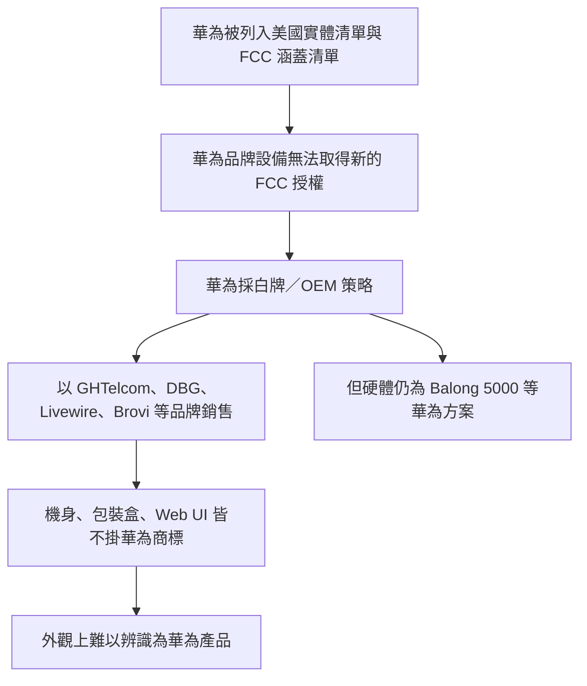

# 為何 5G CPE Pro 3 機身、包裝盒與 Web UI 上都沒有華為商標

## 摘要

市面上的「5G CPE Pro 3」在外觀與介面上幾乎找不到任何華為（Huawei）商標，這並非仿冒品，而是一項刻意的品牌策略：該裝置實際上由華為製造，卻以「白牌／OEM 貼牌」方式，改用 GHTelcom、DBG、Livewire 等第三方品牌對外銷售[^routeur5g-h138][^ghtelcom-spec]。其目的是規避美國對華為電信設備的進口與銷售禁令，以及其它國家對華為品牌的限制[^sing4g-h138][^fierce][^fcc-covered]。

---

## 一、裝置的真實身分

「5G CPE Pro 3」是一款固定式 5G 無線閘道器（CPE，Customer Premises Equipment），功能是把 5G 或 4G LTE 行動網路訊號轉換為 Wi-Fi 6 與有線乙太網路，供家用或小型辦公室上網[^routeur5g-h138]。其對應型號為 **H138-380**[^4gltemall]。

在硬體規格上，多個零售與規格頁面都明確指出，它採用華為自家的 **Balong 5000** 晶片組與 Gigahome Wi-Fi 晶片[^ghtelcom-spec][^routeur5g-h138]，管理 App 亦為「HUAWEI AI Life App（Android）」與「HUAWEI Smart Home App（iOS）」，且支援華為 HiLink 免密碼連線[^ghtelcom-spec]。換言之，內部從晶片、韌體到 App 生態系仍是華為技術，只是對外不掛華為品牌。

| 項目 | 內容 |
|---|---|
| 產品名稱 | 5G CPE Pro 3（部分市場稱 5G CPE 5 / CPE 5s） |
| 型號 | H138-380（另有 H135-380、H153-381、H155-381、H158-381 等衍生型號）[^ghtelcom-spec][^routeur5g-brovi] |
| 晶片 | 華為 Balong 5000 + Gigahome Wi-Fi 晶片[^ghtelcom-spec] |
| Wi-Fi | Wi-Fi 6，2.4 GHz 574 Mbps + 5 GHz 1201 Mbps[^ghtelcom-spec] |
| 5G 速率 | 下行最高 3.6 Gbps／上行 250 Mbps（理論值）[^ghtelcom-spec] |
| 管理介面 | 網頁 UI（WebUI），預設常見 IP 192.168.8.1；HUAWEI AI Life / Smart Home App[^ghtelcom-spec] |

---

## 二、為何沒有華為商標：禁令與品牌迴避

### 2.1 直接原因：規避各國對華為的禁令

新加坡零售商 Sing4g 在其 H138-380（即 5G CPE Pro 3）商品頁上直白說明：

> "For reason huawei is ban from many country, it is new model make by huawei is no longer use huawei logo, this is using new brand name GHTelcom"[^sing4g-h138]

（大意：由於華為被許多國家禁用，這款華為新生產的機型不再使用華為標誌，改用新品牌名 GHTelcom。）

同一賣場對 Brovi H155（華為貼牌機）亦寫道：

> "It is new model make by huawei is no longer use huawei logo on device / webui"[^sing4g-h155]

（大意：這是華為新生產的機型，機身與 Web UI 都不再使用華為標誌。）

### 2.2 白牌／貼牌（rebrand）實際情況

法國 5G 路由器評測網站 routeur5g.com 明確指出，2021 年推出的 DBG 5G CPE Pro 3 是「華為的 5G 路由器，依國家不同被重新貼牌為 DBG、GHTelcom 或 Livewire」[^routeur5g-h138]。該站對後繼的 Brovi CPE 5s 也說明其「其實是華為路由器重新貼牌，很可能是為了在歐盟與美國迴避原品牌的問題」[^routeur5g-brovi]。

GHTelcom 官網本身即以自家品牌販售「GHTelcom 5G CPE Pro 3」，並在頁尾標示 "Copyright © 2021 GHTelcom | Powered by GHTelcom"，公司自述 2021 年成立，提供 5G 產品的設計、開發、製造與通路整合[^ghtelcom-spec][^ghtelcom-about]。然而其產品規格頁仍公開列出 Balong 5000 晶片與 HUAWEI AI Life App[^ghtelcom-spec]，可視為華為貼牌關係的間接證據。

### 2.3 2024 年媒體調查報導

2024 年 6 月 14 日，《The Information》以「Huawei Is Quietly Selling Routers Without Its Logo to Evade the U.S. Ban」（華為悄悄販售無自家標誌的路由器以規避美國禁令）為題報導此事，路透社（Reuters）隨後以「華為被指將 CPE 產品重新貼牌以規避美國制裁」轉載[^information][^reuters]。Fierce Network 亦有「Huawei said to be rebranding CPE products to evade ban」的相關報導[^fierce]。

> 註：上述原始報導網站多為付費牆或被下架，本次研究僅能取得其標題與網址，未能取得全文引文；相關內容已由零售商與評測站的第一手說明佐證，但仍應留意此限制。

---

## 三、制度背景：美國為何要禁

禁令並非只針對路由器本身，而是一整套供應鏈安全法規：

- 2019 年 5 月，美國商務部工業與安全局（BIS）將華為與逾 150 家關聯企業列入實體清單（Entity List）[^eversheds]。
- 2021 年 3 月 12 日，美國聯邦通訊委員會（FCC）依《安全與可信通訊網路法》（Secure and Trusted Communications Networks Act of 2019）公布「涵蓋清單」（Covered List），將華為、中興等設備列為對美國國安構成不可接受風險[^fcc-order][^fcc-covered]。
- 依《2021 年安全設備法》（Secure Equipment Act of 2021），FCC 不得再對涵蓋清單上的設備核發新的設備授權，使新的華為品牌設備無法合法輸美銷售[^secure-equipment-act]。

---

## 四、結論

5G CPE Pro 3 沒有華為商標，是因為它被刻意「去品牌化」：

1. **它確實是華為製造**，內部使用華為 Balong 5000 晶片、韌體與 HUAWEI AI Life App 生態[^ghtelcom-spec]。
2. **不掛華為商標是策略選擇**，目的是在華為被多國禁用的市場繼續銷售硬體[^sing4g-h138][^routeur5g-h138]。
3. **銷售改掛第三方品牌**，如 GHTelcom（最常見）、DBG、Livewire 與 Brovi[^routeur5g-h138][^routeur5g-brovi]。
4. **Web UI 同樣去除華為標誌**，但底層仍是華為韌體[^sing4g-h155]。
5. **根本原因是美國等地的法規封鎖**，包括 2019 年實體清單、2021 年 FCC 涵蓋清單與《安全設備法》[^eversheds][^fcc-order][^secure-equipment-act]。

對消費者而言，這類裝置多數硬體與效能與華為原廠機一致，但**品牌、保固與售後可能由貼牌方負責**，選購時應以型號（如 H138-380）而非品牌名辨識，並自行評估韌體來源與安全性。

---

## 參考資料

[^routeur5g-h138]: routeur5g.com. (2021-12-09, updated 2026-10-15). Huawei 5G CPE Pro 3 (H138-380 / DBG / GHTelecom). Retrieved 2026-10-17, from https://www.routeur5g.com/ghtelcom-h138-380/

[^routeur5g-brovi]: routeur5g.com. (2025-07-22, updated 2026-10-15). Brovi CPE 5s 5G. Retrieved 2026-10-17, from https://www.routeur5g.com/brovi-cpe-5s-5g/

[^sing4g-h138]: Sing4g. (n.d.). H138 CPE Pro 3 5G 1.8Gbps 2LAN 128WiFi. Retrieved 2026-10-17, from https://www.sing4g.com/product-page/h138-cpe-pro-3-5g-1-8gbps-2lan-128wifi

[^sing4g-h155]: Sing4g. (n.d.). Huawei Brovi H155 5G CPE 5 5G 3.6Gbps 2LAN 128WiFi. Retrieved 2026-10-17, from https://www.sing4g.com/product-page/huawei-brovi-h155-5g-cpe-5-5g-3-6gbps-2lan-128wifi

[^ghtelcom-spec]: GHTelcom. (2021). GHTelcom 5G CPE Pro 3. Retrieved 2026-10-17, from https://www.ghtelcom.com/5g-cpe-pro-3/

[^ghtelcom-about]: GHTelcom. (2021). About. Retrieved 2026-10-17, from https://www.ghtelcom.com/about/

[^4gltemall]: 4gltemall.com. (n.d.). Huawei H138-380 5G CPE PRO 3 Specs, Price, Review. Retrieved 2026-10-17, from https://www.4gltemall.com/huawei-h138-380-5g-cpe-pro-3.html

[^information]: Chen, W. (2024-06-14). Huawei Is Quietly Selling Routers Without Its Logo to Evade the U.S. Ban. The Information. Retrieved 2026-10-17, from https://www.theinformation.com/articles/huawei-is-quietly-selling-routers-without-its-logo-to-evade-the-us-ban (付費牆，僅取得標題與網址)

[^reuters]: Reuters. (2024-06-14). Huawei said to be rebranding CPE products to evade US sanctions. Retrieved 2026-10-17, from https://www.reuters.com/technology/huawei-said-rebranding-cpe-products-evade-us-sanctions-source-2024-06-14/ (付費牆，僅取得標題與網址)

[^fierce]: Fierce Network. (2024). Huawei said to be rebranding CPE products to evade ban. Retrieved 2026-10-17, from https://www.fierce-network.com/regulatory/huawei-said-be-rebranding-cpe-products-evade-ban (頁面已下架，僅取得標題與網址)

[^eversheds]: Eversheds Sutherland. (n.d.). Unpacking US-China sanctions and export control regulations: Huawei. Retrieved 2026-10-17, from https://www.eversheds-sutherland.com/en/united-states/insights/unpacking-us-china-sanctions-and-export-control-regulations-huawei

[^fcc-order]: Federal Communications Commission. (2021-01-13). Protecting Against National Security Threats to the Communications Supply Chain Through FCC Programs (FR Doc. 2021-00052). Federal Register. Retrieved 2026-10-17, from https://www.federalregister.gov/documents/2021/01/13/2021-00052/protecting-against-national-security-threats-to-the-communications-supply-chain-through-fcc-programs

[^fcc-covered]: Federal Communications Commission. (n.d.). Covered List. Retrieved 2026-10-17, from https://www.fcc.gov/supplychain/coveredlist

[^secure-equipment-act]: Secure Equipment Act of 2021, Pub. L. No. 117-55. Retrieved 2026-10-17, from https://en.wikipedia.org/wiki/Secure_Equipment_Act
