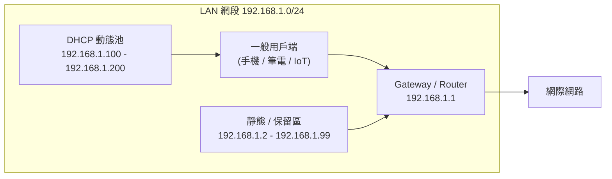
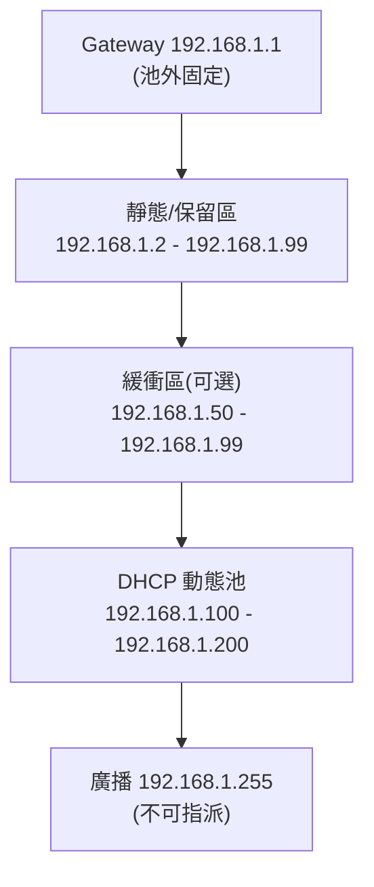

# 區域網路 (LAN) 架設中的 DHCP、Gateway IP 與固定 IP 設定規則

## 摘要

本文說明在架設區域網路 (LAN, Local Area Network) 時，路由器 (Router／Gateway) 的 IP 位址、DHCP (Dynamic Host Configuration Protocol) 位址池 (Pool) 的配置慣例與規則，以及在該網域內使用固定／靜態 IP (Static IP) 時必須遵守的位址選擇與設定規則。核心結論是：LAN 內部應使用 RFC 1918 定義的私有位址；Gateway 通常取子網中第一個可用位址 (如 `192.168.1.1`)；動態 DHCP 位址池與靜態／保留位址必須落在互不重疊的區間，且網路位址 (`x.x.x.0`) 與廣播位址 (`x.x.x.255`) 不得指派給任何裝置。

---

## 1. 背景與名詞定義

- **LAN (區域網路)**：一個受單一組織或個人管理、通常位於同一實體範圍內的網路，其內部裝置彼此可直接通訊。
- **Gateway／Default Gateway (預設閘道)**：當主機要與本地子網以外的目的地通訊時，封包會被送往的下一跳路由器位址。它同時是 LAN 對外 (例如連上網際網路) 的出口[^gw]。
- **DHCP**：一種讓伺服器 (通常是路由器) 自動把 IP 位址及相關設定 (子網遮罩、閘道、DNS) 派發給主機的協定[^dhcp]。
- **DHCP 位址池 (Pool／Scope)**：DHCP 伺服器可動態派發的位址範圍。
- **靜態 IP (Static IP)**：由人工在裝置上手動設定、不經 DHCP 動態取得的固定位址。
- **DHCP 保留 (DHCP Reservation)**：在 DHCP 伺服器上以 MAC 位址綁定一個固定 IP，讓特定裝置每次取得同一位址[^dhcp]。

---

## 2. 私有 IP 位址範圍 (RFC 1918)

LAN 內部位址應選自 RFC 1918「Address Allocation for Private Internets」定義的三個私有位址區塊。這些位址不會在公開網際網路上被路由，任何人都可自由使用，無需向 IANA 或任何註冊機構申請[^rfc1918]。

- **24 位元區塊**：`10.0.0.0/8`，範圍 `10.0.0.0` – `10.255.255.255`，約 1,677 萬個位址，適合大型企業與需要大量子網切割的環境。
- **20 位元區塊**：`172.16.0.0/12`，範圍 `172.16.0.0` – `172.31.255.255`，約 104 萬個位址，適合中型組織。
- **16 位元區塊**：`192.168.0.0/16`，範圍 `192.168.0.0` – `192.168.255.255`，約 6.5 萬個位址，為家庭與小型辦公室最常見的選擇。

RFC 1918 本身建議：若能設計並由設備支援合適的子網切割方案，宜採用 24 位元區塊 (即 `10.0.0.0/8`) 並規劃具成長空間的定址計畫[^rfc1918]。此外，RFC 1918 明確提醒：為降低日後兩個私有網路合併時發生位址衝突的風險，強烈建議組織在分配內部子區塊時，從私有位址池中「隨機」選取[^rfc1918]。實務上的含意是：不要因為 `192.168.1.0/24` 是最常見預設值就一律採用，可考慮 `192.168.142.x`、`10.14.x.x`、`172.22.x.x` 等較少見的網段，以降低衝突機率。

**必須避免使用的位址範圍 (RFC 5735、RFC 6890)**[^rfc5735][^rfc6890]：

- `0.0.0.0/8`：表示「本網路」，不可路由，不可指派。
- `127.0.0.0/8`：回送位址 (Loopback，如 `127.0.0.1`)，僅供主機自我參照。
- `169.254.0.0/16`：連結本地 (Link-local / APIPA) 位址，保留給 DHCP 失敗時的自動組態。
- `224.0.0.0/4`：多播 (Multicast) 位址，非單播主機指派用途。
- `240.0.0.0/4`：保留供未來使用。
- `255.255.255.255/32`：有限廣播，僅能作為目的地位址。
- `100.64.0.0/10`：電信級 NAT (CGNAT) 共享位址空間 (RFC 6598)，不可用於私有 LAN[^cgnat]。

---

## 3. 子網遮罩與網段結構

家庭／小型 LAN 幾乎一律使用 `/24` 子網，其子網遮罩為 `255.255.255.0`。`/24` 提供 254 個可用主機位址 (1 至 254)，對一般家庭或小型辦公室而言遠超所需，且前三個八位元代表網段、最後一個八位元代表主機，直觀易懂[^private]。

在一個子網內，依 RFC 950「Internet Standard Subnetting Procedure」的子網切割規則，全為 0 的位址代表網路本身 (Network ID)，全為 1 的位址代表廣播 (Broadcast)，此兩者不得指派給任何介面[^rfc950]。以 `192.168.1.0/24` 為例：

- 網路位址：`192.168.1.0` (不可指派)
- 廣播位址：`192.168.1.255` (不可指派)
- 可用主機位址：`192.168.1.1` – `192.168.1.254`

若需要更小的子網 (例如 /25 提供 126 個位址、/26 提供 62 個位址)，網路與廣播位址的規則仍然成立，只是位置隨子網切割而改變。

---

## 4. Gateway (Router) IP 的規則與慣例

**Gateway 通常取子網中第一個可用位址**，例如 `192.168.1.1` 或 `192.168.0.1`。這並非任何 RFC 的強制規定，而是產業慣例，原因包括[^gw]：

1. **可預測性**：管理員與其他裝置永遠知道要到哪個位址尋找閘道。
2. **邏輯順序**：排除網路位址 `x.x.x.0` 後，`x.x.x.1` 是第一個主機位址，位置自然。
3. **歷史沿革**：此慣例可追溯至 TCP/IP 早期與 RFC 950 的子網模型，當時以 `.1` 作為區段上的第一部路由器。
4. **廠商預設值一致**：多數消費級路由器製造商皆採用 `.1`。
5. **便於保留**：把 `.1` 固定給閘道，其餘位址規劃更單純。

**主要廠商的預設 LAN IP 慣例**[^tplink][^netgear]：

- **TP-Link**：`192.168.0.1` 或 `192.168.1.1`；Deco Mesh 系列部分機型為 `192.168.68.1`。
- **Netgear**：多數機型 `192.168.1.1`，部分為 `192.168.0.1`。
- **ASUS**：多數機型 `192.168.1.1`，部分為 `192.168.50.1`。
- **Cisco／Linksys**：`192.168.1.1`。

**Gateway IP 的設定規則**：

- Gateway 位址必須位於 LAN 子網之內，且落在 DHCP 動態池「之外」，以免被 DHCP 派發給其他裝置而產生衝突。
- 若變更路由器的 LAN IP，必須同步更新 DHCP 伺服器所派發的「預設閘道」選項，否則用戶端將失去通往網際網路的路由[^gw]。
- 若網路中有多個路由器／子網，每個子網必須使用彼此相異的網段，且各自的 Gateway 應位於自身子網內。

---

## 5. DHCP 的運作與位址池配置規則

### 5.1 DHCP 的運作方式

DHCP 由 RFC 2131 定義其協定行為，其位址派發包含三個層次的分配方式[^dhcp]：

- **動態分配 (Dynamic allocation)**：伺服器從位址池租借位址，租約到期後可回收再派給其他裝置。
- **自動分配 (Automatic allocation)**：伺服器永久性地從池中指派位址，並記住先前的指派結果。
- **手動分配 (Manual allocation)**：即靜態 DHCP 保留 (MAC 對 IP 綁定)，管理員指定某 MAC 位址固定取得某 IP，伺服器永遠提供該位址[^dhcp]。

DHCP 伺服器在 DHCPOFFER／DHCPACK 訊息中，除了提供 IP 之外，還會附帶網路組態選項 (定義於 RFC 2132)[^rfc2132]：

- **Option 1**：子網遮罩 (Subnet Mask)。
- **Option 3**：路由器／閘道 (Router，即 Default Gateway)。
- **Option 6**：DNS 伺服器。
- **Option 51**：租約時間 (Lease Time)。

這代表使用 DHCP 的裝置 (包括 DHCP 保留) 會自動收到閘道與 DNS 設定，無需在裝置上手動輸入。

### 5.2 位址池配置的規則與慣例

以 `192.168.1.0/24` 為例，常見且建議的配置分工如下：

- **Gateway／Router**：`192.168.1.1` (固定，位於池外)。
- **靜態／保留區**：`192.168.1.2` – `192.168.1.99` (伺服器、印表機、NAS、無線基地台等)。
- **緩衝區**：`192.168.1.50` – `192.168.1.99` (可選，保留給未來新增的靜態裝置)。
- **DHCP 動態池**：`192.168.1.100` – `192.168.1.200` (一般用戶端)。
- **廣播位址**：`192.168.1.255` (不可指派)。
- **租約時間**：家庭網路建議 1 至 7 天；高流動性的 WiFi 環境建議 1 至 24 小時，以在續約流量與穩定性間取得平衡[^dhcp]。

**關鍵規則**：靜態／保留區與 DHCP 動態池之間必須留有間隔。若把靜態 IP 設在 DHCP 池內，DHCP 伺服器可能在不知情的情況下把同一位址派給另一台裝置，造成 IP 衝突[^dhcp]。

---

## 6. 固定／靜態 IP 的設定規則

在 LAN 內使用固定／靜態 IP 時，必須遵守以下規則：

1. **位址必須取自 RFC 1918 私有範圍** (`10.0.0.0/8`、`172.16.0.0/12`、`192.168.0.0/16`)[^rfc1918]。
2. **位址不得落在網路位址或廣播位址** (`x.x.x.0` 與 `x.x.x.255`)，這兩者依 RFC 950 不可指派給介面[^rfc950]。
3. **位址必須與 DHCP 動態池互不重疊**：靜態 IP 應設在 DHCP 池之外的專屬區間[^dhcp]。
4. **子網遮罩須與網段一致**：例如 `/24` 網路必須使用 `255.255.255.0`，否則裝置會誤判哪些位址屬於本地子網。
5. **必須指定 Gateway**：手動設定靜態 IP 時，裝置不會收到 DHCP 的 Option 3，因此必須手動填入路由器 LAN IP 作為預設閘道，否則無法對外通訊[^gw]。
6. **必須指定 DNS 伺服器**：同樣地，手動靜態設定不經 DHCP Option 6，需手動填入 DNS (可用路由器 IP 或如 `8.8.8.8`、`1.1.1.1` 等公用 DNS)[^rfc2132]。
7. **不得使用 `169.254.0.0/16`**：此為 DHCP 失敗時由作業系統自動使用的連結本地 (APIPA) 位址，非供手動靜態指派之用；RFC 3927 並規定 `169.254.0.0/24` 與 `169.254.255.0/24` 為保留，可用範圍為 `169.254.1.0` – `169.254.254.255`[^rfc3927]。
8. **不得使用回送位址** `127.0.0.0/8`[^rfc5735]。
9. **多路由器環境不得網段重疊**：若另一台路由器／子網已使用相同網段，會造成路由衝突。
10. **避免選擇過於常見的網段**：RFC 1918 建議從私有池中隨機選取，以降低日後網路合併時的衝突風險[^rfc1918]。

**手動靜態設定時需要填寫的欄位**：IP 位址、子網遮罩、預設閘道、DNS 伺服器 (以及視需要的第一／第二 DNS)。這點不因路由器新舊而改變：路由器不會把這些設定「推送」給手動設定的裝置[^gw][^dhcp]。

---

## 7. DHCP 保留 (Reservation) 與手動靜態 IP 的比較

兩種讓裝置固定取得同一位址的方法，適用情境不同：

- **DHCP 保留 (在路由器上以 MAC 綁定)**
  - 設定位置：集中於 DHCP 伺服器 (路由器)。
  - 優點：集中管理、裝置無需逐一走訪設定、伺服器本身會避免派發衝突位址、閘道與 DNS 隨 DHCP 自動提供。
  - 適用：印表機、媒體伺服器、NAS 等具固定 MAC 的裝置。
  - 限制：位址仍由 DHCP 租約機制管理；若 DHCP 伺服器關閉，裝置可能取得不到位址。

- **手動靜態 IP (在裝置本身上設定)**
  - 設定位置：分散於各裝置。
  - 優點：位址完全不依賴 DHCP 伺服器狀態，適合關鍵基礎設施。
  - 缺點：需逐一設定且須手動確保位址在 DHCP 池外、無內建衝突防護、任意一台裝置可能因誤設而與他人衝突。
  - 適用：路由器本身、網路交換器，以及無法存取 DHCP 伺服器的情境。

**建議**：在家庭與一般辦公室環境，優先採用 **DHCP 保留**。它集中管理、較不易出錯，且伺服器保證不會把同一 IP 派給其他裝置[^dhcp]。只有在需要位址完全不隨 DHCP 伺服器狀態變動時，才採用裝置端的手動靜態 IP。

---

## 8. 衝突避免檢查清單

1. 僅使用 RFC 1918 私有位址。
2. 不指派網路位址 (`x.x.x.0`) 與廣播位址 (`x.x.x.255`)。
3. Gateway 位於 DHCP 池之外 (通常為 `.1`)。
4. 靜態 IP 位於 DHCP 池之外。
5. DHCP 保留位於動態池之前的專屬子區間。
6. 在靜態／保留區與動態池之間保留緩衝區。
7. 不使用 `169.254.x.x` (連結本地) 與 `127.x.x.x` (回送)。
8. 多路由器時各子網段互不重疊。
9. 手動靜態設定務必填入正確的子網遮罩、閘道與 DNS。
10. 變更路由器 LAN IP 時，同步更新 DHCP 派發的閘道選項。

---

## 9. 完整配置範例 (`192.168.1.0/24`)

- 私有範圍：`192.168.0.0/16` (RFC 1918)
- 子網：`192.168.1.0/24`
- 子網遮罩：`255.255.255.0`
- 網路位址：`192.168.1.0` (不指派)
- Gateway／Router：`192.168.1.1` (慣例取第一個可用位址)
- DHCP 靜態／保留區：`192.168.1.2` – `192.168.1.49`
- 緩衝區：`192.168.1.50` – `192.168.1.99`
- DHCP 動態池：`192.168.1.100` – `192.168.1.200`
- 廣播位址：`192.168.1.255` (不指派)
- 連結本地 (APIPA)：`169.254.x.x` (僅 DHCP 失敗時自動使用)

對應的裝置端靜態設定範例 (以某台 NAS 為例)：

- IP 位址：`192.168.1.10`
- 子網遮罩：`255.255.255.0`
- 預設閘道：`192.168.1.1`
- DNS 伺服器：`192.168.1.1` (或 `1.1.1.1`)

---

## 10. 來源批判性反思

- **權威性**：RFC (Request for Comments) 文件由 IETF 發布，是網際網路協定的第一手標準來源，權威性最高；本文關於私有位址、子網特殊位址、DHCP 運作與連結本地位址的核心規則均直接引述 RFC 1918、RFC 950、RFC 2131／2132、RFC 3927、RFC 5735、RFC 6890。
- **時效性與適用範圍**：RFC 1918 (1996) 與 RFC 950 (1985) 年代久遠，但其定義的私有位址範圍與子網規則至今仍是 IPv4 LAN 的基礎，未見被取代；惟讀者應注意本文討論以 IPv4 為主，IPv6 環境的位址規劃 (如 ULA `fc00::/7`) 規則不同。
- **廠商文件的偏誤**：TP-Link、Netgear 等廠商說明頁屬第一手產品文件，權威性限於其自家產品，且帶有引導使用者使用其預設設定的商業傾向；本文僅以其佐證「Gateway 慣用 `.1`」此一可交叉驗證的產業慣例，不作為通則標準。
- **交叉驗證**：`Gateway 慣用 `.1``、`靜態 IP 應避開 DHCP 池`、``.0`` 與 `.255`` 不可指派` 等敘述在多個獨立來源 (RFC 與維基百科) 中一致，具高度可信度。
- **維基百科的角色**：維基百科僅作為整理與補充來源，其陳述凡涉及標準者均已回溯至對應 RFC，未單獨以維基百科作為唯一依據。

---

## 參考文獻

Internet Engineering Task Force. (1985). *RFC 950: Internet standard subnetting procedure*. Retrieved 2026-10-17, from https://www.rfc-editor.org/rfc/rfc950

Internet Engineering Task Force. (1996). *RFC 1918: Address allocation for private internets*. Retrieved 2026-10-17, from https://datatracker.ietf.org/doc/html/rfc1918

Internet Engineering Task Force. (1997). *RFC 2131: Dynamic host configuration protocol*. Retrieved 2026-10-17, from https://www.rfc-editor.org/rfc/rfc2131

Internet Engineering Task Force. (1997). *RFC 2132: DHCP options and BOOTP vendor extensions*. Retrieved 2026-10-17, from https://www.rfc-editor.org/rfc/rfc2132

Internet Engineering Task Force. (2005). *RFC 3927: Dynamic configuration of IPv4 link-local addresses*. Retrieved 2026-10-17, from https://www.rfc-editor.org/rfc/rfc3927

Internet Engineering Task Force. (2010). *RFC 5735: Special use IPv4 addresses*. Retrieved 2026-10-17, from https://www.rfc-editor.org/rfc/rfc5735

Internet Engineering Task Force. (2013). *RFC 6890: Special-purpose IP address registries*. Retrieved 2026-10-17, from https://www.rfc-editor.org/rfc/rfc6890

Netgear. (n.d.). *How do I find my router's IP address?* Retrieved 2026-10-17, from https://kb.netgear.com/248/

TP-Link. (n.d.). *What is the default IP address of a TP-Link router?* Retrieved 2026-10-17, from https://www.tp-link.com/us/support/faq/2392/

Wikimedia Foundation. (n.d.). Default gateway. In *Wikipedia*. Retrieved 2026-10-17, from https://en.wikipedia.org/wiki/Default_gateway

Wikimedia Foundation. (n.d.). Dynamic host configuration protocol. In *Wikipedia*. Retrieved 2026-10-17, from https://en.wikipedia.org/wiki/Dynamic_Host_Configuration_Protocol

Wikimedia Foundation. (n.d.). List of reserved IP addresses. In *Wikipedia*. Retrieved 2026-10-17, from https://en.wikipedia.org/wiki/List_of_reserved_IP_addresses

Wikimedia Foundation. (n.d.). Private network. In *Wikipedia*. Retrieved 2026-10-17, from https://en.wikipedia.org/wiki/Private_network

[^gw]: Wikimedia Foundation (n.d.). Default gateway. In *Wikipedia*. A default gateway is the node that routes traffic from the local subnet to other networks; conventionally placed at the first usable address.
[^dhcp]: Wikimedia Foundation (n.d.). Dynamic host configuration protocol. In *Wikipedia*. DHCP supports dynamic, automatic, and manual (reservation) allocation; gateway (Option 3) and DNS (Option 6) are supplied automatically to clients.
[^rfc1918]: Internet Engineering Task Force (1996). RFC 1918: Address allocation for private internets. The three private blocks are 10.0.0.0/8, 172.16.0.0/12, and 192.168.0.0/16; random selection within the pool is recommended to reduce merger conflicts.
[^rfc950]: Internet Engineering Task Force (1985). RFC 950: Internet standard subnetting procedure. The all-zeros address denotes the network and the all-ones address denotes the broadcast; neither may be assigned to an interface.
[^rfc5735]: Internet Engineering Task Force (2010). RFC 5735: Special use IPv4 addresses. Defines 0.0.0.0/8, 127.0.0.0/8, 169.254.0.0/16, 224.0.0.0/4, 240.0.0.0/4, and 255.255.255.255/32.
[^rfc6890]: Internet Engineering Task Force (2013). RFC 6890: Special-purpose IP address registries. Consolidates the special-purpose IPv4 registry.
[^cgnat]: Internet Engineering Task Force (2012). RFC 6598: IANA-reserved IPv4 prefix for shared address space. 100.64.0.0/10 is reserved for carrier-grade NAT and is not for private LAN use.
[^rfc2132]: Internet Engineering Task Force (1997). RFC 2132: DHCP options and BOOTP vendor extensions. Option 1 = subnet mask, Option 3 = router, Option 6 = DNS server, Option 51 = lease time.
[^rfc3927]: Internet Engineering Task Force (2005). RFC 3927: Dynamic configuration of IPv4 link-local addresses. 169.254.0.0/16 is for automatic link-local configuration; 169.254.0.0/24 and 169.254.255.0/24 are reserved.
[^private]: Wikimedia Foundation (n.d.). Private network. In *Wikipedia*. RFC 1918 ranges, the /24 default for home networks, and the distinction from CGNAT space.
[^tplink]: TP-Link (n.d.). What is the default IP address of a TP-Link router? Default LAN IPs are 192.168.0.1 or 192.168.1.1; Deco mesh models may use 192.168.68.1.
[^netgear]: Netgear (n.d.). How do I find my router's IP address? Most Netgear routers use 192.168.1.1, with some using 192.168.0.1.
