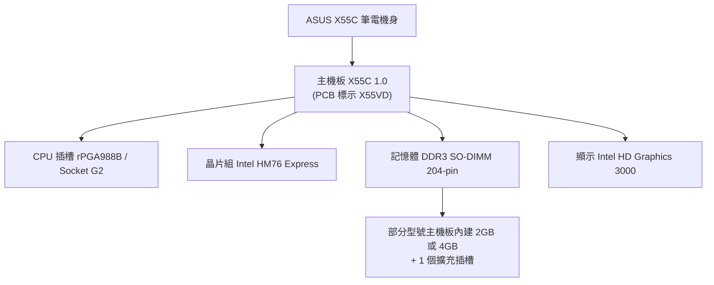
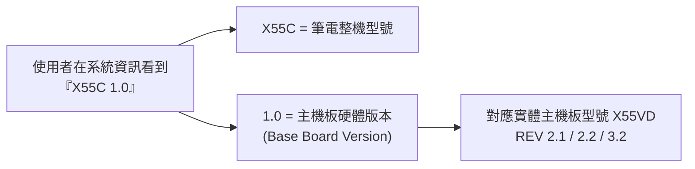

# ASUS X55C（主機板版本 1.0）筆記型電腦規格調查

## 摘要

ASUS X55C 是華碩（ASUSTek）於 2012 年底推出的 15.6 吋入門級筆記型電腦，搭載第二代 Intel Core i3 處理器（Sandy Bridge 架構）與整合式 Intel HD Graphics 3000 顯示晶片，出貨作業系統以 Windows 8 為主[^ifixit][^notebookcheck]。

查詢字串中的「1.0」指的是這台機器**主機板（Baseboard / Mainboard）的硬體版本號**，而非筆電的產品型號或 SKU。硬體資料庫 Linux Hardware Database 收錄的裝置 ID 為 `board:asustek-x55c-1-0`，廠商 ASUSTek，名稱標示為「Motherboard X55C 1.0」，類別為 Motherboard（主機板）[^linuxhw]。此欄位對應的是作業系統以 DMI（Desktop Management Interface）查詢到的「Base Board Version」，可在 Windows 的系統資訊、Linux 的 `dmidecode`、或 CPU-Z 的 Mainboard 分頁（Revision 欄位）看到。ASUS 官方產品規格頁本身並未列出主機板版本欄位，因此「X55C 1.0」是硬體回報值，而非官方型號命名[^asusarchive]。

## 產品定位與外觀

X55C 屬於華碩 X 系列（X Series）的平價機種，機身採黑色塑膠材質，上蓋與鍵盤面帶有橫向條紋（官方描述為 suit streak 紋理）[^sx028h]。所有連接埠集中在機身左側，包含 USB、HDMI、Ethernet、VGA 與音訊孔[^ifixit]。機身尺寸為 37.8 × 25.3 × 3.19 公分，重量約 2.45 公斤[^sx030h][^sx028h]。

## 核心規格

### 處理器（CPU）

| 項目 | 規格 |
| --- | --- |
| 架構 | Intel Sandy Bridge（第二代 Core）為主，部分型號為 Ivy Bridge（第三代） |
| 常見型號 | Core i3-2328M（2.2 GHz）、Core i3-2350M（2.3 GHz）、Core i3-2370M（2.4 GHz）、Pentium 2020M |
| 核心數 | 雙核心（i3 系列含 Hyper-Threading，共 4 執行緒） |
| 快取 | 3 MB（i3 系列） |
| 插槽 | rPGA988B，亦即 Socket G2（俗稱 Socket 989 / PGA 989） |

SX030H 與 SX028H 兩型號皆採用 Core i3-2328M（2.2 GHz、雙核、3 MB 快取、支援 64 位元）[^sx030h][^sx028h]。DS31 型號為 Core i3-2370M（2.4 GHz）[^notebookcheck]。X55C 主機板使用 rPGA988B / Socket G2，理論上可支援 Sandy Bridge 與 Ivy Bridge 兩代行動處理器，但若要完整支援第三代（Ivy Bridge）處理器，需搭配較新的 BIOS 版本[^socketg2][^alibaba]。

### 晶片組

Mobile Intel HM76 Express（Chief River 平台、7 系列行動晶片組），支援 PCI Express 2.0 與 SATA 介面[^sx030h][^sx028h][^asusarchive]。

### 記憶體（RAM）

| 項目 | 規格 |
| --- | --- |
| 類型 | DDR3 SDRAM（1333 MHz，部分來源標示支援 DDR3-1600） |
| 外觀 | SO-DIMM 204-pin |
| 插槽數 | 1 個 + 主機板內建（焊接）記憶體，依型號而異 |
| 常見出廠配置 | 2 GB（1×2 GB）或 4 GB（焊接於主機板） |
| 最大支援 | 8 GB |

SX030H 標配 2 GB（1×2 GB），使用 1 個 SO-DIMM 插槽且無空插槽[^sx030h]；SX028H 則為 4 GB 且標示「provided memory is soldered」（記憶體焊接於主機板），另有 1 個空插槽，最大可擴充至 8 GB，速度 1333 MHz[^sx028h]。gadgetaz 的資料亦列出最大 8 GB、DDR3-1600[^gadgetaz]。華碩官方存檔規格頁則描述兩種組合：2 GB 內建 + 1 個 SO-DIMM 插槽（合計最高 6 GB），或 4 GB 內建 + 1 個 SO-DIMM 插槽（合計最高 8 GB）[^asusarchive]。

### 顯示器

| 項目 | 規格 |
| --- | --- |
| 尺寸 | 15.6 吋（對角線） |
| 解析度 | 1366 × 768（HD） |
| 背光 | LED 背光 |
| 面板 | TFT LCD、16:9 寬螢幕 |
| 特性 | Zero Bright Dot、HD Ready，部分型號為亮面（glossy） |

SX030H 與 SX028H 的規格頁皆記載 15.6 吋、1366 × 768、LED 背光、支援寬螢幕、16:9 比例，SX030H 並標示具備 glare（亮面）與 Zero Bright Dot 特性[^sx030h][^sx028h]。Notebookcheck 的 DS31 規格亦為 15.6 吋、1366 × 768、亮面[^notebookcheck]。

### 顯示晶片（GPU）

整合式 Intel HD Graphics 3000，共用系統記憶體，最大配置約 384 MB[^sx030h][^sx028h]。此為 Sandy Bridge 處理器內建的 GT2 版本，含 12 個執行單元（EU），僅能執行需求極低的 3D 遊戲[^notebookcheck]。

### 儲存與光碟機

| 項目 | 規格 |
| --- | --- |
| 硬碟 | 320 GB 或 500 GB HDD，SATA 3 Gb/s、5400 rpm、2.5 吋 |
| 光碟機 | DVD±RW（±R DL）/ DVD-RAM |

SX030H 與 SX028H 皆配置 500 GB HDD（SATA 3 Gb/s、5400 rpm）與 DVD±RW（±R DL）/ DVD-RAM 光碟機[^sx030h][^sx028h]。華碩官方存檔規格頁另列出 320 GB、750 GB（5400/7200 rpm）、1 TB 等硬碟選項，以及 Super-Multi DVD 光碟機（可選 Blu-ray DVD Combo）[^asusarchive]。

### 連接埠與通訊

| 連接埠 | 數量 |
| --- | --- |
| USB 3.0 Type-A | 1 |
| USB 2.0 Type-A | 1 |
| HDMI | 1 |
| VGA（D-Sub） | 1 |
| RJ-45 Gigabit Ethernet | 1 |
| 耳機輸出（3.5 mm） | 1 |
| 麥克風輸入（3.5 mm） | 1 |
| 讀卡機 | 2 合 1（SD、MMC） |
| 安全鎖孔 | 1 |

無線網路為 802.11b/g/n，部分型號支援藍牙 4.0（DS31 標示 Bluetooth 4.0）[^sx030h][^notebookcheck][^asusarchive]。

### 音訊、視訊與相機

內建 Altec Lansing 喇叭與麥克風，並具備 ASUS SonicMaster Lite 音效強化功能[^sx030h][^sx028h]。相機為 0.3 百萬畫素網路攝影機[^asusarchive]。

### 電池與電源

| 項目 | 規格 |
| --- | --- |
| 電池 | 6 芯鋰離子（Li-Ion） |
| 容量 | 47 Wh |
| 變壓器輸出 | 65 W（19 V、3.42 A） |
| 變壓器輸入 | AC 100–240 V、50/60 Hz |

SX030H 與 SX028H 皆標示 6 芯、47 Wh 電池與 65 W（19 V、3.42 A）變壓器[^sx030h][^sx028h]。華碩官方存檔規格頁列出 6 芯 4400 mAh / 47 Whrs 與 65 W 變壓器[^asusarchive]。

### 尺寸、重量與作業系統

| 項目 | 規格 |
| --- | --- |
| 尺寸 | 37.8 × 25.3 × 3.19 公分（W×D×H；官方存檔另標高度 2.62–3.19 公分） |
| 重量 | 約 2.45 公斤 |
| 作業系統 | Windows 8（SX030H 為 Windows 8；官方存檔另列 Windows 7 各版本） |
| 出貨時間 | 2012 年底 |

iFixit 明確記載 X55C 於 2012 年底推出[^ifixit]，Notebookcheck 對 DS31 的評測日期為 2013-04-03[^notebookcheck]，與 Windows 8 於 2012 年 10 月上市的時間線一致。

## 「1.0」與主機板（X55VD）的關係

X55C 機身內部的主機板在印刷電路板（PCB）上印有 **X55VD MAIN BOARD** 字樣，並以 REV 2.1、REV 2.2、REV 3.2 等修訂版流通[^alibaba][^winraid]。多個獨立維修來源指出 X55C 與 X55VD 使用相同電路圖（identical schematic），可互換維修[^laptechinfo]。主機板零件編號為 60-N0OMB1100-C01 / C02 / C04，通路商列表標示插槽為 Socket-989，晶片組為 HM76[^prodisk][^serverblink]。

因此：

- **X55C** 是筆電系統（整機）型號。
- **X55VD** 是主機板型號。
- **1.0** 是主機板（Baseboard）硬體修訂版本，由硬體回報（Linux Hardware DB 的 `board:asustek-x55c-1-0`、`dmidecode` 的 Base Board Version、CPU-Z 的 Revision）[^linuxhw]。

## 常見 SKU 差異

X55C 系列透過型號後綴區分不同配置，底盤相同，主要差異在 CPU、記憶體與硬碟[^sx030h][^sx028h][^notebookcheck][^gadgetaz]：

| SKU | CPU | 記憶體 | 硬碟 |
| --- | --- | --- | --- |
| X55C-SX030H | Core i3-2328M | 2 GB（1×2 GB） | 500 GB |
| X55C-SX028H | Core i3-2328M | 4 GB（焊接），最高 8 GB | 500 GB |
| X55C-DS31 | Core i3-2370M | — | — |

## 來源評估與限制

- 本報告的規格以第三方規格資料庫（productindetail、Notebookcheck、iFixit、gadgetaz）與華碩官方頁面的 Internet Archive 存檔為主要依據；華碩現行官網已不再提供 X55C 產品頁[^asusarchive][^ifixit][^notebookcheck]。
- 部分規格（如硬碟容量選項、記憶體為焊接或插槽式）在不同 SKU 間存在差異，報告中已分別標註對應型號，讀者須以自身機器實際配置為準。
- 「1.0」為硬體回報的主機板版本，非華碩官方型號；不同批次的 X55C 可能回報不同主機板修訂版。

## 參考文獻

[^ifixit]: iFixit. (n.d.). Asus X55C repair. Retrieved 2026-10-17, from https://www.ifixit.com/Device/Asus_X55C

[^notebookcheck]: Notebookcheck. (2013, April 3). Asus X55C-DS31. Retrieved 2026-10-17, from https://www.notebookcheck.net/Asus-X55C-DS31.90779.0.html

[^sx030h]: Productindetail. (n.d.). ASUS X55C (SX030H) specifications, tests and review. Retrieved 2026-10-17, from https://www.productindetail.com/pn/asus-x55c-sx030h

[^sx028h]: Productindetail. (n.d.). ASUS X55C (SX028H) specifications, tests and review. Retrieved 2026-10-17, from https://www.productindetail.com/pn/asus-x55c-sx028h

[^gadgetaz]: Gadgetaz. (n.d.). ASUS X55C. Retrieved 2026-10-17, from https://gadgetaz.com/Laptop/ASUS_X55C--5953

[^linuxhw]: Linux Hardware Database. (n.d.). ASUSTek Computer Motherboard X55C 1.0. Retrieved 2026-10-17, from https://linux-hardware.org/?id=board:asustek-x55c-1-0

[^asusarchive]: ASUS. (2016). X55C specifications [Archived web page]. Retrieved 2026-10-17, from https://web.archive.org/web/20161209000608/http://www.asus.com/Notebooks/X55C/specifications/

[^socketg2]: Wikipedia. (n.d.). Socket G2. Retrieved 2026-10-17, from https://en.wikipedia.org/wiki/Socket_G2

[^alibaba]: Alibaba Electronics. (n.d.). ASUS X55VD motherboard guide: Repair, replace, or retire. Retrieved 2026-10-17, from https://electronics.alibaba.com/buyingguides/asus-x55vd-motherboard-guide-repair,-replace,-or-retire

[^winraid]: Win-Raid Forum. (n.d.). [Help BIOS] Asus X55C / Motherboard X55VD Rev. 3.2. Retrieved 2026-10-17, from https://winraid.level1techs.com/t/help-bios-asus-x55c-motherboard-x55vd-rev-3-2/34461

[^laptechinfo]: Laptechinfo. (n.d.). Asus X55VD REV 2.1. Retrieved 2026-10-17, from https://laptechinfo.com/threads/asus-x55vd-rev-2-1.4182/

[^prodisk]: Prodisk Network. (n.d.). Intel 60-N0OMB1100-C01 motherboard. Retrieved 2026-10-17, from https://www.prodisknetwork.com/product/intel-60-n0omb1100-c01-motherboard

[^serverblink]: Serverblink. (n.d.). 60-N0OMB1100-C02 ASUS X55C Intel laptop motherboard Socket 989. Retrieved 2026-10-17, from https://www.serverblink.com/60-n0omb1100-c02-asus-x55c-intel-laptop-motherboard-socket-989/
