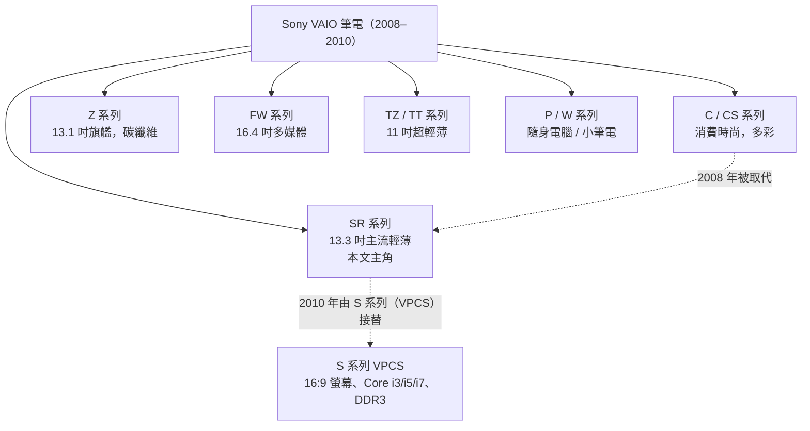

# Sony VAIO VGN-SR56TG/B（C602Y5TQ）規格與背景調查

## 摘要

本文調查兩組標記所指涉的同一台筆記型電腦：

- **VGN-SR56TG/B**：Sony VAIO SR 系列的 13.3 吋機種，2009 年在台灣（繁體中文市場）上市的版本，`/B` 代表機身顏色為黑色（Modern Black，摩登黑）[^b-suffix][^hot3c-spec]。
- **C602Y5TQ**：一組 8 碼英數字串。**本研究無法在公開網路上找到任何一筆索引紀錄**，且它不符合 VAIO 的型號（Model Number）命名規則，因此最合理的推測是機身底部標籤上的「產品代碼（Product Code）」，而非型號或序號。此推測屬本文的推論，並非可被來源證實的事實，詳見〈第四節：關於 C602Y5TQ〉[^s1f0264][^uk-findmodel]。

## 一、機種定位：SR 系列在 Sony VAIO 產品線中的位置

Sony VAIO SR 系列是 2008 年 7 至 8 月隨 Intel Centrino 2 平台一同推出的消費級筆記型電腦，用來取代 VAIO C 系列，同時也被視為與較低階 SZ 機種競爭的產品[^wp-sr]。它的定位是「比旗艦 Z 系列便宜的替代方案」，提供多數相同功能但價格較低[^vaiolib]。

SR 系列與 Z 系列共用相同的 CPU、RAM、硬碟選項，並同樣有 Blu-ray 光碟機選項；差異在於 SR 沒有 Z 系列的 WWAN（HSDPA）與 RAID SSD 選項，機身以鎂合金打造、重量約 1.95 公斤，明顯比碳纖維的 Z 系列重[^wp-sr]。繪圖方面，SR 基本款使用整合式 Intel GMA 4500MHD，高階款配備 ATI Mobility Radeon HD 3470，後期機種則升級為 ATI Mobility Radeon HD 4570；由於 Z 系列在小機身中使用 NVIDIA GeForce 9300M GS（發熱較低），配 ATI 的 SR 反而有更好的遊戲效能，被定位為「消費者／玩家取向」的選擇[^wp-sr]。SR 也配備 130 萬畫素網路攝影機，優於 Z 系列的 30 萬畫素[^wp-sr]。

機身設計包含鎂合金機殼、機身側面的圓柱型電源按鈕、獨立的巧克力（孤島式）鍵盤，並提供黑色、Platinum Silver、Titanium Grey、Glossy Pink 等顏色[^vaiolib]。

## 二、Switch 情境模式（VAIO Mode Switch）

SR 系列最具代表性的功能是鍵盤上方的一排按鍵與「Switch」模式切換：使用者可將三種模式自訂為不同用途，例如商務、個人與娛樂，只要按下 MODE 鍵即可切換，各模式的快捷功能與桌面主題背景都能分別設定[^switch][^hot3c-summer]。

台灣 Sony 在 2009 年 6 月的夏季新品發表時，將這組功能描述為「隨選情境 Switch 使用者介面」，可切換「商務情境模式」、「娛樂情境模式」與「個人情境模式」，分別設定不同的快捷功能與主題背景[^hot3c-summer]。同年 10 月上市資訊中，SR56 亦強調「Switch」人性化操作介面，能依使用情境快速切換[^hot3c-spec]。

## 三、VGN-SR56TG/B 規格

以下規格以台灣市場的 SR56 規格表為主，並以 Sony 亞太（Asia Pacific）VGN-SR56GG 規格頁與其他地區同世代機種交叉比對。SR56 族系（TG／GG／SG／MG 等）是同一世代的區域版本，硬體配置基本一致，主要差異在作業系統語言、預載軟體與保固條款[^hot3c-spec][^sony-ap][^notebookspec]。

| 項目 | 規格 |
| --- | --- |
| 型號 | VGN-SR56TG/B（`/B` = 摩登黑 Modern Black）[^hot3c-spec][^b-suffix] |
| 作業系統 | 正版 Windows 7 Professional 64-bit（繁體中文版）with SP1（英文語言包）[^hot3c-spec] |
| 平台 | Intel Centrino 2 處理器技術[^hot3c-spec] |
| 處理器 | Intel Core 2 Duo P8700（2.53 GHz）[^hot3c-spec] |
| 晶片組 | Mobile Intel PM45 Express[^hot3c-spec] |
| 前端匯流排 | 1066 MHz[^hot3c-spec] |
| 記憶體匯流排 | 800 MHz[^hot3c-spec] |
| 快取記憶體 | 3 MB（L2）[^hot3c-spec] |
| 主記憶體 | 4 GB DDR2 SDRAM，最高可升級至 8 GB；2 組 SO-DIMM 插槽（預置模組佔用一個）[^hot3c-spec] |
| 硬碟 | 320 GB SATA HDD，7200 rpm[^hot3c-spec] |
| 光碟機 | DVD±RW / ±R DL / RAM；讀取最高 DVD±R 8x、DVD-RAM 5x、CD 24x；寫入 DVD±R 8x（單層）/4x（雙層）、DVD-RW 6x、DVD-RAM 5x、CD-R 24x、CD-RW 16x[^hot3c-spec] |
| 顯示卡 | ATI Mobility Radeon HD 4570，獨立顯示記憶體 512 MB[^hot3c-spec] |
| 顯示器 | 13.3 吋寬螢幕 TFT（WXGA 1280 x 800），VAIO Display Premium，LED 背光[^hot3c-spec] |
| 無線網路 | Intel WiFi Link 5100，IEEE 802.11a/b/g/n；2.4 GHz 與 5 GHz 雙頻；最高 11 Mbps（b）/ 54 Mbps（a/g）/ 300 Mbps（n）[^hot3c-spec] |
| 藍牙 | Bluetooth 標準 Ver. 2.1 + EDR[^hot3c-spec] |
| 安全 | TCG Ver.1.2 相容 TPM 安全晶片；指紋感應器 x1[^hot3c-spec] |
| 網路攝影機 | 有效畫素 1280 x 1024[^hot3c-spec] |
| 音效 | Intel High Definition Audio 相容、3D 音效（支援 DirectSound 3D）、內建立體聲喇叭、內建單聲道麥克風[^hot3c-spec] |
| 鍵盤 | 19 mm 鍵距 / 2 mm 鍵擊高度、82 鍵、智慧型觸控板[^hot3c-spec] |
| 隨附電池 | VGP-BPS13A/Q 鋰電池，最長約 3 小時[^hot3c-spec] |
| 選購電池 | VGP-BPL13 鋰電池，最長約 4.5 小時[^hot3c-spec] |
| 尺寸（寬 x 高 x 深） | 315 x 24.9–34 x 233.8 mm[^hot3c-spec] |
| 重量 | 1.99 kg（含隨附電池）[^hot3c-spec] |
| 隨附配件 | AC 變壓器（VGP-AC19V31 或 VGP-AC19V35）、VGP-BPS13A/Q 電池、Windows XP Professional 安裝光碟[^hot3c-spec] |

### 連接介面

| 介面 | 數量／規格 |
| --- | --- |
| USB | 高速 USB 2.0 x 2[^hot3c-spec] |
| i.LINK（IEEE 1394） | 4 pin（S400）x 1[^hot3c-spec] |
| 有線網路 | RJ-45，10Base-T / 100Base-TX x 1[^hot3c-spec] |
| 顯示器輸出 | 類比 RGB，迷你 D-sub 15 pin x 1[^hot3c-spec] |
| HDMI | 輸出 x 1[^hot3c-spec] |
| 數據機 | V.92 / V.90 相容 x 1[^hot3c-spec] |
| 耳機／麥克風 | 立體聲迷你插孔各 x 1[^hot3c-spec] |
| Memory Stick | 相容 Standard / Duo 尺寸、MagicGate、Memory Stick PRO[^hot3c-spec] |
| SD 記憶卡 | 相容 SDHC、CPRM 版權保護[^hot3c-spec] |
| 擴充卡 | ExpressCard /34 x 1[^hot3c-spec] |
| 其他 | DC IN x 1、擴充基座（Docking Station）連接埠 x 1[^hot3c-spec] |

### 規格表之間的差異說明（重要）

在比對資料時可見幾處出入，解讀時須留意：

- **處理器**：台灣規格表（SR56TG/B、SR56GG、SR56SG、SR56MG）一致標示 **P8700（2.53 GHz）**[^hot3c-spec][^sony-ap][^notebookspec]。不過另有來源在 CNET 的網址描述中把 SR56TG/B 列為 **Core 2 Duo T9600（2.80 GHz）+ 3 GB DDR2**，此敘述與上述規格表衝突，且該來源內容無法完整查證，宜以 Sony／台灣規格表為準。
- **顯示器名稱**：台灣規格表寫「VAIO Display Premium」[^hot3c-spec]；部分 Sony 亞太地區頁面將同款面板列為「VAIO Display Plus」。兩者指同一片 13.3 吋 WXGA LED 面板，屬命名差異。
- **作業系統**：台灣版為 Windows 7 Professional 64-bit[^hot3c-spec]；泰國版 SR56SG 則為 Windows 7 Home Premium[^notebookspec]。同世代各地區出貨設定不同屬常態。
- **價格**：台灣 Sony 2009 年 6 月發表 SR45／SR46 時，建議售價分別為新台幣 44,800 元與 49,800 元[^hot3c-summer]；SR56 的實際成交／報價資料零散（例如 2011 年光華商場報價欄位記錄新台幣 46,800 元、2010 年論壇二手讓售價新台幣 36,500 元），僅能作為行情參考，不足以代表官方定價。

### 系列同世代機種對照

為確認「SR56」在系列中的層級，可參考同世代其他機種的配置：

| 機種 | 處理器 | 顯示卡 | 記憶體 | 硬碟 | 參考售價 | 來源 |
| --- | --- | --- | --- | --- | --- | --- |
| VGN-SR56 Series（VGN-SR56，南非通路規格表） | Core 2 Duo P8700 2.53 GHz | ATI Mobility Radeon HD 4570 512 MB | 4096 MB DDR2-800（2x2048） | 320 GB SATA 7200 rpm | — | [^comx] |
| VGN-SR56SG（泰國） | Core 2 Duo P8700 | ATI Radeon HD 4570 | 4 GB DDR2 | 320 GB 7200 rpm | 49,900 泰銖 | [^notebookspec] |
| VGN-SR41M/S（歐洲） | Core 2 Duo T6400 | ATI Mobility Radeon HD 4570 512 MB | 4 GB | — | 約 1,200 歐元 | [^nbc] |
| VGN-SR19XN（歐洲，初代） | Core 2 Duo P8400 | Intel GMA 4500MHD（整合） | 2 GB | 250 GB | 約 1,200 歐元 | [^nbc] |
| VGN-SR19VN（歐洲，初代） | Core 2 Duo P8400 | ATI Mobility Radeon HD 3470 | 2 GB | 250 GB | 約 1,600 歐元 | [^nbc] |

由此可見，SR56 屬於該系列 2009 年的高規格配置（P8700 + HD 4570 + 320 GB 7200 rpm），在系列中並非入門款。

## 四、關於 C602Y5TQ

### 4.1 搜尋結果

以精確字串 `"C602Y5TQ"` 在多個搜尋引擎與資料庫查詢，**未取得任何一筆結果**：包含 DuckDuckGo 精確字串查詢回報「No results found」，Marginalia 搜尋引擎因機器人流量管制未能完成查詢。搜尋亦涵蓋 VAIO、product、serial、model、part、SKU、laptop 等關鍵字組合，均無命中[^search-none]。

### 4.2 為什麼它不像型號或序號

Sony 官方說明文件指出，VAIO 筆電的型號一律以字母前綴開頭並包含連字號，例如 `PCG-N505VX`、`VGN-FW550F`、`SVE-1511YN`、`SVJ-202190X` 等[^s1f0264]。`C602Y5TQ` 為 8 碼英數字、無連字號、無 VAIO 系列前綴，因此**不符合 VAIO 型號格式**[^s1f0264]。

另一方面，Sony 亞太地區支援文件說明，VAIO 的**序號為 7 個數字字元**，位於機身底部白色條碼標籤下方，格式為 `******** - XXXXXXX`[^serial-7]。

### 4.3 最合理的推測：機身底部的「產品代碼（Product Code）」

Sony VAIO 的使用手冊「Owner's Record」段落寫明：*「序號、型號與產品代碼位於 Sony 電腦的底部」*（The serial number, model number and product code are located on the bottom of your Sony computer）[^owners-record]。Sony 支援文章亦將 **Model Name（機型名稱）、Product Code（產品代碼）、Serial Number（序號）、Service Tag（服務標籤）** 列為機身底部貼紙上的四項資料，且這些資訊也可在 BIOS 設定工具的 Main 選單中查到[^s1f0264][^sony-4items]。

此外，2009 年（含）之後的 VAIO 若為「configured-to-order（CTO，客製訂購）」機種，其完整型號才會貼在機身底部；非客製機種的完整型號並不在機殼上，需透過 VAIO Care 或 `C:\Windows\Model.txt` 查得[^s1f0264]。這說明「機身底部標籤」上確實存在多組與型號不同、且不對外公開索引的代碼欄位。

**綜合以上，本文推論：`C602Y5TQ` 極可能是該台 VGN-SR56TG/B 機身底部標籤上所列的 Product Code（產品代碼）或 Service Tag。**

必須強調此為**推論而非證實**：

- 沒有任何線上來源記錄過 `C602Y5TQ` 這組字串[^search-none]。
- 本文未能取得任何一份具體的 VAIO Product Code 範例，因此無法比對其字元格式（長度、是否為 8 碼、是否以 `C` 開頭）是否與已知規則相符。
- 另有 Sony 英國支援頁面提到，每台 VAIO 底部另有一張黑色貼紙印有 `PCG` 開頭的參考碼（例如 `PCG-61M2`），該參考碼描述一群相似機種，**不用於支援服務**[^uk-findmodel]。因此底部貼紙上的代碼可能有多種、用途各異。

若需確認 `C602Y5TQ` 的真正身分，唯一可靠方式是實際檢視該機底部貼紙的各欄位標題，或進入 BIOS Main 選單比對 Machine Name / Serial Number 等欄位[^s1f0264][^sony-4items]。

## 五、歷史與後續

- SR 系列自 2008 年 7 至 8 月推出，取代 C 系列，生命周期約至 2010 年[^wp-sr]。
- 2010 年 1 月，Sony 推出 **VAIO S 系列（型號前綴 VPCS）** 作為 SR 系列的後繼機種：螢幕比例由 16:10（1280x800）改為 16:9（1600x900／1360x768），處理器由 Core 2 Duo 升級為第一代 Core i3／i5／i7，記憶體由 DDR2 改為 DDR3[^wp-s]。
- Sony 於 2014 年 2 月宣布出售 VAIO 個人電腦事業，由 Japan Industrial Partners（JIP）接手並成立 VAIO 株式會社；2025 年 JIP 再將其持有的 VAIO 股份出售給 Nojima[^wp-vaio]。
- 以今日角度看，SR 系列仍可用於基本文書，建議升級至 4 GB RAM 並改用 SSD；標準電池 VGP-BPS13 因曾廣泛用於多款 VAIO，至今仍容易購得[^vaiolib]。

## 六、來源品質與批判性反思

- **規格數據**：本文主要依賴台灣規格表[^hot3c-spec]（2009-10-22 發布，內容與 Sony 官方規格表用語高度一致，包含電池型號、尺寸、重量等細節，可信度高）以及 Sony 亞太地區頁面內容。台灣規格表與南非通路規格表（ComX）[^comx]、泰國通路規格表[^notebookspec]三者互相吻合，形成交叉驗證。
- **CNET 的 T9600 敘述**：屬二手網址描述，且與三份規格表衝突，本文不採用，僅記錄為疑點。
- **`C602Y5TQ` 的判定**：本文明確區分「推論」與「事實」。在缺乏一手來源的情況下，任何斷言都會是過度推測；本文選擇標示不確定性。
- **搜尋覆蓋範圍的限制**：Bing、Brave、Startpage、Ecosia、Marginalia 等引擎在自動化查詢時遭 robots.txt 或機器人驗證阻擋，Searx 公開實例亦要求瀏覽器驗證，因此精確字串的搜尋覆蓋率並非全網；`C602Y5TQ` 仍可能以圖片或非索引形式存在於網路上。
- **SR56TG 的一手官方頁面**：Sony 台灣 VGN-SR56TG 支援頁面目前僅剩手冊與公告，規格連結已移除；Sony 亞太的 VGN-SR56GG 規格頁在自動化抓取時回應 403，亦有一份 2018 年 Wayback Machine 快照存在但僅捕捉到頁面框架。因此本文的規格內容以當時的台灣規格表轉載為主，並以多地規格表交叉比對補強。

## 參考資料

[^hot3c-spec]: S.L. Gan. (2009-10-22). *Sony VAIO SR56 規格表*. 哈燒王 Hot3C. Retrieved 2026-10-17, from https://hot3c.com.tw/read.asp?class=4&id=14494
[^hot3c-summer]: S.L. Gan. (2009-06-02). *Sony VAIO 夏季新品上市*. 哈燒王 Hot3C. Retrieved 2026-10-17, from https://hot3c.com.tw/read.asp?class=4&id=14056
[^b-suffix]: Sony. (n.d.). *Support for Sony product: Find model name and serial number*. Retrieved 2026-10-17, from https://services.sony.co.uk/support/en/modal-box/help/find-model/book
[^wp-sr]: Wikipedia. (2026-10-15). *Sony Vaio SR series*. Retrieved 2026-10-17, from https://en.wikipedia.org/wiki/Sony_Vaio_SR_series
[^vaiolib]: VAIO Library. (2025-01-24). *VGN-SR*. Retrieved 2026-10-17, from https://vaiolibrary.com/index.php?title=VGN-SR
[^switch]: Sony. (n.d.). *Using the Switch Functionality, VAIO Mode Switch* (VGN-SR190NAB User Guide). ManualOwl. Retrieved 2026-10-17, from https://www.manualowl.com/m/Sony/VGN-SR190NAB/Manual/286311?page=35
[^sony-ap]: Sony Asia Pacific. (n.d.). *VGN-SR56GG Specifications*. Retrieved 2026-10-17, from https://www.sony-asia.com/electronics/support/laptop-pc-vgn-series/vgn-sr56gg/specifications
[^notebookspec]: NotebookSPEC. (n.d.). *Sony VAIO VGN-SR56SG*. Retrieved 2026-10-17, from https://notebookspec.com/notebook/2407-Sony-VAIO-VGN-SR56SG.html
[^comx]: ComX Computers. (n.d.). *Sony VAIO SR56 Series Silver: laptop specification sheet*. Retrieved 2026-10-17, from https://www.comx-computers.co.za/laptop-specification-sheet.php?laptop=32738
[^nbc]: Notebookcheck. (n.d.). *Sony Vaio VGN-SR Serie*. Retrieved 2026-10-17, from https://www.notebookcheck.org/Sony-VAIO-VGN-SR-Serie.10382.0.html
[^s1f0264]: Sony. (n.d.). *How to Find Your Model Number*. Retrieved 2026-10-17, from https://www.sony.com/electronics/support/articles/S1F0264 (archived copy: https://web.archive.org/web/2018/https://www.sony.com/electronics/support/articles/S1F0264)
[^sony-4items]: Sony. (n.d.). *Where are the Model Name, Product Code, Serial Number and Service Tag located?* Retrieved 2026-10-17, from https://www.sony.com/electronics/support/articles/00022989
[^serial-7]: Sony India. (n.d.). *How to find the serial number of the VAIO computer?* Retrieved 2026-10-17, from https://www.sony.co.in/electronics/support/articles/S500031418
[^uk-findmodel]: Sony UK. (n.d.). *Support for Sony product: Find model name and serial number*. Retrieved 2026-10-17, from https://services.sony.co.uk/support/en/modal-box/help/find-model/book
[^owners-record]: Sony. (n.d.). *VGN-S series / VGN-T series Owner's Record*. Retrieved 2026-10-17, from https://www.sony.com/electronics/support/res/manuals/Z018/Z018311111.PDF
[^search-none]: DuckDuckGo. (2026-10-17). *Search results for "C602Y5TQ"* [Zero results returned]. Retrieved 2026-10-17, from https://html.duckduckgo.com/html/?q=%22C602Y5TQ%22
[^wp-s]: Wikipedia. (n.d.). *Sony Vaio S series*. Retrieved 2026-10-17, from https://en.wikipedia.org/wiki/Sony_Vaio_S_series
[^wp-vaio]: Wikipedia. (2026). *Vaio*. Retrieved 2026-10-17, from https://en.wikipedia.org/wiki/Vaio
