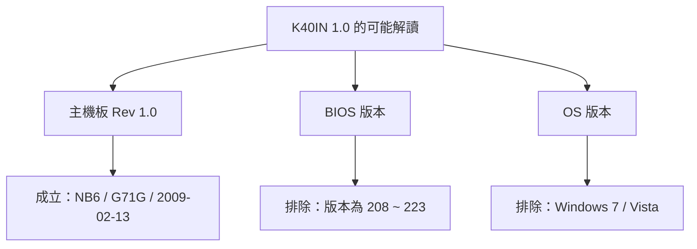
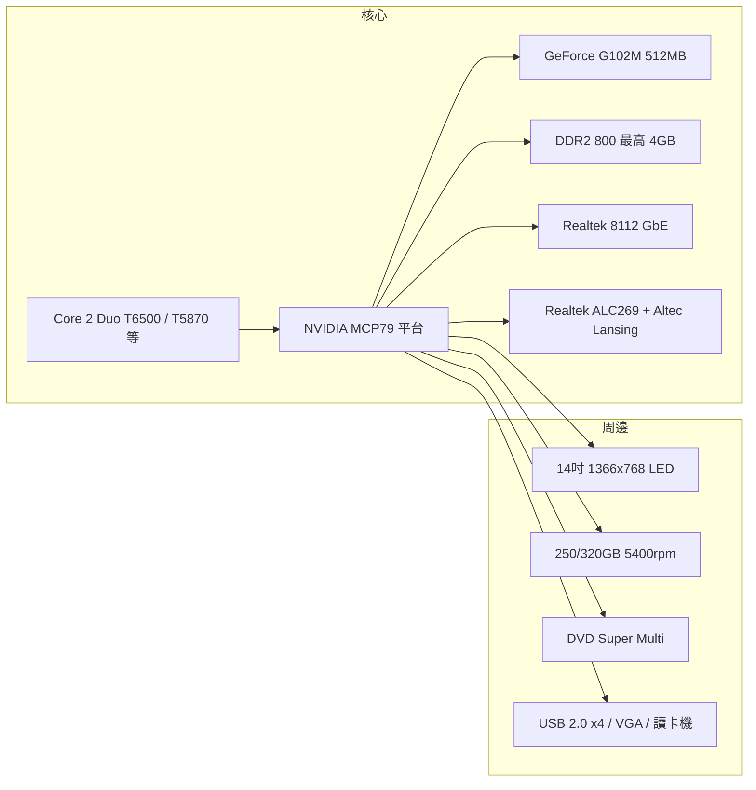
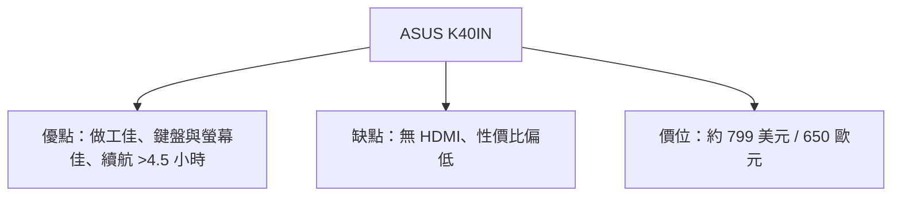

# ASUS K40IN（K40 系列）筆電與「1.0」版本規格調查報告

## 摘要

「K40IN 1.0」在本報告中判定為**華碩（ASUS）於 2009 年推出的 14 吋筆記型電腦 K40IN，其主機板（motherboard）修訂版本 Rev 1.0**。此處的「1.0」並非 BIOS 版本、也不是作業系統版本，而是主機板 PCB 的 revision 標記；對應的主機板型號為 ASUSTeK **NB6**、專案代號 **G71G**，設計日期為 2009-02-13[^drbios][^elektrotanya]。K40IN 本體為華碩 K/A 系列（K Series）的家用入門筆電，主打 14 吋 16:9 HD 螢幕、NVIDIA 獨立顯示與 Altec Lansing 音效[^asuspage]。

---

## 一、釐清「1.0」的意義

針對「K40IN 1.0」有多種可能解讀，逐一排除如下：

| 解讀 | 是否成立 | 依據 |
|---|---|---|
| 主機板修訂版 Rev 1.0 | **成立（最可能）** | 維修文件普遍以「ASUS K40IN G71G Rev 1.0」標示其電路圖[^drbios][^elektrotanya] |
| BIOS 版本 1.0 | 不成立 | 官方 K40IN BIOS 版本為 208、211、213、217～223，沒有 1.0[^asusbios] |
| 產品型號結尾（如 VX148X） | 不成立 | 型號後綴為一連串英數字，非 1.0[^pid] |
| 作業系統版本 | 不成立 | 出貨 OS 為 Windows 7 / Vista 系列[^asuspage] |

華碩官方 BIOS 下載頁顯示 K40IN 的 BIOS 從 208（2009-06-23）一路更新到 223（2011-07-22），最新版描述為「Update EC firmware」，皆無名為「1.0」者[^asusbios]。因此「1.0」幾乎可確定指主機板硬體修訂版。

---

## 二、K40IN 主機板 Rev 1.0（NB6 / G71G）規格

依電路圖資料庫彙整，Rev 1.0 主機板的技術參數如下[^drbios]：

| 參數 | 內容 |
|---|---|
| 品牌 | ASUSTeK COMPUTER INC. |
| 主機板型號 | NB6 |
| 專案代號 | G71G |
| 修訂版本 | 1.0 |
| 設計日期 | 2009-02-13（星期五） |
| CPU 平台 | MCP75 |
| 支援 CPU | Intel Meron / Penryn（Socket 478B） |
| FSB | 800 MHz；1066 MHz |
| 南橋 / PCH | NVIDIA MCP79 |
| 嵌入式控制器 EC/KBC | EC8502 |
| 音效編解碼 | Realtek ALC269 |
| BIOS / SPI Flash | SPI ROM |
| 記憶體類型 | DDR2 |
| 記憶體架構 | DDRII So-DIMM × 2，800 MHz |
| 網路 IC | Realtek 8112（Gigabit LAN） |
| 溫度感測 | Maxim MAX6657 |
| 充電 IC | IT8752 |
| 顯示架構 | MCP75（整合式，對應 GeForce G102M） |

> **維修人員常見問題（節錄）**：本板 EC/KBC 為 EC8502；音效為 Realtek ALC269；網路為 Realtek 8112 千兆乙太網路控制器；溫度感測為 Maxim MAX6657；充電控制為 IT8752[^drbios]。

電子維修站 Elektrotanya 收錄同一份「ASUS K40IN G71G REV 1.0 SCH」電路圖（PDF，91 頁），標題與 Rev 1.0 相符，可作為交叉佐證[^elektrotanya]。

---

## 三、K40IN 筆電整機規格

K40IN 依銷售地區與配置有多種子型號（如 -B1、VX148X、VX093V），規格略有差異。以下彙整各獨立來源。

### 處理器與晶片組

- CPU 選項包含 Intel Core 2 Duo T6500（2.1 GHz）、T6400（2.0 GHz）、T5870（2.0 GHz）、Pentium Dual-Core T4200（2.0 GHz）、Celeron T3000（1.8 GHz）與 Celeron 900（2.2 GHz），皆為雙核心[^mobilespecs][^pid]。
- Notebookcheck 標示 K40IN-B1 採用 Intel Core 2 Duo T6500，2 核 / 2 執行緒，2.1 GHz[^nbc]。
- **晶片組存在來源矛盾**：維修電路圖顯示為 NVIDIA MCP79[^drbios]；部分規格網站則提及 Intel GL40 Express[^easyhelp]。由於本機搭載 NVIDIA GeForce G102M 獨立顯示，採 NVIDIA MCP 系列平台較為合理，惟一般規格站標示 GL40，需留意。

### 顯示與繪圖

- 螢幕：14.0 吋、16:9、LED 背光、1366 × 768（HD）、鏡面（glossy）[^nbc][^pid][^mobilespecs]。
- 繪圖晶片：NVIDIA GeForce G102M，內建 512 MB 專用視訊記憶體；核心架構源自 GeForce 9400M G，支援 PureVideo HD（VP3）[^nbc][^pid]。
- Notebookcheck 評述：G102M 僅能執行極低需求的 3D 遊戲[^nbc]。

### 記憶體與儲存

- 記憶體：4 GB（2 × 2 GB）DDR2 SDRAM，800 MHz，SO-DIMM 200-pin，2 個插槽，最大支援 4 GB[^pid][^mobilespecs]。
- 硬碟：250 GB 或 320 GB HDD、5400 rpm[^pid][^mobilespecs]。
- 光碟機：5.25 吋、12.7 mm，DVD Super Multi（DVD±RW / DVD-RAM）[^pid][^mobilespecs]。

### 音效、視訊與通訊

- 音效：Altec Lansing 喇叭，SRS Premium Sound，High Definition Audio，編解碼 Realtek ALC269[^pid][^drbios]。
- 視訊鏡頭：內建 1.3 百萬像素網路攝影機[^pid]。
- 無線網路：802.11 b/g/n[^pid]；部分來源列 802.11 a/b/g/n[^mobilespecs]。
- 有線網路：Gigabit Ethernet（Realtek 8112）[^pid][^drbios]。
- 藍牙：規格表未列（部分來源標為無）[^pid]。

### 連接埠（I/O）

- USB 2.0 × 4[^pid]
- VGA × 1（外接顯示器）[^pid]
- LAN（RJ-45）× 1（Gigabit）[^pid]
- 麥克風輸入 × 1、耳機輸出 × 1（3.5 mm）[^pid]
- 3 合 1 讀卡機：SD / Memory Stick / MMC[^pid]
- **無 HDMI**：Notebookcheck 收錄的原始評測指出 K40IN 缺 HDMI 埠，是其被批評的缺點之一[^nbc]。

### 電池、尺寸與重量

- 電池：6-cell 鋰離子電池[^pid]。
- 尺寸（寬 × 深 × 高）：約 34.5 cm × 24.9 cm × 3.1～3.6 cm[^pid][^mobilespecs]。
- 重量：約 2.36 kg（mobilespecs）[^mobilespecs] 至 2.4 kg（Notebookcheck、Product in Detail）[^nbc][^pid]。

### 作業系統與特色

- 出貨 OS：Windows 7 Home Premium / Home Basic（部分型號），VX148X 搭載 Windows 7 Professional 64-bit，K40IN-A1 搭載 Windows Vista Home Premium[^mobilespecs][^pid]。官方頁面標語為「ASUS recommends Windows.」[^asuspage]。
- 特色功能：ASUS Super Hybrid Engine（SHE）電源管理、Power4Gear Hybrid、IceCool 散熱設計[^pid][^asuspage]。
- 保固（VX148X）：整機 2 年、電池 1 年[^pid]。

---

## 四、官方評測與市場定位

Notebookcheck 彙整三家原始評測，指出 K40IN 具備良好機身做工、舒適鍵盤與螢幕，電池續航超過 4.5 小時；但性價比受質疑，因其缺少 HDMI、且售價比同級競品高 100～150 美元，NVIDIA 顯示卡的實際效益有限[^nbc]。Laptop Mag 將其定位為適合學生、售價 799 美元的 14 吋機種；Computer Shopper 認為它適合想在有限預算下兼顧輕度遊戲的族群[^nbc]。

---

## 五、來源評估與限制（批判性反思）

- **官方頁面已下線**：華碩原始 K40IN 產品頁已不存在，本報告引用的是 2015-09-06 的網頁存檔（Wayback Machine），其內容多為行銷文案，未提供完整規格表[^asuspage]。
- **維修文件站為次級來源**：NB6 / G71G / Rev 1.0 的主機板技術參數取自 Dr-Bios 等維修資料庫，這些站點彙整自原始電路圖，非華碩官方出版品；但多家維修站（Elektrotanya 等）收錄同一份「K40IN G71G REV 1.0 SCH」可相互佐證[^drbios][^elektrotanya]。
- **晶片組矛盾未解**：NVIDIA MCP79（維修圖）與 Intel GL40（規格站）兩種說法並存。由於本機採 NVIDIA GeForce G102M 顯示，MCP 平台較具技術一致性，但目前無法以單一權威來源定論，讀者應以實際機器或官方服務手冊為準[^drbios][^easyhelp]。
- **規格隨型號變動**：K40IN 有多個子型號，CPU、硬碟、OS 皆依配置而異，任何單一「規格」都只是某一配置的代表[^pid][^mobilespecs]。
- **未找到可直接下載的官方使用手冊 PDF**：華碩支援頁列出 K40 Series Hardware User's Manual（版本 E4564），但直接連結未取得，需自官方支援頁下載[^asusmanual]。

---

## 參考文獻

[^drbios]: Dr-Bios. (2020, July 10). *asus k40in rev1.0 schematic*. Retrieved 2026-10-17, from https://dr-bios.com/threads/asus-k40in-rev1-0-schematic.28830/

[^elektrotanya]: Elektrotanya. (n.d.). *ASUS K40IN G71G REV 1.0 SCH*. Retrieved 2026-10-17, from https://elektrotanya.com/asus_k40in_g71g_rev_1.0_sch.pdf/download.html

[^asuspage]: ASUS. (2015, September 6). *K40IN | Notebooks | ASUS Global* [Web archive]. Retrieved 2026-10-17, from https://web.archive.org/web/20150906235513/http://www.asus.com/Notebooks/K40IN/

[^asusbios]: ASUS. (n.d.). *K40IN – Support (BIOS & Firmware)*. Retrieved 2026-10-17, from https://www.asus.com/us/supportonly/k40in/helpdesk_bios/

[^asusmanual]: ASUS. (n.d.). *K40IN – Support (Manual & Document)*. Retrieved 2026-10-17, from https://www.asus.com/us/supportonly/k40in/helpdesk_manual/

[^nbc]: Notebookcheck. (n.d.). *Asus K40IN-B1*. Retrieved 2026-10-17, from https://www.notebookcheck.net/Asus-K40IN-B1.20793.0.html

[^mobilespecs]: MobileSpecs. (n.d.). *Asus K40IN specs*. Retrieved 2026-10-17, from https://mobilespecs.net/laptop/ASUS/ASUS_K40IN.html

[^pid]: Product in Detail. (n.d.). *ASUS K40IN (VX148X) – full specs, details and review*. Retrieved 2026-10-17, from https://www.productindetail.com/pn/asus-k40in-vx148x

[^easyhelp]: Easy Help Guide. (n.d.). *ASUS K40IN Notebook DDR2 800MHz Manual*. Retrieved 2026-10-17, from https://www.easyhelpguide.com/manual/ASUS-K40INNotebookDDR2800MHz-Manual.html
