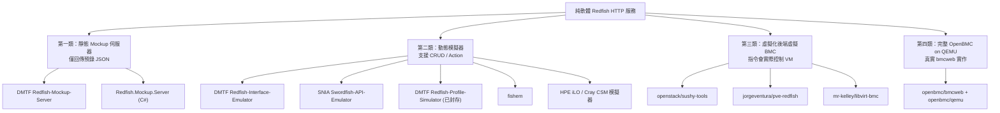
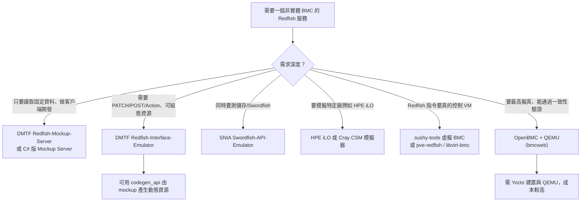

# 不使用實體 BMC 硬體即可提供 DMTF Redfish HTTP 服務的專案調查

## 摘要

**結論：可以，而且選擇相當多。** 目前社群與標準組織已提供多個純軟體方案，能在沒有真實 BMC（Baseboard Management Controller，主機板管理控制器）硬體的狀況下，對外提供符合 DMTF Redfish 標準的 HTTP/HTTPS 服務。這些方案大致可分為四類：(1) 純靜態 mockup 伺服器；(2) 支援 CRUD 與 Action 的動態模擬器；(3) 以虛擬化平台（libvirt、Proxmox、OpenStack）為後端的虛擬 BMC；(4) 在 QEMU 中執行完整 OpenBMC 映像，內含真正通過驗證的 Redfish 實作。本文逐一調查各專案、GitHub 星數、語言、授權、靜態或動態能力，並比較其適用情境與限制。

---

## 1. 背景知識：Redfish 與 BMC 是什麼

### 1.1 DMTF Redfish

Redfish 是 DMTF（Distributed Management Task Force）制定的產業標準，目的在於以現代 Web 技術提供伺服器、儲存、網路與整合式 IT 基礎架構的 RESTful 管理介面，用以取代舊式的 IPMI 等協定。它具備以下特性：

- **RESTful API**：使用標準 HTTP 方法（GET、POST、PATCH、DELETE）操作硬體資源。
- **JSON 格式**：資料以 JSON 交換，人類可讀、機器可解析。
- **沿用 Web 標準**：使用 HTTPS、OData、JSON Schema 等，可直接融入現代 DevOps 工具鏈。
- **安全設計**：支援 TLS/SSL、角色權限控管與標準認證機制。

Redfish 第一版於 2015 年 8 月發布，至今仍持續維護[^rfwiki]。截至 2026 年 9 月 14 日，最新發布為 **Redfish Release 2026.2**，其中包含核心規格 DSP0266 v1.25.0、資料模型規格 DSP0268、Schema Bundle（DSP8010）、Registries Bundle（DSP8011）以及 **Mockups Bundle（DSP2043）**[^dmtfrf]。DSP2043 是一包官方範例 mockup，可直接餵給後述的模擬工具使用。

### 1.2 BMC（Baseboard Management Controller）

BMC 是內嵌於伺服器主機板上的微控制器，提供**帶外管理（out-of-band management）**能力，可在主 CPU、BIOS/UEFI 與作業系統之外獨立運作。其主要能力包括：

- 監控硬體感測器（溫度、風扇轉速、電壓、電源、機箱入侵）
- 遠端電源控制（開機、關機、重置、電源循環）
- 遠端主控台（Serial-over-LAN、KVM-over-IP）
- 遠端掛載虛擬媒體（如 ISO 映像檔）
- 告警（SNMP trap 等）
- 資產盤點（FRU、韌體版本）

BMC 擁有自己的韌體、RAM、網路介面，通常還有入門級顯示晶片。**BMC 就是真正「實作」Redfish API 的硬體**：當你對伺服器送出 Redfish HTTP 請求時，對話的對象是執行 Redfish 韌體的 BMC[^bmcwiki]。常見的 BMC 實作包含 Dell iDRAC、HPE iLO、Lenovo XCC、Supermicro BMC、開源的 OpenBMC，以及 AMI MegaRAC。

### 1.3 為什麼要在沒有真實 BMC 的情況下提供 Redfish 服務

開發者想要 Redfish 模擬服務的原因，主要包括：

1. **無需硬體即可開發**：不必擁有價值數萬元的機架伺服器，即可撰寫與測試 Redfish 客戶端程式。
2. **CI/CD 自動化測試**：模擬器可用容器在 CI 管線中啟動，對擬真的 API 回應執行整合測試。
3. **可重現的確定性狀態**：真實 BMC 的風扇轉速、溫度、韌體版本會浮動；mockup 回傳已知且固定的資料，讓測試可靠。
4. **邊界情境測試**：可測試錯誤狀態、空感測器值、缺少資源、慢速回應等難以在正式硬體重現的情境。
5. **離線開發**：不需連線到實驗室伺服器。
6. **平行開發**：多位開發者可各自跑一份模擬器，不搶共用硬體。
7. **成本與規模**：一台真機只有一個 BMC；一個模擬器可模擬整個資料中心的機箱、刀鋒、交換器與儲存陣列。
8. **安全性**：開發過程不會誤將正式伺服器斷電或破壞韌體。

---

## 2. 專案分類總覽

依「模擬深度」可分為四層，下圖為概念分類：



---

## 3. 第一類：靜態 Mockup 伺服器

### 3.1 DMTF Redfish-Mockup-Server

這是 DMTF 官方最基礎的工具[^dmtfmsrepo]。

| 項目 | 內容 |
| --- | --- |
| 儲存庫 | `DMTF/Redfish-Mockup-Server` |
| GitHub 星數 | 127[^dmtfmsrepo] |
| 語言 | Python（原作者描述為 Python 3.4 程式） |
| 授權 | BSD 3-Clause（README 授權徽章標示）[^dmtfmsreadme] |
| 型態 | 主要為靜態（GET），對 PATCH / POST / Action 僅有限支援 |

**能力**[^dmtfmsreadme]：

- 在指定的 IP 與埠提供 Redfish mockup 服務，預設為 `127.0.0.1:8000`。
- 可透過命令列參數或 `config.ini` 設定 host、port、mockup 目錄、憑證、延遲等。
- **延遲模擬**：可用 `-t` 為所有回應加入固定延遲，或用 `-T` 依 mockup 內的 `time.json` 逐資源延遲，以模擬真實 BMC 的回應時間。
- **SSL/HTTPS 模式**：提供憑證與金鑰即可改用 HTTPS。
- **自訂標頭**：`-X` 可載入 mockup 內 `headers.json` 的自訂 HTTP 回應標頭。
- **SSDP 可被發現**：`-P` 可用 SSDP（Simple Service Discovery Protocol）廣播自己，讓它像真實 Redfish 服務一樣出現在網路上。
- **Docker 支援**：官方映像 `dmtf/redfish-mockup-server`，亦提供 `docker-compose.yml`。
- **內建範例 mockup**：`public-rackmount1`；若 mockup 未含 `/redfish/v1/` 根資源，可用 `--short-form` 自動補上。
- 可搭配 **Redfish-Mockup-Creator**（78 星，Python）從真實的線上演算法服務擷取成 mockup 目錄。

**明確限制**：README 直言「本工具的範圍是為了開發用途而提供靜態 mockup」，修改請求（PATCH、POST、DELETE）與 Action「僅有限支援」。若需要更完整功能，官方建議改用 Redfish-Interface-Emulator 或 Swordfish-API-Emulator[^dmtfmsreadme]。

### 3.2 Redfish.Mockup.Server（C# 移植版）

| 項目 | 內容 |
| --- | --- |
| 儲存庫 | `yurvon-screamo/Redfish.Mockup.Server` |
| GitHub 星數 | 2[^csharpms] |
| 語言 | C#（.NET 8.0，AOT 編譯） |
| 授權 | Apache-2.0[^csharpms] |
| 型態 | 靜態（讀取） |

此專案是 DMTF Python 版本的 C# 移植，可放在任何 mockup 目錄頂層並在指定 IP/埠提供服務，主打 AOT 編譯帶來的效能，但功能較原版少[^csharpms]。星數極低（2 星），社群驗證有限；依本專案研究規範，此類低星專案在主題本身屬小眾時仍予以收錄，但讀者應理解其成熟度。

---

## 4. 第二類：動態模擬器（支援 CRUD 與 Action）

### 4.1 DMTF Redfish-Interface-Emulator

這是 DMTF 官方建議用於「更完整 Redfish 體驗」的工具[^dmtfemurepo]。

| 項目 | 內容 |
| --- | --- |
| 儲存庫 | `DMTF/Redfish-Interface-Emulator` |
| GitHub 星數 | 86[^dmtfemurepo] |
| 語言 | Python（Flask） |
| 授權 | GitHub API 標示為 Other / NOASSERTION[^dmtfemurepo] |
| 型態 | 靜態（GET）或動態（POST / PATCH / DELETE） |

**能力**[^dmtfemureadme]：

- **靜態模擬**：把 Redfish mockup 放進 `./static` 目錄即可提供 GET（僅 HTTP GET 有效）。
- **動態模擬**：為每個資源建立 Python 檔案（API-file 定義各 HTTP 指令行為、template-file 定義資源屬性），即可支援 GET、PATCH、POST、DELETE 與 Action。靜態與動態資源可在同一台模擬器中共存。
- **程式碼產生器**：`codegen_api` 與 `codegen_template` 可由 mockup 的 `index.json` 自動產生 API-file 與 template-file。
- **INFRAGEN 自動填充模組**：讀取 `populate-config.json`，可一次產生多個 Chassis、Systems、Processors、Memory、SimpleStorage、EthernetInterfaces 等，適合模擬整個機箱。
- **Composition GUI**：可透過瀏覽器在 `/CompositionService/ResourceZones/<ZONE>/` 組合（compose）與刪除系統。
- **HTTPS 支援**：`emulator-config.json` 中設定 `"HTTPS": "Enable"`，搭配 `server.crt` 與 `server.key`。
- **部署方式**：本機執行（預設埠 5000）、Cloud Foundry，或 Docker（官方映像 `dmtf/redfish-interface-emulator`）。
- **單元測試**：內附 `unittests.py`。

內建的動態資源涵蓋 Chassis/{id}、Chassis/{id}/Thermal、Chassis/{id}/Power、Systems/{id}、Systems/{id}/Memory、Systems/{id}/Processors/{id}、Systems/{id}/SimpleStorage/{id}、Systems/{id}/Bios、Managers/{id}、Managers/{id}/VirtualMedia 等[^dmtfemureadme]。

### 4.2 SNIA Swordfish-API-Emulator

| 項目 | 內容 |
| --- | --- |
| 儲存庫 | `SNIA/Swordfish-API-Emulator` |
| GitHub 星數 | 27[^sniarepo] |
| 語言 | Python（Flask） |
| 授權 | GitHub API 標示為 Other / NOASSERTION[^sniarepo] |
| 型態 | 動態（起始於 mockup，可對應 create/modify/delete） |

此專案由 SNIA 維護，是 DMTF Redfish-Interface-Emulator 的延伸，加入 Swordfish（SNIA 的儲存網路標準）Schema 支援。它從一組 mockup 描述的初始狀態出發，模擬 Swordfish 系統對建立／修改／刪除操作的回應，讓開發者能為新的 Swordfish 功能建模、測試客戶端並做展示[^sniarepo]。它把絕大多數 Redfish Interface Emulator 的 API-file 換成 Swordfish 版本，涵蓋 Volumes、StoragePools、Fabrics、Endpoints、Switches、StorageServices、ClassesOfService 等大量儲存相關資源[^dmtfemureadme]。

### 4.3 DMTF Redfish-Profile-Simulator（已封存）

| 項目 | 內容 |
| --- | --- |
| 儲存庫 | `DMTF/Redfish-Profile-Simulator` |
| GitHub 星數 | 24[^profsim] |
| 語言 | Python（Flask） |
| 授權 | GitHub API 標示為 Other / NOASSERTION[^profsim] |
| 狀態 | **已封存（archived）**，最後推送約為 2024-06[^profsim] |

這是一個基於 Flask 的 Redfish 服務模擬器，實作當時提案中的 OCP Profile 功能[^dmtfos]。DMTF 的開源專案清單仍收錄它[^dmtfos]，但儲存庫已標記封存，代表不再接受維護，**不建議用於新專案**。

### 4.4 fishem

| 項目 | 內容 |
| --- | --- |
| 儲存庫 | `ddeel/fishem` |
| GitHub 星數 | 3[^fishem] |
| 語言 | Python（Flask、Flask-RESTful） |
| 授權 | BSD 3-Clause[^fishem] |
| 型態 | 動態（完整 CRUD + Action） |

fishem 的定位是「讓 Redfish 與 Swordfish mockup 活起來」，載入任何有效的 mockup（或先前的「fish」JSON 檔）後，對 Redfish/Swordfish 定義的 create、read、update、delete 與 action 操作做出回應，內附 200 多個由 Schema 產生的 API 模組，並可在結束時把狀態輸出成 mockup 或「fish」JSON 檔，適合逐步擴充 mockup 的開發流程[^fishemreadme]。版本 0.9.1 基於 Redfish Release 2021.4 與 Swordfish 1.2.3 的 Schema，Action 為「基本處理」（偵測、回應並記錄），且 **HTTPS、ETag 與 Schema 屬性強制檢查尚未完成**[^fishemreadme]。星數僅 3、最後推送約為 2022-09，屬低成熟度但概念清楚的方案。

### 4.5 廠商衍生模擬器：HPE iLO 與 Cray CSM

| 專案 | 星數 | 語言 | 授權 | 型態 | 說明 |
| --- | --- | --- | --- | --- | --- |
| `HewlettPackard/ilo-redfish-emulator` | 8[^ilorepo] | Python（Flask） | BSD 3-Clause[^ilorepo] | 混合 | 輕量級 HPE iLO BMC 模擬器，內含 DL360、DL380a、DL325 等機型 mockup，可用 Docker 單一或多實例執行[^ilorepo] |
| `Cray-HPE/csm-redfish-interface-emulator` | 6[^csmrepo] | Python（Flask） | BSD 3-Clause[^csmrepo] | 混合 | DMTF Redfish-Interface-Emulator 的分支，針對 HPE Cray 超級電腦硬體，內含 EX235a、EX425、Gigabyte 等多種 mockup，並以 Loader 疊加電源控制、系統／機箱／管理器 reset、UpdateService、帳號／Session、Event、憑證等動態處理器[^csmrepo] |

HPE 的模擬器本身即基於 Cray-HPE 的 CSM 模擬器，而 CSM 又基於 DMTF 的 Interface Emulator，形成一條清楚的衍生鏈[^ilorepo]。這種「靜態 mockup + 針對特定 URI 疊加動態處理器」的混合架構，是實務上模擬真實 BMC（例如重現 iLO 特有行為）最常見的做法。

---

## 5. 第三類：虛擬化後端虛擬 BMC（指令會實際控制 VM）

### 5.1 openstack/sushy-tools

| 項目 | 內容 |
| --- | --- |
| 儲存庫 | `openstack/sushy-tools`（程式碼維護於 opendev.org 鏡像）[^sushyrepo] |
| GitHub 星數 | 45[^sushyrepo] |
| 語言 | Python |
| 授權 | Apache-2.0[^sushyrepo] |
| 型態 | 混合：靜態回應器 + 虛擬 Redfish BMC |

此套件為支援 Sushy 函式庫（OpenStack 的 Redfish 客戶端）開發與測試而生，內含**兩個模擬器**[^sushyreadme]：

1. **靜態 Redfish 回應器（static Redfish responder）**：一個簡單的 REST API 伺服器，對客戶端查詢永遠回傳相同內容，實質上唯讀。
2. **虛擬 Redfish BMC（virtual Redfish BMC）**：以 libvirt 或 OpenStack 雲為後端，部分客戶端查詢會被轉譯為真正控制 VM 的指令。某種程度上，它「類似真實的 Redfish 受控裸機」；但仍有部分 Redfish 指令只回傳靜態內容，不觸及虛擬化後端。

**重要限制**：專案明確聲明「並非設計用於開發與測試環境之外，請勿在任何生產環境執行 sushy-tools」[^sushyreadme]。此外 GitHub 上的儲存庫是 opendev.org 的鏡像，正式程式碼請以 opendev.org 為準[^sushyrepo]。

### 5.2 jorgeventura/pve-redfish

| 項目 | 內容 |
| --- | --- |
| 儲存庫 | `jorgeventura/pve-redfish` |
| GitHub 星數 | 11[^pverepo] |
| 語言 | Python |
| 授權 | Apache-2.0[^pverepo] |
| 型態 | 動態（包裝 Proxmox API） |

此為 Python 常駐程式（daemon），以 Proxmox VE 節點本身作為 BMC，為其模擬實用的 Redfish 端點。支援 Session 與 Basic 認證、電源操作（開／強制關機／強制重開機，另有 Pause／Resume／ForceStop 等自訂值，皆走 `Systems/<vm_id>/Actions/ComputerSystem.Reset`）、虛擬媒體掛載與退出、開機管理（PATCH `Boot` 的 `BootSourceOverrideTarget` 與 `BootSourceOverrideEnabled`）、以及自訂的 Config 端點與 BIOS/SMBIOS 查詢；它不是完整 mockup，而是把 Proxmox API 包裝成 Redfish 形狀的端點[^pvereadme]。README 也坦承多個硬體導向端點（Chassis、Power、Thermal、Managers 等）與管理功能（EventService、LogServices、TaskService、AccountService）因 Proxmox VM 缺乏對應概念而未實作[^pvereadme]。同類但更小的還有 `dariommr/redmox-project`（0 星，為滿足 WindRiver Conductor 需求而寫，透過 PVE API 代理）[^redmoxrepo]。

### 5.3 mr-kelley/libvirt-bmc

| 項目 | 內容 |
| --- | --- |
| 儲存庫 | `mr-kelley/libvirt-bmc` |
| GitHub 星數 | 0[^libvirtbmc] |
| 語言 | Python 3.12 |
| 授權 | MIT[^libvirtbmc] |
| 型態 | 動態（呼叫真實 libvirt API） |

此專案（README 自稱 Redfish & IPMI Emulator）不依賴 sushy 程式碼，是獨立實作，目的在模擬 libvirt 虛擬機的 BMC。其存在理由是：sushy-tools 把 libvirt 主機模型化為 *chassis*、每台 VM 為其中的 *blade*，適用于刀鋒伺服器；但對於「每台機器都有自己獨立 BMC 的 pizza-box 伺服器」這種常見情境並不貼合。因此本專案採用 **pizza-box 模型：每個 VM 一個獨立 BMC（Redfish + IPMI 端點）**，各自擁有自己的管理 IP，讓期待「單機自帶 BMC」的工具能正確運作[^libvirtbmcreadme]。Redfish 端為可用狀態（含電源開關與狀態查詢、虛擬媒體插入／退出與狀態、單次開機至虛擬媒體），以 HTTPS 提供並可自簽憑證；**IPMI 端尚未可用**，測試仍被跳過，另有虛擬媒體狀態的已知 bug[^libvirtbmcreadme]。星數 0、安裝需 root 權限（綁定特權埠、新增 IP、管理 systemd），屬實驗性。

---

## 6. 第四類：在 QEMU 中執行完整 OpenBMC（最接近真實 BMC）

若專案需要**完整、標準相容**的 Redfish 服務，而非 mockup 層級，最完整的軟體方案是把完整 OpenBMC 映像跑在 QEMU 中。

### 6.1 openbmc/bmcweb

| 項目 | 內容 |
| --- | --- |
| 儲存庫 | `openbmc/bmcweb` |
| GitHub 星數 | 239[^bmcwebrepo] |
| 語言 | C++（Boost.Asio / Boost.Beast、D-Bus） |
| 授權 | Apache-2.0[^bmcwebrepo] |
| 型態 | 真實實作（DBus 至 Redfish 的轉譯器） |

bmcweb 是 OpenBMC 的嵌入式網頁伺服器，實作 Redfish 並被描述為「符合協定、把 D-Bus 轉譯為 Redfish」的伺服器[^bmcwebrepo]。Redfish 內建於 OpenBMC 映像中，開機後即在 443 埠（HTTPS）提供服務。其儲存庫的 `docs/Redfish.md` 記錄了所支援的 Redfish Schema，涵蓋 ServiceRoot、AccountService、Chassis、Systems、Managers、EventService、TelemetryService、UpdateService、SessionService、Thermal、Power 等[^bmcwebredfish]。

### 6.2 openbmc/qemu 與開發環境

OpenBMC 官方文件提供完整的 QEMU 開發環境流程（見 `openbmc/docs` 的開發環境章節）[^obmcdocs]：

1. 使用 Yocto/BitBake 建置 OpenBMC（例如 `. setup romulus` 後 `bitbake obmc-phosphor-image`）。
2. 下載 OpenBMC 維護的 QEMU 二進位（ARM softmmu 分支，含 BMC 機型支援，如 `romulus-bmc`，模擬 ASPEED AST2xxx SoC）[^obmcqemu]。
3. 以 QEMU 開機，並把 Redfish 埠映射出來，例如：

```bash
./qemu-system-arm -m 256 -M romulus-bmc -nographic \
  -drive file=./obmc-phosphor-image-romulus.static.mtd,format=raw,if=mtd \
  -net nic \
  -net user,hostfwd=:127.0.0.1:2222-:22,hostfwd=:127.0.0.1:2443-:443,hostfwd=udp:127.0.0.1:2623-:623,hostname=qemu
```

4. 以 `root` / `0penBmc`（注意是數字 0）登入。
5. 測試 Redfish：`curl -k -u root:0penBmc https://127.0.0.1:2443/redfish/v1`[^obmcdocs]。

透過這種方式，Redfish 服務完全由真實的 bmcweb 實作提供，只是底層硬體被 QEMU 取代，因此幾乎不會有 mockup 常見的「行為與真實 BMC 不符」問題。代價是建置與執行門檻明顯較高（Yocto 建置耗時、需要較多資源）。

---

## 7. 綜合比較表

| 專案 | 星數 | 語言 | 靜態/動態 | CRUD + Action | 是否需真實 BMC | 授權 |
| --- | --- | --- | --- | --- | --- | --- |
| DMTF Redfish-Mockup-Server[^dmtfmsrepo] | 127 | Python | 主要靜態 | 極有限 | 否 | BSD 3-Clause[^dmtfmsreadme] |
| DMTF Redfish-Interface-Emulator[^dmtfemurepo] | 86 | Python/Flask | 混合 | 是 | 否 | Other（NOASSERTION）[^dmtfemurepo] |
| openstack/sushy-tools[^sushyrepo] | 45 | Python | 混合 | 部分（虛擬 BMC 模式） | 否 | Apache-2.0[^sushyrepo] |
| SNIA Swordfish-API-Emulator[^sniarepo] | 27 | Python/Flask | 動態 | 是（含 Swordfish） | 否 | Other（NOASSERTION）[^sniarepo] |
| DMTF Redfish-Profile-Simulator[^profsim] | 24 | Python/Flask | 動態（已封存） | 是 | 否 | Other（NOASSERTION）[^profsim] |
| jorgeventura/pve-redfish[^pverepo] | 11 | Python | 動態（包裝 Proxmox） | 是 | 否 | Apache-2.0[^pverepo] |
| HewlettPackard/ilo-redfish-emulator[^ilorepo] | 8 | Python/Flask | 混合 | 動態資源支援 | 否 | BSD 3-Clause[^ilorepo] |
| Cray-HPE/csm-redfish-interface-emulator[^csmrepo] | 6 | Python/Flask | 混合 | 動態資源支援 | 否 | BSD 3-Clause[^csmrepo] |
| ddeel/fishem[^fishem] | 3 | Python/Flask | 動態 | 是（完整） | 否 | BSD 3-Clause[^fishem] |
| yurvon-screamo/Redfish.Mockup.Server[^csharpms] | 2 | C#/.NET 8 | 靜態 | 否 | 否 | Apache-2.0[^csharpms] |
| mr-kelley/libvirt-bmc[^libvirtbmc] | 0 | Python | 動態（libvirt） | 是（真實 libvirt 動作） | 否 | MIT[^libvirtbmc] |
| openbmc/bmcweb + openbmc/qemu[^bmcwebrepo][^obmcdocs] | 239 | C++ | 真實實作 | 是 | 否（QEMU 取代硬體） | Apache-2.0[^bmcwebrepo] |

---

## 8. 如何選擇（決策指引）



**簡要建議**：

- **最快上手、最單純**：DMTF Redfish-Mockup-Server（有官方 Docker 映像與內建範例 mockup）。
- **需要寫入與 Action**：DMTF Redfish-Interface-Emulator（官方推薦、可程式化擴充、內含 INFRAGEN 與 Composition GUI）。
- **儲存領域（Swordfish）**：SNIA Swordfish-API-Emulator。
- **要驗證「真的能控制機器」的流程**：openstack/sushy-tools 的虛擬 Redfish BMC，或 pve-redfish（以 Proxmox 節點為 BMC）。
- **要最高擬真度**：OpenBMC on QEMU，服務由真正的 bmcweb 提供。

---

## 9. 資料來源的批判性反思

在閱讀上述專案時，應注意以下事項：

1. **星數與成熟度落差**：本主題屬相當小眾的領域，多數專案星數偏低（個位數到兩位數）。GitHub 星數低不等於不可用，但意味著社群驗證少、問題回報與修復速度可能較慢。依本專案研究規範，主題本身小眾時仍收錄低星專案，但須附上此背景說明。
2. **政策風險**：多個專案明確標示「僅供開發與測試」。sushy-tools 甚至在 README 直接要求「請勿在生產環境執行」[^sushyreadme]。把這些工具（尤其是會實際下電源指令的虛擬 BMC）誤用於生產環境，可能造成真實損失。
3. **封存與停更**：DMTF Redfish-Profile-Simulator 已封存[^profsim]，fetahi/redfish-emulator 與 BenTech2/redfish-emulator 幾乎是空殼或早已停更。選擇時應優先考慮仍持續推送的專案（例如 Redfish-Mockup-Server 於 2026-09 仍有更新[^dmtfmsrepo]、bmcweb 於 2026-10 仍活躍[^bmcwebrepo]）。
4. **授權欄位不一致**：部分 DMTF 專案的 GitHub API 授權欄位顯示為「Other / NOASSERTION」而非標準 SPDX 識別碼[^dmtfemurepo][^sniarepo][^profsim]。若要商用或再散布，應直接閱讀各儲存庫內實際的 LICENSE 檔案，勿僅依賴 GitHub 標籤。
5. **「模擬」不等於「一致」**：mockup 系列的資料是預錄且靜態的，無法反映真實 BMC 的動態行為；即使是動態模擬器，其 Action 行為也是人工撰寫，未必與各廠牌實機完全一致。若需要通過 DMTF 一致性驗證，OpenBMC on QEMU 是唯一由真實實作提供服務的選項。
6. **資訊時效**：本文所有星數、授權與描述皆擷取自 2026-10-17 當日各專案頁面與 GitHub API，之後可能變動。

---

## 參考文獻

[^rfwiki]: Wikipedia. (n.d.). Redfish (specification). Retrieved 2026-10-17, from https://en.wikipedia.org/wiki/Redfish_(specification)

[^bmcwiki]: Wikipedia. (n.d.). Intelligent Platform Management Interface. Retrieved 2026-10-17, from https://en.wikipedia.org/wiki/Intelligent_Platform_Management_Interface

[^dmtfrf]: Distributed Management Task Force. (n.d.). REDFISH - Redfish®. Retrieved 2026-10-17, from https://www.dmtf.org/standards/redfish

[^dmtfos]: Distributed Management Task Force. (n.d.). DMTF Open Source. Retrieved 2026-10-17, from https://www.dmtf.org/standards/opensource

[^dmtfmsrepo]: Distributed Management Task Force. (n.d.). Redfish-Mockup-Server. GitHub. Retrieved 2026-10-17, from https://github.com/DMTF/Redfish-Mockup-Server

[^dmtfmsreadme]: Distributed Management Task Force. (n.d.). Redfish Mockup Server README. GitHub. Retrieved 2026-10-17, from https://raw.githubusercontent.com/DMTF/Redfish-Mockup-Server/main/README.md

[^dmtfemurepo]: Distributed Management Task Force. (n.d.). Redfish-Interface-Emulator. GitHub. Retrieved 2026-10-17, from https://github.com/DMTF/Redfish-Interface-Emulator

[^dmtfemureadme]: Distributed Management Task Force. (n.d.). Redfish Interface Emulator README. GitHub. Retrieved 2026-10-17, from https://raw.githubusercontent.com/DMTF/Redfish-Interface-Emulator/master/README.md

[^sushyrepo]: OpenStack. (n.d.). sushy-tools. GitHub. Retrieved 2026-10-17, from https://github.com/openstack/sushy-tools

[^sushyreadme]: OpenStack. (n.d.). Redfish development tools README. Retrieved 2026-10-17, from https://raw.githubusercontent.com/openstack/sushy-tools/master/README.rst

[^sniarepo]: Storage Networking Industry Association. (n.d.). Swordfish-API-Emulator. GitHub. Retrieved 2026-10-17, from https://github.com/SNIA/Swordfish-API-Emulator

[^profsim]: Distributed Management Task Force. (n.d.). Redfish-Profile-Simulator. GitHub. Retrieved 2026-10-17, from https://github.com/DMTF/Redfish-Profile-Simulator

[^fishem]: ddeel. (n.d.). fishem. GitHub. Retrieved 2026-10-17, from https://github.com/ddeel/fishem

[^fishemreadme]: ddeel. (n.d.). fishem README. GitHub. Retrieved 2026-10-17, from https://raw.githubusercontent.com/ddeel/fishem/main/README.md

[^ilorepo]: Hewlett Packard Enterprise. (n.d.). ilo-redfish-emulator. GitHub. Retrieved 2026-10-17, from https://github.com/HewlettPackard/ilo-redfish-emulator

[^csmrepo]: Cray-HPE. (n.d.). csm-redfish-interface-emulator. GitHub. Retrieved 2026-10-17, from https://github.com/Cray-HPE/csm-redfish-interface-emulator

[^pverepo]: jorgeventura. (n.d.). pve-redfish. GitHub. Retrieved 2026-10-17, from https://github.com/jorgeventura/pve-redfish

[^pvereadme]: jorgeventura. (n.d.). Python Daemon for Redfish Requests. GitHub. Retrieved 2026-10-17, from https://raw.githubusercontent.com/jorgeventura/pve-redfish/master/README.md

[^redmoxrepo]: dariommr. (n.d.). redmox-project. GitHub. Retrieved 2026-10-17, from https://github.com/dariommr/redmox-project

[^libvirtbmcreadme]: mr-kelley. (n.d.). Redfish & IPMI Emulator README. GitHub. Retrieved 2026-10-17, from https://raw.githubusercontent.com/mr-kelley/libvirt-bmc/main/README.md

[^libvirtbmc]: mr-kelley. (n.d.). libvirt-bmc. GitHub. Retrieved 2026-10-17, from https://github.com/mr-kelley/libvirt-bmc

[^csharpms]: yurvon-screamo. (n.d.). Redfish.Mockup.Server. GitHub. Retrieved 2026-10-17, from https://github.com/yurvon-screamo/Redfish.Mockup.Server

[^bmcwebrepo]: OpenBMC. (n.d.). bmcweb. GitHub. Retrieved 2026-10-17, from https://github.com/openbmc/bmcweb

[^bmcwebredfish]: OpenBMC. (n.d.). Redfish.md. GitHub. Retrieved 2026-10-17, from https://github.com/openbmc/bmcweb/blob/master/docs/Redfish.md

[^obmcdocs]: OpenBMC. (n.d.). OpenBMC Development Environment. GitHub. Retrieved 2026-10-17, from https://github.com/openbmc/docs/blob/master/development/dev-environment.md

[^obmcqemu]: OpenBMC. (n.d.). qemu. GitHub. Retrieved 2026-10-17, from https://github.com/openbmc/qemu
