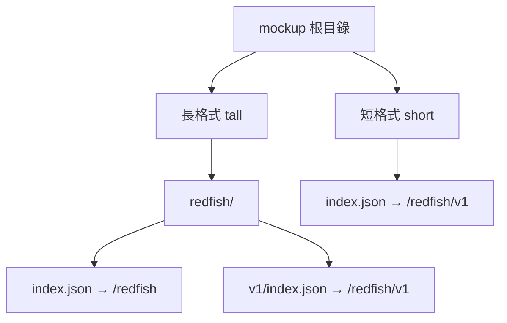
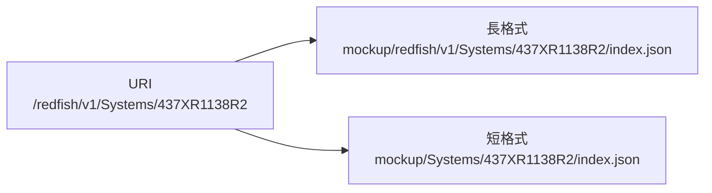
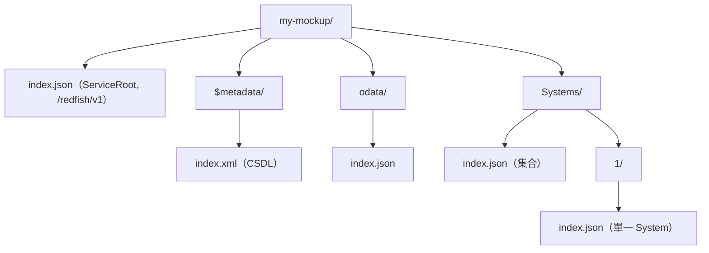

# 如何為 Redfish-Mockup-Server 製作 Mockup 檔案

## 摘要

DMTF 的 [Redfish-Mockup-Server](https://github.com/DMTF/Redfish-Mockup-Server) 是一個純 Python 的 HTTP 伺服器，用來把一份「Redfish mockup」以真實 Redfish 服務的介面提供出來，方便在沒有實體 BMC（Baseboard Management Controller）的情況下開發與測試 Redfish 用戶端[^server-readme]。本報告說明 mockup 的目錄與檔案規範、兩種佈局形式、如何手動建立最小可用的 mockup、如何使用官方的 Redfish-Mockup-Creator 從現有服務自動產生，以及啟動與驗證的完整流程。所有內容皆以 DMTF 官方原始碼與文件為依據。

## 1. 背景：什麼是 Redfish mockup

Redfish 是 DMTF 制定的現代化管理標準，以 RESTful API、JSON 與 OData 為基礎[^dsp2043]。一台伺服器的所有管理資源（System、Chassis、Manager、各類 Service）都以 URI 形式暴露，例如 `/redfish/v1/Systems/437XR1138R2`。

所謂 mockup，就是把這些 URI 對應的 **JSON 回應內容**事先存成檔案，並用「一個 URI 路徑對應一個目錄」的方式組織在磁碟上；每個目錄內放一個 `index.json` 存放該 URI 的 GET 回應內容[^server-src]。Redfish-Mockup-Server 讀取這棵目錄樹，並在指定的 IP 與埠號上回應 Redfish 請求，預設為 `127.0.0.1:8000`[^server-readme]。

此工具本身的定位是「靜態 mockup 伺服器」，以開發為目的；它對 `PATCH`、`POST`、`DELETE` 與部分 Action 提供有限度的支援，但變更只存在於記憶體中[^server-readme]。若需要更完整的動態行為，官方建議改用 Redfish-Interface-Emulator 或 SNIA 的 Swordfish-API-Emulator[^server-readme]。

本主題涉及的 GitHub 專案星數如下（擷取於 2026-10-17）：Redfish-Mockup-Server 為 127 顆星、53 個 fork；Redfish-Mockup-Creator 為 78 顆星、34 個 fork；Redfish-Interface-Emulator 為 86 顆星、37 個 fork；Swordfish-API-Emulator 為 27 顆星、20 個 fork[^api][^api-creator][^api-emulator][^api-swordfish]。以 DMTF 官方工具而言，星數雖不算高，但這些是該領域唯一的權威實作，且 Redfish 生態中大量教材與工具直接引用，具高度參考價值。

## 2. 目錄與檔案命名規範

mockup 的核心規則只有一條：**URI 路徑即目錄路徑，每個目錄內的 `index.json` 即該路徑的 JSON 酬載**。在此之上，還有幾種特殊檔名會覆蓋或補充預設行為：

| 檔名 | 所在位置 | 用途 |
| --- | --- | --- |
| `index.json` | 每個資源目錄 | 該 URI 的 GET 回應 JSON 本體[^server-src] |
| `index.xml` | CSDL 目錄（如 `$metadata`） | 該 URI 的 XML（CSDL）回應，用於 metadata[^server-src] |
| `headers.json` | 資源目錄（選用） | 以 `{"GET": {...}}` 格式提供自訂回應標頭，需伺服器加上 `-X` 才會載入[^server-readme][^server-src] |
| `time.json` | 資源目錄（選用） | 以 `{"GET_Time": "0.05"}` 格式提供該資源的回應延遲秒數，需伺服器加上 `-T`[^server-readme][^server-src] |
| `error.txt` | 資源目錄（選用） | 當原始服務回傳非 JSON 內容時，改存原始錯誤內容[^creator-readme] |
| `explorer_config.json` | mockup 根目錄（選用） | 供 Redfish-Explorer 之類工具建立導覽樹用的描述檔[^mockup-tree] |
| `README` | mockup 根目錄（選用） | 由 Creator 產生，記錄擷取時間、來源服務、統計資訊[^creator-src] |

其中 `index.json` 的內容是**真實的 Redfish 酬載**，因此必須遵循 Redfish 資料模型，例如每個資源應含 `@odata.id`、`@odata.type`、`Id`、`Name`，集合類資源則應含 `Members` 與 `Members@odata.count`[^mockup-index][^mockup-collection]。伺服器在輸出前會主動移除 `@Redfish.Copyright` 屬性[^server-src]。

## 3. 兩種佈局：「長格式」與「短格式」

Redfish-Mockup-Server 支援兩種 mockup 佈局，差別在於**是否在目錄樹的最上層包含 `redfish` 目錄**。



- **長格式（tall / long form）**：根目錄下有 `redfish/` 子目錄，內含 `index.json`（代表 `/redfish` 資源）與 `v1/`。伺服器啟動時會檢查 `mockDir/redfish` 是否存在，不存在則直接中止[^server-src]。
- **短格式（short form）**：省略 `/redfish/v1` 這段路徑前綴，mockup 根目錄的 `index.json` 直接代表 `/redfish/v1`。此時必須加上 `-S`／`--short-form` 參數，而且根目錄必須存在 `index.json`，否則中止[^server-src][^server-readme]。

程式中的路徑轉換邏輯定義在 `clean_path` 與 `construct_path` 兩個函式：`clean_path` 會去除路徑首尾斜線、去除 `?` 查詢字串與 `#` 片段，並且在短格式模式下把 `redfish/v1` 置換為空字串；最終檔案路徑為 `mockDir + 清理後路徑 + 檔名`[^server-src]。這解釋了為何短格式可以完全不改檔案內容就改變伺服器的掛載點。

官方內建的 `public-rackmount1` 範例即採用**短格式**：其最上層直接是 `index.json`、`$metadata/`、`Systems/`、`Chassis/`、`Managers/` 等目錄，沒有 `redfish/` 目錄[^mockup-tree]。當使用者未指定 `-D` 時，伺服器會自動改用這份內建 mockup 並啟用短格式[^server-src]。

## 4. 路徑對應關係

下圖說明同一個 URI 在兩種佈局下的實際檔案位置。



以官方 `public-rackmount1` 為例（短格式），其 ServiceRoot 位於 `index.json`，內容的 `@odata.id` 為 `/redfish/v1/`，並以 `@odata.id` 連結指向 `Systems`、`Chassis`、`Managers`、`TaskService` 等子資源[^mockup-index]；`Systems` 集合則位於 `Systems/index.json`，其 `Members` 指向 `/redfish/v1/Systems/437XR1138R2`[^mockup-collection]，對應到實體檔案 `Systems/437XR1138R2/index.json`。

## 5. 如何手動建立一份 mockup

### 5.1 決定佈局

先決定要用長格式或短格式。若手上已經有一份從真實服務擷取、以 `/redfish/v1` 為開頭的完整目錄樹，直接照抄即可（長格式）；若想從零開始只做幾個資源，短格式較省事，但啟動時必須加 `-S`。

### 5.2 建立目錄樹

以下以短格式為例，建立一個只含 ServiceRoot、metadata、odata 與一個 System 的最小 mockup。



若改採長格式，只需在最外層多包一層 `redfish/`，並在其中放入代表 `/redfish` 資源的 `index.json`，其餘結構同前。

### 5.3 撰寫各 `index.json`

ServiceRoot（短格式的根目錄 `index.json`）必須讓 `@odata.id` 與實際 URI 一致，並提供指向子資源的連結。可參考官方範例的寫法：

```json
{
    "@odata.type": "#ServiceRoot.v1_16_1.ServiceRoot",
    "Id": "RootService",
    "Name": "Root Service",
    "RedfishVersion": "1.15.0",
    "Systems": { "@odata.id": "/redfish/v1/Systems" },
    "Chassis": { "@odata.id": "/redfish/v1/Chassis" },
    "Managers": { "@odata.id": "/redfish/v1/Managers" },
    "@odata.id": "/redfish/v1/"
}
```

集合類資源必須含 `Members` 與 `Members@odata.count`：

```json
{
    "@odata.type": "#ComputerSystemCollection.ComputerSystemCollection",
    "Name": "Computer System Collection",
    "Members@odata.count": 1,
    "Members": [
        { "@odata.id": "/redfish/v1/Systems/1" }
    ],
    "@odata.id": "/redfish/v1/Systems"
}
```

以上兩段結構與屬性均依照官方 `public-rackmount1` 範例實際內容簡化而成[^mockup-index][^mockup-collection]。重點是所有 `@odata.id` 都必須與檔案所在的 URI 路徑相符，否則用戶端沿連結走訪時會找不到對應檔案而得到 404。

### 5.4 啟動與驗證

原生執行（需先安裝 Python 3、pip 與 `requirements.txt`）[^server-readme]：

```bash
pip install -r requirements.txt
python redfishMockupServer.py -D ./my-mockup -H 127.0.0.1 -p 8000
```

短格式請加 `-S`：

```bash
python redfishMockupServer.py -D ./my-mockup -H 127.0.0.1 -p 8000 -S
```

以 Docker 執行時，把 mockup 目錄掛載進容器再以 `-D` 指向即可[^server-readme]：

```bash
docker run --rm -v <path-to-mockup>:/mockup dmtf/redfish-mockup-server:latest -D /mockup
```

啟動後即可用瀏覽器或任何 Redfish 用戶端對 `http://127.0.0.1:8000/redfish/v1` 發出 GET 請求，伺服器會回傳對應 `index.json` 的內容，並附上 `Content-Type: application/json` 與 `OData-Version: 4.0` 標頭[^server-src]。驗證時應逐層走訪：先確認 ServiceRoot 可讀，再依其連結確認 `Systems`、`Chassis`、`Managers` 等集合與其成員皆可回應。

### 5.5 用 `config.ini` 保存設定

伺服器自 1.3.0 版起支援以 `config.ini` 設定，適合重複執行同一份 mockup 時使用[^changelog][^config]。命令列參數的優先序高於設定檔[^server-readme]：

```ini
[Server]
host = 127.0.0.1
port = 8000

[Mockup]
Dir = /path/to/mockup
short-form = false

[Options]
headers = false
time = 0
timefromjson = false
ssdp = false
```

## 6. 用 Redfish-Mockup-Creator 自動產生

若不想手動撰寫數百個 `index.json`，官方提供了 [Redfish-Mockup-Creator](https://github.com/DMTF/Redfish-Mockup-Creator)，它會登入一台**真實的 Redfish 服務**，遞迴走訪所有資源並產生對應的目錄樹與檔案[^creator-readme]。

其產生規則與伺服器端的讀取規則互相對應[^creator-readme][^creator-src]：

- 每個 URI 建立一個目錄，JSON 回應存為 `index.json`。
- 每個 CSDL 檔（如 `$metadata`）在對應目錄建立 `index.xml`。
- 非 JSON 回應改存為 `error.txt`，內含 HTTP 狀態、標頭與原始內容。
- 加上 `--Headers` 時額外產生 `headers.json`；加上 `--Time` 時額外產生 `time.json`。
- 在輸出根目錄產生 `README`，記錄版本、時間、來源服務、使用者與回應時間統計。

典型用法[^creator-readme]：

```bash
python redfishMockupCreate.py -u username -p password -r RedfishIP -S -D /outputDir
```

產生的目錄樹會包含 `/redfish`、`/redfish/v1/odata`、`/redfish/v1/$metadata` 與 `/redfish/v1` 等節點，因此屬於**長格式**，可直接餵給 Redfish-Mockup-Server 而不需 `-S`[^creator-src]。

## 7. 常見注意事項

- **目錄驗證**：長格式必須有 `redfish/` 目錄，短格式必須有根目錄 `index.json`，否則伺服器啟動即中止[^server-src]。
- **檔案名稱是固定的**：伺服器只認 `index.json`、`index.xml`、`headers.json`、`time.json` 這幾個檔名，並也支援資源目錄下直接放置任意檔名（如二進位映像檔）並以副檔名決定 MIME 類型[^server-src]。
- **Windows 檔名限制**：若 URI 含有 Windows 不允許的字元，Creator 會用底線取代，並同步修正酬載中的 `@odata.id`，以維持檔案路徑與 URI 一致；在容器或跨平台情境可用 `--forcefolderrename` 強制啟用[^creator-readme][^creator-src]。
- **變更不落地**：`PATCH`、`POST`、`DELETE` 的結果只寫回記憶體中的 `patchedLinks`，重新啟動即還原為磁碟上的靜態內容；`PUT` 一律回 405[^server-src]。
- **查詢參數支援有限**：伺服器支援 `$top`、`$skip`（產生 `Members@odata.nextLink`）與基本的 `$expand`，但 `SelectQuery`、`FilterQuery` 在多數 mockup 中為關閉狀態[^server-src][^mockup-index]。
- **測試 ETag 尚未實作**：`-E`／`test-etag` 選項在說明中明確標示為 unimplemented[^server-readme]。

## 8. 來源評估

本報告以 DMTF 官方 GitHub 專案的原始碼與 README 為主要依據，屬於第一手資料：`redfishMockupServer.py` 直接定義了伺服器端可接受的目錄與檔名規則，`redfishMockupCreate.py` 則定義了檔案產生規則，兩者可互相印證。目錄結構同時可由 repo 中實際存在的 `public-rackmount1` 檔案樹佐證，可信度高。

需留意的限制：DMTF 的 DSP2043 系列文件本身並未提供逐步的「手動建立 mockup」教學，而是以打包好的範例 bundle 形式發布，因此本報告中的手動建立步驟是根據伺服器原始碼的路徑解析邏輯反推整理；實際行為可能隨版本變動，建議以執行當下版本的原始碼為準（本報告依據 1.3.0 版，發行於 2026-09-04）[^changelog][^dsp2043]。此外，部分第三方（如 Go 生態的 mockup 套件）雖也採用同一佈局，但非 DMTF 官方來源，本報告未將其行為視為規範。

## 參考文獻

[^server-readme]: DMTF. (n.d.). *Redfish Mockup Server* [README]. GitHub. Retrieved 2026-10-17, from https://github.com/DMTF/Redfish-Mockup-Server/blob/main/README.md

[^server-src]: DMTF. (2026). *redfishMockupServer.py* (Version 1.3.0) [Computer software]. GitHub. Retrieved 2026-10-17, from https://github.com/DMTF/Redfish-Mockup-Server/blob/main/redfishMockupServer.py

[^creator-readme]: DMTF. (n.d.). *Redfish Mockup Creator* [README]. GitHub. Retrieved 2026-10-17, from https://github.com/DMTF/Redfish-Mockup-Creator/blob/main/README.md

[^creator-src]: DMTF. (2026). *redfishMockupCreate.py* (Version 1.2.1) [Computer software]. GitHub. Retrieved 2026-10-17, from https://github.com/DMTF/Redfish-Mockup-Creator/blob/main/redfishMockupCreate.py

[^changelog]: DMTF. (2026). *CHANGELOG.md*. GitHub. Retrieved 2026-10-17, from https://github.com/DMTF/Redfish-Mockup-Server/blob/main/CHANGELOG.md

[^config]: DMTF. (2026). *config.ini*. GitHub. Retrieved 2026-10-17, from https://github.com/DMTF/Redfish-Mockup-Server/blob/main/config.ini

[^mockup-tree]: DMTF. (2026). *public-rackmount1 mockup directory tree*. GitHub. Retrieved 2026-10-17, from https://github.com/DMTF/Redfish-Mockup-Server/tree/main/public-rackmount1

[^mockup-index]: DMTF. (2026). *public-rackmount1/index.json*. GitHub. Retrieved 2026-10-17, from https://raw.githubusercontent.com/DMTF/Redfish-Mockup-Server/main/public-rackmount1/index.json

[^mockup-collection]: DMTF. (2026). *public-rackmount1/Systems/index.json*. GitHub. Retrieved 2026-10-17, from https://raw.githubusercontent.com/DMTF/Redfish-Mockup-Server/main/public-rackmount1/Systems/index.json

[^dsp2043]: DMTF. (2026, September 14). *All published versions of DSP2043* [Redfish Mockups Bundle]. Retrieved 2026-10-17, from https://www.dmtf.org/dsp/DSP2043

[^api]: GitHub. (2026). *DMTF/Redfish-Mockup-Server* [Repository metadata]. Retrieved 2026-10-17, from https://api.github.com/repos/DMTF/Redfish-Mockup-Server

[^api-creator]: GitHub. (2026). *DMTF/Redfish-Mockup-Creator* [Repository metadata]. Retrieved 2026-10-17, from https://api.github.com/repos/DMTF/Redfish-Mockup-Creator

[^api-emulator]: GitHub. (2026). *DMTF/Redfish-Interface-Emulator* [Repository metadata]. Retrieved 2026-10-17, from https://api.github.com/repos/DMTF/Redfish-Interface-Emulator

[^api-swordfish]: GitHub. (2026). *SNIA/Swordfish-API-Emulator* [Repository metadata]. Retrieved 2026-10-17, from https://api.github.com/repos/SNIA/Swordfish-API-Emulator
