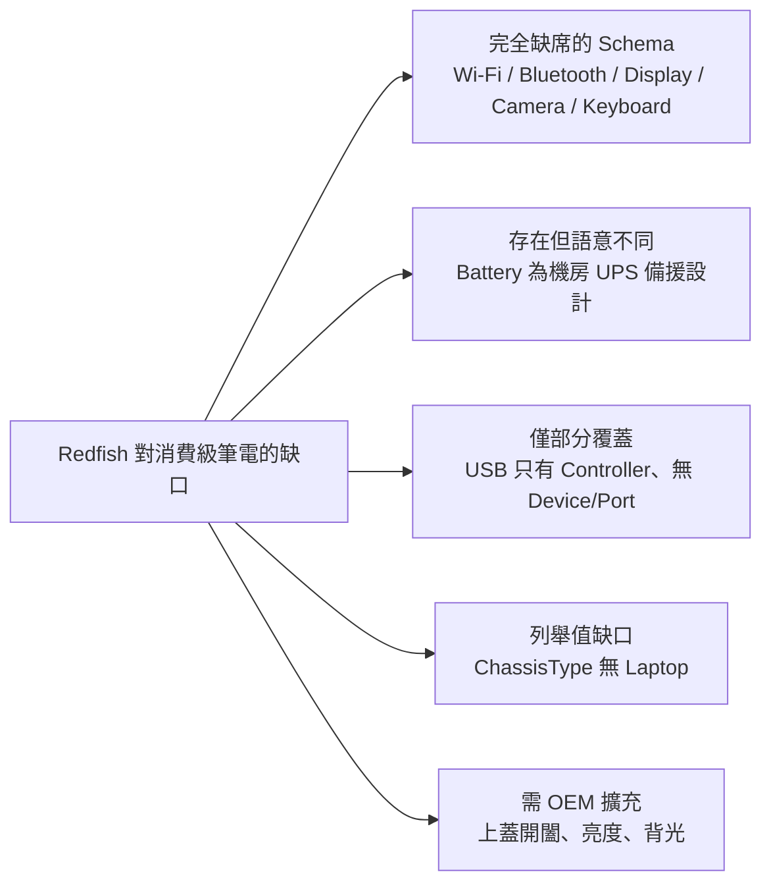
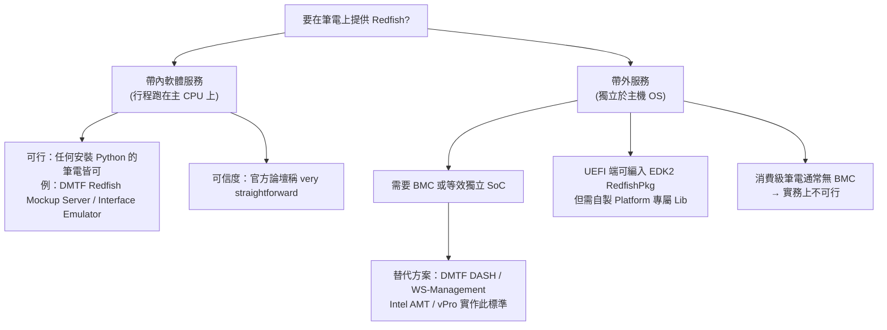

# 以 Redfish 描述消費級筆電：可用的 Resource / Schema 盤點

## 摘要

Redfish 是由 DMTF（Distributed Management Task Force）制定的 RESTful 管理標準，其規範文件 DSP0266 開宗明義寫道「Redfish 最初的範圍以伺服器為目標」（"The initial Redfish scope targeted servers"），之後 DMTF 與其聯盟夥伴再將範圍擴展到「大多數資料中心 IT 設備與其他解決方案」[^dsp0266]。在整個 Redfish 規範（DSP0266）與資源與 Schema 指南（DSP2046）中，**完全沒有出現 laptop、notebook、desktop、client computer、consumer device 這些詞彙**，唯一的 "workstation" 出現於描述實體位置（例如「辦公桌、隔間或工作站座位」）的屬性說明，而非被管理的系統類型[^dsp2046]。

然而 Redfish 的 Schema 本身是**裝置類型中立（device-type-agnostic）**的：Schema Index 並未以「server vs. client」對任何 Schema 做分類標註，絕大多數 Schema 的敘述都是通用語彙[^index]。因此技術上確實可以用 Redfish 的既有資源模型去描述一台消費級筆電，只是會遇到兩類限制：(1) 部分資源的**語意**（例如 Battery 是為機房 UPS/備援電池而設計）與筆電情境不完全吻合；(2) 筆電的**特有硬體**（Wi-Fi、藍牙、螢幕、鍵盤、上蓋開闔）在標準 Schema 中沒有對應。

本報告盤點「若以 Redfish 描述消費級筆電，有哪些 Resource/Schema 能夠被呈現」，並標示語意落差與缺口。

---

## 一、Redfish 的定位與範圍

### 1.1 規範自述的範圍

DSP0266 v1.8.0 的範圍陳述為：

> "This specification defines the required protocols, data model, behaviors, and other architectural components for an interoperable, multivendor, remote, and out-of-band capable interface... While large and hyperscale environments are the primary focus, clients can use the specification for individual system management."[^dsp0266]

重點有三：

- Redfish 從一開始是**帶外（out-of-band）**導向，預設存在一個獨立於主機作業系統的服務執行環境（通常是 BMC）。
- 主要焦點是**大規模／超大規模環境**（伺服器機櫃、機房）。
- 但也留有「也可以是單一系統管理」的彈性空間。

### 1.2 名稱的意涵

Redfish 全名為「Redfish Scalable Platforms Management API」。其中 "Scalable" 指從單機到數千節點的擴展能力；"Platforms" 指運算平台（伺服器、機箱、機櫃、Fabric）；"Management" 指帶外監控、盤點、韌體更新、電源控制與事件處理[^wiki]。

### 1.3 論壇對「非伺服器電腦」的官方回應

Redfish 論壇（Redfish Forum）在 2020 年 5 月有一則由使用者 adnan 發起的討論串，直接詢問「我想在非伺服器電腦上實作 Redfish，這可能嗎？」論壇管理者 Jeff Autor（帳號 jautor）回覆：

> "Yes, it's certainly possible, but the answer will depend on what you mean by 'non-server computer'. If you just want to implement a Redfish service in software (as in, running as a process on the main CPU), that is very straightforward. But if you're looking at a workstation or desktop computer and want to have the 'out-of-band, always-available service regardless of the host OS', that would require firmware and a place to execute it."[^forum]

後續追問「若要用工作站提供帶外 Redfish 服務，需要什麼？」時，jautor 回答：

> "A full out-of-band implementation on a workstation would very likely involve some of the UEFI components, but more importantly, it will require a BMC or other SoC to provide the separate CPU complex to execute the code. Some workstation designs do include BMCs or a desktop-class-equivalent device, depending on what chipset/architecture the product is based on."[^forum]

也就是說：**以軟體行程形式在筆電上跑一個 Redfish 服務是可行的；但要達到伺服器等級的「帶外、獨立於作業系統」服務，需要 BMC 或等效的獨立 SoC，而消費級筆電通常沒有。** 該討論串並未提及 DMTF 有任何把 Redfish 正式擴展到消費級裝置的計畫[^forum]。

---

## 二、可呈現的 Resource / Schema 盤點

以下依「筆電上實際存在的硬體／管理對象」，對照 Redfish 標準中可用的 Schema。所有 Schema 名稱與版本皆取自 DMTF Redfish Schema Index 與 DSP8010 官方 Schema 檔案[^index][^chassis][^compsys]。

### 2.1 系統本體與機箱

| 筆電對應對象 | Redfish Resource | Schema（版本） | 說明 |
|---|---|---|---|
| 筆電本體 | `/redfish/v1/Systems/{id}` | `ComputerSystem` (v1.29.0) | 代表一個可存取的軟體可見系統；`SystemType` 選 `Physical`[^compsys] |
| 機箱（外殼） | `/redfish/v1/Chassis/{id}` | `Chassis` (v1.29.0) | 代表實體構件；筆電屬 `StandAlone`（單一獨立系統）[^chassis] |
| BIOS 設定 | `Systems/{id}/Bios` | `Bios` (v1.3.0) | BIOS 屬性登錄檔與設定[^index] |
| 開機設定 | `ComputerSystem.Boot` | `ComputerSystem.Boot` | 開機來源、順序、模式[^compsys] |
| OS 資訊 | `Systems/{id}/OperatingSystem` | `OperatingSystem` (v1.0.2) | 作業系統與其上軟體[^index] |
| UEFI 安全開機 | `Systems/{id}/SecureBoot` | `SecureBoot` (v1.2.1) | UEFI Secure Boot 狀態與管理[^index] |
| TPM／信任元件 | `Systems/{id}/TrustedComponents` | `TrustedComponent` (v1.5.0) | TPM 等信任裝置[^index][^compsys] |
| 韌體／驅動盤點 | `UpdateService` / `SoftwareInventory` | `SoftwareInventory` (v1.15.0) | BIOS、BMC 韌體、裝置韌體、系統驅動、Provider 軟體[^index] |

`ComputerSystem` 中可直接對應筆電的欄位相當完整，包括 `AssetTag`、`BiosVersion`、`HostName`、`Manufacturer`、`Model`、`PartNumber`、`SerialNumber`、`SKU`、`UUID`、`PowerState`、`MemorySummary`、`ProcessorSummary`、`Status`，以及記憶體／處理器／儲存／PCIe／網路／USB 的子集合連結[^compsys]。

### 2.2 電池（最貼近消費級筆電的資源）

Redfish 有專屬的 `Battery` 與 `BatteryMetrics` Schema，這是筆電情境中最「名實相符」的一組資源。

| Resource | Schema（版本） | 主要欄位 |
|---|---|---|
| `Chassis/{id}/PowerSubsystem/Batteries/{id}` | `Battery` (v1.5.0) | `BatteryChemistryType`、`ChargeState`、`CapacityActualAmpHours`、`CapacityActualWattHours`、`CapacityRatedAmpHours`、`CapacityRatedWattHours`、`Manufacturer`、`Model`、`PartNumber`、`SerialNumber`、`ProductionDate`、`ServicedDate`、`MaxChargeRateAmps`、`MaxChargeVoltage`、`MaxDischargeRateAmps`、`NominalOutputVoltage`、`StateOfHealthPercent`、`HotPluggable`、`Replaceable`、`Metrics`[^battery] |
| `.../Batteries/{id}/Metrics` | `BatteryMetrics` (v1.1.0) | `ChargePercent`、`DischargeCycles`、`CellVoltages`、`InputCurrentAmps`、`InputVoltage`、`OutputCurrentAmps`、`OutputVoltages`、`StoredChargeAmpHours`、`StoredEnergyWattHours`、`TemperatureCelsius`[^battery] |
| 所屬子系統 | `PowerSubsystem` (v1.2.0) | `Batteries`（BatteryCollection）、`PowerSupplies`、`CapacityWatts`、`Allocation`[^powersub] |

`Battery` 的列舉值可直接套用於筆電電池：

- `BatteryChemistryType`：`LeadAcid`、`LithiumIon`、`NickelCadmium`（筆電為 `LithiumIon`）[^battery]
- `ChargeState`：`Idle`、`Charging`、`Discharging`[^battery]
- `EnergyStorageType`：`Battery`、`Supercapacitor`[^battery]

並提供三個標準動作：`#Battery.Calibrate`、`#Battery.Reset`、`#Battery.SelfTest`[^battery]。

**語意落差**：Schema Index 對 `Battery` 的描述是「用於在**電力中斷事件（power-loss event）**期間為系統或其元件提供電力、或儲存能量供後續使用」的單元[^index]。其 `Links` 指向的是接受電池備援的 NVDIMM 記憶體與 RAID 儲存控制器[^battery]，明顯是為機房 UPS／RAID 快取備援電池而設計。此外 `PowerSubsystem` 是掛在 `Chassis` 底下[^chassis]，在伺服器脈絡中代表機箱電源子系統。**因此在筆電上使用 Battery Schema 是「欄位可用、語意需重新詮釋」**：可承載鋰電池的容量、健康度、充放電狀態與循環次數，但 `Links` 的 NVDIMM／StorageController 對應欄位在筆電上通常為空。

### 2.3 散熱與溫度

| 筆電對應對象 | Resource | Schema（版本） | 說明 |
|---|---|---|---|
| 散熱子系統 | `Chassis/{id}/ThermalSubsystem` | `ThermalSubsystem` (v1.5.0) | 機箱的散熱子系統[^index] |
| 散熱量測 | `.../ThermalSubsystem` 相關 Metrics | `ThermalMetrics` (v1.3.3) | 機箱熱量測資料[^index] |
| 風扇（部分電競筆電） | `Chassis/{id}/ThermalSubsystem/Fans` | `Fan` (v1.6.0) | 冷卻風扇單元[^index] |
| 舊版相容 | `Chassis/{id}/Thermal` | `Thermal` (v1.7.3) | 溫度監控與管理子系統（含風扇）[^index] |
| 各點溫度感測 | `Chassis/{id}/Sensors` | `Sensor` (v1.14.0) | `ReadingType: Temperature`[^sensor] |

`Sensor` 的 `ReadingType` 列舉涵蓋 `Temperature`、`Voltage`、`Current`、`Power`、`EnergyWh`、`ChargeAh`、`Frequency`、`Rotational`（RPM）、`Percent` 等，足以描述 CPU/GPU 溫度、風扇轉速、電壓與功耗[^sensor]。

`Sensor` 可透過 `PhysicalContext` 標示量測位置，該列舉中包含 `CPU`、`CPUSubsystem`、`GPU`、`GPUSubsystem`、`SystemBoard`、`Battery`、`Memory`、`StorageDevice`、`Fan`、`Intake`、`Exhaust`、`Ambient` 等值，並有 `PhysicalSubContext`（`Input`／`Output`）做子位置區分[^physctx]。這些位置值對筆電大多適用。

### 2.4 電源與環境量測

| 筆電對應對象 | Resource | Schema（版本） | 說明 |
|---|---|---|---|
| 電源子系統 | `Chassis/{id}/PowerSubsystem` | `PowerSubsystem` (v1.2.0) | 見 2.2[^powersub] |
| 變壓器（若有感測） | `Chassis/{id}/PowerSubsystem/PowerSupplies` | `PowerSupply` (v1.8.0) | 電源供應單元[^index] |
| 環境量測 | `Chassis/{id}/EnvironmentMetrics` | `EnvironmentMetrics` (v1.7.0) | `TemperatureCelsius`、`HumidityPercent`、`PowerWatts`、`EnergyJoules`／`EnergykWh`、`PowerLoadPercent`、`PowerLimitWatts`、`FanSpeedsPercent`[^env] |
| 網路卡的環境量測 | `NetworkAdapter.EnvironmentMetrics` | `EnvironmentMetrics` | v1.7.0 起 `NetworkAdapter` 也具備此連結[^env] |
| 舊版電源 | `Chassis/{id}/Power` | `Power` (v1.7.3) | 功耗量測與功率限制[^index] |

`EnvironmentMetrics` 同時提供可寫的 `PowerLimitWatts` 控制與 `ResetMetrics`、`ResetToDefaults` 動作[^env]，可用於筆電的功耗上限（PL1/PL2 之類）語意對應。

### 2.5 運算、記憶體、儲存與擴充

| 筆電對應對象 | Resource | Schema（版本） |
|---|---|---|
| CPU | `Systems/{id}/Processors` | `Processor` (v1.24.0)、`ProcessorMetrics` (v1.7.1)[^index][^compsys] |
| 記憶體（SO-DIMM / 焊死） | `Systems/{id}/Memory` | `Memory` (v1.24.0)、`MemoryMetrics` (v1.8.0)[^index][^compsys] |
| 儲存子系統 | `Systems/{id}/Storage` | `Storage` (v1.23.0)[^compsys] |
| 儲存控制器 | `Storage/{id}/Controllers` | `StorageController` (v1.12.0)[^index] |
| 邏輯磁碟區 | `Storage/{id}/Volumes` | `Volume` (v1.11.0)[^index] |
| 實體磁碟（NVMe/SATA） | `Systems/{id}/Storage/.../Drives` | `Drive` (v1.22.0)、`DriveMetrics` (v1.4.0)[^index] |
| 簡易儲存 | `ComputerSystem` 舊欄位 | `SimpleStorage` (v1.3.2)[^index] |
| 獨立顯卡／內顯 | `Systems/{id}/GraphicsControllers` | `GraphicsController` (v1.0.2)[^compsys] |
| USB 控制器 | `Systems/{id}/USBControllers` | `USBController` (v1.0.1)[^compsys] |
| PCIe 裝置 | `Systems/{id}/PCIeDevices` | `PCIeDevice` (v1.23.0)、`PCIeFunction` (v1.7.0)[^compsys] |

`GraphicsController` 的官方描述為「可用來驅動一個或多個顯示裝置的圖形控制器」（"drive one or more display devices"）[^index]，是筆電 GPU 的合理落點；但**它只描述控制器，不描述面板本身**。

`ComputerSystem.USBControllers` 自 v1.15.0 起加入，連結至 `USBControllerCollection`[^compsys]。注意標準中**只有 `USBController`，沒有 `USBDevice` 或 `USBPort`**，因此無法以標準 Schema 表達「插了哪些 USB 周邊」[^index]。

### 2.6 網路

| 筆電對應對象 | Resource | Schema（版本） | 有線支援 | 無線支援 |
|---|---|---|---|---|
| 網路介面彙總 | `Systems/{id}/NetworkInterfaces` | `NetworkInterface` (v1.2.3) | 是 | 否 |
| 實體網路卡 | `Chassis/{id}/NetworkAdapters` | `NetworkAdapter` (v1.14.0)、`NetworkAdapterMetrics` (v1.1.0) | 是 | 否 |
| 網路埠 | `NetworkAdapter/.../Ports` | `Port` (v1.6.0)／`NetworkPort` (v1.4.3) | 是 | 否 |
| 網路功能 | `NetworkAdapter/.../NetworkDeviceFunctions` | `NetworkDeviceFunction` (v1.9.0) | 是 | 否 |
| 乙太網路介面 | 各處 `EthernetInterface` | `EthernetInterface` (v1.12.6) | 是 | 否 |

**這是最大的缺口。** 經逐一檢視，`NetworkDeviceFunction` 的 `NetDevFuncType`（即 `NetworkDeviceTechnology` 列舉）只有 `Disabled`、`Ethernet`、`FibreChannel`、`iSCSI`、`FibreChannelOverEthernet`、`InfiniBand`[^netdev]；`NetworkPort` 的 `LinkNetworkTechnology` 只有 `Ethernet`、`InfiniBand`、`FibreChannel`[^netdev]；`EthernetInterface` 完全沒有無線相關屬性[^netdev]。**整個 Redfish 標準 Schema 集中沒有任何 `WiFi`、`Wireless` 或 `Bluetooth` 的值或 Schema**[^index][^netdev]。這對「筆電最常用的連線方式」而言是關鍵缺口，只能靠 OEM 擴充表達。

### 2.7 管理服務與軟體堆疊

| 服務 | Resource | Schema（版本） |
|---|---|---|
| 服務根 | `/redfish/v1` | `ServiceRoot`[^index] |
| 管理器 | `/redfish/v1/Managers/{id}` | `Manager` (v1.25.0)[^index] |
| 管理器網路設定 | `Manager/NetworkProtocol` | `ManagerNetworkProtocol` (v1.14.0)[^index] |
| 帳號 | `/redfish/v1/AccountService` | `AccountService` (v1.19.0)[^index] |
| 工作階段 | `/redfish/v1/SessionService` | `SessionService` (v1.2.0)[^index] |
| 事件訂閱 | `/redfish/v1/EventService` | `EventService` (v1.12.0)[^index] |
| 遙測 | `/redfish/v1/TelemetryService` | `TelemetryService` (v1.4.1)[^index] |
| 長時間作業 | `/redfish/v1/TaskService` | `TaskService` (v1.3.0)[^index] |
| 韌體更新 | `/redfish/v1/UpdateService` | `UpdateService` (v1.17.1)[^index] |
| 憑證 | `/redfish/v1/CertificateService` | `CertificateService` (v1.2.2)[^index] |
| 日誌 | `Managers/{id}/LogServices`、`Systems/{id}/LogServices` | `LogService` (v1.9.0)[^index] |
| 虛擬媒體 | `Managers/{id}/VirtualMedia` | `VirtualMedia` (v1.7.0)[^index] |
| 控制點 | `Chassis/{id}/Controls` | `Control` (v1.8.1)[^index] |

`Control` 在本盤點中扮演「缺口補位」的角色：它描述一個可控制點及其屬性，可透過 OEM 定義的 `ControlType` 承載標準未涵蓋的可調項目（例如螢幕亮度、鍵盤背光）[^index]。

---

## 三、無法對應的筆電特有硬體（缺口清單）

以下項目經查證**在 Redfish Schema Index 中不存在對應 Schema**[^index][^netdev][^chassis]：

| 筆電硬體 | 標準 Schema | 現況 |
|---|---|---|
| Wi-Fi 無線網卡 | 無 | 無任何 Wireless/WiFi 列舉值或 Schema[^netdev] |
| 藍牙 | 無 | 同上[^index] |
| 螢幕／面板（尺寸、解析度、亮度） | 無 | `Display` 並非 Schema；`GraphicsController` 僅描述控制器[^index] |
| 觸控螢幕 | 無 | 無 `Touchscreen`[^index] |
| 視訊鏡頭 | 無 | 無 `Camera`／`Webcam`[^index] |
| 鍵盤（含背光） | 無 | 無 `Keyboard`[^index] |
| 上蓋開闔感測 | 無 | 最接近者為 `Chassis` 的 `PhysicalSecurity.IntrusionSensor`（機箱入侵偵測，狀態為 `Normal`／`HardwareIntrusion`／`TamperingDetected`）與 v1.24.0 的 `Doors`（`Open`／`Closed`／`Locked`／`LockedAndOpen`），需以 OEM 擴充映射[^chassis] |
| 電池以外的周邊電池（無線滑鼠等） | 無 | 只能以 `Battery` 通用欄位表達 |
| USB 周邊裝置／埠（種類、插拔狀態） | 無 | 僅有 `USBController`，無 `USBDevice`／`USBPort`[^index] |

此外，`Chassis` 的 `ChassisType` 列舉中**沒有 `Laptop`**。官方列舉值為 `Rack`、`Blade`、`Enclosure`、`StandAlone`、`RackMount`、`Card`、`Cartridge`、`Row`、`Pod`、`Expansion`、`Sidecar`、`Zone`、`Sled`、`Shelf`、`Drawer`、`Module`、`Component`、`IPBasedDrive`、`RackGroup`、`StorageEnclosure`、`ImmersionTank`、`HeatExchanger`、`PowerStrip`、`Other`。最接近者為 `StandAlone`，其描述為「單一、獨立系統，通常稱為塔式或桌上型機箱」[^chassis]。實務上筆電只能選 `StandAlone` 或 `Other`。

---

## 四、整體架構對照

下圖為「以 Redfish 描述一台消費級筆電」的資源樹，標示每個節點的性質。

```mermaid
graph TD
  SR["/redfish/v1 (ServiceRoot)"]
  SR --> S["Systems/1<br/>ComputerSystem v1.29.0<br/>SystemType=Physical"]
  SR --> C["Chassis/1<br/>Chassis v1.29.0<br/>ChassisType=StandAlone"]
  SR --> M["Managers/1<br/>Manager v1.25.0"]
  SR --> AS["AccountService / SessionService / EventService"]
  SR --> TS["TaskService / UpdateService / TelemetryService"]
  SR --> CS["CertificateService"]

  S --> BIOS["Bios v1.3.0"]
  S --> SB["SecureBoot v1.2.1"]
  S --> OS["OperatingSystem v1.0.2"]
  S --> TC["TrustedComponents v1.5.0"]
  S --> CPU["Processors v1.24.0 (+ProcessorMetrics)"]
  S --> MEM["Memory v1.24.0 (+MemoryMetrics)"]
  S --> ST["Storage v1.23.0"]
  S --> GC["GraphicsControllers v1.0.2"]
  S --> USB["USBControllers v1.0.1 (僅控制器)"]
  S --> PCIE["PCIeDevices v1.23.0"]
  S --> NI["NetworkInterfaces v1.2.3"]

  ST --> VOL["Volumes v1.11.0"]
  ST --> DRV["Drives v1.22.0 (+DriveMetrics)"]

  C --> PS["PowerSubsystem v1.2.0"]
  C --> TH["ThermalSubsystem v1.5.0 (+ThermalMetrics)"]
  C --> SENS["Sensors v1.14.0 (Temperature/Voltage/Power...)"]
  C --> ENV["EnvironmentMetrics v1.7.0"]
  C --> NA["NetworkAdapters v1.14.0"]
  C --> CTL["Controls v1.8.1 (OEM ControlType 可補位)"]

  PS --> BAT["Batteries/Battery v1.5.0"]
  BAT --> BM["Metrics/BatteryMetrics v1.1.0"]
  PS --> PSU["PowerSupplies v1.8.0"]
  TH --> FAN["Fans v1.6.0"]

  NA --> PORT["Ports v1.6.0 (Ethernet/FC/IB)"]
  NA --> NDF["NetworkDeviceFunctions v1.9.0"]

  style BAT fill:#cfe8cf,stroke:#2e7d32
  style BM fill:#cfe8cf,stroke:#2e7d32
  style GC fill:#cfe8cf,stroke:#2e7d32
  style SENS fill:#cfe8cf,stroke:#2e7d32
  style ENV fill:#cfe8cf,stroke:#2e7d32
  style NA fill:#f8d7da,stroke:#b02a37
  style NDF fill:#f8d7da,stroke:#b02a37
  style PORT fill:#f8d7da,stroke:#b02a37
```

> 綠色：與筆電語意相符或高度可用。紅色：僅支援有線網路，無 Wi-Fi／藍牙。

下圖為缺口的分類。

---

## 五、實作可行性路徑

要點說明：

- **帶內（in-band）軟體服務**：DMTF 自家的 Redfish Mockup Server 與 Redfish Interface Emulator 可在任何安裝 Python 3 的筆電上執行，用途是開發與測試 Redfish 用戶端。但此時筆電只是「執行模擬器」，其本身並未被 Redfish 原生管理[^forum]。
- **帶外（out-of-band）**：EDK2 的 `RedfishPkg` 提供 Redfish 用戶端、Host Interface 與 Config Handler，但其驅動依賴平台實作的 `RedfishPlatformCredentialLib` 與 `RedfishPlatformHostInterfaceLib`；參考實作指向「BMC 託管的 Redfish 服務」或 `EmulatorPkg` 測試環境[^edk2]。`Redfish Host Interface`（DSP0270）依賴 SMBIOS Type 42 記錄與 IPMI 開機憑證，消費級筆電通常不具備[^edk2]。
- **消費級裝置的既有管理標準是 DASH**：DMTF 的 Desktop and Mobile Architecture for System Hardware（DASH）走 WS-Management 協定，涵蓋 BIOS 管理、KVM 重導、感測器、電源狀態等；Intel AMT／vPro 即實作 DASH，且 AMT 明確是為**客戶端運算系統**（筆電、桌機、平板、工作站）設計[^dash][^amt]。

---

## 六、批判性反思

1. **「Schema 存在」不等於「語意相符」**。`Battery` 是筆電情境中最誘人的資源，但其官方描述與 `Links`（NVDIMM、StorageController）揭示它是為機房備援電池而設計[^battery][^index]。若直接採用，會出現「欄位填得進去、但語意被扭曲」的狀況，需要在實作文件或 OEM 區塊中明確註記重新詮釋的規則。

2. **Schema Index 未做裝置類型標註**，這既是機會也是風險。機會是：實作者可自由地把通用 Schema 套用到筆電。風險是：缺乏官方背書意味著互通性（interoperability）沒有保證，DMTF 的 Interoperability Profile 體系（DSP8013）中亦無針對筆電的 Profile[^dsp8013][^profiles]。

3. **最大的功能缺口是無線網路**。筆電的主要連線方式是 Wi-Fi／藍牙，而標準中連一個列舉值都沒有[^netdev]。這使得任何「以標準 Redfish 完整描述筆電」的嘗試都會在網路章節實質失敗。

4. **來源權威性**：DSP0266、DSP2046、DSP8010 Schema 檔案與 DMTF 官網為一手權威來源；Schema Index 為官方彙整頁；Redfish 論壇回應來自 DMTF 論壇管理者，屬官方性質但非規範文件；EDK2 為開源實作專案，可佐證實作可行性但非標準。維基百科僅用於補充名稱背景，未作為關鍵事實依據。

5. **時效性**：本報告於 2026-10-18 擷取資料，引用的 Schema 版本以當日 Schema Index 與官方 Schema 檔所示最新版本為準；DMTF 每季更新 DSP8010，未來版本可能新增無線相關支援，使用前應重新查核。

6. **未找到反例**：本次檢索並未發現 DMTF 有任何「Redfish for Client／Laptop／Consumer」的工作項目、白皮書或 DSP 文件。此為「未找到」而非「確認不存在」的推論，但在多個官方來源（規範本文、Schema Index、DSP8013 版本清單、公開 Profile 目錄）皆一致的情況下，可信度較高。

---

## 七、結論

以 Redfish 描述消費級筆電時，**可被呈現**的資源涵蓋三大類：

1. **直接可用且語意相符**：`ComputerSystem`、`Chassis`、`Processor`／`ProcessorMetrics`、`Memory`／`MemoryMetrics`、`Storage`／`StorageController`／`Volume`／`Drive`、`GraphicsController`、`USBController`、`PCIeDevice`、`Sensor`、`EnvironmentMetrics`、`ThermalSubsystem`／`ThermalMetrics`／`Fan`、`Bios`、`SecureBoot`、`TrustedComponent`、`OperatingSystem`、`SoftwareInventory`，以及整套管理服務（`Manager`、`AccountService`、`SessionService`、`EventService`、`TaskService`、`UpdateService`、`TelemetryService`、`CertificateService`、`LogService`、`VirtualMedia`）。

2. **欄位可用但語意需重新詮釋**：`Battery`／`BatteryMetrics`（原為機房備援電池設計）、`PowerSubsystem`／`PowerSupply`（原為機箱電源子系統）。

3. **完全無法呈現**：Wi-Fi、藍牙、螢幕與面板、視訊鏡頭、鍵盤／背光、上蓋開闔、USB 周邊裝置與埠、以及 `ChassisType` 中的 `Laptop` 值。這些需要 OEM 擴充（例如以 `Control` 的 OEM `ControlType`，或以 `Oem` 區塊）才能表達。

換言之，**用 Redfish 描述筆電是「七成可行、關鍵缺口在無線與人機介面」**：硬體盤點、感測、電池、儲存、韌體與管理服務都能對上；但最能代表筆電使用體驗的無線連線與顯示／輸入裝置，在標準中沒有落點。

---

## 參考文獻

[^dsp0266]: DMTF. (n.d.). *Redfish Specification (DSP0266) v1.8.0*. Retrieved 2026-10-18, from https://redfish.dmtf.org/schemas/DSP0266_1.8.0.html

[^dsp2046]: DMTF. (n.d.). *Redfish Resource and Schema Guide (DSP2046)*. Retrieved 2026-10-18, from https://redfish.dmtf.org/schemas/DSP2046_2022.2.html

[^index]: DMTF. (n.d.). *Redfish Schema Index*. Retrieved 2026-10-18, from https://redfish.dmtf.org/redfish/schema_index

[^battery]: DMTF. (n.d.). *Battery schema v1.5.0*. Retrieved 2026-10-18, from https://redfish.dmtf.org/schemas/v1/Battery.v1_5_0.yaml

[^powersub]: DMTF. (n.d.). *PowerSubsystem schema v1.2.0*. Retrieved 2026-10-18, from https://redfish.dmtf.org/schemas/v1/PowerSubsystem.v1_2_0.json

[^chassis]: DMTF. (n.d.). *Chassis schema v1.29.0 / v1.24.0*. Retrieved 2026-10-18, from https://redfish.dmtf.org/schemas/v1/Chassis.v1_29_0.yaml

[^compsys]: DMTF. (n.d.). *ComputerSystem schema v1.29.0*. Retrieved 2026-10-18, from https://redfish.dmtf.org/schemas/v1/ComputerSystem.v1_29_0.yaml

[^sensor]: DMTF. (n.d.). *Sensor schema v1.14.0*. Retrieved 2026-10-18, from https://redfish.dmtf.org/schemas/v1/Sensor.v1_14_0.yaml

[^physctx]: DMTF. (n.d.). *PhysicalContext schema*. Retrieved 2026-10-18, from https://redfish.dmtf.org/schemas/v1/PhysicalContext.yaml

[^env]: DMTF. (n.d.). *EnvironmentMetrics schema v1.4.0*. Retrieved 2026-10-18, from https://redfish.dmtf.org/schemas/v1/EnvironmentMetrics.v1_4_0.yaml

[^netdev]: DMTF. (n.d.). *NetworkDeviceFunction schema v1.9.0; Port schema v1.6.0; NetworkPort schema v1.4.3; EthernetInterface schema v1.9.0*. Retrieved 2026-10-18, from https://redfish.dmtf.org/schemas/v1/NetworkDeviceFunction.v1_9_0.yaml

[^forum]: Redfish Forum. (2020, May 11-15). *Redfish In-band Host interface on non server computers* [Online forum thread, posts by "adnan" and "jautor"]. Retrieved 2026-10-18, from https://redfishforum.com/thread/320/redfish-band-interface-server-computers

[^edk2]: TianoCore. (n.d.). *RedfishPkg Readme*. Retrieved 2026-10-18, from https://github.com/tianocore/edk2/blob/master/RedfishPkg/Readme.md

[^dash]: DMTF. (n.d.). *DASH - Desktop and Mobile Architecture for System Hardware*. Retrieved 2026-10-18, from https://www.dmtf.org/standards/dash

[^amt]: Wikipedia. (n.d.). *Intel Active Management Technology*. Retrieved 2026-10-18, from https://en.wikipedia.org/wiki/Intel_Active_Management_Technology

[^dsp8013]: DMTF. (2026, May 17). *All Published Versions of DSP8013 - Redfish Interoperability Profiles Bundle*. Retrieved 2026-10-18, from https://www.dmtf.org/dsp/DSP8013

[^profiles]: DMTF. (n.d.). *Redfish-Publications: profiles directory (tag 2026.1)*. Retrieved 2026-10-18, from https://github.com/DMTF/Redfish-Publications/tree/2026.1/profiles

[^wiki]: Wikipedia. (n.d.). *Redfish (specification)*. Retrieved 2026-10-18, from https://en.wikipedia.org/wiki/Redfish_(specification)
