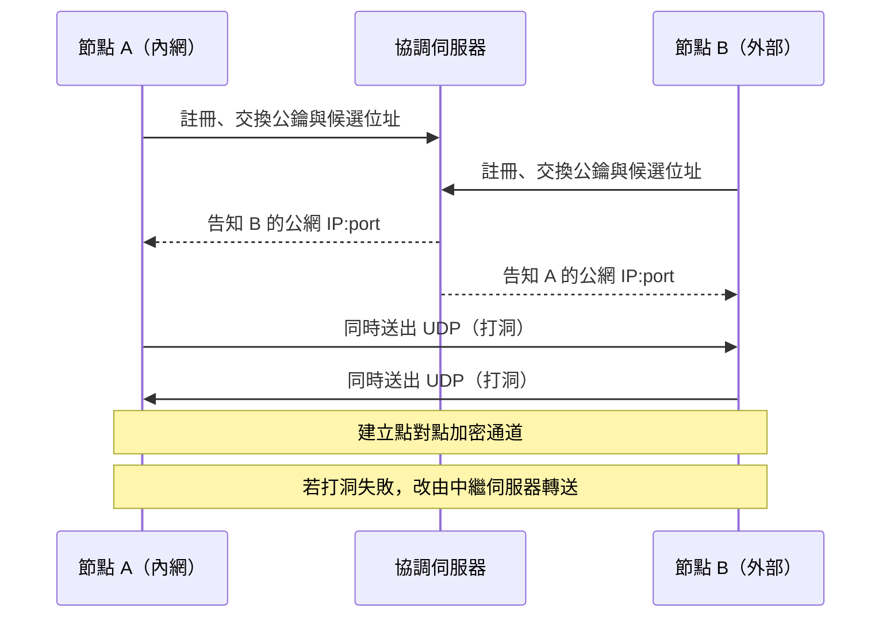
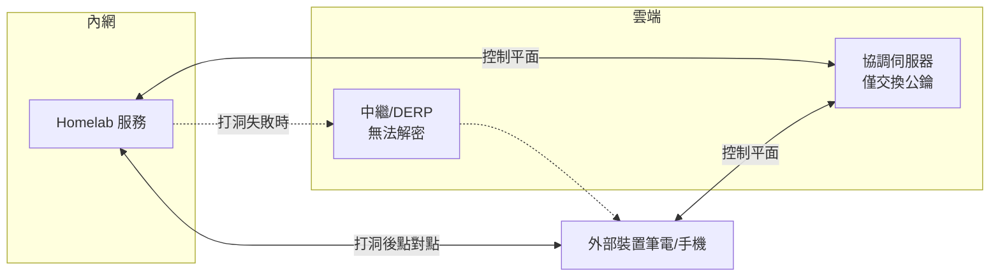

# 內網 Homelab 的安全外部存取方案

## 摘要

當 Homelab 架設在住宅或企業內網、位於 NAT（Network Address Translation，網路位址轉換）之後，且**沒有對外開放任何連接埠（port）**時，外部網際網路的使用者無法主動發起連線進入該內網。要在這種前提下安全地從外部存取內網服務，核心思路是**反轉連線方向**：改由內網機器主動向外部（雲端服務或自架 VPS）建立一條對外連線，外部流量再沿著這條已建立的通道回送。此類架構通常稱為「僅對外連線（outbound-only）」或「反向通道（reverse tunnel）」，其最大安全優勢在於**對外的攻擊面為零**——網際網路的連接埠掃描器完全看不到任何入口[^noport]。

本報告整理目前主流方案的運作原理、授權模式、成本與安全特性，並給出兼顧便利與安全的實務架構建議。

---

## 一、問題背景：NAT 與「未開埠」的意義

大部分家用網路位於電信業者或路由器的 NAT 之後，內網裝置只有私有 IP（如 `192.168.x.x`）。路由器對外的公網 IP 若沒有設定**連接埠轉送（port forwarding）**或**DMZ**，則外部封包無法被導向內網任何裝置。這種設定本身即是重要的安全防線：由於沒有開放的入口，外部掃描器無法觸及服務，常見的暴力破解、漏洞探測流量大多被擋在門外[^noport]。

問題在於「方便」與「安全」的取捨。若為了存取而直接開放連接埠，就等於把內網服務暴露在整個網際網路面前；因此實務上會改用**由內而外的連線**來繞過 NAT，同時不犧牲安全性。

### NAT 打洞（hole punching）簡介

若要建立點對點（peer-to-peer）連線，現代工具會使用 STUN（Session Traversal Utilities for NAT）與 ICE（Interactive Connectivity Establishment）等標準技術，先讓雙方各自得知自己在公網上的 `IP:port` 對應，再同時互送 UDP 封包，藉由「狀態防火牆允許已送出封包的來源回包」的特性，在 NAT 上打出一條臨時通道[^nat]。



---

## 二、方案分類與運作原理

### A. Mesh VPN（網狀 VPN）

Mesh VPN 建立一個覆蓋網路（overlay network），每個節點都能透過 NAT 打洞或中繼與其他節點直接通訊，無須中央 VPN 集中器，也無須開放任何連入連接埠。

| 工具 | 底層協定 | 授權／自架 | 說明 |
|---|---|---|---|
| **Tailscale** | WireGuard | 客戶端開源；協調伺服器為雲端服務（可用 Headscale 自架） | 以 WireGuard 為資料平面，協調伺服器僅交換公鑰，私鑰不離裝置；打洞失敗時改用 DERP 中繼，中繼無法解密[^tshow][^nat] |
| **ZeroTier** | 自有 ZTNVP | 客戶端與控制器可自架（企業版） | 虛擬 L2/L3 網路，AES-256 對稱加密；免費方案裝置數有限[^zt] |
| **NetBird** | WireGuard | 完全開源、可自架 | 由管理服務、信號服務、中繼服務（TURN/WebSocket）組成；以 ICE 打洞，中繼無法解密[^nb] |
| **Headscale** | WireGuard | BSD-3-Clause，開源 | Tailscale 協調伺服器的自架實作，讓你可完全掌控控制平面[^hs] |

Mesh VPN 的關鍵安全特性：**私鑰不離開裝置、端到端加密、無需開放連入埠**；身分驗證通常委外給 OAuth2/OIDC/SAML 身分供應者（如 Google、Microsoft、GitHub），並可在該處強制多因素驗證（MFA）[^tshow][^sso]。



---

### B. 反向通道 / 反向代理（Reverse Tunnel）

此類方案在內網執行一個輕量代理程式，主動對外建立連線（通常是 TCP/TLS 443），外部流量再由雲端或 VPS 沿通道回送。因為走的是標準對外 HTTPS，幾乎能穿透所有防火牆。

#### Cloudflare Tunnel（cloudflared）

在內網執行 `cloudflared` 常駐程式，它對 Cloudflare 全球網路建立**僅對外**的連線；外部使用者連到 Cloudflare 邊緣節點，流量再經通道送往內網服務[^cft]。由於連線由內網主動發起，可將防火牆設定為**封鎖所有連入流量**，外部掃描器看不到任何入口。

Cloudflare Tunnel 可搭配 **Cloudflare Access** 作為具身分感知能力的前置代理（Identity-Aware Proxy），在流量抵達內網服務前先完成驗證與授權。Access 政策可依電子郵件、IP 範圍、國家、身分供應者群組、SAML/OIDC 宣告、裝置狀態、服務權杖、mTLS 等條件判斷，並支援 Allow／Block／Bypass／Service Auth 等動作[^cfauth]。免費方案在 Tunnel 通道流量上**沒有頻寬限制**，且 Access 免費版支援最多 50 位使用者[^cflimit]。快速通道（trycloudflare.com）無須帳號即可臨時使用，但不保證可用性、主機名稱每次變動[^cft]。

#### ngrok

ngrok 代理程式在服務旁執行，主動以 TLS 443 對外撥號，回傳一個公開網址；流量沿同一條連線回送到本機服務。支援 HTTP/HTTPS/TCP/TLS，並可在代理層套用 Traffic Policy（OAuth、mTLS、WAF、速率限制）[^ngrok]。免費方案限制包含端點數、傳輸量與請求數，HTTP 端點會顯示插頁提示[^ngrokprice]。

#### frp / rathole / boringproxy

- **frp**（Apache-2.0）為最成熟的反向代理工具，由 `frps`（公網 VPS）與 `frpc`（內網客戶端）組成，內網主動向 VPS 建立連線；支援 TCP/UDP/HTTP/HTTPS，另有 STCP（需預共享密鑰）與 xtcp（點對點打洞）模式，自 v0.50.0 起預設啟用 TLS，並支援權杖或 OIDC 驗證[^frp]。
- **rathole**（Apache-2.0，Rust）主打輕量與高效能，二進位檔極小，使用 Noise Protocol 加密，無須自行管理 TLS 憑證[^rathole]。
- **boringproxy**（MIT）為面向自架者的簡單隧道反向代理，內建網頁介面與 Let's Encrypt 自動 HTTPS[^boringproto]。

#### Pangolin

Pangolin 是一套開源自架的 SASE（Secure Access Service Edge）平台，整合零信任 VPN、零信任反向代理、特權存取管理（PAM）與 AI 閘道，底層為 WireGuard（元件 Newt，具 NAT 打洞）與 Traefik。站點連接器以對外連線建立隧道，使用者可經瀏覽器以具身分驗證的方式存取 HTTPS、VNC、RDP、SSH，並以角色為基礎的存取控制（RBAC）授權每個資源[^pangolin]。授權為 AGPL-3.0 社群版搭配商業授權企業版。

---

### C. 自架 VPS + WireGuard / 反向 SSH

若不想依賴第三方 SaaS，可租用一台有公網 IP 的便宜 VPS 作為中樞。

- **WireGuard + VPS**：VPS 與內網機器都執行 WireGuard，由**內網主動對外連線**至 VPS。由於 NAT 對應會逾時，需在客戶端設定 `PersistentKeepalive = 25`（每 25 秒送一次 keepalive），以維持通道存活，使 VPS 隨時能回送封包[^wg]。此為中樞輻射（hub-and-spoke）架構，所有流量經 VPS 轉送。
- **反向 SSH**：使用 `ssh -R 8080:localhost:80 user@vps` 由內網對外建立遠端連接埠轉送，VPS 的 8080 連接埠即轉往內網的 80。優點是無需額外軟體，缺點是 SSH 非為高吞吐隧道設計，且斷線需以 `autossh` 之類工具自動重連[^ngrok]。

此類自架方案的最大優點是**完全掌控、無第三方可讀取明文**（相對於 SaaS 中繼）；缺點是需自行維護、缺乏內建驗證層（需再加上 oauth2-proxy、Authelia 等），且 VPS 本身可見到解密的流量（除非端對端加密）。

---

### D. Tailscale Funnel

Funnel 可將內網資源以 `<裝置>.<tailnet>.ts.net` 的網址公開到網際網路。公開 DNS 會將該網址解析到 **Funnel 中繼伺服器**，而非你的裝置 IP，因此裝置位置不外洩；中繼伺服器以加密 TCP 代理連回你的裝置，且**不解密流量**，維持端對端加密[^funnel]。

限制：Funnel 只能監聽連接埠 **443、8443、10000**，僅支援 TLS 加密連線，且受**不可設定的頻寬限制**。需求為 Tailscale v1.38.3 以上、啟用 MagicDNS 與 HTTPS 憑證，並在 tailnet 政策檔中設定 funnel 節點屬性；此功能在所有方案（含免費 Personal）皆可用（撰寫時仍為 beta）[^funnel]。

---

## 三、方案比較

| 方案 | 類型 | 需開放連入埠 | 是否需 VPS | 內建身分驗證 | 成本（個人／Homelab） | 開源性 |
|---|---|---|---|---|---|---|
| Tailscale | Mesh VPN（WireGuard） | 否 | 否 | SSO/OIDC/MFA（委外） | 免費（免費方案有使用者／裝置上限）[^tsprice] | 客戶端開源[^tshow] |
| ZeroTier | Mesh VPN（自有協定） | 否 | 否 | 付費方案 OIDC SSO | 免費方案裝置數有限[^zt] | 部分開源 |
| NetBird | Mesh VPN（WireGuard） | 否 | 可自架 | 開源、免費方案有上限[^nb] | 免費方案有上限[^nb] | 開源 |
| Headscale | 自架控制平面 | 否 | 需 | 自行整合 | 免費[^hs] | 開源（BSD-3）[^hs] |
| Cloudflare Tunnel | 反向通道 | 否 | 否 | Cloudflare Access（豐富） | 免費（無頻寬費）[^cflimit] | cloudflared 開源[^cft] |
| ngrok | 反向通道 | 否 | 否 | 付費方案 OAuth/mTLS | 免費版有限制[^ngrokprice] | 代理程式閉源 |
| frp | 反向代理 | 否 | 需 | 權杖／OIDC | 免費，需 VPS[^frp] | 開源（Apache-2.0）[^frp] |
| rathole | 反向代理 | 否 | 需 | 權杖 + Noise | 免費，需 VPS[^rathole] | 開源（Apache-2.0）[^rathole] |
| WireGuard + VPS | 中樞輻射 VPN | 否 | 需 | 無（需自行加） | 僅 VPS 費用[^wg] | 開源 |
| Tailscale Funnel | 反向通道（公開） | 否 | 否 | 無（預設公開） | 免費（含頻寬限制）[^funnel] | 部分開源 |

**重點提醒**：Funnel 與 ngrok 免費版預設將服務**公開**給任何知道網址的人；若服務本身沒有驗證機制，應優先選擇能搭配身分感知代理的方案（如 Cloudflare Tunnel + Access，或 Tailscale 網狀網路搭配 ACL）。

---

## 四、安全實務建議

### 1. 縱深防禦（Defense in Depth）

單一防護不足，應採多層重疊控制[^beyondcorp][^ztcf]：

| 層次 | 建議作法 |
|---|---|
| 網路 | 僅對外連線的通道（Cloudflare Tunnel、Mesh VPN），防火牆封鎖所有連入 |
| 身分驗證 | 具身分感知的前置代理（Cloudflare Access、Pomerium）＋ SSO |
| 授權 | 多因素驗證（MFA）、最小權限 |
| 加密 | 服務對服務使用 mTLS |
| 限速／封鎖 | fail2ban、WAF 規則 |
| 修補 | 持續更新與自動化修補 |

### 2. 零信任模型（Zero Trust）

零信任的核心原則是「**永不信任，一律驗證**」：不因使用者位於內網就預設信任，而是對每一次請求持續驗證身分、裝置狀態與請求情境[^ztcf]。Google 的 BeyondCorp 研究即主張移除「特權內網」的概念，將企業應用直接置於網際網路上，並以持續驗證取代網路邊界防護[^beyondcorp]。實務要點包含：持續驗證、最小權限、微分割（microsegmentation），以及防止橫向移動（lateral movement）[^ztcf]。

### 3. 具身分感知的代理（Identity-Aware Proxy, IAP）

相較於直接暴露服務，更安全的作法是加上一層 IAP，在流量抵達服務前先檢驗使用者身分。開源的 **Pomerium** 即基於 BeyondCorp 與零信任原則，持續驗證使用者身分、裝置狀態與請求情境後才放行[^pomerium]。身分驗證建議委外給身分供應者（IdP），以便自動輪替加密金鑰並沿用組織的 MFA 政策[^sso]。

### 4. mTLS（雙向 TLS）

一般 TLS 僅驗證伺服器身分；mTLS 要求**用戶端也出示憑證**，適用於機器對機器（M2M）通訊與微服務架構，可防禦中間人、重放與偽冒攻擊[^mtls]。

### 5. fail2ban

fail2ban 掃描日誌（如 `/var/log/auth.log`），對反覆登入失敗的來源 IP 以防火牆規則暫時封鎖[^f2b]。不過該專案自身提醒：fail2ban 無法消除弱驗證帶來的風險，服務應盡量採用雙因素或公私鑰驗證機制[^f2b]。若已使用前置 IAP，對直連服務的保護價值較低，但對 SSH 與管理介面仍有用。

### 6. 持續修補

未修補的漏洞是現實世界多數入侵的起點；零信任網路亦要求能限制脆弱裝置的存取[^ztcf]。Homelab 可採用自動更新（Debian/Ubuntu 的 unattended-upgrades）、容器映像自動更新（如 Watchtower、Renovate），並定期以全新基礎映像重建。

---

## 五、建議架構

對多數 Homelab 而言，兼顧便利與安全的務實作法是**分層使用**：

- **管理用途**（SSH、資料庫、非 HTTP 服務）：使用 Mesh VPN（如 Tailscale 或自架 Headscale），端對端加密、不開放連入埠、可搭配 ACL 精細授權。
- **對外公開的網頁服務**：使用 Cloudflare Tunnel 搭配 Cloudflare Access（身分感知代理），免費、具 DDoS 防護、且以 SSO＋MFA 保護。
- **僅需臨時分享**：ngrok 或 Cloudflare 快速通道，用畢即關。

```mermaid
flowchart TB
    U[外部使用者瀏覽器]
    U2[管理者裝置]
    CF[Cloudflare 邊緣<br/>Access 驗證]
    MESH[Mesh VPN<br/>Tailscale/Headscale]
    subgraph 內網 Homelab
        W[網頁服務]
        S[SSH/資料庫/admin]
    end
    U -->|HTTPS| CF
    CF -->|cloudflared 僅對外通道| W
    U2 -->|WireGuard 加密| MESH
    MESH --> S
    FW[防火牆：封鎖所有連入] -.->|保護| 內網 Homelab
```

---

## 六、結論

在內網且未對外開埠的前提下，安全的外部存取關鍵在於**反轉連線方向**，讓內網服務主動建立對外通道，使攻擊面降為零。依需求可選：

1. **最易上手**：Mesh VPN（Tailscale），免費、跨平台、無須 VPS、端對端加密[^tshow]。
2. **公開網頁服務**：Cloudflare Tunnel + Access，免費、無頻寬費、內建豐富驗證[^cflimit][^cfauth]。
3. **最大主控權**：frp 或 WireGuard + 自架 VPS，完全開源、無第三方可讀明文[^frp][^wg]。
4. **全功能自架**：Pangolin，整合 VPN、反向代理、PAM 與 AI 閘道[^pangolin]。

無論選擇何者，都應遵循零信任與縱深防禦原則：以 IAP＋SSO＋MFA 作為驗證層、以 mTLS 保護服務間通訊、以 fail2ban 與自動修補作為補強[^ztcf][^pomerium][^f2b]。

---

## 參考資料

[^noport]: Cloudflare. (n.d.). *Cloudflare Tunnel*. Retrieved 2026-10-18, from https://developers.cloudflare.com/cloudflare-one/connections/connect-networks/
[^nat]: Tailscale. (2020). *How NAT traversal works*. Retrieved 2026-10-18, from https://tailscale.com/blog/how-nat-traversal-works
[^tshow]: Tailscale. (2022). *How Tailscale works*. Retrieved 2026-10-18, from https://tailscale.com/blog/how-tailscale-works
[^tsprice]: Tailscale. (n.d.). *Pricing*. Retrieved 2026-10-18, from https://tailscale.com/pricing
[^zt]: ZeroTier. (n.d.). *Pricing*. Retrieved 2026-10-18, from https://www.zerotier.com/pricing/
[^nb]: NetBird. (n.d.). *How NetBird works*. Retrieved 2026-10-18, from https://docs.netbird.io/about-netbird/how-netbird-works
[^hs]: juanfont. (n.d.). *headscale*. GitHub. Retrieved 2026-10-18, from https://github.com/juanfont/headscale
[^cft]: Cloudflare. (n.d.). *Connect networks (Cloudflare Tunnel)*. Retrieved 2026-10-18, from https://developers.cloudflare.com/cloudflare-one/connections/connect-networks/
[^cfauth]: Cloudflare. (n.d.). *Access policies*. Retrieved 2026-10-18, from https://developers.cloudflare.com/cloudflare-one/policies/access/
[^cflimit]: Cloudflare. (n.d.). *Cloudflare One account limits*. Retrieved 2026-10-18, from https://developers.cloudflare.com/cloudflare-one/account-limits/
[^ngrok]: ngrok. (n.d.). *Agent overview*. Retrieved 2026-10-18, from https://ngrok.com/docs/agent/
[^ngrokprice]: ngrok. (n.d.). *Pricing*. Retrieved 2026-10-18, from https://ngrok.com/pricing
[^frp]: fatedier. (n.d.). *frp: A fast reverse proxy*. GitHub. Retrieved 2026-10-18, from https://github.com/fatedier/frp
[^rathole]: rapiz1. (n.d.). *rathole*. GitHub. Retrieved 2026-10-18, from https://github.com/rapiz1/rathole
[^boringproto]: boringproxy. (n.d.). *boringproxy*. GitHub. Retrieved 2026-10-18, from https://github.com/boringproxy/boringproxy
[^pangolin]: Fossorial. (n.d.). *Pangolin*. GitHub. Retrieved 2026-10-18, from https://github.com/fosrl/pangolin
[^wg]: WireGuard. (n.d.). *Quick start*. Retrieved 2026-10-18, from https://www.wireguard.com/quickstart/
[^funnel]: Tailscale. (n.d.). *Tailscale Funnel*. Retrieved 2026-10-18, from https://tailscale.com/kb/1223/funnel
[^sso]: Tailscale. (n.d.). *Supported SSO identity providers*. Retrieved 2026-10-18, from https://tailscale.com/kb/1013/sso-providers
[^ztcf]: Cloudflare. (n.d.). *What is Zero Trust?* Retrieved 2026-10-18, from https://www.cloudflare.com/learning/security/glossary/what-is-zero-trust/
[^beyondcorp]: Google. (n.d.). *BeyondCorp: A new approach to enterprise security*. Retrieved 2026-10-18, from https://research.google/pubs/pub43231/
[^pomerium]: Pomerium. (n.d.). *Pomerium documentation*. Retrieved 2026-10-18, from https://www.pomerium.com/docs/
[^mtls]: Wikipedia. (n.d.). *Mutual authentication*. Retrieved 2026-10-18, from https://en.wikipedia.org/wiki/Mutual_authentication
[^f2b]: fail2ban. (n.d.). *fail2ban*. GitHub. Retrieved 2026-10-18, from https://github.com/fail2ban/fail2ban
