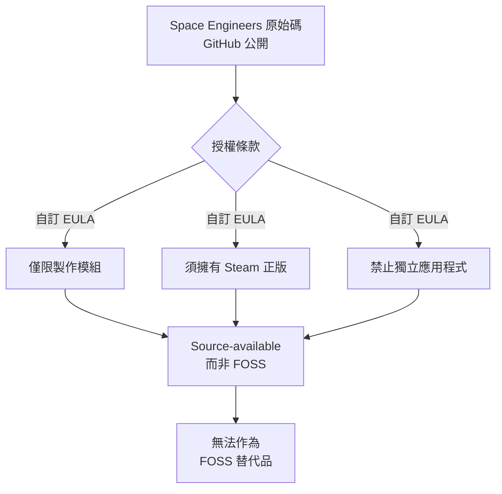
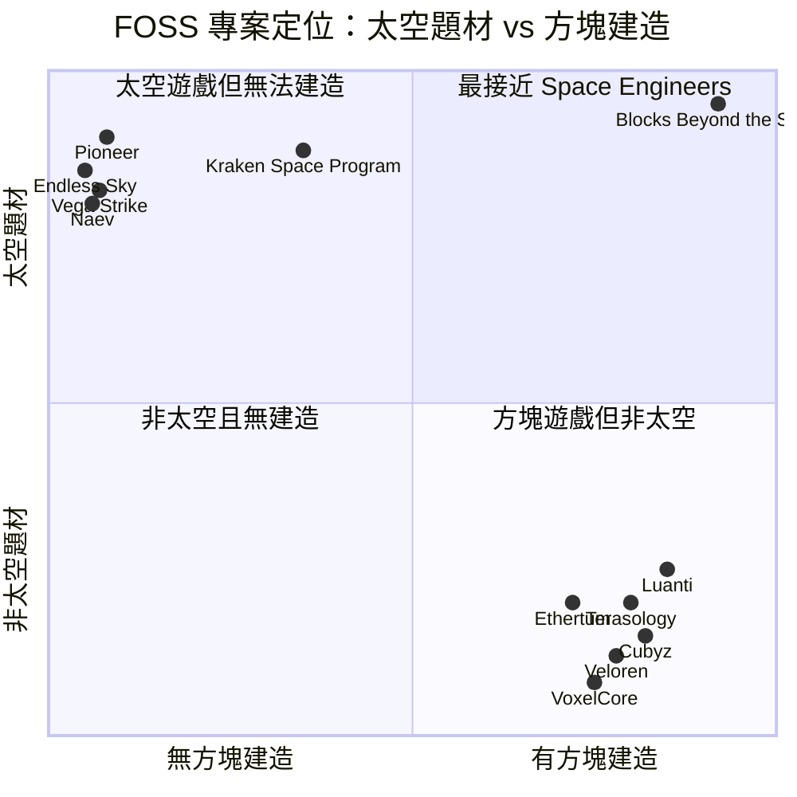

# Space Engineers 的自由開源 (FOSS) 替代方案調查

## 摘要

Space Engineers 是一款以方塊 (block) 為單位建構太空船、太空站與行星基地的沙盒工程遊戲[^se-steam]。其官方原始碼雖然公開於 GitHub，卻採用自訂 EULA 授權，明確聲明「不得被誤認為自由軟體、開放原始碼或公共領域軟體」，因此**並非 FOSS**[^se-eula]。

本報告調查是否存在功能對等的 FOSS 替代品。結論是：**目前最接近 Space Engineers 的 FOSS 專案是 Blocks Beyond the Stars**，它是唯一同時具備「方塊造船 + 太空飛行 + 多人連線 + 開源授權」的專案，但仍屬早期開發階段，知名度極低（GitHub 星數約 37）[^bbts-gh]。其餘 FOSS 太空遊戲（Pioneer、Endless Sky、Naev、Vega Strike 等）大多為「太空飛行模擬 / 貿易」，**不具備方塊造船機制**；而 Luanti、Terasology、Cubyz、Veloren 等 FOSS 方塊遊戲則**不具備太空題材**。

---

## 一、研究對象：Space Engineers 是什麼

Space Engineers 由 Keen Software House 開發與發行，於 2019-02-28 正式推出，售價 19.99 美元，僅支援 Windows[^se-steam]。Steam 頁面描述其核心玩法為：

- 以方塊為單位設計並駕駛小型與大型船艦、小行星太空站與行星基地[^se-steam]
- 超過 200 種功能方塊：推進器、轉子、活塞、砲塔、輸送帶、生產方塊等[^se-steam]
- 具體積的物理引擎：每個方塊與體素 (voxel) 都有質量、慣性與損傷，船艦會解體、地形可被鑽掘與重塑[^se-steam]
- 生存模式需手動焊接組裝、管理電力與氧氣/氫氣；創造模式則資源無限[^se-steam]
- 支援單人與多人（合作或競爭），並提供專用伺服器[^se-steam]

### 官方原始碼的授權狀態

`github.com/KeenSoftwareHouse/SpaceEngineers` 於 GitHub 上為公開儲存庫，有約 2,977 顆星、888 個 fork，語言為 C#，但已被封存 (archived)，最後推送時間為 2022-01-06[^se-repo]。GitHub API 未偵測到任何標準開源授權[^se-repo]。

其 `EULA.txt` 開頭即寫明[^se-eula]：

> The source code and art assets must not to be mistaken for free software, an open source in a free-software activist understanding, copy-left or public domain software. All source code and art assets remain copyrighted and licensed by KEEN SWH LTD.

EULA 摘要條款進一步限制[^se-eula]：

- 原始碼僅能用於開發 Space Engineers 的模組 (mod)，**不得建立獨立應用程式**
- 所有使用原始碼者必須擁有有效的 Steam 版 Space Engineers
- 不得移除 Steam 整合
- 商業使用須另行取得書面同意

**判定：Space Engineers 是「原始碼可見 (source-available)」，不是自由開源軟體**[^se-eula]。

---

## 二、評估標準

要稱為 Space Engineers 的「替代品」，一個 FOSS 專案理論上需要滿足下列核心條件（依重要性排序）：

| 條件 | 說明 |
|---|---|
| 1. 方塊 / 體素造船 | 能以離散方塊逐塊組裝船艦或太空站 |
| 2. 太空航行 | 建造物能在太空環境中飛行、移動 |
| 3. 開源授權 | 具備 OSI 認可之自由開源授權 |
| 4. 資源採集與合成 | 採礦、精煉、製作等生存要素 |
| 5. 多人連線 | 可自行架設或加入多人遊戲 |
| 6. 破壞與物理 | 船艦可受損、解體 |
| 7. 可遊玩性 | 有可下載或可執行的版本 |

以下依照「與 Space Engineers 的相似程度」分層介紹。

---

## 三、最接近的 FOSS 替代方案

### 3.1 Blocks Beyond the Stars（目前唯一直接對標者）

| 項目 | 內容 |
|---|---|
| 專案名 | Blocks Beyond the Stars |
| 儲存庫 | `github.com/marceld23/BlocksBeyondTheStars`[^bbts-gh] |
| 授權 | GNU Affero General Public License v3.0 or later (AGPL-3.0-or-later)[^bbts-license] |
| 語言 / 引擎 | C#（.NET 伺服器）+ Unity 6 客戶端[^bbts-readme] |
| 星數 | 約 37[^bbts-gh] |
| Fork 數 | 12[^bbts-gh] |
| 建立時間 | 2026-05-30[^bbts-gh] |
| 最後推送 | 2026-10-17（極度活躍）[^bbts-gh] |
| 可遊玩 | 是：Windows / 原生 Linux / 實驗性 macOS / 瀏覽器[^bbts-readme] |
| 官方網站 | `www.blocksbeyondthestars.com`[^bbts-readme] |

**與 Space Engineers 的相似點**[^bbts-readme]：

- 「逐塊建造」船艦、行星基地與太空站
- 程序化生成的星系：各自擁有恆星、行星、衛星與可採礦小行星帶
- 採礦、冶煉、製作、藍圖解鎖
- 生存 (Explorer) / 創造 (Creative) / 沙盒 (Sandbox) 三種模式
- 多人連線：區域網路、自行架設伺服器、或官方代管世界
- 具「Crystal Net」邏輯線路系統（類似 Space Engineers 的可程式化方塊與電路）
- 方塊可重塑為板、斜坡、階梯、圓頂等

**與 Space Engineers 的差異點**[^bbts-readme]：

- 方塊系統偏向「體素方塊」而非 Space Engineers 的細網格 (grid) 系統
- 船艦物理較簡化，缺乏 Space Engineers 的體積物理與逐塊破壞解體
- 專案極新（2026 年 5 月建立），內容深度與穩定性遠不及 Space Engineers
- **100% 由生成式 AI 產出**（程式碼、美術、音樂），由一位父親與其 10 歲兒子主導[^bbts-readme]
- 客戶端依賴 Unity；採用 CLA，允許未來針對封閉主機平台另行商業授權，但承諾 GitHub 版本永遠維持 AGPL[^bbts-readme]

**批判性反思**：本專案雖然在功能面上最貼近 Space Engineers，但星數僅 37，屬於極早期專案；且「100% AI 生成」意味著程式碼品質、長期維護性與原創性都仍有待社群驗證。此外，AGPL + CLA 的雙軌授權模式，雖保證開源版本永久存在，但也表示上游開發者可將同一份程式碼用於閉源商業發行，與嚴格意義的「純 FOSS 生態」仍有落差[^bbts-readme]。

---

## 四、FOSS 方塊遊戲：可作基礎但非太空題材

以下專案是成熟的 FOSS 方塊 / 體素遊戲，可作為「自行打造 Space Engineers 類遊戲」的引擎基礎，但本身不是太空造船遊戲。

### 4.1 Luanti（原 Minetest）

| 項目 | 內容 |
|---|---|
| 儲存庫 | `github.com/luanti-org/luanti`[^luanti-gh] |
| 授權 | 原始碼 LGPL-2.1 或更新版本；素材 CC BY-SA 3.0[^luanti-license] |
| 語言 | C++（Lua 模組 API）[^luanti-gh] |
| 星數 | 約 13,735[^luanti-gh] |
| 定位 | 開源體素「遊戲創作平台」，社群有太空主題模組[^luanti-gh] |

Luanti 是最成熟、社群最龐大的 FOSS 體素平台。其模組生態中存在太空 / 月球主題的子遊戲，但方塊造船通常為節點 (node) 式，預設不具備 Space Engineers 網格式船舶物理與解體機制[^luanti-gh]。

### 4.2 Terasology

| 項目 | 內容 |
|---|---|
| 儲存庫 | `github.com/MovingBlocks/Terasology`[^tera-gh] |
| 授權 | Apache-2.0[^tera-gh] |
| 語言 | Java[^tera-gh] |
| 星數 | 約 3,900[^tera-gh] |
| 定位 | 模組化體素世界平台，主要為奇幻 / Minecraft 風格[^tera-gh] |

### 4.3 Cubyz

| 項目 | 內容 |
|---|---|
| 儲存庫 | `github.com/PixelGuys/Cubyz`[^cubyz-gh] |
| 授權 | GPL-3.0[^cubyz-gh] |
| 語言 | Zig[^cubyz-gh] |
| 星數 | 約 3,726[^cubyz-gh] |
| 定位 | 超大視距體素沙盒，Minecraft 取向，非太空題材[^cubyz-gh] |

### 4.4 Veloren

| 項目 | 內容 |
|---|---|
| 儲存庫 | `github.com/veloren/veloren`（GitLab 為主）[^veloren-gh] |
| 授權 | GPL-3.0[^veloren-gh] |
| 語言 | Rust[^veloren-gh] |
| 星數 | 約 7,630[^veloren-gh] |
| 定位 | 開源體素 RPG，受 Dwarf Fortress 與 Cube World 啟發，**無太空船**[^veloren-gh] |

### 4.5 VoxelCore

| 項目 | 內容 |
|---|---|
| 儲存庫 | `github.com/MihailRis/voxelcore`[^voxelcore-gh] |
| 授權 | Mozilla Public License 2.0 (MPL-2.0)[^voxelcore-gh] |
| 語言 | C++ / OpenGL[^voxelcore-gh] |
| 星數 | 約 1,475[^voxelcore-gh] |
| 定位 | 體素遊戲引擎（非完整遊戲），可用來打造 Space Engineers 類作品[^voxelcore-gh] |

---

## 五、FOSS 太空遊戲：無方塊造船

以下專案具備太空題材，但**沒有方塊造船機制**，玩家只能購買 / 駕駛預製船艦。

| 專案 | 授權 | 語言 | 星數 | 與 Space Engineers 的差異 |
|---|---|---|---|---|
| Pioneer Space Simulator[^pioneer-gh] | GPL-3.0[^pioneer-license] | C++[^pioneer-gh] | 約 1,921[^pioneer-gh] | 3D 太空模擬，買現成船艦，無方塊建造[^pioneer-gh] |
| Endless Sky[^esky-gh] | GPL-3.0[^esky-gh] | C++[^esky-gh] | 約 7,636[^esky-gh] | 2D 俯視太空貿易 / 戰鬥，無建造[^esky-gh] |
| Naev[^naev-gh] | GPL-3.0 或更新版本[^naev-license] | C / Lua[^naev-gh] | 約 940[^naev-gh] | 2D 太空 RPG，無建造[^naev-gh] |
| Naikari[^naikari-gh] | GPL-3.0 或更新版本[^naikari-license] | C / Lua[^naikari-gh] | 約 91[^naikari-gh] | 2D 太空沙盒，無建造[^naikari-gh] |
| Vega Strike[^vega-gh] | GPL-3.0[^vega-license] | C++[^vega-gh] | 約 364[^vega-gh] | 太空戰鬥 / 貿易模擬，買現成船艦[^vega-gh] |
| Space Nerds In Space[^snis-gh] | GPL-2.0[^snis-gh] | C[^snis-gh] | 約 781[^snis-gh] | 多人艦橋模擬，無建造[^snis-gh] |
| Space Station 14[^ss14-gh] | MIT[^ss14-gh] | C#[^ss14-gh] | 約 3,870[^ss14-gh] | 太空站角色扮演，非造船[^ss14-gh] |
| Kraken Space Program[^kraken-gh] | MIT[^kraken-gh] | Rust / Bevy[^kraken-gh] | 約 34[^kraken-gh] | KSP 精神續作（零件組裝，非方塊），極早期[^kraken-gh] |
| Cosmos Journeyer[^cj-gh] | AGPL-3.0[^cj-gh] | TypeScript[^cj-gh] | 約 58[^cj-gh] | 瀏覽器太空探索，無建造[^cj-gh] |
| Ethertum[^ether-gh] | GPL-3.0[^ether-gh] | Rust / Bevy[^ether-gh] | 約 545[^ether-gh] | 體素多人沙盒生存，非太空造船[^ether-gh] |
| new-ospgl（Open Space Program）[^osp-gh] | MIT[^osp-gh] | C++[^osp-gh] | 約 42[^osp-gh] | 太空探索原型，極早期[^osp-gh] |

此外，`OpenSpace/OpenSpace`（約 1,280 星、C++）雖名為「Open Space」，實際上是給天文館使用的天文物視化軟體，**並非遊戲**[^openspace-gh]。

### 商業同名遊戲並非 FOSS

在搜尋過程中經常被提及的幾款「方塊造船 + 太空」商業遊戲，其原始碼皆未以 FOSS 授權公開：

- StarMade：遊戲本體為專有軟體；GitHub 上的 `StarMade/StarMade` 僅是已封存的模組用反編譯程式碼包，無授權檔[^starmade-gh]
- Avorion、Empyrion - Galactic Survival、Starship EVO、Stationeers、Cosmonautica、Astro Colony：皆為專有商業遊戲[^se-steam]

---

## 六、綜合比較：相似度矩陣

| 條件 | Blocks Beyond the Stars | Luanti + 太空模組 | Pioneer | Endless Sky | VoxelCore（自建） |
|---|---|---|---|---|---|
| 方塊造船 | 是 | 部分 | 否 | 否 | 需自行開發 |
| 太空航行 | 是 | 部分 | 是 | 是 | 需自行開發 |
| 開源授權 | AGPL-3.0+ | LGPL-2.1+ / CC BY-SA | GPL-3.0 | GPL-3.0 | MPL-2.0 |
| 採礦 / 合成 | 是 | 是 | 弱 | 弱 | 需自行開發 |
| 多人連線 | 是 | 是 | 否 | 否 | 需自行開發 |
| 破壞 / 物理 | 部分 | 弱 | 無 | 無 | 需自行開發 |
| 可遊玩性 | 可執行 | 成熟 | 成熟 | 成熟 | 引擎 |
| 星數 | 37 | 13,735 | 1,921 | 7,636 | 1,475 |

---

## 七、結論與建議

1. **沒有成熟的 FOSS 版 Space Engineers。** Space Engineers 的體積物理、網格式船舶、逐塊破壞與大規模多人同步是極高門檻的組合，目前尚無開源專案完整複製[^se-steam][^bbts-readme]。

2. **若想「現在就能玩方塊造船 + 太空」**：首選 **Blocks Beyond the Stars**（AGPL-3.0-or-later，可免費下載或直接在瀏覽器遊玩），但請預期它是早期專案，內容與穩定性有限[^bbts-readme]。

3. **若想「自行開發」一款 FOSS Space Engineers**：**Luanti**（LGPL-2.1+，13,700+ 星）提供最成熟的體素引擎與 Lua 模組生態；**VoxelCore**（MPL-2.0）或 **Terasology**（Apache-2.0）是 C++ / Java 的替代引擎選擇[^luanti-gh][^voxelcore-gh][^tera-gh]。

4. **若只想玩「開源太空遊戲」**：Pioneer、Endless Sky、Naev、Vega Strike 都是成熟且免費的選擇，但玩法是太空飛行 / 貿易 / 戰鬥，**不是工程建造**[^pioneer-gh][^esky-gh][^naev-gh][^vega-gh]。

5. **重要提醒**：Space Engineers 的 GitHub 原始碼無法作為 FOSS 專案的基礎。其 EULA 禁止將程式碼用於獨立應用程式，且要求使用者擁有 Steam 正版；任何試圖以其原始碼建立獨立 FOSS 遊戲的行為都違反授權[^se-eula]。

---

## 參考文獻

[^se-steam]: Valve Corporation. (2019, February 28). Space Engineers. Steam. Retrieved 2026-10-18, from https://store.steampowered.com/app/244850/Space_Engineers/

[^se-repo]: Keen Software House. (2022, January 6). KeenSoftwareHouse/SpaceEngineers [Source code repository]. GitHub. Retrieved 2026-10-18, from https://github.com/KeenSoftwareHouse/SpaceEngineers

[^se-eula]: KEEN SWH LTD. (n.d.). Space Engineers end user license agreement (EULA.txt). Retrieved 2026-10-18, from https://raw.githubusercontent.com/KeenSoftwareHouse/SpaceEngineers/master/EULA.txt

[^bbts-gh]: Dütscher, M. (2026, October 17). marceld23/BlocksBeyondTheStars [Source code repository]. GitHub. Retrieved 2026-10-18, from https://github.com/marceld23/BlocksBeyondTheStars

[^bbts-license]: Dütscher, M. (2026). GNU Affero General Public License v3.0 or later (LICENSE). BlocksBeyondTheStars. Retrieved 2026-10-18, from https://raw.githubusercontent.com/marceld23/BlocksBeyondTheStars/main/LICENSE

[^bbts-readme]: Dütscher, M. (2026, October 17). Blocks Beyond the Stars — README. GitHub. Retrieved 2026-10-18, from https://raw.githubusercontent.com/marceld23/BlocksBeyondTheStars/main/README.md

[^luanti-gh]: Luanti Organization. (2026, October 17). luanti-org/luanti [Source code repository]. GitHub. Retrieved 2026-10-18, from https://github.com/luanti-org/luanti

[^luanti-license]: Ahola, P., & Luanti contributors. (2024). License of Luanti textures and sounds; License of Luanti source code (LICENSE.txt). Luanti. Retrieved 2026-10-18, from https://raw.githubusercontent.com/luanti-org/luanti/master/LICENSE.txt

[^tera-gh]: MovingBlocks. (2026, October 8). MovingBlocks/Terasology [Source code repository]. GitHub. Retrieved 2026-10-18, from https://github.com/MovingBlocks/Terasology

[^cubyz-gh]: PixelGuys. (2026, October 15). PixelGuys/Cubyz [Source code repository]. GitHub. Retrieved 2026-10-18, from https://github.com/PixelGuys/Cubyz

[^veloren-gh]: Veloren. (2026, October 17). veloren/veloren [Source code repository]. GitHub. Retrieved 2026-10-18, from https://github.com/veloren/veloren

[^voxelcore-gh]: MihailRis. (2026, October 16). MihailRis/voxelcore [Source code repository]. GitHub. Retrieved 2026-10-18, from https://github.com/MihailRis/voxelcore

[^pioneer-gh]: Pioneer Space Sim. (2026, October 13). pioneerspacesim/pioneer [Source code repository]. GitHub. Retrieved 2026-10-18, from https://github.com/pioneerspacesim/pioneer

[^pioneer-license]: Pioneer Space Sim. (n.d.). Pioneer Space Simulator — README (License GPLv3). GitHub. Retrieved 2026-10-18, from https://raw.githubusercontent.com/pioneerspacesim/pioneer/master/README.md

[^esky-gh]: Endless Sky. (2026, October 17). endless-sky/endless-sky [Source code repository]. GitHub. Retrieved 2026-10-18, from https://github.com/endless-sky/endless-sky

[^naev-gh]: Naev. (2026, October 16). naev/naev [Source code repository]. GitHub. Retrieved 2026-10-18, from https://github.com/naev/naev

[^naev-license]: Simo-Serra, E., & Naev contributors. (n.d.). Naev LICENSE. Naev. Retrieved 2026-10-18, from https://raw.githubusercontent.com/naev/naev/main/LICENSE

[^naikari-gh]: Naikari. (2026, September 6). naikari/naikari [Source code repository]. GitHub. Retrieved 2026-10-18, from https://github.com/naikari/naikari

[^naikari-license]: Naikari contributors. (n.d.). Naikari LICENSE. Naikari. Retrieved 2026-10-18, from https://raw.githubusercontent.com/naikari/naikari/main/LICENSE

[^vega-gh]: Vega Strike. (2026, October 13). vegastrike/Vega-Strike-Engine-Source [Source code repository]. GitHub. Retrieved 2026-10-18, from https://github.com/vegastrike/Vega-Strike-Engine-Source

[^vega-license]: The Vega Strike Contributors. (2026). Vega Strike LICENSE. Vega Strike. Retrieved 2026-10-18, from https://github.com/vegastrike/Vega-Strike-Engine-Source

[^snis-gh]: Cameron, S. (2026, October 17). smcameron/space-nerds-in-space [Source code repository]. GitHub. Retrieved 2026-10-18, from https://github.com/smcameron/space-nerds-in-space

[^ss14-gh]: Space Wizards Federation. (2026, October 18). space-wizards/space-station-14 [Source code repository]. GitHub. Retrieved 2026-10-18, from https://github.com/space-wizards/space-station-14

[^kraken-gh]: Kraken Space Program. (2026, April 16). Kraken-Space-Program/Kraken-Space-Program [Source code repository]. GitHub. Retrieved 2026-10-18, from https://github.com/Kraken-Space-Program/Kraken-Space-Program

[^cj-gh]: Paleologue, B. (2026, October 16). BarthPaleologue/CosmosJourneyer [Source code repository]. GitHub. Retrieved 2026-10-18, from https://github.com/BarthPaleologue/CosmosJourneyer

[^ether-gh]: Dreamtowards. (2026, October 11). Dreamtowards/Ethertum [Source code repository]. GitHub. Retrieved 2026-10-18, from https://github.com/Dreamtowards/Ethertum

[^osp-gh]: TheOpenSpaceProgram. (2024, July 5). TheOpenSpaceProgram/new-ospgl [Source code repository]. GitHub. Retrieved 2026-10-18, from https://github.com/TheOpenSpaceProgram/new-ospgl

[^openspace-gh]: OpenSpace. (2026, October 16). OpenSpace/OpenSpace [Source code repository]. GitHub. Retrieved 2026-10-18, from https://github.com/OpenSpace/OpenSpace

[^starmade-gh]: StarMade. (2017). StarMade/StarMade [Source code repository]. GitHub. Retrieved 2026-10-18, from https://github.com/StarMade/StarMade
