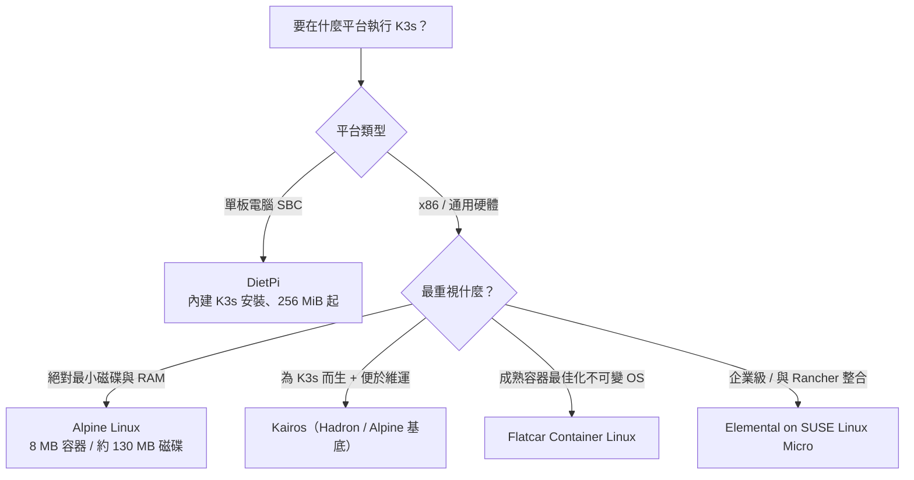

# 執行 K3s 最輕量的主機作業系統

## 摘要

K3s 是一套輕量級的 Kubernetes 發行版，其官方文件將伺服器節點的最低需求定為 2 核心 CPU、2 GB 記憶體，代理（agent）節點定為 1 核心 CPU、512 MB 記憶體[^k3sreq]。當探討「最輕量的主機作業系統」時，必須先釐清一個關鍵事實：**K3s 本身的資源佔用遠大於作業系統本身的差異**。實測顯示 K3s 代理約佔用 275 MB 記憶體，而含工作負載的伺服器節點約佔用 1,596 MB 至 1,606 MB 記憶體[^k3sprof]，因此作業系統層級能節省的空間通常在數百 MB 以內。

儘管如此，若單純以作業系統本身的磁碟與記憶體足跡衡量，**Alpine Linux** 是絕對最輕量的選擇，其容器映像不超過 8 MB，最小磁碟安裝約 130 MB[^alpineabout]。若要在「輕量」與「為 K3s 而生、便於維運」之間取得平衡，則 **Kairos**（可基於 Alpine 等發行版建構的不可變邊緣 Kubernetes 作業系統）與 **Flatcar Container Linux** 是較佳選擇。在單板電腦（SBC）場景下，**DietPi** 提供了內建的一鍵 K3s 安裝選項。

需要特別提醒的是，數個常被誤認為「K3s 作業系統」的專案實際上並不執行 K3s：**Talos Linux** 執行的是原生上游 Kubernetes 而非 K3s；**Bottlerocket** 並無 K3s 變體；**Ubuntu Core** 沒有 K3s 的 snap 套件。而專為 K3s 設計的 **k3OS** 已於 2023 年停止維護，並由 **Elemental** 取代。

## 一、先量測基準：K3s 自身需要多少資源？

在比較作業系統之前，必須先了解 K3s 元件的固定成本，因為這決定了主機 OS 能影響的空間上限。

### 官方最低需求

| 節點類型 | CPU | 記憶體 |
| --- | --- | --- |
| 伺服器（Server） | 2 核心 | 2 GB |
| 代理（Agent） | 1 核心 | 512 MB |

上述數字為 K3s 及其內建套裝元件的基線，不含實際工作負載所消耗的資源[^k3sreq]。

### 實測資源剖析

官方資源剖析測試（K3s v1.26.5，啟用所有內建元件，並執行 Prometheus、Grafana 監控堆疊與一個 Nginx 範例部署）得到以下結果[^k3sprof]：

| 元件 | 平台 | CPU 使用 | 記憶體（Kine/SQLite） | 記憶體（內嵌 etcd） |
| --- | --- | --- | --- | --- |
| 含工作負載的伺服器 | Intel 8375C | 單核 6% | 1,596 MB | 1,606 MB |
| 含工作負載的伺服器 | 樹莓派 4B | 單核 30% | 1,588 MB | 1,613 MB |
| 代理節點 | Intel 8375C | 單核 3% | 275 MB | 275 MB |
| 代理節點 | 樹莓派 4B | 單核 10% | 268 MB | 268 MB |

由此可見，Kubernetes 控制平面（API Server、Controller-Manager、Scheduler、資料儲存）才是資源消耗的主要來源，作業系統本身所佔的比例相對有限[^k3sprof]。

### 作業系統層級的先決條件

K3s 預期可在「大多數現代 Linux 系統」上運作，官方文件針對 SUSE Linux Enterprise / openSUSE、Red Hat Enterprise Linux / CentOS / Fedora、Ubuntu / Debian 及樹莓派提供了額外的設定說明[^k3sreq]。此外：

- K3s 需要 `cgroups` 才能啟動其服務；樹莓派 OS 預設未啟用 cgroups，需在核心命令列加入 `cgroup_memory=1 cgroup_enable=memory`[^k3sreq]。
- K3s 的安裝腳本會自動偵測系統使用 systemd 或 OpenRC，並以對應方式啟用與啟動服務；使用 OpenRC 時日誌位於 `/var/log/k3s.log`[^k3sadv]。

這表示一個「純 OpenRC、無 systemd」的輕量發行版在技術上是被支援的，這對評估 Alpine Linux 相當重要[^k3sadv]。

## 二、候選作業系統總覽

下表彙整各候選主機作業系統的性質、輕量程度與對 K3s 的支援情況。GitHub 星號數為 2026 年 10 月 18 日查詢之值。

| 作業系統 | 性質 / 基底 | OS 足跡概況 | 對 K3s 支援 | GitHub 星數 | 維護狀態 |
| --- | --- | --- | --- | --- | --- |
| Alpine Linux | musl libc + busybox；OpenRC | 容器 8 MB、最小磁碟安裝約 130 MB[^alpineabout] | 可（安裝腳本支援 OpenRC）[^k3sadv] | 1,304（docker-alpine）[^alpinedocker] | 活躍 |
| DietPi | 精簡化 Debian；systemd | 最低裝置為 256 MiB RAM[^dietpi] | 內建 K3s 安裝選項[^dietpisoft] | 6,331[^dietpigit] | 活躍 |
| Kairos | 不可變 meta-distribution；OCI | 依基底而異（可 Alpine / Hadron）[^kairosfaq] | 原生（provider 支援 k3s 與 k0s）[^kairosmatrix] | 1,855[^kairosgit] | 活躍 |
| Flatcar Container Linux | 不可變、容器最佳化；systemd | QEMU 映像約 565 MiB[^flatcarrel] | 良好（屬容器最佳化 OS）[^flatcardoc] | 1,288[^flatcargit] | 活躍 |
| openSUSE MicroOS | 不可變；btrfs 交易式更新；systemd | 最低 1 GB RAM、/ 5 GB、/var 5 GB[^microos] | 良好[^suse] | 無單一主庫 | 活躍 |
| SUSE Linux Micro | 企業版不可變 OS；systemd | 與 RKE2、K3S、Rancher Prime 搭配[^suse] | 官方推薦[^suse] | 無公開主庫 | 商業支援 |
| Elemental | 建構於 SLE Micro 之上；systemd | 繼承 SLE Micro 需求[^elemental] | 原生（配置 K3s / RKE2）[^elemental] | 383[^elementalgit] | 活躍 |
| Fedora CoreOS | 不可變；Ignition；systemd | 預設映像 10 GB[^fcos] | 良好 | 未查證 | 活躍 |
| Talos Linux | 專為 Kubernetes 設計、無 shell | 系統磁碟最低 10 GiB[^talos] | ✗ 執行原生 K8s，非 K3s[^talos] | 11,364[^talosgit] | 活躍 |
| Bottlerocket | 容器最佳化、無 shell / 套件管理器 | 僅提供 EKS / ECS / VMware 變體[^bottle] | ✗ 無 K3s 變體[^bottle] | 9,680[^bottlegit] | 活躍 |
| Ubuntu Core | snap 為基礎的不可變 OS | 最低 512 MB RAM、1 GB 儲存[^ubuntucore] | ✗ 無 K3s snap[^ubuntucore] | 未查證 | 活躍 |
| k3OS | 專為 K3s 設計 | live 安裝需 2 GB、本機安裝需 1 GB RAM[^k3osreadme] | 原生（但已停止維護）[^k3osreadme] | 3,477（已封存）[^k3osgit] | 停止維護 |

## 三、候選作業系統深入分析

### Alpine Linux：絕對最輕量

Alpine Linux 以 musl libc 與 busybox 為核心，官方描述其「容器不需要超過 8 MB，而最小磁碟安裝約需 130 MB 儲存空間」[^alpineabout]。它使用 OpenRC 初始化系統與 `apk` 套件管理器，設計上力求簡潔[^alpineabout]。截至 2026 年 9 月，目前穩定版為 3.24.2[^alpinedl]。

**對 K3s 的適用性。** K3s 並未在官方文件中針對 Alpine 提供專門章節，但 K3s 安裝腳本確實支援 OpenRC，會將服務檔放置於 `/etc/init.d/` 並以 OpenRC 管理[^k3sadv]。這意味著 Alpine 在技術上能執行 K3s，特別是代理節點。

**取捨。** 由於 Alpine 使用 musl libc，部分預先編譯的二進位檔可能出現相容性問題；使用者需自行確保 cgroups 正確配置，且缺乏如 Kairos 或 k3OS 那樣的 Kubernetes 生命週期自動化管理。因此 Alpine 適合追求極致精簡、願意自行維運的使用者。

### DietPi：單板電腦上的最輕量實用選擇

DietPi 是一套高度最佳化的極精簡 Debian 作業系統，並預設採用記憶體記錄（RAM logging）與低行程 / 記憶體足跡設計，以在裝置上取得最大效能[^dietpi]。其支援的最低階裝置（如樹莓派 1 / Zero、NanoPi NEO、ZeroPi）僅具備 256 MiB 記憶體[^dietpi]。

DietPi 將 **K3s** 及 MicroK8s 列為可直接安裝的軟體選項，安裝後可透過 `systemctl` 管理服務並以 `journalctl -u k3s` 檢視日誌[^dietpisoft]。由於它基於 Debian 且使用 systemd，K3s 能以標準安裝流程直接運作。對於在樹莓派或類似 SBC 上建構 K3s 叢集的使用者，DietPi 可說是最輕量且最省心的組合。

### Kairos：為邊緣 Kubernetes 而生的不可變 meta-distribution

Kairos 自我定位為「用於邊緣 Kubernetes 的不可變 Linux meta-distribution」，採發行版無關（distro-agnostic）設計，並以標準容器映像的形式散佈整個作業系統[^kairosfaq]。其架構採 A/B 分割與不可變設計，並可選擇性啟用基於 libp2p 的 P2P 網路，讓節點自行協調以簡化多節點叢集建置[^kairosfaq]。

Kairos 的標準映像內含 Kubernetes provider，官方支援 **k3s 與 k0s**，並可選擇搭配 P2P[^kairosmatrix]。這使其成為「原生為 K3s 而生」且仍在維護的選項之一。

**重要變化。** 根據官方說明，由於團隊規模較小，Kairos 現在將官方預建構成品與文件預設值**集中在 Hadron**（其自有基底），其他發行版仍受支援並透過自動化測試驗證，但已不再是預設路徑[^kairosmatrix]。因此若選擇 Kairos，實務上多半會以 Hadron 為基底；若需 Alpine 基底，則須透過 BYOI（Bring Your Own Image）自行建構[^kairosmatrix]。

### Flatcar Container Linux：成熟的容器最佳化不可變 OS

Flatcar 自稱是「極精簡、不可變、容器最佳化的 Linux 作業系統，也是 CoreOS Container Linux 的活躍後繼者」，採用自動化佈署、唯讀系統映像與原子更新[^flatcardoc]。它沒有傳統套件管理器，改用 `systemd-sysext` 系統擴充與容器來提供額外軟體[^flatcardoc]。

其 QEMU 映像約 565 MiB[^flatcarrel]，磁碟安裝需求至少 8 GB 可用空間。它在概念上與 K3s 的容器工作負載模型高度契合，但官方文件中並未提供 K3s 專門頁面。

### openSUSE MicroOS 與 SUSE Linux Micro：企業級不可變選項

openSUSE MicroOS 是為容器工作負載設計的不可變作業系統，以 btrfs 快照實現交易式更新與回滾[^microos]。其最低需求為 1 GB 實體記憶體，`/` 根分割區最低 5 GB、`/var` 分割區最低 5 GB（建議 40 GB 以上）[^microos]。

企業版 SUSE Linux Micro 則被 SUSE 描述為「適合易於維護的獨立容器佈署，並可輕易與最新雲原生技術結合，包括 Rancher Prime、RKE2 與 K3S」[^suse]。它是 Rancher 生態中受支援的 Kubernetes 主機作業系統層，但 1 GB 起的 RAM 需求使其並非極致輕量的選項。

### Elemental：k3OS 的官方後繼者

Elemental 是 Rancher / SUSE 推出的作業系統管理堆疊，建構於 SLE Micro 之上，包含 `elemental-toolkit`、`elemental-operator`、`elemental-register`、`elemental-cli` 與 `rancher-system-agent` 等元件[^elemental]。它能讓 Rancher Manager 全面控制 Elemental 叢集，從節點作業系統的安裝管理到以集中方式佈署新的 **K3s 或 RKE2** 叢集[^elemental]。

由於它繼承了 SLE Micro 的資源需求，加上 K3s 自身的需求，Elemental 稱不上「最輕量」，但它是承接已停止維護之 k3OS 的官方演進路線。

### k3OS：已停止維護的專為 K3s 而生之作業系統

k3OS 曾是最貼近「為 K3s 而生」的作業系統。其設計目標是「移除 Kubernetes 叢集中盡可能多的 OS 維護工作」，且「專門設計成僅包含執行 k3s 所需的內容」，並可由 `kubectl` 管理[^k3osreadme]。其核心使用者空間多來自 Alpine 並重新打包[^k3osreadme]。資源需求為：live 安裝（從 ISO 開機）至少 2 GB RAM，本機安裝需 1 GB RAM[^k3osreadme]。

然而，專案狀態頁明確聲明：「k3os 已不再維護，並已被 Elemental 取代。請勿再向此 repo 提交 PR 或 issue。」[^k3osreadme] 其 GitHub 儲存庫已封存[^k3osgit]。因此 k3OS 不應再作為新佈署的選擇。

### 常被誤認為 K3s 作業系統的專案

- **Talos Linux。** Talos 是現代化、專為 Kubernetes 打造的 Linux 發行版，執行的是**原生上游 Kubernetes**，而非 K3s[^talos]。其最低需求為控制平面 2 GiB 記憶體 / 2 核心、工作節點 1 GiB 記憶體 / 1 核心，系統磁碟皆需 10 GiB[^talos]。雖然它本身設計極為精簡，但不適合需要 K3s 特定功能的場景。
- **Bottlerocket。** Bottlerocket 以極簡、安全、無 shell 與無套件管理器著稱，但僅提供 `aws-k8s-*`、`aws-ecs-*`、`vmware-k8s-*` 等變體，**並無 K3s 變體**[^bottle]。因此它不是執行 K3s 的實用選擇。
- **Ubuntu Core。** Ubuntu Core 是基於 snap 的不可變 Ubuntu 版本，最低需求為 512 MB RAM 與 1 GB 儲存[^ubuntucore]。但 Snap Store 中並無 K3s 套件；Canonical 官方推薦的 Kubernetes 方案是其自家的 MicroK8s[^ubuntucore]。

## 四、決策建議

### 綜合結論

1. **絕對最輕量：Alpine Linux。** 就純粹的作業系統足跡而言，Alpine 最小；K3s 安裝腳本支援 OpenRC 使其在技術上可行[^alpineabout][^k3sadv]。代價是需要較多手動設定與 musl libc 相容性考量。
2. **單板電腦最佳解：DietPi。** 它同時具備極精簡的 Debian 基底、systemd 支援，以及一鍵安裝 K3s 的便利性[^dietpi][^dietpisoft]。
3. **為 K3s 而生的現代選擇：Kairos 或 Flatcar。** Kairos 原生支援 K3s provider 且具備不可變、P2P 等邊緣特性[^kairosmatrix][^kairosfaq]；Flatcar 則是成熟的容器最佳化不可變 OS[^flatcardoc]。
4. **企業與 Rancher 生態：Elemental（on SUSE Linux Micro）。** 它是 k3OS 的官方後繼者[^elemental][^k3osreadme]。
5. **應排除的選項：** k3OS（已停止維護）[^k3osreadme]、Talos（非 K3s）[^talos]、Bottlerocket（無 K3s 變體）[^bottle]、Ubuntu Core（無 K3s snap）[^ubuntucore]。

### 給實務者的提醒

由於 K3s 代理的實測記憶體佔用約 275 MB、伺服器節點約 1.6 GB[^k3sprof]，作業系統選擇所能節省的資源相對有限。選擇主機 OS 時，**可維護性、更新機制與安全性**，往往比再省下數十至數百 MB 更具實質意義。若目標是生產環境，建議以具備原子更新與回滾能力的不可變發行版（Kairos、Flatcar、MicroOS / SUSE Linux Micro）為優先；若目標是資源極度受限的邊緣裝置或 SBC，則 Alpine 或 DietPi 更為適切。

## 參考文獻

[^k3sreq]: K3s Project. (2026). Requirements. In K3s Documentation. Retrieved 2026-10-18, from https://docs.k3s.io/installation/requirements

[^k3sprof]: K3s Project. (2026). Resource Profiling. In K3s Documentation. Retrieved 2026-10-18, from https://docs.k3s.io/reference/resource-profiling

[^k3sadv]: K3s Project. (2026). Advanced Options / Configuration. In K3s Documentation. Retrieved 2026-10-18, from https://docs.k3s.io/advanced

[^k3sgit]: k3s-io. (2026). k3s [Computer software]. GitHub. Retrieved 2026-10-18, from https://github.com/k3s-io/k3s

[^k3srel]: k3s-io. (2026, September 30). v1.37.1+k3s1 [Release]. GitHub. Retrieved 2026-10-18, from https://github.com/k3s-io/k3s/releases/tag/v1.37.1%2Bk3s1

[^alpineabout]: Alpine Linux Development Team. (2025). About. Alpine Linux. Retrieved 2026-10-18, from https://alpinelinux.org/about/

[^alpinedl]: Alpine Linux Development Team. (2026). Downloads. Alpine Linux. Retrieved 2026-10-18, from https://alpinelinux.org/downloads/

[^alpinedocker]: alpinelinux. (2026). docker-alpine [Computer software]. GitHub. Retrieved 2026-10-18, from https://github.com/alpinelinux/docker-alpine

[^dietpi]: DietPi. (2026). DietPi - Lightweight justice for your SBC. Retrieved 2026-10-18, from https://dietpi.com/

[^dietpisoft]: DietPi. (2026). DietPi Documentation - Software. Retrieved 2026-10-18, from https://dietpi.com/docs/software/

[^dietpigit]: MichaIng. (2026). DietPi [Computer software]. GitHub. Retrieved 2026-10-18, from https://github.com/MichaIng/DietPi

[^kairosfaq]: Kairos. (2026). Frequently asked questions. In Kairos Documentation. Retrieved 2026-10-18, from https://kairos.io/docs/reference/faq/

[^kairosmatrix]: Kairos. (2026). Image support matrix. In Kairos Documentation. Retrieved 2026-10-18, from https://kairos.io/docs/reference/image_matrix/

[^kairosgit]: kairos-io. (2026). Kairos [Computer software]. GitHub. Retrieved 2026-10-18, from https://github.com/kairos-io/kairos

[^flatcardoc]: Flatcar Project Contributors. (2026). Flatcar Container Linux Documentation. Retrieved 2026-10-18, from https://www.flatcar.org/docs/latest/

[^flatcarrel]: Flatcar Project. (2026). Release directory amd64-usr/current. Retrieved 2026-10-18, from https://stable.release.flatcar-linux.net/amd64-usr/current/

[^flatcargit]: flatcar. (2026). Flatcar [Computer software]. GitHub. Retrieved 2026-10-18, from https://github.com/flatcar/Flatcar

[^microos]: openSUSE Project. (2023). openSUSE MicroOS. Retrieved 2026-10-18, from https://microos.opensuse.org/

[^suse]: SUSE. (2026). SUSE Linux Micro. Retrieved 2026-10-18, from https://www.suse.com/products/micro/

[^elemental]: SUSE Rancher. (2026). OS Management for Rancher. In Elemental Documentation. Retrieved 2026-10-18, from https://elemental.docs.rancher.com/

[^elementalgit]: rancher. (2026). Elemental [Computer software]. GitHub. Retrieved 2026-10-18, from https://github.com/rancher/elemental

[^fcos]: Fedora Project. (2026). Getting Started with Fedora CoreOS. Fedora Docs. Retrieved 2026-10-18, from https://docs.fedoraproject.org/en-US/fedora-coreos/getting-started/

[^talos]: Sidero Labs. (2026). System Requirements. In Talos Linux Documentation. Retrieved 2026-10-18, from https://www.talos.dev/v1.14/getting-started/system-requirements/

[^talosgit]: siderolabs. (2026). Talos [Computer software]. GitHub. Retrieved 2026-10-18, from https://github.com/siderolabs/talos

[^bottle]: Bottlerocket OS. (2026). Bottlerocket. Retrieved 2026-10-18, from https://bottlerocket.dev/

[^bottlegit]: bottlerocket-os. (2026). Bottlerocket [Computer software]. GitHub. Retrieved 2026-10-18, from https://github.com/bottlerocket-os/bottlerocket

[^ubuntucore]: Canonical. (2026). Ubuntu Core documentation. Retrieved 2026-10-18, from https://ubuntu.com/core/docs

[^k3osreadme]: Rancher Labs. (n.d.). k3OS [Computer software]. GitHub. Retrieved 2026-10-18, from https://github.com/rancher/k3os

[^k3osgit]: rancher. (2023). k3os [Computer software]. GitHub. Retrieved 2026-10-18, from https://github.com/rancher/k3os
