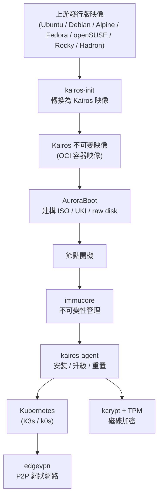
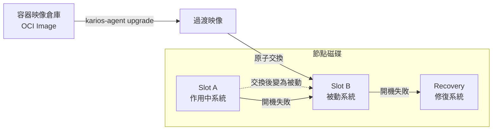

# Kairos：以容器映像交付的不可變 Linux 中介發行版

## 摘要

Kairos（官網 <https://kairos.io/>）是一套開源的「不可變 Linux 中介發行版」（immutable Linux meta-distribution），核心目標是管理機器從安裝、升級到修復的完整生命週期，讓大量機器變得可預測、可重現且易於長期維運。它並非從零打造一套新的發行版，而是把既有的 Linux 發行版「轉換」成具備不可變佈局與 Kubernetes 原生元件的系統，並以 OCI 容器映像作為交付與升級單位。本報告說明其定位、架構元件、不可變與 A/B 原子升級模型、支援的發行版、雲端原生與邊緣應用場景、安全性設計、授權與治理，並對其宣稱做批判性檢視。

---

## 一、這是什麼？

Kairos 在官網首頁的自我描述為：一套管理機器完整生命週期（從安裝到升級與修復）的 Linux 框架，讓大量機器具備可預測性、可重現性與易維運性，並將強健的營運保證帶到「從邊緣到資料中心」的各種環境[^home]。

其 GitHub 專案則以一句話定義自己為「邊緣 Kubernetes 的不可變 Linux 中介發行版」，並說明：使用 Kairos，你可以像寫 Dockerfile 一樣輕鬆地為邊緣裝置建構不可變、可開機的 Kubernetes 與 OS 映像[^gh]。

換言之，Kairos 的定位介於「發行版」與「框架」之間：

- 它提供一套可重複的生命週期模型（安裝 / 升級 / 重置 / 修復）。
- 它不綁定特定 Linux 發行版，也不綁定特定 Kubernetes 發行版。
- 它把「作業系統」當成應用程式一樣，以容器映像的方式派送到節點。

---

## 二、核心概念：什麼是「中介發行版」

Kairos 官方架構文件明確表示：

> 「我們喜歡把 Kairos 定義為一個中介 Linux 發行版（meta-Linux Distribution），因為它的目標是把其他發行版轉換成具備 Kubernetes 原生元件的不可變佈局。」[^meta]

也就是說，Kairos 是一層「加在既有發行版之上」的框架。它的作法是：選定一個上游基底發行版（例如 Ubuntu、Debian、Alpine、Fedora、openSUSE、Rocky Linux 或自行打造的 Hadron），在其上疊加一組共通元件，使其變成不可變、可原子升級、並可原生跑 Kubernetes 的系統。

要把一個發行版「轉換」成 Kairos，需求其實相當低：

- 若要用 Trusted Boot，需要 `systemd` 256 以上版本與 `systemd-boot`。
- 若只要 Secure Boot，需要 `systemd` 或 `openrc` 加上 `grub`。
- 核心（kernel）需要開啟 `CONFIG_EFI_STUB`[^meta]。

---

## 三、架構與元件

Kairos 的執行期元件在 v4.3 之後整合進單一 monorepo（`kairos-io/kairos`），共用一份 `go.mod`。各元件分工如下[^meta][^gh]：

| 元件 | 角色 |
|---|---|
| `kairos-init/` | 影像初始化器，負責在既有上游發行版的容器映像上安裝 Kairos 元件，並在建構時鎖定版本 |
| `immucore/` | 不可變性管理介面（immutability management interface） |
| `agent/` | 節點生命週期代理，負責安裝、重置與升級（即 `kairos-agent`） |
| `kcrypt/discovery/` | 負責資料靜態加密（encryption of data at rest） |
| `kcrypt/challenger/` | KMS 端，搭配 TPM 晶片解鎖 LUKS 分割區 |
| `installer/` | 供 Live-CD 開機使用的互動式終端機（TUI）安裝程式 |

值得注意的是，這些執行期二進位檔（`kairos-agent`、`immucore`、`kcrypt-discovery-challenger`）實際上由**同一個 multi-call 的 `kairos` 執行檔**依 `argv[0]` 分派；歷史上的各別檔名只是指向它的符號連結[^meta]。

此外還有數個外部／可選元件：

- **K3s 或 k0s**：可選的 Kubernetes 發行版（provider 模型）。
- **edgevpn**：以 libp2p 為基礎的 P2P 網狀網路，用於分散式網路、節點協調與 bootstrap。
- **AuroraBoot**：節點開機引導器（bootstrapper），可建構 ISO、UKI、raw disk、sysextension，並透過 PXE／netboot／Redfish／USB 佈署機器。
- **osbuilder**：從容器映像建構可開機成品。
- **entangle**：用於互連多個 Kubernetes 叢集的 CRD[^meta][^gh]。

下圖以概念方式呈現 Kairos 的組成與互動：



---

## 四、不可變檔案系統與 A/B 原子升級

### 4.1 不可變的設計哲學

官方架構文件說明：不可變 OS 是一套經過精心設計、以受限且無權限模式開機的系統，其中某些路徑不可寫入；舉例來說，安裝後就無法再對系統新增額外套件，任何設定變更也會在重開機後被丟棄[^immutable]。

標準（非 Trusted Boot）安裝後的典型分割區佈局如下[^immutable]：

| 路徑 | 特性 |
|---|---|
| `/usr/local` | 持久（分割區標籤 `COS_PERSISTENT`） |
| `/oem` | 持久（分割區標籤 `COS_OEM`） |
| `/var`、`/etc`、`/srv` | 短暫（ephemeral，重開機即丟棄） |
| `/` | 不可變 |

### 4.2 以容器映像進行的 A/B 原子升級

升級是以標準 OCI 容器映像、透過容器映像倉庫派送。官方文件描述：

> 「升級是原子性的 A/B 交換，具備回退機制與自動開機評估。」[^container]

具體流程是：節點會建立一個「過渡映像」（transition image），把它與目前作用中的系統交換，原先作用中的系統則變為被動（passive）。這確保了防竄改的升級，並有自動回退與開機評估策略，能在必要時自動從備援系統開機。當作用中與被動系統都失敗時，系統會退回修復模式（Recovery Mode），形成「A → B → Recovery」的開機鏈[^container]。

另一個與傳統做法不同之處：Kairos 採用**靜態 initrd**，在「建構升級映像時」就已產生，而非在節點本機動態生成 initramfs。這是刻意的設計選擇，讓整個 OS 堆疊被侷限為單一圖層，升級時可被原子性地拉取與替換[^container]。



---

## 五、安裝與升級的實際操作

### 5.1 以 Containerfile 建構映像（Kairos Factory）

Kairos 提供 `kairos-init` 這個「初始化器」，能把任意基底容器映像轉換成 Kairos 就緒的映像。最小範例如下[^factory]：

```dockerfile
FROM ubuntu:24.04

ARG VERSION=1.0.0

RUN --mount=type=bind,from=quay.io/kairos/kairos-init:v0.17.3,src=/kairos-init,dst=/kairos-init \
    /kairos-init --version "${VERSION}"
```

若要在映像中內建 Kubernetes provider（例如 k3s）與自訂二進位檔[^factory]：

```dockerfile
FROM ghcr.io/kairos-io/hadron:v0.0.1-beta1 AS base
ARG VERSION

RUN --mount=type=bind,from=quay.io/kairos/kairos-init:v0.17.3,src=/kairos-init,dst=/kairos-init \
    eval /kairos-init -l debug -s install --provider k3s --version "${VERSION}" && \
    eval /kairos-init -l debug -s init --provider k3s --version "${VERSION}"

COPY --from=build-stage /btm /usr/bin/btm
```

`kairos-init` 的常用旗標包含：`--version`／`-v`（設定成品版本）、`--provider`／`-p`（指定 provider，可重複）、`-s`（執行階段：`install`、`init` 或 `all`）、`-m`／`--model`（硬體目標，如 `generic`、`rpi4`）、`-t`（啟用 Trusted Boot）[^factory]。

### 5.2 kairos-agent 指令

安裝（無人值守）：

```bash
sudo kairos-agent manual-install --device "auto" cloud-config.yaml
```

`--device` 可接受完整裝置路徑（如 `/dev/sda`）、udev 符號連結，或 `"auto"`[^factory]。

升級：

```bash
sudo kairos-agent upgrade list-releases
sudo kairos-agent upgrade --source oci:quay.io/kairos/hadron:v0.5.1-standard-amd64-generic-v4.3.0-k3s-v1.36.4-k3s1
```

同樣支援 `--recovery`（僅升級修復系統），以及離線升級（先 `docker save` 成 tar，再以 `--source ocifile:` 指定）等方式[^factory]。

重置：

```bash
sudo kairos-agent bootentry --select statereset
```

或於修復主控台執行 `kairos reset`[^factory]。

### 5.3 以 AuroraBoot 建構 ISO

AuroraBoot 是官方引導器，可從容器映像產生 ISO。離線建構範例[^factory]：

```bash
docker run -v "$PWD"/cloud-config.yaml:/cloud-config.yaml \
           -v "$PWD"/build:/tmp/auroraboot \
           --rm -ti quay.io/kairos/auroraboot:v0.27.0 \
           --set container_image=quay.io/kairos/hadron:v0.5.1-core-amd64-generic-v4.3.0 \
           --set "disable_http_server=true" \
           --set "disable_netboot=true" \
           --cloud-config /cloud-config.yaml \
           --set "state_dir=/tmp/auroraboot"
```

產出會放在 `build/` 目錄，內含 `kairos.iso`、已嵌入 cloud-config 的 `kairos.iso.custom.iso` 與其 `sha256` 檢查碼[^factory]。

---

## 六、Cloud-Config 與開機階段

Kairos 使用 **[yip](https://github.com/mudler/yip)** 作為其 cloud-init 引擎（而非標準 cloud-init 常駐程式），同時支援標準 cloud-init 語法與自有的擴充語法[^cloudinit]。

系統以「事件驅動的開機階段」運作，依序觸發（見下表）[^cloudinit]：

| 階段 | 說明 |
|---|---|
| `rootfs` | 最早階段，在切換 root 之前、於 initrd root 上執行 |
| `initramfs` | 切換 root 前，chroot 進目標 root 執行 |
| `boot` | initramfs 已切換 root 後，於 systemd 開機期間 |
| `fs` | 檔案系統掛載時（`COS_STATE` 與 `COS_PERSISTENT` 可用） |
| `network` | 網路可用時 |
| `reconcile` | 開機後 5 分鐘觸發，之後每 60 分鐘週期性執行 |

每個階段都有 `.before` 與 `.after` 子階段，方便覆寫預設行為。此外還有安裝／升級／重置的生命週期階段（如 `before-install`、`after-upgrade-chroot`、`before-reset` 等），以及 Kubernetes provider 專屬的 `provider-kairos.bootstrap.before.<role>` 與 `provider-kairos.bootstrap.after.<role>`[^cloudinit]。

### 設定檔的分層與優先順序

由於系統不可變，跨重開機唯一持久的設定就是 cloud-init 設定。Kairos 會依**字典序（lexicographic order）**讀取多個設定檔並合併，後讀取者覆蓋先讀取者。搜尋順序如下（由先到後）[^cloudinit]：

1. `/run/initramfs/live`（僅 LiveCD／Netboot 可用）
2. `/usr/local/cloud-config`（可選，放在持久分割區）
3. `/etc/kairos`
4. `/etc/elemental`（已棄用）
5. `/oem`（主要的使用者設定目錄）

其中 `/system/oem/` 保留給基底映像隨附的預設 cloud-init 檔，使用者可透過 `/oem` 或 `/usr/local/cloud-config` 覆寫。相同階段若在多個檔案中定義，所有定義都會被尊重，不會互相覆寫[^cloudinit]。

執行中的系統可用下列指令檢視合併後的最終設定：

```bash
kairos-agent config
```

### 單節點 k3s 叢集範例

```yaml
#cloud-config
users:
- name: kairos
  passwd: kairos
  groups:
    - admin
  ssh_authorized_keys:
    - github:<YOUR_GITHUB_USER>

k3s:
  enabled: true
```

（節錄自官方單節點範例，另可透過 `write_files` 於 `/var/lib/rancher/k3s/server/manifests/` 寫入 Kubernetes 清單檔[^cloudinit]。）

---

## 七、支援的作業系統發行版

Kairos 支援並測試過以下基底發行版[^home][^matrix]：

- **Hadron**（預設、專為 Kairos 打造的精簡 Linux 基底，目前官方主力）
- **Alpine**
- **Debian**
- **Fedora**
- **openSUSE**
- **Rocky Linux**
- **Ubuntu**

官方文件說明，作為一個小型開源團隊，目前官方預建成品（prebuilt artifacts）與文件預設值已聚焦於 Hadron；其他發行版仍受支援，並透過 `kairos-init` 的自動化測試加以驗證[^matrix]。

若你要使用非 Hadron 的發行版，建議走 **BYOI（Bring Your Own Image）** 路線：自行建構並發佈映像，同時沿用 Kairos 的生命週期與升級語意[^byoi]。官網強調：

> 「Kairos 是此類別中唯一能透過 BYOI 跨多種 Linux 發行版運作、同時維持單一可重複生命週期模型的不可變 Linux 框架。」[^home]

---

## 八、應用場景

Kairos 將自己定位為「邊緣／裸機／公有雲／虛擬機的雲原生 OS」，在單一生命週期模型下涵蓋多種環境[^home]：

- **邊緣裝置**：可在 Raspberry Pi、Nvidia Orin 等裝置上，以同一套生命週期模型運作[^home]。
- **公有雲**：為雲端 VM 與虛擬化基礎設施部署可重現的映像[^home]。
- **Trusted Boot**：當裝置具備 TPM 時，最安全的執行方式[^home]。
- **不使用 Kubernetes**：若工作負載不需要 Kubernetes，可純粹作為不可變 Linux 框架運行[^home]。
- **P2P 邊緣叢集**：透過 libp2p／edgevpn 形成自協調、全網狀的邊緣叢集，無需中央管理平面。

CNCF 專案頁面亦提及採用者包含 Clastix、DeEEP Network、imec 與 Spectro Cloud，並指出其實際採用橫跨「裸機、邊緣與分散式基礎設施」[^cncf]。

---

## 九、安全性設計：Trusted Boot

Kairos 將 **Trusted Boot** 定義為三項互補技術的組合：FDE（全碟加密）、Secure Boot 與 Measured Boot[^trustedboot]。

> 「Trusted Boot 是一組能強化執行中系統安全態勢的技術組合，由 FDE、Secure Boot 與 Measured Boot 構成。」[^trustedboot]

- **FDE（Full Disk Encryption）**：加密整顆磁碟（LUKS）。在 Trusted Boot 模式下，加密金鑰綁定 TPM 的 PCR 政策，使得磁碟只能在相同硬體上被解鎖[^trustedboot]。
- **Secure Boot**：Kairos 改為直接使用**上游簽署的成品**（shim → grub → kernel），而非自行對每個發行版維護金鑰，因此所有支援的發行版在 UEFI 模式下皆可開箱支援 Secure Boot（Alpine 例外，因其未提供簽署成品）[^secureboot]。
- **Measured Boot 與 UKI／USI**：Measured Boot 會把每個開機步驟的雜湊值記錄進 TPM，用以驗證未被竄改。Kairos 更進一步採用 **UKI（Unified Kernel Images）**，並在 v4.3 演進為 **USI（Unified System Images）**——一個單一、已簽署、內含完整 OS 的「胖二進位檔」[^trustedboot]。

> 「UKI 檔是一個單一的胖二進位檔，涵蓋 OS 與開機所需的全部內容，以單一已驗證的檔案啟動整個系統。」[^trustedboot]

在 Trusted Boot 下的分割區佈局與一般模式不同[^trustedboot]：

| 路徑 | 類型 |
|---|---|
| `/` | 不可變 |
| `/usr` | 唯讀 |
| `/etc` | 短暫 |
| `/oem` | 加密 |
| `/usr/local` | 加密 |

一個重要後果是：由於 UKI／USI 的簽章也涵蓋 kernel command line，任何對 kernel command line 的變更都必須重新產生 UKI 檔並重建安裝映像[^trustedboot]。

---

## 十、「無漂移」（No Drift）主張

Kairos 的核心主張是：以「整台機器的單一原子不可變映像」取代「用組態管理工具就地修改節點」，可消除基礎設施漂移。官方文件直言：

> 「我們認為引入回滾或增量修補升級，會增加基礎設施漂移的曝險。相反地，不可變的單一映像像應用程式般被派送到節點上——你的節點不再有差異——也不再需要 Chef、Ansible 之類的組態管理工具。」[^container]

> 「沒有雪花（snowflakes）——所有機器都基於同一映像、設定與行為，這能帶來可預測的基礎設施、可預測的升級，以及叢集內同質的組態。」[^immutable]

其機制正是前文所述的 A/B 原子升級：每次升級都是換上一個全新、乾淨的映像，沒有增量修補。

### 與其他方法的比較

官網提供了一份比較表，以下為其要點[^home]：

| 能力 | Kairos | 組態管理系統（CMS） | 其他特殊用途 OS |
|---|---|---|---|
| 不可變 root 檔案系統 | 是 | 否 | 是 |
| 原子映像升級／回滾 | 是 | 否 | 是 |
| 重用既有 Linux 映像 | 是 | 部分 | 否 |
| 安裝後持久設定分層 | 是 | 是 | 是 |
| Kubernetes 原生 OS 生命週期管理 | 是 | 否 | 部分 |
| 可選擇 Kubernetes 發行版 | 是 | 是 | 否 |

官方對差異的補充說明[^home]：

- **組態管理工具**（如 Puppet、Ansible）是在執行中的主機上就地修改，只是「管理」漂移而非在 OS 層「阻止」它。
- **bootc 系系統**要求採用其相容的映像模型，而非重用既有發行版管線。
- **Bottlerocket** 與 **Talos** 提供強大的 day-2 維運，但不提供同等廣度的「由 Kubernetes operator 驅動的 OS 生命週期管理」；且 Bottlerocket 為每個環境提供不同變體，Kairos 則允許你在同一 OS 模型上自帶 Kubernetes 發行版[^home]。

---

## 十一、授權、治理與社群

- **授權**：Apache License, Version 2.0。授權檔載明「Copyright 2024 Kairos authors. Licensed under the Apache License, Version 2.0.」[^license]
- **CNCF 狀態**：Kairos 是 CNCF（Cloud Native Computing Foundation）**Sandbox** 專案，於 2024 年 4 月 13 日被接受[^cncf]。
- **治理模型**：`GOVERNANCE.md` 定義四個貢獻者層級——Contributor（GitHub Triage）、Approver（Write）、Maintainer（Maintain）、Admin（Admin）。重點規則包括：不得自我任命（須提名與投票）、連續 3 個月無貢獻即被移出、設有 Emeritus 名譽身分；維護者來自多個組織（例如 Mirantis 與 Spectro Cloud）[^governance]。
- **社群管道**：GitHub、CNCF Slack `#kairos`、Matrix `#kairos-io:matrix.org`、libera.chat IRC `#kairos`、LinkedIn、YouTube，以及每週公開的專案 Office Hours[^governance]。
- **專案起源**：由 Spectro Cloud 貢獻，最初名為 `c3os`，專案建立於 2021 年 7 月 30 日[^gh]。

---

## 十二、專案活躍度與規模

依 GitHub API 資料，主要儲存庫 `kairos-io/kairos` 的概況如下[^gh]：

| 指標 | 數值 |
|---|---|
| 星星數 | 約 1,855 |
| Fork 數 | 約 152 |
| 主要語言 | Go |
| 授權 | Apache License 2.0 |
| 建立時間 | 2021-07-30 |
| 最近推送 | 2026-10-16 |
| 提交數 | 約 7,889 |

CNCF 專案頁面則提供另一組社群指標：總貢獻者約 593、貢獻組織約 202、健康分數 82（Healthy）、軟體價值估值約 1,260 萬美元[^cncf]。

---

## 十三、批判性檢視

以下為對來源的反思與需留意之處：

1. **官方文件與官網為主要來源，具行銷立場。** 本報告多數技術陳述來自 kairos.io 官方文件與 GitHub README，屬於專案自身的說明，難免強調優勢。例如「唯一能在同類別跨發行版運作的不可變 Linux 框架」這類比較性宣稱，宜視為廠商／專案主張，而非中立第三方評比[^home]。
2. **各來源的 GitHub 星星數不一致。** GitHub 倉庫頁面顯示約 1,855 顆星，而 CNCF 專案頁面顯示 573 顆星，兩者差距甚大，可能反映統計口徑（是否含相關子專案、統計時點或計算方式）不同[^gh][^cncf]。讀者引用時應註明來源與時點。
3. **官方預建成品已聚焦 Hadron。** 雖然文件列出 Ubuntu、Debian、Alpine、Fedora、openSUSE、Rocky 等支援清單，但亦明言官方預建成品與文件預設值已轉向 Hadron，其餘發行版改以 BYOI 自建並由自動化測試驗證[^matrix]。實際專案導入時應據此評估維運成本。
4. **文件版本差異。** 本報告主要引用 v4.3.0 文件；部分 `getting-started` 路徑已變動（回傳 404），顯示文件結構仍在演進。功能與指令在未來版本可能調整。
5. **未找到獨立的第三方安全稽核或效能基準。** 本報告未能取得針對 Kairos Trusted Boot 實作的獨立稽核報告，其安全性宣稱主要仍來自專案文件本身[^trustedboot]。

---

## 十四、結論

Kairos 是一套「把 Linux 發行版轉換為不可變、容器化、原子升級系統」的框架，而非一套全新發行版。它透過 `kairos-init` 轉換上游映像、以 OCI 映像作為升級單位、以 A/B 交換與自動回退確保升級安全，並以 yip 驅動的 cloud-config 完成宣告式設定。其差異化在於：不綁定 Linux 發行版、不綁定 Kubernetes 發行版，並提供 P2P 邊緣協調與 Trusted Boot 等能力。專案為 Apache 2.0 授權、CNCF Sandbox 專案，且截至 2026 年 10 月仍高度活躍。評估導入時，建議重點關注官方主力已轉向 Hadron、以及其比較性宣稱多源自專案自身說明這兩點。

---

## 參考文獻

[^home]: Kairos. (n.d.). *Kairos: The Cloud Native OS for Edge, Baremetal, Public Cloud, VMs*. Retrieved 2026-10-18, from https://kairos.io/

[^gh]: kairos-io. (n.d.). *kairos-io/kairos: The immutable Linux meta-distribution for edge Kubernetes* [Computer software]. GitHub. Retrieved 2026-10-18, from https://github.com/kairos-io/kairos

[^meta]: Kairos. (n.d.). *Architecture: Meta-Distribution*. Retrieved 2026-10-18, from https://kairos.io/docs/v4.3.0/architecture/meta/

[^immutable]: Kairos. (n.d.). *Architecture: Immutable*. Retrieved 2026-10-18, from https://kairos.io/docs/v4.3.0/architecture/immutable/

[^container]: Kairos. (n.d.). *Architecture: Container-based OS*. Retrieved 2026-10-18, from https://kairos.io/docs/v4.3.0/architecture/container/

[^trustedboot]: Kairos. (n.d.). *Architecture: Trusted Boot*. Retrieved 2026-10-18, from https://kairos.io/docs/v4.3.0/architecture/trustedboot/

[^secureboot]: Kairos. (n.d.). *Architecture: Secure Boot*. Retrieved 2026-10-18, from https://kairos.io/docs/v4.3.0/architecture/secureboot/

[^cloudinit]: Kairos. (n.d.). *Architecture: Cloud-Init*. Retrieved 2026-10-18, from https://kairos.io/docs/v4.3.0/architecture/cloud-init/

[^factory]: Kairos. (n.d.). *Reference: Kairos Factory / AuroraBoot / Configuration*. Retrieved 2026-10-18, from https://kairos.io/docs/reference/kairos-factory/

[^matrix]: Kairos. (n.d.). *Reference: Image Matrix*. Retrieved 2026-10-18, from https://kairos.io/docs/v4.3.0/reference/image_matrix/

[^byoi]: Kairos. (n.d.). *Reference: Bring Your Own Image (BYOI)*. Retrieved 2026-10-18, from https://kairos.io/docs/v4.3.0/reference/byoi/

[^license]: Kairos authors. (2024). *Apache License, Version 2.0*. Retrieved 2026-10-18, from https://raw.githubusercontent.com/kairos-io/kairos/master/LICENSE

[^cncf]: Cloud Native Computing Foundation. (n.d.). *Kairos*. Retrieved 2026-10-18, from https://www.cncf.io/projects/kairos/

[^governance]: Kairos community. (n.d.). *GOVERNANCE.md*. Retrieved 2026-10-18, from https://raw.githubusercontent.com/kairos-io/community/main/GOVERNANCE.md
