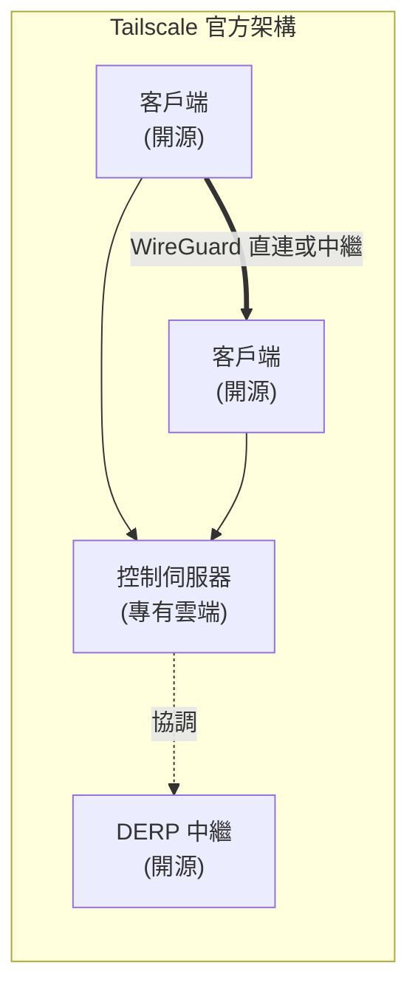
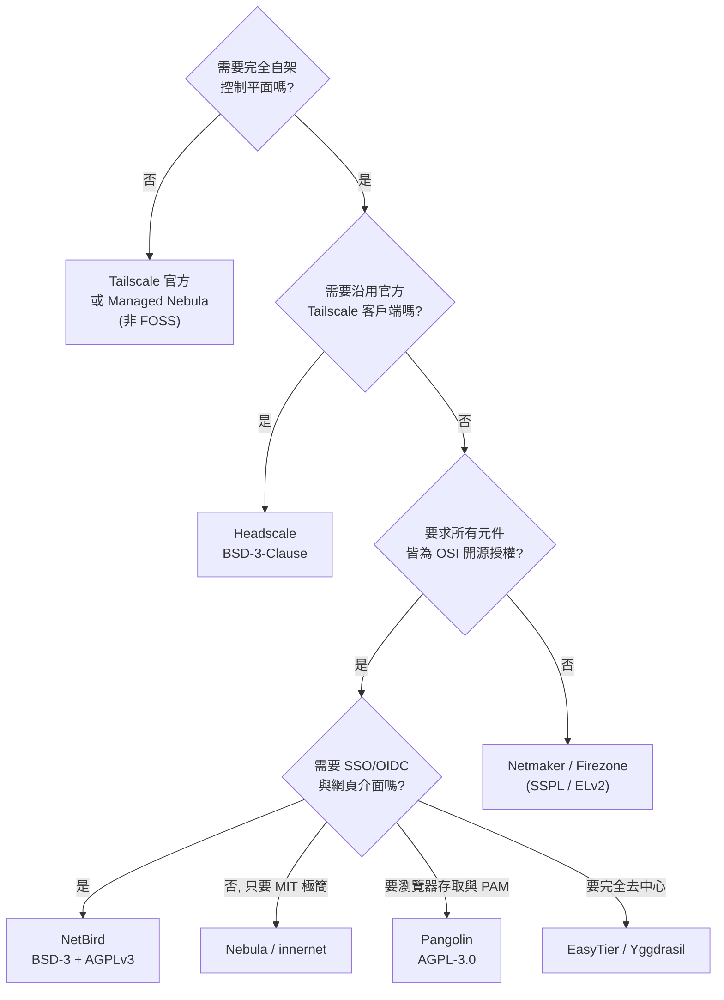

# Tailscale 的自由開源軟體替代方案調查

## 摘要

Tailscale 是一套以 WireGuard 為基礎的「零設定」私有網路（mesh VPN / overlay network）服務[^tailscale-what]，其最大特色是透過集中式控制伺服器（coordination server，又稱 control plane）自動完成節點身分驗證、金鑰交換、IP 指派、ACL 政策與 NAT 穿透協調，讓使用者只要登入帳號就能把散落各地的裝置連成一個虛擬區網。問題在於：Tailscale 的**客戶端程式是開源的，但控制伺服器是專有雲端服務**[^tailscale-oss]，使用者無法自架、也無法稽核控制平面，這對重視資料主權、離線可用性與授權自由的使用者構成限制。

本報告調查 2026 年 10 月仍活躍的 FOSS 替代方案，依「是否可完全自架控制平面」「授權條款是否為 OSI 認可的開源授權」「是否仍積極維護」三個維度評估，並給出選擇建議。

---

## 1. 背景：Tailscale 的開源／專有分界

要挑替代方案，必須先理解 Tailscale 本身哪些部分是開放的。

| 元件 | 授權狀態 | 說明 |
|---|---|---|
| 客戶端 `tailscaled` 常駐程式與 `tailscale` CLI | 開源，BSD-3-Clause | Linux、macOS、Windows、Android 皆有開源客戶端[^ts-repo] |
| GUI 外殼（Windows / macOS / iOS） | 專有 | 圖形介面包裝層未開源 |
| DERP 中繼伺服器、協定實作 | 開源 | 資料層與通訊協定可稽核 |
| **控制伺服器（coordination server）** | **專有** | 這是唯一封閉的核心，也是替代方案的切入點[^tailscale-oss] |
| `tsnet` 程式庫 | 開源，BSD-3-Clause | 讓 Go 程式內嵌一個完整 Tailscale 節點，不需獨立常駐程式與 root 權限[^tsnet] |

換句話說，「Tailscale 的 FOSS 替代方案」實務上有兩種路線：

1. **替換控制平面、沿用官方客戶端**：以開源伺服器取代 Tailscale 的雲端控制伺服器，客戶端不變。
2. **整套換掉**：改用另一套從控制平面到客戶端都開源的 WireGuard 網狀網路系統。

---

## 2. 評估構面

本報告對每個候選方案檢查以下項目：

- **授權條款**：是否為 OSI 認可的開源授權（避免「原始碼可見但非開源」的授權，如 SSPL、Elastic License、BSL）。
- **控制平面可否自架**：這是與 Tailscale 最關鍵的差異點。
- **底層技術**：是否基於 WireGuard（效能與稽核性較佳）。
- **關鍵對等功能**：NAT 穿透、MagicDNS 等價物、ACL／政策引擎、SSO／OIDC 身分整合。
- **維護活躍度**：以 GitHub 星數、發布節奏、最近提交時間衡量。星數資料取自 2026-10-18 的 GitHub API[^gh-api]。

---

## 3. 候選方案逐一分析

### 3.1 Headscale：最直接的「Tailscale 控制伺服器」替代品

Headscale 是 Tailscale 控制伺服器的開源重新實作，使用 **BSD-3-Clause** 授權，以 Go 撰寫，2026-10-18 時有 **44,741 顆星**[^headscale-repo]。它只替換專有的控制伺服器，客戶端仍使用官方 Tailscale 客戶端，因此相容性最高。

支援的功能包含：OIDC 單一登入註冊節點、ACL 政策（HuJSON）、Grants、MagicDNS、Tailscale SSH、節點屬性等[^headscale-features]。**不支援**的功能則有：Funnel、Serve、網路流量日誌（flow logs），以及「以 OIDC 群組驅動 ACL」的能力[^headscale-features]。

限制方面：一個 Headscale 實例只服務一個 tailnet、不支援多租戶、沒有內建 HA／容錯、沒有官方網頁介面（社群專案 Headplane 可補足）、沒有 RBAC 與稽核日誌匯出[^headscale-analysis]。最新版本為 **v0.29.5（2026-10-13）**[^headscale-release]。

值得注意的治理事實：Headscale 的其中一位維護者 Kristoffer Dalby 受僱於 Tailscale 並被允許在上班時間貢獻，Tailscale 官方也公開表示鼓勵 Headscale 生態[^tailscale-oss]。這帶來「上游相容性極佳」的好處，但也意味著此專案的長期走向與 Tailscale 的商業策略存在間接關聯。

### 3.2 NetBird：最完整的獨立開源平台

NetBird 是從零打造的 WireGuard 網狀網路平台，控制平面、訊號伺服器、中繼伺服器、網頁後台**全部可自架**。授權為混合式：整體為 **BSD-3-Clause**，但 `management/`、`signal/`、`relay/`、`combined/` 四個目錄為 **AGPLv3**[^netbird-license]，兩者皆為 OSI 認可的開源授權。

2026-10-18 時有 **30,040 顆星**[^netbird-repo]，最新版本 **v0.81.2（2026-10-16）**[^netbird-release]，發布節奏非常密集。功能上包含以 Pion ICE 實作的 STUN/TURN 式 NAT 穿透、內建私有 DNS（含自訂 DNS 區域）、以群組與規則為基礎的身分式存取政策、以及對 Keycloak／Auth0／Okta／Google／Microsoft Entra ID／GitHub 等 IdP 的 SSO 整合[^tailscale-alts-1]。另有採用 Rosenpass 的抗量子選項與更廣的路由器／防火牆客戶端支援[^netbird-repo]。

主要缺點是專案本身仍年輕、開放議題數量較多（2026-10-18 時 API 回報 798 個未關閉議題[^netbird-repo]），且公司同時經營雲端商業版，長期需觀察功能是否會向商業版傾斜。

### 3.3 Pangolin：自架 SASE，功能超越純 mesh VPN

Pangolin 是由 Fossorial 開發、以 WireGuard 為基礎的開源 SASE 平台，社群版為 **AGPL-3.0**（企業版為 Fossorial Commercial License 的 open-core 模式）[^pangolin-readme]。2026-10-18 時有 **23,115 顆星**[^pangolin-repo]。

它的定位比 Tailscale 更廣：除了站對站與客戶端 VPN，還內建**零信任反向代理**（可在瀏覽器中直接使用 SSH／RDP／VNC／Web 應用，終端使用者不需安裝客戶端）、特權存取管理（PAM），以及**身分感知的 AI Gateway**（可代理 OpenAI／Anthropic 或自架 Ollama／vLLM）[^pangolin-readme]。這讓它在「自架、開源、零信任」三個條件上比 Tailscale 更徹底。

代價是 AGPL-3.0 的強 copyleft 特性：若修改後以網路服務形式提供給他人使用，必須釋出原始碼。對純自用者無影響，但若要二次開發成商業服務需留意授權義務。

### 3.4 EasyTier：去中心化、無控制平面的 WireGuard 網狀網路

EasyTier 以 Rust 撰寫，採 **LGPL-3.0** 授權，2026-10-18 時有 **14,118 顆星**[^easytier-repo]。其架構為**完全去中心化**：節點對等，沒有伺服器與客戶端之分，可選用公共節點作為中繼，但不依賴任何集中控制平面[^easytier-site]。

特色包含 UDP 與 IPv6 打洞（可穿透 NAT4-NAT4）、延遲優先的智慧路由與自動容錯、可分享子網段、以及能充當 WireGuard 伺服器讓 iOS／Android 的原生 WireGuard 客戶端加入[^easytier-site]。v2.7.0 起加入集中式網管控制台、憑證與 ACL 動態管理[^easytier-repo]。

適合不想要任何中心依賴、且能接受以設定檔（TOML）與 CLI／Web Console 管理的使用者。其社群與文件以華語圈為主要來源，英文資源相對較少。

### 3.5 Netmaker：複雜拓撲與 Kubernetes 取向

Netmaker 以 Go 撰寫，社群版採 **Apache-2.0 與 SSPL 混合**授權，Pro／Business 版為專有[^netmaker-repo]。2026-10-18 時有 **11,830 顆星**[^netmaker-repo]。

它擅長站對站、多雲與 Kubernetes 連線等複雜拓撲，提供視覺化網路拓撲圖、egress gateway、relay node、多租戶隔離[^tailscale-alts-1]。**關鍵警示**：社群版使用 SSPL，非 OSI 認可的開源授權，嚴格定義下不算「自由開源軟體」，且較多進階功能被綁在付費版之後[^tailscale-alts-1]。若嚴格要求 FOSS，建議避開或以 Apache-2.0 涵蓋範圍為限。

### 3.6 Nebula：Slack 打造的大規模 overlay 網路

Nebula 由 Slack 開發，採 **MIT** 授權，2026-10-18 時有 **18,449 顆星**[^nebula-repo]。它不使用 WireGuard，而是自研協定（基於 Noise Protocol Framework，AES-256-GCM 與 ECDH），以憑證式 PKI 驗證身分，並以「lighthouse」節點協調對等節點探索與 UDP 打洞[^tailscale-alts-1]。

優點：MIT 授權最寬鬆、經過 Slack 大規模實戰驗證、加入 FIPS 140-3 模式支援[^tailscale-alts-1]。缺點：需自行管理憑證簽發、無網頁介面（純 YAML 設定與 CLI）、**沒有 SSO／OIDC**、學習曲線較陡[^tailscale-alts-1]。另有商業代管服務 Managed Nebula（Defined Networking 提供）[^nebula-managed]，即代管本身非 FOSS，但底層軟體仍是。

### 3.7 ZeroTier：Layer 2 乙太網路虛擬化（部分開源）

ZeroTier 核心採 **MPL-2.0**，但部分元件為 BSL 1.1 或專有（官方網頁後台不開源，社群有 `ztncui`）[^zerotier-repo]。2026-10-18 時有 **17,193 顆星**[^zerotier-repo]。

其獨特價值在於 **Layer 2 模擬**：multicast、broadcast、mDNS 都能運作，適合 IoT、區網遊戲與服務探索[^tailscale-alts-1]。但它不用 WireGuard、使用自研協定，效能通常低於 WireGuard 方案；免費方案已縮減為新帳號 10 台裝置／3 個網路[^tailscale-alts-1]。因為授權混合且部分原始碼可見但非開源，嚴格 FOSS 標準下只算部分符合。

### 3.8 wg-easy：WireGuard 的網頁管理層

wg-easy 以 **AGPL-3.0** 授權，2026-10-18 時有 **27,162 顆星**[^wg-easy-repo]，但它在架構上與 Tailscale **不同類**：它只是 WireGuard 的網頁管理介面與 Docker 封裝層，提供客戶端建立、QR code、連線統計、2FA、Prometheus 指標等[^wg-easy-repo]。

它**沒有 NAT 穿透、沒有 ACL 系統、沒有 mesh 路由、沒有 SSO**：所有流量走中心伺服器（hub-and-spoke），伺服器必須位於可公開連線的位址[^wg-simple]。適合「只需要一個好用的 WireGuard 管理後台」的情境，不應視為 Tailscale 的完整替代。

### 3.9 OpenZiti：零信任 overlay 平台（不只 mesh VPN）

OpenZiti 由 NetFoundry 發起，採 **Apache-2.0** 授權，2026-10-18 時有 **4,434 顆星**[^openziti-repo]。它是完整的零信任網路平台：每個連線都以密碼學身分驗證、由政策授權、端到端加密，服務可做到**不開任何監聽埠**（dark services），並提供 Go／C／Java／Swift／Node.js／C#／Python 等 SDK 讓應用程式內嵌零信任[^openziti-repo]。

它可作為 Tailscale 的替代，但設定複雜度高（需部署 controller 與 edge router 並定義政策），且社群規模與星數遠小於其他候選[^tailscale-openziti]。同一團隊另有更簡易的 `zrok`（建立在 OpenZiti 之上的對等隧道工具）[^tailscale-openziti]。

### 3.10 innernet：CIDR 優先的 Rust 網狀網路

innernet（tonarino 團隊）以 Rust 撰寫，採 **MIT** 授權，2026-10-18 時有 **5,563 顆星**[^innernet-repo]。它以傳統網路概念（CIDR、子網）為核心，透過一次性邀請檔加入節點，沒有網頁介面與 SSO，純 CLI[^tailscale-alts-2]。最後一次程式碼推送為 2026-07-28[^innernet-repo]，發布節奏偏慢。適合熟悉傳統網路、想要輕量且確定性高的網狀網路之小團隊。

### 3.11 Yggdrasil：完全去中心化的 IPv6 overlay

Yggdrasil 採 **LGPLv3** 授權，社群評估約 **5,500 顆星**[^yggdrasil-repo]。它沒有中央控制平面，是完全自我組態的加密 IPv6 overlay，適合社群網路與抗審查用途[^tailscale-alts-2]。因缺乏政策引擎與身分整合，定位偏向「公眾／社群網狀網路」而非企業遠端存取。

### 3.12 其他值得知道的專案

- **Kilo**（Apache-2.0，約 2,300 星）：專為 Kubernetes 設計的 WireGuard overlay，可在多雲叢集間建立連線，非通用 VPN[^tailscale-alts-2]。
- **EdgeVPN**（Apache-2.0，約 2,100 星）：基於 libp2p 的完全去中心化網狀網路，無中央伺服器，被 Kairos 專案採用，但未經安全稽核、標示為實驗性[^tailscale-alts-2]。
- **n2n**（GPL-3.0，約 7,000 星）：supernode + edge 架構的輕量對等 VPN，有 NAT 穿透與中繼，但無 ACL、無 SSO、無內建 DNS[^wg-simple]。
- **tinc**（GPL-2.0-or-later，約 2,300 星）：最老牌的對等網狀 VPN，支援自動路由與有限 NAT 穿透，但 1.1 分支已 pre-release 十餘年，開發速度極慢、加密實作較舊[^wg-simple]。

---

## 4. 綜合比較

| 方案 | 授權 | 星數（2026-10-18） | WireGuard | 控制平面可自架 | 全開源 | MagicDNS 等價 | ACL | SSO/OIDC |
|---|---|---:|---|---|---|---|---|---|
| **Headscale** | BSD-3-Clause | 44.7k | 是 | 是 | 是 | 是 | 是 | 部分（OIDC 群組不入 ACL） |
| **NetBird** | BSD-3 + AGPLv3 | 30.0k | 是 | 是 | 是 | 是 | 是 | 是 |
| **wg-easy** | AGPL-3.0 | 27.2k | 是 | 是 | 是 | 否 | 否 | 否 |
| **Pangolin** | AGPL-3.0 + FCL | 23.1k | 是 | 是 | 社群版是 | 是（DNS 別名） | 是（RBAC） | 是 |
| **Nebula** | MIT | 18.4k | 否（自研 Noise） | 是 | 是 | 是 | 是（憑證群組） | 否 |
| **ZeroTier** | MPL-2.0 + BSL／專有 | 17.2k | 否（自研） | 部分 | 否 | 否 | 是 | 僅 SaaS |
| **EasyTier** | LGPL-3.0 | 14.1k | 是 | 無需（去中心） | 是 | 部分（子網分享） | 部分（v2.7 起） | 否 |
| **Netmaker** | Apache-2.0 + SSPL | 11.8k | 是 | 是（社群版） | 否（SSPL） | 是 | 是 | 部分 |
| **Firezone** | Apache-2.0 + ELv2 | ~9.1k | 是 | 技術可行、官方不支援生產 | 否（ELv2） | 部分 | 是 | 是 |
| **n2n** | GPL-3.0 | ~7.0k | 否（自研 AES） | 是（supernode） | 是 | 否 | 否 | 否 |
| **innernet** | MIT | 5.6k | 是 | 是 | 是 | 否 | 是（CIDR） | 否 |
| **Yggdrasil** | LGPLv3 | ~5.5k | 否（自研） | 無需（去中心） | 是 | IPv6 位址 | 否 | 否 |
| **OpenZiti** | Apache-2.0 | 4.4k | 否（自研 mTLS） | 是 | 是 | 部分 | 是（政策） | 部分 |
| **tinc** | GPL-2.0+ | ~2.3k | 否（OpenSSL） | 無需（對等） | 是 | 否 | 否 | 否 |
| **Kilo** | Apache-2.0 | ~2.3k | 是 | 是（K8s 內） | 是 | 否 | 部分 | 否 |
| **EdgeVPN** | Apache-2.0 | ~2.1k | 否（libp2p） | 無需 | 是 | 否 | 否 | 否 |

> 星數為 2026-10-18 當日快照；標示「約」者取自第三方比較文獻而非 GitHub API 直接查詢[^tailscale-alts-2]。Firezone 的星數約 9,100 顆[^firezone-repo]。
> 「全開源」欄位判準為：所有核心元件（含控制平面）皆採 OSI 認可授權。

### 授權合規性速判

---

## 5. 選擇建議

- **想無痛從 Tailscale 遷移**：選 **Headscale**。客戶端不用換，只要把協調伺服器網址改指向自架實例並重新驗證即可；代價是 Funnel、Serve、flow logs 與多租戶不受支援[^headscale-features]。
- **想要一個完整、獨立、可自架的開源平台**：選 **NetBird**。控制平面到中繼全部自架，SSO、DNS、政策都齊備，且發布節奏最積極[^netbird-release]。
- **需要瀏覽器直接存取、跳過客戶端安裝，還想要 PAM 與 AI Gateway**：選 **Pangolin**[^pangolin-readme]。
- **極度重視授權寬鬆度（MIT）與大規模實戰驗證**：選 **Nebula**，但要接受自行管理憑證與沒有 SSO[^nebula-repo]。
- **完全不想要任何中心依賴**：選 **EasyTier**（Rust、LGPL-3.0、去中心、支援 WireGuard 互連）[^easytier-repo]。
- **只想要好用的 WireGuard 管理後台、且伺服器有公開位址**：**wg-easy** 即可，但別期待 mesh 或政策功能[^wg-simple]。
- **企業零信任、要把服務做成「不開監聽埠」**：**OpenZiti**，但接受較高複雜度[^openziti-repo]。
- **Kubernetes 多雲叢集互連**：**Kilo** 或 **Netmaker**（後者注意 SSPL 授權）[^tailscale-alts-2]。

---

## 6. 對來源的批判性反思

1. **星數不等於品質，但低星數需警惕**。本報告納入的專案中，innernet、Yggdrasil、OpenZiti、Kilo、EdgeVPN 星數皆低於 1 萬。依本專案規則，低於約 100 星者須審慎評估；上述專案均高於 2,000 星，且各有明確利基（如 Kilo 專攻 Kubernetes、EdgeVPN 為 Kairos 採用），故仍收錄，但讀者應理解其社群規模與商業支援遠小於 Headscale、NetBird。
2. **GitHub API 快照有時效性**。所有精確星數取自 2026-10-18 的 GitHub REST API 回應[^gh-api]，之後會變動。標示「約」者來自第三方比較文章，權威性低於官方 API，僅供量級參考。
3. **廠商與第三方文章皆有立場**。Headscale 的維護者與 Tailscale 有僱傭關係，Tailscale 官方文件傾向將 Headscale 描述為「生態的一部分」[^tailscale-oss]；而 NetBird、Pangolin、Netmaker 的比較文章多為其自身行銷內容或第三方流量文章（如 dev.to、itprotutorials）[^tailscale-alts-1]，這些來源傾向放大自家優勢。本報告已盡量以官方 repository 與官方文件（授權檔、features 頁、release 頁）作為主要依據，行銷文章僅用於補充定性描述。
4. **授權判讀以原始授權檔為準**。GitHub API 對 NetBird、Pangolin、Netmaker、ZeroTier 皆回報 `NOASSERTION`（無法自動識別），因此本報告直接讀取各專案的 `LICENSE` 內容判定[^netbird-license][^pangolin-readme]，而非依賴 API 的授權欄位。
5. **未查證的項目**：本次調查未能取得 `Rustscale` 的公開 repository（查詢回傳 404），第三方文章亦指出該專案不存在，故不列入候選[^tailscale-alts-2]。此外，Firezone 最新版本號與星數來自其 repository 與官網，未逐一以 API 複核，標示為約略值。

---

## 參考文獻

[^tailscale-what]: Tailscale Inc. (n.d.). *What is Tailscale?* Retrieved 2026-10-18, from https://tailscale.com/
[^tailscale-oss]: Tailscale Inc. (n.d.). *Open source*. Retrieved 2026-10-18, from https://tailscale.com/opensource/
[^ts-repo]: Tailscale Inc. (n.d.). *tailscale/tailscale* [Computer software]. GitHub. Retrieved 2026-10-18, from https://github.com/tailscale/tailscale
[^tsnet]: Tailscale Inc. (n.d.). *tsnet package*. pkg.go.dev. Retrieved 2026-10-18, from https://pkg.go.dev/tailscale.com/tsnet
[^headscale-repo]: Juanfont. (n.d.). *juanfont/headscale* [Computer software]. GitHub. Retrieved 2026-10-18, from https://github.com/juanfont/headscale
[^headscale-features]: Headscale. (n.d.). *Features*. Retrieved 2026-10-18, from https://headscale.net/stable/about/features/
[^headscale-release]: Juanfont. (2026, October 13). *Release v0.29.5* [Computer software release]. GitHub. Retrieved 2026-10-18, from https://github.com/juanfont/headscale/releases/tag/v0.29.5
[^headscale-analysis]: Bex. (2026, September 4). *Headscale: A self-hosted mesh fleet* [Web log post]. Retrieved 2026-10-18, from https://bex.co/blog/2026/09/04/headscale-self-hosted-mesh-fleet
[^netbird-repo]: NetBird. (n.d.). *netbirdio/netbird* [Computer software]. GitHub. Retrieved 2026-10-18, from https://github.com/netbirdio/netbird
[^netbird-license]: NetBird. (n.d.). *LICENSE* [Computer software license]. GitHub. Retrieved 2026-10-18, from https://raw.githubusercontent.com/netbirdio/netbird/main/LICENSE
[^netbird-release]: NetBird. (2026, October 16). *Release v0.81.2* [Computer software release]. GitHub. Retrieved 2026-10-18, from https://github.com/netbirdio/netbird/releases/tag/v0.81.2
[^pangolin-repo]: Fossorial. (n.d.). *fosrl/pangolin* [Computer software]. GitHub. Retrieved 2026-10-18, from https://github.com/fosrl/pangolin
[^pangolin-readme]: Fossorial. (n.d.). *Pangolin README* [Computer software documentation]. GitHub. Retrieved 2026-10-18, from https://github.com/fosrl/pangolin/blob/main/README.md
[^nebula-repo]: Slack. (n.d.). *slackhq/nebula* [Computer software]. GitHub. Retrieved 2026-10-18, from https://github.com/slackhq/nebula
[^nebula-managed]: Defined Networking. (n.d.). *Managed Nebula*. Retrieved 2026-10-18, from https://www.defined.net/
[^zerotier-repo]: ZeroTier. (n.d.). *zerotier/ZeroTierOne* [Computer software]. GitHub. Retrieved 2026-10-18, from https://github.com/zerotier/ZeroTierOne
[^wg-easy-repo]: wg-easy. (n.d.). *wg-easy/wg-easy* [Computer software]. GitHub. Retrieved 2026-10-18, from https://github.com/wg-easy/wg-easy
[^wg-simple]: Pinggy. (n.d.). *Top open source Tailscale alternatives*. Retrieved 2026-10-18, from https://pinggy.io/blog/top_open_source_tailscale_alternatives/
[^easytier-repo]: EasyTier. (n.d.). *EasyTier/EasyTier* [Computer software]. GitHub. Retrieved 2026-10-18, from https://github.com/EasyTier/EasyTier
[^easytier-site]: EasyTier. (n.d.). *Introduction*. Retrieved 2026-10-18, from https://easytier.cn/en/guide/introduction.html
[^netmaker-repo]: Gravitl. (n.d.). *gravitl/netmaker* [Computer software]. GitHub. Retrieved 2026-10-18, from https://github.com/gravitl/netmaker
[^firezone-repo]: Firezone. (n.d.). *firezone/firezone* [Computer software]. GitHub. Retrieved 2026-10-18, from https://github.com/firezone/firezone
[^openziti-repo]: NetFoundry. (n.d.). *openziti/ziti* [Computer software]. GitHub. Retrieved 2026-10-18, from https://github.com/openziti/ziti
[^innernet-repo]: Tonarino. (n.d.). *tonarino/innernet* [Computer software]. GitHub. Retrieved 2026-10-18, from https://github.com/tonarino/innernet
[^yggdrasil-repo]: Yggdrasil Network. (n.d.). *yggdrasil-network/yggdrasil-go* [Computer software]. GitHub. Retrieved 2026-10-18, from https://github.com/yggdrasil-network/yggdrasil-go
[^n2n-repo]: ntop. (n.d.). *ntop/n2n* [Computer software]. GitHub. Retrieved 2026-10-18, from https://github.com/ntop/n2n
[^tinc-repo]: Sliepen, G. (n.d.). *gsliepen/tinc* [Computer software]. GitHub. Retrieved 2026-10-18, from https://github.com/gsliepen/tinc
[^tailscale-alts-1]: iTPRO Tutorials. (n.d.). *Tailscale alternatives 2026*. Retrieved 2026-10-18, from https://itprotutorials.com/tailscale-alternatives-2026/
[^tailscale-alts-2]: Lightning Dev. (n.d.). *Open source alternatives to Tailscale in 2026*. Retrieved 2026-10-18, from https://dev.to/lightningdev123/open-source-alternatives-to-tailscale-in-2026-132p
[^tailscale-openziti]: OpenZiti. (n.d.). *zrok*. Retrieved 2026-10-18, from https://zrok.io/
[^gh-api]: GitHub. (2026, October 18). *Repository metadata* [Data set]. GitHub REST API. Retrieved 2026-10-18, from https://api.github.com/
