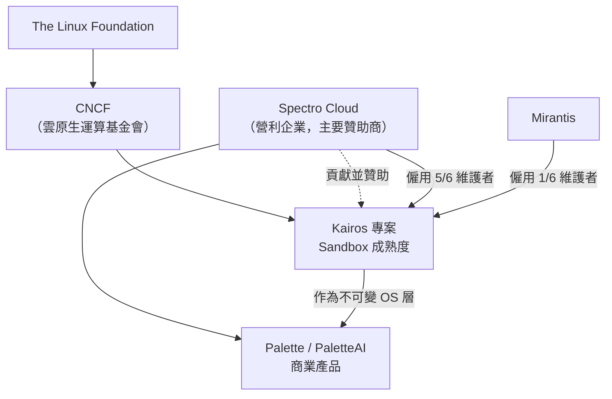

# Kairos (kairos.io) 專案背景調查

## 摘要

Kairos 是一個開源的「不可變（immutable）Linux 元發行版（meta-distribution）」，目標是管理邊緣（edge）與資料中心大量機器的完整生命週期，從安裝、升級到回復[^kairos-home][^gh-repo]。本報告針對 `kairos.io` 這個專案進行背景調查，涵蓋：它是否為一家公司、背後的法律與治理結構、主要贊助企業、維護團隊、資金與創投關係、社群，以及採用者。

**核心結論：`kairos.io` 並不是一家公司，而是一個由 CNCF（Cloud Native Computing Foundation，雲原生運算基金會）託管的開源專案。** 它由企業 **Spectro Cloud** 貢獻並主要贊助[^gh-readme][^cncf-page]。因此「Kairos 的創投、資金」實際上要追溯到 Spectro Cloud 這家公司。

---

## 1. Kairos 是什麼

Kairos 自稱為「The Immutable OS to Operate at Scale」，描述為「一個管理機器完整生命週期的 Linux 框架——從安裝到升級與回復，使大量機器變得可預測、可重現、易於長期維運，並將強健的維運保證帶到從邊緣到資料中心的場景」[^kairos-home]。

技術上，Kairos 讓使用者能以「像寫 Dockerfile 一樣」簡單的方式，為邊緣裝置建構不可變、可開機的 Kubernetes 與 OS 映像；節點更新透過容器映像檔（OCI）推送與 A/B 原子升級完成，並可選擇性使用 P2P 網狀網路（mesh）自動化節點啟動與協調[^gh-readme]。它支援「自帶映像（BYOI, Bring Your Own Image）」，可基於 Alpine、Debian、Fedora、Hadron、openSUSE、Rocky、Ubuntu 等基底[^kairos-home]。

| 項目 | 內容 |
|------|------|
| 官方網站 | https://kairos.io/ [^kairos-home] |
| GitHub 主倉庫 | https://github.com/kairos-io/kairos [^gh-repo] |
| 授權條款 | Apache-2.0 [^gh-repo] |
| 最新版本（2026-10-18 查核） | v4.3.0 [^kairos-home] |
| 原始名稱 | 早期名為 `c3os` [^gh-readme] |
| 定位 | 邊緣 Kubernetes 的不可變 Linux 元發行版 [^gh-repo] |

### 專案隸屬關係

上圖說明：Kairos 由 CNCF（隸屬 Linux Foundation）託管，但由企業 Spectro Cloud 貢獻並贊助，且 Spectro Cloud 的商業產品 Palette 使用 Kairos 作為其不可變 OS 層[^gh-readme][^adopters][^cncf-page]。

---

## 2. 法律與治理結構

### 2.1 版權與法律實體

Kairos 官方網站頁尾明載：「Copyright © 2026 Kairos a Series of LF Projects, LLC」，並指向 `lfprojects.org/policies`[^kairos-adopters]。這表示 Kairos 是 Linux Foundation 旗下「LF Projects, LLC」的一個系列專案（series），屬於基金會的法律架構，而非獨立公司。

### 2.2 CNCF 成熟度與接納時間

| 項目 | 內容 |
|------|------|
| 託管組織 | CNCF（隸屬 The Linux Foundation）[^cncf-page] |
| 成熟度等級 | **Sandbox**（沙箱，最初階）[^cncf-page] |
| 被 CNCF 接納日期 | **2024-04-13** [^cncf-page][^cncf-blog] |
| 貢獻方（Contributing/Sponsoring Org） | Spectro Cloud [^cncf-sandbox-issue] |
| 商標 | 依 CNCF 沙箱申請書已捐贈給 CNCF [^cncf-sandbox-issue] |
| 目前動向 | 正申請從 Sandbox 晉升至 Incubation（孵化）[^incubation-issue] |

TOC（Technical Oversight Committee）表決於 2024-04-13 通過，11 張具約束力票中 8 票贊成（72.73%），超過 66% 門檻[^cncf-blog][^cncf-sandbox-issue]。

### 2.3 治理模式

Kairos 的治理文件說明其角色階梯為 Contributor → Approver → Maintainer → Admin，架構「寬鬆地基於 Kyverno 治理」[^governance]。新成員須經既有 Maintainer 提名並由全體 Maintainer 投票產生，不接受自我申請；若任一角色連續 3 個月無貢獻，管理者須移除其權限並轉為 emeritus（榮譽退任）狀態[^governance]。

---

## 3. 主要贊助企業：Spectro Cloud

Kairos 的 GitHub README 明確寫道：「Kairos is a Cloud Native Computing Foundation (CNCF) Sandbox project and was contributed by Spectrocloud.」[^gh-readme]。因此理解 Kairos 的「公司背景」，等同於理解 Spectro Cloud。

| 項目 | 內容 |
|------|------|
| 公司名稱 | Spectro Cloud [^sc-company] |
| 成立年份 | 2019 [^sc-company] |
| 總部 | 1731 Technology Dr, Suite 590, San Jose, CA 95110, USA [^sc-company] |
| 產品 | Palette / PaletteAI（Kubernetes 與 AI 基礎設施管理平台）[^sc-company] |
| 官網 | https://www.spectrocloud.com [^sc-company] |
| 與 Kairos 的關係 | 「built and sponsors Kairos」的贊助公司，並在 Palette 中使用 Kairos 作為不可變 OS 層 [^adopters] |

Spectro Cloud 提供 Kairos 的商業支援服務，分為兩級[^sc-support]：

| 支援層級 | 價格 | 內容概述 |
|----------|------|----------|
| Community | 免費 | 僅文件、GitHub 社群、公開 Slack，無 SLA |
| Basic | US$2,000/年（5 張 ticket） | 回應時間 SLA、8x5 線上支援（P3/P4）、CVE 修補、訓練資源；加購 3 張 ticket 為 US$1,000 |
| Production | US$10,000/年（最多 50 節點） | 含 Basic 全部 + 24x7 電話支援、安全強化支援、長期維護、免費 Palette Edge（5 個邊緣叢集） |

> 註：官方以「每週不到 40 美元」行銷其支援合約[^sc-support]。

---

## 4. 團隊：維護者

依 `MAINTAINERS.md`（2026-10-18 查核），Kairos 目前有 **6 位維護者**，其中 5 位隸屬 Spectro Cloud、1 位隸屬 Mirantis[^maintainers]。

| 姓名 | GitHub | 所屬公司 | 角色 |
|------|--------|----------|------|
| Ettore Di Giacinto | [@mudler](https://github.com/mudler) | Spectro Cloud | 原作者、Administrator、Maintainer |
| Dimitris Karakasilis | [@jimmykarily](https://github.com/jimmykarily) | Spectro Cloud | Administrator、Maintainer |
| Itxaka Serrano Garcia | [@itxaka](https://github.com/itxaka) | Spectro Cloud | Administrator、Maintainer |
| Mauro Morales | [@mauromorales](https://github.com/mauromorales) | Spectro Cloud | Administrator、Maintainer |
| Rishi Anand | [@rishi-anand](https://github.com/rishi-anand) | Spectro Cloud | Maintainer |
| William Rizzo | [@wrkode](https://github.com/wrkode) | **Mirantis** | Maintainer |

**前任維護者（emeritus）**：Jacob Payne（[@paynejacob](https://github.com/paynejacob)，Spectro Cloud）、Oz Tiram（[@oz123](https://github.com/oz123)，Spectro Cloud）[^maintainers]。

**Kairos 原始作者**為 Ettore Di Giacinto（[@mudler](https://github.com/mudler)），他同時是 CNCF 沙箱申請書的提交人[^cncf-sandbox-issue]。值得注意的是，[@mudler](https://github.com/mudler) 亦是另一知名開源專案 LocalAI 的作者。

### 維護者多樣性風險

Kairos 於 2026-07-15 開設的「CNCF Incubation Readiness」追蹤 issue 中，明確將「6 位維護者中有 5 位來自同一家公司」列為廠商中立性（vendor-neutrality）風險與晉升孵化的阻礙之一[^incubation-issue]。

---

## 5. 資金與創投

### 5.1 Kairos 專案本身

**Kairos 開源專案本身未曾進行創投募資。** 它是 CNCF 專案，由 Spectro Cloud 的贊助與貢獻支持[^gh-readme][^cncf-sandbox-issue]。CNCF 申請書中載明：「Spectro Cloud which is funding the project entirely」（Spectro Cloud 全額資助該專案）[^cncf-sandbox-issue]。

### 5.2 Spectro Cloud 的創投募資

若要理解 Kairos 背後的資金，須看其贊助商 Spectro Cloud 的募資歷程。以下為各輪募資，**總計約 US$242.5M**（部分來源記為約 US$260M，差異可能來自未逐輪公開的資金工具）[^seedtable][^sc-series-d]。

| 輪次 | 日期 | 金額 | 領投 | 主要參與者 |
|------|------|------|------|------------|
| Seed | 2020-03-17 | US$7.5M | Sierra Ventures | Boldstart Ventures、WestWave Capital、Firebolt Ventures [^finsmes-seed] |
| Series A | 2021-07 | US$20M | Stripes | 既有投資人 + T-Mobile Ventures、Alter Venture Partners [^sc-series-a] |
| Series B | 2022-03 | US$40M | Stripes | 既有投資人 + TSG [^sc-series-b] |
| Series C | 2024-11-19 | US$75M | Growth Equity at **Goldman Sachs Alternatives** | 既有投資人（含 Qualcomm Ventures、NEC 等）[^sc-series-c] |
| Series D | 2026-07-15 | **超過 US$100M** | Growth Equity at **Goldman Sachs Alternatives** | **AMD Ventures、Ericsson、LG Technology Ventures、Maximus** [^sc-series-d] |

**投資人總名單**（依 Spectro Cloud 公告整理）：Goldman Sachs Growth Equity、Stripes、Sierra Ventures、Boldstart Ventures、WestWave Capital、Alter Venture Partners、Firebolt Ventures、T-Mobile Ventures、Qualcomm Ventures、NEC 與 Translink Orchestrating Future Fund、AMD Ventures、Ericsson、Maximus、LG Technology Ventures[^sc-company][^sc-series-c][^sc-series-d]。

**Series D（2026-07-15）細節**[^sc-series-d]：
- 金額：超過 US$100M，為超額認購（oversubscribed）輪次
- 領投：Growth Equity at Goldman Sachs Alternatives
- 策略投資人：AMD Ventures、Ericsson、LG Technology Ventures、Maximus
- 累計募資：US$260M
- **估值：未揭露**（公告中未提及估值數字）
- 用途：加速三大方向——產品（擴展 PaletteAI）、市場推廣（歐洲、中東、APJ/APAC 的企業、公部門、neocloud、主權雲）、生態系（深化 AI 基礎設施夥伴關係）

**重要觀察**：Spectro Cloud 在 Series C 與 Series D 的新聞稿中**均未提及 Kairos**[^sc-series-c][^sc-series-d]，其敘事重心已明顯轉向 AI 與邊緣 AI。

### 5.3 董事會

Spectro Cloud 董事會成員包括：Tenry Fu（Spectro Cloud CEO 暨共同創辦人）、Paul Melchiorre（Stripes）、Mark Fernandes（Sierra Ventures）、Gaurav Manglik（獨立董事）、Michael Reilly（Goldman Sachs，於 Series C 時加入）[^sc-company][^sc-series-c]。

### 5.4 Spectro Cloud 創辦團隊

| 姓名 | 職稱 |
|------|------|
| Tenry Fu | CEO 暨共同創辦人 [^sc-company] |
| Saad Malik | CTO 暨共同創辦人 [^sc-company] |
| Gautam Joshi | VP Engineering 暨共同創辦人 [^sc-company] |

---

## 6. 社群

Kairos 社群活躍於多個管道[^gh-readme][^kairos-community]：

| 管道 | 位置 |
|------|------|
| GitHub 主倉庫 | https://github.com/kairos-io/kairos |
| GitHub 社群倉庫 | https://github.com/kairos-io/community |
| GitHub Discussions | https://github.com/kairos-io/kairos/discussions |
| CNCF Slack | `#kairos` 頻道（頻道 ID: C0707M8UEU8），https://slack.cncf.io/ |
| Matrix | `#kairos-io:matrix.org` |
| IRC | `#kairos` on libera.chat |
| 郵件列表 | cncf-kairos-maintainers@lists.cncf.io |
| LinkedIn | https://www.linkedin.com/company/kairos-oss/ |
| X（Twitter） | @Kairos_OSS |
| YouTube | @Kairos-IO |
| CNCF DevStats | https://kairos.devstats.cncf.io/ |
| 每週 Office Hours / 會議 | Zoom-LFX 行事曆：https://zoom-lfx.platform.linuxfoundation.org/meetings/kairos |
| 月度 meetup 議程 | Google Doc（見 `kairos.io/community/`） |

此外有一個獨立的 **`kairos-community` GitHub 組織**，存放社群支持與實驗性專案（bundles、Helm charts、meta-kairos（Yocto）、openamt、hadron-desktop 等），與官方維護的 `kairos-io` 組織區隔開來[^gh-readme]。

### 貢獻者規模

- CNCF 專案頁數據：**593 位貢獻者**、**202 個貢獻組織**[^cncf-page]
- GitHub 主倉庫：約 **93 位貢獻者**[^gh-repo]

---

## 7. 採用者（Adopters）

依 `ADOPTERS.md` 與官方 adopters 頁面[^adopters][^adopters-md]：

| 組織 | 專案 | 用途 | 狀態 |
|------|------|------|------|
| IMT Nord Europe | abcd | 教育用系統與網路實驗室的多元 OS | Production |
| OGI-IT | 客製軟體 | 使用 ARM 與 Intel 節點的邊緣叢集 | Production |
| DeEEP Network | DeEEP Device | 企業級 Web3 雲端託管的分散式邊緣機群 | Production |
| CLASTIX | kMetal | 多租戶裸機 Kubernetes 平台，使用 Kairos 做不可變 OS 佈建 | Proof of Concept（2026-04-24） |
| Imec | Edge test infrastructure | 異質裸機邊緣機群上佈建不可變 OS 供研究與基準測試 | Proof of Concept（2026-05-26） |
| Spectro Cloud | Palette | 邊緣與分散式基礎設施的 Kubernetes 管理平台，服務提供商型採用者 | Production |

個別採用者：Bryan Lee（TaoNet，K8s PaaS）、Ludea（Sparus，遊戲啟動器）[^adopters-md]。

Kairos 官方頁面明確表示正在申請從 CNCF Sandbox 晉升至 Incubation，並邀請組織透過 adopter application 支持[^kairos-adopters]。

---

## 8. 專案數據與指標

### 8.1 GitHub 數據（2026-10-18 查核）

| 指標 | 數值 |
|------|------|
| Stars | 約 1,900（1.9k）[^gh-repo] |
| Forks | 152 [^gh-repo] |
| 貢獻者 | 約 93 [^gh-repo] |
| 授權 | Apache-2.0 [^gh-repo] |
| `kairos-io` 組織倉庫數 | 61 [^gh-org] |

### 8.2 CNCF 專案頁數據

| 指標 | 數值 |
|------|------|
| 健康分數（Health Score） | 82（Healthy）[^cncf-page] |
| 總貢獻者 | 593（較前一年 -1%）[^cncf-page] |
| 貢獻組織數 | 202（較前一年 -6%）[^cncf-page] |
| GitHub Stars（依 CNCF 方法） | 573（+28%）[^cncf-page] |
| GitHub Forks | 259（+178%）[^cncf-page] |
| 軟體價值（Software Value） | US$12.6M [^cncf-page] |
| 首次 commit | 2016-02-18 [^cncf-page] |

### 8.3 孵化準備進度（2026-07-15 追蹤 issue）

- CNCF 標準達成度：**13/29 項（45%）**（OpenSSF Best Practices 徽章通過後更新）[^incubation-issue]
- 已列 **2 位 emeritus 維護者**，證明維護者生命週期機制可運作[^incubation-issue]
- 待補項目：General Technical Review、Governance Review、TAG Security 自我評估、維護者多樣性、正式化的發布流程與安全回應角色[^incubation-issue]

---

## 9. 資料矛盾與不確定性

研究過程中發現以下矛盾或需保留之處，讀者應審慎看待：

1. **Star 數量不一致**：GitHub 倉庫頁面顯示約 1,900 stars[^gh-repo]，而 CNCF 專案頁顯示 573 stars[^cncf-page]。可能原因為 CNCF 採用不同的追蹤方法或快照時間點，或追蹤的是不同的倉庫。此差異未被任一來源解釋。

2. **首次 commit 日期（2016-02-18）**：CNCF 專案頁列為 2016-02-18[^cncf-page]，但贊助商 Spectro Cloud 成立於 2019 年[^sc-company]，且 Kairos 早期名為 `c3os`[^gh-readme]。此日期可能反映倉庫歷史被改寫、吸收了更早的程式碼，或 CNCF 數據的計算方式特殊，不宜直接解讀為「專案始於 2016 年」。

3. **募資總額 vs 逐輪加總**：逐輪加總為 US$242.5M[^seedtable]，但 Spectro Cloud 官方 Series D 公告稱累計 US$260M[^sc-series-d]。差異未被說明。

4. **同名混淆風險**：網路上存在多個同名「Kairos」的無關實體（如身分驗證公司、體育經紀、預測市場），它們與 `kairos.io` 的 Kairos OS 專案無關。本報告所有內容僅針對 `kairos.io` 的作業系統專案。

5. **Series A/B 日期**：Series A（2021-07）、Series B（2022-03）之具體日期來自第三方綜合來源與公司新聞稿索引，未逐一取得新聞稿正文核對，精度略低於 Series C、Series D。

---

## 10. 批判性反思

- **來源權威性**：本報告核心事實（CNCF 接納、維護者名單、治理、採用者）優先採用一手來源——CNCF 官方專案頁、`kairos-io/community` 倉庫的 `MAINTAINERS.md`／`ADOPTERS.md`／`GOVERNANCE.md`、官方新聞稿。這些是一手且可驗證的。
- **來源偏差**：Spectro Cloud 為營利公司，其官網與新聞稿屬自我陳述（self-reported），在募資金額、估值、客戶案例上可能有行銷考量；本報告已標註官方未揭露估值。
- **時效性**：系列數據（star 數、貢獻者數、募資輪次）會持續變動。所有數值均標註查核日期 2026-10-18，日後閱讀需重新驗證。
- **推論邊界**：「Kairos 背後的資金＝Spectro Cloud 的創投」是基於 CNCF 申請書「Spectro Cloud 全額資助該專案」的陳述[^cncf-sandbox-issue]，屬官方自述，非經獨立審計。
- **未取得資料**：Kairos 專案本身若接受 CNCF 任何形式的經費補助、或其商標捐贈的具體條件，未在本研究中找到公開細節。

---

## 11. 參考資料

[^kairos-home]: Kairos. (n.d.). *Kairos — The Immutable OS to Operate at Scale*. Retrieved 2026-10-18, from https://kairos.io/

[^kairos-community]: Kairos. (n.d.). *Community*. Retrieved 2026-10-18, from https://kairos.io/community/

[^kairos-adopters]: Kairos. (n.d.). *Kairos adopters*. Retrieved 2026-10-18, from https://kairos.io/adopters/

[^gh-repo]: kairos-io. (n.d.). *kairos* [Computer software]. GitHub. Retrieved 2026-10-18, from https://github.com/kairos-io/kairos

[^gh-readme]: kairos-io. (n.d.). *README.md*. GitHub. Retrieved 2026-10-18, from https://github.com/kairos-io/kairos/blob/master/README.md

[^gh-org]: kairos-io. (n.d.). *Repositories*. GitHub. Retrieved 2026-10-18, from https://github.com/orgs/kairos-io/repositories

[^maintainers]: kairos-io. (n.d.). *MAINTAINERS.md*. GitHub. Retrieved 2026-10-18, from https://github.com/kairos-io/community/blob/main/MAINTAINERS.md

[^adopters-md]: kairos-io. (n.d.). *ADOPTERS.md*. GitHub. Retrieved 2026-10-18, from https://github.com/kairos-io/community/blob/main/ADOPTERS.md

[^governance]: kairos-io. (n.d.). *GOVERNANCE.md*. GitHub. Retrieved 2026-10-18, from https://github.com/kairos-io/community/blob/main/GOVERNANCE.md

[^adopters]: Spectro Cloud. (n.d.). Retrieved 2026-10-18, from the Kairos adopters page: https://kairos.io/adopters/

[^cncf-page]: Cloud Native Computing Foundation. (n.d.). *Kairos*. Retrieved 2026-10-18, from https://www.cncf.io/projects/kairos/

[^cncf-blog]: Kairos. (2024, October 8). *Kairos joins the CNCF as a Sandbox project*. Kairos Blog. Retrieved 2026-10-18, from https://kairos.io/blog/2024/10/08/kairos-joins-the-cncf-as-a-sandbox-project/

[^cncf-sandbox-issue]: Cloud Native Computing Foundation. (n.d.). *[Sandbox] Kairos* [Issue #52]. GitHub. Retrieved 2026-10-18, from https://github.com/cncf/sandbox/issues/52

[^incubation-issue]: kairos-io. (2026, July 15). *CNCF Incubation Readiness: Road from Sandbox to Incubating* [Issue #4242]. GitHub. Retrieved 2026-10-18, from https://github.com/kairos-io/kairos/issues/4242

[^sc-company]: Spectro Cloud. (n.d.). *Company*. Retrieved 2026-10-18, from https://www.spectrocloud.com/company

[^sc-support]: Spectro Cloud. (n.d.). *Kairos Support*. Retrieved 2026-10-18, from https://www.spectrocloud.com/solutions/kairos-support

[^sc-series-a]: Spectro Cloud. (2021, July). *Announcing $20M Completion of Series A Funding*. Retrieved 2026-10-18, from https://www.spectrocloud.com/news/spectro-cloud-announces-20m-completion-of-series-a-funding

[^sc-series-b]: Spectro Cloud. (2022, March). *Spectro Cloud closes $40M series B round*. Retrieved 2026-10-18, from https://www.spectrocloud.com/news/spectro-cloud-closes-40m-series-b-round

[^sc-series-c]: Spectro Cloud. (2024, November 19). *The next chapter*. Retrieved 2026-10-18, from https://www.spectrocloud.com/news/the-next-chapter

[^sc-series-d]: Spectro Cloud. (2026, July 15). *Spectro Cloud raises $100 million Series D to accelerate production AI adoption*. Retrieved 2026-10-18, from https://www.spectrocloud.com/news/spectro-cloud-raises-100-million-series-d-to-accelerate-production-ai-adoption

[^finsmes-seed]: FinSMEs. (2020, March 17). *Spectro Cloud raises $7.5M in seed funding*. Retrieved 2026-10-18, from https://www.finsmes.com/2020/03/spectro-cloud-raises-7-5m-in-seed-funding.html

[^seedtable]: Seedtable. (n.d.). *Spectro Cloud — funding rounds*. Retrieved 2026-10-18, from https://seedtable.com/companies/spectro-cloud/funding-rounds
