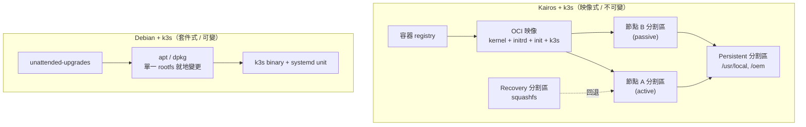
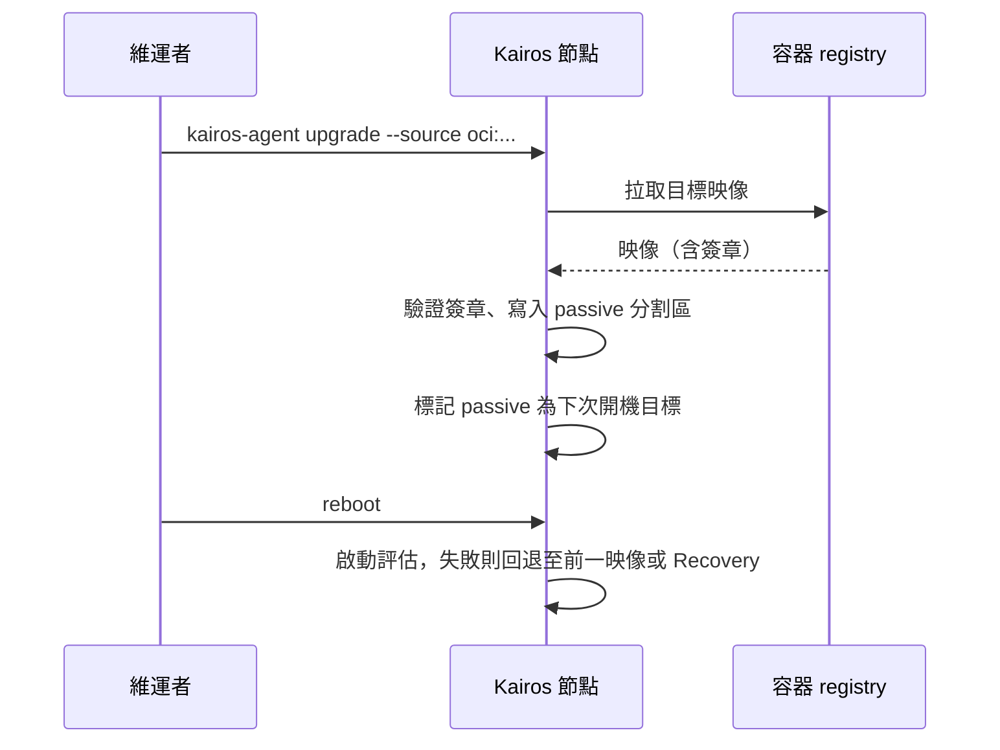
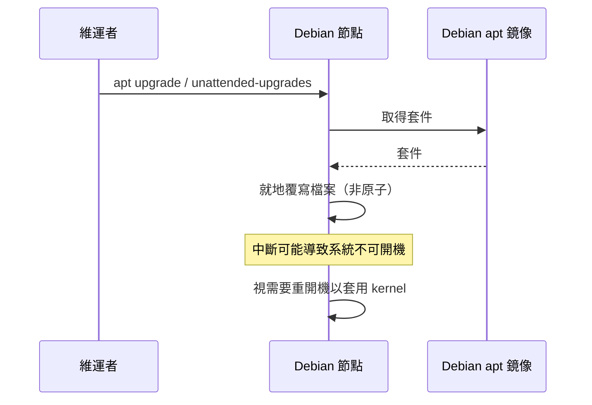
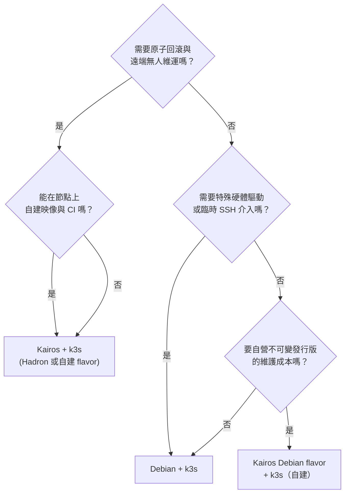

# Kairos + k3s 與 Debian + k3s 方案評估比較

## 摘要

本報告比較兩種以 k3s 為 Kubernetes 執行環境的作業系統方案：一是「Kairos + k3s」（不可變、OCI 容器映像式、A/B 原子升級的 Linux 元發行版），二是「Debian + k3s」（傳統套件管理器維護的可變式 Linux 發行版）。

核心結論如下：

- 兩者的關鍵差異**不在 Kubernetes 層，而在作業系統的生命週期管理模型**。k3s 在兩種方案中都是同一個 k3s；差別在於作業系統如何被建置、修補、升級與回復。
- Kairos 提供原子式 A/B 升級、映像簽章驗證、開機評估與自動回退、以 cloud-init（實作上為 `yip`）宣告式設定、以及可選的 P2P 自我協調網路；代價是導入成本較高、文件與工具鏈仍在演進、且「不可變」本身限制了臨時介入的能力。
- Debian + k3s 提供最低的學習門檻、最完整的硬體與驅動相容性、最豐富的社群資源與最強的直接除錯能力；代價是套件升級為就地（in-place）變更、缺乏原子回滾、需自行以組態管理工具（Ansible 等）避免節點漂移。
- 兩者並非完全互斥：Kairos 的設計目標是「元發行版（meta-distribution）」，可把 Debian、Ubuntu、Alpine 等既有發行版轉為不可變映像。因此實務上存在第三種型態：**Kairos 的 Debian flavor + k3s**，即「保留 Debian 生態系但取得不可變生命週期」。不過自 Kairos v4 起，官方預建產物改以 Hadron 為預設基底，Debian 等 flavor 改為使用者自行以 BYOI（Bring Your Own Image）建置。

適用建議（詳見第 6 節）：資源受限、網路不穩、無法現場介入的邊緣節點，或需要「同一映像大量複製、無雪花節點」的機群，Kairos 較合適；而需要特殊硬體驅動、需要臨時 SSH 介入排錯、或維運團隊規模小且熟悉傳統 Linux 的場合，Debian + k3s 較務實。

---

## 1. 研究背景與範圍

### 1.1 為何這個比較容易失焦

「Kairos + k3s」與「Debian + k3s」表面上像是兩個同層級選項，但實際上比較的軸線有兩條，必須分開討論：

1. **Kubernetes 發行版軸**：k3s、k0s、kubeadm 等。
2. **作業系統生命週期軸**：可變式（套件管理器維護）與不可變式（映像式、原子升級）。

在本報告的兩個方案中，第 1 軸相同（皆為 k3s），因此真正的差異落在第 2 軸[^k3s_home][^kairos_container]。若把兩軸混為一談，就會得到「Kairos 比 Debian 好/壞」這種無法行動的結論；正確的問題是「我要用何種作業系統生命週期模型來承載 k3s」。

### 1.2 範圍界定

本報告涵蓋：

- Kairos 專案的定位、治理、架構與生命週期機制。
- k3s 的定位、資源需求與升級機制。
- Debian 的發行週期、LTS 與自動更新機制。
- 兩方案的逐項對照（更新、安全、資源、維運、除錯、生態系）。
- 公開的第三方實測經驗與批評。
- 適用場景建議與來源反思。

本報告不涵蓋：具體硬體採購建議、特定雲廠商的落地成本、GPU/AI 工作負載的深度調校。

---

## 2. 名詞與研究對象基礎介紹

### 2.1 Kairos

Kairos 自我定位為「簡化邊緣、雲端與裸機作業系統生命週期管理的開源專案」，以統一的雲原生 API 為介面，強調社群驅動、開源、且與發行版無關（distro agnostic）[^kairos_docs]。其 GitHub 專案描述為「The immutable Linux meta-distribution for edge Kubernetes」[^kairos_github]。

治理與專案狀態：

- Kairos 自 2024 年 4 月起正式成為 CNCF Sandbox 專案（官方部落格於 2024 年 10 月 8 日公告）[^kairos_blog_cncf]。
- 專案網站頁尾標示「Project supported by Spectro Cloud」與「Kairos a Series of LF Projects, LLC」，並在 adopters 頁面說明 Spectro Cloud 為「the original sponsoring company for Kairos and employer of several maintainers」[^kairos_docs][^kairos_adopters]。
- 2026 年 4 月，專案公告正準備由 CNCF Sandbox 申請進入 Incubation，並依 CNCF TOC 流程需要 5 至 7 個 adopters 受訪[^kairos_blog_adopter]。
- 已列名的 adopters 包括 CLASTIX、DeEEP Network、imec 與 Spectro Cloud 本身[^kairos_adopters]。

架構核心主張（依官方文件）：

- **不可變（immutable）**：系統以受限、無寫入權限的模式開機，`/` 為唯讀，`/etc`、`/var`、`/srv` 為暫時性（ephemeral，重開機即丟棄），僅 `/usr/local`（`COS_PERSISTENT`）與 `/oem`（`COS_OEM`）為持久分割區[^kairos_immutable]。
- **容器式（container based）**：整個作業系統以標準 OCI 容器映像發布，內含 kernel、initrd 與 init system；映像不會在節點上以容器執行，而是在本機被展開成可供 A/B 開機的映像，因此「no overhead introduced」[^kairos_container]。
- **A/B 原子升級**：升級會產生過渡映像，與 Active 交換、原 Active 變為 Passive，並具備啟動評估與自動回退機制，開機順序為 `A -> B -> Recovery`[^kairos_container][^kairos_immutable]。
- **元發行版（meta-distribution）**：目標是把其他發行版轉換為具 Kubernetes 原生元件的不可變佈局；官方 provider 支援 `k3s` 與 `k0s`[^kairos_meta][^kairos_matrix]。
- **P2P 自我協調**：以 EdgeVPN（底層為 libp2p）建立可選的覆蓋網路與共享帳本，透過 mDNS（區網）或 DHT（跨網）探索節點，並以一次性密碼（OTP）輪換會合點與 AES 加密帳本金鑰[^kairos_network]。

元件組成（皆在 `kairos-io/kairos` 單一 monorepo 中，自 v4.3 起）：`kairos-init`（在原生發行版上建置 Kairos 映像）、`immucore`（不可變性管理介面）、`agent`（安裝、重置、升級）、`kcrypt/discovery` 與 `kcrypt/challenger`（靜態資料加密與 TPM 解鎖）、`installer`（互動式 TUI 安裝器）[^kairos_meta]。2026 年 8 月的部落格說明，`kairos-agent`、`immucore`、`kairos-sdk`、`kairos-init`、`kcrypt-discovery-challenger` 等原本獨立 repo 已被封存並整合進 monorepo[^kairos_blog_onerepo]。

版本脈絡：Kairos 遵循語意化版本（SemVer），patch 版本大致每週、minor 版本每月、major 版本代表重大功能或架構變更；且官方明言「In-place upgrades from old to new major release branches are not always guaranteed」[^kairos_matrix]。本報告撰寫時最新正式版為 v4.3.0（發布於 2026-09-08），其資產包含 Hadron v0.5.1 core 映像，以及內含 k3s v1.34.11 / v1.35.8 / v1.36.4 與 k0s v1.34.11 / v1.35.8 / v1.36.4 的 standard 映像[^kairos_release]。

基底發行版策略的重要轉折：

- 2025 年 12 月，專案發表 Hadron，一個「from scratch」、使用 musl libc + systemd、vanilla kernel、「no package manager by design」的最小化發行版，作為 Kairos 的專用基底；文中明確表示 Hadron「is not positioned as a replacement or competitor to established general-purpose distributions like Ubuntu, Debian, or Alpine」[^kairos_hadron_blog]。
- 自 Kairos v4 起，官方僅發布 Hadron-based 產物，以降低維護成本[^kairos_matrix]，並在官方影像支援矩陣中說明「As a small open-source team, we now focus official prebuilt artifacts and docs defaults on Hadron. Other distributions are still supported and validated through automated testing in `kairos-init`」，且仍可透過 BYOI 與 Kairos Factory 自建 Ubuntu、Debian、Alpine 等 flavor[^kairos_matrix]。

### 2.2 k3s

k3s 是通過 CNCF 認證的輕量級 Kubernetes 發行版，主打「half the memory, all in a binary of less than 100 MB」[^k3s_home]。其主要特徵：

- 以單一 binary 或最小化容器映像散布；控制平面所有元件封裝於單一 binary 與單一程序，並自動化憑證散布等複雜叢集操作[^k3s_home]。
- 預設資料存放區為基於 sqlite3 的 lightweight datastore（透過 Kine shim），亦支援嵌入式 etcd、MySQL、MariaDB、PostgreSQL[^k3s_home][^k3s_req]。
- 內建 containerd、Flannel CNI、CoreDNS、Traefik ingress、ServiceLB、kube-router netpol、local-path-provisioner、Helm controller、Spegel 等元件[^k3s_home]。
- 最低硬體需求：server 節點 2 核 / 2 GB RAM，agent 節點 1 核 / 512 MB RAM；官方建議使用 SSD，並指出在 Raspberry Pi 等 ARM 裝置上 etcd 寫入密集、SD 卡與 eMMC 無法承受該 I/O 負載[^k3s_req]。
- 支援 x86_64、armhf、arm64/aarch64；官方稱「K3s is expected to work on most modern Linux systems」，唯一硬性前提是現代 kernel 與 cgroup 掛載[^k3s_req]。
- 版本號反映上游 Kubernetes 版本，例如 `v1.27.4+k3s1` 對應 Kubernetes v1.27.4，後綴 `+k3sN` 供同一上游版本發布額外修正[^k3s_github]。
- 發布節奏為「patch releases within one week, and new minors within 30 days」，緊跟上游 Kubernetes[^k3s_github]。
- 專案標示為 CNCF Sandbox Project，維護者團隊成員皆使用 `@suse.com` 信箱，反映其由 SUSE（Rancher）主導[^k3s_github]。
- 本報告撰寫時最新正式版為 `v1.37.1+k3s1`（發布於 2026-09-30），內含 Kubernetes v1.37.1、etcd v3.7.1-k3s3、containerd v2.3.4-k3s1 等[^k3s_release]。

### 2.3 Debian

Debian 為歷史悠久的通用型 Linux 發行版，採 stable / testing / unstable 三軌並行維護[^debian_releases]。

- 目前 stable 為 Debian 13（代號 trixie），2025-08-09 首次發布，最新更新 13.7 於 2026-09-12 發布[^debian_releases]。
- 生命週期為五年：前三年完整支援，後兩年由 LTS 團隊接手；Debian 13 的 LTS 期間為 2028-08-09 至 2030-06-30[^debian_releases][^debian_lts]。另有第三方付費的 Extended LTS（ELTS）可再延長[^debian_lts]。
- 自動更新以 `unattended-upgrades` 為標準做法；Debian wiki 明確指出「APT/Dpkg is a non-atomic packaging system and could leave your computer in a non-functionnal or non-bootable state if abruptly interrupted during an upgrade」[^debian_periodic]。此為套件式（可變式）更新的本質限制，也正是不可變式方案要解決的問題。

---

## 3. 架構對照

### 3.1 作業系統生命週期模型

### 3.2 開機與升級流程差異

在 Kairos 中，升級指令語意上等同「切換到目標系統映像」，同樣的指令可用於降級[^kairos_lifecycle]。官方 Quickstart 的示範為 `sudo kairos-agent upgrade --source oci:ttl.sh/my-hadron:0.2.0`，重開機後以 `cat /etc/kairos-release | grep KAIROS_VERSION` 驗證版本[^kairos_lifecycle]。

Kairos 的 kernel 與 initrd 是從映像內載入、由 bootloader（GRUB）chainload，而非在節點上本機產生 initramfs；官方描述此為刻意設計，以讓整個 OS 堆疊維持為可在升級時原子抽換的單一層[^kairos_immutable]。

### 3.3 升級觸發管道

| 面向 | Kairos + k3s | Debian + k3s |
|---|---|---|
| 手動 | `kairos-agent upgrade`[^kairos_lifecycle] | `apt upgrade`[^debian_periodic] |
| 透過 Kubernetes | Kairos Operator（`NodeOp`、`NodeOpUpgrade` CRD）；System Upgrade Controller 已標為 deprecated[^kairos_upgrade] | system-upgrade-controller + `Plan` CRD（Rancher 官方路徑）[^k3s_upg_auto] |
| 批次控管 | CRD 的 `concurrency`、`stopOnFailure`、`nodeSelector`[^coffee] | `Plan` 的 `concurrency`、`cordon`、`window`（可限定時段）[^k3s_upg_auto] |
| 叢集散佈與版本 | 以容器 registry 散佈：映像推送即為升級來源[^kairos_container] | 以 release channel URL（如 stable / v1.33）或指定版本號驅動[^k3s_upg_manual] |
| 升級粒度 | 整個作業系統 + k3s 一起（同一映像）[^kairos_container] | 作業系統套件與 k3s binary 可分開、分別升級[^k3s_upg_manual] |
| 降級 | 支援（指向舊映像標籤即視為「升級」至該映像）[^kairos_lifecycle] | k3s 拒絕降級控制平面；`cordon: true` 的節點在計畫失敗後維持 cordon[^k3s_upg_auto] |

k3s 的 automated upgrade 文件另有一項務實提醒：system-upgrade-controller 本身不會保護你不跨越不支援的 Kubernetes 版本，須自行遵守 version skew policy[^k3s_upg_auto]。

---

## 4. 逐項比較

### 4.1 更新與回復能力

這是最明確的分野。

- Kairos 官方將 A/B 升級描述為「tamper-proof upgrades」、「atomic A/B swaps with fallback mechanisms and automatic boot assessment」[^kairos_container]。升級會建構全新 pristine 映像，舊映像被標記為 passive，若新映像無法開機，系統會嘗試設定 bootloader 改由 passive 開機[^kairos_lifecycle]。
- Debian 的自動更新則被官方 wiki 明確標示為非原子操作，中斷可能導致無法開機[^debian_periodic]。
- 兩者的回復時間差異是質性的：Kairos 的回復是「重開機並回退」，Debian 的回復往往是「救援模式、chroot、修復 dpkg 狀態」。

### 4.2 安全性與攻擊面

Kairos 的主張：

- 不可變系統「far more secure than traditional systems... most attack vectors rely on writing on the system, or installing persistent tools after a vector has been exploited」[^kairos_immutable]。
- 提供 Secure Boot 支援、Trusted Boot（FDE + Secure Boot + Measured Boot 的組合）、以及 TPM 配對的 LUKS 解鎖（`kcrypt`）[^kairos_meta][^kairos_immutable]。
- 發布物具備 SBOM（SPDX）與 cosign 簽章，升級時可用 kyverno 驗證映像 attestation[^kairos_matrix]。
- P2P 網路的帳本以 AES 對稱加密，並以 OTP 輪換會合點與金鑰[^kairos_network]。

Debian + k3s 的實際狀況：

- 攻擊面天然較大：可變的檔案系統、可用的套件生態、通常開放的 SSH、多個常駐 daemon。防護需自行疊加（CIS 基準、AppArmor/SELinux、防火牆）。
- k3s 自身文件即指出 Flannel 依賴 Bridge CNI 建立 L2 網路，具 `NET_RAW` 能力的 Pod 可濫用該 L2 網路進行 ARP 欺騙等攻擊，建議對非信任 Pod 套用停用 `NET_RAW` 的 restricted profile[^k3s_req]。這與作業系統是否不可變無關，兩種方案都要處理。
- k3s 也提醒 Flannel VXLAN 的 UDP 8472 不應對外暴露，否則等於把叢集網路開放給任何人[^k3s_req]。

需注意的是，Kairos 的安全優勢來自「不可變 + 簽章 + 可驗證升級」的組合；若使用者在 Kairos 上開啟 debug、關閉不可變性，或自行以 BYOI 建置未簽章映像，這些優勢將大幅衰減。

### 4.3 資源需求與映像體積

- k3s 本身需求極低（server 2 核/2 GB，agent 1 核/512 MB）[^k3s_req]。
- Kairos 在官方 Quickstart 針對 Hadron + k3s 單節點示範給出的門檻為：8 GB 磁碟 / 2 GB RAM 為「bare-minimum」（僅供受限環境與 smoke test），16 GB / 4 GB 為「practical minimum」，32 GB / 8 GB 為「recommended playground」[^kairos_quickstart]。
- 映像體積（v4.3.0 資產，可作量級參考）：core Hadron ISO 約 291 MiB、含 k3s v1.36.4 的 standard ISO 約 396 MiB[^kairos_release]。
- Kairos 的不可變佈局需要 State（含 active/passive 映像，`.img` loopback 掛載）、Recovery（`.squashfs`）、OEM、Persistent 等分割區，因此對磁碟的需求本質上高於單純的 Debian + k3s 安裝[^kairos_immutable]。

也就是說，Kairos 的「輕量」體現在映像與元件精簡，而非磁碟佔用；在極小容量的 eMMC 或 SD 卡上，Debian + k3s 反而更容易塞得下。

### 4.4 組態管理與節點漂移

Kairos 的核心論點是消除雪花節點（no snowflakes）：

- 「All the machines are based on the same image, configuration settings and behavior. This allows to have a predictable infrastructure, predictable upgrades, and homogeneous configurations across your cluster.」[^kairos_immutable]
- 組態唯一入口是開機時的 cloud-init 設定（實作為 `yip`），之後皆以 Kubernetes 原生方式處理，「no configuration management software is required」[^kairos_immutable]。
- 官方對 Chef/Puppet/Ansible 的批評是「nodes can have different version matrices of software and OS, which makes your set of nodes inhomogeneous and difficult to maintain」[^kairos_immutable]。

Debian + k3s 的現實：若節點數量成長到需要一致性，實務上就會引入 Ansible 等工具，因而額外承受「組態管理工具與實際狀態不同步」這一整類問題。這是 Kairos 論述中最強的論點，也是第三方的正面評價來源[^coffee]。

### 4.5 除錯與臨時介入

- Kairos：有 Recovery 系統與手動升級路徑，可掛載 active 分割區排查[^kairos_lifecycle][^kairos_immutable]；但 `/` 唯讀，無法在執行中的節點上 `apt-get install` 臨時工具，第三方實測者即提到監控代理（如 Netdata）等必須改為以容器執行[^tyzbit]。
- Debian + k3s：完整 shell、完整可用的工具鏈，任何套件都能立刻安裝、任何設定都能即刻修改。這是它在排錯上的絕對優勢。

### 4.6 生態系與社群規模

以下 GitHub 數據擷取於 2026-10-17[^kairos_api][^kairos_hadron_api][^k3s_api]：

| 專案 | Stars | Forks | Open issues | 首次建立 |
|---|---|---|---|---|
| k3s-io/k3s | 34,210 | 2,762 | 76 | 2018-05-31 |
| kairos-io/kairos | 1,855 | 153 | 592 | 2021-07-30 |
| kairos-io/hadron | 71 | 16 | 6 | 2025-06-28 |

解讀：

- k3s 的社群規模約為 Kairos 的 18 倍，且 open issues 僅 76 對比 Kairos 的 592，反映維護能量與議題處理節奏的差距。
- Kairos 的高 open issue 數不必然代表品質問題（其中含大量 feature 與討論），但在選型時是可觀察的維護負荷指標。
- Hadron 僅 71 stars 且建立於 2025 年年中，屬極新專案；由於 Kairos v4 起官方產物以 Hadron 為預設，這意味著**新的預設路徑相對年輕**，而成熟的 Debian/Ubuntu flavor 路徑已改為須自行 BYOI 建置[^kairos_matrix]。這是選型時容易被忽略的風險。

### 4.7 治理與長期永續性

- Kairos：CNCF Sandbox（2024-04 起），LF Projects, LLC 系列專案，主要贊助與維護者雇主為 Spectro Cloud[^kairos_blog_cncf][^kairos_adopters]。
- k3s：CNCF 認證發行版與 Sandbox 專案，維護團隊由 SUSE 主導[^k3s_github][^k3s_home]。
- Debian：社群治理、無單一商業實體依賴，五年生命週期與 LTS[^debian_releases][^debian_lts]。

---

## 5. 綜合對照表

| 比較面向 | Kairos + k3s | Debian + k3s |
|---|---|---|
| 作業系統模型 | 不可變、OCI 映像式[^kairos_container] | 可變、套件管理器維護[^debian_periodic] |
| 升級機制 | 原子 A/B 抽換、開機評估、自動回退[^kairos_container] | 就地套件升級、非原子[^debian_periodic] |
| 降級／回復 | 指向舊映像即可回退[^kairos_lifecycle] | 無原生原子回退；k3s 拒絕降級控制平面[^k3s_upg_auto] |
| 組態入口 | cloud-init / `yip`，單一來源[^kairos_immutable] | 檔案系統 + 組態管理工具，多來源 |
| 執行期可修改性 | 否（`/` 唯讀）[^kairos_immutable] | 是 |
| 臨時除錯便利性 | 中（Recovery 模式）[^kairos_lifecycle] | 高（完整 shell 與工具鏈） |
| 安全加固路徑 | Secure Boot、Trusted Boot、FDE、簽章映像、SBOM[^kairos_matrix][^kairos_meta] | 自行疊加（CIS、MAC、防火牆） |
| 硬體／驅動相容性 | 取決於基底 flavor；Hadron 為 musl + systemd 精簡基底[^kairos_hadron_blog] | 最廣（Debian 生態系） |
| 最小資源門檻（含 k3s） | 8 GB 磁碟 / 2 GB RAM（示範下限）[^kairos_quickstart] | 依 k3s 需求即可（server 2 核/2 GB）[^k3s_req] |
| 節點一致性 | 高（同一映像複製）[^kairos_immutable] | 低，需外部工具維持 |
| 網路協調 | 可選 P2P（EdgeVPN/libp2p）、自動 VirtualIP[^kairos_network] | 自行設計（VIP、DHCP、手動） |
| 上手學習曲線 | 中高（cloud-init、stages、P2P、operator） | 低 |
| 生態系規模 | 1,855 stars[^kairos_api] | k3s 34,210 stars[^k3s_api] + Debian 海量資源 |
| 治理 | CNCF Sandbox，Spectro Cloud 主導[^kairos_blog_cncf][^kairos_adopters] | 社群治理 + SUSE 主導 k3s[^k3s_github] |
| 文件成熟度 | 官方文件完整但工具鏈文件落差大[^tyzbit] | 極成熟 |

---

## 6. 適用場景建議

### 6.1 建議選擇 Kairos + k3s 的情境

- **無法現場介入的邊緣節點**：Kairos 的 A/B 升級與自動回退，能在「節點掛了但沒人到得了現場」時提供最低成本的保險[^kairos_container]。
- **網路拓撲不固定或跨網段**：P2P 自我協調讓節點在無固定 IP 的情況下自行組網與分配 VirtualIP[^kairos_network]。
- **需要大量複製同構節點**：以映像為單位散布升級，可避免版本矩陣漂移[^kairos_immutable]。
- **合規要求可驗證供應鏈**：需要 SBOM、cosign 簽章、Secure Boot / Trusted Boot 的場合[^kairos_matrix][^kairos_meta]。
- **邊緣站點無人維運、且不打算在節點上跑非 Kubernetes 的常駐服務**。

### 6.2 建議選擇 Debian + k3s 的情境

- **需要特殊硬體驅動或核心模組**：Debian 的驅動覆蓋率最高，且可即時安裝測試。
- **維運團隊小且熟悉傳統 Linux**：學習曲線最低，排錯工具最完備。
- **需要在節點上跑 k3s 以外的服務**（如 NAS、藍牙堆疊、印表機等），例如第三方實測者選擇 Kairos 而非 Talos 正是因為需要 Bluetooth/dbus-broker 等元件[^tyzbit]。
- **磁碟／記憶體極度受限**：不需承擔不可變佈局的多分割區與映像儲存成本[^kairos_immutable]。
- **需要成熟、可預期、有五年 LTS 承諾的基底**[^debian_releases][^debian_lts]。

### 6.3 第三條路：Kairos 的 Debian flavor + k3s

若同時想要「Debian 生態系」與「不可變生命週期」，理論上可採 Kairos 的 Debian flavor。但需注意：

- 自 Kairos v4 起官方不再發布非 Hadron 的預建產物，須以 BYOI / Kairos Factory 自行建置與發布[^kairos_matrix]。
- 官方明言「Those flavor repositories are no longer actively updated by the Kairos release pipeline. Use them as templates and build/publish your own images with BYOI」[^kairos_matrix]。
- 因此此路線需要自建 CI 管線、自行承擔基底映像的 CVE 修補流程，實質上等於「自營一個不可變發行版」。

這條路對具備平台工程能力的團隊可行，但對一般維運團隊而言，其總持有成本可能高於直接採用 Hadron flavor 或直接使用 Debian + k3s。

### 6.4 決策樹

---

## 7. 批評、限制與來源反思

### 7.1 第三方實測與公開批評

**P2P 與 PXE 工具鏈的摩擦**：tyzbit 的 13 天實測紀錄了 AuroraBoot（Kairos 的網路開機工具）的多項問題：8080 埠與常見服務衝突、參數無法透過環境變數設定只能走 CLI 或設定檔、容器重啟需 5 至 6 分鐘拉映像導致迭代緩慢；並引用官方文件中「Generic hardware based netbooting is out of scope for this document」一句，認為對想用 PXE 的人不友善[^tyzbit]。他也指出「the documentation for AuroraBoot is good but the information on the repository is abysmal」，許多設定選項與預設值只能靠讀原始碼得知[^tyzbit]。

**文件與驗證落差**：同一篇提到 web 設定驗證器「can't tell you if a value is wrong, only if it's formatted correctly」，以及 PXE 開機紀錄不會被保存、排查需要開啟 verbose 但也未說明如何持久化紀錄[^tyzbit]。

**不可變性的代價**：`apt-get install` 這條路被封閉，第三方監控代理等需改以容器形式運行[^tyzbit]。

**k0s 工作流的 token 設計**：a-cup-of-coffee 的評測指出 k0s 的 worker join token 實際上是壓縮後 base64 編碼的 kubeconfig，API server 位址硬編碼其中，若要使用負載平衡器或 VIP 就必須手動解碼、修改、再編碼，並形容「the workflow is therefore not optimal and automation is painful」[^coffee]。此問題在 k3s 上不存在，因為自動探索（auto-discovery）僅支援 k3s[^coffee]。這對本報告的主題（k3s 路線）反而是正面訊息。

**與 Talos 的定位比較**：HN 討論串中多人追問 Kairos 與 Talos 的差異，甚至有「Is it basically a bootloader+host kernel shim and nothing else?」的困惑[^hn]。這反映 Kairos 的價值主張對首次接觸者並不直觀。同一串中亦有 Talos 使用者指出，若偏離 happy path，「it can become challenging technically. And then you have sunk costs around choosing this platform」[^hn]，此類批評其實同樣適用於任何冪等的不可變平台。

### 7.2 正面實證

- HN 上有使用者表示「Been successful using Kairos to build and deploy an immutable RHEL9 to environments without internet access. Appreciate the flexibility to work with different distros and the maintainers provide great support.」[^hn] 這直接對應本報告關注的 BYOI 與離線場景。
- a-cup-of-coffee 的作者（自述長期 Talos 使用者、Sidero ambassador）結論為「I'm quite pleasantly surprised by Kairos, which seems quite promising for anyone wanting to use an Immutable Kubernetes-oriented OS without taking the plunge into API-Only OSes like Talos」，並肯定 Kairos Operator、Entangle、Yip 等周邊投資[^coffee]。
- tyzbit 最終結論是「I've got a cluster that provisions itself without touching it except to choose boot options」，顯示自動協調的目標確實可達成，但代價是近兩週的密集投入[^tyzbit]。

### 7.3 來源偏誤與可信度反思

- **官方文件偏誤**：Kairos 文件與部落格由專案與 Spectro Cloud 維護者撰寫，對不可變架構的效益陳述（如「far more secure」）帶有推廣性質，且缺乏量化基準。本報告僅將其作為架構事實描述，未採信其比較級論斷。
- **第三方樣本數極少**：本主題的獨立實測文章僅能找到少數數篇（tyzbit 2023 年、a-cup-of-coffee 2026 年、cloudification 2022 年），且 tyzbit 的紀錄已距今約三年，期間 Kairos 已歷經 v3 → v4、monorepo 整合、Hadron 引入等重大變動，其部分批評（AuroraBoot 文件、k0s token）可能已改善或已非主路徑。選型時應以現行官方文件與自身 PoC 驗證為準。
- **時效性風險**：Kairos 在 2025 年 12 月才引入 Hadron，並自 v4 起改以 Hadron 為預設產物[^kairos_hadron_blog][^kairos_matrix]。這意味著坊間多數既有的 Kairos 教學、範例與部落格，可能仍以 Ubuntu/openSUSE flavor 為前提，與現行預設路徑不一致。這是本報告在比較時特別標註的地方。
- **數據時點**：所有 GitHub 星數與版本號皆為 2026-10-17 至 2026-10-18 擷取，屬快照性質[^kairos_api][^k3s_api][^k3s_release][^kairos_release]。
- **未能查證的項目**：本報告未能取得 Kairos 與 Debian + k3s 的獨立效能基準測試（如同等硬體下的升級耗時、開機時間、CPU 額外負擔）。官方雖提及 EdgeVPN 為 user-space 實作、相較 kernel-space 的 WireGuard 較慢，且在高度流量環境下因額外加密層會增加 CPU 使用，但未提供具體數字[^kairos_network]。因此本報告不對兩方案的效能優劣下判斷。
- **利益揭露**：本報告所述 Kairos 治理與資金關係（Spectro Cloud 為原始贊助公司且雇用多名維護者）[^kairos_adopters] 應納入評估，因為商業支持既是永續性的保證，也可能影響預設技術路徑的選擇（例如將預設基底由社群通用發行版轉向自製的 Hadron）。

### 7.4 需自行驗證、無法從文件回答的問題

- 在自有硬體上，Hadron（musl + systemd + vanilla kernel）是否支援你所需的驅動與周邊。
- 你的 CI 是否願意承擔以 BYOI 自建 flavor 的長期維護成本。
- 你的團隊是否能接受由「SSH 進去改一下」轉為「改設定、重建映像、重新部署」的心智模型轉換。
- 在既有的監控、備份、日誌、身分驗證體系中，不可變節點與 P2P 覆蓋網路是否會被視為例外而需額外整合。

---

## 8. 結論

1. **k3s 不是差異點**。兩個方案都執行同一個 k3s，版本、功能與升級管道（system-upgrade-controller / Plan CRD）在兩邊都可使用[^k3s_upg_auto]。真正被比較的是作業系統生命週期模型。
2. **Kairos 的獨特價值有兩項，且只有一項是普遍適用的**：
   - 普遍適用者：**原子 A/B 升級 + 開機評估 + 自動回退 + 簽章映像**，這是相對 Debian 套件式更新最實質的差異[^kairos_container][^debian_periodic]。
   - 情境限定者：**P2P 自我協調網路**，只有在網路拓撲不固定或無固定 IP 的邊緣場景才構成不可替代的優勢[^kairos_network]。
3. **Debian + k3s 的優勢同樣有兩項，且同樣只有一項是普遍適用的**：
   - 普遍適用者：**學習曲線低、除錯能力強、生態系與硬體相容性最廣**。
   - 情境限定者：**生命週期承諾明確**（五年支援、LTS 排程可預期）[^debian_releases][^debian_lts]。
4. **最大的隱藏成本在 Kairos 這側**。依官方文件，非 Hadron flavor 已不再由官方管線主動更新，須自行以 BYOI / Kairos Factory 建置與發布[^kairos_matrix]；而新的預設基底 Hadron 是 2025 年才出現、GitHub 僅 71 stars 的年輕專案[^kairos_hadron_api]。若採用 Kairos，實質上是在「採用一個生態系」與「自營一個不可變發行版」之間做選擇。
5. **建議以 PoC 而非文獻終結決策**。第三方獨立實測資料稀少且時效落差大，建議在目標硬體上各建一組最小叢集，實測三件事：一次刻意失敗的升級是否真能自動回退、所需硬體周邊是否在 Hadron（或自建 flavor）下可用、以及團隊完成一次「改設定 → 重建映像 → 部署」循環所需的實際工時。

---

## 參考文獻

[^kairos_docs]: Kairos. (n.d.). *Documentation*. Retrieved 2026-10-18, from https://kairos.io/docs/

[^kairos_github]: kairos-io. (2026). *kairos* [Source code]. GitHub. Retrieved 2026-10-18, from https://github.com/kairos-io/kairos

[^kairos_api]: GitHub. (2026, October 17). *Repository metadata for kairos-io/kairos* [Data file]. Retrieved 2026-10-18, from https://api.github.com/repos/kairos-io/kairos

[^kairos_hadron_api]: GitHub. (2026, October 16). *Repository metadata for kairos-io/hadron* [Data file]. Retrieved 2026-10-18, from https://api.github.com/repos/kairos-io/hadron

[^kairos_immutable]: Kairos. (2026, September 8). *Immutable*. Retrieved 2026-10-18, from https://kairos.io/docs/v4.3.0/architecture/immutable/

[^kairos_container]: Kairos. (2026, September 8). *Container based*. Retrieved 2026-10-18, from https://kairos.io/docs/v4.3.0/architecture/container/

[^kairos_meta]: Kairos. (2026, September 8). *Meta-Distribution*. Retrieved 2026-10-18, from https://kairos.io/docs/v4.3.0/architecture/meta/

[^kairos_network]: Kairos. (2026, September 8). *P2P Network*. Retrieved 2026-10-18, from https://kairos.io/docs/v4.3.0/architecture/network/

[^kairos_upgrade]: Kairos. (2026, September 8). *Upgrade*. Retrieved 2026-10-18, from https://kairos.io/docs/v4.3.0/upgrade/

[^kairos_matrix]: Kairos. (2026, September 8). *Image support matrix*. Retrieved 2026-10-18, from https://kairos.io/docs/v4.3.0/reference/image_matrix/

[^kairos_lifecycle]: Kairos. (2026, February 24). *Lifecycle Management*. Retrieved 2026-10-18, from https://kairos.io/quickstart/lifecycle-management/

[^kairos_quickstart]: Kairos. (2026, April 27). *Hadron Quickstart*. Retrieved 2026-10-18, from https://kairos.io/quickstart/

[^kairos_release]: kairos-io. (2026, September 8). *v4.3.0* [Software release]. GitHub. Retrieved 2026-10-18, from https://github.com/kairos-io/kairos/releases/tag/v4.3.0

[^kairos_blog_cncf]: Morales, M. (2024, October 8). *Kairos Joins the CNCF as a Sandbox Project*. Retrieved 2026-10-18, from https://kairos.io/blog/2024/10/08/kairos-joins-the-cncf-as-a-sandbox-project/

[^kairos_blog_adopter]: Morales, M. (2026, April 9). *Help Kairos Move to CNCF Incubation: Become an Adopter*. Retrieved 2026-10-18, from https://kairos.io/blog/2026/04/09/become-a-kairos-adopter-for-cncf-incubation/

[^kairos_blog_onerepo]: Morales, M., & Karakasilis, D. (2026, August 31). *One Repo, One Pipeline, One Version*. Retrieved 2026-10-18, from https://kairos.io/blog/2026/08/31/one-repo-one-pipeline-one-version/

[^kairos_hadron_blog]: Di Giacinto, E. (2025, December 17). *Introducing Hadron: The Minimal, Upstream-First Linux Base for Kairos*. Retrieved 2026-10-18, from https://kairos.io/blog/2025/12/17/introducing-hadron-the-minimal-upstream-first-linux-base-for-kairos/

[^kairos_adopters]: Kairos. (n.d.). *Kairos adopters*. Retrieved 2026-10-18, from https://kairos.io/adopters/

[^k3s_home]: K3s. (n.d.). *Lightweight Kubernetes*. Retrieved 2026-10-18, from https://docs.k3s.io/

[^k3s_req]: K3s. (2026, October 14). *Requirements*. Retrieved 2026-10-18, from https://docs.k3s.io/installation/requirements

[^k3s_upg_auto]: K3s. (2026, October 14). *Automated Upgrades*. Retrieved 2026-10-18, from https://docs.k3s.io/upgrades/automated

[^k3s_upg_manual]: K3s. (2026, October 14). *Manual Upgrades*. Retrieved 2026-10-18, from https://docs.k3s.io/upgrades/manual

[^k3s_github]: k3s-io. (2026). *k3s* [Source code]. GitHub. Retrieved 2026-10-18, from https://github.com/k3s-io/k3s

[^k3s_api]: GitHub. (2026, October 18). *Repository metadata for k3s-io/k3s* [Data file]. Retrieved 2026-10-18, from https://api.github.com/repos/k3s-io/k3s

[^k3s_release]: k3s-io. (2026, September 30). *v1.37.1+k3s1* [Software release]. GitHub. Retrieved 2026-10-18, from https://github.com/k3s-io/k3s/releases/tag/v1.37.1%2Bk3s1

[^debian_releases]: Debian. (n.d.). *Debian Releases*. Retrieved 2026-10-18, from https://www.debian.org/releases/

[^debian_lts]: Debian Wiki. (2026, September 1). *LTS*. Retrieved 2026-10-18, from https://wiki.debian.org/LTS

[^debian_periodic]: Debian Wiki. (2026, July 10). *PeriodicUpdates*. Retrieved 2026-10-18, from https://wiki.debian.org/PeriodicUpdates

[^hn]: Hacker News. (2025, October 3). *Kairos: Immutable Distro for K8s at the Edge* [Online forum post]. Retrieved 2026-10-18, from https://news.ycombinator.com/item?id=45436148

[^tyzbit]: tyzbit. (n.d.). *Trying Out Kairos*. Retrieved 2026-10-18, from https://tyzbit.blog/trying-out-kairos

[^coffee]: Joly, Q. (2026, March 22). *Kairos, the immutable OS for deploying Kubernetes*. Retrieved 2026-10-18, from https://a-cup-of.coffee/blog/kairos/
