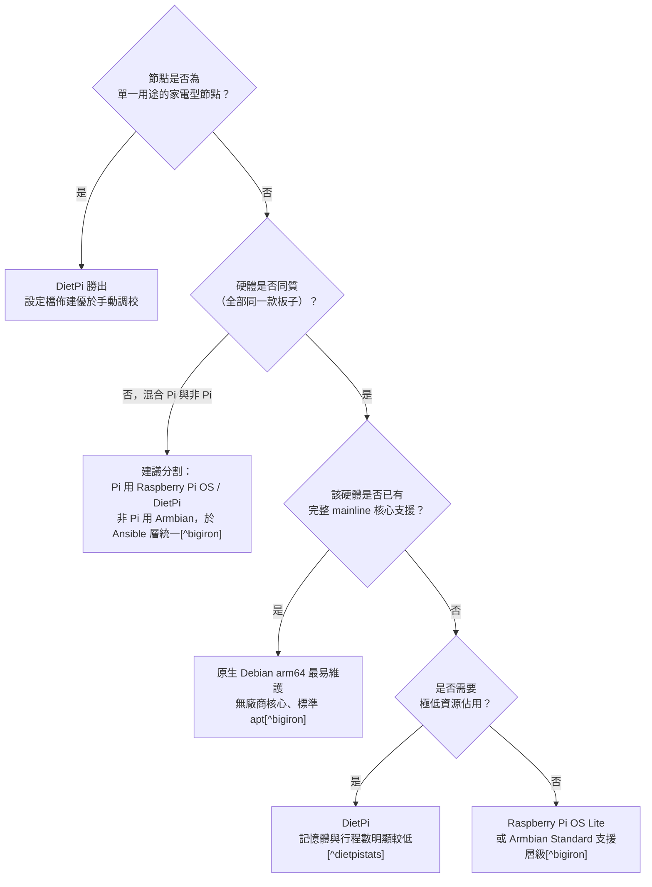

# DietPi + K3s 與 Debian + K3s 方案評估比較

## 摘要

本報告比較兩種在單板電腦（SBC）或小型伺服器上執行 Kubernetes 的路線：「DietPi 發行版搭配 K3s」與「原生 Debian 搭配 K3s」。結論是：**兩者的 K3s 本體完全相同，差異來自作業系統（OS）層的映像大小、資源佔用、佈建自動化、核心來源與日誌／交換空間（swap）預設值**。DietPi 的優勢在於宣告式佈建、極小的基礎映像、以及針對容器平台替使用者預先處理 cgroup 與 iptables 細節；代價是它是一個第三方專案，非 Raspberry Pi 硬體上的核心來自 Armbian，社群規模較小，且與上游 Debian 之間多一層抽象。原生 Debian 的優勢是「無仲介層」、核心與使用者空間全部來自上游、`unattended-upgrades` 的安全模型可直接套用；代價是映像較大、需要手動完成 cgroup、iptables、swap、日誌、佈建等前置作業。

選擇的關鍵不在「哪個比較快」，而在**節點是同質或異質、以及六個月後你要如何修補它們**。

---

## 1. 背景知識：三個元件

### 1.1 Kubernetes 與 K3s

K3s 是由 Rancher（現屬 SUSE）推出的輕量級 Kubernetes 發行版，為物聯網（IoT）與邊緣運算設計，是 CNCF 認證的 Kubernetes 發行版，功能上可作為標準 Kubernetes 叢集的替代品，只是更輕量[^k3sfaq]。它以單一約 60–80 MiB 的執行檔（binary）封裝控制平面（control plane）、資料儲存（datastore）、kubelet 與容器執行環境（container runtime），並內建打包元件：CoreDNS、Traefik（Ingress）、local-storage、metrics-server，以及 servicelb 負載平衡控制器[^k3spkg]。單一節點的 server 安裝即是一個完整可用的 Kubernetes 叢集[^k3squick]。

K3s 的官方最低需求為：server 節點 2 核心 CPU 與 2 GiB RAM；agent 節點 1 核心 CPU 與 512 MiB RAM[^k3sreq]。官方實測資料較此更樂觀也更具體：在 Raspberry Pi 4 Model B 上，跑著一個工作負載的 server 節點使用約 1588 MiB RAM 與 30% 單核 CPU；閒置 agent 節點約 268 MiB RAM[^k3sprof]。

### 1.2 DietPi

DietPi 是一套「高度最佳化、極簡的 Debian 基礎 Linux 發行版」，核心設計目標是最小化 CPU 與 RAM 資源佔用[^dietpidocs]。它由第三方社群維護，以配置檔（`/boot/dietpi.txt`）驅動佈建，並提供 `dietpi-software` 軟體選單與 `dietpi-config` 系統設定工具[^dietpihome]。自 v10.0（2026 年 1 月）起，DietPi 腳本最低要求 Debian 12（Bookworm）；目前的預設映像則是以 Debian 13（Trixie）為基礎[^dietpi10][^dietpihome]。

DietPi 的核心特性包括：

- **極小的基礎映像**：官方自測資料顯示，在 Raspberry Pi Zero W 上（Trixie 32 位元映像，2026-03-31 測試），DietPi RAM 佔用 42 MiB、執行中行程 9 個、磁碟佔用 702 MiB、預裝套件 215 個；對照 Raspberry Pi OS Lite 分別為 96 MiB、24 個行程、2378 MiB、664 個套件[^dietpistats]。
- **預設 RAM 日誌**：預設以 tmpfs 掛載 `/var/log`，並每小時清理，以降低 SD 卡寫入並提升效能；也可切換為完整日誌（Full logging，含 rsyslog 與 logrotate）[^dietpiramlog]。
- **宣告式佈建**：在 `/boot/dietpi.txt` 與 `/boot/dietpi-wifi.txt` 預先寫入主機名稱、靜態 IP、時區、軟體選項，開機即自動完成設定[^dietpiusage]。
- **廣大的硬體支援**：涵蓋 Raspberry Pi 全系列、Odroid、PINE64、Radxa、ASUS Tinker Board、NanoPi、Orange Pi 以及 RISC-V 板與 PC／VM[^dietpihw]。

### 1.3 Debian

Debian 是本報告的比較基準：由 Debian 專案維護的通用 Linux 發行版，目前穩定版為 Debian 13（代號 trixie），提供 `arm64`、`armhf`、`amd64`、`riscv64` 等架構的網路安裝映像（netinst）[^debiannetinst]。DietPi 本身即建構在 Debian 之上，因此兩者共用 apt、systemd、以及絕大多數使用者空間工具[^dietpidocs]。

值得注意的是，Debian 13 起 `/tmp` 改為 tmpfs，且 `/tmp` 與 `/var/tmp` 會被定期清理[^debiantrixieissue]。DietPi 多年來即採用類似的 `/tmp` tmpfs 與 RAMlog 策略，因此在新版 Debian 上兩者於此面向的差距縮小。

---

## 2. 研究方法與來源批判

本報告的事實來源分為三類：

1. **上游官方文件**：K3s 官方文件（`docs.k3s.io`）、DietPi 官方文件（`dietpi.com/docs`）、Debian 官方發行說明與安裝頁面。這類來源權威性高，但 K3s 與 DietPi 文件皆為「自述」，可能對自身方案有正面偏向。
2. **原始碼與版本控制紀錄**：包含 DietPi 的 `dietpi-software`、`dietpi.txt`、`dietpi-set_swapfile` 等腳本，以及 GitHub Issue 與 CHANGELOG。這類來源最接近「事實本身」，可用來驗證文件敘述是否屬實。
3. **第三方比較與社群教學**：如 Big Iron 的作業系統比較、1c3d 的 Raspberry Pi 作業系統比較、rpi4cluster.com 的 8 節點 K3s 叢集教學。這類來源可能帶有作者偏好或業配，且部分內容為 2026 年的文章，但仍可補足官方文件未涵蓋的實務經驗。

**主要限制**：

- K3s 與 DietPi 官方皆未提供「DietPi + K3s vs Debian + K3s」的直接效能對照數據，因此本報告的資源比較採用「OS 基底佔用」加上「K3s 官方需求」的方式推估，而非同一硬體上的實測。
- 部分社群來源（論壇貼文）的細節無法逐一回溯至主要來源，本報告僅在能直接讀取原文時引用。
- DietPi 對非 Raspberry Pi 硬體的核心來源為 Armbian，這點由第三方來源指出[^bigiron]，DietPi 官方亦自述「僅對少數 SBC 維護自有核心，其餘依賴其他專案的核心開發」[^dietpistats]。

---

## 3. DietPi + K3s 方案剖析

### 3.1 DietPi 對 K3s 的整合方式

DietPi 將 K3s 作為軟體選項 ID 193 納入 `dietpi-software`。安裝時可透過兩個鉤子（hook）控制行為[^dietpik3sdoc][^dietpitxt]：

- `SOFTWARE_K3S_EXEC`：其值會被直接複製到 `INSTALL_K3S_EXEC` 環境變數，再交由 K3s 官方安裝腳本執行；因此可指定 `server` 或 `agent`，並附加任意 K3s 命令列參數。
- `/boot/dietpi-k3s.yaml`：若存在，安裝時會被複製到 `/etc/rancher/k3s/config.yaml`，即 K3s 的標準設定檔位置[^k3sconfig]。

實際上 DietPi 並非重新包裝 K3s，而是**呼叫 K3s 官方安裝腳本**：在其 CI 測試設定中，K3s 的檢查指令為 `k3s -v`、服務名稱為 `k3s`[^dietpici]，與 K3s 官方 `get.k3s.io` 安裝腳本所建立的 systemd 服務一致[^k3squick]。因此「DietPi 版 K3s」與「Debian 版 K3s」在核心元件層面沒有差異。

DietPi 在 OS 層額外替 K3s 處理的事項：

- **記憶體 cgroup**：在 Raspberry Pi 與 Odroid N2 上安裝 Docker 或 K3s 時，自動將 `cgroup_enable=memory` 加入核心命令列，以支援容器記憶體用量監控[^dietpicgroup]。K3s 官方文件明確指出標準 Raspberry Pi OS 預設未啟用 cgroup，需手動加入 `cgroup_memory=1 cgroup_enable=memory`[^k3sreq]。DietPi 的此項自動化直接消除了 K3s 在 RPi 上最常見的第一步卡關。
- **iptables 後端選擇**：DietPi 會偵測核心是否支援 `nf_tables`，並以 `update-alternatives` 自動在 `iptables-nft` 與 `iptables-legacy` 之間切換[^dietpiiptables]。K3s 官方已知問題頁指出，iptables v1.6.1 或更舊版本在 nftables 模式下、以及 v1.8.0–1.8.4 皆有已知問題，可能導致 K3s 失敗或規則重複累積[^k3sissues]。
- **交換空間管理**：DietPi 提供 `dietpi-set_swapfile`（可設為 0 以完全停用）與 `dietpi-drive_manager` 圖形介面，另有 `dietpi.txt` 的 `AUTO_SETUP_SWAPFILE_SIZE` 與 `AUTO_SETUP_SWAPFILE_LOCATION`（可設為 `zram`）[^dietpiswap][^dietpitxt]。Kubernetes 長久以來要求停用 swap；K3s 的 `check-config` 會回報 `swap: disabled`[^k3sissue6389]。

### 3.2 佈建模擬：DietPi 的宣告式流程

DietPi 的 `dietpi.txt` 可同時指定多個軟體 ID 與自動化開關，例如：

```
AUTO_SETUP_AUTOMATED=1
AUTO_SETUP_NET_HOSTNAME=k3s-node1
AUTO_SETUP_INSTALL_SOFTWARE_ID=193
CFG_SOFTWARE_K3S_EXEC=server
```

（實際鍵名為 `SOFTWARE_K3S_EXEC` 與 `AUTO_SETUP_INSTALL_SOFTWARE_ID`[^dietpiusage][^dietpitxt]。）

搭配放置於開機分割區的 `dietpi-k3s.yaml`，就能在完全無人互動的情況下，讓節點開機後自動成為設定好的 K3s server 或 agent。這正是 rpi4cluster.com 作者在 8 節點 Raspberry Pi 4 K3s 叢集教學中所強調的優點：DietPi 的開機設定檔「已經幫我們完成了大部分 OS 設定，省了很多時間」[^rpi4cluster]。

### 3.3 已知問題與修復歷史

DietPi 的 K3s 整合並非從未出錯。可查證的案例包括：

| 版本 | 問題 | 影響 | 狀態 |
|---|---|---|---|
| v8.1 前 | RPi 上重複安裝容器平台時，`cgroup_enable=memory` 被重複附加到 `cmdline.txt` | 無害但設定凌亂 | v8.2 修復[^dietpicgroup] |
| v8.19 前 | Quartz64 上 K3s 因核心缺少 `CONFIG_CGROUP_FREEZER` 與 `CONFIG_NETFILTER_XT_MATCH_IPVS` 而所有系統 Pod 進入 CrashLoopBackOff | 節點無法使用 | v8.19 透過重建核心修復[^k3sissue6389] |
| v10.2 前 | 首次開機自動化安裝 K3s（`AUTO_SETUP_INSTALL_SOFTWARE_ID=193`）時，`/boot/dietpi-k3s.yaml` 未被複製到 `/etc/rancher/k3s/config.yaml` | 自訂設定靜默失效 | v10.2 修復[^dietpiissue7985] |

第三個案例特別值得注意：它屬於「靜默失敗」（silent failure）——K3s 安裝成功、服務啟動，但使用者的自訂設定沒有生效。這凸顯了第三方整合層的風險：多一層自動化，就多一層可能失準的假設。

### 3.4 DietPi 的結構性限制

- **非 Pi 硬體的核心來源為 Armbian**：在非 Raspberry Pi 的 ARM 硬體上，DietPi 不自行維護板級支援，而是架在 Armbian（或廠商）的核心之上。第三方分析指出，「DietPi vs Armbian 在 Rock 5B 上並不是兩個獨立選項的選擇，而是 DietPi 的佈建層疊在 Armbian 核心上」[^bigiron]。
- **核心模組缺漏風險**：如 v8.19 前的 Quartz64 案例，非 Pi 硬體的核心可能缺少 Kubernetes 所需的核心選項，而這類問題需要深入 Armbian 或廠商核心才能解決[^k3sissue6389][^bigiron]。
- **社群規模較小**：第三方比較指出 DietPi 社群小於官方 Raspberry Pi OS，且在全新 Pi 硬體發表初期，支援偶爾落後[^1c3d]。
- **單一維護者風險**：GitHub 上 DietPi 專案有約 6,331 顆星、569 個 fork[^dietpigh]，相較 K3s 的 34,210 顆星與 2,762 個 fork[^k3sgh]規模明顯較小；其主要維護者為單一核心人物，專案簡介中明確列出專案負責人[^dietpireadme]。

---

## 4. Debian + K3s 方案剖析

### 4.1 安裝流程

在原生 Debian 上，K3s 的標準安裝方式為官方安裝腳本：

```
curl -sfL https://get.k3s.io | sh -
```

安裝後會自動設定 systemd（或 openrc）服務、安裝 `kubectl`／`crictl`／`ctr`／`k3s-killall.sh`／`k3s-uninstall.sh`，並在 `/etc/rancher/k3s/k3s.yaml` 產生 kubeconfig[^k3squick]。多節點時，agent 以 `K3S_URL` 與 `K3S_TOKEN` 加入叢集[^k3squick]。

設定可透過三種方式提供：`K3S_` 環境變數、命令列參數、以及 `/etc/rancher/k3s/config.yaml`（可搭配 `/etc/rancher/k3s/config.yaml.d/*.yaml` 遞增合併）[^k3sconfig]。

### 4.2 需要手動處理的前置作業

原生 Debian 路線需要自行確認或處理下列事項：

| 項目 | 說明 | 來源 |
|---|---|---|
| cgroup | 若目標為 Raspberry Pi OS 或其他預設未啟用 cgroup 的映像，需在 `cmdline.txt` 加入 `cgroup_memory=1 cgroup_enable=memory` | [^k3sreq] |
| iptables 版本 | 需確認未使用 v1.6.1 或更舊的 nftables 模式，或 v1.8.0–1.8.4；可改用 K3s 內附的 1.8.8（`--prefer-bundled-bin`） | [^k3sissues] |
| swap | 需確認已停用；`k3s check-config` 會回報狀態 | [^k3sissue6389] |
| 韌體／防火牆 | 官方建議關閉 firewalld 或 ufw，或加入對應規則（6443/tcp、8472/udp、10250/tcp 等） | [^k3sreq] |
| 磁碟 | 官方建議使用 SSD；etcd 寫入密集，SD 卡與 eMMC 無法承受 IO 負載 | [^k3sreq] |
| 節點命名 | 兩節點不可同名；可使用 `--with-node-id`、`--node-name` 或 `K3S_NODE_NAME` | [^k3sreq] |

### 4.3 網路需求

K3s 需要 6443/tcp 供所有節點存取 API server；使用 Flannel VXLAN 時節點間需 UDP 8472 互通；使用 Flannel WireGuard 時為 UDP 51820（IPv6 時另有 51821）；metrics server 需要 10250/tcp；內嵌 etcd 高可用時需要 2379–2380/tcp[^k3sreq]。官方特別警告 VXLAN 埠不應對外網暴露[^k3sreq]。

---

## 5. 逐項比較

### 5.1 功能與架構對照

```mermaid
graph TB
    subgraph "DietPi + K3s"
        A1["DietPi 映像<br/>Debian Trixie 基礎"] --> A2["DietPi 佈建層<br/>dietpi.txt / dietpi-software"]
        A2 --> A3["OS 層自動化<br/>cgroup / iptables / swap / RAMlog"]
        A3 --> A4["K3s 官方安裝腳本<br/>get.k3s.io"]
        A4 --> A5["k3s.service<br/>單一二進位執行檔"]
        A6["核心來源<br/>RPi 自有 · 非 Pi 為 Armbian"] --> A1
    end

    subgraph "Debian + K3s"
        B1["Debian 映像<br/>netinst"] --> B2["手動佈建<br/>preseed / cloud-init / Ansible"]
        B2 --> B3["手動前置作業<br/>cgroup / iptables / swap / 日誌"]
        B3 --> B4["K3s 官方安裝腳本<br/>get.k3s.io"]
        B4 --> B5["k3s.service<br/>單一二進位執行檔"]
        B6["核心來源<br/>上游 mainline Debian"] --> B1
    end
```



### 5.2 比較表

| 面向 | DietPi + K3s | Debian + K3s |
|---|---|---|
| K3s 本體 | K3s 官方安裝腳本，元件相同[^dietpici] | K3s 官方安裝腳本，元件相同[^k3squick] |
| 基礎映像大小 | 極小；RPi Zero W 映像 1024 MiB、下載 178 MiB[^dietpistats] | Debian netinst 映像較大；RPi OS Lite 對照組映像 2568 MiB、下載 497 MiB[^dietpistats] |
| 閒置 RAM | RPi Zero W 42 MiB / RPi 5 152 MiB[^dietpistats] | RPi OS Lite 96 MiB / RPi 5 240 MiB；同機 Armbian minimal 186 MiB[^dietpistats] |
| 執行中行程數 | RPi Zero W 9 個 / RPi 5 92 個[^dietpistats] | RPi OS Lite 24 個 / RPi 5 124 個[^dietpistats] |
| 開機時間 | RPi Zero W 27.8 秒 / RPi 5 2.77 秒[^dietpistats] | RPi OS Lite 125.2 秒 / RPi 5 15.8 秒[^dietpistats] |
| 預裝套件數 | RPi Zero W 215 個[^dietpistats] | RPi OS Lite 664 個[^dietpistats] |
| 佈建方式 | 宣告式：`dietpi.txt` + `dietpi-k3s.yaml`[^dietpiusage][^dietpik3sdoc] | 手動：preseed、cloud-init 或 Ansible；或第三方映像[^bigiron] |
| K3s 專屬設定鉤子 | 內建：`SOFTWARE_K3S_EXEC`、`/boot/dietpi-k3s.yaml`[^dietpitxt] | 自行撰寫環境檔與 config.yaml[^k3sconfig] |
| cgroup v2 記憶體 | RPi 與 Odroid N2 安裝 K3s 時自動加入核心參數[^dietpicgroup] | 手動；K3s 文件明示標準 RPi OS 未啟用[^k3sreq] |
| iptables 後端 | 自動依核心能力選擇 nft 或 legacy[^dietpiiptables] | 手動；需避開已知有問題的版本[^k3sissues] |
| swap | 內建 `dietpi-set_swapfile`（可設 0 或 zram）[^dietpiswap] | 手動 `swapoff`、編輯 `/etc/fstab` |
| 日誌 | 預設 RAMlog（tmpfs，每小時清除）[^dietpiramlog] | 預設磁碟日誌；Trixie 起 `/tmp`、`/var/tmp` 定期清理[^debiantrixieissue] |
| SD 卡壽命 | RAMlog + tmpfs 大幅降低寫入[^dietpiramlog] | 需自行調整；否則日誌與 tmp 持續寫入 |
| 核心來源 | RPi 自有；非 Pi 為 Armbian／廠商核心[^bigiron] | 上游 Debian 核心（若硬體有 mainline 支援）[^bigiron] |
| `unattended-upgrades` 安全模型 | 多一層：DietPi 可能覆寫設定，且核心更新來自不同來源 | 可直接套用 Debian 標準指引[^bigiron] |
| 硬體廣度 | 數十款 SBC 皆提供官方映像[^dietpihw] | 僅有 mainline 支援的板子可用 netinst；其餘需 Armbian 等衍生版[^debiannetinst][^bigiron] |
| 非 Pi 硬體的替代路線 | 底層實為 Armbian 核心[^bigiron] | Armbian 本身支援 300 款以上板子、60 家以上廠商[^armbian] |
| 社群與疑難排解 | 社群較小；K3s 特定問題的既有解答較少[^1c3d] | Debian 社群龐大；但 K3s + Debian 的組合教學相對分散 |
| 專案規模 | GitHub 約 6,331 星[^dietpigh] | Debian 為獨立大型專案 |
| 授權 | GPL-2.0[^dietpigh] | Debian 為自由軟體發行版 |
| 代表性實務案例 | rpi4cluster.com 的 8 節點 Raspberry Pi 4 K3s 叢集[^rpi4cluster] | 大量既有 Debian 伺服器基礎上的延伸部署 |

### 5.3 適合情境



---

## 6. 決策建議

### 6.1 選擇 DietPi + K3s 的理由

1. **節點是單一用途的家電型節點**：DietPi 的 `dietpi.txt` 佈建模型專為「刷入 SD 卡後幾分鐘內上線」設計[^dietpiusage][^bigiron]。
2. **資源受限的硬體**：在 512 MiB 至 1 GiB RAM 的板子上，DietPi 的 42 MiB 級閒置佔用是真實優勢[^dietpistats][^1c3d]。
3. **想要現成的 K3s 整合**：DietPi 已內建 K3s 選項、設定鉤子，以及 cgroup 與 iptables 的自動處理，可省下數個手動步驟[^dietpik3sdoc][^dietpicgroup][^dietpiiptables]。
4. **大量同型節點需要快速重建**：宣告式佈建加上 DietPi-Backup 的自動還原機制，適合「重新刷機即可複製」的情境[^dietpiusage]。

### 6.2 選擇 Debian + K3s 的理由

1. **硬體具備完整 mainline 核心支援**：此時不需要任何第三方映像，可直接使用標準 Debian netinst，並讓 `unattended-upgrades` 的標準安全指引原封不動地適用[^bigiron][^debiannetinst]。
2. **希望「無仲介層」以降低除錯複雜度**：當問題發生時，不必同時考慮「是 K3s 的問題、DietPi 的問題，還是 Armbian 核心的問題」。
3. **節點是既有 Debian 基礎設施的一部分**：可直接沿用原本的 Ansible playbook、監控代理程式與修補流程[^bigiron]。
4. **混合硬體但想統一一種作業系統**：若強制全機隊使用 DietPi，非 Pi 硬體上的核心仍來自 Armbian，只是被 DietPi 的佈建介面「藏起來」，反而讓除錯更困難；此時第三方分析建議接受兩種 OS 家族、在自動化層統一[^bigiron]。

### 6.3 兩者的共同注意事項

無論選擇哪一條路線，都必須處理：

- **儲存媒體**：K3s 官方明確建議使用 SSD；etcd 為寫入密集型，SD 卡與 eMMC 無法承受 IO 負載[^k3sreq]。在 SBC 上執行 K3s 時，這一點的影響通常大於作業系統選擇。
- **記憶體總量的現實**：K3s 官方實測顯示，Pi 4B 上跑工作負載的 server 約需 1.6 GiB RAM[^k3sprof]。因此 2 GiB 是實務上的低標，4 GiB 以上才留有工作負載空間。
- **日誌持久性**：DietPi 預設的 RAMlog 每小時清除 `/var/log`[^dietpiramlog]，而 K3s 在 systemd 下的日誌位於 journald，可用 `journalctl -u k3s` 檢視[^k3sfaq]。若要長期保留日誌以除錯，DietPi 需切換到完整日誌模式，或將 journald 設為持久儲存。
- **iptables 版本檢查**：務必以 `k3s check-config` 驗證，並確認核心具備 `CONFIG_CGROUP_FREEZER` 與 `CONFIG_NETFILTER_XT_MATCH_IPVS` 等選項[^k3sissue6389][^k3sissues]。
- **網路埠與防火牆**：6443/tcp、8472/udp、10250/tcp 是基本需求，且 VXLAN 埠不應對外網暴露[^k3sreq]。

---

## 7. 結論

DietPi + K3s 與 Debian + K3s 並非兩種不同的 Kubernetes，而是**同一個 K3s 搭配兩種不同的作業系統哲學**。DietPi 是「佈建導向、資源極小化、替使用者預先處理容器平台細節」的作業系統，代價是第三方仲介層、非 Pi 硬體上的 Armbian 核心依賴、以及規模較小的社群。原生 Debian 是「上游、標準、無仲介」的路線，代價是更大的映像與更多的前置手動作業。

若節點是同質的、單一用途的、且資源受限，DietPi 能提供實質的佈建與資源優勢；若硬體有完整 mainline 支援、且節點要融入既有的 Debian 基礎設施與修補流程，原生 Debian 是維護成本更低、除錯路徑更單純的選擇。對於混合 Pi 與非 Pi 的機隊，最具可維護性的做法不是強迫全機隊使用同一種映像，而是在自動化層統一、並在各自硬體上使用最合適的作業系統。

---

## 參考文獻

[^dietpidocs]: DietPi. (n.d.). *Welcome to the DietPi documentation*. Retrieved 2026-10-18, from https://dietpi.com/docs/

[^dietpihome]: DietPi. (n.d.). *DietPi | Minimal image at its core*. Retrieved 2026-10-18, from https://dietpi.com/

[^dietpihw]: DietPi. (n.d.). *Supported hardware*. Retrieved 2026-10-18, from https://dietpi.com/docs/hardware/

[^dietpistats]: DietPi. (n.d.). *DietPi OS stats & comparison*. Retrieved 2026-10-18, from https://dietpi.com/stats.html

[^dietpiusage]: DietPi. (n.d.). *Usage hints / HowTo: How to do an automatic base installation at first boot (DietPi-Automation)*. Retrieved 2026-10-18, from https://dietpi.com/docs/usage/

[^dietpik3sdoc]: DietPi. (n.d.). *System stats & management: K3s*. Retrieved 2026-10-18, from https://dietpi.com/docs/software/system_stats/#k3s

[^dietpiramlog]: DietPi. (n.d.). *Log system choices: DietPi-RAMlog*. Retrieved 2026-10-18, from https://dietpi.com/docs/software/log_system/

[^dietpi10]: DietPi. (2026, January 25). *Release notes: January 2026 (version 10.0)*. Retrieved 2026-10-18, from https://dietpi.com/docs/releases/v10_0/

[^dietpitxt]: MichaIng. (n.d.). *dietpi.txt* [Source code]. GitHub. Retrieved 2026-10-18, from https://raw.githubusercontent.com/MichaIng/DietPi/dev/dietpi.txt

[^dietpicgroup]: MichaIng. (2022, March 5). *DietPi v8.2 release notes (CHANGELOG): DietPi-Software | Docker/K3s — memory cgroup now enabled; duplicate cgroup_enable=memory argument fix*. GitHub. Retrieved 2026-10-18, from https://raw.githubusercontent.com/MichaIng/DietPi/dev/CHANGELOG.txt

[^dietpiiptables]: MichaIng. (2022, February 5). *DietPi v8.1 release notes (CHANGELOG): iptables is now automatically configured to use either modern nf_tables API or legacy API*. GitHub. Retrieved 2026-10-18, from https://raw.githubusercontent.com/MichaIng/DietPi/dev/CHANGELOG.txt

[^dietpiswap]: MichaIng. (n.d.). *dietpi-set_swapfile* [Source code]. GitHub. Retrieved 2026-10-18, from https://raw.githubusercontent.com/MichaIng/DietPi/dev/dietpi/func/dietpi-set_swapfile

[^dietpici]: MichaIng. (n.d.). *dietpi-software.bash* [Source code, GitHub Actions workflow]. GitHub. Retrieved 2026-10-18, from https://raw.githubusercontent.com/MichaIng/DietPi/dev/.github/workflows/dietpi-software.bash

[^dietpigh]: GitHub. (2026, October 18). *MichaIng/DietPi* [Repository metadata: 6,331 stars, 569 forks, GPL-2.0]. Retrieved 2026-10-18, from https://api.github.com/repos/MichaIng/DietPi

[^dietpireadme]: MichaIng. (n.d.). *README.md: The DietPi project team*. GitHub. Retrieved 2026-10-18, from https://raw.githubusercontent.com/MichaIng/DietPi/dev/README.md

[^dietpiissue7985]: grhawk. (2026, February 26). *dietpi-k3s.yaml appears ignored during AUTO_SETUP_INSTALL_SOFTWARE_ID=193 first boot automation* [Issue #7985]. GitHub. Retrieved 2026-10-18, from https://api.github.com/repos/MichaIng/DietPi/issues/7985

[^k3sfaq]: K3s Project Authors. (n.d.). *FAQ*. Retrieved 2026-10-18, from https://docs.k3s.io/faq

[^k3sreq]: K3s Project Authors. (n.d.). *Requirements*. Retrieved 2026-10-18, from https://docs.k3s.io/installation/requirements

[^k3sprof]: K3s Project Authors. (n.d.). *Resource profiling*. Retrieved 2026-10-18, from https://docs.k3s.io/reference/resource-profiling

[^k3squick]: K3s Project Authors. (n.d.). *Quick-start guide*. Retrieved 2026-10-18, from https://docs.k3s.io/quick-start

[^k3sconfig]: K3s Project Authors. (n.d.). *Configuration options*. Retrieved 2026-10-18, from https://docs.k3s.io/installation/configuration

[^k3spkg]: K3s Project Authors. (n.d.). *Managing packaged components*. Retrieved 2026-10-18, from https://docs.k3s.io/installation/packaged-components

[^k3sissues]: K3s Project Authors. (n.d.). *Known issues*. Retrieved 2026-10-18, from https://docs.k3s.io/known-issues

[^k3sissue6389]: acelinkio. (2023, May 23). *Quartz64 | Add kernel features required for Kubernetes* [Issue #6389]. GitHub. Retrieved 2026-10-18, from https://api.github.com/repos/MichaIng/DietPi/issues/6389

[^k3sgh]: GitHub. (2026, October 18). *k3s-io/k3s* [Repository metadata: 34,210 stars, 2,762 forks, Apache-2.0]. Retrieved 2026-10-18, from https://api.github.com/repos/k3s-io/k3s

[^bigiron]: Big Iron. (2026, July 30). *Raspberry Pi OS vs DietPi vs Armbian for SBC fleets: The provisioning decision*. Retrieved 2026-10-18, from https://www.bigiron.cc/guides/raspberry-pi-os-vs-dietpi-vs-armbian-for-sbc-fleets

[^1c3d]: jam3yy. (2026, August 30). *Choosing a Raspberry Pi operating system: Raspberry Pi OS, DietPi, Ubuntu Server, and purpose-built images compared*. 1c3d. Retrieved 2026-10-18, from https://1c3d.com/howtos/choosing-a-raspberry-pi-operating-system-comparison

[^rpi4cluster]: Portos, V. (n.d.). *Setup DietPi 64bit on Raspberry to run K3s Kubernetes*. rpi4cluster.com. Retrieved 2026-10-18, from https://rpi4cluster.com/k3s-os-setting/

[^debiannetinst]: Debian Project. (n.d.). *Installing Debian via the Internet*. Retrieved 2026-10-18, from https://www.debian.org/distrib/netinst

[^debiantrixieissue]: Debian Documentation Team. (2026, August 23). *Issues to be aware of for trixie: The temporary-files directory /tmp is now stored in a tmpfs*. Retrieved 2026-10-18, from https://www.debian.org/releases/trixie/release-notes/issues.en.html

[^armbian]: Armbian. (n.d.). *Armbian — Optimized Linux for 300+ ARM boards*. Retrieved 2026-10-18, from https://www.armbian.com/

[^armbiangh]: GitHub. (2026, October 18). *armbian/build* [Repository metadata: 5,473 stars, 3,211 forks, GPL-2.0]. Retrieved 2026-10-18, from https://api.github.com/repos/armbian/build
