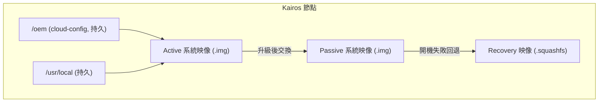
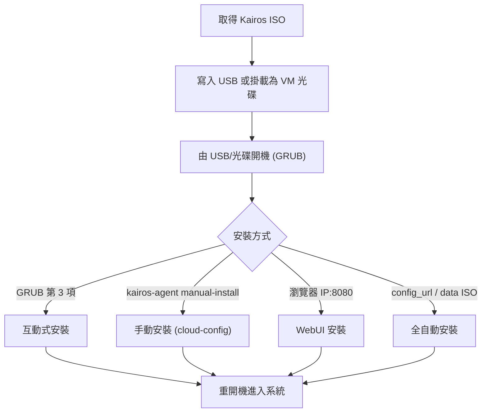

# 如何安裝 Kairos 並設定 k3s：完整實作指南

## 摘要

Kairos 是一套開源的「不可變（immutable）Linux 元發行版（meta-distribution）」，目標是讓邊緣（edge）、雲端與裸機節點的作業系統生命週期能以 Kubernetes 原生方式管理[^apidocs]。它被 CNCF（Cloud Native Computing Foundation）接納為 Sandbox 專案，接納日期為 2024-04-13[^cncf]。Kairos 的預設發行版（flavor）是 Hadron，這是一套由 Kairos 團隊從零打造、以 musl libc 搭配 systemd 的精簡 Linux 基底[^hadron][^imgmatrix]。

本報告以「實作」為核心：說明如何取得 Kairos ISO、寫入 USB、完成安裝，並用 cloud-config 啟用 k3s（或 k3s-agent）以建立單節點、多節點與高可用（HA）叢集，最後涵蓋安裝後設定、升級、取用 kubeconfig 與疑難排解。本報告同時保留來源間的差異（例如互動式安裝產生的設定檔名），並在文末做批判性來源反思。

> 本報告的事實以 2026-10-18 的檢索結果為準。Kairos 與 k3s 版本迭代頻繁，實作前請以官方最新文件與 release 頁面為準。

---

## 1. Kairos 是什麼

### 1.1 定位與治理

- Kairos 自稱為「不可變 Linux 元發行版」，用於邊緣 Kubernetes[^cncf]。
- 它是 CNCF Sandbox 專案，於 2024-04-13 被接納[^cncf]。
- 授權條款為 Apache License 2.0[^gh]。
- 主要語言為 Go[^gh]。
- 截至 2026-10-18 檢索，GitHub 專案 `kairos-io/kairos` 約有 1,855 顆星、153 個 fork[^gh]。

### 1.2 三個核心架構概念

**（一）不可變系統佈局。** 安裝完成後，根目錄 `/` 為唯讀，安裝後無法再新增套件；`/usr/local` 與 `/oem` 為持久（persistent）分割區，會跨升級保留；`/var`、`/etc`、`/srv` 則為暫時（ephemeral），重開機後變更會被捨棄[^apidocs]。持久路徑會被 bind-mount 到 `/usr/local/.state`，預設包含 `/etc/ssh`、`/etc/systemd`、`/etc/kubernetes`、`/home`、`/opt`、`/root`、`/var/lib/containerd`、`/var/lib/kubelet`、`/var/lib/etcd`、`/var/log` 等[^apidocs]。

**（二）A/B 原子升級（atomic upgrade）。** Kairos 採雙分割區 A/B 配置，並加上 recovery 備援。安裝時建立的分割區包含：state（存放 active 與 passive 開機用的容器映像，`.img`）、recovery（存放 `.squashfs` 映像）、選用的 OEM（使用者設定），以及 persistent（跨重開機保留資料）[^apidocs]。開機順序為 Active → Passive → Recovery；升級時會從容器登錄檔（container registry）拉取新映像、建立 transition 映像，下次重開機後 transition 成為 Active，舊 Active 變成 Passive；若開機失敗，bootloader 會自動回退[^apidocs]。

**（三）元發行版（meta-distribution）。** Kairos 的設計目標是把其他 Linux 發行版「轉換」成具備不可變佈局與 Kubernetes 原生元件的系統[^apidocs]。核心元件（v4.3.0 起合併至 `kairos-io/kairos` 單一 repo）包含：`kairos-init`（在標準上游發行版上建構 Kairos 映像）、`immucore`（不可變管理介面）、`agent`（節點的安裝、重置、升級）、`kcrypt`（TPM + LUKS 靜態資料加密）、`installer`（互動式終端 UI 安裝器）、`provider`（k3s／k0s 與 P2P 支援）與 `sdk`[^apidocs]。



### 1.3 Hadron：預設發行版

Hadron 是 Kairos 團隊從零打造的極精簡 Linux 發行版，官方部落格於 2025-12-17 發布介紹文[^hadron]。其關鍵屬性：

- **libc**：musl[^hadron]（版本 1.2.6）[^imgmatrix]
- **init**：systemd[^hadron]（Hadron v0.5.3 為 systemd 261.3；v0.6.0 為 systemd 262）[^imgmatrix]
- **套件管理器**：刻意不提供（no package manager by design）[^hadron]
- **核心**：vanilla Linux kernel（v0.5.3 為 7.2.6；v0.6.0 為 7.2.10）[^imgmatrix]
- **開機**：支援標準開機（Dracut/GRUB）與 Trusted Boot（UKI/USI）[^imgmatrix]
- Hadron 被描述為「少數刻意同時結合 musl libc 與 systemd 的發行版」[^hadron]

其他歷史發行版（Ubuntu、Rocky、openSUSE、Debian、Fedora、Alpine 等）仍可透過 `kairos-init` 自建，但官方 release pipeline 不再產製預建映像檔，預建產物以 Hadron 為主[^imgmatrix]。Hadron 於 2026-01-28 由 Spectro Cloud 發出正式新聞稿[^spectro]。

---

## 2. 版本與映像檔選擇

### 2.1 目前版本

- Kairos 最新穩定版：**v4.3.0**，於 2026-09-08 發布，是第一個從合併後 monorepo 釋出的版本[^rel430]。
- 該版本使用的 Hadron：**v0.5.1**（release 資產命名）[^apidocs][^rel430]。
- 已知釋出的三個 k3s 版本：**v1.34.11+k3s1、v1.35.8+k3s1、v1.36.4+k3s1**（最新為 v1.36.4+k3s1）[^rel430]。

> 註：另有來源指出 Hadron v0.5.3（2026-09-18）與 Hadron v0.6.0（2026-10-14）已釋出[^imgmatrix]，但 Kairos v4.3.0 的官方 ISO 資產仍以 Hadron v0.5.1 命名[^rel430]。此為上游 Hadron 與 Kairos 發布節奏不同步所致，實作時以 release 資產實際檔名為準。

### 2.2 映像檔命名規則

命名格式為 `kairos-<flavor>-<flavor_release>-<variant>-<arch>-<device>-<version>.<extension>`[^apidocs][^install]。各欄位定義：

| 欄位 | 值 | 說明 |
|---|---|---|
| flavor | `hadron` | 發行版基底 |
| flavor_release | `v0.5.1` | 該發行版版本 |
| variant | `core` 或 `standard` | core 不含 Kubernetes；standard 含 k3s 或 k0s[^apidocs] |
| arch | `amd64` 或 `arm64` | x86_64 或 aarch64[^apidocs] |
| device | `generic` 或 `rpi4` | 一般硬體或 Raspberry Pi 4[^apidocs] |
| version | `v4.3.0` | Kairos 版本 |

### 2.3 v4.3.0 實際 ISO 檔名（節錄）

**Core（不含 Kubernetes）：**

- `kairos-hadron-v0.5.1-core-amd64-generic-v4.3.0.iso`（約 291 MB）[^apidocs]
- `kairos-hadron-v0.5.1-core-arm64-generic-v4.3.0.iso`（約 282 MB）[^apidocs]

**Standard（含 k3s，amd64）：**

- `kairos-hadron-v0.5.1-standard-amd64-generic-v4.3.0-k3sv1.34.11+k3s1.iso`
- `kairos-hadron-v0.5.1-standard-amd64-generic-v4.3.0-k3sv1.35.8+k3s1.iso`
- `kairos-hadron-v0.5.1-standard-amd64-generic-v4.3.0-k3sv1.36.4+k3s1.iso`（約 415 MB，下載數最高）[^rel430]

**Standard（含 k3s，arm64）：**

- `kairos-hadron-v0.5.1-standard-arm64-generic-v4.3.0-k3sv1.36.4+k3s1.iso`（約 394 MB）[^rel430]

對應的容器映像發布於 Quay.io，例如 `quay.io/kairos/hadron:v0.5.1-standard-amd64-generic-v4.3.0-k3s-v1.36.4-k3s1`[^apidocs][^upgrade]。

> 重要：`core` 映像不含 Kubernetes 引擎，僅是精簡基底 OS[^apidocs]。若要用 k3s，需選擇 `standard` 映像，或在 `core` 映像的 cloud-config 中啟用 `k3s.enabled: true` 讓 Kairos 於開機時部署。

### 2.4 取得映像檔的方式

1. 使用 `kairos-lab`（初學者推薦）：
   ```
   kairos-lab download
   ```
   [^quickstart]

2. 手動下載：至 `https://github.com/kairos-io/kairos/releases/latest` 下載[^quickstart][^install]。

3. 下載容器映像再取出 raw 映像（適用於 Raspberry Pi 等 raw 檔）：
   ```bash
   export IMAGE=quay.io/kairos/hadron:v0.5.1-core-arm64-rpi4-v4.3.0-img
   container=$(docker create "$IMAGE" noop)
   docker cp "$container:/artifacts/." .
   docker rm "$container"
   ```
   [^apidocs]

---

## 3. 安裝前置需求

Kairos 官方文件沒有獨立的「系統需求」頁面，最接近的具體數字來自 Quick Start 的 Hadron 單節點 k3s 情境[^quickstart]：

| 情境 | 磁碟 | 記憶體 | 說明 |
|---|---|---|---|
| 最低可開機 | 8 GB | 2 GB | 可開機並執行極小工作負載（僅供冒煙測試）[^quickstart] |
| 實務最低 | 16 GB | 4 GB | 示範、實驗室、PoC 的建議起點[^quickstart] |
| 建議遊樂場 | 32 GB | 8 GB | 可跑小型資料庫、儀表板與多個應用[^quickstart] |

Quick Start 範例以 1 顆 CPU 即可完成安裝[^quickstart]。Raspberry Pi 安裝建議 SD 卡至少 16 GB[^install]。

支援架構：`amd64`（x86_64）與 `arm64`（aarch64）；裝置模型為 `generic` 與 `rpi4`[^apidocs]。

**UEFI 注意事項：** 若以 UEFI 模式開機，安裝目標磁碟的儲存裝置需設定為 **AHCI** 而非 RAID[^baremetal]。

---

## 4. 安裝方法

Kairos 提供多種安裝途徑，選擇取決於是否要互動、是否要自動化、以及是否為裸機或虛擬機。



### 4.1 裸機：下載、驗證、寫入 USB

**步驟 1：下載 ISO** 及對應的 `.sha256`、`.sha256.bundle` 檔案[^install]。

**步驟 2（建議）：驗證簽章。** 需要 `sha256sum` 與 `cosign` v2.0.0 以上[^sig]：

```bash
cosign verify-blob \
  --bundle kairos-hadron-v0.5.1-core-amd64-generic-v4.3.0.iso.sha256.bundle \
  --certificate-identity https://github.com/kairos-io/kairos/.github/workflows/reusable-factory.yaml@refs/tags/v4.3.0 \
  --certificate-oidc-issuer https://token.actions.githubusercontent.com \
  kairos-hadron-v0.5.1-core-amd64-generic-v4.3.0.iso.sha256

sha256sum -c kairos-hadron-v0.5.1-core-amd64-generic-v4.3.0.iso.sha256
```

預期輸出 `Verified OK` 與 `<iso>: OK`[^sig]。

**步驟 3：寫入 USB。**

```bash
dd if=/path/to/kairos.iso of=/path/to/dev bs=4MB
```

或用 GUI 工具如 balenaEtcher[^baremetal]。

**步驟 4：由 USB 開機**，進入 GRUB 選單，選第三項 `kairos (interactive install)` 進行互動式安裝，或改用下列其他方法[^interactive]。

### 4.2 互動式安裝（Interactive）

- 由 GRUB 選單選擇第三項 `kairos (interactive install)`[^interactive]。
- 或在 LiveCD 上手動執行：

  ```bash
  kairos-agent interactive-install
  ```
  [^interactive]

- 互動式安裝會產生一份設定檔，安裝後位於 `/oem/90_custom.yaml`[^interactive]。

互動式安裝器（`kairos-installer`）依序詢問：磁碟（必填，確認訊息為「Everything on {value} will be erased.」）、使用者與密碼（密碼會先雜湊再寫入設定）、SSH 公鑰、主機名稱、時區與鍵盤、系統擴充套件、Provider 設定，以及安裝完成後的動作（Nothing / Reboot / Power off）[^interactive]。其中 Provider 設定會依內建 provider plugin 顯示額外問題，預設 provider 會問「是否啟用 k3s？」與「是否啟用 k0s？」[^interactive]。摘要畫面顯示產生的 `#cloud-config`，可按 `e` 編輯、按 `v` 檢視，按 Enter 後需輸入 `y` 確認才會抹除磁碟[^interactive]。

> 來源不一致：互動式安裝頁面明確寫 `/oem/90_custom.yaml`[^interactive]；而 after-install 頁面在描述 `/oem` 讀取順序時，提及互動式安裝器產生的是 `/oem/99_custom.yaml`[^after]。兩種檔名都曾被文件提及，實作時建議以實際節點上 `kairos-agent config` 的輸出為準[^after]。

### 4.3 手動安裝（Manual install with cloud-config）

建立 `cloud-config.yaml`（第一行必須是 `#cloud-config`）：

```yaml
#cloud-config

users:
- name: "kairos"
  passwd: "kairos"
  ssh_authorized_keys:
  - github:mudler
  - "ssh-rsa AAA..."

k3s:
  enabled: true
```

執行（**具破壞性，會抹除磁碟**）：

```bash
sudo kairos-agent manual-install --device "auto" cloud-config.yaml
```

`--device "auto"` 會自動選擇最大的磁碟；也可指定 `/dev/sda` 等裝置[^manual][^single]。

> 安全提醒：安裝後若未在 cloud-config 中提供 `ssh_authorized_keys`，可能無法以 SSH 登入（密碼登入會被停用）；`passwd` 主要用於實體主控台（tty）登入[^single]。

### 4.4 WebUI 安裝

LiveCD 開機後，Kairos 預設在 **8080** 埠啟動 WebUI。以瀏覽器開啟 `http://<機器IP>:8080`，貼上 cloud-config YAML，於 device 欄位輸入 `auto`，勾選「Restart after installation」後安裝[^quickstart][^baremetal]。

### 4.5 全自動（零接觸）安裝

**方式 A：資料來源 ISO（data source ISO）。** 在 cloud-config 加入 `install` 區塊：

```yaml
#cloud-config
install:
  device: "/dev/sda"
  reboot: true
  poweroff: false
  auto: true   # 自動安裝所必需

p2p:
  network_token: ....
```

製作含設定的 ISO：

```bash
mkdir -p build
cd build
touch meta-data
cp -rfv cloud-config.yaml user-data
mkisofs -output ci.iso -volid cidata -joliet -rock user-data meta-data
```

開機時同時掛載此 `ci.iso` 與 Kairos ISO[^automated]。

**方式 B：config URL。** 開機時加入核心參數 `config_url=<URL>`，機器會下載設定；該值在抓取前會先以 Go template 渲染，支援 `.Values.product.uuid`、`.Values.network` 等變數[^automated]。

**方式 C：以 AuroraBoot 重製 ISO（remaster）。** 需 Docker：

```bash
docker run -v $PWD/cloud-config.yaml:/cloud-config.yaml \
  -v $PWD/build:/tmp/auroraboot \
  -v /var/run/docker.sock:/var/run/docker.sock \
  --rm -ti quay.io/kairos/auroraboot:v0.27.0 \
  --set container_image=oci:$IMAGE \
  --set "disable_http_server=true" \
  --set "disable_netboot=true" \
  --cloud-config /cloud-config.yaml \
  --set "state_dir=/tmp/auroraboot"
```

產物位於 `build/` 目錄下[^automated]。AuroraBoot 是 Kairos 官方 bootstrapper，可用單一執行檔建構開機映像（ISO、UKI、raw disk、sysext）、透過 PXE/netboot/Redfish 佈署、並以內建 dashboard 管理機群[^aurora]。AuroraBoot GitHub 專案約 41 顆星[^aurora]。

### 4.6 虛擬機與本機試用（kairos-lab）

`kairos-lab` 是一支小型 Go CLI，用於本機初次體驗 Kairos，適合不常使用虛擬化軟體者[^lab]。安裝方式：

```
# macOS
brew tap kairos-io/kairos
brew install kairos-lab

# Linux：由 releases 頁面下載二進位檔並放入 PATH
```

接著：

```
kairos-lab setup     # 安裝相依（如 QEMU）
kairos-lab download  # 下載最新 Kairos ISO
kairos-lab start     # 依提示建立並啟動 VM
```

`kairos-lab` 最新版為 v0.1.5（2026-09-25），授權 Apache-2.0，GitHub 約 2 顆星[^lab]。Windows 上 `kairos-lab` 無法執行，需改用 VirtualBox 等軟體[^quickstart]。VM 設定需啟用 **bridged network**，才能取得可從瀏覽器連線的 IP；`kairos-lab` 建立 bridged network 需 sudo 權限[^quickstart]。

---

## 5. 設定 k3s

### 5.1 cloud-config 結構

Kairos 使用 cloud-config 格式（YAML，第一行 `#cloud-config`）。它支援部分標準 cloud-init 語法，並以 [yip](https://github.com/mudler/yip) 擴充；Kairos 實際上不使用 cloud-init[^config]。重要頂層欄位包括：`users`、`k3s`、`k3s-agent`、`install`、`reset`、`upgrade`、`p2p`、`kubevip`、`stages`、`hostname`、`write_files`、`config_url`、`debug`、`strict`[^config]。

### 5.2 k3s provider 設定鍵

`k3s` 區塊設定 k3s **server**（控制平面）實例[^config]：

| 鍵 | 型別 | 預設 | 說明 |
|---|---|---|---|
| `k3s.enabled` | bool | — | 啟用 k3s server 實例[^config] |
| `k3s.env` | map[string]string | `{}` | 額外環境變數，如 `K3S_RESOLV_CONF`、`K3S_DATASTORE_ENDPOINT`[^config] |
| `k3s.args` | []string | `[]` | 額外命令列參數，如 `--cluster-init`、`--disable=traefik,servicelb`[^config] |
| `k3s.replace_env` | bool | `false` | 若為 true，取代 Kairos 傳給 k3s 的所有預設環境變數[^config] |
| `k3s.replace_args` | bool | `false` | 若為 true，取代 Kairos 傳給 k3s 的所有預設參數[^config] |
| `k3s.embedded_registry` | bool | — | 啟用 k3s 內嵌容器登錄檔[^config] |

`k3s-agent` 區塊設定 k3s **agent**（工作節點）實例，鍵與 `k3s` 對應：`k3s-agent.enabled`、`k3s-agent.env`、`k3s-agent.args`、`k3s-agent.replace_env`、`k3s-agent.replace_args`、`k3s-agent.embedded_registry`[^config]。

> 重要警告：`k3s.args` 只在 k3s 服務**建立時（安裝期間）**套用；安裝後再改 `k3s.args` 不會生效。若要在安裝後覆寫，需覆寫服務設定：Alpine 系寫入 `/etc/rancher/k3s/k3s.env` 的 `command_args`；systemd 系則用 yip 的 `systemctl` plugin 寫入 override[^config]。

### 5.3 單節點 k3s

最小可用設定：

```yaml
#cloud-config

users:
- name: kairos
  passwd: kairos
  groups:
    - admin
  ssh_authorized_keys:
    - github:<YOUR_GITHUB_USER>

k3s:
  enabled: true
```

[^single]

若要在開機後自動部署 manifest，可用 `write_files` 將 YAML 寫入 `/var/lib/rancher/k3s/server/manifests/`（k3s 會自動套用該目錄下的 manifest）[^single]。

### 5.4 多節點叢集

**控制平面（master）節點：**

```yaml
#cloud-config

hostname: metal-{{ trunc 4 .MachineID }}

users:
- name: kairos
  passwd: kairos
  groups:
    - admin
  ssh_authorized_keys:
    - github:<YOUR_GITHUB_USER>

k3s:
  enabled: true
  args:
    - --disable=traefik,servicelb
```

[^multi]

**工作（worker）節點**（注意金鑰是 `k3s-agent`，與 master 不同）：

```yaml
#cloud-config

hostname: metal-{{ trunc 4 .MachineID }}

users:
- name: kairos
  passwd: kairos
  groups:
    - admin
  ssh_authorized_keys:
    - github:<YOUR_GITHUB_USER>

k3s-agent:
  enabled: true
  args:
    - --with-node-id
  env:
    K3S_TOKEN: "<MASTER_SERVER_TOKEN>"
    K3S_URL: https://<MASTER_SERVER_IP>:6443
```

[^multi]

其中 `K3S_TOKEN` 取自 master 節點上的 `/var/lib/rancher/k3s/server/node-token`，`K3S_URL` 使用登入 master 所用的同一 IP[^multi]。`hostname` 使用 Go template 與 sprig 函式，`.MachineID` 可用於產生唯一主機名[^config]。

### 5.5 高可用（HA）叢集

**第一個控制平面節點（`--cluster-init`）：**

```yaml
#cloud-config

hostname: metal-{{ trunc 4 .MachineID }}

users:
- name: kairos
  passwd: kairos
  groups:
  - admin
  ssh_authorized_keys:
  - github:mudler

k3s:
  enabled: true
  args:
  - --cluster-init
  env:
    K3S_TOKEN: "TOKEN_GOES_HERE"
```

若未指定 token，會自動產生於 `/var/lib/rancher/k3s/server/node-token`[^ha]。

**其他控制平面節點：**

```yaml
#cloud-config

hostname: metal-{{ trunc 4 .MachineID }}

users:
- name: kairos
  passwd: kairos
  groups:
  - admin
  ssh_authorized_keys:
  - github:mudler

k3s:
  enabled: true
  args:
  - --server https://<ip or hostname of server1>:6443
  env:
    K3S_TOKEN: "TOKEN_GOES_HERE"
```

[^ha]

**工作節點：**

```yaml
#cloud-config

hostname: metal-{{ trunc 4 .MachineID }}

users:
- name: kairos
  passwd: kairos
  groups:
  - admin

k3s-agent:
  enabled: true
  env:
    K3S_TOKEN: "TOKEN_GOES_HERE"
    K3S_URL: "https://<ip or hostname of server1>:6443"
```

[^ha]

> 上述 HA 為手動配置。Kairos 另提供 P2P（EdgeVPN）與 `p2p.auto.enable`、`p2p.auto.ha.enable` 等選項，可自動分配節點角色與 HA 控制平面，並搭配 `kubevip` 提供 VIP[^config]。

---

## 6. 驗證與取用叢集

### 6.1 在節點上使用 kubectl

以 SSH 登入後（`ssh kairos@<IP>`），切換為 root：

```bash
sudo su -
kubectl get nodes
kubectl get pods -n kube-system
```

預期可看到 control-plane 節點狀態為 `Ready`，以及 `kube-system` 中的 coredns、traefik、metrics-server、local-path-provisioner、svclb 等 Pod[^quickstart]。因 k3s 的 kubectl 預設讀取 `/etc/rancher/k3s/k3s.yaml`，也可直接用 `k3s kubectl ...`[^single][^k3saccess]。

k3s 預設內建元件（v1.36.4+k3s1 為例）：Traefik v3.7.8、metrics-server v0.9.0、local-path-provisioner v0.0.37、CoreDNS v1.14.6、Helm-controller v0.17.7、Flannel v0.28.4、containerd v2.3.4、Kubernetes v1.36.4[^rel430]。k3s 預設不會停用這些內建元件[^rel430]。

### 6.2 取得 kubeconfig

k3s 的 admin kubeconfig 位於 master 節點的 `/etc/rancher/k3s/k3s.yaml`[^k3saccess]。複製到工作站：

```bash
scp kairos@<node-ip>:/etc/rancher/k3s/k3s.yaml ~/.kube/config
```

之後需把 `~/.kube/config` 中的 `server` 由 `https://127.0.0.1:6443` 改為實際節點 IP：

```yaml
server: https://<node-ip>:6443
```

[^k3saccess]

然後即可使用：

```bash
export KUBECONFIG=~/.kube/config
kubectl get nodes
```

[^k3saccess]

> 注意：k3s 每次啟動都會更新 admin kubeconfig 內的憑證；複製出去的副本需手動更新，否則憑證會過期[^k3saccess]。

另可透過 P2P 網路以 `kairosctl get-kubeconfig` 取得遠端 kubeconfig：

```bash
sudo kairosctl bridge --network-token <TOKEN>   # 需 root，另開終端保持執行
kairosctl get-kubeconfig --network-id kairos > kubeconfig
```

可用旗標：`--api`（預設連本機 edgevpn daemon，如 `http://127.0.0.1:8080` 或 `unix:///run/edgevpn.sock`）與 `--network-id`（預設 `kairos`）[^kairosctl]。

### 6.3 重要路徑速查

| 項目 | 路徑 |
|---|---|
| k3s admin kubeconfig | `/etc/rancher/k3s/k3s.yaml`[^k3saccess] |
| k3s node token | `/var/lib/rancher/k3s/server/node-token`[^multi][^k3stoken] |
| k3s server token（安全格式） | `/var/lib/rancher/k3s/server/token`[^k3stoken] |
| Kairos 持久 cloud-config | `/oem/`、`/usr/local/cloud-config/`[^after] |
| Kairos 代理日誌 | `/var/log/kairos/*.log`[^after] |

---

## 7. 安裝後管理

### 7.1 推送設定（/oem）

Kairos 開機時會以字典序（lexicographic order）讀取 `/oem` 與 `/usr/local/cloud-config` 下的 YAML 檔，後讀者覆蓋先讀者[^config][^after]。可在安裝後以 SSH 寫入新檔案，例如 `/oem/100_zram.yaml`，然後重開機使其生效[^after]。

檢查目前合併後的設定與日誌：

```bash
kairos-agent config        # 印出合併後的 cloud config
kairos-agent logs --debug  # 收集日誌成 ./kairos-logs.tar.gz
journalctl -u k3s
kairos-agent state
```

[^after]

### 7.2 升級

**手動升級（節點上執行）：**

```bash
sudo kairos-agent upgrade list-releases
sudo kairos-agent upgrade --source oci:quay.io/kairos/hadron:v0.5.1-standard-amd64-generic-v4.3.0-k3s-v1.36.4-k3s1
```

`--source` 支援 `oci:`（容器登錄檔）、`ocifile:`（`docker save` 的 tarball）、`dir:`（已解開的 rootfs）、`file:`（單一映像 blob）[^upgrade]。被動（passive）系統不需直接升級，會在主動系統重開機時自動同步[^upgrade]。Trusted Boot 安裝另需傳 `--boot-entry <efi_file_name>`[^upgrade]。

**透過 Kubernetes 升級（推薦使用 Kairos Operator）：**

```bash
helm repo add kairos-operator https://kairos-io.github.io/kairos-operator/charts
helm repo update
helm install kairos-operator kairos-operator/kairos-operator \
  --namespace kairos-operator --create-namespace
```

建立 `NodeOpUpgrade` 資源即可進行金絲雀升級：

```yaml
apiVersion: operator.kairos.io/v1alpha1
kind: NodeOpUpgrade
metadata:
  name: kairos-upgrade
  namespace: default
spec:
  image: quay.io/kairos/hadron
  nodeSelector:
    matchLabels:
      kairos.io/managed: "true"
  concurrency: 1
  stopOnFailure: true
  upgradeActive: true
  upgradeRecovery: false
  force: false
```

[^upgrade]

舊有的 Rancher System Upgrade Controller 已列為 deprecated，建議改用 Kairos Operator[^upgrade]。

### 7.3 重置（reset）

- 由 GRUB 選單選擇 Reset 項目，節點會自動重置並重開機[^after]。
- 遠端（root，Kairos v3.0.0+）：

  ```bash
  kairos-agent bootentry --select statereset
  ```
  [^after]

`reset` 預設保留 `/oem` 設定檔，但會抹除持久資料；可用 `reset.reset-persistent` 與 `reset.reset-oem` 控制[^config][^after]。

### 7.4 疑難排解

- 以 `console=tty0 rd.debug rd.immucore.debug` 核心參數開機以取得詳細日誌（於 GRUB 按 `e` 編輯 cmdline）[^after]。
- 以 `kairos-agent logs` 檢視開機模式，尋找如 `INF Boot Mode boot_mode=active_boot` 的行[^after]。
- 檢查服務：`journalctl -u cos-setup-boot`、`-u cos-setup-network`、`-u k3s`、`-u kairos`[^after]。

---

## 8. 批判性來源反思

1. **官方文件為主，社群轉述為輔。** 本報告多數敘述來自 `kairos.io` 官方文件與 GitHub release 資產，可信度較高[^apidocs][^rel430]。少數詳細銷售／新聞資訊（如 Hadron 的 Spectro Cloud 新聞稿）屬於行銷材料，可能帶有推廣傾向，故僅用於佐證發布時間與定位[^spectro]。

2. **文件內部不一致。** 互動式安裝產生的設定檔名，官方兩份文件分別寫 `/oem/90_custom.yaml` 與 `/oem/99_custom.yaml`[^interactive][^after]。此類版本殘留是常見現象，實務上應以節點上 `kairos-agent config` 與實際檔案清單為準[^after]。

3. **版本節奏落差。** Kairos v4.3.0 的 official ISO 資產以 Hadron v0.5.1 命名[^rel430]，但 Hadron 上游已推出 v0.5.3 與 v0.6.0[^imgmatrix]。不同來源對「最新 Hadron 版本」的答案不同，原因是關注對象不同（Kairos release 資產 vs. Hadron 獨立 release）。引用版本時必須明示脈絡。

4. **k3s 版本並非單一固定值。** Kairos release pipeline 會動態查詢 k3s 最新 patch，並針對最近三個 minor 版本建構映像[^rel430]。因此「Kairos v4.3.0 搭哪個 k3s」沒有唯一答案，而是取決於所選 ISO 檔名。

5. **硬體需求缺乏權威頁面。** Kairos 官方沒有正式系統需求頁，唯一具體數字來自 Quick Start 的示範情境[^quickstart]。這些數字為示範／VM 取向，生產環境的資源規劃仍需保守上調。

6. **時間敏感。** k3s 本身迭代極快（截至 2026-09-30 最新穩定版為 v1.37.1+k3s1）[^k3sdocs]，Kairos 亦持續改版。本報告的版本數字在數週後可能已過時，實作前務必重新核對。

---

## 9. 參考文獻

[^apidocs]: Kairos. (n.d.). *Documentation overview*. Retrieved 2026-10-18, from https://kairos.io/docs/

[^cncf]: Cloud Native Computing Foundation. (n.d.). *Kairos*. Retrieved 2026-10-18, from https://www.cncf.io/projects/kairos/

[^gh]: GitHub. (n.d.). *kairos-io/kairos*. Retrieved 2026-10-18, from https://github.com/kairos-io/kairos

[^rel430]: Kairos. (2026, September 8). *v4.3.0 release*. Retrieved 2026-10-18, from https://github.com/kairos-io/kairos/releases/tag/v4.3.0

[^quickstart]: Kairos. (n.d.). *Quick start*. Retrieved 2026-10-18, from https://kairos.io/quickstart/

[^install]: Kairos. (n.d.). *Installation*. Retrieved 2026-10-18, from https://kairos.io/docs/v4.3.0/installation/

[^baremetal]: Kairos. (n.d.). *Bare-metal installation*. Retrieved 2026-10-18, from https://kairos.io/docs/v4.3.0/installation/bare-metal/

[^interactive]: Kairos. (n.d.). *Interactive installation*. Retrieved 2026-10-18, from https://kairos.io/docs/installation/interactive/

[^manual]: Kairos. (n.d.). *Manual installation*. Retrieved 2026-10-18, from https://kairos.io/docs/v4.3.0/installation/manual/

[^automated]: Kairos. (n.d.). *Automated installation*. Retrieved 2026-10-18, from https://kairos.io/docs/v4.3.0/installation/automated/

[^sig]: Kairos. (n.d.). *Check the signatures*. Retrieved 2026-10-18, from https://kairos.io/docs/v4.3.0/installation/check-the-signatures/

[^config]: Kairos. (n.d.). *Configuration reference*. Retrieved 2026-10-18, from https://kairos.io/docs/reference/configuration/

[^single]: Kairos. (n.d.). *Single node example*. Retrieved 2026-10-18, from https://kairos.io/docs/examples/single-node/

[^multi]: Kairos. (n.d.). *Multi node example*. Retrieved 2026-10-18, from https://kairos.io/docs/examples/multi-node/

[^ha]: Kairos. (n.d.). *HA cluster example*. Retrieved 2026-10-18, from https://kairos.io/docs/examples/ha/

[^upgrade]: Kairos. (n.d.). *Upgrade*. Retrieved 2026-10-18, from https://kairos.io/docs/upgrade/

[^after]: Kairos. (n.d.). *After install*. Retrieved 2026-10-18, from https://kairos.io/docs/advanced/after-install/

[^kairosctl]: Kairos. (n.d.). *kairosctl reference*. Retrieved 2026-10-18, from https://kairos.io/docs/reference/kairosctl/

[^imgmatrix]: Kairos. (n.d.). *Image matrix*. Retrieved 2026-10-18, from https://kairos.io/docs/reference/image_matrix/

[^hadron]: Kairos. (2025, December 17). *Introducing Hadron: The minimal, upstream-first Linux base for Kairos*. Retrieved 2026-10-18, from https://kairos.io/blog/2025/12/17/introducing-hadron-the-minimal-upstream-first-linux-base-for-kairos/

[^spectro]: Spectro Cloud. (2026, January 28). *Spectro Cloud announces Hadron: A lightweight, security-first Linux base for modern enterprise edge deployments*. Retrieved 2026-10-18, from https://www.businesswire.com/news/home/20260128584925/en/

[^lab]: GitHub. (n.d.). *kairos-io/kairos-lab*. Retrieved 2026-10-18, from https://github.com/kairos-io/kairos-lab

[^aurora]: GitHub. (n.d.). *kairos-io/AuroraBoot*. Retrieved 2026-10-18, from https://github.com/kairos-io/AuroraBoot

[^k3sdocs]: K3s. (n.d.). *Documentation*. Retrieved 2026-10-18, from https://docs.k3s.io/

[^k3saccess]: K3s. (n.d.). *Cluster access*. Retrieved 2026-10-18, from https://docs.k3s.io/cluster-access

[^k3stoken]: K3s. (n.d.). *Token*. Retrieved 2026-10-18, from https://docs.k3s.io/cli/token
