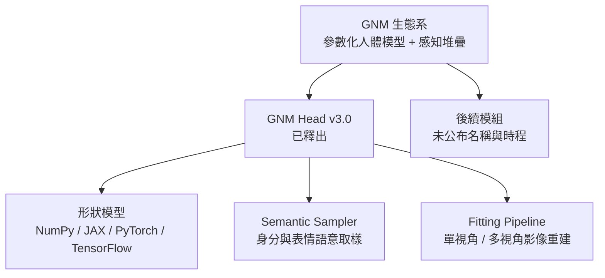
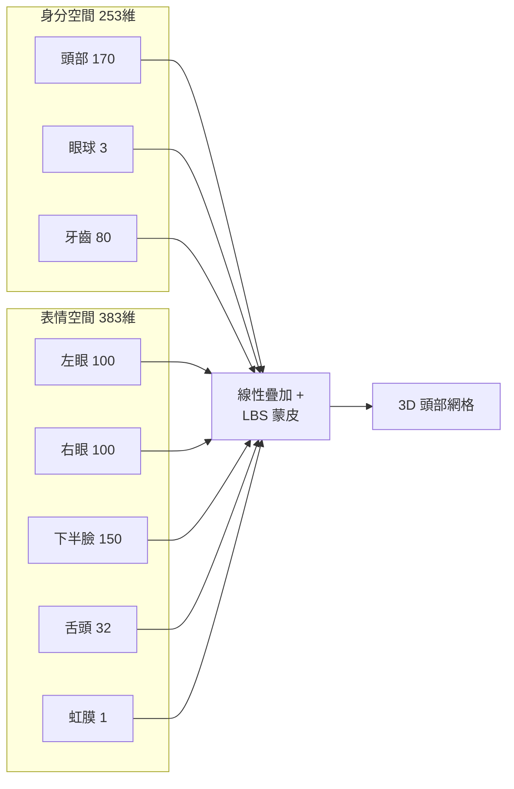

# GNM (Generative aNthropometric Model)：Google 的參數化人頭統計模型

## 1. 一句話總結

GNM 是 Google 開源的一組「參數化 3D 統計人體模型」生態系，名稱刻意讀作與「基因組」(genome) 同音的 `/ˈdʒiː.noʊm/`，比喻其如同人類基因組一般，試圖用一組低維參數完整描述人體三維幾何[^repo]。目前公開釋出的第一個模組是 **GNM Head**，一個涵蓋頭、臉、頸、眼球、牙齒與舌頭的線性 3D 形變模型 (3DMM)[^arxiv][^hf]。官方定位是「最準確、最完整的 3D 參數化人體模型」[^repo]。

需要注意名稱易混淆：官方與技術報告寫的是 **Generative aNthropometric Model**（「人體測量學」）[^arxiv]，而部分媒體報導寫成 Generative aNthropomorphic Model（「擬人化的」）[^cgchannel]，兩者指同一個專案。

## 2. 專案基本資料

| 項目 | 內容 |
| :--- | :--- |
| 開發者 | Google（Google Research）[^arxiv] |
| 官方倉庫 | `github.com/google/GNM`，Apache 2.0 授權[^repo] |
| 倉庫建立 | 2026-03-23[^ghapi] |
| 主要語言 | Python[^ghapi] |
| 星數 / 分支 | 約 1,586 stars、174 forks（統計於 2026-10-18）[^ghapi] |
| 首次公開模組 | GNM Head（v3.0 權重）[^hf] |
| 技術報告 | arXiv:2607.23687，v1 於 2026-07-26 提交，v3 於 2026-09-11 修訂[^arxiv] |
| 權重託管 | Hugging Face Hub `google/gnm-v3`、Kaggle Models[^hf][^repo] |
| 授權 | Apache 2.0（可商用）[^repo][^hf] |

生態系的檔名與新聞稿顯示 Google 打算陸續釋出更多模組（社群常推測會有 GNM Body），但截至本報告撰寫時，官方尚未公布後續模組的名稱與時程[^repo][^cgchannel]。

## 3. 為什麼要做 GNM：既有模型的痛點

技術報告把問題定義得很明確：現有公開的參數化人頭模型（如 FLAME、Basel Face Model、LSFM）基本上把頭顱當成「空心殼」，只建模外部皮膚幾何，幾乎完全忽略口腔內部（牙齒、舌頭）與眼球的細部結構[^arxiv]。這帶來三個實務後果：

1. **生成式模型的幾何約束不足**：擴散模型等 2D 生成系統拿不到嘴巴內部的幾何先驗，合成張嘴表情時品質明顯下滑[^arxiv]。
2. **失去非語音溝通線索的控制**：無法精細控制嘴唇與舌頭的協同發音動作 (co-articulation)[^arxiv]。
3. **解剖不完整導致動畫穿幫**：高階動畫常需要看到口腔內部，眼球也需要生理上合理的建模[^arxiv]。

GNM 的三個宣稱貢獻為：(i) 將牙齒幾何整合進全域身分形狀空間；(ii) 引入明確的舌頭與局部化臉部表情 blendshape，超越傳統「全域表情」的粗粒度控制；(iii) 建模瞳孔放大，以及隨身分變化的鞏膜與角膜形狀[^arxiv]。

## 4. 技術原理

### 4.1 資料來源與擷取

GNM Head 的訓練資料來自 Google 自建的**多視角立體擷取系統**：22 台高解析度 (6144×4096) ZCam E2 S6G 相機、14 盞可控制燈光，提供均勻漫射照明；取像涵蓋水平約 150 度、垂直約 60 度的範圍[^arxiv][^cgchannel]。資料集包含約 5,000 位受試者，每人拍攝一組靜態表情，總計約 15 萬個樣本[^arxiv]。表情涵蓋類別包括：肌肉緊繃與微笑、10 類標準視素 (visemes)、唇部動作、全域情緒、舌頭動作、下顎側移、眨眼與瞇眼、凝視方向、眉毛動作、臉頰變形等[^arxiv]。Google 另開發了高度平行的資料處理流程，宣稱每天可處理約 1 萬個樣本[^arxiv]。

值得注意的是，由於髮際遮擋使掃描無法直接量測顱頂，GNM 額外以 200 個藝術家雕刻的頭部網格建立輔助模型，透過跨域潛在空間回歸補出解剖上合理的顱骨形狀，再以非剛性形變貼回原始註冊結果[^arxiv]。

### 4.2 模型公式

GNM 遵循標準 3DMM 定義，但加入骨架與線性混合蒙皮 (LBS)。模型是一個函式，輸入參數集合 $\Theta = (\beta, \phi, \theta, \tau)$，輸出 $N_V$ 個 3D 頂點的網格[^arxiv]：

- $\beta$：**身分**參數
- $\phi$：**表情**參數
- $\theta$：K = 4 個關節的軸角 (axis-angle) 旋轉
- $\tau$：全域位移

先以模板網格 $T$ 搭配身分基 $I$ 與表情基 $E$ 逐頂點線性疊加，得到 bind pose 頂點；再以類骨架關節 $J$、關節位置身分基 $Q$、蒙皮權重 $W$ 與運動鏈定義 $p$ 計算每個關節的仿射轉換，最後以標準 LBS 旋轉並混合頂點[^arxiv]。簡言之，**它是線性統計模型，而非生成式 AI／深度生成網路**[^cgchannel]。

### 4.3 參數空間（v3.x）

**身分參數：253 維**，典型值域約 −3 至 +3[^shape]：

| 子空間 | 維度 |
| :--- | ---: |
| 頭部 | 170 |
| 眼球 | 3 |
| 牙齒 | 80 |
| **合計** | **253** |

**表情參數：383 維**，典型值域約 −3 至 +3[^shape]：

| 子空間 | 維度 |
| :--- | ---: |
| 左眼 | 100 |
| 右眼 | 100 |
| 下半臉 | 150 |
| 舌頭 | 32 |
| 虹膜 | 1 |
| **合計** | **383** |

**姿態參數**：每個關節的軸角旋轉（形狀為 `[batch, num_joints, 3]`）加上全域平移 `[batch, 3]`[^shape]。

### 4.4 UV 佈局與網格拓撲

GNM Head 提供結構化 UV 佈局，同時支援四邊形 (`quad_uvs`, `[Q, 4, 2]`) 與三角化 (`triangle_uvs`, `[T, 3, 2]`) 兩種拓撲[^shape][^hf]。邏輯區域包含皮膚、上排牙齒與牙齦、下排牙齒與牙齦、舌頭、眼球內部（鞏膜、瞳孔、虹膜）與眼球外部（角膜）[^shape]。左右眼的 UV 刻意對映到重疊的 UV 空間區域以節省貼圖空間[^shape]。

### 4.5 Semantic Sampler（語意取樣器）

為避免使用者直接亂調 PCA 參數而產生不自然的幾何變形，Google 提供以**雙 CVAE (dual-CVAE) 架構**訓練的語意取樣器，把高階語意標籤對映到平滑的參數流形上[^arxiv][^shape]：

- `IdentitySampler`：依性別、族群等屬性產生身分參數[^shape]。
- `ExpressionSampler`：產生如 "happy"、"surprise" 等表情參數，並可混合[^shape]。

### 4.6 Fitting Pipeline（影像重建）

GNM 附帶一套擬合流程，可從單視角或多視角影像重建 GNM 網格，基於稠密 2D 臉部特徵點，並加入碰撞約束、局部舌頭凸包測試與正則化項[^arxiv]。流程包含專為眼周與口內設計的處理，以處理這些區域常被遮擋的問題[^arxiv]。

## 5. 多框架支援與取用方式

GNM Head 以統一介面提供 **NumPy、JAX、PyTorch、TensorFlow** 四種後端實作[^shape]。安裝方式為自 GitHub 複製後以 pip 安裝，可只安裝需要的框架（例如 `pip install -e ".[pytorch]"`）[^shape]。模型權重首次使用時會自動從遠端 CDN（Hugging Face Hub 或 Kaggle Models）下載並快取於 `~/.cache/gnm/models/`[^shape]。官方另有互動式 XR Blocks 網頁 Demo，可在 XR 裝置、手機或桌面瀏覽器上即時調整身分與表情參數[^shape]。

## 6. 應用場景

技術報告列出的下游客戶端包括[^arxiv]：

- **2D 生成式 AI 的幾何錨點**：以 GNM 參數條件化擴散模型，取得空間與時間上更穩定的生成結果。
- **隱私安全的合成資料生成**：產生大量合規、可標註的合成人臉資料集。
- **神經渲染的結構橋樑**：作為 3D Gaussian Splatting (3DGS) 與 NeRF 的幾何先驗，兼顧寫實度與即時可動畫性。
- **語音驅動的視聽合成與遠距臨場**：唇形同步與協同發音。
- **影視特效與遊戲的表演捕捉**。
- **媒體鑑識**：以 3D 姿態與特徵點一致性辨識 AI 變造的深偽內容。
- **醫療**：顱顏手術規劃、症候群分類、生物特徵形狀分析。

## 7. 與既有模型的比較

| 面向 | 傳統 3DMM (如 FLAME) | 神經式模型 (如 NPHM、imHead) | GNM Head |
| :--- | :--- | :--- | :--- |
| 表現形式 | 線性基 (PCA) | 隱式神經場 | 線性基 + 骨架 + LBS[^arxiv] |
| 解剖範圍 | 多為外部臉部外殼 | 視模型而定，常烘焙牙齒與眼睛 | 皮膚、眼球、牙齒、牙齦、舌頭[^arxiv] |
| 控制性 | 語意直觀但受拓撲限制 | 潛在空間不直觀、難以局部控制 | 分區、解耦的語意控制[^arxiv] |
| 幾何細節 | 受資料解析度限制 | 較高，但黑箱 | 高解析網格拓撲，局部化表情基[^arxiv] |
| 可商用授權 | 各異 | 各異 | Apache 2.0[^repo] |

報告聲稱 GNM 在多項下游任務（包含擬合目標 3D 臉部掃描）上持續優於 FLAME[^arxiv]。此外，GNM 對顱骨、頭皮與耳後採用**分區的平滑約束**，避免傳統全域 PCA 常見的長距離耦合變形（改一個臉部參數卻意外改變顱骨形狀）[^arxiv]。

## 8. 社群整合（釋出後數小時內出現）

GNM Head 於 2026 年 7 月中公開後，社群極快出現整合工具[^cgchannel]：

- **Blender**：`GNM Head Importer`，由綁定師 Nathan Dickson 釋出的免費外掛，以滑桿即時調整參數，適用 Blender 5.1 以上[^cgchannel]。
- **3ds Max**：`GNM Head Generator`，由 Iman Shirani 釋出的免費整合[^cgchannel]。
- **Houdini**：由 Zoic Studios 3D 總監 David Eschrich 整合為 HDA（報導時尚未公開發布）[^cgchannel]。

媒體評論指出，GNM Head 目前的定位更偏向「研究與軟體開發者的資源」，而非直接給 CG 藝術家使用的工具；它較可能被整合進既有的角色生成工具（如 MakeHuman/MPFB、CharMorph、Reallusion Character Creator）之中[^cgchannel]。

## 9. 限制與批判性反思

**官方自陳的限制**：訓練資料採用二元性別分類與四大族群分組，這些類別無法完整涵蓋人類性別認同的光譜與全球人口的完整多樣性；官方要求使用者留意其應用場域中的公平性與代表性風險，細節見技術報告[^shape][^hf]。此外，部分官方文件本身存在不一致（例如 UV 佈局在行文中被描述為「五個」邏輯區域，但條列與表格實際列出六個：皮膚、上牙齦、下牙齦、舌頭、眼內、眼外），使用時建議以程式介面實際定義為準[^shape][^hf]。

**閱讀者應注意的偏誤**：

1. **來源同質性**：本報告多數技術細節直接來自 Google 自家的技術報告與倉庫文件，屬於第一方說法；「優於 FLAME」等效能宣稱目前尚缺乏獨立第三方複現驗證。獨立媒體報導目前多為轉述性質[^cgchannel]。
2. **時效性**：專案於 2026 年 3 月建庫、7 月公開、9 月修訂技術報告，屬於極新的專案；API 與權重版本（v3.0）仍可能快速變動。
3. **「GNM」一詞歧義**：在學術文獻中 GNM 也常是 Graph Neural Network 的縮寫，而此處官方語意與圖神經網路完全無關，搜尋與引用時須特別注意[^arxiv]。媒體報導中名稱寫法亦有語意差異（aNthropometric vs. aNthropomorphic）[^cgchannel]。
4. **「生成式」的用詞**：名稱雖含 Generative，但本質是統計形變模型（PCA 線性基底）而非深度生成模型；官方自己也在媒體報導中澄清這點[^cgchannel]。

**正面訊號**：Apache 2.0 授權允許商用、四種主流框架皆有原生後端、權重同時上架 Hugging Face 與 Kaggle，這些都顯著降低了導入門檻[^repo][^hf][^shape]。

## 10. 參考資料

[^repo]: Google. (2026). GNM: Generative aNthropometric Model and Ecosystem [Source code repository]. GitHub. Retrieved 2026-10-18, from https://github.com/google/GNM

[^shape]: Google. (2026). GNM: Generative aNthropometric Model (gnm/shape package documentation) [Source code repository]. GitHub. Retrieved 2026-10-18, from https://raw.githubusercontent.com/google/GNM/main/gnm/shape/README.md

[^arxiv]: Ploumpis, S., Bednarik, J., Zoss, G., Guseinov, R., Prasso, L., Chandran, P., Boyne, O., Choutas, V., Bolkart, T., Wang, D., Chai, M., Qiu, D., Winberg, S., Rainer, G., Bridgeman, L., Helminger, L., Collins, E., Vicini, D., Riviere, J., Boetzel, Y., Koumis, A., Moschoglou, S., Busch, J., Herrera, C., Still, J., Ysebert, S., Lincoln, P., Escolano, S. O., Rhemann, C., Wood, E., Beeler, T., & Zafeiriou, S. (2026). GNM Head: A Generative aNthropometric Model of the human head (arXiv:2607.23687v3). arXiv. Retrieved 2026-10-18, from https://arxiv.org/abs/2607.23687

[^hf]: Google. (2026). GNM (Generative aNthropometric Model) - v3.0 [Model weights and model card]. Hugging Face. Retrieved 2026-10-18, from https://huggingface.co/google/gnm-v3

[^ghapi]: GitHub. (2026). Repository metadata for google/GNM [API response]. Retrieved 2026-10-18, from https://api.github.com/repos/google/GNM

[^cgchannel]: Thacker, J. (2026, July 15). Google open-sources GNM Head, its parametric human head model. CG Channel. Retrieved 2026-10-18, from https://www.cgchannel.com/2026/07/google-open-sources-gnm-head-its-parametric-human-head-model/

[^chandran]: Chandran, P. (2026). GNM Head: A Generative aNthropometric Model of the human head. Prashanth Chandran, Research Scientist Web site. Retrieved 2026-10-18, from https://prashanth-chandran.github.io/publication/gnm_2026
