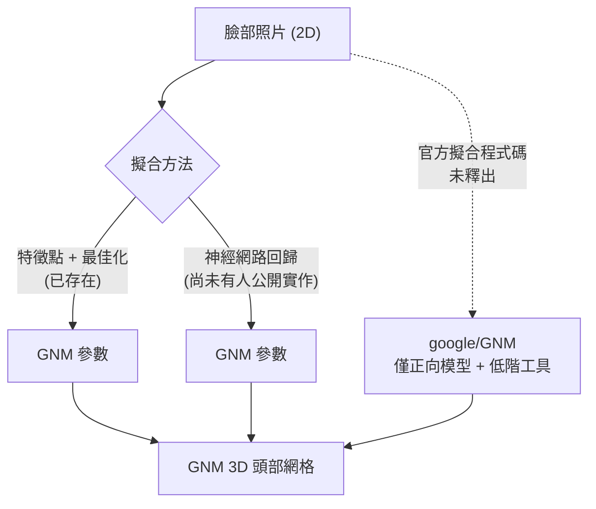
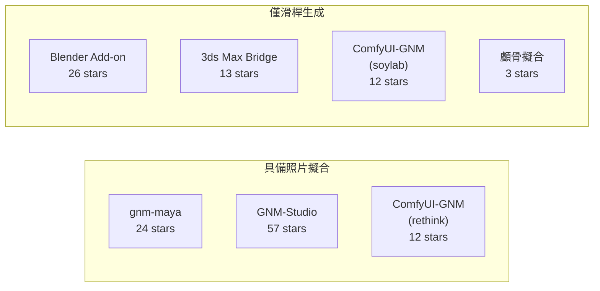

# 是否有工具能把臉部照片轉換成 GNM (Generative aNthropometric Model) 模型？

## 摘要

GNM 是 Google 於 2026 年 7 月開源的參數化人頭統計模型，全名 Generative aNthropometric Model（發音同 genome，基因組），目前開源範圍為「GNM Head」子模型[^gnmrepo]。本文調查的核心問題是：**是否存在任何工具，能把單張臉部照片（2D 影像）轉換（擬合）成 GNM 模型參數？**

結論如下：

- **Google 官方倉庫尚未釋出任何「照片轉 GNM」的模型推論或深度學習編碼器程式碼**，只提供正向模型（參數 → 網格）以及低階的擬合輔助函式[^gnmrepo][^fittingutils]。
- **社群已有三個工具實作了「照片 → GNM 參數」的功能**，但全部是**基於特徵點（landmark）的傳統最佳化擬合**，而非深度學習回歸：`gnm-maya`、`GNM-Studio`、`rethink-studios/ComfyUI-GNM`[^gnmmaya][^gnmstudio][^comfyui-rethink]。
- **不存在任何已公開的「學習式神經網路編碼器」**（以 PyTorch/JAX 訓練，直接從影像回歸 GNM 係數）[^noencoder]。
- 其餘大量 GNM 相關外掛（Blender、3ds Max、Houdini、ComfyUI）**僅提供滑桿生成，不具備照片擬合能力**。

---

## 背景：GNM 是什麼

GNM Head 是 Google 釋出的高擬真統計 3D 人頭模型，涵蓋頭、臉、頸、眼球、牙齒與舌頭，並包含可控的內部解剖結構[^gnmrepo]。其技術報告於 2026 年 7 月 28 日發布（arXiv:2607.23687）[^gnmpaper]。

模型採用固定拓樸：17,821 個頂點、17,662 個四邊形面，並帶有 UV 與六個解剖部位（皮膚、左右眼球、上下牙齒與牙齦、舌頭）[^gnmmayareadme]。參數維度為：

- **Identity（身分）**：253 維，控制臉型等身分特徵。
- **Expression（表情）**：383 維，控制表情。
- **Pose（姿態）**：4 個關節（頸、頭、左右眼）。

模型支援 NumPy、JAX、PyTorch、TensorFlow 四種後端，授權為 Apache 2.0，可用於商業與非商業用途[^gnmrepo]。

---

## 一、Google 官方倉庫：只有正向模型與低階擬合工具

`google/GNM` 官方倉庫約有 **1.6k stars、174 forks**[^gnmrepo]。其 `gnm/shape/fitting_utils/` 目錄僅包含四個檔案[^fittingutils]：

| 檔案 | 作用 |
| --- | --- |
| `project_on_pca.py` | 將 3D 頂點投影到 PCA 基底（即 3D 幾何 → 係數） |
| `regularized_least_squares.py` | 帶正則化的最小平方擬合工具 |
| 對應的兩個 `_test.py` | 單元測試 |

關鍵在於：這些工具**期望的輸入是 3D 頂點位置，而非 2D 影像**[^fittingutils]。官方 README 明確表示，其路線圖包含「感知與分析技術（perception and analysis technology）」，暗示**影像端的擬合程式碼尚未釋出**[^gnmrepo]。

GNM Head 技術報告中確實描述了一套「擬合 GNM 到影像與影片」的方法，但該方法是**最佳化式**的：先用稠密特徵點偵測器（真實影像約 600 點）取得 2D 特徵點，再最佳化身分係數、表情係數、關節旋轉、位移與相機參數以滿足重投影約束[^gnmpaper]。報告以單張合成影像實驗，GNM 平均誤差 1.683 mm，優於 FLAME 的 2.172 mm[^gnmpaper]。然而，**報告中完整的影像擬合流程（稠密特徵點偵測器、完整最佳化迴圈、自相交懲罰項）並未隨倉庫釋出，倉庫內只有共用輔助函式**[^gnmpaper][^fittingutils]。

---

## 二、具備「照片 → GNM」能力的社群工具

以下三個工具確實能從照片產生 GNM 模型，但**全部採用傳統最佳化擬合，而非神經網路回歸**。

### 2.1 enriquevelmai/gnm-maya（Maya 外掛，24 stars）

Autodesk Maya 外掛，提供 `Create` 分頁的 **「From Photo…」** 按鈕[^gnmmayareadme]。其演算法流程為[^gnmmayareadme]：

1. 以 **MediaPipe FaceMesh** 偵測 468 個臉部特徵點，再映射為標準 iBUG-68 佈局，最後置換為 GNM 內部特徵點順序。
2. 以 **弱透視相機（weak-perspective）** 初始化：利用 Procrustes / SVD 對齊 GNM 模板的 68 個 3D 特徵點與偵測到的 2D 特徵點。
3. **聯合最佳化**：以阻尼式 Gauss-Newton（Tikhonov 正則化）同時求解 **253 個身分係數 + 6 個相機參數**，並將係數裁切於 ±3.0。

官方文件明言其結果為「**從正面資訊產生的相似度（likeness），而非掃描級精確匹配**」[^gnmmayareadme]。第一次使用時會下載約 290 MB 的 MediaPipe/OpenCV 套件，全程本機執行[^gnmmayareadme]。

### 2.2 Saganaki22/GNM-Studio（桌面／網頁版，57 stars）

本機優先（local-first）的 Windows 桌面應用（Tauri/Rust），亦有網頁版[^gnmstudio]。其 **「Experimental Custom Head」** 功能可接受一張正面照片，並可選第二張 45–60° 側臉照[^gnmstudio]。

其擬合方式為：MediaPipe 對齊 **118 個穩定解剖特徵點**，再以強健的**約束式求解器**擬合「從有效 GNM 身分中取樣的 48 維子空間」[^gnmstudio]。專案使用 DINOv3 模型**僅用於驗證雙視角一致性，不用於重建網格**，且照片不會上傳[^gnmstudio]。文件將此功能標為「實驗性（Experimental）」[^gnmstudio]。

### 2.3 rethink-studios/ComfyUI-GNM（ComfyUI 節點，12 stars）

ComfyUI 自訂節點套件，包含參數滑桿生成與實驗性擬合管線[^comfyui-rethink]。其 Phase B（Fitting）與 Phase C（Reenactment）節點包括[^comfyui-rethink]：

- `GNM Fit To Landmarks`：從照片（MediaPipe）或 JSON 特徵點擬合參數
- `GNM Extract Identity From Photo`：從來源照片擷取身分與頭部姿態
- `GNM Drive Expression`：從驅動照片取得表情與姿態
- `GNM Texture Transfer`、`GNM Animate Portrait`

README 明確標示：**「Fitting（Phase B）尚未定案。結果可能不穩定；API 與行為可能變更」**，並建議將 Phase B/C 的照片流程視為「預覽而非可用於生產」[^comfyui-rethink]。

---

## 三、不具備照片擬合能力的 GNM 工具

以下工具**僅提供滑桿／語意取樣生成，沒有照片輸入**：

| 工具 | 類型 | Stars | 說明 |
| --- | --- | --- | --- |
| derQwertzus/GNM-Head-Add-on-for-Blender | Blender 外掛 | 26 | 語意取樣、區域遮罩隨機化、烘焙，無照片擬合[^blenderaddon] |
| imanshirani/GNM-Bridge-for-3ds-Max | 3ds Max 外掛 | 13 | 身分／表情／姿態滑桿、唇形同步，無照片擬合[^maxbridge] |
| soylab-edu/ComfyUI-GNM | ComfyUI 節點 | 12 | 滑桿生成、輸出 ControlNet 用深度／法線圖，無反向擬合[^comfyui-soylab] |
| vatrion360/GNM-Craniofacial-Approximation-Pipeline | Blender 外掛 | 3 | 將 GNM 擬合到 **3D 顱骨掃描**（法醫用途），非照片[^cranio] |
| ControllerArts/GNM-Controller | Blender 外掛 | 2 | 早期開發中，僅有滑桿[^controller] |
| luozhipi/gnm-photo-fitting-sdk | 佔位倉庫 | 0 | 僅有 README 寫「Google GNM fit to multiview images」，無任何程式碼[^photofitsdk] |

此外，Hugging Face 上的三個 GNM Space（`hugging-apps/gnm`、`hugging-apps/gnm-v3-head-demo`、`emlcpfx/gnm-arkit-blendshapes`）與 XR Blocks 的網頁 Demo，**皆為滑桿式互動示範，不支援照片輸入**[^hfspace]。

---

## 四、關鍵結論：沒有學習式神經網路編碼器

截至目前（2026 年 10 月），**不存在任何公開的學習式神經網路編碼器**（例如以 PyTorch 或 JAX 訓練、輸入影像直接回歸 GNM 身分／表情係數的網路）[^noencoder]。所有現存的「照片轉 GNM」方案都是**特徵點偵測 + 最小平方／Gauss-Newton 最佳化**的傳統求解器[^gnmmaya][^gnmstudio][^comfyui-rethink]。

值得注意的是，Google 官方倉庫已提供 JAX 與 PyTorch 後端，技術上可據此訓練一個影像編碼器，但尚無任何公開專案完成此事[^gnmrepo][^noencoder]。

### 狀態總覽

---

## 五、對來源的批判性反思

- **時效性**：本主題極新（GNM 於 2026 年 7 月才開源），社群工具幾乎都在 2026 年 7 至 8 月間湧現，部分專案（如 gnm-maya）仍在活躍更新，因此上述「有／無」的判斷**可能數週內改變**[^gnmmayareadme][^gnmstudio]。
- **成熟度落差**：三個具備照片擬合的專案都將其功能標為「實驗性」或「相似度而非掃描匹配」，使用者不應期待高精度的身分還原[^gnmmayareadme][^gnmstudio][^comfyui-rethink]。
- **低星數專案**：除 GNM-Studio（57）外，其餘社群工具星數偏低（≤26）。但由於本主題屬高度利基領域，能達成照片擬合者本就稀少，故仍全數收錄並標明星數[^gnmmaya][^comfyui-rethink]。
- **官方與社群的落差**：官方技術報告展示了以稠密特徵點最佳化擬合影像的方法並取得最佳結果，但**程式碼未開源**；社群則以稀疏特徵點（68 或 118 點）自行實作，精度預期低於報告結果[^gnmpaper][^gnmmayareadme][^gnmstudio]。
- **無法排除的來源**：多數社群專案以 README 自述為主要資訊來源，缺少同儕審查或獨立驗證，其效能宣稱應保守看待。

---

[^gnmrepo]: Google. (2026). *GNM: An open ecosystem of parametric human models and perception stacks*. GitHub. Retrieved 2026-10-18, from https://github.com/google/GNM

[^gnmpaper]: Ploumpis, S., Bednarik, J., Zoss, G., et al. (2026). *GNM Head: A Generative aNthropometric Model of the human head* (arXiv:2607.23687v3). arXiv. Retrieved 2026-10-18, from https://arxiv.org/abs/2607.23687

[^fittingutils]: Google. (2026). *gnm/shape/fitting_utils*. GitHub. Retrieved 2026-10-18, from https://github.com/google/GNM/tree/main/gnm/shape/fitting_utils

[^gnmmaya]: enriquevelmai. (2026). *gnm-maya: Generate Google GNM parametric human heads inside Autodesk Maya*. GitHub. Retrieved 2026-10-18, from https://github.com/enriquevelmai/gnm-maya

[^gnmmayareadme]: enriquevelmai. (2026). *GNM-Maya documentation* (README.md). GitHub. Retrieved 2026-10-18, from https://github.com/enriquevelmai/gnm-maya/blob/master/gnm-maya/README.md

[^gnmstudio]: Saganaki22. (2026). *GNM Studio: A local-first Windows desktop and web studio for creating and animating Google GNM heads*. GitHub. Retrieved 2026-10-18, from https://github.com/Saganaki22/GNM-Studio

[^comfyui-rethink]: rethink-studios. (2026). *ComfyUI-GNM: ComfyUI custom nodes for Google GNM parametric 3D heads*. GitHub. Retrieved 2026-10-18, from https://github.com/rethink-studios/ComfyUI-GNM

[^comfyui-soylab]: soylab-edu. (2026). *ComfyUI-GNM*. GitHub. Retrieved 2026-10-18, from https://github.com/soylab-edu/ComfyUI-GNM

[^blenderaddon]: derQwertzus. (2026). *GNM Head — Blender Add-on*. GitHub. Retrieved 2026-10-18, from https://github.com/derQwertzus/GNM-Head-Add-on-for-Blender

[^maxbridge]: imanshirani. (2026). *GNM Head Generator for 3ds Max*. GitHub. Retrieved 2026-10-18, from https://github.com/imanshirani/GNM-Bridge-for-3ds-Max

[^cranio]: vatrion360. (2026). *GNM-Craniofacial-Approximation-Pipeline*. GitHub. Retrieved 2026-10-18, from https://github.com/vatrion360/GNM-Craniofacial-Approximation-Pipeline

[^controller]: ControllerArts. (2026). *GNM-Controller*. GitHub. Retrieved 2026-10-18, from https://github.com/ControllerArts/GNM-Controller

[^photofitsdk]: luozhipi. (2026). *gnm-photo-fitting-sdk: Google GNM fit to multiview images*. GitHub. Retrieved 2026-10-18, from https://github.com/luozhipi/gnm-photo-fitting-sdk

[^hfspace]: Hugging Face. (2026). *GNM Head — Interactive 3D Face Model*. Retrieved 2026-10-18, from https://huggingface.co/spaces/hugging-apps/gnm

[^noencoder]: 本結論基於對 GitHub 搜尋（"GNM image encoder"、"GNM fitting from image"、"GNM photo"、"GNM regression" 等關鍵字）之綜合檢視，未發現任何以神經網路直接從影像回歸 GNM 參數的公開專案。檢視日期 2026-10-18。
