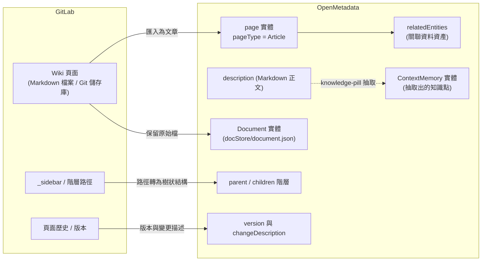
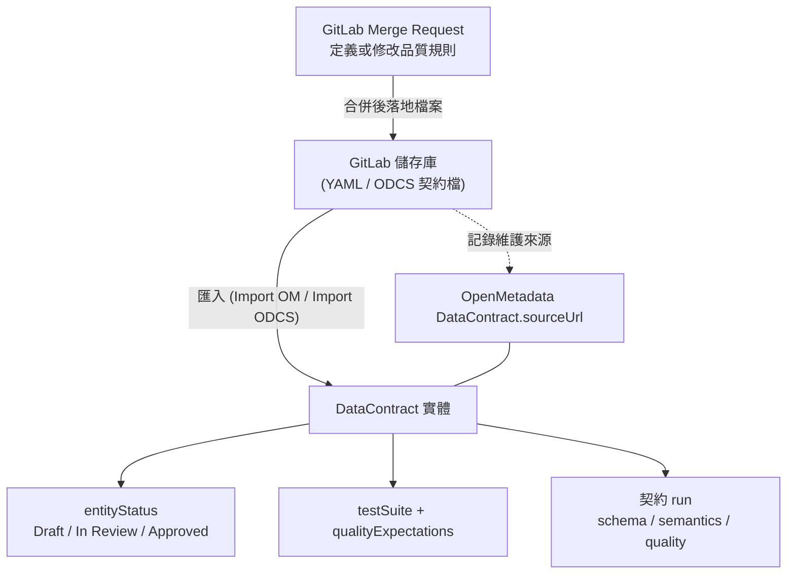

# GitLab 的 Wiki 與 Merge Request 在 OpenMetadata 中會如何呈現？

## 摘要

截至 2026-10-18，OpenMetadata **沒有 GitLab 連接器**，也**沒有對應「Wiki 頁」或「Merge Request」的原生實體**[^omdconnectors][^omdlooker]。因此問題的答案是「不對應成同名實體，而是分別落在不同的機制上」：

- **GitLab Wiki** 最接近的落點是 **Context Center 的 Articles**（內部實體型別 `page`，`pageType: "Article"`），再加上 Documents 與 Memories 兩類內容[^omdcc][^omdpage]。
- **GitLab Merge Request（MR）** 沒有實體可對應；它會被視為「變更流程的來源」。最接近的落點有三個：**Data Contract 的 `sourceUrl`**（指向 Git 儲存庫）、**ODCS／YAML 契約匯入**（contract-as-code），以及 **Data Quality as Code** 的 SDK／CLI 流程[^omdspec][^omdocdcs][^omddqac]。

另外，OpenMetadata 對 GitLab 的唯一原生支援是**把 GitLab 當成「程式碼儲存庫憑證」**，用於 Looker 的 LookML 檔案抽取，並非資料資產層級的整合[^omdlooker][^omdgitlabreader]。

## 背景一：GitLab Wiki 與 MR 是什麼

### GitLab Wiki

GitLab 的 Wiki 提供專案與群組層級的文件功能，每個 Wiki 本身就是一個獨立的 Git 儲存庫（separate Git repository），可離線 clone、修改、再 push[^glwiki]。頁面支援 Markdown、RDoc、AsciiDoc、Org 等格式，並具備側邊欄（sidebar）、頁面歷史（page history）、版本還原、目錄（table of contents）、頁面範本（templates）與表情回應（emoji reactions）[^glwiki]。Wiki 的變更會被記錄在 GitLab 的活動頁與使用者個人檔案的 wiki 事件中，但 Wiki 的 commit 不計入 repository analytics[^glwiki]。

Wiki 也有完整的 REST API：`GET/POST/PUT/DELETE /projects/:id/wikis`，可列出、讀取、建立、更新、刪除頁面，且可上傳附件到 Wiki 儲存庫的 `uploads/` 目錄[^glwikiapi]。頁面回應包含 `content`、`format`、`slug`、`title`、`encoding` 等欄位[^glwikiapi]。這表示 Wiki 內容本質上是**「以檔案為單位、有版本、可 diff」的文件**。

### GitLab Merge Request

Merge Request（合併請求）是 GitLab 用來集中進行程式碼審查、討論與追蹤變更的地方；一個 MR 會顯示變更描述、程式碼差異與行內評論、CI/CD pipeline 資訊、可合併性報告、留言、commit 清單[^glmr]。每個 MR 有兩種角色：**Assignee**（負責推進）與 **Reviewer**（審查、可核准）[^glmr]。專案的核准規則（approval rules）決定誰能核准 MR[^glmr]。

MR REST API 提供 `GET /merge_requests`，狀態包含 `opened`、`closed`、`locked`、`merged`，並可用 `state`、`scope`、`merged_after`、`updated_before`、`author_username`、`reviewer_username` 等大量參數篩選[^glmrapi]。回應欄位包含 `title`、`description`、`state`、`merged_at`、`merge_user`、`source_branch`、`target_branch`、`reviewers`、`approvals`（部分已棄用）等[^glmrapi]。換言之，MR 的資料模型是**「流程事件 + 審查狀態 + 關聯的程式碼變更」**，而不是資料目錄中的資料資產。

## 背景二：OpenMetadata 的相關機制

OpenMetadata 是一個開源的資料情境（context）與後設資料平台，其 GitHub 儲存庫在檢索時有 15,506 顆星[^omdrepo]。與本題相關的機制有三塊：

1. **Context Center**：共享知識庫，包含 **Articles**（長篇頁面）、**Memories**（原子事實）、**Documents**（上傳檔案）[^omdcc]。
2. **Data Contract**：描述資料資產的結構、語意規則、品質、服務水準與安全期待，儲存為綁定單一資產的實體[^omdspec]。
3. **Data Quality as Code／ODCS**：以 Python SDK、YAML 設定或 ODCS 標準檔在程式碼端定義測試與契約[^omddqac][^omdocdcs]。

此外，OpenMetadata 的連接器清單（v2.0.x）涵蓋資料庫、Dashboard、Pipeline、Messaging、ML Model、Storage、Search、Metadata、Drive 等類別，但**清單中沒有 GitLab 連接器**[^omdconnectors]。

## GitLab Wiki 在 OpenMetadata 中的呈現

### 主要落點：Context Center 的 Articles

Context Center 的定位是「為公司情境提供共享的家」，包含 Articles、Memories、Documents 三種內容，可從左側導覽列開啟[^omdcc]。其中 Articles 是「你的團隊撰寫與維護的長篇頁面」，典型用途包含資料治理政策、分類標準、事故處理手冊（playbooks）、內部 API 文件[^omdarticle]。這與 GitLab Wiki 的用途高度重疊。

在實體層級，一篇文章是型別為 `page` 的實體，其 JSON Schema（`schemas/entity/data/page.json`）定義了[^omdpage]：

| 欄位 | 說明 |
| - | - |
| `pageType` | 列舉 `["Article", "QuickLink"]` |
| `page` | `oneOf` 指向 `article.json` 或 `quickLink.json` |
| `description` | Markdown 格式的正文 |
| `relatedEntities` | 「Related Entities for the Knowledge Page」 |
| `parent` / `children` / `childrenCount` | 頁面階層（Knowledge Center） |
| `attachments` | 型別為 `attachments/asset.json` 的附件陣列 |
| `memoryCount` | 由此頁面抽取出的 knowledge pills 數量 |
| `processingStatus` | knowledge-pill 抽取狀態，列舉 `["Queued", "Processing", "Processed", "Failed"]` |

`article.json` 另外定義了 `publicationDate` 與 `relatedArticles`[^omdarticle2]。也就是說，GitLab Wiki 頁面若要在 OpenMetadata 呈現，對應物是「一個 `page` 實體，`pageType` 為 `Article`，正文放進 `description`，子頁面用 `parent`/`children` 表達」。

在 UI 上，文章具備：標題、描述、擁有者（owner）、網域（domain）、標籤（tags）、版本號（例如 `0.2`）、狀態徽章（例如 `In Review`）、附件與關聯資料資產，以及 **Activity Feeds & Tasks** 分頁（含審查請求等任務）[^omdarticle]。文章會自動儲存，沒有獨立的發佈步驟[^omdarticle]。

透過 MCP，AI 助理可用 `find_context` 語意搜尋 Articles、Glossary Terms 與 Metrics，或用 `get_entity_details` 加 `include: ["content"]` 讀取文章全文；建立文章則是 `create_entity` 搭配 `entityType: "page"` 與 `attributes: {"pageType": "Article", "page": {}}`[^omdmcp]。

### 次要落點：Documents 與 Memories

- **Documents**：適合「不想改寫成 Article 的既有檔案」，例如報告、試算表、合規稽核；OpenMetadata 會從檔案抽取問答筆記（question and answer notes），MCP 助理檢索的是**抽取出的筆記，而不是 Document 記錄本身**[^omddocs]。其 JSON Schema 為 `schemas/entity/docStore/document.json`，欄位包含 `entityType` 與自由格式的 `data`[^omddocument]。
- **Memories**：適合「短小、原子的事實」，例如偏好、操作手冊步驟、FAQ；可由使用者在 UI 建立，或由 AI 助理在對話中產生[^omdcc]。其 JSON Schema 為 `schemas/entity/context/contextMemory.json`，關鍵定義包含[^omdmemory]：
  - `memoryType`：`Preference`、`UseCase`、`Note`、`Runbook`、`Faq`
  - `memoryScope`：`UserGlobal`、`EntityScoped`
  - `status`：`Draft`、`Active`、`Archived`
  - `sourceType`：`Manual`、`ChatPromotion`、`RememberRequest`、`FileExtraction`、`PageExtraction`
  - `primaryEntity`、`relatedEntities`（連結到資料資產）、`shareConfig`（可見性與共享對象）

值得注意的是 Memos 與 Documents 受 RBAC 控管：Documents 由 **File** 資源（Files and documents 類別）涵蓋，Memories 由 **Context Memory** 資源（Misc 類別）涵蓋；而 **Articles 沒有被列在這段 RBAC 說明中**[^omdcc]。

### Wiki 對應關係示意

### Wiki 對應的落差

- GitLab Wiki 支援 Markdown、RDoc、AsciiDoc、Org 等多種格式[^glwiki]；OpenMetadata 文章的正文是 Markdown（`markdown` 型別）[^omdpage]。非 Markdown 頁面需要轉換。
- GitLab Wiki 的附件存放於 Wiki 儲存庫的 `uploads/` 目錄並可透過 API 上傳[^glwikiapi]；OpenMetadata 的 `attachments` 是另一套附件結構[^omdpage]。附件需要重新上傳。
- GitLab Wiki 的 `_sidebar` 自訂導覽[^glwiki]在 OpenMetadata 沒有直接對應，只能改用 `parent`/`children` 階層或資料夾概念近似表達[^omdpage]。
- OpenMetadata 沒有文件化的 GitLab Wiki 匯入器；要落地必須自行以 GitLab Wiki API[^glwikiapi] 或 Git 儲存庫讀取，再以 OpenMetadata API／MCP 建立 `page` 實體[^omdmcp]。

## GitLab MR 在 OpenMetadata 中的呈現

### 沒有 MR 實體，只有「流程接入點」

OpenMetadata 的連接器與實體清單中沒有 Merge Request 這種概念[^omdconnectors]。GitLab 在 OpenMetadata 原始碼中只以三種形式出現，且都不是資料資產整合：

1. **Looker 連接器的程式碼儲存庫憑證**：Looker 文件列出 `Git Credentials` 選項，包含 **GitLab Credentials**，欄位為 Git Host URL（如 `https://gitlab.com`）、Repository Owner、Repository Name、API Token[^omdlooker]。
2. **`GitlabCredentials` JSON Schema**：定義 `type`（列舉 `["Gitlab"]`，預設 `Gitlab`）、`gitHostURL`、`repositoryOwner`、`repositoryName`、`token`[^omdcreds]。
3. **`GitlabReader` 實作**：透過 `https://gitlab.com/api/v4` 以 `PRIVATE-TOKEN` 標頭讀取檔案、取得預設分支、遞迴走訪 repository tree[^omdgitlabreader]。

這三者的共同點是：**GitLab 被當成「拿着 repo 檔案」的來源，用於抽取 LookML 視圖與其對應資料表血緣**，而不是把 GitLab 的協作物件（MR、issue、wiki）本身目錄化[^omdlooker]。

### 落點一：Data Contract 的 `sourceUrl` 指向 Git 儲存庫

OpenMetadata 的 Data Contract 實體（`schemas/entity/data/dataContract.json`）欄位包含 `sourceUrl`，其文件說明為「Link to where the contract is maintained, such as a Git repository」[^omdspec][^omdcontract]。官方 YAML 範例中也有對應欄位，且契約本身有 `entityStatus`：`Draft`、`In Review`、`Approved`、`Rejected`、`Deprecated`、`Archived`，並支援 `reviewers` 與審批語意[^omdspec]。

因此「MR 通過後契約生效」在 OpenMetadata 的呈現方式是：**契約實體存在於 OpenMetadata，`sourceUrl` 指向 GitLab 儲存庫，審批狀態由 `entityStatus`（搭配 `reviewers`）表達**，而 MR 本身留在 GitLab 一側，不成為 OpenMetadata 的物件[^omdspec]。

契約可檢查的區段為 schema、semantics、quality；security 與 SLA 只做記錄、不被強制檢查[^omdspec]。契約執行（run）可由 UI 的 **Run now**、API `POST /v1/dataContracts/{id}/validate`，或預設每日午夜的 **Data Contract Validation** 應用觸發[^omdspec]。

以實體欄位來看，契約包含 `entity`（指向資料資產）、`testSuite`、`schema`、`semantics`、`termsOfUse`、`security`、`sla`、`qualityExpectations`、`odcsQualityRules`、`contractUpdates`、`latestResult`、`inherited` 等[^omdcontract]。

### 落點二：contract-as-code 匯入（ODCS 與 OpenMetadata YAML）

OpenMetadata 支援以檔案匯入契約，這是最接近「MR 內定義、合併後生效」的機制[^omdspec]：

- **Import OM**：匯入 OpenMetadata 自家 YAML 格式；若資產已有契約，可選擇 **Merge with Existing** 或 **Replace Entire Contract**[^omdcreate]。
- **Import ODCS**：匯入 Open Data Contract Standard 格式；支援的 `apiVersion` 包含 `v3.1.0`（原生映射）、`v3.2.0`、`v3.0.x`、`v2.2.x`，且文件必須有 `kind: DataContract` 與合法 `status`[^omdocdcs]。
- **API**：`PUT /v1/dataContracts/odcs/yaml?entityId=...&entityType=table&mode=merge`，另有 `POST /v1/dataContracts/odcs/validate/yaml` 可先驗證而不落地[^omdocdcs]。

ODCS 的品質規則會被轉成 OpenMetadata 測試案例，例如 `metric: nullValues` 對應 `columnValuesToBeNotNull`、`metric: rowCount` 對應 `tableRowCountToEqual` 或 `tableRowCountToBeBetween`、`type: sql` 對應 `tableCustomSQLQuery`[^omdocdcs]。這意味著「在 MR 裡寫品質規則、合併後變成 OpenMetadata 測試」在技術上是可行的：**MR 是審查與合併的媒介，真正的資料落地點是契約實體與測試案例實體**[^omdocdcs][^omdspec]。

### 落點三：Data Quality as Code 與 CLI

若不想透過契約，OpenMetadata 也提供以程式碼定義測試的路徑[^omddqac][^omdyaml]：

- **Python SDK**：以 `configure()` 設定連線後，使用 `TestRunner.for_table("<FQN>")` 執行測試（需 OpenMetadata 2.0.3 以上）[^omddqac]。
- **YAML 設定 + CLI**：以 `processor.type: "orm-test-runner"` 定義 `testCases`，再執行 `metadata test -c /path/to/my/config.yaml`[^omdyaml]。

此路徑與 CI 的結合方式通常是：GitLab CI pipeline 在 MR 合併後執行上述指令。**OpenMetadata 本身不感知 MR 事件**，是 CI 主動呼叫 OpenMetadata[^omdyaml]。

### 落點四：Collate 的「單向 GitLab DQ 同步」（未公開）

OpenMetadata 的 GitHub issue #21537 標題為「1 way Gitlabs sync for DQ management」，內容為[^gh21537]：

> Enable users to manage their data quality from gitlabs (e.g. when PR defining DQ in Gitlab is merged, then create it in OpenMetaadta)

此 issue 由 TeddyCr 於 2025-06-03 建立，2025-09-16 標記為 completed 並關閉；唯一的留言是「see https://github.com/open-metadata/openmetadata-collate/issues/1543」，指向**私有**的 Collate 儲存庫[^gh21537]。由於該儲存庫不對外公開，無法從公開來源確認實作細節、支援範圍與版本；**本文不推測其實作方式**[^gh21537]。

### 相關但不同的 GitLab 議題

| Issue | 標題 | 狀態 | 與本題關係 |
| - | - | - | - |
| #16010 | Gitlab support for Looker code | 2024-08-07 完成[^gh16010] | 讓 Looker 可用 GitLab 當程式碼來源 |
| #23421 | Support for self-hosted Git repository URLs in Looker ingestion | 2025-11-22 完成[^gh23421] | 讓 Looker 可用自架 Git 伺服器 URL |
| #21537 | 1 way Gitlabs sync for DQ management | 2025-09-16 完成[^gh21537] | 唯一觸及「MR 合併後建立 DQ」的公開線索 |

### 反方向：OpenMetadata 事件觸發 GitLab

OpenMetadata 會捕捉技術後設資料與商業後設資料的變更，並以版本形式產生事件，可用於整合到其他工具或觸發動作[^omdchange]。這可用來實作反向流程（例如資料品質失敗時在 GitLab 開 issue 或觸發 pipeline），但公開文件只簡述此能力，未提供 GitLab 專用的整合說明[^omdchange]。

### 另外一個近似物：Thread 與 Task

OpenMetadata 內部有 `Thread` 實體（`schemas/entity/feed/thread.json`），`threadType` 列舉 `Conversation`、`Task`、`Announcement`、`Chatbot`；`taskType` 列舉 `RequestDescription`、`UpdateDescription`、`RequestTag`、`UpdateTag`、`RequestApproval`、`RequestTestCaseFailureResolution`、`RecognizerFeedbackApproval`、`Generic`[^omdthread]。另有 `taskDetails` 內含 `assignees`、`status`（`Open`/`Closed`）、`closedBy`、`oldValue`、`suggestion`、`newValue` 等[^omdthread]。

這是 OpenMetadata 中最接近「審查 / 指派 / 核准」語意的機制，但它服務的是**資料資產的後設資料變更審查**，不是程式碼變更審查；在文章與資料契約上表現為 **In Review** 徽章與 Activity Feeds & Tasks 中的任務[^omdarticle][^omdspec]。

## 對照總表

| GitLab 物件 | OpenMetadata 是否有原生對應 | 最接近的落點 | 主要落差 |
| - | - | - | - |
| Wiki 頁面 | 無 Wiki 連接器 | `page` 實體，`pageType: "Article"`，正文放 `description`[^omdpage] | 需自行開發匯入；非 Markdown 格式需轉換 |
| Wiki 階層與側邊欄 | 無 | `parent` / `children` / `childrenCount`[^omdpage] | `_sidebar` 自訂導覽無對應 |
| Wiki 頁面歷史 | 無 | 實體 `version` 與 `changeDescription`[^omdpage] | 無逐頁 diff 檢視的對等物 |
| Wiki 附件 | 無 | `attachments`（`attachments/asset.json`）[^omdpage] | 需重新上傳 |
| Wiki 頁面留言 | 無 | `Thread`（`Conversation`）與 `Task`[^omdthread] | 不同實體，不同生命週期 |
| Merge Request | 無 | 無 MR 實體；只有變更流程接入點[^omdconnectors] | MR 留在 GitLab 一側 |
| MR 內定義的品質規則 | 私有功能（Collate #1543）[^gh21537] | ODCS / YAML 匯入轉成 test case[^omdocdcs] | 公開版本無自動同步 |
| MR 審查與核准狀態 | 無 | `entityStatus`（`Draft`/`In Review`/`Approved`/…）＋ `reviewers`[^omdspec] | 契約層級，非程式碼層級 |
| 程式碼儲存庫位置 | 有（區域性） | Looker 連接器的 GitLab Credentials[^omdlooker] | 僅用於抽取 LookML，非通用整合 |

## 為何是這種設計：關鍵洞察

1. **OpenMetadata 目錄化的是「資料資產與其情境」，不是「開發協作物件」。** 連接器清單中沒有 GitLab，卻有 130 種以上的資料來源連接器[^omdconnectors]。GitLab 在 OpenMetadata 眼中的角色是「程式碼的位置」，不是「要被目錄化的系統」。
2. **Wiki 之所以能落進 Context Center，是因為兩者都是「給人看的長篇文件」。** 但 OpenMetadata 進一步要求把文件榨成可檢索的知識點：文章會觸發 knowledge-pill 抽取（`memoryCount`、`processingStatus`）[^omdpage]，Document 會被抽取問答筆記[^omddocs]。
3. **MR 之所以難以對應，是因為 OpenMetadata 的變更模型是「實體版本」而非「分支與合併」。** 契約的每次更新留下 `contractUpdates` 與 `version`[^omdcontract]，而不是一個可審查的 diff 與核准軌跡。
4. **OpenMetadata 的審批語意落在 `entityStatus` 與 `reviewers`，而非 MR 核准規則。** 契約從 **In Review** 到 **Approved** 需由 reviewer 執行，但 OpenMetadata 沒有內建的契約核准工作流程[^omdspec]。

## 若要自行橋接：可行路徑

若要在自架環境重現「GitLab Wiki／MR 進 OpenMetadata」，公開資訊足以支撐以下做法：

- **Wiki 同步**：定期以 GitLab Wiki API 的 `GET /projects/:id/wikis?with_content=1` 拉取頁面[^glwikiapi]，將 `title` 與 `content` 映射為 `page` 實體的 `displayName` 與 `description`，以 `slug` 的路徑階層建立 `parent`/`children` 關係[^omdpage]，再以 MCP 的 `create_entity`（`entityType: "page"`）或 HTTP API 寫入[^omdmcp]。
- **MR 觸發契約更新**：在 GitLab CI 於合併到主分支的 pipeline 中，以 `PUT /v1/dataContracts/odcs/yaml` 匯入 ODCS 檔[^omdocdcs]；或改用 `metadata test -c config.yaml` 建立測試案例[^omdyaml]。契約的 `sourceUrl` 填上 GitLab 儲存庫 URL 以保留溯源[^omdspec]。
- **審批狀態同步**：MR 核准後，以 API 更新契約的 `entityStatus`（例如由 `In Review` 轉為 `Approved`）並設定 `reviewers`[^omdspec]。
- **反向通知**：使用 OpenMetadata 的變更事件，在資料品質失敗或後設資料變更時觸發 GitLab pipeline 或開立 issue[^omdchange]。

## 批判性反思：來源、時效與限制

- **版本敏感度**：本文的 Context Center、Data Contract、ODCS、MCP 工具敘述以官方 v2.0.x 文件為準；文檔中的 MCP 工具已明確標示部分舊工具（如 `search_company_context`、`get_company_context`、`create_context_memory`）已移除，改用新工具[^omdmcp]。不同版本行為差異大，實作前必須核對自身版本。
- **公開資訊的邊界**：issue #21537 的實作落在私有儲存庫[^gh21537]，因此本文僅陳述公開可見的事實，未假設其功能範圍。任何「OpenMetadata 開源版本會自動同步 GitLab MR」的說法都缺乏公開依據。
- **來源權威性**：GitLab 與 OpenMetadata 的官方文件與 JSON Schema 為一手來源；GitHub issue 為專案維護者本人發言，可信度高但屬單一來源；社群彙整來源僅用於交叉比對。
- **Schema 與文件的一致性**：`page.json` 與 `dataContract.json` 在 OpenMetadataStandards 與 OpenMetadata 儲存庫中的版本略有差異（例如前者沒有 `odcsElementExtensions`／`extension` 欄位，`entityStatus` 也未見 `default: "Draft"`）。本文以兩個來源併陳，避免只依賴單一版本[^omdpage][^omdcontract][^omdcontractstd]。
- **未驗證事項**：GitLab 自架伺服器在 Looker 連接器的支援狀態，於 v2.0.x 文件中仍是 `gitHostURL` 欄位自由填寫[^omdlooker][^omdcreds]；本文未實測其在自架環境的實際行為。

## 結論

- **Wiki → Context Center Articles。** 這是 OpenMetadata 中唯一在型別層級清楚對應「文件頁面」的機制：`page` 實體、`pageType: "Article"`、Markdown 正文、`parent`/`children` 階層、版本與附件[^omdpage]。但沒有現成連接器，需自建匯入。
- **MR → 沒有實體，只有流程接入點。** MR 不會以 MR 的形式出現在 OpenMetadata。它的效果只能透過 **Data Contract 的 `sourceUrl` 溯源**、**ODCS／YAML 匯入 contract-as-code**、**Data Quality as Code 的 SDK/CLI** 三條路徑間接呈現[^omdspec][^omdocdcs][^omddqac]。
- **唯一觸及「MR 合併後建立 DQ」的公開線索是私有功能**，無法從公開來源驗證其能力邊界[^gh21537]。
- **GitLab 在 OpenMetadata 目前的正式角色是「程式碼儲存庫憑證」**，用於 Looker 的 LookML 抽取[^omdlooker][^omdgitlabreader]。

## 參考文獻

[^omdconnectors]: OpenMetadata. (n.d.). Connectors. Retrieved 2026-10-18, from https://docs.open-metadata.org/v2.0.x/connectors

[^omdcc]: OpenMetadata. (n.d.). Context Center. Retrieved 2026-10-18, from https://docs.open-metadata.org/v2.0.x/how-to-guides/context-center

[^omdarticle]: OpenMetadata. (n.d.). Articles. Retrieved 2026-10-18, from https://docs.open-metadata.org/v2.0.x/how-to-guides/context-center/articles

[^omddocs]: OpenMetadata. (n.d.). Documents and Archive. Retrieved 2026-10-18, from https://docs.open-metadata.org/v2.0.x/how-to-guides/context-center/documents

[^omdpage]: OpenMetadataStandards. (n.d.). page.json [JSON Schema]. Retrieved 2026-10-18, from https://raw.githubusercontent.com/open-metadata/OpenMetadataStandards/main/schemas/entity/data/page.json

[^omdarticle2]: OpenMetadataStandards. (n.d.). article.json [JSON Schema]. Retrieved 2026-10-18, from https://raw.githubusercontent.com/open-metadata/OpenMetadataStandards/main/schemas/entity/data/article.json

[^omddocument]: OpenMetadataStandards. (n.d.). document.json [JSON Schema]. Retrieved 2026-10-18, from https://raw.githubusercontent.com/open-metadata/OpenMetadataStandards/main/schemas/entity/docStore/document.json

[^omdmemory]: OpenMetadataStandards. (n.d.). contextMemory.json [JSON Schema]. Retrieved 2026-10-18, from https://raw.githubusercontent.com/open-metadata/OpenMetadataStandards/main/schemas/entity/context/contextMemory.json

[^omdmcp]: OpenMetadata. (n.d.). MCP Tools Reference. Retrieved 2026-10-18, from https://docs.open-metadata.org/v2.0.x/how-to-guides/mcp/reference

[^omdspec]: OpenMetadata. (n.d.). Data Contract Specification. Retrieved 2026-10-18, from https://docs.open-metadata.org/v2.0.x/how-to-guides/data-contracts/spec

[^omdcreate]: OpenMetadata. (n.d.). Create Data Contracts. Retrieved 2026-10-18, from https://docs.open-metadata.org/v2.0.x/how-to-guides/data-contracts/create

[^omdocdcs]: OpenMetadata. (n.d.). ODCS Import and Export. Retrieved 2026-10-18, from https://docs.open-metadata.org/v2.0.x/how-to-guides/data-contracts/odcs

[^omdcontract]: OpenMetadata. (n.d.). dataContract.json [JSON Schema]. Retrieved 2026-10-18, from https://raw.githubusercontent.com/open-metadata/OpenMetadata/main/openmetadata-spec/src/main/resources/json/schema/entity/data/dataContract.json

[^omdcontractstd]: OpenMetadataStandards. (n.d.). dataContract.json [JSON Schema]. Retrieved 2026-10-18, from https://raw.githubusercontent.com/open-metadata/OpenMetadataStandards/main/schemas/entity/data/dataContract.json

[^omdthread]: OpenMetadataStandards. (n.d.). thread.json [JSON Schema]. Retrieved 2026-10-18, from https://raw.githubusercontent.com/open-metadata/OpenMetadataStandards/main/schemas/entity/feed/thread.json

[^omddqac]: OpenMetadata. (n.d.). Getting Started with Data Quality as Code. Retrieved 2026-10-18, from https://docs.open-metadata.org/v2.0.x/how-to-guides/data-quality-observability/quality/data-quality-as-code/getting-started

[^omdyaml]: OpenMetadata. (n.d.). Adding Data Quality Test Cases from yaml config. Retrieved 2026-10-18, from https://docs.open-metadata.org/v2.0.x/how-to-guides/data-quality-observability/quality/test-cases-from-yaml-config

[^omdlooker]: OpenMetadata. (n.d.). Looker Connector. Retrieved 2026-10-18, from https://docs.open-metadata.org/v2.0.x/connectors/dashboard/looker

[^omdcreds]: OpenMetadataStandards. (n.d.). gitlabCredentials.json [JSON Schema]. Retrieved 2026-10-18, from https://raw.githubusercontent.com/open-metadata/OpenMetadataStandards/main/schemas/security/credentials/gitlabCredentials.json

[^omdgitlabreader]: OpenMetadata. (2025). Gitlab client to read files with token auth [Source code]. Retrieved 2026-10-18, from https://raw.githubusercontent.com/open-metadata/OpenMetadata/main/ingestion/src/metadata/readers/file/gitlab.py

[^omdchange]: OpenMetadata. (n.d.). Change Events. Retrieved 2026-10-18, from https://docs.open-metadata.org/v2.0.x/connectors/ingestion/versioning/change-events

[^omdrepo]: OpenMetadata. (2026). open-metadata/OpenMetadata [Repository metadata]. GitHub. Retrieved 2026-10-18, from https://api.github.com/repos/open-metadata/OpenMetadata

[^gh21537]: OpenMetadata. (2025, September 16). 1 way Gitlabs sync for DQ management (Issue No. 21537). GitHub. Retrieved 2026-10-18, from https://github.com/open-metadata/OpenMetadata/issues/21537

[^gh16010]: OpenMetadata. (2024, August 7). Gitlab support for Looker code (Issue No. 16010). GitHub. Retrieved 2026-10-18, from https://github.com/open-metadata/OpenMetadata/issues/16010

[^gh23421]: OpenMetadata. (2025, November 22). Support for self-hosted Git repository URLs in Looker ingestion (Issue No. 23421). GitHub. Retrieved 2026-10-18, from https://github.com/open-metadata/OpenMetadata/issues/23421

[^glwiki]: GitLab. (n.d.). Wiki. Retrieved 2026-10-18, from https://docs.gitlab.com/user/project/wiki/

[^glwikiapi]: GitLab. (n.d.). Project wikis API. Retrieved 2026-10-18, from https://docs.gitlab.com/api/wikis/

[^glmr]: GitLab. (n.d.). Merge requests. Retrieved 2026-10-18, from https://docs.gitlab.com/user/project/merge_requests/

[^glmrapi]: GitLab. (n.d.). Merge requests API. Retrieved 2026-10-18, from https://docs.gitlab.com/api/merge_requests/
