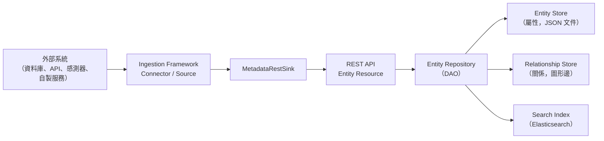
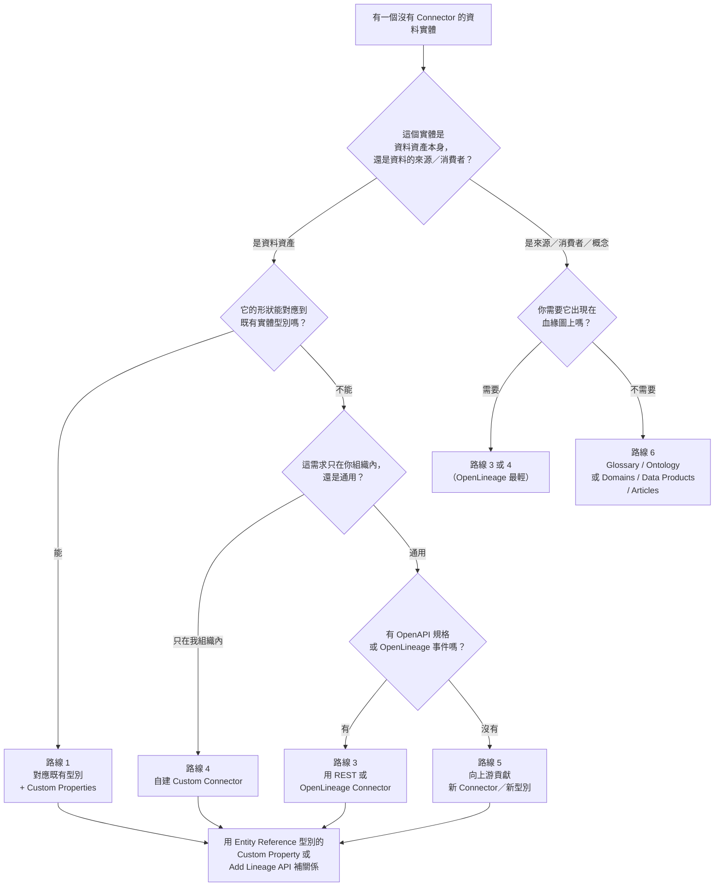
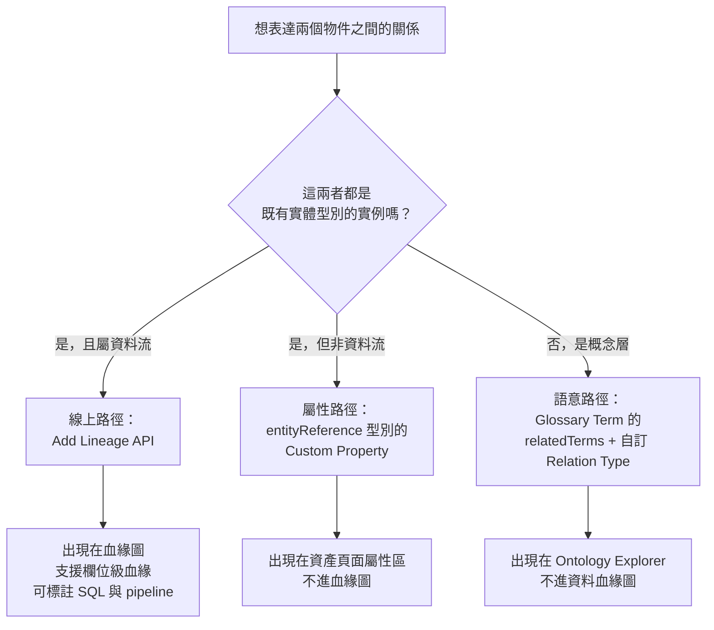

# 當資料實體沒有 Connector 時，如何在 OpenMetadata 建模：可用選項、官方原則與對齊 SOP

## 摘要

OpenMetadata 是一套以 JSON Schema 為單一真實來源（schema-first）的開源資料目錄與資料治理平台[^om-highlevel]。它的模型由「實體型別（entity type）」組成，例如 Table、Dashboard、Pipeline、Topic、API Endpoint 等，而 Connector（連接器）負責從外部系統抓取這些實體的實例（instance）並寫入平台[^om-customconn]。

當某個真實世界的資料實體（例如地端感測器、資料提供者、內部自製服務、圖資料庫或專有系統）沒有現成 Connector 時，OpenMetadata **並未提供在執行期動態新增實體型別的機制**，官方對這件事的立場是刻意的設計選擇，而非功能缺口[^om-issue4920][^om-issue24285]。因此可用的做法可以歸納為六條路線，依「貼合度 vs. 成本」排序如下：

| 路線 | 做法 | 是否需要寫程式 | 是否能進入血緣圖 | 官方定位 |
| --- | --- | --- | --- | --- |
| 1 | 對應到語意最接近的既有實體型別，再用 Custom Properties 補欄位 | 否 | 是 | 主要推薦路徑[^om-issue4920][^om-standards-cp] |
| 2 | 為既有實體型別註冊 Custom Properties（含 Entity Reference 型別） | 否 | 部分（透過屬性引用）[^om-standards-cp] |
| 3 | 使用官方提供的替代入口 Connector（REST/OpenAPI、OpenLineage） | 否（提供規格檔即可） | 是[^om-rest][^om-openlineage] |
| 4 | 自建 Custom Connector（私有、不進上游） | 是（Python） | 是[^om-customconn] |
| 5 | 向上游貢獻新 Connector，或走完整「新增實體型別」流程 | 是（多語言：JSON Schema、Python、Java、TypeScript） | 是[^om-newconnector] |
| 6 | 用 Glossary／Ontology／RDF 對概念建模，而非對資料資產建模 | 否 | 部分（概念層）[^om-ontology][^om-rdf] |

截至目前（文件版本 v2.0.x），「自訂實體型別（Custom Entities）」仍是未實作的社群需求，對應的 GitHub Issue 自 2025 年 11 月開啟後持續討論中[^om-issue24285]。

---

## 背景：先理解 OpenMetadata 的建模骨架

### Connector 在架構中的角色

OpenMetadata 的高階設計由四個部分組成：REST API、UI、Ingestion Framework（連接器框架）與儲存層[^om-highlevel]。其中 Ingestion Framework 是「OpenMetadata 與外部來源之間的介面」，所有 Connector 都是這個框架的實作；它們的工作是從外部系統抽取中繼資料，轉成平台定義好的實體請求，再送到 Sink 寫入[^om-highlevel][^om-ingestion-arch]。



這裡有一個關鍵設計：實體的**屬性（attributes）**與**關係（relationships）**分開儲存。屬性以 JSON 文件存於 `<entityName>_entity` 資料表；關係則以圖形節點與邊的形式，獨立存在 `entity_relationship` 資料表，邊上帶有關係型別（例如 `contains`、`owns`、`follows`）[^om-highlevel]。

### Schema-first 是整個模型的根本限制

OpenMetadata 所有實體型別都以 JSON Schema（Draft 07 或 2020-12）定義，並由同一份 Schema 自動產生三套程式碼：伺服器端的 Java 類別、Ingestion 的 Python 類別、UI 的 TypeScript 型別[^om-highlevel]。官方在定義「實體擴充機制」的 epic 中明確說明這個選擇的理由：

> OpenMetadata 採用 schema-first 的方式，以 JSON schema 建立強型別實體模型。這對建立開放的中繼資料標準、讓中繼資料可被共享非常重要。這與其他系統「以 key-value 為基礎、鬆散建模」的做法形成對比。後者雖然容易擴充 schema，卻犧牲了標準化。[^om-issue4920]

換句話說，「沒有 Connector 就無法建模」這個痛點，本質上不是 Connector 數量不足，而是**實體型別集合是編譯期決定的**。可用的實體型別清單與其 JSON Schema 檔案，都放在原始碼的 `openmetadata-spec/src/main/resources/json/schema/entity/data/` 之下[^om-schemadir]。

### 目前有哪些內建實體型別

截至本報告查證時間，`entity/data/` 目錄下的實體定義包含（節錄）[^om-schemadir]：

- **資料庫類**：`database`、`databaseSchema`、`table`、`storedProcedure`、`query`、`queryCostRecord`
- **儀表板類**：`dashboard`、`dashboardDataModel`、`chart`、`report`
- **管線與訊息類**：`pipeline`、`topic`
- **ML 類**：`mlmodel`
- **儲存類**：`container`、`file`、`folder`、`directory`、`spreadsheet`、`worksheet`
- **API 類**：`apiCollection`、`apiEndpoint`
- **搜尋類**：`searchIndex`
- **治理類**：`glossary`、`glossaryTerm`、`metric`、`metricGroup`、`dataContract`
- **知識與語意類**：`article`、`page`、`contextFile`、`relationshipType`、`ontologyAxiom`、`ontologyChangeSet`

其中 `relationshipType`、`ontologyAxiom`、`metricGroup` 屬於較新的語意層實體，在 `main` 分支的 Schema 中可見[^om-relationshipType][^om-ontologyAxiom]。

---

## 核心設計原則（官方的「為什麼不讓你自由定義」）

在動手選方案前，先理解官方立場，這會決定你的方案會不會在未來版本被打破。

### 原則一：標準化優先於自由擴充

官方對「開放自訂實體」的社區回應相當直接，出自 OpenMetadata 維護者 pmbrull：

> 自訂實體的問題是我們會失去對標準的掌控。定義豐富標準的主要目的，是要確保我們能涵蓋大多數使用情境。真正該問的是：**缺少的實體型別究竟長什麼形狀？** 與其直接開放自由的 key-value 配對，或許從「形狀」切入會更容易。[^om-issue24285]

這段話提示了實務上的最佳做法：與其問「我能創造什麼實體型別」，不如先把你想描述的物件**抽象成現有實體型別的欄位組合**，真的無法表達時再走新增型別的路。

### 原則二：優先做加法（擴充），最後才做乘法（新型別）

同一個 epic 的任務拆解顯示，官方的路線圖是「先用 extension 滿足組織特定屬性，再視情況新增型別」[^om-issue4920]。而早期關於 thesaurus／generic entity 的討論（Issue #1039）中，維護者 sureshms 的結論也是：

> 我一開始的想法是，讓我們在社群裡設計好所有實體，然後為既有實體加上擴充點。等我們更了解使用者如何使用系統之後，再來探索是否允許以程式方式新增實體與型別。[^om-issue1039]

Issue #1039 已於 2022 年關閉，Issue #24285 至今（2026 年）仍為開啟狀態[^om-issue24285]。

### 原則三：私有需求走 Custom Connector，通用需求走上游貢獻

官方在「開發新連接器」文件中明確區分了兩條路：

> 開發一個新的連接器，適合「可能被許多其他使用者使用」的情況。**如果你面對的是只在你這裡使用的自訂方案，那麼你更應該依照 Custom Connector 指南建立自己的 Custom Connector。**[^om-newconnector]

這條分界線是整個 SOP 的核心判斷點。

### 原則四：來源規格驅動（Spec-driven）勝過手工填寫

如果外部系統能提供 OpenAPI 規格，官方 REST Connector 可自動解析並產生 `apiCollection` / `apiEndpoint` 實體[^om-rest]；如果外部系統能發出 OpenLineage 事件，官方 OpenLineage Connector 可消費事件並轉成 Pipeline 與血緣資訊[^om-openlineage]。能走規格就別走手工，這能大幅降低長期維護成本。

---

## 選項總覽與決策流程



---

## 路線 1：對應到既有實體型別，再用 Custom Properties 補欄位

### 做法

挑一個語意最接近的既有實體型別，把「不支援的實體」當成該型別的實例寫入，再用 Custom Properties 補上它獨有的欄位。常見的對應關係如下：

| 真實物件 | 建議對應的既有型別 | 理由 |
| --- | --- | --- |
| 非關聯式／圖資料庫的表 | `table` | 結構化資料集，欄位可放進 `columns`[^om-dataassets] |
| 專有 ETL 排程 | `pipeline` | 官方就是用它表示工作流程[^om-dataassets] |
| 自製 REST 服務 | `apiCollection` / `apiEndpoint` | 官方提供 REST Connector 直接產生[^om-rest] |
| 檔案型資料來源 | `container` / `file` / `directory` | 儲存類實體層級[^om-dataassets] |
| 報表產出物 | `report` / `dashboard` / `chart` | 儀表板類實體層級[^om-dataassets] |

官方在 Data Assets 規格中列出所有可用的型別與其階層，這是選擇對應型別時的第一手依據[^om-dataassets]。

### Custom Properties 的機制

每個 OpenMetadata 實體都有 `extension` 欄位，用來存放組織自訂的鍵值[^om-standards-cp]。`extension` 在基底型別 `basic.json` 中以 `entityExtension` 定義，本身不限制結構，但**值的定義必須先在型別系統中註冊**[^om-standards-cp][^om-basic]：

```json
{
  "name": "dataClassification",
  "propertyType": {
    "id": "classification-type-id",
    "type": "enum",
    "name": "DataClassification"
  },
  "description": "Data classification level",
  "customPropertyConfig": {
    "config": {
      "values": ["Public", "Internal", "Confidential", "Restricted"]
    }
  }
}
```

支援的屬性型別包含：`string`、`integer`、`number`、`boolean`、`date`、`dateTime`、`time`、`duration`、`email`、`uri`、`enum`、`entityReference`、`entityReferenceList`、`markdown`、`array`[^om-standards-cp][^om-basic]。

### 兩種建立方式

**透過 API**，分五步：取得實體型別 ID、取得欄位型別 ID、以 `PUT /api/v1/metadata/types/{entityTypeId}` 建立屬性、以 `GET ...?fields=customProperties` 驗證、最後用 `PATCH /api/v1/{collection}/{id}` 搭配 JSON Patch 的 `/extension` 路徑寫值[^om-customprops-api]。

```bash
# 步驟 1：取得 table 實體型別 ID
curl -X GET http://localhost:8585/api/v1/metadata/types/name/table

# 步驟 3：建立 custom property
curl -X PUT http://localhost:8585/api/v1/metadata/types/7f0b032f-cdc8-4573-abb0-22165dcd8e07 \
  -H "Content-Type: application/json" \
  -d '{
    "description": "Property for tracking the tableSize.",
    "name": "tableSize",
    "propertyType": { "id": "7531f881-c37c-4e39-9154-4bdf0802e05e", "type": "type" }
  }'

# 步驟 5：設定值
curl -X PATCH http://localhost:8585/api/v1/tables/208598fc-bd5f-458c-bf98-59224e1620c7 \
  --header 'Content-Type: application/json-patch+json' \
  --data '[{"op":"add","path":"/extension","value":{"tableSize":"50GB"}}]'
```

**透過 UI**：Settings → Custom Properties → 選實體型別 → Add Custom Property[^om-customprops-ui]。

### 最佳實務（官方明列）

OpenMetadata Standards 文件列出 8 條最佳實務[^om-standards-cp]：

1. 命名一致（camelCase，例如 `dataClassification` 而非 `data_classification`）
2. 提供清楚的描述
3. 受控值優先用 enum 而非自由文字
4. **不要重複標準欄位**，Custom Properties 只用於組織特有需求
5. 規劃治理，定義誰能建立與修改
6. 維護自訂屬性的定義文件
7. 用合適的型別與驗證規則
8. 每個實體型別的屬性數量**少於 20 個**，以免影響效能

### 何時該選這條路

當你能明確回答「這個物件在既有型別中，最像什麼」時。例如智慧城市情境中的感測器，可用 `apiEndpoint`（若它靠 API 提供資料）或 `topic`（若它推資料流）承接，再用 Custom Properties 補上廠牌、部署位置、量測項目等欄位。

### 限制

- 屬性值雖可查詢與篩選，但**不會自動變成圖上的關係邊**，除非屬性型別是 `entityReference` 或 `entityReferenceList`[^om-standards-cp]。
- 語意上會有落差：「這其實不是一張表，但被標成表」。官方文件本身承認用 Generic API Service 或 Database Service 當佔位符「語意上不合，很快就會變得令人困惑」[^om-issue24285]。

---

## 路線 2：用 Entity Reference 型別的 Custom Property 表達關係

這是路線 1 的關係強化版，值得獨立說明，因為它是**在不寫任何程式的前提下，讓兩個既有實體間產生可瀏覽關係的主要手段之一**。

### 做法

將 Custom Property 的 `propertyType.type` 設為 `entityReference`（單一引用）或 `entityReferenceList`（多筆引用），並在 `customPropertyConfig.config.entityType` 指定目標實體型別[^om-standards-cp]：

```json
{
  "name": "relatedTable",
  "propertyType": {
    "type": "entityReference",
    "config": { "entityType": "table" }
  },
  "description": "Reference to related table"
}
```

### 行為與限制

- 這類屬性在 UI 中會渲染成可點擊的實體引用，並可顯示目標實體的 FQN 副標題[^om-pr27362]。
- 進階搜尋可依 Custom Property 篩選，包含 Entity Reference 型別；相關的篩選錯誤已於 2025 至 2026 年間被修正[^om-pr33253]。
- Entity Reference 型別的屬性值在搜尋索引中會拆開儲存（name、FQN、display name 各存一處），查詢時需注意比對欄位[^om-pr33253]。
- 這個關係是**屬性層級**的，不是圖層級的關係邊，因此不會出現在血緣圖中。

---

## 路線 3：使用官方替代入口 Connector

### REST / OpenAPI Connector

如果外部系統能提供 OpenAPI 規格（JSON 或 YAML），REST Connector 會自動解析規格、探索 API Collection 與 Endpoint，並產生 `apiCollection` 與 `apiEndpoint` 實體[^om-rest]。你需要做的只有：在服務連線表單填入 OpenAPI Schema URL（必要時加 Token）、設定過濾樣式、部署 Agent[^om-rest]。

這條路的價值在於：**任何有 OpenAPI 規格的服務，無論背後是什麼系統，都能被納入目錄**，而且它不是「假裝成表」，而是真的對應到 API 語意的實體型別。

### OpenLineage Connector

如果你的自製系統能發出 OpenLineage 事件（透過 Kafka 或 AWS Kinesis），OpenLineage Connector 會消費事件並轉成 OpenMetadata 的 Pipeline 與血緣資訊[^om-openlineage]。官方支援到 OpenLineage 1.7.0，並表示對未來版本也會持續可用[^om-openlineage]。

使用 OpenLineage 時需注意官方明列的「不支援」項目：**Pipeline Status、Owners、Tags** 不被支援[^om-openlineage]。也就是說，它適合補血緣，不適合補治理中繼資料。

### 其他替代入口

官方尚有 Metadata 類 Connector（Alation Sink、Amundsen、Atlas），用於與其他目錄互換中繼資料[^om-connectors]。若你的資料實體已經存在於另一套目錄系統，這可能是最短的路徑。

---

## 路線 4：自建 Custom Connector（私有方案）

### 適用情境

官方定義得很清楚：「如果你面對的是只在你這裡使用的自訂方案，那麼你更應該建立自己的 Custom Connector」[^om-newconnector]。

### 實作步驟

Custom Connector 是一個 Python 類別，繼承 `metadata.ingestion.api.steps.Source`，並實作 `create`、`prepare`、`test_connection`、`close` 與 `_iter`[^om-customconn]。

最核心的是 `_iter`，它是一個產生器，負責把 `CreateEntityRequest` 包在 `Either` 中往下游送[^om-customconn]：

```python
from metadata.ingestion.api.models import Either, StackTraceError
from metadata.ingestion.api.steps import Source

class CustomDatabaseSource(Source):
    def prepare(self): ...
    def test_connection(self): ...
    def close(self): ...

    def _iter(self):
        try:
            1 / 0
        except Exception:
            yield Either(left=StackTraceError(
                name="My Error",
                error="Demoing one error",
                stack_trace=traceback.format_exc(),
            ))

        for row in self.data:
            yield Either(right=CreateTableRequest(...))
```

`Either` 的 `right` 放成功的 `CreateEntityRequest`，`left` 放 `StackTraceError`；錯誤會在執行結束時以表格形式彙總輸出[^om-customconn]。

`_iter` 可 yield 的請求型別包含 `CreateDatabaseServiceRequest`、`CreateDatabaseRequest`、`CreateDatabaseSchemaRequest`、`CreateTableRequest`、`CreateStoredProcedureRequest`、`OMetaTagAndClassification`、`OMetaFQNLineageRequest`，以及用於排序的 `Barrier` 等[^om-customconn]。

### 部署方式

1. 用 `setup.py` 或 `pyproject.toml` 打包[^om-customconn]
2. 以官方 ingestion 映像為基底建立自訂映像，在 Dockerfile 中 `pip install --no-deps .`[^om-customconn]
3. 在 UI 選擇對應服務下的 **Custom** 型別，填入 `Source Python Class Name`，例如 `connector.my_awesome_connector.MyAwesomeConnector`[^om-customconn]

官方提供八種服務型別的 Custom 範例（Database、Dashboard、Messaging、ML Model、Pipeline、Search、Storage、Drive），可作為實作起點[^om-customconn]。其中 Custom Drive 的範例特別值得參考，因為它的服務表單不暴露 Source Python Class 欄位，必須改用 YAML 並以 `metadata ingest -c <config.yaml>` 執行[^om-customdrive]：

```yaml
source:
  type: custom-drive
  serviceName: <service_name>
  serviceConnection:
    config:
      type: CustomDrive
      sourcePythonClass: custom_drive.my_drive_connector.MyDriveConnector
  sourceConfig:
    config:
      type: DriveMetadata
sink:
  type: metadata-rest
  config: {}
```

### 技術架構背景

Ingestion Framework 採用 **Source → Sink** 模式，並以 **Topology（拓樸）** 宣告式地描述實體階層：每個節點有 `producer`（產生原始項目）、`stages`（轉換為實體請求）、`children`（遞迴）、`post_process`（收尾）[^om-ingestion-arch]。Sink 端（`MetadataRestSink`）以 `@singledispatchmethod` 依實體型別分派處理器，並用 `sourceHash` 指紋機制決定 CREATE / PATCH / SKIP，達成增量攝取[^om-ingestion-arch]。

寫 Custom Connector 時不需要重造這套架構，只要正確 yield `CreateEntityRequest` 即可；但若效能在意，可參考官方建議的分頁、記憶體管理、查詢最佳化與連線重用實務[^om-newconnector-perf]。

---

## 路線 5：向上游貢獻新 Connector 或新增實體型別

### 5a. 貢獻新 Connector

若該來源具通用價值，官方建議走完整的貢獻流程[^om-newconnector]：

1. 定義 JSON Schema（連線設定）
2. 開發 Ingestion 程式碼
3. 套用 UI 變更
4. 建立 Java ClassConverter
5. 測試
6. 更新文件

同時官方也提供了 AI 輔助開發路徑：安裝 AI Skills、用 scaffold 工具產生 JSON Schema 與 Python 樣板、再以 AI 工具實作連接器[^om-newconnector-ai]。

### 5b. 新增實體型別（真正的「新模型」）

這是唯一能讓 OpenMetadata 擁有真正新實體型別的方式，也是對「不存在 connector 的資料實體」最徹底的解法。官方沒有單一命名為「如何新增實體型別」的頁面，但完整模式散見於高階設計與 JSON Schema 開發文件中[^om-highlevel][^om-define-schema]。流程是：

1. 在 `openmetadata-spec/src/main/resources/json/schema/entity/` 之下新增 JSON Schema 檔案，並以 `$comment: "@om-entity-type"` 標記為實體型別[^om-schemadir]
2. 由同一份 Schema 產生 Java（API）、Python（Ingestion）、TypeScript（UI）三套類別[^om-highlevel]
3. 實作 Entity Resource（REST 端點定義）與 Entity Repository（DAO，含驗證、FQN 計算、關係處理、變更事件）[^om-highlevel]
4. 於 `entity_relationship` 註冊需要的新關係型別（見下方「關係型別的硬限制」）
5. 補測試、補文件

Schema 開發的官方最低要求是必填欄位 `$schema`、`title`、`description`、`type`，最佳實務是用 `$ref` 重用、加 examples、加 constraints、完整記錄每個欄位[^om-standards-schemadev]。

### 現實檢查

- 這條路需要同時改動四種語言層（JSON Schema、Java、Python、TypeScript），成本高[^om-highlevel]。
- 新增實體型別屬於「編譯期」變更，不能由使用者在執行期完成，且必須發 PR 進主幹[^om-issue4920][^om-issue24285]。
- 官方對開放新型別的顧慮是「設計不良或文件不全的型別會導致重複與不一致，反而傷害標準化與工具互通性」[^om-issue1039]。

---

## 路線 6：把「不是資料資產的東西」放進語意與治理層

有些實體根本不是資料資產，例如「資料提供者」「內部應用程式」「外部機構」。這類物件不應該硬塞進 `table` 或 `pipeline`，而應該用治理層與語意層承接。

### 6a. Glossary 與 Glossary Term

Glossary Term 是「業務概念」的載體，支援同義詞、階層、關聯詞，並可掛上分類標籤、擁有者、審核者[^om-glossaryterm]。它是把業務語意連到技術資產的主要機制[^om-glossaryterm]。

特別值得注意的是 `glossaryTerm.json` 中的 `realizedIn` 欄位[^om-glossaryterm-schema]：

> 實際實現此概念的資料資產。這與標籤不同，標籤只記錄某資產引用了該概念；realization 記錄的是該資產**儲存了此概念的實例**。

其結構由 `assetRealization.json` 定義，包含 `asset`（實體引用）、`role`（`PRIMARY_STORE` / `DERIVED` / `REPLICA`）、`description`、`provenance`（`Manual` / `Inferred` / `Imported` / `AiSuggested`）[^om-assetrealization]。這讓「概念 → 實體資產」的對應成為一級公民的關係，而不是散落的文字描述。

### 6b. Glossary Term 之間的有型別關係與關係型別治理

Glossary Term 支援帶型別的語意關係 `relatedTerms`，每筆關係由 `termRelation.json` 定義，包含 `relationType`、`relationshipType`（解析後的一級關係型別引用）、`provenance`、`status`[^om-termrelation]。

管理員可在 **Settings → Governance → Glossary Term Relations** 新增自訂關係型別，可設定[^om-relationtypes]：

- **Category**：Hierarchical（Parent Of、Broader 等）、Associative（Related To、See Also 等）、Equivalence（Synonym 等）
- **Cardinality**：One-to-One、One-to-Many、Many-to-One、Many-to-Many、或自訂 Source Max / Target Max
- **Symmetric**：關係是否雙向等價
- **Transitive**：關係是否可遞移
- **Cross-Glossary**：是否允許跨 glossary 連結
- **Inverse Relation**、**RDF Predicate**（啟用 RDF 索引時映射到哪個 RDF/OWL 述詞）、**Color**

系統定義的關係型別帶鎖頭圖示，不可編輯或刪除；自訂的可以編輯與刪除[^om-relationtypes]。

底層的 `relationshipType.json` 描述此實體為「由管理員治理的語意關係定義，供 Ontology 使用」，其 `category` 列舉為 `CORE`、`OWL_SKOS`、`CUSTOM`，並支援 `inverse`、`domain`、`range`、`characteristics`（SYMMETRIC、TRANSITIVE、FUNCTIONAL、INVERSE_FUNCTIONAL、REFLEXIVE、IRREFLEXIVE、ASYMMETRIC）、`cardinality`、`propertyChain`、`disjointWith`、`rdfPredicate` 等高階語意屬性[^om-relationshipType]。

**重要限制**：這套「可自訂關係型別」機制目前的官方操作介面與文件，是綁在 **Glossary Term 之間**的關係上，不是任意兩個實體之間的關係[^om-relationtypes]。任意實體之間的關係，仍受限於平台的固定關係列舉（見下節）。

### 6c. 匯入既有的 OWL / SKOS 本體

如果你組織已經維護 OWL 或 SKOS 檔，OpenMetadata 2.0 支援直接匯入並轉成 glossary term 與有型別關係[^om-owlimport]。對應關係如下[^om-owlimport]：

| 本體構件 | 轉換為 |
| --- | --- |
| `skos:Concept` 或 `owl:Class` | A glossary term |
| `skos:broader` 或 `rdfs:subClassOf` | 詞彙在 glossary 階層中的 parent |
| `skos:closeMatch`、`skos:exactMatch` 等 `skos:*Match` | 詞彙上的 concept mapping |
| `owl:ObjectProperty` 邊 | 有型別的 related term |
| `owl:DatatypeProperty` 定義 | 每個概念的屬性 |

API 為 `PUT /api/v1/glossaries/name/{glossaryName}/importRdf`，支援 `format` 參數（`turtle`、`rdfxml`、`ntriples`）與 `dryRun` 參數（預設 `true`，會先驗證並回報將要做的變更）[^om-owlimport]。匯入結果會回報 `termsCreated`、`relationsAdded`、`relationTypesRegistered`、`customPropertiesCreated` 等統計[^om-owlimport]。

底層的 concept mapping 由 `conceptMapping.json` 定義，型別包含 `EXACT_MATCH`、`CLOSE_MATCH`、`BROAD_MATCH`、`NARROW_MATCH`、`RELATED_MATCH`、`SAME_AS`[^om-conceptmapping]。此外 `ontologyAxiom.json` 定義了受治理的 OWL 公理（`SUBCLASS_OF`、`EQUIVALENT_CLASS`、`DISJOINT_WITH`、`CLASS_ASSERTION`、`OBJECT_PROPERTY_ASSERTION`、`DATA_PROPERTY_ASSERTION`），並註明「當 RDF 關閉時，其關聯式表示仍為權威來源」[^om-ontologyAxiom]。

### 6d. Ontology Explorer

Ontology Explorer 是 Beta 功能，把 Glossary 渲染成互動式知識圖，並提供 Model / Data 兩種檢視：Model 檢視顯示詞彙之間的關係，Data 檢視顯示詞彙與其標記的資料資產[^om-ontology]。它支援依 Glossary 與 Relationship Type 過濾、依階層或環狀排列、匯出 PNG / SVG，啟用 RDF 索引後還可匯出 Turtle 與 RDF/XML[^om-ontology]。

### 6e. RDF 知識圖（Beta）

RDF Knowledge Graph 是選用功能，預設關閉。它把中繼資料以 RDF 三元組形式存進 Apache Jena Fuseki，解鎖 SPARQL 查詢、本體推論與 JSON-LD 連結資料表示[^om-rdf]。啟用後需執行 **RDF Knowledge Graph Indexing** 應用程式做初始索引[^om-rdf]。

值得注意的效能警告：對大型目錄做首次全量索引會對伺服器與 Fuseki 造成明顯負載，官方觀察到「全量重建索引期間，加入標籤這類實體更新可能耗時 30 至 40 秒」，建議安排在低流量時段執行[^om-rdf]。

### 6f. Domains、Data Products 與 Articles 作為收納容器

- **Domain**：依業務領域組織資料資產[^om-dataassets]。
- **Data Product**：把策展過的資料資產打包成單一實體，具備定義好的擁有者、型別與可見性，並支援 **Input Ports** 與 **Output Ports** 來表達資料流的消費與產出關係[^om-dataproducts]。官方明確說明 Input Port「不必是該資料產品的資產，可以把只消費的外部來源記為 input port」[^om-dataproducts]。這對「外部提供者」這類物件的建模極有幫助。
- **Article / Context Center**：Context Center 取代了舊的 Knowledge Center，提供 Articles（團隊撰寫的長篇知識頁）、Memories（事實、定義、偏好）、Documents（上傳檔案）[^om-articles]。Article 可掛上 Data Products、Reviewers、Tags、Glossary Term、相關 Data Assets、Attachments[^om-articles]。

---

## 關係建模的硬限制與可用手段

理解「哪些關係可以自訂」是這整個議題最容易被誤解的部分。

### 固定的核心關係列舉

核心的實體對實體關係由 `entityRelationship.json` 的 `relationshipType` 列舉定義，完整值為[^om-entityrelationship]：

`contains`、`createdBy`、`repliedTo`、`isAbout`、`addressedTo`、`mentionedIn`、`testedBy`、`uses`、`owns`、`parentOf`、`has`、`follows`、`joinedWith`、`upstream`、`appliedTo`、`relatedTo`、`reviews`、`reactedTo`、`voted`、`expert`、`editedBy`、`defaultsTo`、`relatesTo`、`inputPort`、`outputPort`、`assignedTo`、`mappedTo`、`derivedFrom`

Schema 中附帶一條重要註記說明變更規則[^om-entityrelationship]：

> 變更列舉的規則（因為序數位置會被存進資料庫）：(1) 不要移除任何列舉值，資料庫可能已儲存該序數。(2) 新增列舉值時必須加在最後，以保留既有列舉值的序數位置。

這表示**「在執行期新增任意實體對實體關係」並不是設計上支援的能力**，它是編譯期變更，且必須遵守序數穩定規則。

### 因此實務上有三種表達關係的方式



**線上路徑（Add Lineage API）**：`PUT /v1/lineage` 可建立兩個實體間的血緣邊，支援 `fromEntity` / `toEntity` 的型別（例如 `table`、`dashboard`、`pipeline`、`topic`）、`description`、以及 `lineageDetails` 中的 `sqlQuery`、`columnsLineage`、`pipeline`[^om-addlineage]。這是最能讓自訂實體「活在血緣圖上」的方式。UI 也提供拖拉式的無程式碼血緣編輯器，可把 table、topic、pipeline、dashboard、ML model、container 放上圖並新增或刪除邊[^om-lineage-manual]。

血緣的 `source` 欄位列舉顯示血緣可由多種來源產生：`Manual`、`ViewLineage`、`QueryLineage`、`PipelineLineage`、`DashboardLineage`、`DbtLineage`、`SparkLineage`、`OpenLineage`、`ExternalTableLineage`、`CrossDatabaseLineage`、`ChildAssets`[^om-standards-lineage]。血緣同時支援表層級與欄位層級[^om-standards-lineage]。

**屬性路徑**：如路線 2 所述，用 Entity Reference 型別的 Custom Property。

**語意路徑**：如 6b 所述，用 Glossary Term 的有型別關係，並可搭配自訂 Relation Type 與 RDF 述詞映射。

---

## 對齊 SOP：可操作的步驟化流程

以下把官方文件中的原則與機制，整理成一份可重複執行的流程。

### 步驟 0：定義物件的「形狀」，而不是「名字」

這是官方最強調的一步。維護者建議不要問「我要新增什麼型別」，而要問「缺少的實體型別長什麼形狀」[^om-issue24285]。具體做法是列出這個物件：

- 有哪些**屬性**？（識別、描述、擁有者、標籤、生命週期）
- 有哪些**階層**？（上層容器是誰、下層子項目是誰）
- 有哪些**關係**？（依賴誰、被誰依賴、擁有什麼）
- 哪些中繼資料是**治理用的**？（分類、詞彙、品質、合約）

### 步驟 1：先掃描既有實體型別，找語意最接近者

依據你的「形狀」清單，對照 Data Assets 規格書中的型別清單與階層[^om-dataassets]，選出候選型別。若候選型別能承接超過七成的屬性與全部的重要關係，就選它。

### 步驟 2：判斷能不能走「規格驅動」的替代入口

- 有 OpenAPI 規格 → 用 REST Connector[^om-rest]
- 能發 OpenLineage 事件 → 用 OpenLineage Connector[^om-openlineage]
- 資料已在別的目錄系統 → 評估 Metadata Connector[^om-connectors]

能走這條就跳過後續步驟，因為這是維護成本最低、且語意最正確的路徑。

### 步驟 3：對應既有型別，並用 Custom Properties 補足差異

在**所有相關角色**（資料工程、資料治理、資料使用者）之間對齊屬性定義後再建立，因為 Custom Property 是全實體型別共用的定義，隨意新增會造成混亂。遵守官方的 8 條最佳實務，特別是「不要重複標準欄位」與「少於 20 個屬性」[^om-standards-cp]。

建議同時建立一份內部登錄表（誰在何時定義了哪個屬性、用途為何），因為官方最佳實務第 6 條要求「維護自訂屬性定義的文件」[^om-standards-cp]。

### 步驟 4：補上關係

- 若關係屬資料流 → 用 Add Lineage API 或 UI 血緣編輯器[^om-addlineage][^om-lineage-manual]
- 若關係屬屬性引用 → 用 entityReference 型別的 Custom Property[^om-standards-cp]
- 若關係屬業務概念 → 用 Glossary Term 的 relatedTerms 與自訂 Relation Type[^om-relationtypes]

### 步驟 5：判斷是否該升級為 Connector

問三個問題：

1. 這個抽取邏輯會長期存在於我組織嗎？還是只是現在缺？
2. 有沒有規格或事件可依賴？
3. 其他組織會需要嗎？

若答案是「只在我組織、長期存在、沒有規格」，走 **Custom Connector** 並自建 ingestion 映像[^om-customconn]。若答案是「其他組織也會需要」，走 **上游貢獻**[^om-newconnector]。

### 步驟 6：只有前三步都無法表達時，才走新增實體型別

這是最後手段，需要 JSON Schema、Java、Python、TypeScript 四層改動、新的 Entity Repository 邏輯、新的關係型別註冊（且受序數穩定規則約束），以及測試與文件[^om-highlevel][^om-entityrelationship][^om-newconnector]。

### 步驟 7：把「非資料資產」的物件放到治理與語意層

資料提供者、外部機構、內部應用程式這類物件，若它們不儲存資料，就不要當成資料資產。可考慮：

- 用 **Data Product 的 Input Port** 記錄你只消費不擁有的外部來源[^om-dataproducts]
- 用 **Glossary Term** 定義該外部物件所代表的概念，並用 `realizedIn` 連結到實際儲存資料的資產[^om-assetrealization]
- 用 **Article** 撰寫該物件的背景與脈絡文件[^om-articles]

---

## 常見情境對照表

以下依社群需求中最常出現的幾類物件，整理建議路線。各情境的屬性需求取自 GitHub Issue #24285 的實際案例描述[^om-issue24285]。

| 情境 | 為什麼沒有 Connector | 建議路線 | 具體做法 |
| --- | --- | --- | --- |
| 物理感測器（交通、環境、行動力） | 不是資料庫、不是 API 服務，是實體資料生產者 | 路線 1 + 2 + 6 | 若感測器有 API，用 `apiEndpoint`；否則用 Glossary Term 定義概念，`realizedIn` 指向實際儲存資料的表；再用 Custom Property 補廠牌、座標、量測項目[^om-issue24285][^om-assetrealization] |
| 內部軟體元件（IoT Agent、Context Broker、訊息分發器） | 官方定義的 `pipeline` 語意不完全貼合 | 路線 1 + 3 | 優先視為 `pipeline`；若它是常駐服務而非批次工作，用 Custom Property 補「服務型別」欄位；若它會發 OpenLineage 事件則接 OpenLineage[^om-openlineage][^om-issue24285] |
| 外部資料提供者（公司、公部門、第三方服務） | 本身不產生也不儲存資料，只是來源 | 路線 6 | 用 Data Product 的 **Input Port** 記錄「只消費不擁有」的外部來源，這正是官方對此欄位的建議用途[^om-dataproducts] |
| 資料消費者（入口網站、開放資料站、自製儀表板） | 是下游消費端，不儲存資料 | 路線 1 + 4 | 自製儀表板用 `dashboard` / `chart`；自製入口網站若無 Connector，用 Custom Connector 或先以 `apiEndpoint` 承接[^om-dataassets][^om-customconn] |
| 圖資料庫或 NoSQL 的表 | 可能有 Connector，但結構語意不同 | 路線 1 | 用 `table` 承接，把節點與邊的型別放進 `columns`[^om-dataassets] |
| 專有／自製資料庫 | 沒有原生連接器可用 | 路線 1 或 4 | 若它支援 SQL 或 SDK，先評估以 `table` 層級承接；若抽取邏輯特殊且長期存在，寫 Custom Connector[^om-customconn] |
| 程式碼掃描、AI 工作流程等非資料資產 | 不屬於任何資料資產型別 | 路線 5 或 6 | 這類需求已有大型組織提出，目前仍需走新增型別或語意層[^om-issue24285] |

---

## 限制與風險總表

| 限制 | 說明 | 來源 |
| --- | --- | --- |
| 無執行期新型別 | 無法在不改程式碼的情況下建立全新實體型別 | [^om-issue4920][^om-issue24285] |
| 關係列舉受序數約束 | 不能移除列舉值，新值必須加在最後 | [^om-entityrelationship] |
| 全新關係型別是編譯期變更 | 任意實體對實體關係無法在執行期自訂 | [^om-entityrelationship] |
| 自訂 Relation Type 目前限 Glossary Term | 官方 UI 與文件僅提供 glossary term 關係管理 | [^om-relationtypes] |
| Custom Property 上限 | 官方建議每實體型別少於 20 個 | [^om-standards-cp] |
| Custom Property 不進血緣圖 | 只有 lineage 邊與 entityReference 屬性各有其可視範圍 | [^om-standards-cp][^om-addlineage] |
| OpenLineage 功能缺口 | 不支援 Pipeline Status、Owners、Tags | [^om-openlineage] |
| RDF 索引效能 | 全量索引期間可能造成實體更新延遲 30 至 40 秒 | [^om-rdf] |
| Ontology Explorer 為 Beta | 功能可能變動 | [^om-ontology] |
| RDF 後端僅支援 Fuseki | `QLEVER` 已定義於 schema 但未實作，設定會啟動失敗 | [^om-rdf] |
| 語意落差風險 | 用不相符的型別當佔位符會快速造成困惑 | [^om-issue24285] |

---

## 結論

對「不存在 Connector 的資料實體」而言，OpenMetadata 的答案不是單一捷徑，而是一條**由寬到窄的漏斗**：

1. 先看能否用**規格驅動**的替代入口（OpenAPI、OpenLineage、Metadata Connector）自動化。
2. 其次把物件**對應到語意最接近的既有型別**，並用 **Custom Properties** 補足差異。
3. 需要參與血緣時，用 **Add Lineage API** 或 **UI 血緣編輯器**補邊。
4. 若是**非資料資產**（提供者、消費者、機構、內部服務），改走 **Glossary / Ontology**、**Data Product Input Port** 或 **Article**。
5. 若上述都無法表達，且需求只服務自己組織，寫 **Custom Connector**（私有、自建映像）。
6. 若需求通用，走**上游貢獻**：貢獻 Connector，或在極少數情況下貢獻**全新實體型別**（四語言層改動）。

貫穿這整條漏斗的官方原則是三個關鍵字：**標準化優先**、**形狀先於命名**、**規格驅動優先於手工**。理解這三點，就不會在「我能不能自訂一個 Sensor 實體」這個問題上繞圈子，而會直接問「Sensor 的形狀，能不能用既有的 `apiEndpoint` 加三個 Custom Property 表達」。

---

## 參考文獻

[^om-highlevel]: OpenMetadata. (n.d.). *High Level Design | OpenMetadata Architecture Overview*. Retrieved 2026-10-18, from https://docs.open-metadata.org/v2.0.x/main-concepts/high-level-design

[^om-customconn]: OpenMetadata. (n.d.). *Custom Connectors | Build & Extend OpenMetadata Easily*. Retrieved 2026-10-18, from https://docs.open-metadata.org/v2.0.x/connectors/custom-connectors

[^om-customdrive]: OpenMetadata. (n.d.). *Custom Drive Connector | Build & Extend OpenMetadata Easily*. Retrieved 2026-10-18, from https://docs.open-metadata.org/v2.0.x/connectors/drive/custom-drive

[^om-newconnector]: OpenMetadata. (n.d.). *Developing a new Connector*. Retrieved 2026-10-18, from https://docs.open-metadata.org/v2.0.x/developers/contribute/developing-a-new-connector

[^om-newconnector-perf]: OpenMetadata. (n.d.). *Performance & Memory Management*. Retrieved 2026-10-18, from https://docs.open-metadata.org/v2.0.x/developers/contribute/developing-a-new-connector/performance-and-memory

[^om-newconnector-ai]: OpenMetadata. (n.d.). *AI-Assisted Connector Development*. Retrieved 2026-10-18, from https://docs.open-metadata.org/v2.0.x/developers/contribute/developing-a-new-connector/ai-assisted-development

[^om-define-schema]: OpenMetadata. (n.d.). *Define the JSON Schema*. Retrieved 2026-10-18, from https://docs.open-metadata.org/v2.0.x/developers/contribute/developing-a-new-connector/define-json-schema

[^om-standards-cp]: OpenMetadata Standards. (2025). *Custom Properties & Extensions*. Retrieved 2026-10-18, from https://openmetadatastandards.org/metadata-specifications/custom-properties/

[^om-customprops-api]: OpenMetadata. (n.d.). *How to Add a Custom Property to an Entity with API*. Retrieved 2026-10-18, from https://docs.open-metadata.org/v2.0.x/developers/custom-properties

[^om-customprops-ui]: OpenMetadata. (n.d.). *How to Create a Custom Property for a Data Asset*. Retrieved 2026-10-18, from https://docs.open-metadata.org/v2.0.x/how-to-guides/guide-for-data-users/custom

[^om-basic]: Open Metadata. (2026). *basic.json* [Data file]. Retrieved 2026-10-18, from https://github.com/open-metadata/OpenMetadata/blob/main/openmetadata-spec/src/main/resources/json/schema/type/basic.json

[^om-schemadir]: Open Metadata. (2026). *openmetadata-spec/src/main/resources/json/schema/entity/data* [Source code directory]. Retrieved 2026-10-18, from https://github.com/open-metadata/OpenMetadata/tree/main/openmetadata-spec/src/main/resources/json/schema/entity/data

[^om-entityrelationship]: Open Metadata. (2026). *entityRelationship.json* [Data file]. Retrieved 2026-10-18, from https://github.com/open-metadata/OpenMetadata/blob/main/openmetadata-spec/src/main/resources/json/schema/type/entityRelationship.json

[^om-issue4920]: Suresh, M. (2022). *Entity extension mechanism - support adding custom properties to an entity* (Issue No. 4920). Retrieved 2026-10-18, from https://github.com/open-metadata/OpenMetadata/issues/4920

[^om-issue1039]: tomtor. (2021). *Add a generic Entity type* (Issue No. 1039). Retrieved 2026-10-18, from https://github.com/open-metadata/OpenMetadata/issues/1039

[^om-issue24285]: GregorioBlazquez. (2025). *[Feature Request] Support for defining Custom Entities (beyond standard service types)* (Issue No. 24285). Retrieved 2026-10-18, from https://github.com/open-metadata/OpenMetadata/issues/24285

[^om-dataassets]: OpenMetadata Standards. (2025). *Data Assets*. Retrieved 2026-10-18, from https://openmetadatastandards.org/data-assets/overview/

[^om-rest]: OpenMetadata. (n.d.). *REST API Connector | OpenMetadata Integration Documentation*. Retrieved 2026-10-18, from https://docs.open-metadata.org/v2.0.x/connectors/api/rest

[^om-openlineage]: OpenMetadata. (n.d.). *OpenLineage | OpenMetadata Data Lineage Pipeline*. Retrieved 2026-10-18, from https://docs.open-metadata.org/v2.0.x/connectors/pipeline/openlineage

[^om-connectors]: OpenMetadata. (n.d.). *Connectors | OpenMetadata Docs for Seamless Data Integration*. Retrieved 2026-10-18, from https://docs.open-metadata.org/v2.0.x/connectors

[^om-ingestion-arch]: OpenMetadata. (n.d.). *Metadata Ingestion | Technical Architecture*. Retrieved 2026-10-18, from https://docs.open-metadata.org/v2.0.x/developers/contribute/codebase-deep-dives/metadata-ingestion

[^om-ontology]: OpenMetadata. (n.d.). *Ontology Explorer | OpenMetadata Knowledge Graph Guide*. Retrieved 2026-10-18, from https://docs.open-metadata.org/v2.0.x/how-to-guides/data-governance/ontology

[^om-relationtypes]: OpenMetadata. (n.d.). *Manage Relation Types | OpenMetadata Ontology Explorer Guide*. Retrieved 2026-10-18, from https://docs.open-metadata.org/v2.0.x/how-to-guides/data-governance/ontology/relationship-types

[^om-owlimport]: OpenMetadata. (n.d.). *Import an OWL/SKOS Ontology | OpenMetadata Knowledge Graph Guide*. Retrieved 2026-10-18, from https://docs.open-metadata.org/v2.0.x/how-to-guides/data-governance/ontology/import

[^om-rdf]: OpenMetadata. (n.d.). *Enable RDF (Knowledge Graph) (Beta) | OpenMetadata Deployment Guide*. Retrieved 2026-10-18, from https://docs.open-metadata.org/v2.0.x/deployment/rdf-knowledge-graph

[^om-glossaryterm]: OpenMetadata Standards. (2025). *GlossaryTerm*. Retrieved 2026-10-18, from https://openmetadatastandards.org/governance/glossary-term/

[^om-glossaryterm-schema]: Open Metadata. (2026). *glossaryTerm.json* [Data file]. Retrieved 2026-10-18, from https://github.com/open-metadata/OpenMetadata/blob/main/openmetadata-spec/src/main/resources/json/schema/entity/data/glossaryTerm.json

[^om-assetrealization]: Open Metadata. (2026). *assetRealization.json* [Data file]. Retrieved 2026-10-18, from https://github.com/open-metadata/OpenMetadata/blob/main/openmetadata-spec/src/main/resources/json/schema/type/assetRealization.json

[^om-termrelation]: Open Metadata. (2026). *termRelation.json* [Data file]. Retrieved 2026-10-18, from https://github.com/open-metadata/OpenMetadata/blob/main/openmetadata-spec/src/main/resources/json/schema/type/termRelation.json

[^om-relationshipType]: Open Metadata. (2026). *relationshipType.json* [Data file]. Retrieved 2026-10-18, from https://github.com/open-metadata/OpenMetadata/blob/main/openmetadata-spec/src/main/resources/json/schema/entity/data/relationshipType.json

[^om-ontologyAxiom]: Open Metadata. (2026). *ontologyAxiom.json* [Data file]. Retrieved 2026-10-18, from https://github.com/open-metadata/OpenMetadata/blob/main/openmetadata-spec/src/main/resources/json/schema/entity/data/ontologyAxiom.json

[^om-conceptmapping]: Open Metadata. (2026). *conceptMapping.json* [Data file]. Retrieved 2026-10-18, from https://github.com/open-metadata/OpenMetadata/blob/main/openmetadata-spec/src/main/resources/json/schema/type/conceptMapping.json

[^om-semanticreference]: Open Metadata. (2026). *semanticReference.json* [Data file]. Retrieved 2026-10-18, from https://github.com/open-metadata/OpenMetadata/blob/main/openmetadata-spec/src/main/resources/json/schema/type/semanticReference.json

[^om-addlineage]: OpenMetadata. (n.d.). *Add Lineage*. Retrieved 2026-10-18, from https://docs.open-metadata.org/v2.0.x/api-reference/lineage/add

[^om-lineage-manual]: OpenMetadata. (n.d.). *How to Manually Add or Edit Lineage*. Retrieved 2026-10-18, from https://docs.open-metadata.org/v2.0.x/how-to-guides/data-lineage/manual

[^om-standards-lineage]: OpenMetadata Standards. (2025). *Lineage*. Retrieved 2026-10-18, from https://openmetadatastandards.org/lineage/lineage/

[^om-dataproducts]: OpenMetadata. (n.d.). *Data Products*. Retrieved 2026-10-18, from https://docs.open-metadata.org/v2.0.x/how-to-guides/data-marketplace/data-products

[^om-articles]: OpenMetadata. (n.d.). *Articles*. Retrieved 2026-10-18, from https://docs.open-metadata.org/v2.0.x/how-to-guides/context-center/articles

[^om-standards-schemadev]: OpenMetadata Standards. (2025). *Schema Development*. Retrieved 2026-10-18, from https://openmetadatastandards.org/developer/schema-development/

[^om-pr27362]: mohitjeswani01. (n.d.). *Fixes #26939: Add FQN subtitle to Custom Property entity references* (Pull Request No. 27362). Retrieved 2026-10-18, from https://github.com/open-metadata/OpenMetadata/pull/27362

[^om-pr33253]: anuj-kumary. (2026). *Fixes 26509: Entity Reference custom property filters return no results in Advanced Search* (Pull Request No. 33253). Retrieved 2026-10-18, from https://github.com/open-metadata/OpenMetadata/pull/33253
